# EasyVoca 完成教材｜第039バッチ

- 担当：39
- global_order：3041〜3120
- 対象：main の採用済み候補80件（index 5746〜5925）
- 並び：index 昇順、同じ index では candidate_id 昇順
- 発音：主に米語の目安。表記に十分な確信がない箇所は省略。

## 3041. miserable

- **品詞**：adjective
- **発音**：/ˈmɪzərəbəl/
- **候補ID**：`ev-05746-ai-01`（index: 5746）

<small>よく知られている意味：みじめな、悲惨な</small>

### 見落としやすい意味

**（金額・量・成果などが）情けないほどわずかな**

**例文**：The workers were offered a miserable wage.

**和訳**：労働者たちに提示された賃金は情けないほど低かった。

**コアイメージ**：miserable は人のつらい状態だけでなく、量や成果がひどく不足している状態も表す。「期待に到底届かない」という否定的評価が中心にある。

**図**

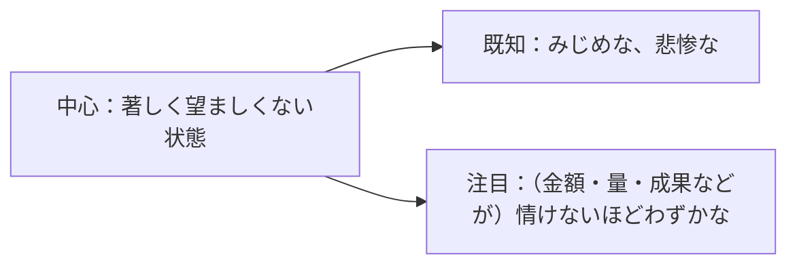


---

## 3042. outlook

- **品詞**：noun
- **発音**：/ˈaʊtlʊk/
- **候補ID**：`ev-05751-ai-01`（index: 5751）

<small>よく知られている意味：物事の見方</small>

### 見落としやすい意味

**今後の見通し、将来の見込み**

**例文**：The economic outlook has improved this year.

**和訳**：今年、経済の先行きは改善した。

**コアイメージ**：outlook は外へ目を向けたときに見える眺めを出発点とする。視線を未来に向ければ、これからどうなるかという見通しになる。

**図**

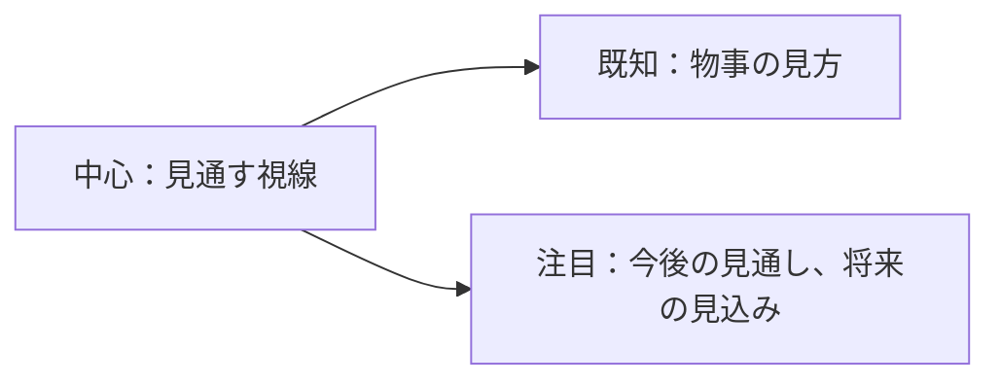

**重要語法**：`economic outlook`


---

## 3043. outlook

- **品詞**：noun
- **発音**：/ˈaʊtlʊk/
- **候補ID**：`ev-05751-noun-01`（index: 5751）

<small>よく知られている意味：将来の見通し</small>

### 見落としやすい意味

**物事を見る立場、考え方・ものの見方**

**例文**：Her outlook on education changed after the trip.

**和訳**：旅行の後、彼女の教育に対する考え方は変わった。

**コアイメージ**：outlook は何を見るかだけでなく、どんな立場から見るかにも関わる。未来の予測ではなく、物事に向ける考え方を指すこともある。

**図**

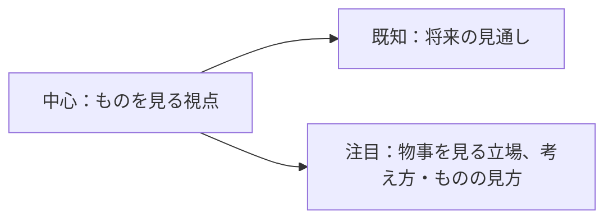

**重要語法**：`outlook on life`


---

## 3044. overthrow

- **品詞**：verb
- **発音**：/ˌoʊvərˈθroʊ/
- **候補ID**：`ev-05752-verb-01`（index: 5752）

<small>よく知られている意味：政権を打倒する</small>

### 見落としやすい意味

**（従来の判断や判決などを）覆す**

**例文**：New evidence helped overthrow the earlier ruling.

**和訳**：新たな証拠が以前の判決を覆す助けとなった。

**コアイメージ**：overthrow の中心には、いったん成立していたものを倒す動きがある。倒す対象が政権ではなく判断や判決になると、法的判断を覆す意味になる。

**図**

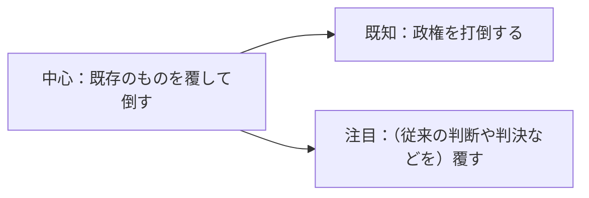


---

## 3045. overturn

- **品詞**：verb
- **発音**：/ˌoʊvərˈtɜːrn/
- **候補ID**：`ev-05753-verb-01`（index: 5753）

<small>よく知られている意味：ひっくり返す</small>

### 見落としやすい意味

**判決・決定などを取り消し、覆す**

**例文**：The court overturned the decision.

**和訳**：裁判所はその決定を覆した。

**コアイメージ**：overturn は物をひっくり返す動きから、決定の効力を逆転させる意味へ広がる。法律や審査の文脈では、判断の取り消しを表す。

**図**

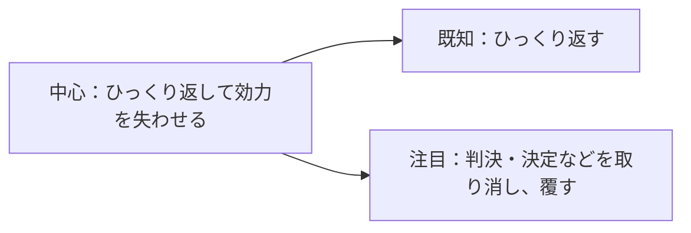

**重要語法**：`overturn a verdict`


---

## 3046. payoff

- **品詞**：noun
- **発音**：/ˈpeɪɔːf/
- **候補ID**：`ev-05755-ai-01`（index: 5755）

<small>よく知られている意味：努力の成果、報い</small>

### 見落としやすい意味

**賄賂、口止め料などの不正な支払い**

**例文**：The investigation revealed a payoff to an official.

**和訳**：調査によって役人への不正な金銭の支払いが発覚した。

**コアイメージ**：payoff は何らかの結果を得るための支払いを指すことがある。正当な成果だけでなく、不正に相手を動かすための金銭にも使われる。

**図**

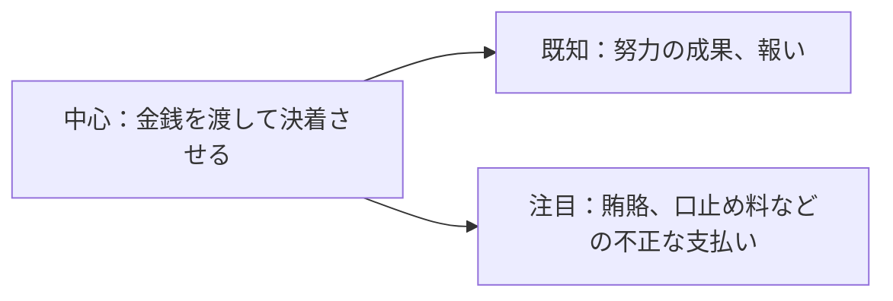


---

## 3047. payoff

- **品詞**：noun
- **発音**：/ˈpeɪɔːf/
- **候補ID**：`ev-05755-noun-01`（index: 5755）

<small>よく知られている意味：不正な支払い、口止め料</small>

### 見落としやすい意味

**努力・行動の成果、報い**

**例文**：All those extra hours finally had a payoff.

**和訳**：あの長時間の追加作業がついに報われた。

**コアイメージ**：payoff は行動の結果として得られるものを表す。金銭の支払いに限らず、努力の成果や見返りを表せる。

**図**

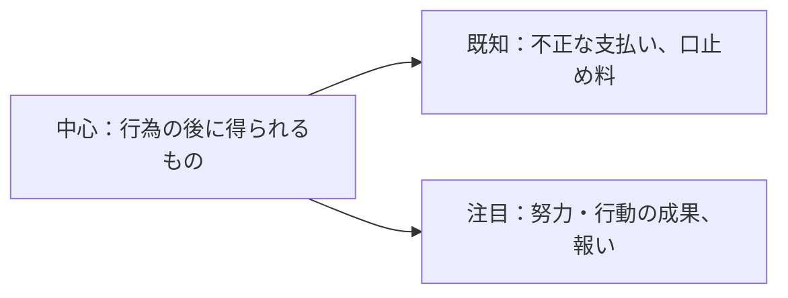

**重要語法**：`the payoff for hard work`


---

## 3048. preclude

- **品詞**：construction
- **発音**：/prɪˈkluːd/
- **候補ID**：`ev-05758-ai-01`（index: 5758）

<small>よく知られている意味：妨げる、排除する</small>

### 見落としやすい意味

**preclude A from doing / preclude doing：〜が…するのを妨げる**

**例文**：The injury precluded her from joining the race.

**和訳**：そのけがのため、彼女はレースに参加できなかった。

**コアイメージ**：preclude はある出来事が起こる可能性をあらかじめ閉ざすイメージを持つ。preclude A from doing では、A が行動する道を塞ぐ形になる。

**図**

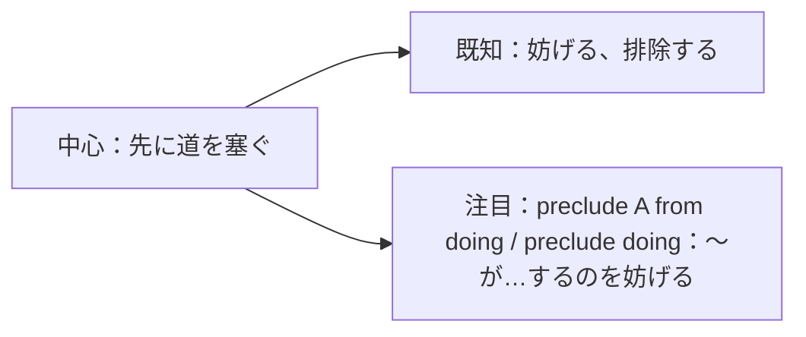

**重要語法**：`preclude A from doing`、`preclude doing`


---

## 3049. redeem

- **品詞**：verb
- **発音**：/rɪˈdiːm/
- **候補ID**：`ev-05761-ai-01`（index: 5761）

<small>よく知られている意味：名誉を回復する</small>

### 見落としやすい意味

**（引換券・ポイントなどを）商品や金銭に交換する**

**例文**：You can redeem the voucher for a free meal.

**和訳**：その引換券を無料の食事と交換できる。

**コアイメージ**：redeem には、何かを差し出して価値を取り戻す感覚がある。引換券の場合は券に対応する商品やサービスを受け取ることを意味する。

**図**

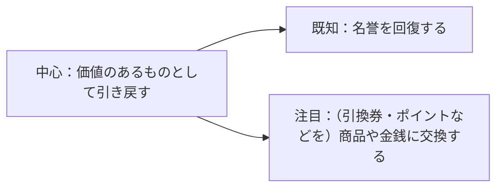

**重要語法**：`redeem a voucher for a gift`


---

## 3050. redeem

- **品詞**：verb
- **発音**：/rɪˈdiːm/
- **候補ID**：`ev-05761-verb-01`（index: 5761）

<small>よく知られている意味：引換券を交換する</small>

### 見落としやすい意味

**名誉・価値・評価を回復させる**

**例文**：Her final performance redeemed an otherwise weak season.

**和訳**：彼女の最後の演技は、それまで不調だったシーズンの評価を取り戻した。

**コアイメージ**：redeem は失われた価値を回復する動きを表す。人の名誉や評価について使えば、失点を取り返す意味になる。

**図**

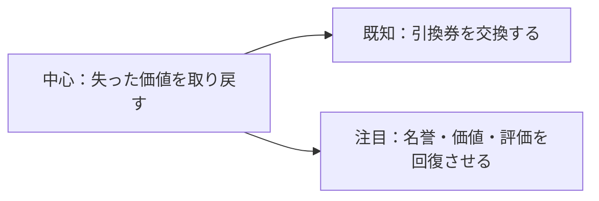

**重要語法**：`redeem oneself`


---

## 3051. salute

- **品詞**：verb
- **発音**：/səˈluːt/
- **候補ID**：`ev-05763-verb-01`（index: 5763）

<small>よく知られている意味：敬礼する</small>

### 見落としやすい意味

**功績・行動を称賛し敬意を示す**

**例文**：We salute the volunteers for their courage.

**和訳**：私たちはボランティアたちの勇気をたたえる。

**コアイメージ**：salute の基本は相手への敬意を示すことにある。軍隊の敬礼だけでなく、言葉で功績を称賛することも表す。

**図**

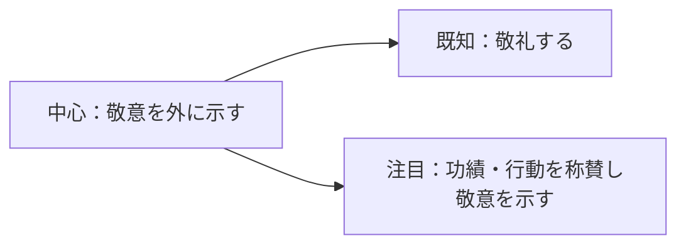

**重要語法**：`salute someone for something`


---

## 3052. soak

- **品詞**：phrasal verb
- **発音**：/soʊk/
- **候補ID**：`ev-05767-ai-01`（index: 5767）

<small>よく知られている意味：液体に浸す</small>

### 見落としやすい意味

**soak up：情報・知識・雰囲気などを吸収する**

**例文**：She soaked up every detail of the lecture.

**和訳**：彼女は講義の細部まで吸収した。

**コアイメージ**：soak は液体を十分に吸い込む様子を表す。知識や雰囲気を心の中へ取り込む場合にも soak up が使える。

**図**

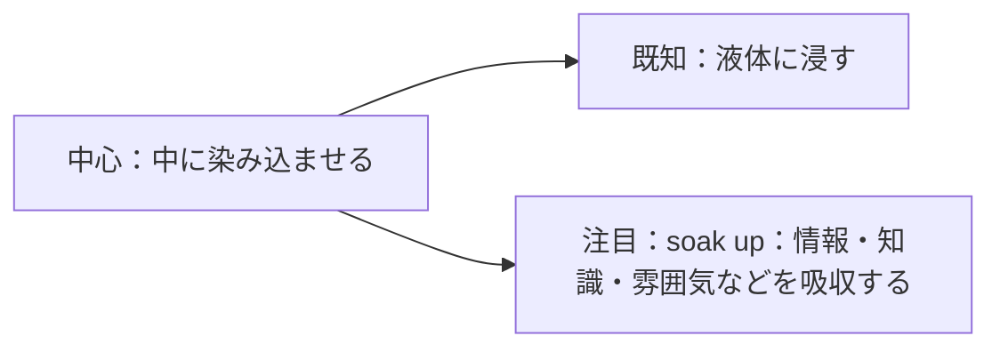

**重要語法**：`soak up information`、`soak up the atmosphere`


---

## 3053. soak

- **品詞**：verb
- **発音**：/soʊk/
- **候補ID**：`ev-05767-ai-02`（index: 5767）

<small>よく知られている意味：水に浸す</small>

### 見落としやすい意味

**（人から）法外な料金・金銭を取る**

**例文**：The hotel soaked tourists for basic services.

**和訳**：そのホテルは基本的なサービスにも観光客から法外な料金を取った。

**コアイメージ**：soak には、口語で人から多額の金を取る別の用法がある。水に浸す意味と無理に結び付けず、金銭の文脈で別義と判断する。

**図**

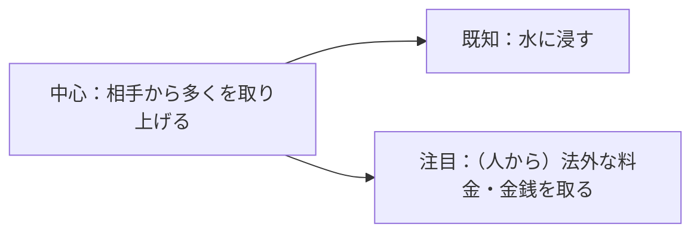

**重要語法**：`soak someone for an amount`


---

## 3054. tapestry

- **品詞**：noun
- **発音**：/ˈtæpəstri/
- **候補ID**：`ev-05770-noun-01`（index: 5770）

<small>よく知られている意味：壁掛け織物</small>

### 見落としやすい意味

**複雑な要素が織り合わさった全体像**

**例文**：The novel presents a tapestry of different lives.

**和訳**：その小説はさまざまな人生が織り合わさった全体像を描いている。

**コアイメージ**：tapestry は多くの糸が織り合わさった布を指す。比喩では、多様な出来事や人間関係が結び付いた複雑な全体を表す。

**図**

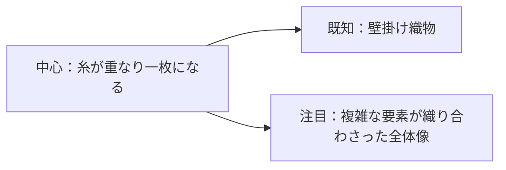

**重要語法**：`a rich tapestry of experiences`


---

## 3055. unspoiled

- **品詞**：adjective
- **発音**：/ˌʌnˈspɔɪld/
- **候補ID**：`ev-05775-adj-01`（index: 5775）

<small>よく知られている意味：傷んでいない</small>

### 見落としやすい意味

**（自然・景観が）人の手で損なわれず、ありのままの美しさを保った**

**例文**：We walked through unspoiled countryside.

**和訳**：私たちは手つかずの美しさが残る田園地帯を歩いた。

**コアイメージ**：unspoiled はよい状態が壊されていないことを示す。自然について使うと、人為的な開発などによって景観が損なわれていないことを表す。

**図**

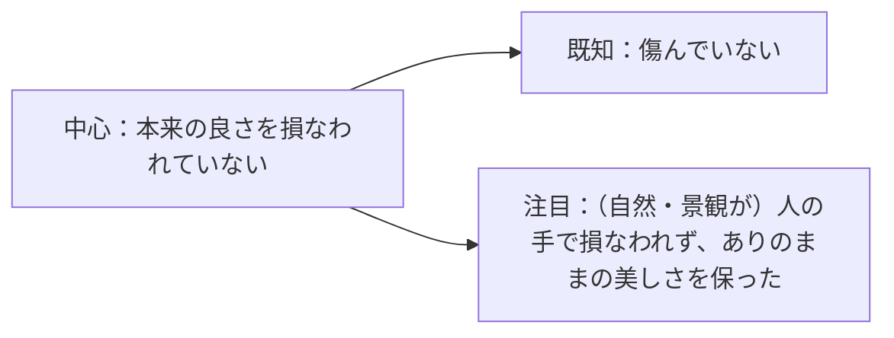

**重要語法**：`unspoiled nature`


---

## 3056. unspoiled

- **品詞**：adjective
- **発音**：/ˌʌnˈspɔɪld/
- **候補ID**：`ev-05775-adj-02`（index: 5775）

<small>よく知られている意味：傷んでいない、損なわれていない</small>

### 見落としやすい意味

**（人が）甘やかされておらず、わがままになっていない**

**例文**：Despite the attention, the young actor remained unspoiled.

**和訳**：注目を集めても、その若い俳優は甘やかされてわがままになることがなかった。

**コアイメージ**：spoil には物をだめにする意味と、人を甘やかす意味がある。unspoiled が人を修飾すると、甘やかしで性格が損なわれていないことを示す。

**図**

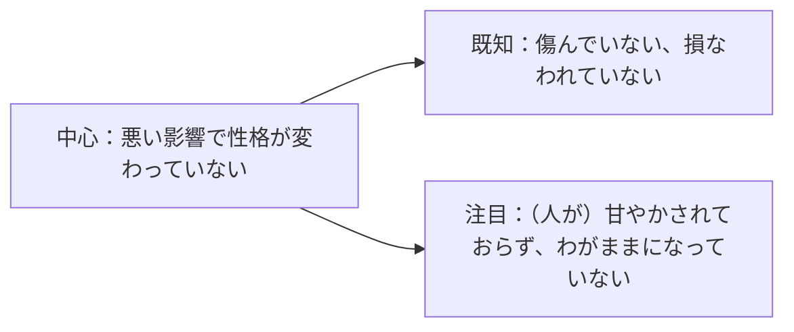


---

## 3057. vacuum

- **品詞**：idiom
- **発音**：/ˈvækjuːm/
- **候補ID**：`ev-05778-ai-01`（index: 5778）

<small>よく知られている意味：真空</small>

### 見落としやすい意味

**power vacuum：権力・指導力の空白状態**

**例文**：The leader's sudden resignation created a power vacuum.

**和訳**：指導者の突然の辞任によって権力の空白が生じた。

**コアイメージ**：vacuum は何もない空間を表す。power vacuum では権力を担う人や組織が不在になった状態を指す。

**図**

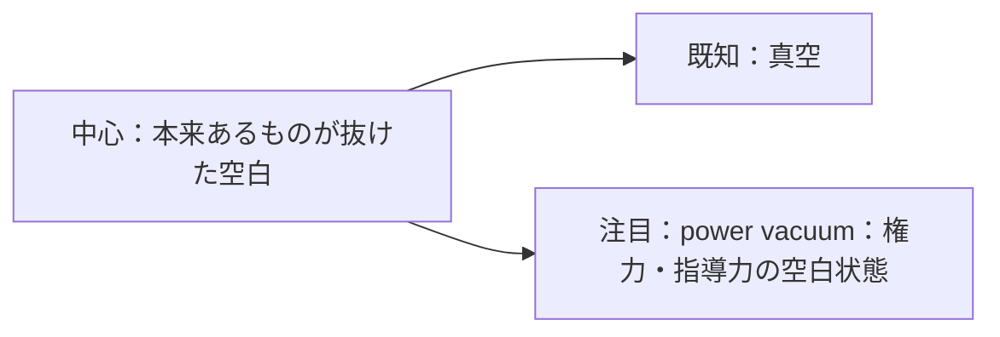

**重要語法**：`power vacuum`


---

## 3058. vain

- **品詞**：adjective
- **発音**：/veɪn/
- **候補ID**：`ev-05779-adj-01`（index: 5779）

<small>よく知られている意味：うぬぼれた</small>

### 見落としやすい意味

**無駄に終わる、成果のない**

**例文**：Their attempts to change the rule were vain.

**和訳**：規則を変えようとする彼らの試みは無駄に終わった。

**コアイメージ**：vain には「実質がない」という感覚がある。人を修飾すると虚栄心、努力を修飾すると成果がないことを表す。

**図**

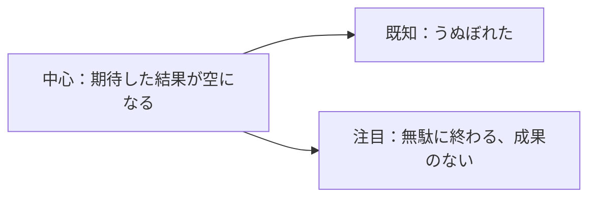

**重要語法**：`in vain`


---

## 3059. verge

- **品詞**：noun
- **発音**：/vɜːrdʒ/
- **候補ID**：`ev-05780-noun-01`（index: 5780）

<small>よく知られている意味：瀬戸際、間際</small>

### 見落としやすい意味

**（英国英語）道路脇の草地・路肩**

**例文**：Wildflowers grew along the roadside verge.

**和訳**：道端の草地に野の花が咲いていた。

**コアイメージ**：verge の基本像は物事の縁や端である。道路について使うと、車道の脇にある草地や路肩を意味することがある。

**図**

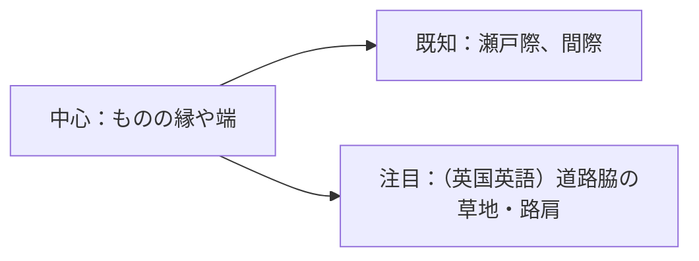

**重要語法**：`roadside verge（主に英国英語）`


---

## 3060. verge

- **品詞**：verb
- **発音**：/vɜːrdʒ/
- **候補ID**：`ev-05780-verb-01`（index: 5780）

<small>よく知られている意味：瀬戸際、間際</small>

### 見落としやすい意味

**（好ましくない状態などに）近づく、～になりかける**

**例文**：His remarks verged on an insult.

**和訳**：彼の発言は侮辱に近いものだった。

**コアイメージ**：verge は境界のすぐ近くという意味を持つ。動詞 verge on では、ある性質や状態にほとんど達していることを表す。

**図**

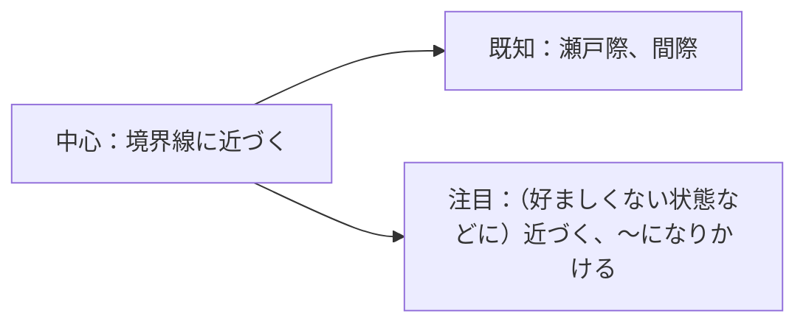

**重要語法**：`verge on something`


---

## 3061. yen

- **品詞**：noun
- **発音**：/jen/
- **候補ID**：`ev-05782-noun-01`（index: 5782）

<small>よく知られている意味：日本の通貨「円」</small>

### 見落としやすい意味

**強い憧れ、切望**

**例文**：She has a yen for adventure.

**和訳**：彼女は冒険を強く望んでいる。

**コアイメージ**：yen は通貨名とは別に、何かへの強い欲求を表す名詞でもある。この二つは別の語義として覚え、have a yen for の形を手掛かりにする。

**図**

```mermaid
flowchart LR
    A["中心：強く引かれる気持ち"]
    B["既知：日本の通貨「円」"]
    C["注目：強い憧れ、切望"]
    A --> B
    A --> C
```

**重要語法**：`have a yen for something`


---

## 3062. notebook

- **品詞**：noun
- **発音**：/ˈnoʊtbʊk/
- **候補ID**：`ev-05784-noun-01`（index: 5784）

<small>よく知られている意味：紙のノート</small>

### 見落としやすい意味

**ノート型の小型携帯パソコン**

**例文**：He opened his notebook to check the presentation.

**和訳**：彼は発表内容を確認するためノート型パソコンを開いた。

**コアイメージ**：notebook はもともと携帯できる記録用の冊子を表す。持ち運べる小型パソコンもその形や用途から notebook と呼ばれる。

**図**

```mermaid
flowchart LR
    A["中心：持ち運びながら記録するもの"]
    B["既知：紙のノート"]
    C["注目：ノート型の小型携帯パソコン"]
    A --> B
    A --> C
```

**重要語法**：`notebook computer`


---

## 3063. worn

- **品詞**：adjective
- **発音**：/wɔːrn/
- **候補ID**：`ev-05789-adj-01`（index: 5789）

<small>よく知られている意味：すり減った、使い古した</small>

### 見落としやすい意味

**疲れ切った、やつれた**

**例文**：After the long journey, everyone looked worn.

**和訳**：長旅の後、皆が疲れ切った様子だった。

**コアイメージ**：worn は使われ続けて消耗した状態を表す。物だけでなく人についても、体力を使い果たした様子を表せる。

**図**

```mermaid
flowchart LR
    A["中心：使われて消耗した状態"]
    B["既知：すり減った、使い古した"]
    C["注目：疲れ切った、やつれた"]
    A --> B
    A --> C
```

**重要語法**：`look worn`


---

## 3064. sour

- **品詞**：adjective
- **発音**：/saʊər/
- **候補ID**：`ev-05790-adj-01`（index: 5790）

<small>よく知られている意味：酸っぱい</small>

### 見落としやすい意味

**不機嫌な、険悪な**

**例文**：The argument left a sour mood in the room.

**和訳**：その口論のせいで部屋には険悪な空気が残った。

**コアイメージ**：sour は味としての酸っぱさから、不快でとげとげしい雰囲気へ広がる。人の表情や態度にも使える。

**図**

```mermaid
flowchart LR
    A["中心：不快な酸っぱさ"]
    B["既知：酸っぱい"]
    C["注目：不機嫌な、険悪な"]
    A --> B
    A --> C
```

**重要語法**：`a sour mood`


---

## 3065. sage

- **品詞**：adjective
- **発音**：/seɪdʒ/
- **候補ID**：`ev-05791-ai-01`（index: 5791）

<small>よく知られている意味：ハーブのセージ</small>

### 見落としやすい意味

**賢明な、思慮深い**

**例文**：Her grandfather gave her sage advice.

**和訳**：祖父は彼女に思慮深い助言を与えた。

**コアイメージ**：sage は形容詞では、経験や判断力に裏付けられた賢さを表す。植物名とは意味のつながりを無理に求めず、品詞で見分ける。

**図**

```mermaid
flowchart LR
    A["中心：経験から生まれる深い知恵"]
    B["既知：ハーブのセージ"]
    C["注目：賢明な、思慮深い"]
    A --> B
    A --> C
```

**重要語法**：`sage advice`


---

## 3066. sage

- **品詞**：noun
- **発音**：/seɪdʒ/
- **候補ID**：`ev-05791-noun-01`（index: 5791）

<small>よく知られている意味：賢者、賢明な</small>

### 見落としやすい意味

**香り付けに使うハーブ、セージ**

**例文**：She added fresh sage to the soup.

**和訳**：彼女はスープに新鮮なセージを加えた。

**コアイメージ**：sage は香り付けに使う植物の名前でもある。賢者を意味する名詞や賢明なという形容詞とは、文脈と用法で区別する。

**図**

```mermaid
flowchart LR
    A["中心：香りのある植物"]
    B["既知：賢者、賢明な"]
    C["注目：香り付けに使うハーブ、セージ"]
    A --> B
    A --> C
```

**重要語法**：`fresh sage`


---

## 3067. retrieve

- **品詞**：verb
- **発音**：/rɪˈtriːv/
- **候補ID**：`ev-05792-verb-01`（index: 5792）

<small>よく知られている意味：物を取り戻す</small>

### 見落としやすい意味

**（記憶から情報を）思い出す、呼び出す**

**例文**：I could not retrieve his name from memory.

**和訳**：私は彼の名前を記憶から思い出せなかった。

**コアイメージ**：retrieve は失ったものを取り戻すことを表す。対象が記憶中の情報なら、必要な知識を心の中から呼び出す意味になる。

**図**

```mermaid
flowchart LR
    A["中心：手元に取り戻す"]
    B["既知：物を取り戻す"]
    C["注目：（記憶から情報を）思い出す、呼び出す"]
    A --> B
    A --> C
```

**重要語法**：`retrieve information from memory`


---

## 3068. lease

- **品詞**：verb
- **発音**：/liːs/
- **候補ID**：`ev-05793-verb-01`（index: 5793）

<small>よく知られている意味：借りる</small>

### 見落としやすい意味

**契約して物件などを貸し出す**

**例文**：The owner leased the building to a new company.

**和訳**：所有者はその建物を新しい会社に貸した。

**コアイメージ**：lease は一定期間の利用に関する契約を表す。貸主を主語にすると、物件を相手に貸し出す意味になる。

**図**

```mermaid
flowchart LR
    A["中心：一定期間の利用権を契約で渡す"]
    B["既知：借りる"]
    C["注目：契約して物件などを貸し出す"]
    A --> B
    A --> C
```

**重要語法**：`lease A to B`


---

## 3069. lease

- **品詞**：verb
- **発音**：/liːs/
- **候補ID**：`ev-05793-verb-02`（index: 5793）

<small>よく知られている意味：貸す</small>

### 見落としやすい意味

**契約して物件などを借りる**

**例文**：The company leased office space from the landlord.

**和訳**：その会社は家主から事務所を借りた。

**コアイメージ**：lease は同じ契約を貸主と借主の両側から表せる。借主を主語にすると、物件を契約して借りる意味になる。

**図**

```mermaid
flowchart LR
    A["中心：一定期間の利用権を契約で得る"]
    B["既知：貸す"]
    C["注目：契約して物件などを借りる"]
    A --> B
    A --> C
```

**重要語法**：`lease A from B`


---

## 3070. converge

- **品詞**：verb
- **発音**：/kənˈvɜːrdʒ/
- **候補ID**：`ev-05799-verb-01`（index: 5799）

<small>よく知られている意味：一点に集まる</small>

### 見落としやすい意味

**（数列・関数などが）一定値に近づく、収束する**

**例文**：The sequence converges to zero.

**和訳**：その数列はゼロに収束する。

**コアイメージ**：converge は別々だったものが共通の一点に近づくことを表す。数学では数列などの値が一定の極限へ近づくことを指す。

**図**

```mermaid
flowchart LR
    A["中心：ばらつきが一つの値に近づく"]
    B["既知：一点に集まる"]
    C["注目：（数列・関数などが）一定値に近づく、収束する"]
    A --> B
    A --> C
```

**重要語法**：`converge to a limit`


---

## 3071. premier

- **品詞**：adjective
- **発音**：（表記省略）
- **候補ID**：`ev-05801-adj-01`（index: 5801）

<small>よく知られている意味：首相</small>

### 見落としやすい意味

**最高位の、第一級の**

**例文**：It is one of the country's premier research centers.

**和訳**：それはその国でも第一級の研究機関の一つだ。

**コアイメージ**：premier には最初・最高位という位置づけがある。形容詞として名詞を修飾すると、一流の、最上級のという評価を表す。

**図**

```mermaid
flowchart LR
    A["中心：最も重要な位置にある"]
    B["既知：首相"]
    C["注目：最高位の、第一級の"]
    A --> B
    A --> C
```

**重要語法**：`premier institution`


---

## 3072. premier

- **品詞**：noun
- **発音**：（表記省略）
- **候補ID**：`ev-05801-ai-01`（index: 5801）

<small>よく知られている意味：一流の、第一級の</small>

### 見落としやすい意味

**首相、（国・州などの）政府の長**

**例文**：The premier announced a new policy.

**和訳**：首相は新しい政策を発表した。

**コアイメージ**：premier は第一の地位を占める人にも使われる。政府の文脈では国や州の首相・首班を意味する名詞になる。

**図**

```mermaid
flowchart LR
    A["中心：最高位で率いる人物"]
    B["既知：一流の、第一級の"]
    C["注目：首相、（国・州などの）政府の長"]
    A --> B
    A --> C
```

**重要語法**：`the provincial premier`


---

## 3073. compel

- **品詞**：verb
- **発音**：/kəmˈpel/
- **候補ID**：`ev-05803-verb-01`（index: 5803）

<small>よく知られている意味：人に強制する</small>

### 見落としやすい意味

**（状況・事情が）〜を不可避にする、どうしても必要とする**

**例文**：The evidence compels a different conclusion.

**和訳**：その証拠からは別の結論を出さざるを得ない。

**コアイメージ**：compel は強い力である結果へ向かわせることを表す。力の源が人ではなく事情や証拠なら、ある判断を不可避にする意味になる。

**図**

```mermaid
flowchart LR
    A["中心：選択の余地をなくす"]
    B["既知：人に強制する"]
    C["注目：（状況・事情が）〜を不可避にする、どうしても必要とする"]
    A --> B
    A --> C
```

**重要語法**：`compel a conclusion`


---

## 3074. simulate

- **品詞**：verb
- **発音**：/ˈsɪmjəleɪt/
- **候補ID**：`ev-05804-verb-01`（index: 5804）

<small>よく知られている意味：模擬実験する</small>

### 見落としやすい意味

**実際にはない感情・状態などがあるふりをする**

**例文**：He simulated surprise when he heard the news.

**和訳**：彼はその知らせを聞いて驚いたふりをした。

**コアイメージ**：simulate は現実の状態を模して見せることを表す。コンピュータ上の再現だけでなく、実際にはない感情を装う場合にも使う。

**図**

```mermaid
flowchart LR
    A["中心：本物に似せて表現する"]
    B["既知：模擬実験する"]
    C["注目：実際にはない感情・状態などがあるふりをする"]
    A --> B
    A --> C
```

**重要語法**：`simulate surprise`


---

## 3075. butcher

- **品詞**：verb
- **発音**：/ˈbʊtʃər/
- **候補ID**：`ev-05817-ai-01`（index: 5817）

<small>よく知られている意味：肉屋、食肉をさばく</small>

### 見落としやすい意味

**（演奏・説明・仕事などを）ひどく下手に行い台無しにする**

**例文**：He butchered the speech by skipping several key lines.

**和訳**：彼は重要な部分を何か所も飛ばし、スピーチを台無しにした。

**コアイメージ**：butcher は肉を切り分ける仕事に関わる語である。比喩では、作業や発表をひどく下手に行い、元の良さを損ねる意味になる。

**図**

```mermaid
flowchart LR
    A["中心：対象を乱暴に扱って台無しにする"]
    B["既知：肉屋、食肉をさばく"]
    C["注目：（演奏・説明・仕事などを）ひどく下手に行い台無しにする"]
    A --> B
    A --> C
```

**重要語法**：`butcher a song`


---

## 3076. compute

- **品詞**：idiom
- **発音**：/kəmˈpjuːt/
- **候補ID**：`ev-05822-ai-01`（index: 5822）

<small>よく知られている意味：計算する</small>

### 見落としやすい意味

**does not compute：筋が通らない、納得できない**

**例文**：His explanation just doesn't compute.

**和訳**：彼の説明はどうにも筋が通らない。

**コアイメージ**：compute は情報を計算し処理することを表す。does not compute は、説明や状況が論理的につながらず納得できないという慣用表現になる。

**図**

```mermaid
flowchart LR
    A["中心：筋道を処理して答えを出す"]
    B["既知：計算する"]
    C["注目：does not compute：筋が通らない、納得できない"]
    A --> B
    A --> C
```

**重要語法**：`does not compute`


---

## 3077. confidential

- **品詞**：adjective
- **発音**：/ˌkɑːnfɪˈdenʃəl/
- **候補ID**：`ev-05823-adj-01`（index: 5823）

<small>よく知られている意味：秘密の、機密の</small>

### 見落としやすい意味

**（人が）個人的な秘密を預かる立場にある**

**例文**：She served as the director's confidential adviser.

**和訳**：彼女は理事長の個人的な秘密を預かる顧問を務めた。

**コアイメージ**：confidential は信頼に基づいて秘密を扱うことに関係する。情報を修飾すれば機密、人を修飾すれば秘密を託される立場を表す。

**図**

```mermaid
flowchart LR
    A["中心：他人に知られないよう信頼して託す"]
    B["既知：秘密の、機密の"]
    C["注目：（人が）個人的な秘密を預かる立場にある"]
    A --> B
    A --> C
```

**重要語法**：`confidential adviser`


---

## 3078. conglomerate

- **品詞**：noun
- **発音**：/kənˈɡlɑːmərət/
- **候補ID**：`ev-05824-noun-01`（index: 5824）

<small>よく知られている意味：塊、集合体</small>

### 見落としやすい意味

**異なる分野の企業が集まった複合企業体**

**例文**：The conglomerate owns companies in several industries.

**和訳**：その複合企業体は複数の業界の会社を所有している。

**コアイメージ**：conglomerate は異なるものが集まって一つになったものを指す。経済記事では、異なる事業を抱える企業グループを意味する。

**図**

```mermaid
flowchart LR
    A["中心：異質なものが一つに集まる"]
    B["既知：塊、集合体"]
    C["注目：異なる分野の企業が集まった複合企業体"]
    A --> B
    A --> C
```

**重要語法**：`business conglomerate`


---

## 3079. cutting

- **品詞**：adjective
- **発音**：/ˈkʌtɪŋ/
- **候補ID**：`ev-05826-adj-01`（index: 5826）

<small>よく知られている意味：切断する、切る</small>

### 見落としやすい意味

**言葉や態度が辛辣な、傷つけるような**

**例文**：Her cutting remark silenced the room.

**和訳**：彼女の辛辣な一言で部屋は静まり返った。

**コアイメージ**：cutting は切る動作を思わせる語である。言葉に使えば、鋭く相手の気持ちを傷つけるような厳しさを表す。

**図**

```mermaid
flowchart LR
    A["中心：刃物のように鋭く傷つける"]
    B["既知：切断する、切る"]
    C["注目：言葉や態度が辛辣な、傷つけるような"]
    A --> B
    A --> C
```

**重要語法**：`cutting remark`


---

## 3080. cutting

- **品詞**：noun
- **発音**：/ˈkʌtɪŋ/
- **候補ID**：`ev-05826-ai-01`（index: 5826）

<small>よく知られている意味：辛辣な、鋭い</small>

### 見落としやすい意味

**（植物を増やすための）挿し木・切り枝**

**例文**：She grew the plant from a cutting.

**和訳**：彼女はその植物を挿し木から育てた。

**コアイメージ**：cutting は切り取られたものを指す名詞にもなる。園芸では、そこから新しい植物を育てるための切り枝を意味する。

**図**

```mermaid
flowchart LR
    A["中心：切り取って新しい株を育てる"]
    B["既知：辛辣な、鋭い"]
    C["注目：（植物を増やすための）挿し木・切り枝"]
    A --> B
    A --> C
```

**重要語法**：`take a cutting`


---

## 3081. hopeful

- **品詞**：noun
- **発音**：/ˈhoʊpfəl/
- **候補ID**：`ev-05831-noun-01`（index: 5831）

<small>よく知られている意味：希望に満ちた</small>

### 見落としやすい意味

**有望な候補者・志望者**

**例文**：The young hopeful reached the final round.

**和訳**：その若い有望選手は決勝ラウンドに進んだ。

**コアイメージ**：hopeful は希望や期待のある状態を表す。名詞になると、成功を期待されている候補者や志望者を指す。

**図**

```mermaid
flowchart LR
    A["中心：将来の成功が期待される人"]
    B["既知：希望に満ちた"]
    C["注目：有望な候補者・志望者"]
    A --> B
    A --> C
```

**重要語法**：`a presidential hopeful`


---

## 3082. inflate

- **品詞**：verb
- **発音**：/ɪnˈfleɪt/
- **候補ID**：`ev-05834-verb-01`（index: 5834）

<small>よく知られている意味：空気を入れて膨らませる</small>

### 見落としやすい意味

**数字・価格・成果などを実態以上に大きく見せる、誇張する**

**例文**：The firm inflated its sales figures.

**和訳**：その会社は売上高の数字を水増しした。

**コアイメージ**：inflate は物を膨らませる動きが基本である。数字や成果について使えば、実際以上に大きく見せる意味になる。

**図**

```mermaid
flowchart LR
    A["中心：実際以上に大きく膨らませる"]
    B["既知：空気を入れて膨らませる"]
    C["注目：数字・価格・成果などを実態以上に大きく見せる、誇張する"]
    A --> B
    A --> C
```

**重要語法**：`inflate figures`


---

## 3083. maturity

- **品詞**：noun
- **発音**：/məˈtʃʊrəti/
- **候補ID**：`ev-05837-noun-01`（index: 5837）

<small>よく知られている意味：成熟、円熟</small>

### 見落としやすい意味

**（債券・借入金などの）満期、償還期限**

**例文**：The bond reaches maturity next June.

**和訳**：その債券は来年6月に満期を迎える。

**コアイメージ**：maturity はあるものが成熟した段階に達することを表す。金融では、借りた資金などを返済する期限に達することをいう。

**図**

```mermaid
flowchart LR
    A["中心：十分な時期に達する"]
    B["既知：成熟、円熟"]
    C["注目：（債券・借入金などの）満期、償還期限"]
    A --> B
    A --> C
```

**重要語法**：`reach maturity`


---

## 3084. needy

- **品詞**：adjective
- **発音**：/ˈniːdi/
- **候補ID**：`ev-05839-adj-01`（index: 5839）

<small>よく知られている意味：貧困に苦しむ</small>

### 見落としやすい意味

**（人が）周囲の愛情や関心を過度に求める**

**例文**：He can become needy when he feels ignored.

**和訳**：彼は無視されていると感じると、人の関心を過度に求めることがある。

**コアイメージ**：needy は何かが不足し、それを強く必要とする状態を表す。金銭だけでなく、愛情や注意を求めすぎる態度にも使われる。

**図**

```mermaid
flowchart LR
    A["中心：他者からの支えを強く必要とする"]
    B["既知：貧困に苦しむ"]
    C["注目：（人が）周囲の愛情や関心を過度に求める"]
    A --> B
    A --> C
```


---

## 3085. outright

- **品詞**：adverb
- **発音**：/ˈaʊtraɪt/
- **候補ID**：`ev-05844-adv-01`（index: 5844）

<small>よく知られている意味：完全な、あからさまな</small>

### 見落としやすい意味

**全面的に、徹底的に**

**例文**：The committee rejected the proposal outright.

**和訳**：委員会はその提案を全面的に拒否した。

**コアイメージ**：outright は部分的・条件付きでないことを表す。動詞を修飾すると、全面的に、きっぱりとという程度を示す。

**図**

```mermaid
flowchart LR
    A["中心：一切の留保なしに"]
    B["既知：完全な、あからさまな"]
    C["注目：全面的に、徹底的に"]
    A --> B
    A --> C
```

**重要語法**：`reject outright`


---

## 3086. outright

- **品詞**：adjective
- **発音**：/ˈaʊtraɪt/
- **候補ID**：`ev-05844-ai-01`（index: 5844）

<small>よく知られている意味：全面的に、完全に</small>

### 見落としやすい意味

**完全な、まったくの、無条件の**

**例文**：It was an outright failure.

**和訳**：それは完全な失敗だった。

**コアイメージ**：outright は名詞の前では形容詞として働く。程度や性質に一切の留保がないことを強調する。

**図**

```mermaid
flowchart LR
    A["中心：隠れた条件や例外がない"]
    B["既知：全面的に、完全に"]
    C["注目：完全な、まったくの、無条件の"]
    A --> B
    A --> C
```

**重要語法**：`outright failure`


---

## 3087. patent

- **品詞**：adjective
- **発音**：（表記省略）
- **候補ID**：`ev-05846-adj-01`（index: 5846）

<small>よく知られている意味：特許</small>

### 見落としやすい意味

**明白な、疑いようのない**

**例文**：The report contained a patent error.

**和訳**：その報告書には明白な誤りがあった。

**コアイメージ**：patent は特許を指す語としてよく知られるが、形容詞では明らかに見えることを表す。意味のつながりを無理に作らず、文脈と品詞で区別する。

**図**

```mermaid
flowchart LR
    A["中心：隠れずはっきり見える"]
    B["既知：特許"]
    C["注目：明白な、疑いようのない"]
    A --> B
    A --> C
```

**重要語法**：`patent error`


---

## 3088. penetrate

- **品詞**：verb
- **発音**：/ˈpenətreɪt/
- **候補ID**：`ev-05847-verb-01`（index: 5847）

<small>よく知られている意味：突き通す、貫通する</small>

### 見落としやすい意味

**（事情・意味などを）理解する、見抜く**

**例文**：She struggled to penetrate the meaning of the poem.

**和訳**：彼女はその詩の意味を理解するのに苦労した。

**コアイメージ**：penetrate は外側を越えて奥へ入ることを表す。情報や意味について使えば、表面の言葉を越えて本質を見抜く意味になる。

**図**

```mermaid
flowchart LR
    A["中心：表面を越えて内部へ届く"]
    B["既知：突き通す、貫通する"]
    C["注目：（事情・意味などを）理解する、見抜く"]
    A --> B
    A --> C
```

**重要語法**：`penetrate the meaning`


---

## 3089. skeleton

- **品詞**：idiom
- **発音**：/ˈskelɪtən/
- **候補ID**：`ev-05855-idiom-01`（index: 5855）

<small>よく知られている意味：骸骨</small>

### 見落としやすい意味

**a skeleton in the closet：隠しておきたい過去の不名誉な秘密**

**例文**：Every family has a skeleton in the closet.

**和訳**：どの家庭にも人に知られたくない秘密がある。

**コアイメージ**：skeleton は本来、骨格を表す。a skeleton in the closet はそれとは別に、隠しておきたい過去の秘密を表す定型的な比喩である。

**図**

```mermaid
flowchart LR
    A["中心：人目につかない場所に隠す"]
    B["既知：骸骨"]
    C["注目：a skeleton in the closet：隠しておきたい過去の不名誉な秘密"]
    A --> B
    A --> C
```

**重要語法**：`a skeleton in the closet`


---

## 3090. skeleton

- **品詞**：noun
- **発音**：/ˈskelɪtən/
- **候補ID**：`ev-05855-noun-01`（index: 5855）

<small>よく知られている意味：骸骨、骨格</small>

### 見落としやすい意味

**組織・計画などの最低限の枠組み、骨組みだけの状態**

**例文**：The team presented a skeleton of its plan.

**和訳**：そのチームは計画の大まかな骨組みを示した。

**コアイメージ**：skeleton は体を支える骨格である。計画や組織に使うと、詳細を付ける前の最低限の構造を表す。

**図**

```mermaid
flowchart LR
    A["中心：必要な部分だけを残した構造"]
    B["既知：骸骨、骨格"]
    C["注目：組織・計画などの最低限の枠組み、骨組みだけの状態"]
    A --> B
    A --> C
```

**重要語法**：`a skeleton plan`


---

## 3091. surgical

- **品詞**：adjective
- **発音**：/ˈsɜːrdʒɪkəl/
- **候補ID**：`ev-05858-adj-01`（index: 5858）

<small>よく知られている意味：外科手術の</small>

### 見落としやすい意味

**（作業・判断などが）外科手術のように精密な**

**例文**：The team made surgical changes to the design.

**和訳**：チームは設計に的を絞った精密な修正を加えた。

**コアイメージ**：surgical は外科手術に関わる語である。比喩では、余計な部分に触れず正確に狙いを定める作業を表す。

**図**

```mermaid
flowchart LR
    A["中心：必要な箇所に正確に手を加える"]
    B["既知：外科手術の"]
    C["注目：（作業・判断などが）外科手術のように精密な"]
    A --> B
    A --> C
```

**重要語法**：`surgical precision`


---

## 3092. tabs

- **品詞**：idiom
- **発音**：/tæbz/
- **候補ID**：`ev-05861-ai-01`（index: 5861）

<small>よく知られている意味：タブ、つまみ</small>

### 見落としやすい意味

**keep tabs on：〜の動向を継続的に把握する**

**例文**：We kept tabs on the storm's progress.

**和訳**：私たちは嵐の進み具合を継続して把握していた。

**コアイメージ**：tab には記録や勘定に関わる用法がある。keep tabs on は相手の状況を続けて確認し、動向を把握する慣用句である。

**図**

```mermaid
flowchart LR
    A["中心：記録を継続して手元に置く"]
    B["既知：タブ、つまみ"]
    C["注目：keep tabs on：〜の動向を継続的に把握する"]
    A --> B
    A --> C
```

**重要語法**：`keep tabs on someone or something`


---

## 3093. tin

- **品詞**：noun
- **発音**：/tɪn/
- **候補ID**：`ev-05863-ai-01`（index: 5863）

<small>よく知られている意味：金属のスズ</small>

### 見落としやすい意味

**（英国英語）金属製の缶、缶詰**

**例文**：She opened a tin of biscuits.

**和訳**：彼女はビスケットの缶を開けた。

**コアイメージ**：tin は金属のスズを表す。特に英国英語では、金属でできた容器や缶詰も tin と呼ぶ。

**図**

```mermaid
flowchart LR
    A["中心：金属の材質から容器へ"]
    B["既知：金属のスズ"]
    C["注目：（英国英語）金属製の缶、缶詰"]
    A --> B
    A --> C
```

**重要語法**：`a tin of biscuits（主に英国英語）`


---

## 3094. volatile

- **品詞**：adjective
- **発音**：/ˈvɑːlətəl/
- **候補ID**：`ev-05868-adj-01`（index: 5868）

<small>よく知られている意味：揮発性の</small>

### 見落としやすい意味

**情勢・感情が急変しやすい、不安定な**

**例文**：The region remains politically volatile.

**和訳**：その地域の政治情勢は依然として不安定だ。

**コアイメージ**：volatile は気化しやすい物質の性質を表す。状況や感情については、急に変化しやすく予測しにくい状態をいう。

**図**

```mermaid
flowchart LR
    A["中心：変わりやすく安定しない"]
    B["既知：揮発性の"]
    C["注目：情勢・感情が急変しやすい、不安定な"]
    A --> B
    A --> C
```

**重要語法**：`volatile situation`


---

## 3095. bracket

- **品詞**：noun
- **発音**：/ˈbrækɪt/
- **候補ID**：`ev-05871-ai-01`（index: 5871）

<small>よく知られている意味：括弧、支持具</small>

### 見落としやすい意味

**tax bracket：所得に応じた課税区分**

**例文**：A higher tax bracket applies to part of her income.

**和訳**：彼女の所得の一部には、より高い税率区分が適用される。

**コアイメージ**：bracket は対象を一定の範囲にまとめるものを表す。tax bracket では所得の額に応じて分けた課税区分を指す。

**図**

```mermaid
flowchart LR
    A["中心：同じ範囲の中に収める"]
    B["既知：括弧、支持具"]
    C["注目：tax bracket：所得に応じた課税区分"]
    A --> B
    A --> C
```

**重要語法**：`tax bracket`


---

## 3096. bracket

- **品詞**：verb
- **発音**：/ˈbrækɪt/
- **候補ID**：`ev-05871-verb-01`（index: 5871）

<small>よく知られている意味：括弧、支持具</small>

### 見落としやすい意味

**同じ区分に入れる、ひとまとめに分類する**

**例文**：The study brackets these two groups together.

**和訳**：その研究はこの二つの集団を同じ区分にまとめている。

**コアイメージ**：bracket は複数の対象を一つの枠で扱うイメージを持つ。動詞では、同じグループに入れて分類する意味になる。

**図**

```mermaid
flowchart LR
    A["中心：共通の枠の中に入れる"]
    B["既知：括弧、支持具"]
    C["注目：同じ区分に入れる、ひとまとめに分類する"]
    A --> B
    A --> C
```

**重要語法**：`bracket A with B`


---

## 3097. broadly

- **品詞**：adverb
- **発音**：/ˈbrɔːdli/
- **候補ID**：`ev-05872-adv-01`（index: 5872）

<small>よく知られている意味：幅広く</small>

### 見落としやすい意味

**おおむね、概して、大筋では**

**例文**：Broadly speaking, the plan was successful.

**和訳**：大筋では、その計画は成功だった。

**コアイメージ**：broadly は広い範囲を扱うことを表す。議論の細部を除いて述べるときは、おおむね、大筋ではという意味になる。

**図**

```mermaid
flowchart LR
    A["中心：細部ではなく全体を捉える"]
    B["既知：幅広く"]
    C["注目：おおむね、概して、大筋では"]
    A --> B
    A --> C
```

**重要語法**：`broadly speaking`


---

## 3098. cosmopolitan

- **品詞**：noun
- **発音**：/ˌkɑːzməˈpɑːlɪtən/
- **候補ID**：`ev-05877-noun-01`（index: 5877）

<small>よく知られている意味：国際的な</small>

### 見落としやすい意味

**世界各地の文化に通じ、国際的な経験が豊富な人**

**例文**：The city attracted artists and cosmopolitans.

**和訳**：その都市には芸術家や国際経験の豊かな人々が集まった。

**コアイメージ**：cosmopolitan は世界の多様な文化に通じることを表す。名詞になると、そうした経験や視野を持つ人物を指す。

**図**

```mermaid
flowchart LR
    A["中心：国や文化の境界を越える"]
    B["既知：国際的な"]
    C["注目：世界各地の文化に通じ、国際的な経験が豊富な人"]
    A --> B
    A --> C
```


---

## 3099. embargo

- **品詞**：verb
- **発音**：/ɪmˈbɑːrɡoʊ/
- **候補ID**：`ev-05881-verb-01`（index: 5881）

<small>よく知られている意味：禁輸措置</small>

### 見落としやすい意味

**文書・情報の公表を禁止する**

**例文**：The publisher embargoed the report until Friday.

**和訳**：出版社は金曜日までその報告書の公表を禁じた。

**コアイメージ**：embargo は流通や公表を制限することを表す。物資の輸出入だけでなく、情報を一定時点まで公開しない取り決めにも使う。

**図**

```mermaid
flowchart LR
    A["中心：公開や流通を一時的に止める"]
    B["既知：禁輸措置"]
    C["注目：文書・情報の公表を禁止する"]
    A --> B
    A --> C
```

**重要語法**：`embargo a report until a date`


---

## 3100. familiarity

- **品詞**：noun
- **発音**：/fəˌmɪliˈærəti/
- **候補ID**：`ev-05884-noun-01`（index: 5884）

<small>よく知られている意味：親しみ、熟知</small>

### 見落としやすい意味

**相手との距離感を欠く不適切な親しさ、なれなれしさ**

**例文**：His excessive familiarity with new colleagues caused discomfort.

**和訳**：新しい同僚への彼のなれなれしすぎる態度は、不快感を与えた。

**コアイメージ**：familiarity は相手をよく知り親しんでいる状態を表す。度を越すと、礼儀や距離感を欠いたなれなれしさという否定的評価になる。

**図**

```mermaid
flowchart LR
    A["中心：親しさが適切な距離を越える"]
    B["既知：親しみ、熟知"]
    C["注目：相手との距離感を欠く不適切な親しさ、なれなれしさ"]
    A --> B
    A --> C
```

**重要語法**：`excessive familiarity`


---

## 3101. infect

- **品詞**：verb
- **発音**：/ɪnˈfekt/
- **候補ID**：`ev-05889-verb-01`（index: 5889）

<small>よく知られている意味：病気を感染させる</small>

### 見落としやすい意味

**思想・感情・考えなどを他人に伝染させる**

**例文**：Her excitement infected the whole class.

**和訳**：彼女の興奮はクラス全体に伝わった。

**コアイメージ**：infect は病気などが広がることを表す。比喩では、感情や考え方が周囲に伝わり影響を与える意味になる。

**図**

```mermaid
flowchart LR
    A["中心：影響が人から人へ広がる"]
    B["既知：病気を感染させる"]
    C["注目：思想・感情・考えなどを他人に伝染させる"]
    A --> B
    A --> C
```

**重要語法**：`infect someone with enthusiasm`


---

## 3102. median

- **品詞**：adjective
- **発音**：/ˈmiːdiən/
- **候補ID**：`ev-05891-adj-01`（index: 5891）

<small>よく知られている意味：中央値</small>

### 見落としやすい意味

**中心線に沿った、真ん中に位置する**

**例文**：A median strip separates the two directions of traffic.

**和訳**：中央分離帯が対向する二つの車線を分けている。

**コアイメージ**：median は中央に位置することを表す。統計の中央値だけでなく、道路などの中央の位置を表す形容詞にもなる。

**図**

```mermaid
flowchart LR
    A["中心：二つの側の真ん中にある"]
    B["既知：中央値"]
    C["注目：中心線に沿った、真ん中に位置する"]
    A --> B
    A --> C
```

**重要語法**：`median strip`


---

## 3103. metric

- **品詞**：noun
- **発音**：/ˈmetrɪk/
- **候補ID**：`ev-05892-noun-01`（index: 5892）

<small>よく知られている意味：メートル法の</small>

### 見落としやすい意味

**成果・進捗・品質などを測るための定量的な評価指標**

**例文**：Customer satisfaction is a key metric for the service.

**和訳**：顧客満足度はそのサービスの重要な評価指標だ。

**コアイメージ**：metric は測定に関わる語である。ビジネスや研究では成果を数値で確かめるための指標を指す。

**図**

```mermaid
flowchart LR
    A["中心：ものさしとして測る基準"]
    B["既知：メートル法の"]
    C["注目：成果・進捗・品質などを測るための定量的な評価指標"]
    A --> B
    A --> C
```

**重要語法**：`performance metric`


---

## 3104. reclaim

- **品詞**：verb
- **発音**：/rɪˈkleɪm/
- **候補ID**：`ev-05898-ai-01`（index: 5898）

<small>よく知られている意味：回収して再利用する</small>

### 見落としやすい意味

**（海・湿地などを）埋め立てて土地を造成する**

**例文**：The city plans to reclaim land from the sea.

**和訳**：その市は海を埋め立てて土地を造成する計画だ。

**コアイメージ**：reclaim は失われたものを再び利用できる状態にすることを表す。海や湿地については、埋め立てなどで土地を造成する意味になる。

**図**

```mermaid
flowchart LR
    A["中心：役に立つ土地として取り戻す"]
    B["既知：回収して再利用する"]
    C["注目：（海・湿地などを）埋め立てて土地を造成する"]
    A --> B
    A --> C
```

**重要語法**：`reclaim land from the sea`


---

## 3105. reclaim

- **品詞**：verb
- **発音**：/rɪˈkleɪm/
- **候補ID**：`ev-05898-verb-01`（index: 5898）

<small>よく知られている意味：取り戻す</small>

### 見落としやすい意味

**廃材などを回収し、再利用する**

**例文**：The factory reclaims materials from old batteries.

**和訳**：その工場は古い電池から材料を回収して再利用する。

**コアイメージ**：reclaim は失われそうな価値を取り戻すことを表す。廃材から使える資源を回収する場合もこの動詞を使う。

**図**

```mermaid
flowchart LR
    A["中心：使える価値を回復する"]
    B["既知：取り戻す"]
    C["注目：廃材などを回収し、再利用する"]
    A --> B
    A --> C
```

**重要語法**：`reclaim materials`


---

## 3106. rigid

- **品詞**：adjective
- **発音**：/ˈrɪdʒɪd/
- **候補ID**：`ev-05901-ai-01`（index: 5901）

<small>よく知られている意味：硬い、曲がらない</small>

### 見落としやすい意味

**（考え・制度・規則が）厳格で融通の利かない**

**例文**：The system has rigid rules that leave little room for exceptions.

**和訳**：その制度には例外をほとんど認めない厳格な規則がある。

**コアイメージ**：rigid は曲がらない硬さを表す。制度や考え方に使うと、柔軟に変えられず融通が利かないことを意味する。

**図**

```mermaid
flowchart LR
    A["中心：形や考えが簡単に変わらない"]
    B["既知：硬い、曲がらない"]
    C["注目：（考え・制度・規則が）厳格で融通の利かない"]
    A --> B
    A --> C
```

**重要語法**：`rigid rules`


---

## 3107. smear

- **品詞**：verb
- **発音**：/smɪr/
- **候補ID**：`ev-05903-verb-01`（index: 5903）

<small>よく知られている意味：汚れをこすり付ける</small>

### 見落としやすい意味

**悪評を流すなどして人を中傷する**

**例文**：The rumor was intended to smear her reputation.

**和訳**：そのうわさは彼女の評判を傷つけるためのものだった。

**コアイメージ**：smear は汚れなどを塗り広げる動作を表す。比喩では悪評を人に付け、評判を汚すことを意味する。

**図**

```mermaid
flowchart LR
    A["中心：汚れを塗り付ける"]
    B["既知：汚れをこすり付ける"]
    C["注目：悪評を流すなどして人を中傷する"]
    A --> B
    A --> C
```

**重要語法**：`smear someone's reputation`


---

## 3108. spiral

- **品詞**：idiom
- **発音**：/ˈspaɪrəl/
- **候補ID**：`ev-05905-ai-01`（index: 5905）

<small>よく知られている意味：らせん形</small>

### 見落としやすい意味

**spiral out of control：悪化が加速して制御不能になる**

**例文**：Costs began to spiral out of control.

**和訳**：費用は加速度的に増え、制御できなくなり始めた。

**コアイメージ**：spiral はらせん状に進む動きを表す。spiral out of control では、問題が次の問題を生み、悪化が止められなくなる状態を表す。

**図**

```mermaid
flowchart LR
    A["中心：悪化が連鎖して拡大する"]
    B["既知：らせん形"]
    C["注目：spiral out of control：悪化が加速して制御不能になる"]
    A --> B
    A --> C
```

**重要語法**：`spiral out of control`


---

## 3109. tack

- **品詞**：idiom
- **発音**：/tæk/
- **候補ID**：`ev-05908-idiom-01`（index: 5908）

<small>よく知られている意味：画びょう、仮縫い</small>

### 見落としやすい意味

**change tack：問題への対処方法・方針を変える**

**例文**：When the first plan failed, we changed tack.

**和訳**：最初の計画が失敗したので、私たちは方針を変えた。

**コアイメージ**：change tack は航海で進路の取り方を変えることに由来する表現である。比喩では目標への取り組み方を切り替える意味になる。

**図**

```mermaid
flowchart LR
    A["中心：進む方向を切り替える"]
    B["既知：画びょう、仮縫い"]
    C["注目：change tack：問題への対処方法・方針を変える"]
    A --> B
    A --> C
```

**重要語法**：`change tack`


---

## 3110. tense

- **品詞**：noun
- **発音**：/tens/
- **候補ID**：`ev-05909-noun-01`（index: 5909）

<small>よく知られている意味：緊張した</small>

### 見落としやすい意味

**動詞の時制**

**例文**：The sentence uses the past tense.

**和訳**：その文では過去時制が使われている。

**コアイメージ**：tense は形容詞では緊張を表すが、名詞では文法上の時間表現を指す。動詞の形で過去や現在などを示す仕組みである。

**図**

```mermaid
flowchart LR
    A["中心：動作が時間の中でどう位置づくか"]
    B["既知：緊張した"]
    C["注目：動詞の時制"]
    A --> B
    A --> C
```

**重要語法**：`past tense`、`present tense`


---

## 3111. thumb

- **品詞**：idiom
- **発音**：/θʌm/
- **候補ID**：`ev-05911-ai-01`（index: 5911）

<small>よく知られている意味：親指</small>

### 見落としやすい意味

**rule of thumb：経験に基づく大まかな目安、経験則**

**例文**：As a rule of thumb, save a copy before editing.

**和訳**：経験則として、編集する前にコピーを保存するとよい。

**コアイメージ**：rule of thumb は厳密な計算ではなく、経験に基づく簡便な目安を表す定型句である。親指を直訳しても意味が出ないので、まとまりで覚える。

**図**

```mermaid
flowchart LR
    A["中心：手軽に使える大まかな基準"]
    B["既知：親指"]
    C["注目：rule of thumb：経験に基づく大まかな目安、経験則"]
    A --> B
    A --> C
```

**重要語法**：`as a rule of thumb`


---

## 3112. thumb

- **品詞**：phrasal verb
- **発音**：/θʌm/
- **候補ID**：`ev-05911-ai-02`（index: 5911）

<small>よく知られている意味：親指</small>

### 見落としやすい意味

**thumb through：本・書類などをざっとめくる**

**例文**：She thumbed through the magazine in the waiting room.

**和訳**：彼女は待合室で雑誌をぱらぱらとめくった。

**コアイメージ**：thumb は親指を表す名詞だが、動詞では指を使ってページをめくる動きになる。through を伴うと、本や書類をざっと見ることを表す。

**図**

```mermaid
flowchart LR
    A["中心：指でページを次々と送る"]
    B["既知：親指"]
    C["注目：thumb through：本・書類などをざっとめくる"]
    A --> B
    A --> C
```

**重要語法**：`thumb through a book`


---

## 3113. treasury

- **品詞**：noun
- **発音**：/ˈtreʒəri/
- **候補ID**：`ev-05912-noun-01`（index: 5912）

<small>よく知られている意味：宝物庫</small>

### 見落としやすい意味

**財務省、財政を担当する政府機関**

**例文**：The Treasury announced changes to the budget.

**和訳**：財務省は予算の変更を発表した。

**コアイメージ**：treasury は財産を保管・管理する場所から、財政を担う組織へ意味が広がる。政府の文脈では財務省などの機関を指す。

**図**

```mermaid
flowchart LR
    A["中心：国家の財産を管理する場所や組織"]
    B["既知：宝物庫"]
    C["注目：財務省、財政を担当する政府機関"]
    A --> B
    A --> C
```

**重要語法**：`the Treasury`


---

## 3114. treasury

- **品詞**：noun
- **発音**：/ˈtreʒəri/
- **候補ID**：`ev-05912-noun-02`（index: 5912）

<small>よく知られている意味：財務省、宝物庫</small>

### 見落としやすい意味

**国庫、政府などが保有する資金**

**例文**：The emergency payments came from the national treasury.

**和訳**：緊急支出は国庫から賄われた。

**コアイメージ**：treasury は金銭を管理する場所や組織を表す。管理する機関ではなく、国が保有する資金そのものを指すこともある。

**図**

```mermaid
flowchart LR
    A["中心：国が保有・管理する資金"]
    B["既知：財務省、宝物庫"]
    C["注目：国庫、政府などが保有する資金"]
    A --> B
    A --> C
```

**重要語法**：`national treasury`


---

## 3115. whatsoever

- **品詞**：adverb
- **発音**：/ˌwʌtsoʊˈevər/
- **候補ID**：`ev-05915-adv-01`（index: 5915）

<small>よく知られている意味：何であれ</small>

### 見落としやすい意味

**（否定語句の後で）少しも〜ない、全く〜ないと強調する**

**例文**：There was no explanation whatsoever.

**和訳**：説明は一切なかった。

**コアイメージ**：whatsoever は否定語の後で、どんな種類も少しもないことを強調する。独立した疑問詞として読むのではなく、否定を強める働きに注目する。

**図**

```mermaid
flowchart LR
    A["中心：否定を一切の例外なしに強める"]
    B["既知：何であれ"]
    C["注目：（否定語句の後で）少しも〜ない、全く〜ないと強調する"]
    A --> B
    A --> C
```

**重要語法**：`no ... whatsoever`


---

## 3116. flea

- **品詞**：idiom
- **発音**：/fliː/
- **候補ID**：`ev-05919-ai-01`（index: 5919）

<small>よく知られている意味：ノミという虫</small>

### 見落としやすい意味

**flea market：のみの市、古物市**

**例文**：We found an old camera at a flea market.

**和訳**：私たちは古物市で古いカメラを見つけた。

**コアイメージ**：flea market は中古品や古物を売る市場を指す固定した表現である。flea 一語の「ノミ」から逐語訳せず、熟語全体で意味を取る。

**図**

```mermaid
flowchart LR
    A["中心：語の組み合わせで市場を指す"]
    B["既知：ノミという虫"]
    C["注目：flea market：のみの市、古物市"]
    A --> B
    A --> C
```

**重要語法**：`flea market`


---

## 3117. hop

- **品詞**：verb
- **発音**：/hɑːp/
- **候補ID**：`ev-05921-verb-01`（index: 5921）

<small>よく知られている意味：片足で跳ぶ</small>

### 見落としやすい意味

**飛行機・バスなどの乗り物で移動する**

**例文**：We hopped on a bus and went downtown.

**和訳**：私たちはバスに乗って街の中心部へ向かった。

**コアイメージ**：hop は軽く跳ぶ動きを表す。口語では乗り物にさっと乗ることや、短い移動をすることにも用いられる。

**図**

```mermaid
flowchart LR
    A["中心：軽快に乗り物で移動する"]
    B["既知：片足で跳ぶ"]
    C["注目：飛行機・バスなどの乗り物で移動する"]
    A --> B
    A --> C
```

**重要語法**：`hop on a bus`


---

## 3118. pole

- **品詞**：idiom
- **発音**：/poʊl/
- **候補ID**：`ev-05922-ai-01`（index: 5922）

<small>よく知られている意味：棒、地球の極</small>

### 見落としやすい意味

**poles apart：考えや性質が正反対である**

**例文**：Their views on the issue are poles apart.

**和訳**：その問題に対する二人の考えは正反対だ。

**コアイメージ**：地球の二つの極は互いに大きく離れている。poles apart はこの隔たりを比喩にして、意見や性質がまったく異なることを表す。

**図**

```mermaid
flowchart LR
    A["中心：正反対の端に位置する"]
    B["既知：棒、地球の極"]
    C["注目：poles apart：考えや性質が正反対である"]
    A --> B
    A --> C
```

**重要語法**：`be poles apart`


---

## 3119. jar

- **品詞**：verb
- **発音**：/dʒɑːr/
- **候補ID**：`ev-05923-verb-01`（index: 5923）

<small>よく知られている意味：瓶、つぼ</small>

### 見落としやすい意味

**考え方・様式などが調和しない、食い違う**

**例文**：The cheerful music jars with the serious scene.

**和訳**：陽気な音楽はその深刻な場面とちぐはぐだ。

**コアイメージ**：動詞 jar には不快な衝撃や違和感を生じさせる意味がある。jar with は二つのものが調和せず、食い違って感じられることを表す。

**図**

```mermaid
flowchart LR
    A["中心：周囲の調和を乱す"]
    B["既知：瓶、つぼ"]
    C["注目：考え方・様式などが調和しない、食い違う"]
    A --> B
    A --> C
```

**重要語法**：`jar with something`


---

## 3120. courtesy

- **品詞**：idiom
- **発音**：/ˈkɜːrtəsi/
- **候補ID**：`ev-05925-ai-01`（index: 5925）

<small>よく知られている意味：礼儀、丁寧さ</small>

### 見落としやすい意味

**courtesy of：〜の提供で、〜のおかげで**

**例文**：The drinks were provided courtesy of the local café.

**和訳**：飲み物は地元のカフェの提供だった。

**コアイメージ**：courtesy は他者への配慮や好意を表す。courtesy of は、誰の好意や提供によって実現したかを示す定型表現である。

**図**

```mermaid
flowchart LR
    A["中心：他者の好意によって受けられる"]
    B["既知：礼儀、丁寧さ"]
    C["注目：courtesy of：〜の提供で、〜のおかげで"]
    A --> B
    A --> C
```

**重要語法**：`courtesy of someone`


