# EasyVoca 完成教材｜Batch 040

> 対象 global_order: 3121–3200（全80件）
> 採用済み候補のみを教材化。candidate_id・index・採用語義は元データに対応。

## 01. trunk

- **品詞**：noun
- **発音**：/trʌŋk/
- <small>よく知られている意味：木の幹</small>

### 見落としやすい意味：（米語）自動車の後部荷物室、トランク

**例文**：She left her suitcase in the trunk of the car.

**和訳**：彼女はスーツケースを車のトランクに入れた。

**コアイメージ**：trunk は大きなものの中心となる太い部分を指す。車では荷物を入れる主要な収納部分の名称にもなった。

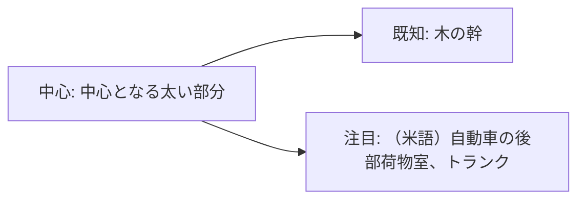

**重要語法**：`in the trunk of a car`

<small>index: 5926 / candidate_id: `ev-05926-ai-01` / global_order: 3121</small>

---

## 02. trunk

- **品詞**：noun
- **発音**：/trʌŋk/
- <small>よく知られている意味：木の幹</small>

### 見落としやすい意味：人間などの胴体

**例文**：The swimmer kept his trunk straight in the water.

**和訳**：その水泳選手は水中で胴体をまっすぐに保った。

**コアイメージ**：木の幹は枝を支える中心の部分である。人の体でも手足を除く中心部分を trunk と呼ぶ。

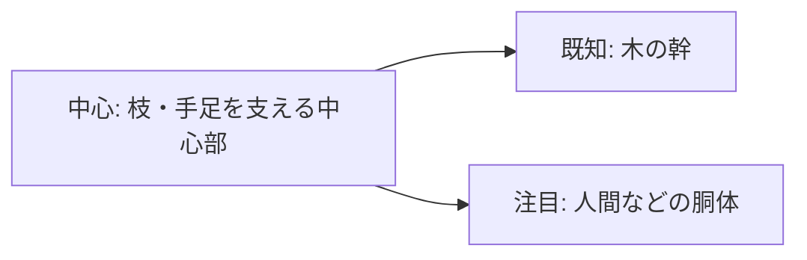

**重要語法**：`the trunk of the body`

<small>index: 5926 / candidate_id: `ev-05926-noun-01` / global_order: 3122</small>

---

## 03. madness

- **品詞**：noun
- **発音**：/ˈmædnəs/
- <small>よく知られている意味：狂気</small>

### 見落としやすい意味：非常に強い熱狂、抑えきれない興奮

**例文**：The crowd's madness for the new game surprised its creators.

**和訳**：新作ゲームへの観客の熱狂は、開発者たちを驚かせた。

**コアイメージ**：madness は理性を失ったような激しさを表す。実際の病気ではなく、熱中や興奮が極端に強いことにも使う。

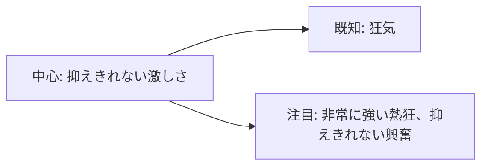

<small>index: 5928 / candidate_id: `ev-05928-noun-01` / global_order: 3123</small>

---

## 04. bolt

- **品詞**：phrasal verb
- **発音**：/boʊlt/
- <small>よく知られている意味：ボルト・留め金</small>

### 見落としやすい意味：bolt down：食事を急いでかき込む

**例文**：He bolted down his breakfast before leaving for school.

**和訳**：彼は学校へ出る前に朝食を急いでかき込んだ。

**コアイメージ**：bolt には勢いよく急に動く感覚がある。食べ物を一気に飲み込むように食べることも bolt down と言う。

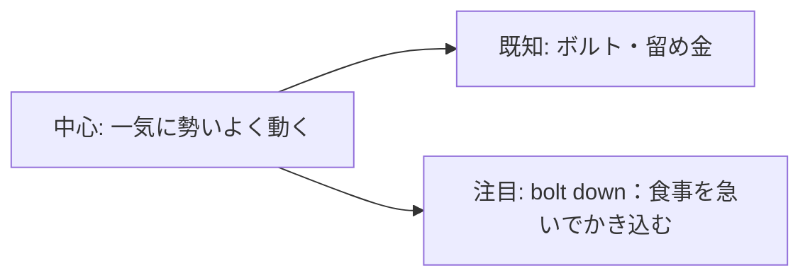

**重要語法**：`bolt down a meal`

<small>index: 5930 / candidate_id: `ev-05930-ai-01` / global_order: 3124</small>

---

## 05. bolt

- **品詞**：verb
- **発音**：/boʊlt/
- <small>よく知られている意味：ボルト・留め金</small>

### 見落としやすい意味：突然駆け出す、急に立ち去る

**例文**：The horse bolted when it heard the loud noise.

**和訳**：その馬は大きな物音を聞いて突然駆け出した。

**コアイメージ**：bolt は固定具を表す名詞として知られる。一方、動詞では突然勢いよく飛び出す動きを表す。

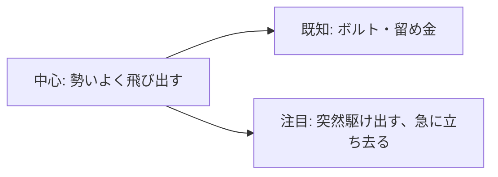

**重要語法**：`bolt from the room`

<small>index: 5930 / candidate_id: `ev-05930-verb-01` / global_order: 3125</small>

---

## 06. blink

- **品詞**：verb
- **発音**：/blɪŋk/
- <small>よく知られている意味：まばたきをする</small>

### 見落としやすい意味：（光が）点滅する、明滅する

**例文**：A red warning light blinked on the control panel.

**和訳**：操作盤の赤い警告灯が点滅した。

**コアイメージ**：blink は目を一瞬閉じて開く短い動きである。光が短い間隔で消えたり現れたりする様子にも広がる。

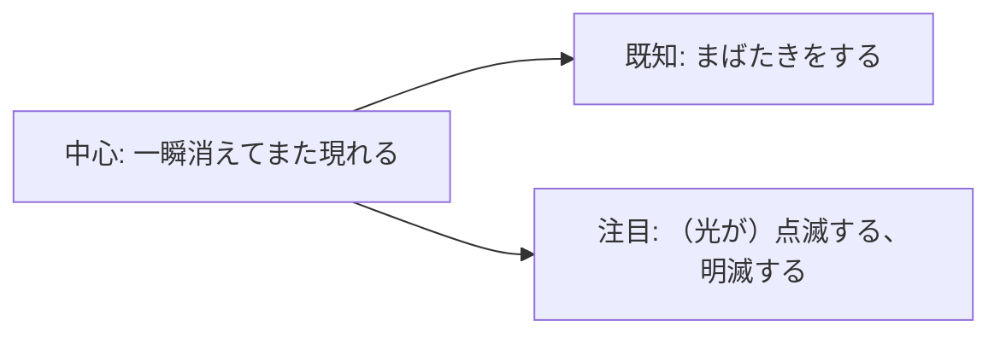

**重要語法**：`a blinking light`

<small>index: 5933 / candidate_id: `ev-05933-verb-01` / global_order: 3126</small>

---

## 07. squash

- **品詞**：verb
- **発音**：/skwɑːʃ/
- <small>よく知られている意味：押しつぶす</small>

### 見落としやすい意味：（反対意見・抗議などを）抑え込む、封じる

**例文**：The manager tried to squash the workers' complaints.

**和訳**：その管理者は労働者の苦情を抑え込もうとした。

**コアイメージ**：squash は力を加えて押しつぶすことである。反対意見や抗議も、表に出ないよう強く押さえつけるときに使う。

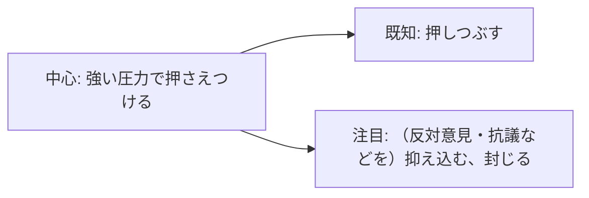

**重要語法**：`squash criticism`

<small>index: 5934 / candidate_id: `ev-05934-ai-01` / global_order: 3127</small>

---

## 08. squash

- **品詞**：verb
- **発音**：/skwɑːʃ/
- <small>よく知られている意味：スカッシュ（球技）</small>

### 見落としやすい意味：押しつぶし、平らにする

**例文**：Please squash the empty box so it fits in the bin.

**和訳**：ごみ箱に入るように空き箱を押しつぶしてください。

**コアイメージ**：動詞 squash の中心は圧力をかけて形をつぶす動作である。箱などを平らにする具体的な場面でそのまま使える。

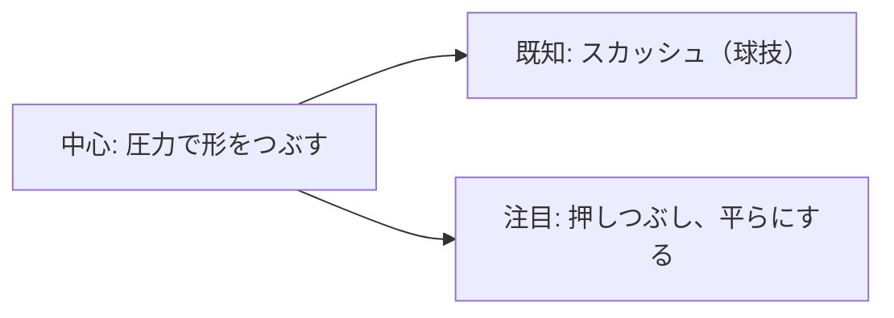

**重要語法**：`squash a box flat`

<small>index: 5934 / candidate_id: `ev-05934-verb-01` / global_order: 3128</small>

---

## 09. flap

- **品詞**：noun
- **発音**：/flæp/
- <small>よく知られている意味：羽ばたくこと</small>

### 見落としやすい意味：騒ぎ、動揺、狼狽

**例文**：There was a flap over the sudden change in the schedule.

**和訳**：突然の日程変更をめぐってひと騒ぎ起きた。

**コアイメージ**：flap は翼や布がばたばたする動きを表す。人々が落ち着かず騒ぐ様子にも比喩的に使う。

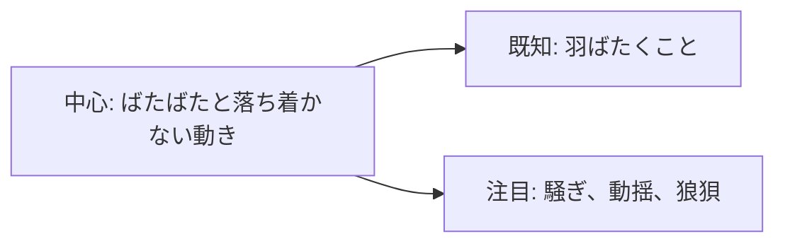

**重要語法**：`a flap over something`

<small>index: 5935 / candidate_id: `ev-05935-ai-01` / global_order: 3129</small>

---

## 10. cozy

- **品詞**：adjective
- **発音**：/ˈkoʊzi/
- <small>よく知られている意味：居心地のよい</small>

### 見落としやすい意味：（取引・関係などが）身内同士に都合がよく、不透明で不公正な

**例文**：The report questioned the cozy relationship between the firm and officials.

**和訳**：報告書はその企業と当局者のなれ合いの関係に疑問を呈した。

**コアイメージ**：cozy は近くて心地よい関係を表す。しかし公的な関係では、近すぎるため公平さを失うという否定的な意味になることがある。

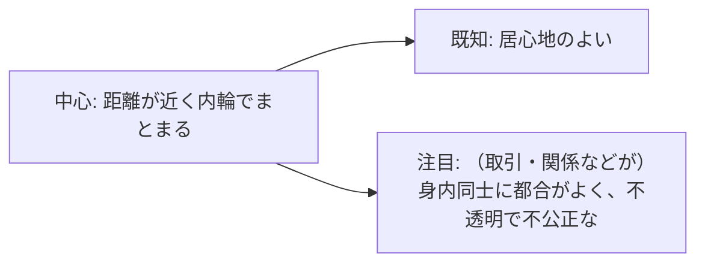

**重要語法**：`a cozy relationship`

<small>index: 5936 / candidate_id: `ev-05936-adj-01` / global_order: 3130</small>

---

## 11. manipulation

- **品詞**：noun
- **発音**：/məˌnɪpjəˈleɪʃən/
- <small>よく知られている意味：巧みな取り扱い</small>

### 見落としやすい意味：（実験条件・データなどの）操作・調整

**例文**：The experiment required careful manipulation of the temperature.

**和訳**：その実験では温度を慎重に操作する必要があった。

**コアイメージ**：manipulation は手を加えて対象を動かしたり調整したりすること。人を操る場合だけでなく、実験条件を意図的に調整する場合にも中立的に使う。

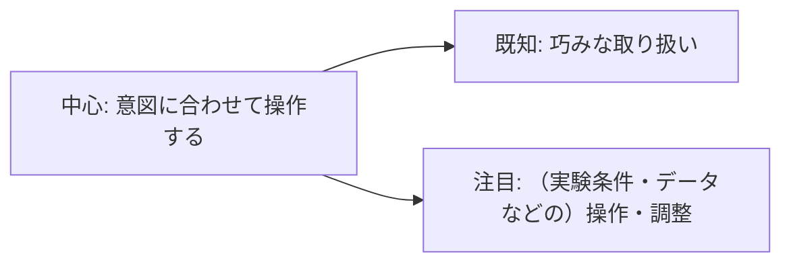

**重要語法**：`manipulation of variables`

<small>index: 5938 / candidate_id: `ev-05938-ai-01` / global_order: 3131</small>

---

## 12. tract

- **品詞**：noun
- **発音**：/trækt/
- <small>よく知られている意味：広がった土地</small>

### 見落としやすい意味：特定の主題について書かれた小冊子・論説文

**例文**：She wrote a short tract calling for better public transport.

**和訳**：彼女は公共交通の改善を訴える小冊子を書いた。

**コアイメージ**：tract はあるまとまりを持った範囲を指すことがある。文章では、一つの主張をまとまった形で述べる小冊子や論説文を表す。

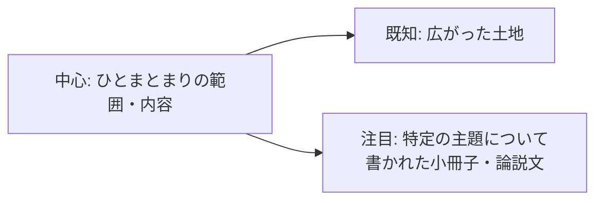

**重要語法**：`a political tract`

<small>index: 5940 / candidate_id: `ev-05940-noun-01` / global_order: 3132</small>

---

## 13. tract

- **品詞**：noun
- **発音**：/trækt/
- <small>よく知られている意味：小冊子・論説文</small>

### 見落としやすい意味：（一定の広がりを持つ）土地の一画、地域

**例文**：The developer bought a large tract of land outside the city.

**和訳**：開発会社は市外の広い土地の一画を購入した。

**コアイメージ**：tract は境界を持った一続きの範囲を表す。土地について使えば、ある程度の面積を持つ一区画を意味する。

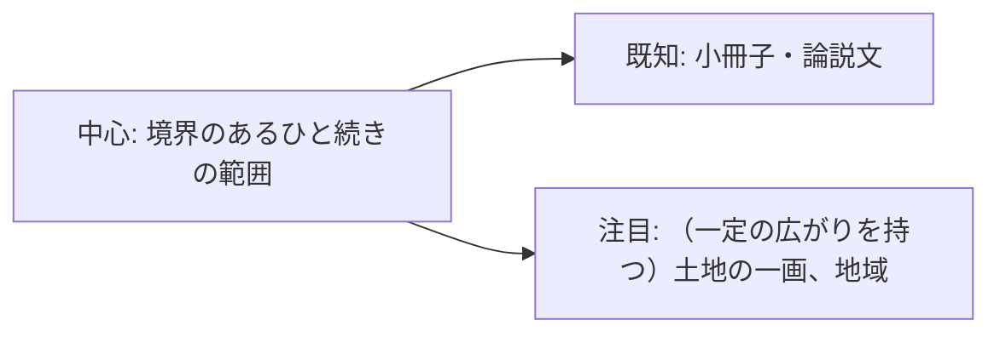

**重要語法**：`a tract of land`

<small>index: 5940 / candidate_id: `ev-05940-noun-02` / global_order: 3133</small>

---

## 14. tract

- **品詞**：noun
- **発音**：/trækt/
- <small>よく知られている意味：土地の一画</small>

### 見落としやすい意味：身体の中で一定の働きを持つ、つながった器官・管の系

**例文**：The doctor examined the patient's digestive tract.

**和訳**：医師は患者の消化管を調べた。

**コアイメージ**：tract はつながった範囲や通り道を表す。体内では同じ働きを持ち、連続している器官や管のまとまりに用いる。

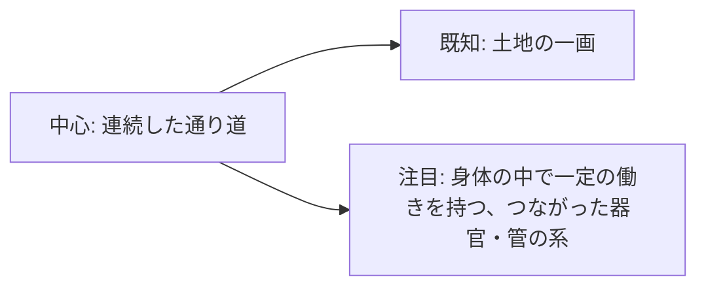

**重要語法**：`digestive tract` ／ `respiratory tract`

<small>index: 5940 / candidate_id: `ev-05940-noun-03` / global_order: 3134</small>

---

## 15. transparency

- **品詞**：noun
- **発音**：/trænsˈperənsi/
- <small>よく知られている意味：透き通っていること</small>

### 見落としやすい意味：（組織・行政などの）情報公開性、透明性

**例文**：Citizens demanded greater transparency in government spending.

**和訳**：市民は政府支出のさらなる透明性を求めた。

**コアイメージ**：transparency は向こう側が見える状態が元のイメージ。組織については、意思決定や金銭の流れを外部から確認できることを表す。

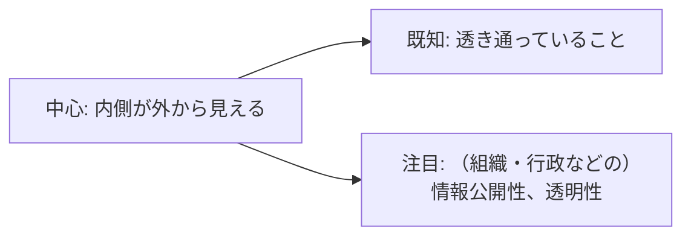

**重要語法**：`transparency in decision-making`

<small>index: 5943 / candidate_id: `ev-05943-ai-01` / global_order: 3135</small>

---

## 16. bounty

- **品詞**：noun
- **発音**：/ˈbaʊnti/
- <small>よく知られている意味：報奨金</small>

### 見落としやすい意味：豊かな恵み、豊富さ

**例文**：The island offers a bounty of fresh fruit in summer.

**和訳**：その島では夏に新鮮な果物が豊富に手に入る。

**コアイメージ**：bounty は惜しみなく与えられる豊かさを表す。報酬として与えるものだけでなく、自然の恵みがたっぷりある状態にも使う。

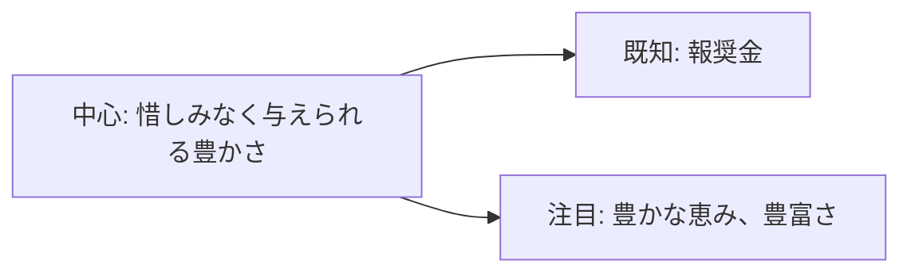

**重要語法**：`a bounty of food`

<small>index: 5952 / candidate_id: `ev-05952-ai-01` / global_order: 3136</small>

---

## 17. caption

- **品詞**：verb
- **発音**：/ˈkæpʃən/
- <small>よく知られている意味：写真・図の説明文</small>

### 見落としやすい意味：図表・写真などに説明文を付ける

**例文**：Please caption each photograph with the place and date.

**和訳**：各写真に場所と日付を記した説明文を付けてください。

**コアイメージ**：caption は画像に添える短い説明である。動詞にすると、その短い説明文を画像へ付ける作業を表す。

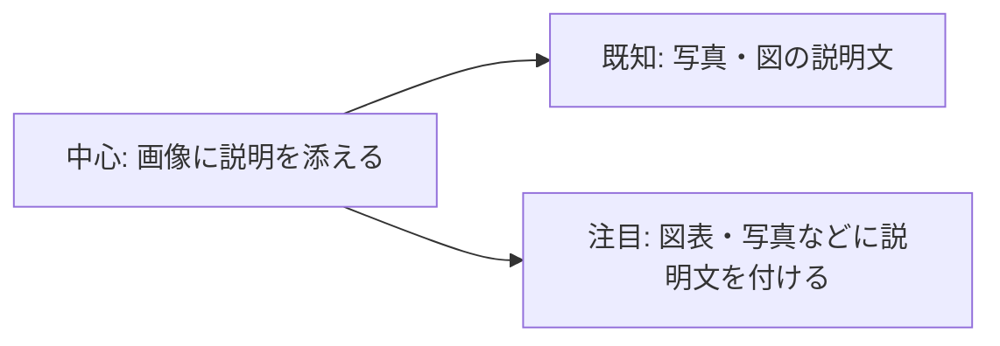

**重要語法**：`caption a photograph`

<small>index: 5954 / candidate_id: `ev-05954-verb-01` / global_order: 3137</small>

---

## 18. cling

- **品詞**：phrasal verb
- **発音**：/klɪŋ/
- <small>よく知られている意味：しがみつく</small>

### 見落としやすい意味：cling to：古い考え・希望などを捨てずに固執する

**例文**：Some people still cling to the belief that the earth is flat.

**和訳**：地球は平らだという考えに今でも固執する人がいる。

**コアイメージ**：cling は物にしっかりつかまって離れないこと。考えや希望を手放さない心理的な状態にも使える。

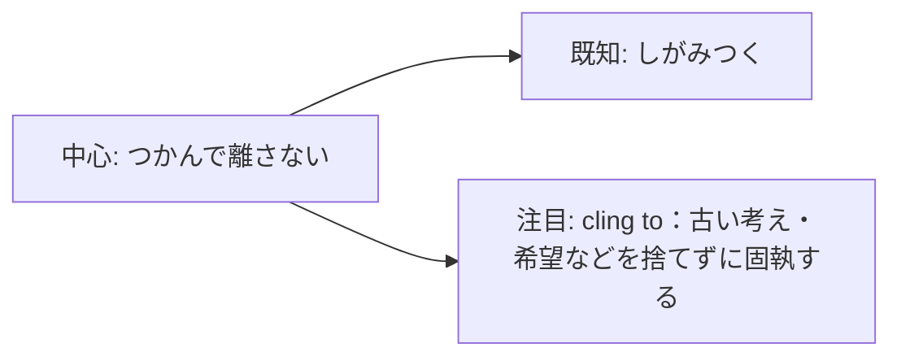

**重要語法**：`cling to an idea`

<small>index: 5956 / candidate_id: `ev-05956-ai-01` / global_order: 3138</small>

---

## 19. coincide

- **品詞**：verb
- **発音**：/ˌkoʊɪnˈsaɪd/
- <small>よく知られている意味：同時に起こる</small>

### 見落としやすい意味：（意見・利害などが）一致する、ぴったり符合する

**例文**：Our opinions coincide on the need for more green spaces.

**和訳**：緑地を増やす必要があるという点で、私たちの意見は一致している。

**コアイメージ**：coincide は二つのものが同じ位置や時点に重なること。考えや利害の場合は、互いに食い違わず一致することを表す。

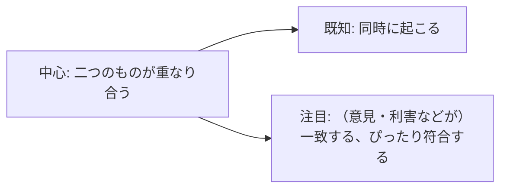

**重要語法**：`coincide with someone's views`

<small>index: 5957 / candidate_id: `ev-05957-ai-01` / global_order: 3139</small>

---

## 20. displace

- **品詞**：verb
- **発音**：/dɪsˈpleɪs/
- <small>よく知られている意味：取って代わる</small>

### 見落としやすい意味：（人を）住む場所から追い出し、移住を余儀なくさせる

**例文**：The flood displaced hundreds of families from their homes.

**和訳**：洪水によって何百もの家族が住まいを追われた。

**コアイメージ**：displace は元の位置から押しのけること。人については、災害や紛争で住む場所を離れざるを得なくなる場合に使う。

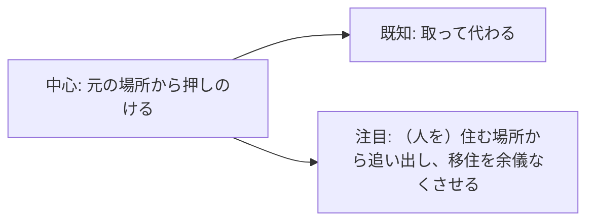

**重要語法**：`displaced families`

<small>index: 5960 / candidate_id: `ev-05960-ai-01` / global_order: 3140</small>

---

## 21. displace

- **品詞**：verb
- **発音**：/dɪsˈpleɪs/
- <small>よく知られている意味：住む場所を追われる</small>

### 見落としやすい意味：それまでの人や物に取って代わる

**例文**：Streaming services have displaced some traditional ways of watching films.

**和訳**：動画配信サービスは従来の映画鑑賞方法の一部に取って代わった。

**コアイメージ**：displace は誰かや何かを元の位置から移すこと。新しいものが古いものの役割や地位を奪う場合にも使われる。

```mermaid
flowchart LR
    A["中心: 元の位置・役割を奪う"]
    B["既知: 住む場所を追われる"]
    C["注目: それまでの人や物に取って代わる"]
    A --> B
    A --> C
```

**重要語法**：`displace an older technology`

<small>index: 5960 / candidate_id: `ev-05960-verb-01` / global_order: 3141</small>

---

## 22. enclosure

- **品詞**：noun
- **発音**：/ɪnˈkloʊʒər/
- <small>よく知られている意味：囲い・囲まれた場所</small>

### 見落としやすい意味：手紙に同封された書類や添付物

**例文**：The letter included an enclosure explaining the new rules.

**和訳**：手紙には新しい規則を説明する書類が同封されていた。

**コアイメージ**：enclosure の基本は何かを中に入れて囲うこと。手紙の封筒の中に収めた別の書類も enclosure と呼ぶ。

```mermaid
flowchart LR
    A["中心: 中に入れて包み込む"]
    B["既知: 囲い・囲まれた場所"]
    C["注目: 手紙に同封された書類や添付物"]
    A --> B
    A --> C
```

**重要語法**：`enclosure: two pages`

<small>index: 5961 / candidate_id: `ev-05961-noun-01` / global_order: 3142</small>

---

## 23. fabricate

- **品詞**：verb
- **発音**：/ˈfæbrɪkeɪt/
- <small>よく知られている意味：材料を加工して作る</small>

### 見落としやすい意味：事実でない話・証拠などをでっち上げる

**例文**：The witness admitted that he had fabricated the story.

**和訳**：その証人は話をでっち上げたと認めた。

**コアイメージ**：fabricate は材料を組み立てて作り上げること。話や証拠について使うと、事実ではないものを意図的に作り上げる意味になる。

```mermaid
flowchart LR
    A["中心: 材料を組み合わせて作る"]
    B["既知: 材料を加工して作る"]
    C["注目: 事実でない話・証拠などをでっち上げる"]
    A --> B
    A --> C
```

**重要語法**：`fabricate evidence`

<small>index: 5963 / candidate_id: `ev-05963-verb-01` / global_order: 3143</small>

---

## 24. famously

- **品詞**：adverb
- **発音**：/ˈfeɪməsli/
- <small>よく知られている意味：有名なことに</small>

### 見落としやすい意味：とてもよく、見事に（特に相性・順調さ）

**例文**：The two scientists got along famously during the project.

**和訳**：その二人の科学者は研究計画の間、とても仲よくやっていた。

**コアイメージ**：famously は有名であることを表す場合が多い。しかし get along などと使うと、非常にうまく・申し分なくという程度の高さを表す。

```mermaid
flowchart LR
    A["中心: 際立つほどよい"]
    B["既知: 有名なことに"]
    C["注目: とてもよく、見事に（特に相性・順調さ）"]
    A --> B
    A --> C
```

**重要語法**：`get along famously`

<small>index: 5964 / candidate_id: `ev-05964-adv-01` / global_order: 3144</small>

---

## 25. feminine

- **品詞**：noun
- **発音**：/ˈfemənɪn/
- <small>よく知られている意味：女性らしい（形容詞）</small>

### 見落としやすい意味：（文法）女性名詞・女性形という文法上の性

**例文**：In French, the word for table is feminine.

**和訳**：フランス語では「テーブル」を表す単語は女性名詞である。

**コアイメージ**：feminine は女性に関連するという分類を示す。文法では実際の性別とは関係なく、名詞などの文法上の性を表す。

```mermaid
flowchart LR
    A["中心: 女性側に分類される"]
    B["既知: 女性らしい（形容詞）"]
    C["注目: （文法）女性名詞・女性形という文法上の性"]
    A --> B
    A --> C
```

**重要語法**：`feminine noun`

<small>index: 5965 / candidate_id: `ev-05965-noun-01` / global_order: 3145</small>

---

## 26. intercept

- **品詞**：noun
- **発音**：/ˌɪntərˈsept/
- <small>よく知られている意味：途中で捕らえる・遮る</small>

### 見落としやすい意味：（数学で）グラフが座標軸と交わる点の座標、切片

**例文**：The line has a y-intercept of three.

**和訳**：その直線の y 切片は3である。

**コアイメージ**：intercept は進む経路を途中で横切るという感覚がある。座標では直線や曲線が軸と交わる位置を示す値を表す。

```mermaid
flowchart LR
    A["中心: 進む線と交わる場所"]
    B["既知: 途中で捕らえる・遮る"]
    C["注目: （数学で）グラフが座標軸と交わる点の座標、切片"]
    A --> B
    A --> C
```

**重要語法**：`x-intercept` ／ `y-intercept`

<small>index: 5970 / candidate_id: `ev-05970-noun-01` / global_order: 3146</small>

---

## 27. multiply

- **品詞**：verb
- **発音**：/ˈmʌltɪplaɪ/
- <small>よく知られている意味：掛け算をする</small>

### 見落としやすい意味：生物などが増殖する、数が増える

**例文**：Bacteria can multiply rapidly in warm conditions.

**和訳**：細菌は温かい環境で急速に増殖することがある。

**コアイメージ**：multiply の中心は数や量を何倍にも増やすこと。計算だけでなく、生物が増えたり問題が増加したりする場面にも使う。

```mermaid
flowchart LR
    A["中心: 数を何倍にも増やす"]
    B["既知: 掛け算をする"]
    C["注目: 生物などが増殖する、数が増える"]
    A --> B
    A --> C
```

**重要語法**：`multiply rapidly`

<small>index: 5977 / candidate_id: `ev-05977-verb-01` / global_order: 3147</small>

---

## 28. projected

- **品詞**：adjective
- **発音**：/prəˈdʒektɪd/
- <small>よく知られている意味：投影された</small>

### 見落としやすい意味：（数値・結果などが）予測された、見込まれる

**例文**：The projected cost of the bridge is higher than expected.

**和訳**：その橋の予測建設費は予想より高い。

**コアイメージ**：project は前方へ映し出すという感覚を持つ。未来の数字を現在から先へ映して見積もると、projected は「予測された」という意味になる。

```mermaid
flowchart LR
    A["中心: 先の姿を映し出す"]
    B["既知: 投影された"]
    C["注目: （数値・結果などが）予測された、見込まれる"]
    A --> B
    A --> C
```

**重要語法**：`projected cost`

<small>index: 5983 / candidate_id: `ev-05983-adj-01` / global_order: 3148</small>

---

## 29. raising

- **品詞**：noun
- **発音**：/ˈreɪzɪŋ/
- <small>よく知られている意味：引き上げること</small>

### 見落としやすい意味：育てられた環境・しつけによって身についた性質

**例文**：She credited her careful raising for her children's good manners.

**和訳**：彼女は子どもたちのよい礼儀作法は丁寧なしつけのおかげだと考えた。

**コアイメージ**：raise は子どもを育て、成長を支えることにも使う。raising はその育て方やしつけの過程を指す名詞として現れる。

```mermaid
flowchart LR
    A["中心: 育てながら形づくる"]
    B["既知: 引き上げること"]
    C["注目: 育てられた環境・しつけによって身についた性質"]
    A --> B
    A --> C
```

**重要語法**：`child-raising`

<small>index: 5985 / candidate_id: `ev-05985-noun-01` / global_order: 3149</small>

---

## 30. realization

- **品詞**：noun
- **発音**：/ˌriːələˈzeɪʃən/
- <small>よく知られている意味：理解・気づき</small>

### 見落としやすい意味：構想・計画・目標などの実現、具体化

**例文**：The realization of the plan took more than five years.

**和訳**：その計画が実現するまでに5年以上かかった。

**コアイメージ**：realization は頭の中の内容が現実になることを表す。気づきという意味に加え、計画が実際の形になることにも使う。

```mermaid
flowchart LR
    A["中心: 頭の中から現実の形へ"]
    B["既知: 理解・気づき"]
    C["注目: 構想・計画・目標などの実現、具体化"]
    A --> B
    A --> C
```

**重要語法**：`the realization of a goal`

<small>index: 5986 / candidate_id: `ev-05986-ai-01` / global_order: 3150</small>

---

## 31. sack

- **品詞**：verb
- **発音**：/sæk/
- <small>よく知られている意味：袋</small>

### 見落としやすい意味：（人を）解雇する

**例文**：The company sacked its manager after repeated losses.

**和訳**：会社は度重なる損失の後、その管理職を解雇した。

**コアイメージ**：sack は袋を表す語として知られる。動詞の口語的な用法では、仕事から人を外す、つまり解雇する意味になる。

```mermaid
flowchart LR
    A["中心: 職場から外へ出す"]
    B["既知: 袋"]
    C["注目: （人を）解雇する"]
    A --> B
    A --> C
```

**重要語法**：`get sacked`

<small>index: 5990 / candidate_id: `ev-05990-verb-01` / global_order: 3151</small>

---

## 32. seduce

- **品詞**：verb
- **発音**：/sɪˈduːs/
- <small>よく知られている意味：性的に誘惑する</small>

### 見落としやすい意味：（人を利益や魅力で）誘惑し、引き込む

**例文**：The promise of quick profits seduced many inexperienced investors.

**和訳**：すぐに利益が出るという約束が、経験の浅い投資家を大勢引きつけた。

**コアイメージ**：seduce は強い魅力によって相手を引き寄せること。利益や便利さなどの魅力で判断を鈍らせる場合にも使える。

```mermaid
flowchart LR
    A["中心: 魅力で引き寄せる"]
    B["既知: 性的に誘惑する"]
    C["注目: （人を利益や魅力で）誘惑し、引き込む"]
    A --> B
    A --> C
```

**重要語法**：`be seduced by an offer`

<small>index: 5993 / candidate_id: `ev-05993-ai-01` / global_order: 3152</small>

---

## 33. sleeve

- **品詞**：idiom
- **発音**：/sliːv/
- <small>よく知られている意味：袖</small>

### 見落としやすい意味：have something up one's sleeve：隠し策を持っている

**例文**：The team has another idea up its sleeve if this plan fails.

**和訳**：この計画が失敗した場合に備えて、チームにはもう一つ隠し策がある。

**コアイメージ**：sleeve は衣服の袖で、外から中が見えにくい場所でもある。up one's sleeve は袖の中に隠しているように、人に見せていない策を持つことを表す。

```mermaid
flowchart LR
    A["中心: 袖の中に隠しておく"]
    B["既知: 袖"]
    C["注目: have something up one's sleeve：隠し策を持っている"]
    A --> B
    A --> C
```

**重要語法**：`have something up one's sleeve`

<small>index: 5997 / candidate_id: `ev-05997-ai-01` / global_order: 3153</small>

---

## 34. spawn

- **品詞**：verb
- **発音**：/spɔːn/
- <small>よく知られている意味：卵を産む</small>

### 見落としやすい意味：新しい事態・問題などを生み出す

**例文**：The new policy spawned a series of unexpected problems.

**和訳**：その新しい政策は予期しない問題を次々に生み出した。

**コアイメージ**：spawn は生物が卵を産み、子を増やすこと。そこから新しい問題や動きが次々生じる場合にも使う。

```mermaid
flowchart LR
    A["中心: 次々に新しいものを生み出す"]
    B["既知: 卵を産む"]
    C["注目: 新しい事態・問題などを生み出す"]
    A --> B
    A --> C
```

**重要語法**：`spawn new problems`

<small>index: 5999 / candidate_id: `ev-05999-verb-01` / global_order: 3154</small>

---

## 35. stifle

- **品詞**：verb
- **発音**：/ˈstaɪfəl/
- <small>よく知られている意味：息を詰まらせる</small>

### 見落としやすい意味：反論・感情・活動などを抑え込む

**例文**：Fear of criticism stifled discussion in the classroom.

**和訳**：批判されることへの恐れが教室での議論を抑え込んだ。

**コアイメージ**：stifle は息や音の通りをふさぐイメージ。議論や感情などが自由に表れないように抑え込む場合にも使う。

```mermaid
flowchart LR
    A["中心: 外に出るものをふさぐ"]
    B["既知: 息を詰まらせる"]
    C["注目: 反論・感情・活動などを抑え込む"]
    A --> B
    A --> C
```

**重要語法**：`stifle debate`

<small>index: 6000 / candidate_id: `ev-06000-verb-01` / global_order: 3155</small>

---

## 36. token

- **品詞**：adjective
- **発音**：/ˈtoʊkən/
- <small>よく知られている意味：しるし・記念品</small>

### 見落としやすい意味：名目的な、形ばかりの（token effort など）

**例文**：The committee made only a token effort to consult students.

**和訳**：委員会は生徒に意見を聞く努力を形ばかりしかしなかった。

**コアイメージ**：token は何かを表すしるしである。形だけの行為を表す形容詞では、実質より「しるしとして行った」ことが強調される。

```mermaid
flowchart LR
    A["中心: 実質よりしるしだけ"]
    B["既知: しるし・記念品"]
    C["注目: 名目的な、形ばかりの（token effort など）"]
    A --> B
    A --> C
```

**重要語法**：`a token effort`

<small>index: 6003 / candidate_id: `ev-06003-adj-01` / global_order: 3156</small>

---

## 37. tumble

- **品詞**：verb
- **発音**：/ˈtʌmbəl/
- <small>よく知られている意味：転がり落ちる</small>

### 見落としやすい意味：（価格・株価などが）急落する

**例文**：Shares in the company tumbled after the announcement.

**和訳**：発表後、その会社の株価は急落した。

**コアイメージ**：tumble は体が勢いよく転がり落ちる動き。数字や価格にも使われ、短期間の急な下落を表す。

```mermaid
flowchart LR
    A["中心: 勢いよく下へ転がる"]
    B["既知: 転がり落ちる"]
    C["注目: （価格・株価などが）急落する"]
    A --> B
    A --> C
```

**重要語法**：`prices tumble`

<small>index: 6005 / candidate_id: `ev-06005-verb-01` / global_order: 3157</small>

---

## 38. vintage

- **品詞**：noun
- **発音**：/ˈvɪntɪdʒ/
- <small>よく知られている意味：古くて質のよい</small>

### 見落としやすい意味：（製品・ワインなどの）製造年、成立年代

**例文**：This bottle is from a particularly good vintage.

**和訳**：このボトルは特に出来のよい収穫年のものだ。

**コアイメージ**：vintage はもともとワインの収穫・醸造の年に関係する。そこから製品の作られた年代や、その年の品質を示す言い方になる。

```mermaid
flowchart LR
    A["中心: 作られた年とその出来"]
    B["既知: 古くて質のよい"]
    C["注目: （製品・ワインなどの）製造年、成立年代"]
    A --> B
    A --> C
```

**重要語法**：`a 2018 vintage`

<small>index: 6009 / candidate_id: `ev-06009-noun-01` / global_order: 3158</small>

---

## 39. lemon

- **品詞**：noun
- **発音**：/ˈlemən/
- <small>よく知られている意味：レモン</small>

### 見落としやすい意味：（特に中古車などの）欠陥品、買って失敗した商品

**例文**：The used car looked perfect, but it turned out to be a lemon.

**和訳**：その中古車は完璧に見えたが、実際は欠陥品だった。

**コアイメージ**：lemon は酸っぱい果実を表す。口語では買ってみて期待外れだった品物、特に故障の多い車を指す。

```mermaid
flowchart LR
    A["中心: 期待した味・価値への失望"]
    B["既知: レモン"]
    C["注目: （特に中古車などの）欠陥品、買って失敗した商品"]
    A --> B
    A --> C
```

**重要語法**：`a used-car lemon`

<small>index: 6013 / candidate_id: `ev-06013-noun-01` / global_order: 3159</small>

---

## 40. batch

- **品詞**：verb
- **発音**：/bætʃ/
- <small>よく知られている意味：ひとまとめ・一回分</small>

### 見落としやすい意味：複数の作業・データをまとめて一括処理する

**例文**：We batch similar tasks so we can finish them more efficiently.

**和訳**：私たちは似た作業を一括処理して、より効率的に終わらせる。

**コアイメージ**：batch はまとめられた一組のものを表す。動詞では個別に行わず一組として処理することを指す。

```mermaid
flowchart LR
    A["中心: 一組にまとめて扱う"]
    B["既知: ひとまとめ・一回分"]
    C["注目: 複数の作業・データをまとめて一括処理する"]
    A --> B
    A --> C
```

**重要語法**：`batch tasks`

<small>index: 6014 / candidate_id: `ev-06014-verb-01` / global_order: 3160</small>

---

## 41. marked

- **品詞**：adjective
- **発音**：/mɑːrkt/
- <small>よく知られている意味：目立った・著しい</small>

### 見落としやすい意味：（非難・攻撃などの）標的として目をつけられた

**例文**：After revealing the fraud, the journalist became a marked person.

**和訳**：不正を明らかにした後、その記者は狙われる人物になった。

**コアイメージ**：mark は印を付けて見分けられるようにすること。marked は誰かに目をつけられ、標的として特定されている状態にもなる。

```mermaid
flowchart LR
    A["中心: 印を付けて狙いを定める"]
    B["既知: 目立った・著しい"]
    C["注目: （非難・攻撃などの）標的として目をつけられた"]
    A --> B
    A --> C
```

**重要語法**：`a marked man` ／ `a marked woman`

<small>index: 6016 / candidate_id: `ev-06016-adj-01` / global_order: 3161</small>

---

## 42. liquid

- **品詞**：adjective
- **発音**：/ˈlɪkwɪd/
- <small>よく知られている意味：液体の</small>

### 見落としやすい意味：（資産が）すぐ換金できる、流動性の高い

**例文**：The investor kept some money in liquid assets for emergencies.

**和訳**：その投資家は緊急時に備えて資金の一部をすぐ換金できる資産で持っていた。

**コアイメージ**：liquid は自由に流れる液体の性質を表す。資産については売却・換金しやすく、必要なとき動かせることを意味する。

```mermaid
flowchart LR
    A["中心: すぐに流れ動かせる"]
    B["既知: 液体の"]
    C["注目: （資産が）すぐ換金できる、流動性の高い"]
    A --> B
    A --> C
```

**重要語法**：`liquid assets`

<small>index: 6017 / candidate_id: `ev-06017-adj-01` / global_order: 3162</small>

---

## 43. wolf

- **品詞**：verb
- **発音**：/wʊlf/
- <small>よく知られている意味：オオカミ</small>

### 見落としやすい意味：（食物を）がつがつ食べる

**例文**：She wolfed down her lunch between classes.

**和訳**：彼女は授業の合間に昼食をがつがつ食べた。

**コアイメージ**：wolf はオオカミを表す。動詞では獲物を勢いよく食べる姿になぞらえ、食事を急いで平らげることをいう。

```mermaid
flowchart LR
    A["中心: 勢いよく食べる"]
    B["既知: オオカミ"]
    C["注目: （食物を）がつがつ食べる"]
    A --> B
    A --> C
```

**重要語法**：`wolf down a sandwich`

<small>index: 6018 / candidate_id: `ev-06018-verb-01` / global_order: 3163</small>

---

## 44. cane

- **品詞**：noun
- **発音**：/keɪn/
- <small>よく知られている意味：つえ</small>

### 見落としやすい意味：竹やサトウキビなどの細長い茎・植物

**例文**：Sugar is produced from the juice of sugar cane.

**和訳**：砂糖はサトウキビの汁から作られる。

**コアイメージ**：cane は細長く丈夫な植物の茎を指す。そこからその茎で作ったつえや、サトウキビなどの植物を表す。

```mermaid
flowchart LR
    A["中心: 細長く丈夫な茎"]
    B["既知: つえ"]
    C["注目: 竹やサトウキビなどの細長い茎・植物"]
    A --> B
    A --> C
```

**重要語法**：`sugar cane`

<small>index: 6021 / candidate_id: `ev-06021-noun-01` / global_order: 3164</small>

---

## 45. triangle

- **品詞**：noun
- **発音**：/ˈtraɪæŋɡəl/
- <small>よく知られている意味：三角形</small>

### 見落としやすい意味：三角関係（love triangle など）

**例文**：The film is about a love triangle involving three friends.

**和訳**：その映画は三人の友人が関わる三角関係を描いている。

**コアイメージ**：triangle は三つの頂点が結ばれた形。人間関係で三人が複雑につながる状態も三角形になぞらえる。

```mermaid
flowchart LR
    A["中心: 三者が互いに結ばれる"]
    B["既知: 三角形"]
    C["注目: 三角関係（love triangle など）"]
    A --> B
    A --> C
```

**重要語法**：`a love triangle`

<small>index: 6022 / candidate_id: `ev-06022-noun-01` / global_order: 3165</small>

---

## 46. muddy

- **品詞**：verb
- **発音**：/ˈmʌdi/
- <small>よく知られている意味：泥だらけの</small>

### 見落としやすい意味：（議論・説明などを）曖昧にする、混乱させる（muddy the waters）

**例文**：The extra details only muddied the debate.

**和訳**：余分な詳細は議論をさらに分かりにくくしただけだった。

**コアイメージ**：muddy は水が泥で濁った状態を表す。動詞では説明や議論を濁らせ、明確に見えなくすることをいう。

```mermaid
flowchart LR
    A["中心: 透明なものを濁らせる"]
    B["既知: 泥だらけの"]
    C["注目: （議論・説明などを）曖昧にする、混乱させる（muddy the waters）"]
    A --> B
    A --> C
```

**重要語法**：`muddy the waters`

<small>index: 6023 / candidate_id: `ev-06023-verb-01` / global_order: 3166</small>

---

## 47. shed

- **品詞**：verb
- **発音**：/ʃed/
- <small>よく知られている意味：小屋</small>

### 見落としやすい意味：shed light on：～を明らかにする

**例文**：The new evidence shed light on the cause of the accident.

**和訳**：新しい証拠は事故の原因を明らかにした。

**コアイメージ**：shed には光などを放つという用法がある。shed light on は暗くて見えなかった事柄を照らし、理解できるようにする表現である。

```mermaid
flowchart LR
    A["中心: 光を当てて見えるようにする"]
    B["既知: 小屋"]
    C["注目: shed light on：～を明らかにする"]
    A --> B
    A --> C
```

**重要語法**：`shed light on a problem`

<small>index: 6027 / candidate_id: `ev-06027-verb-01` / global_order: 3167</small>

---

## 48. shed

- **品詞**：verb
- **発音**：/ʃed/
- <small>よく知られている意味：小屋</small>

### 見落としやすい意味：（習慣・不要物などを）捨て去る、取り払う

**例文**：He finally shed his habit of checking his phone at night.

**和訳**：彼はついに夜に携帯電話を確認する習慣を捨てた。

**コアイメージ**：shed は葉や皮などを自然に落とすことにも使う。自分に付いていた習慣や不要なものを取り去る意味へ広がる。

```mermaid
flowchart LR
    A["中心: 身に付いたものを落とす"]
    B["既知: 小屋"]
    C["注目: （習慣・不要物などを）捨て去る、取り払う"]
    A --> B
    A --> C
```

**重要語法**：`shed an old habit`

<small>index: 6027 / candidate_id: `ev-06027-verb-02` / global_order: 3168</small>

---

## 49. privileged

- **品詞**：adjective
- **発音**：/ˈprɪvəlɪdʒd/
- <small>よく知られている意味：特権を持つ</small>

### 見落としやすい意味：（情報・通信などが法的に）秘匿特権で保護された

**例文**：The lawyer explained that the conversation was privileged.

**和訳**：弁護士はその会話が法的な秘匿特権で保護されると説明した。

**コアイメージ**：privileged は特別な権利によって守られる状態を表す。法的な文脈では、特定のやり取りを開示から保護することを意味する。

```mermaid
flowchart LR
    A["中心: 特別な権利で保護される"]
    B["既知: 特権を持つ"]
    C["注目: （情報・通信などが法的に）秘匿特権で保護された"]
    A --> B
    A --> C
```

**重要語法**：`privileged communication`

<small>index: 6028 / candidate_id: `ev-06028-adj-01` / global_order: 3169</small>

---

## 50. demise

- **品詞**：noun
- **発音**：/dɪˈmaɪz/
- <small>よく知られている意味：死去</small>

### 見落としやすい意味：（制度・企業・活動などの）終焉、消滅

**例文**：The article examined the demise of the local newspaper.

**和訳**：その記事は地元紙が廃刊に至った経緯を検討していた。

**コアイメージ**：demise は終わりや消滅を表す。人の死だけでなく、会社や制度などが存続しなくなる場合にも用いる。

```mermaid
flowchart LR
    A["中心: 存在が終わる"]
    B["既知: 死去"]
    C["注目: （制度・企業・活動などの）終焉、消滅"]
    A --> B
    A --> C
```

**重要語法**：`the demise of an industry`

<small>index: 6030 / candidate_id: `ev-06030-noun-01` / global_order: 3170</small>

---

## 51. sprout

- **品詞**：verb
- **発音**：/spraʊt/
- <small>よく知られている意味：芽を出す</small>

### 見落としやすい意味：sprout up：（新しい店や建物などが）次々と現れる

**例文**：Small cafés have sprouted up across the neighborhood.

**和訳**：小さなカフェが近隣のあちこちに次々と現れた。

**コアイメージ**：sprout は地面から新芽が顔を出すこと。店や建物などが新しく現れ増えていく様子にも使う。

```mermaid
flowchart LR
    A["中心: 新しい芽が次々現れる"]
    B["既知: 芽を出す"]
    C["注目: sprout up：（新しい店や建物などが）次々と現れる"]
    A --> B
    A --> C
```

**重要語法**：`sprout up`

<small>index: 6031 / candidate_id: `ev-06031-verb-01` / global_order: 3171</small>

---

## 52. concur

- **品詞**：verb
- **発音**：/kənˈkɜːr/
- <small>よく知られている意味：同意する</small>

### 見落としやすい意味：（出来事・状況などが）同時に起こる、一致する

**例文**：Several changes concurred to make the result possible.

**和訳**：いくつかの変化が同時に起こり、その結果を可能にした。

**コアイメージ**：concur の中心は複数のことが同じ方向や時点に重なること。意見の一致だけでなく、出来事が同時に作用する場合にも使う。

```mermaid
flowchart LR
    A["中心: 複数のことが重なり合う"]
    B["既知: 同意する"]
    C["注目: （出来事・状況などが）同時に起こる、一致する"]
    A --> B
    A --> C
```

**重要語法**：`concur to produce a result`

<small>index: 6037 / candidate_id: `ev-06037-verb-01` / global_order: 3172</small>

---

## 53. bankrupt

- **品詞**：adjective
- **発音**：/ˈbæŋkrʌpt/
- <small>よく知られている意味：破産した</small>

### 見落としやすい意味：bankrupt of：～という資質・考えを全く欠く

**例文**：His explanation was bankrupt of any convincing evidence.

**和訳**：彼の説明には納得できる証拠がまったく欠けていた。

**コアイメージ**：bankrupt は持っていた財産が尽きた状態を表す。of と組み合わせると、根拠や想像力などの大切な資質が尽きていることを表す。

```mermaid
flowchart LR
    A["中心: 必要なものが尽きている"]
    B["既知: 破産した"]
    C["注目: bankrupt of：～という資質・考えを全く欠く"]
    A --> B
    A --> C
```

**重要語法**：`bankrupt of ideas`

<small>index: 6045 / candidate_id: `ev-06045-adj-01` / global_order: 3173</small>

---

## 54. bankrupt

- **品詞**：verb
- **発音**：/ˈbæŋkrʌpt/
- <small>よく知られている意味：破産した</small>

### 見落としやすい意味：（人・団体から資源などを）奪い尽くす

**例文**：The expensive conflict nearly bankrupted the country of its resources.

**和訳**：その費用のかかる紛争は、その国の資源をほとんど使い尽くした。

**コアイメージ**：bankrupt は資源やお金が尽きる状態に関わる。動詞では何かを使い果たさせ、必要なものを失わせる意味にも広がる。

```mermaid
flowchart LR
    A["中心: 資源を使い尽くさせる"]
    B["既知: 破産した"]
    C["注目: （人・団体から資源などを）奪い尽くす"]
    A --> B
    A --> C
```

**重要語法**：`bankrupt a country of resources`

<small>index: 6045 / candidate_id: `ev-06045-verb-01` / global_order: 3174</small>

---

## 55. destined

- **品詞**：adjective
- **発音**：/ˈdestɪnd/
- <small>よく知られている意味：〜する運命にある</small>

### 見落としやすい意味：（荷物・旅客などが）～行きである（destined for）

**例文**：These packages are destined for the northern warehouse.

**和訳**：これらの荷物は北部の倉庫行きだ。

**コアイメージ**：destined は行き着く先が決まっていることを表す。人の運命だけでなく、荷物や旅客の配送先・目的地にも使う。

```mermaid
flowchart LR
    A["中心: 向かう先が定められている"]
    B["既知: 〜する運命にある"]
    C["注目: （荷物・旅客などが）～行きである（destined for）"]
    A --> B
    A --> C
```

**重要語法**：`be destined for a place`

<small>index: 6055 / candidate_id: `ev-06055-adj-01` / global_order: 3175</small>

---

## 56. evangelical

- **品詞**：adjective
- **発音**：/ˌiːvænˈdʒelɪkəl/
- <small>よく知られている意味：福音主義の</small>

### 見落としやすい意味：（思想・製品などを）熱心に広めようとする、布教的な

**例文**：She is evangelical about the benefits of cycling to work.

**和訳**：彼女は自転車通勤の利点を熱心に広めようとしている。

**コアイメージ**：evangelical は信じる教えを熱心に伝える姿勢に関わる。宗教以外でも、考え方や製品の価値を積極的に広める態度を表す。

```mermaid
flowchart LR
    A["中心: 信じる価値を熱心に広める"]
    B["既知: 福音主義の"]
    C["注目: （思想・製品などを）熱心に広めようとする、布教的な"]
    A --> B
    A --> C
```

**重要語法**：`be evangelical about something`

<small>index: 6060 / candidate_id: `ev-06060-adj-01` / global_order: 3176</small>

---

## 57. fortify

- **品詞**：verb
- **発音**：/ˈfɔːrtɪfaɪ/
- <small>よく知られている意味：要塞化する</small>

### 見落としやすい意味：（食品などにビタミン・ミネラルを）添加して栄養を強化する

**例文**：The cereal is fortified with iron and vitamins.

**和訳**：そのシリアルには鉄分とビタミンが添加され、栄養が強化されている。

**コアイメージ**：fortify は弱い部分を補い、強くすること。食品に不足しがちな栄養素を加える場合にも使われる。

```mermaid
flowchart LR
    A["中心: 不足を補って強くする"]
    B["既知: 要塞化する"]
    C["注目: （食品などにビタミン・ミネラルを）添加して栄養を強化する"]
    A --> B
    A --> C
```

**重要語法**：`be fortified with vitamins`

<small>index: 6061 / candidate_id: `ev-06061-verb-01` / global_order: 3177</small>

---

## 58. freak

- **品詞**：adjective
- **発音**：/friːk/
- <small>よく知られている意味：変わり者</small>

### 見落としやすい意味：めったに起こらない異常な、偶発的な（freak accident など）

**例文**：A freak storm damaged the roofs of several houses.

**和訳**：めったにない異常な嵐が数軒の家の屋根を傷めた。

**コアイメージ**：freak は普通の範囲から大きく外れたものを指す。事故や天候については、まれで予想外の出来事を表す形容詞になる。

```mermaid
flowchart LR
    A["中心: 普通から大きく外れる"]
    B["既知: 変わり者"]
    C["注目: めったに起こらない異常な、偶発的な（freak accident など）"]
    A --> B
    A --> C
```

**重要語法**：`a freak accident`

<small>index: 6062 / candidate_id: `ev-06062-adj-01` / global_order: 3178</small>

---

## 59. freak

- **品詞**：verb
- **発音**：/friːk/
- <small>よく知られている意味：変わり者</small>

### 見落としやすい意味：freak out：非常に動揺する、取り乱す

**例文**：Don't freak out if the first plan doesn't work.

**和訳**：最初の計画がうまくいかなくても取り乱さないで。

**コアイメージ**：freak out は通常の落ち着いた状態から大きく外れること。強い驚きや不安で急に動揺する意味で使われる。

```mermaid
flowchart LR
    A["中心: 落ち着きを急に失う"]
    B["既知: 変わり者"]
    C["注目: freak out：非常に動揺する、取り乱す"]
    A --> B
    A --> C
```

**重要語法**：`freak out`

<small>index: 6062 / candidate_id: `ev-06062-verb-01` / global_order: 3179</small>

---

## 60. guise

- **品詞**：noun
- **発音**：/ɡaɪz/
- <small>よく知られている意味：外見・姿</small>

### 見落としやすい意味：under the guise of：～を装って、～という名目で

**例文**：He collected personal data under the guise of conducting a survey.

**和訳**：彼は調査を実施するという名目で個人情報を集めた。

**コアイメージ**：guise は外から見える姿や見せかけを表す。under the guise of は本当の目的を隠し、別の姿を装うことを意味する。

```mermaid
flowchart LR
    A["中心: 別の外見をまとわせる"]
    B["既知: 外見・姿"]
    C["注目: under the guise of：～を装って、～という名目で"]
    A --> B
    A --> C
```

**重要語法**：`under the guise of help`

<small>index: 6064 / candidate_id: `ev-06064-noun-01` / global_order: 3180</small>

---

## 61. lieutenant

- **品詞**：noun
- **発音**：/luːˈtenənt/（米）
- <small>よく知られている意味：（軍の）中尉</small>

### 見落としやすい意味：（指導者の）側近、腹心、補佐役

**例文**：The director sent her trusted lieutenant to lead the negotiations.

**和訳**：その責任者は信頼する側近を交渉の指揮に派遣した。

**コアイメージ**：lieutenant は上位者を補佐して任務を担う立場に由来する。軍隊だけでなく、組織のリーダーを支える有力な補佐役を表す。

```mermaid
flowchart LR
    A["中心: 上位者の役割を補佐する"]
    B["既知: （軍の）中尉"]
    C["注目: （指導者の）側近、腹心、補佐役"]
    A --> B
    A --> C
```

**重要語法**：`a trusted lieutenant`

<small>index: 6072 / candidate_id: `ev-06072-noun-01` / global_order: 3181</small>

---

## 62. manifest

- **品詞**：adjective
- **発音**：/ˈmænɪfest/
- <small>よく知られている意味：（積荷などを）明示する</small>

### 見落としやすい意味：明白な、はっきり現れた

**例文**：The plan's weaknesses became manifest during the trial.

**和訳**：試行中にその計画の弱点が明白になった。

**コアイメージ**：manifest は隠れていたものが表に現れること。形容詞では、誰にでもはっきり分かる状態を表す。

```mermaid
flowchart LR
    A["中心: 隠れたものが表に現れる"]
    B["既知: （積荷などを）明示する"]
    C["注目: 明白な、はっきり現れた"]
    A --> B
    A --> C
```

**重要語法**：`become manifest`

<small>index: 6073 / candidate_id: `ev-06073-adj-01` / global_order: 3182</small>

---

## 63. manifest

- **品詞**：noun
- **発音**：/ˈmænɪfest/
- <small>よく知られている意味：明らかにする（動詞）</small>

### 見落としやすい意味：乗客名簿、積荷一覧表

**例文**：The airport staff checked the passenger manifest.

**和訳**：空港の係員は乗客名簿を確認した。

**コアイメージ**：manifest は何が存在するかを外から分かるように示すことに関わる。名詞では乗客や積荷を明示した一覧表を指す。

```mermaid
flowchart LR
    A["中心: 中身を一覧で明示する"]
    B["既知: 明らかにする（動詞）"]
    C["注目: 乗客名簿、積荷一覧表"]
    A --> B
    A --> C
```

**重要語法**：`cargo manifest` ／ `passenger manifest`

<small>index: 6073 / candidate_id: `ev-06073-noun-01` / global_order: 3183</small>

---

## 64. minnow

- **品詞**：noun
- **発音**：/ˈmɪnoʊ/
- <small>よく知られている意味：小魚</small>

### 見落としやすい意味：小規模で弱い組織・企業、弱小チーム

**例文**：The small club was considered a minnow in the national league.

**和訳**：その小さなクラブは全国リーグでは弱小チームと見なされていた。

**コアイメージ**：minnow は小さな魚を指す。競争相手が大きい世界では、小規模で力の弱い組織を小魚にたとえる。

```mermaid
flowchart LR
    A["中心: 大きな相手の中の小魚"]
    B["既知: 小魚"]
    C["注目: 小規模で弱い組織・企業、弱小チーム"]
    A --> B
    A --> C
```

**重要語法**：`a league minnow`

<small>index: 6074 / candidate_id: `ev-06074-noun-01` / global_order: 3184</small>

---

## 65. rein

- **品詞**：noun
- **発音**：/reɪn/
- <small>よく知られている意味：手綱</small>

### 見落としやすい意味：give free rein to：～を自由にさせる

**例文**：The teacher gave the students free rein to design their own projects.

**和訳**：先生は生徒たちが自由に課題を設計できるようにした。

**コアイメージ**：rein は馬の動きを制御する手綱。手綱を緩めるイメージから、相手が自由に考えたり行動したりすることを表す。

```mermaid
flowchart LR
    A["中心: 手綱を緩めて自由にする"]
    B["既知: 手綱"]
    C["注目: give free rein to：～を自由にさせる"]
    A --> B
    A --> C
```

**重要語法**：`give free rein to creativity`

<small>index: 6083 / candidate_id: `ev-06083-noun-01` / global_order: 3185</small>

---

## 66. rein

- **品詞**：verb
- **発音**：/reɪn/
- <small>よく知られている意味：手綱</small>

### 見落としやすい意味：rein in：感情・支出などを抑制する

**例文**：The city plans to rein in unnecessary spending.

**和訳**：市は不要な支出を抑制する計画だ。

**コアイメージ**：rein は馬の動きを抑える手綱。rein in は手綱を引いて速度を落とすように、支出や感情を制御することを表す。

```mermaid
flowchart LR
    A["中心: 手綱を引いて抑える"]
    B["既知: 手綱"]
    C["注目: rein in：感情・支出などを抑制する"]
    A --> B
    A --> C
```

**重要語法**：`rein in costs`

<small>index: 6083 / candidate_id: `ev-06083-verb-01` / global_order: 3186</small>

---

## 67. reinvent

- **品詞**：phrase
- **発音**：/ˌriːɪnˈvent/
- <small>よく知られている意味：自分を新しく作り直す</small>

### 見落としやすい意味：reinvent the wheel：既存の方法を無駄に一から作り直す

**例文**：We should use the existing system instead of reinventing the wheel.

**和訳**：車輪を一から作り直すような無駄をせず、既存の仕組みを使うべきだ。

**コアイメージ**：reinvent は既にあるものを再び発明すること。車輪ほど完成されたものを作り直すたとえで、不必要なやり直しを戒める。

```mermaid
flowchart LR
    A["中心: 既にあるものを一から作る"]
    B["既知: 自分を新しく作り直す"]
    C["注目: reinvent the wheel：既存の方法を無駄に一から作り直す"]
    A --> B
    A --> C
```

**重要語法**：`reinvent the wheel`

<small>index: 6084 / candidate_id: `ev-06084-phr-01` / global_order: 3187</small>

---

## 68. saga

- **品詞**：noun
- **発音**：/ˈsɑːɡə/
- <small>よく知られている意味：北欧の長い物語</small>

### 見落としやすい意味：長く複雑な経緯、次々起こる一連の出来事

**例文**：The airport's construction saga continued for another decade.

**和訳**：その空港建設をめぐる長い騒動は、その後さらに10年間続いた。

**コアイメージ**：saga は長い物語を表す。現実の出来事でも、問題が次々と起こる長く複雑な経緯を物語にたとえる。

```mermaid
flowchart LR
    A["中心: 長く続く一連の物語"]
    B["既知: 北欧の長い物語"]
    C["注目: 長く複雑な経緯、次々起こる一連の出来事"]
    A --> B
    A --> C
```

**重要語法**：`a long-running saga`

<small>index: 6085 / candidate_id: `ev-06085-noun-01` / global_order: 3188</small>

---

## 69. shepherd

- **品詞**：verb
- **発音**：/ˈʃepərd/
- <small>よく知られている意味：羊飼い</small>

### 見落としやすい意味：（人や事業を）導いて進める

**例文**：She shepherded the proposal through several rounds of review.

**和訳**：彼女はその提案が何度もの審査を通過できるよう導いた。

**コアイメージ**：shepherd は羊の群れを導いて守る人。動詞では、人や計画が目的地に進めるよう支援し、導くことを表す。

```mermaid
flowchart LR
    A["中心: 群れを安全に導く"]
    B["既知: 羊飼い"]
    C["注目: （人や事業を）導いて進める"]
    A --> B
    A --> C
```

**重要語法**：`shepherd a bill through parliament`

<small>index: 6086 / candidate_id: `ev-06086-verb-01` / global_order: 3189</small>

---

## 70. soften

- **品詞**：verb
- **発音**：/ˈsɔːfən/
- <small>よく知られている意味：柔らかくする</small>

### 見落としやすい意味：（需要・価格・市場などが）弱まる、軟調になる

**例文**：Housing demand began to soften toward the end of the year.

**和訳**：住宅需要は年末にかけて弱まり始めた。

**コアイメージ**：soften は硬さや強さが弱くなること。市場や価格では勢いが落ち、上昇圧力が弱まる様子を表す。

```mermaid
flowchart LR
    A["中心: 強さや勢いが和らぐ"]
    B["既知: 柔らかくする"]
    C["注目: （需要・価格・市場などが）弱まる、軟調になる"]
    A --> B
    A --> C
```

**重要語法**：`demand softens`

<small>index: 6088 / candidate_id: `ev-06088-verb-01` / global_order: 3190</small>

---

## 71. tuck

- **品詞**：verb
- **発音**：/tʌk/
- <small>よく知られている意味：端を折り込む</small>

### 見落としやすい意味：tuck away：奥まった場所にしまう、隠す

**例文**：She tucked the spare key away in a drawer.

**和訳**：彼女は予備の鍵を引き出しの奥にしまった。

**コアイメージ**：tuck は物を狭い場所へ押し込んで収める動作。tuck away は人目につかない奥の場所へしまうことを表す。

```mermaid
flowchart LR
    A["中心: 内側・奥にしまい込む"]
    B["既知: 端を折り込む"]
    C["注目: tuck away：奥まった場所にしまう、隠す"]
    A --> B
    A --> C
```

**重要語法**：`tuck away a key`

<small>index: 6091 / candidate_id: `ev-06091-verb-01` / global_order: 3191</small>

---

## 72. underscore

- **品詞**：verb
- **発音**：/ˌʌndərˈskɔːr/
- <small>よく知られている意味：下線を引く</small>

### 見落としやすい意味：（事実などが重要性を）強調する

**例文**：The survey underscores the need for better public transport.

**和訳**：その調査は公共交通の改善が必要であることを強調している。

**コアイメージ**：underscore は文字の下に線を引いて目立たせること。重要性を強く示す場合にも同じイメージで用いる。

```mermaid
flowchart LR
    A["中心: 下線を引いて目立たせる"]
    B["既知: 下線を引く"]
    C["注目: （事実などが重要性を）強調する"]
    A --> B
    A --> C
```

**重要語法**：`underscore the importance of`

<small>index: 6092 / candidate_id: `ev-06092-verb-01` / global_order: 3192</small>

---

## 73. upheld

- **品詞**：verb
- **発音**：/ʌpˈheld/
- <small>よく知られている意味：持ち上げて支えた</small>

### 見落としやすい意味：（控訴審などで判決・決定が）支持される、維持される

**例文**：The lower court's decision was upheld on appeal.

**和訳**：下級審の判決は控訴審で支持された。

**コアイメージ**：uphold は下から支えて維持すること。裁判では以前の判決が覆されず、そのまま有効と認められることを意味する。

```mermaid
flowchart LR
    A["中心: 支えて維持する"]
    B["既知: 持ち上げて支えた"]
    C["注目: （控訴審などで判決・決定が）支持される、維持される"]
    A --> B
    A --> C
```

**重要語法**：`uphold a ruling`

<small>index: 6094 / candidate_id: `ev-06094-verb-01` / global_order: 3193</small>

---

## 74. witch

- **品詞**：phrase
- **発音**：/wɪtʃ/
- <small>よく知られている意味：魔女</small>

### 見落としやすい意味：witch hunt：根拠の薄い疑いによる集団的な糾弾・犯人捜し

**例文**：The inquiry became a witch hunt against unpopular employees.

**和訳**：その調査は評判のよくない従業員を標的にした不当な犯人捜しになった。

**コアイメージ**：witch hunt は魔女を探して告発した歴史的な迫害をたとえにした表現。確かな根拠より疑いが先に立つ集団的な糾弾を表す。

```mermaid
flowchart LR
    A["中心: 疑いだけで標的を探す"]
    B["既知: 魔女"]
    C["注目: witch hunt：根拠の薄い疑いによる集団的な糾弾・犯人捜し"]
    A --> B
    A --> C
```

**重要語法**：`a political witch hunt`

<small>index: 6097 / candidate_id: `ev-06097-phr-01` / global_order: 3194</small>

---

## 75. towel

- **品詞**：phrase
- **発音**：/ˈtaʊəl/
- <small>よく知られている意味：タオル</small>

### 見落としやすい意味：throw in the towel：敗北を認めてあきらめる

**例文**：After months of losses, the team finally threw in the towel.

**和訳**：何か月も敗北が続き、そのチームはついにあきらめた。

**コアイメージ**：throw in the towel は試合を止める合図としてタオルを投げ入れることから来た表現。これ以上続けず、敗北や断念を認める意味になる。

```mermaid
flowchart LR
    A["中心: タオルを投げて試合を終える"]
    B["既知: タオル"]
    C["注目: throw in the towel：敗北を認めてあきらめる"]
    A --> B
    A --> C
```

**重要語法**：`throw in the towel`

<small>index: 6099 / candidate_id: `ev-06099-phr-01` / global_order: 3195</small>

---

## 76. fork

- **品詞**：verb
- **発音**：/fɔːrk/
- <small>よく知られている意味：フォーク（食器）</small>

### 見落としやすい意味：fork over：金銭をしぶしぶ支払う

**例文**：We had to fork over another fifty dollars for the repair.

**和訳**：私たちは修理のためにさらに50ドルをしぶしぶ支払わなければならなかった。

**コアイメージ**：fork over は手元のものを相手へ差し出す口語表現。特に払いたくないお金を渡す場面で使われる。

```mermaid
flowchart LR
    A["中心: 手元のお金を相手へ渡す"]
    B["既知: フォーク（食器）"]
    C["注目: fork over：金銭をしぶしぶ支払う"]
    A --> B
    A --> C
```

**重要語法**：`fork over the money`

<small>index: 6101 / candidate_id: `ev-06101-verb-01` / global_order: 3196</small>

---

## 77. unconscious

- **品詞**：adjective
- **発音**：/ʌnˈkɑːnʃəs/
- <small>よく知られている意味：意識を失った</small>

### 見落としやすい意味：（偏見・反応などが）自覚されていない、無意識の

**例文**：The study examined unconscious bias in hiring decisions.

**和訳**：その研究は採用判断における無意識の偏見を調べた。

**コアイメージ**：unconscious は本人が意識していない状態を表す。考えや反応については、自分で気づかないまま働くものを指す。

```mermaid
flowchart LR
    A["中心: 自覚に上らない"]
    B["既知: 意識を失った"]
    C["注目: （偏見・反応などが）自覚されていない、無意識の"]
    A --> B
    A --> C
```

**重要語法**：`unconscious bias`

<small>index: 6108 / candidate_id: `ev-06108-adj-01` / global_order: 3197</small>

---

## 78. pupil

- **品詞**：noun
- **発音**：/ˈpjuːpəl/
- <small>よく知られている意味：児童・生徒</small>

### 見落としやすい意味：瞳孔

**例文**：The doctor shone a light into the patient's pupil.

**和訳**：医師は患者の瞳孔に光を当てた。

**コアイメージ**：pupil は生徒という意味だけでなく、目の中心にある光を取り込む開口部も指す。この二つは同じコアイメージから派生した語義ではないので、区別して覚える。

```mermaid
flowchart LR
    A["中心: 目の中心で光を取り入れる"]
    B["既知: 児童・生徒"]
    C["注目: 瞳孔"]
    A --> B
    A --> C
```

**重要語法**：`dilated pupils`

<small>index: 6114 / candidate_id: `ev-06114-noun-01` / global_order: 3198</small>

---

## 79. stray

- **品詞**：adjective
- **発音**：/streɪ/
- <small>よく知られている意味：迷子の・野良の</small>

### 見落としやすい意味：ぽつりと現れた、散発的な

**例文**：A few stray comments interrupted the otherwise quiet meeting.

**和訳**：静かな会議の途中に、ぽつりとした発言がいくつか挟まった。

**コアイメージ**：stray はまとまった群れや決まった経路から外れた状態を表す。発言や物が少数だけ散発的に現れる場合にも使う。

```mermaid
flowchart LR
    A["中心: まとまりからぽつりと外れる"]
    B["既知: 迷子の・野良の"]
    C["注目: ぽつりと現れた、散発的な"]
    A --> B
    A --> C
```

**重要語法**：`a stray remark`

<small>index: 6115 / candidate_id: `ev-06115-adj-01` / global_order: 3199</small>

---

## 80. stray

- **品詞**：verb
- **発音**：/streɪ/
- <small>よく知られている意味：迷子の・野良の</small>

### 見落としやすい意味：（本筋・話題・道筋から）それる

**例文**：The conversation strayed from the main topic.

**和訳**：会話は本題からそれた。

**コアイメージ**：stray は決まった道や集団から離れること。話題や考えが中心から外れていく場合にも使う。

```mermaid
flowchart LR
    A["中心: 決まった道筋から外れる"]
    B["既知: 迷子の・野良の"]
    C["注目: （本筋・話題・道筋から）それる"]
    A --> B
    A --> C
```

**重要語法**：`stray from the topic`

<small>index: 6115 / candidate_id: `ev-06115-verb-01` / global_order: 3200</small>

---
