# EasyVoca 完成教材｜Batch 041

> 対象：採用済み語義の global_order 3201〜3280（80カード）  
> 元データ：`data/candidates/batch_06001_06500.jsonl`（`decision == "accepted"` のみ）  
> 既知の意味は補足、見落としやすい意味を学習の中心としています。

## 3201. orient

**品詞：** 動詞  
**発音：** /ˈɔːriənt/

<small>よく知られている意味：方向を向ける</small>

### 見落としやすい意味：新しい環境や状況の方向をつかみ、適応する

**例文：** It took Mia a few days to orient herself to her new job.  
**和訳：** ミアが新しい仕事の状況をつかむには数日かかった。

**コアイメージ：** 向きを定めることが基本。知らない環境で自分がどこにいるかを把握することから、状況に慣れる意味へ広がる。

**図：**

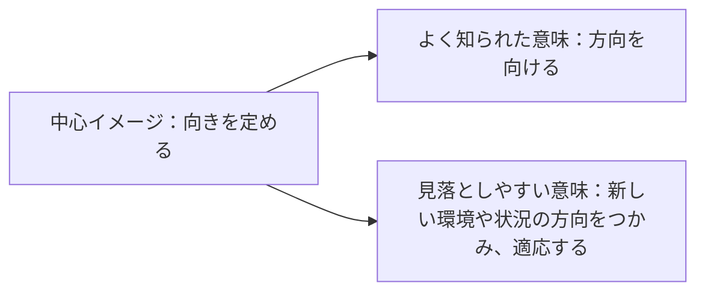

**重要語法：** orient oneself to + 環境・状況

---

## 3202. adhere

**品詞：** 動詞  
**発音：** /ədˈhɪr/

<small>よく知られている意味：くっつく</small>

### 見落としやすい意味：規則や信念などを忠実に守る

**例文：** All members must adhere to the safety rules.  
**和訳：** 全員が安全規則を守らなければならない。

**コアイメージ：** 物にぴったり付いて離れないのが出発点。規則や信念から離れず従うことにも使う。

**図：**

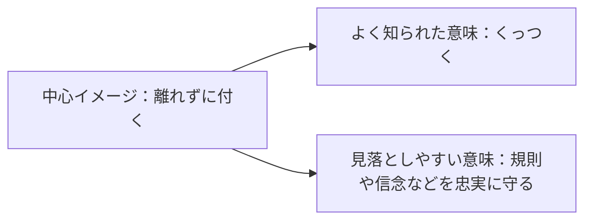

**重要語法：** adhere to + 規則・原則

---

## 3203. redundancy

**品詞：** 名詞  
**発音：** /rɪˈdʌndənsi/

<small>よく知られている意味：冗長さ・重複</small>

### 見落としやすい意味：余剰人員としての解雇・人員整理（主に英国英語）

**例文：** The factory announced fifty redundancies after the merger.  
**和訳：** その工場は合併後、50人の人員整理を発表した。

**コアイメージ：** 必要量を超えて余るという発想が中心。文章では余分な重複を、雇用では余剰人員の発生を指す。

**図：**

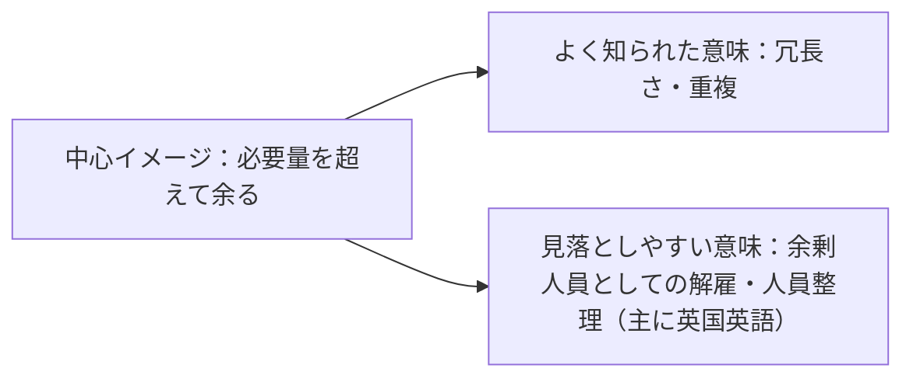

**重要語法：** make somebody redundant＝人員整理で解雇する

---

## 3204. appraisal

**品詞：** 名詞  
**発音：** /əˈpreɪzəl/

<small>よく知られている意味：価値の鑑定・評価</small>

### 見落としやすい意味：従業員などの業績評価・査定

**例文：** Each employee receives an annual performance appraisal.  
**和訳：** 各従業員は毎年、勤務成績の査定を受ける。

**コアイメージ：** 対象の価値や出来を見極めるのが中心。物の値段だけでなく、仕事の成果を評価する場合にも使う。

**図：**

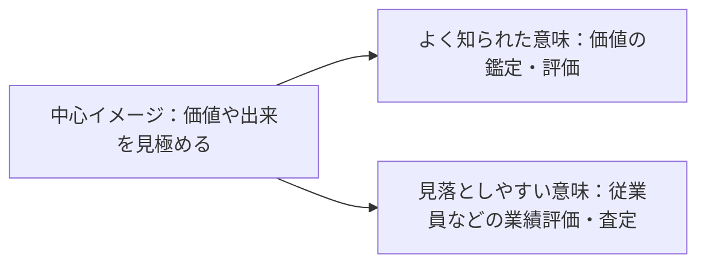

**重要語法：** performance appraisal＝業績評価

---

## 3205. austere

**品詞：** 形容詞  
**発音：** /ɔːˈstɪr/

<small>よく知られている意味：厳格な・質素な</small>

### 見落としやすい意味：財政支出を厳しく抑える、緊縮的な

**例文：** The government introduced an austere budget to reduce debt.  
**和訳：** 政府は債務を減らすため、緊縮的な予算を導入した。

**コアイメージ：** 華美なものを削ぎ落とし、厳しく抑える性質が中心。生活の質素さが財政支出の抑制にも広がる。

**図：**

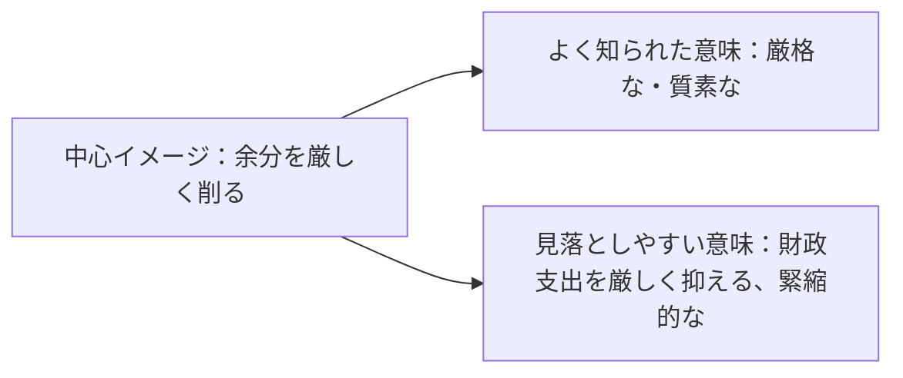

**重要語法：** austere budget／austere fiscal measures

---

## 3206. bishop

**品詞：** 名詞  
**発音：** /ˈbɪʃəp/

<small>よく知られている意味：司教</small>

### 見落としやすい意味：チェスで斜めに動く駒、ビショップ

**例文：** She moved her bishop diagonally across the board.  
**和訳：** 彼女はビショップを盤面で斜めに動かした。

**コアイメージ：** 宗教上の役職とチェスの駒は、同じ単語でも指す対象が異なる。チェスの文脈では駒の名前として判断する。

**図：**

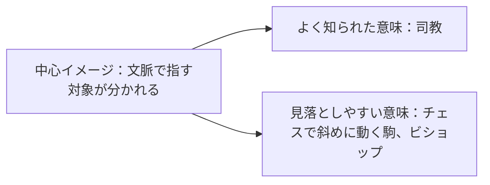

---

## 3207. blur

**品詞：** 動詞  
**発音：** /blɝː/

<small>よく知られている意味：ぼやけさせる</small>

### 見落としやすい意味：区別・境界を曖昧にする

**例文：** The new technology blurs the line between work and leisure.  
**和訳：** 新技術は仕事と余暇の境界を曖昧にする。

**コアイメージ：** 輪郭がぼけると境目が見分けにくくなる。同じことが概念や役割の区別にも起こると捉える。

**図：**

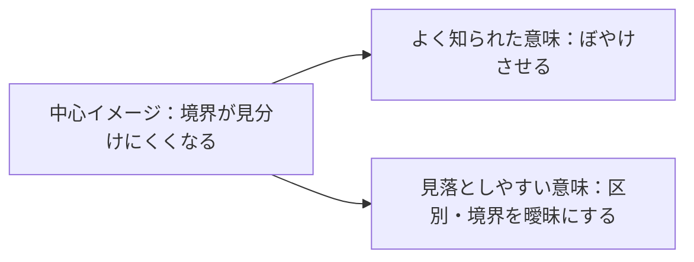

**重要語法：** blur the line／blur the distinction between A and B

---

## 3208. bout

**品詞：** 名詞  
**発音：** /baʊt/

<small>よく知られている意味：（ボクシングなどの）一試合</small>

### 見落としやすい意味：病気・感情などが一時的に続くひとしきり

**例文：** After a short bout of flu, he returned to school.  
**和訳：** 短いインフルエンザの期間を経て、彼は学校に戻った。

**コアイメージ：** 限られた時間続く一まとまりの出来事が中心。競技の一回の対戦にも、病気の一時的な症状にも使う。

**図：**

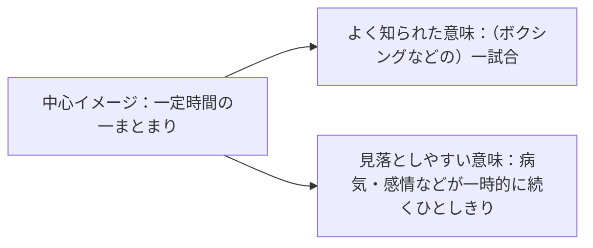

**重要語法：** a bout of illness／a bout of anger

---

## 3209. cobble

**品詞：** 句・慣用表現  
**発音：** /ˈkɑːbəl/

<small>よく知られている意味：靴を修繕する</small>

### 見落としやすい意味：あり合わせを寄せ集めて急ごしらえする

**例文：** We cobbled together a plan from several rough ideas.  
**和訳：** 私たちはいくつかの大まかな案を寄せ集め、急いで計画を作った。

**コアイメージ：** 小さな部分をつなぎ合わせる作業を思い浮かべる。計画でも完成品を一から整えるのでなく、手元の材料を継ぎ合わせる。

**図：**

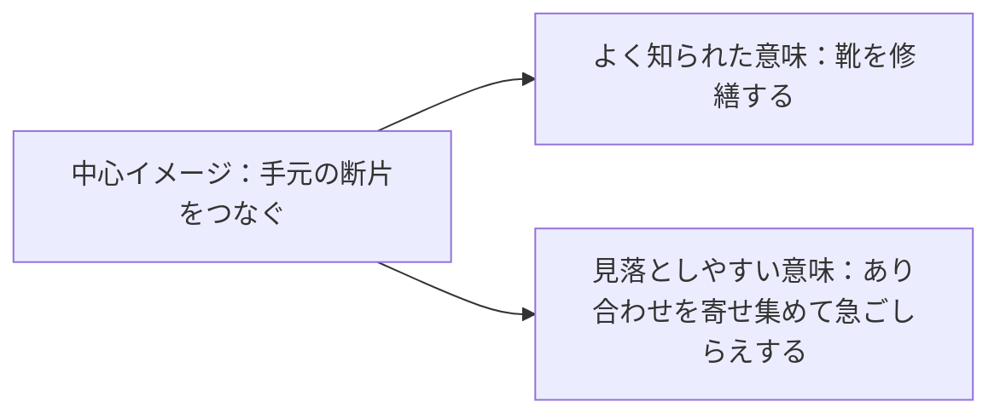

**重要語法：** cobble together + 計画・資金・資料

---

## 3210. curtain

**品詞：** 句・慣用表現  
**発音：** /ˈkɝːtən/

<small>よく知られている意味：カーテン・幕</small>

### 見落としやすい意味：物事や時代に幕を引き、終わらせる

**例文：** The final concert brought down the curtain on the band's career.  
**和訳：** 最後の公演はそのバンドの活動に幕を引いた。

**コアイメージ：** 舞台の幕が下りると公演が終わる。そこから活動や時代の終結を舞台に見立てた表現になる。

**図：**

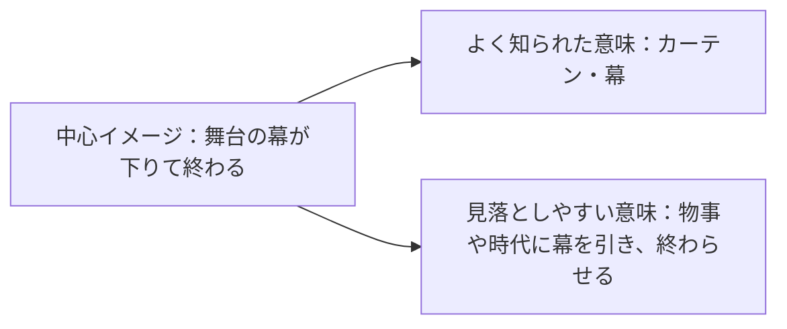

**重要語法：** bring down the curtain on + 出来事

---

## 3211. dole

**品詞：** 名詞  
**発音：** /doʊl/

<small>よく知られている意味：分配されるもの</small>

### 見落としやすい意味：失業給付・公的扶助（特に英国）

**例文：** He was on the dole for several months after losing his job.  
**和訳：** 彼は失職後、数か月間失業給付を受けていた。

**コアイメージ：** 必要な人に給付を分け与えることが背景にある。英国では特に、失業中に受け取る公的給付を指す。

**図：**

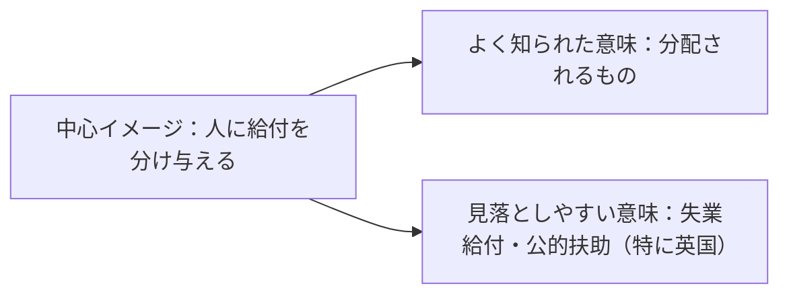

**重要語法：** be on the dole＝失業給付を受けている

---

## 3212. dole

**品詞：** 動詞  
**発音：** /doʊl/

<small>よく知られている意味：（名詞）失業給付</small>

### 見落としやすい意味：少しずつ分配する

**例文：** The volunteers doled out food to the waiting families.  
**和訳：** ボランティアたちは待っている家族に食料を少しずつ配った。

**コアイメージ：** 限られたものを人々に割り当てる感覚。dole out では、一度にではなく順に分けて渡す様子が表れる。

**図：**

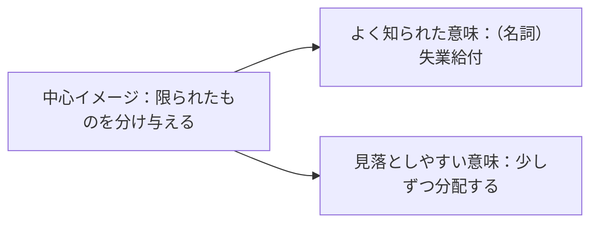

**重要語法：** dole out + 食料・資金・助言

---

## 3213. inaugural

**品詞：** 形容詞  
**発音：** /ɪˈnɔːɡjərəl/

<small>よく知られている意味：就任の・就任式の</small>

### 見落としやすい意味：最初の、初開催の

**例文：** The airline celebrated its inaugural flight to the island.  
**和訳：** 航空会社はその島への初便を祝った。

**コアイメージ：** ある役割や活動が正式に始まる時点を表す。就任式だけでなく、新しい路線・大会などの初回を指せる。

**図：**

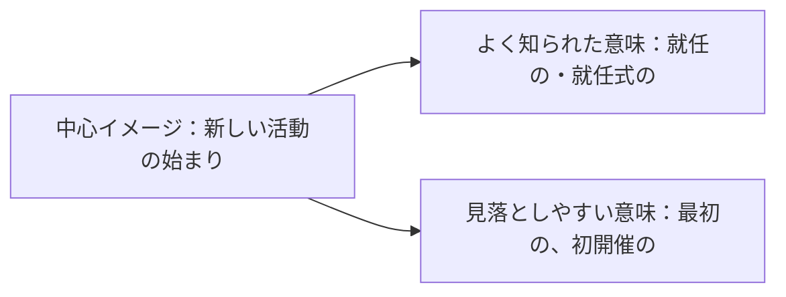

**重要語法：** inaugural flight／inaugural event

---

## 3214. insure

**品詞：** 動詞  
**発音：** /ɪnˈʃʊr/

<small>よく知られている意味：保険を掛ける</small>

### 見落としやすい意味：確実にする、保証する（主に米国英語）

**例文：** We checked the details twice to insure that the plan would work.  
**和訳：** 私たちは計画がうまくいくよう、詳細を二度確認した。

**コアイメージ：** 望ましくない結果に備えるという考えが背景にある。保険を掛ける以外に、結果の確実性を高める意味でも使われる。

**図：**

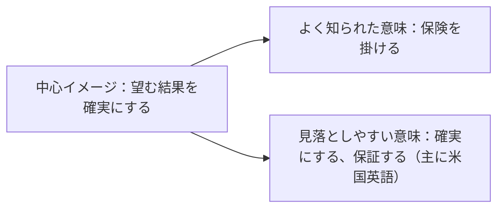

**重要語法：** insure that ...＝ensure that ... に近い（米国英語）

---

## 3215. literate

**品詞：** 形容詞  
**発音：** /ˈlɪtərət/

<small>よく知られている意味：読み書きができる</small>

### 見落としやすい意味：特定の分野の知識や技能がある

**例文：** Students need to become financially literate.  
**和訳：** 生徒には金融についての知識を身につけることが必要だ。

**コアイメージ：** 文字を理解して扱える能力が基本。その能力の対象が広がり、情報技術や金融などを理解して活用できることも表す。

**図：**

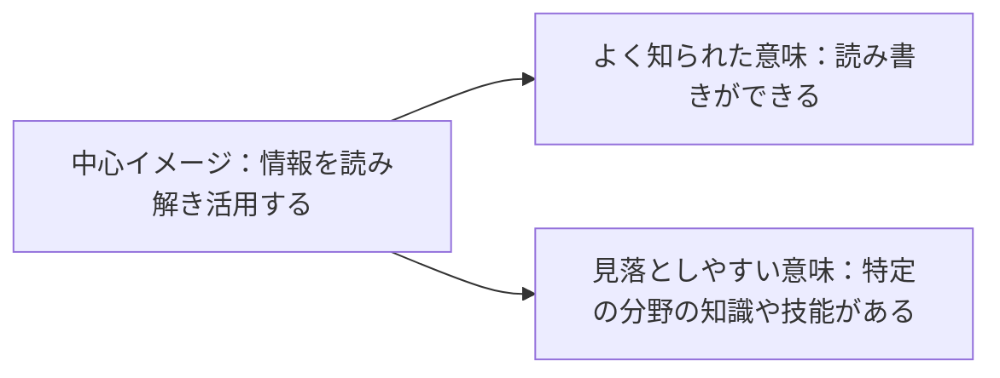

**重要語法：** financially literate／computer literate

---

## 3216. lurk

**品詞：** 動詞  
**発音：** /lɝːk/

<small>よく知られている意味：潜む・隠れている</small>

### 見落としやすい意味：ネット上で投稿せず閲覧だけする

**例文：** I lurked on the forum for weeks before writing a post.  
**和訳：** 私は投稿するまで何週間も掲示板を読むだけだった。

**コアイメージ：** 姿を見せず様子をうかがうのが中心。オンラインでは発言せずに他人の投稿を見ている行動を表す。

**図：**

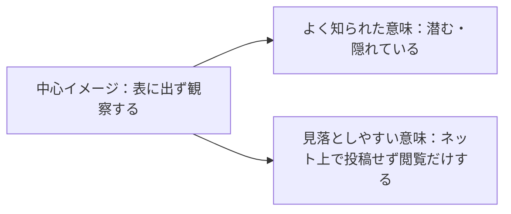

**重要語法：** lurk on a forum＝掲示板を閲覧だけする

---

## 3217. mobilize

**品詞：** 動詞  
**発音：** /ˈmoʊbəlaɪz/

<small>よく知られている意味：兵士を動員する</small>

### 見落としやすい意味：資金・資源・世論などを動員し結集する

**例文：** The charity mobilized local support for the project.  
**和訳：** その慈善団体は事業のために地域の支援を結集した。

**コアイメージ：** 必要な力を集めて動ける状態にするのが中心。兵士だけでなく、人々の協力や資金も対象になる。

**図：**

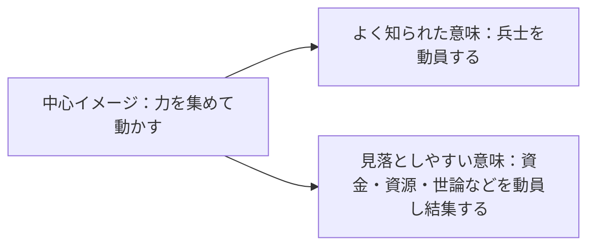

**重要語法：** mobilize support／mobilize resources

---

## 3218. oppressive

**品詞：** 形容詞  
**発音：** /əˈpresɪv/

<small>よく知られている意味：抑圧的な</small>

### 見落としやすい意味：暑さや空気などが息苦しく耐えがたい

**例文：** The oppressive heat made it hard to sleep.  
**和訳：** 耐えがたい暑さのせいで眠りにくかった。

**コアイメージ：** 上から重く押さえつけられるような感覚が中心。政治的な圧力だけでなく、暑さや雰囲気にも使う。

**図：**

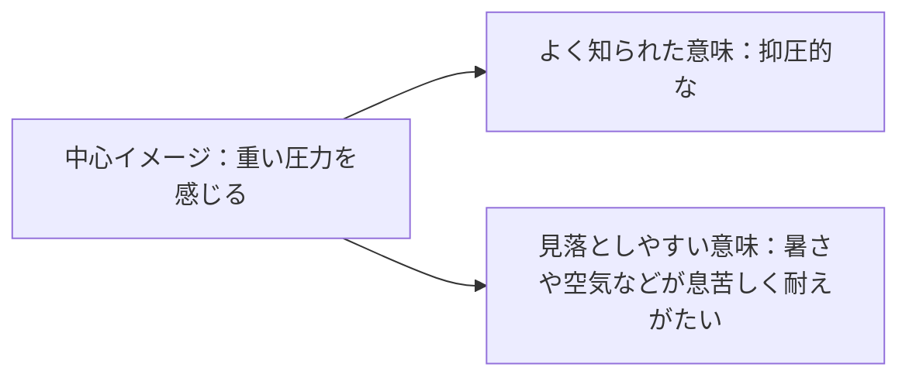

**重要語法：** oppressive heat／oppressive atmosphere

---

## 3219. pitcher

**品詞：** 名詞  
**発音：** /ˈpɪtʃər/

<small>よく知られている意味：野球の投手</small>

### 見落としやすい意味：水差し・飲み物を注ぐ容器

**例文：** There was a pitcher of cold water on the table.  
**和訳：** テーブルには冷たい水を入れた水差しがあった。

**コアイメージ：** 野球の投手と容器は同じ綴りの別の意味。飲み物や食卓の場面では、水などを注ぐ器具として読む。

**図：**

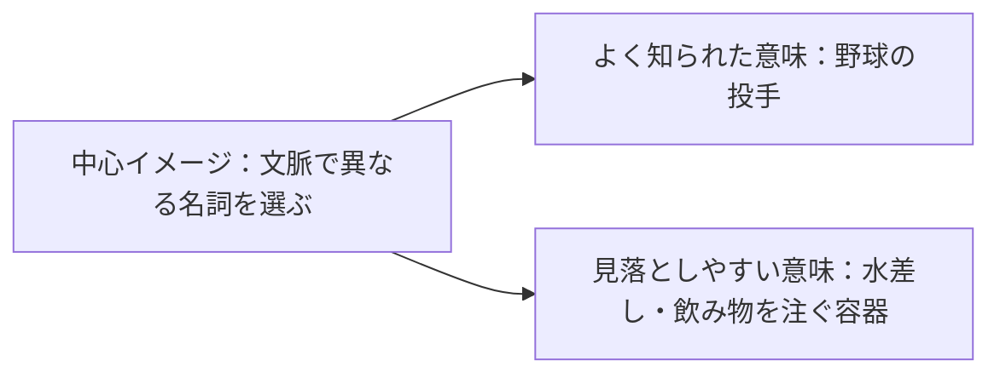

**重要語法：** a pitcher of water＝水差し一杯の水

---

## 3220. playing

**品詞：** 句・慣用表現  
**発音：** /ˈpleɪɪŋ/

<small>よく知られている意味：遊ぶ・競技をする</small>

### 見落としやすい意味：公平な競争条件

**例文：** The policy aims to create a level playing field for small firms.  
**和訳：** その政策は小企業にも公平な競争条件を整えることを目指す。

**コアイメージ：** 競技場が平らならどちらにも地形上の有利不利がない。この比喩を、企業や人が競争する際の条件に広げる。

**図：**

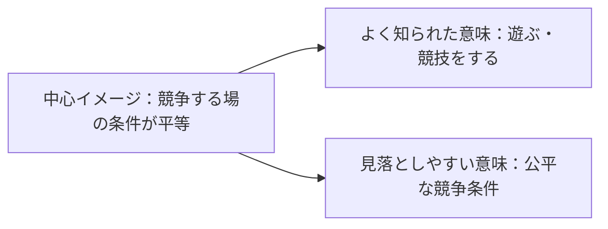

**重要語法：** a level playing field＝公平な競争条件

---

## 3221. prey

**品詞：** 動詞  
**発音：** /preɪ/

<small>よく知られている意味：獲物（名詞）</small>

### 見落としやすい意味：弱みにつけ込んで搾取する

**例文：** Some scammers prey on people who feel isolated.  
**和訳：** 一部の詐欺師は孤立を感じる人々の弱みにつけ込む。

**コアイメージ：** 捕食者が弱い獲物を狙うのがもとの構図。人間関係では弱い立場につけ込む行為を指す。

**図：**

```mermaid
flowchart LR
    A["中心イメージ：弱い相手を狙う"]
    B["よく知られた意味：獲物（名詞）"]
    C["見落としやすい意味：弱みにつけ込んで搾取する"]
    A --> B
    A --> C
```

**重要語法：** prey on + 人・弱み

---

## 3222. prey

**品詞：** 動詞  
**発音：** /preɪ/

<small>よく知られている意味：獲物（名詞）</small>

### 見落としやすい意味：心配事などが頭から離れず心をむしばむ

**例文：** The unanswered question preyed on her mind all night.  
**和訳：** 答えの出ない疑問が一晩中、彼女の心を悩ませた。

**コアイメージ：** 何かが繰り返し相手を苦しめる感覚が背景にある。心配が心から離れず負担になる状態を表す。

**図：**

```mermaid
flowchart LR
    A["中心イメージ：心の平穏を食い荒らす"]
    B["よく知られた意味：獲物（名詞）"]
    C["見落としやすい意味：心配事などが頭から離れず心をむしばむ"]
    A --> B
    A --> C
```

**重要語法：** prey on someone's mind

---

## 3223. pronounced

**品詞：** 形容詞  
**発音：** /prəˈnaʊnst/

<small>よく知られている意味：発音された（過去分詞）</small>

### 見落としやすい意味：特徴・差が著しい、際立った

**例文：** There was a pronounced difference between the two results.  
**和訳：** 二つの結果には著しい差があった。

**コアイメージ：** はっきり示され、誰の目にも分かることが中心。音として発せられる意味とは別に、差や特徴の目立ち方を表す。

**図：**

```mermaid
flowchart LR
    A["中心イメージ：はっきり現れている"]
    B["よく知られた意味：発音された（過去分詞）"]
    C["見落としやすい意味：特徴・差が著しい、際立った"]
    A --> B
    A --> C
```

**重要語法：** a pronounced difference／a pronounced effect

---

## 3224. quarterly

**品詞：** 名詞  
**発音：** /ˈkwɔːrtərli/

<small>よく知られている意味：四半期ごとの</small>

### 見落としやすい意味：季刊誌・年4回発行の雑誌

**例文：** Her essay appeared in a literary quarterly.  
**和訳：** 彼女の随筆は文芸季刊誌に掲載された。

**コアイメージ：** 一年を四つに区切る周期が中心。発行頻度を表す形容詞が、その周期で出る刊行物の名詞になる。

**図：**

```mermaid
flowchart LR
    A["中心イメージ：年を四つに分ける周期"]
    B["よく知られた意味：四半期ごとの"]
    C["見落としやすい意味：季刊誌・年4回発行の雑誌"]
    A --> B
    A --> C
```

**重要語法：** a literary quarterly＝文芸季刊誌

---

## 3225. requisite

**品詞：** 名詞  
**発音：** /ˈrekwɪzɪt/

<small>よく知られている意味：必要な（形容詞）</small>

### 見落としやすい意味：必要条件・必要なもの（名詞）

**例文：** Patience is a requisite for this kind of work.  
**和訳：** 忍耐はこの種の仕事に必要な条件だ。

**コアイメージ：** 何かを成し遂げるのに欠かせない性質が中心。その性質を持つもの自体を名詞で指せる。

**図：**

```mermaid
flowchart LR
    A["中心イメージ：実現に不可欠なもの"]
    B["よく知られた意味：必要な（形容詞）"]
    C["見落としやすい意味：必要条件・必要なもの（名詞）"]
    A --> B
    A --> C
```

**重要語法：** a requisite for + 目的

---

## 3226. seam

**品詞：** 名詞  
**発音：** /siːm/

<small>よく知られている意味：縫い目・継ぎ目</small>

### 見落としやすい意味：石炭などの層・鉱脈

**例文：** Miners discovered a thick seam of coal underground.  
**和訳：** 鉱夫たちは地下に厚い石炭層を発見した。

**コアイメージ：** 長く続く細い帯やつなぎ目を捉える。地中で帯状に続く石炭の層も seam と呼ぶ。

**図：**

```mermaid
flowchart LR
    A["中心イメージ：帯のように長く続くもの"]
    B["よく知られた意味：縫い目・継ぎ目"]
    C["見落としやすい意味：石炭などの層・鉱脈"]
    A --> B
    A --> C
```

**重要語法：** a seam of coal＝石炭層

---

## 3227. shady

**品詞：** 形容詞  
**発音：** /ˈʃeɪdi/

<small>よく知られている意味：日陰のある</small>

### 見落としやすい意味：人物や商売が怪しい・信用できない

**例文：** The police investigated a shady business deal.  
**和訳：** 警察は怪しい商取引を調査した。

**コアイメージ：** 光が届かず中が見えにくいという感覚。比喩的には実態が見えず、信用しにくい人物や取引を指す。

**図：**

```mermaid
flowchart LR
    A["中心イメージ：明るみに出ず不透明"]
    B["よく知られた意味：日陰のある"]
    C["見落としやすい意味：人物や商売が怪しい・信用できない"]
    A --> B
    A --> C
```

**重要語法：** shady dealings＝いかがわしい取引

---

## 3228. spit

**品詞：** 名詞  
**発音：** /spɪt/

<small>よく知られている意味：つば（を吐くこと）</small>

### 見落としやすい意味：海や川に細長く突き出す砂州

**例文：** We walked along a narrow spit of sand into the bay.  
**和訳：** 私たちは湾に突き出した細長い砂州を歩いた。

**コアイメージ：** この地形名では水域に向かって細長く突き出す形が重要。つばの意味を当てず、地形として区別する。

**図：**

```mermaid
flowchart LR
    A["中心イメージ：細長く水面へ突き出す"]
    B["よく知られた意味：つば（を吐くこと）"]
    C["見落としやすい意味：海や川に細長く突き出す砂州"]
    A --> B
    A --> C
```

**重要語法：** a spit of land／a sand spit

---

## 3229. spit

**品詞：** 動詞  
**発音：** /spɪt/

<small>よく知られている意味：つばを吐く</small>

### 見落としやすい意味：雨や雪がぱらつく

**例文：** It began to spit rain as we left the station.  
**和訳：** 駅を出るころ、小雨がぱらつき始めた。

**コアイメージ：** 少量の水滴が短く飛び出すイメージを天気に重ねる。強い雨ではなく、細かな雨粒が散る場面に使う。

**図：**

```mermaid
flowchart LR
    A["中心イメージ：細かな水滴が飛ぶ"]
    B["よく知られた意味：つばを吐く"]
    C["見落としやすい意味：雨や雪がぱらつく"]
    A --> B
    A --> C
```

**重要語法：** spit rain＝小雨がぱらつく

---

## 3230. squirrel

**品詞：** 動詞  
**発音：** /ˈskwɝːəl/

<small>よく知られている意味：リス（名詞）</small>

### 見落としやすい意味：後で使うために蓄えておく

**例文：** She squirreled away a little money each month.  
**和訳：** 彼女は毎月少しずつお金を蓄えていた。

**コアイメージ：** リスが食べ物を隠しておく様子に由来する比喩。すぐに使わず、将来のために資源を取っておく。

**図：**

```mermaid
flowchart LR
    A["中心イメージ：後で使うものを隠して貯める"]
    B["よく知られた意味：リス（名詞）"]
    C["見落としやすい意味：後で使うために蓄えておく"]
    A --> B
    A --> C
```

**重要語法：** squirrel away + 金・資料

---

## 3231. stronghold

**品詞：** 名詞  
**発音：** /ˈstrɔːŋhoʊld/

<small>よく知られている意味：要塞・砦</small>

### 見落としやすい意味：思想や政治勢力の強固な拠点・牙城

**例文：** The district remains a stronghold of the opposition party.  
**和訳：** その地区は今も野党の強固な地盤だ。

**コアイメージ：** 外から簡単に崩せない拠点が中心。軍事的な城だけでなく、支持や影響力が特に強い地域にも使う。

**図：**

```mermaid
flowchart LR
    A["中心イメージ：強く守られた拠点"]
    B["よく知られた意味：要塞・砦"]
    C["見落としやすい意味：思想や政治勢力の強固な拠点・牙城"]
    A --> B
    A --> C
```

**重要語法：** a stronghold of + 勢力・思想

---

## 3232. tangible

**品詞：** 形容詞  
**発音：** /ˈtændʒəbəl/

<small>よく知られている意味：触れることのできる</small>

### 見落としやすい意味：効果や利益が具体的で明確な、実質的な

**例文：** The project brought tangible benefits to the community.  
**和訳：** その事業は地域に目に見える利益をもたらした。

**コアイメージ：** 手で触れられるほど実在感があるのが基本。抽象的な利益でも、確かな成果として認識できることを表す。

**図：**

```mermaid
flowchart LR
    A["中心イメージ：存在や効果をはっきり確かめられる"]
    B["よく知られた意味：触れることのできる"]
    C["見落としやすい意味：効果や利益が具体的で明確な、実質的な"]
    A --> B
    A --> C
```

**重要語法：** tangible benefits／tangible results

---

## 3233. feather

**品詞：** 句・慣用表現  
**発音：** /ˈfeðər/

<small>よく知られている意味：羽根</small>

### 見落としやすい意味：誇るべき功績・名誉（慣用表現）

**例文：** Winning the award was a feather in her cap.  
**和訳：** その賞の受賞は彼女にとって誇るべき功績だった。

**コアイメージ：** 帽子に羽根を飾ることが名誉の印になるという比喩。実際の羽根ではなく、胸を張れる実績を指す。

**図：**

```mermaid
flowchart LR
    A["中心イメージ：帽子を飾る名誉の印"]
    B["よく知られた意味：羽根"]
    C["見落としやすい意味：誇るべき功績・名誉（慣用表現）"]
    A --> B
    A --> C
```

**重要語法：** a feather in one's cap

---

## 3234. tidy

**品詞：** 形容詞  
**発音：** /ˈtaɪdi/

<small>よく知られている意味：きちんと整った</small>

### 見落としやすい意味：金額・利益などがかなりの、多額の

**例文：** He earned a tidy sum from the sale of his paintings.  
**和訳：** 彼は絵の売却でかなりまとまった金額を得た。

**コアイメージ：** 金額の tidy は「整理された」と訳さない。口語では十分に大きく、まとまった額を肯定的に表す別用法になる。

**図：**

```mermaid
flowchart LR
    A["中心イメージ：まとまって十分な規模がある"]
    B["よく知られた意味：きちんと整った"]
    C["見落としやすい意味：金額・利益などがかなりの、多額の"]
    A --> B
    A --> C
```

**重要語法：** a tidy sum／a tidy profit

---

## 3235. minus

**品詞：** 名詞  
**発音：** /ˈmaɪnəs/

<small>よく知られている意味：引き算・負の数</small>

### 見落としやすい意味：欠点・マイナス面

**例文：** The long journey is the only minus of living here.  
**和訳：** 長い通勤時間がここに住む唯一の欠点だ。

**コアイメージ：** 数を差し引く印がもとの感覚。評価では全体の価値を下げる要素を「マイナス」と呼ぶ。

**図：**

```mermaid
flowchart LR
    A["中心イメージ：全体から価値を差し引く"]
    B["よく知られた意味：引き算・負の数"]
    C["見落としやすい意味：欠点・マイナス面"]
    A --> B
    A --> C
```

**重要語法：** a plus and a minus＝長所と短所

---

## 3236. minus

**品詞：** 前置詞  
**発音：** /ˈmaɪnəs/

<small>よく知られている意味：マイナス、～を引く</small>

### 見落としやすい意味：～なしで、～を欠いて

**例文：** The team arrived minus its captain.  
**和訳：** チームは主将抜きで到着した。

**コアイメージ：** 何かを差し引く発想が中心。計算対象ではなく人や条件から引けば、「それがない状態」を示す。

**図：**

```mermaid
flowchart LR
    A["中心イメージ：あるものを取り除く"]
    B["よく知られた意味：マイナス、～を引く"]
    C["見落としやすい意味：～なしで、～を欠いて"]
    A --> B
    A --> C
```

**重要語法：** minus + 人・物・条件

---

## 3237. plug

**品詞：** 動詞  
**発音：** /plʌɡ/

<small>よく知られている意味：栓をする・プラグを差す</small>

### 見落としやすい意味：商品や作品を盛んに宣伝する

**例文：** The host kept plugging his new book during the interview.  
**和訳：** 司会者はインタビュー中、自分の新刊をしきりに宣伝していた。

**コアイメージ：** 本義とは別に、話題へ商品名を繰り返し差し込むような宣伝に使う。会話や番組での売り込みという文脈が手掛かり。

**図：**

```mermaid
flowchart LR
    A["中心イメージ：人の注意に商品を押し出す"]
    B["よく知られた意味：栓をする・プラグを差す"]
    C["見落としやすい意味：商品や作品を盛んに宣伝する"]
    A --> B
    A --> C
```

**重要語法：** plug a book／plug a product

---

## 3238. plug

**品詞：** 動詞  
**発音：** /plʌɡ/

<small>よく知られている意味：栓をする・差し込む</small>

### 見落としやすい意味：根気強く取り組み続ける

**例文：** He plugged away at the report until it was finished.  
**和訳：** 彼は報告書が完成するまで根気強く取り組んだ。

**コアイメージ：** 一度の大きな成果ではなく、地道な作業を繰り返す感じ。plug away at は苦労してもやめずに続けることを示す。

**図：**

```mermaid
flowchart LR
    A["中心イメージ：小さな努力を続ける"]
    B["よく知られた意味：栓をする・差し込む"]
    C["見落としやすい意味：根気強く取り組み続ける"]
    A --> B
    A --> C
```

**重要語法：** plug away at + 作業

---

## 3239. disposition

**品詞：** 名詞  
**発音：** /ˌdɪspəˈzɪʃən/

<small>よく知られている意味：気質・性格</small>

### 見落としやすい意味：人や物の配置・配列

**例文：** The map shows the disposition of the units along the coast.  
**和訳：** その地図は沿岸に沿った部隊の配置を示している。

**コアイメージ：** 物事がどのように置かれ、整えられているかが背景にある。人の性向だけでなく、人員や設備の並び方も指す。

**図：**

```mermaid
flowchart LR
    A["中心イメージ：どのように配置されているか"]
    B["よく知られた意味：気質・性格"]
    C["見落としやすい意味：人や物の配置・配列"]
    A --> B
    A --> C
```

**重要語法：** disposition of troops／disposition of resources

---

## 3240. liable

**品詞：** 形容詞  
**発音：** /ˈlaɪəbəl/

<small>よく知られている意味：法的責任がある</small>

### 見落としやすい意味：～しがちだ・～するおそれがある

**例文：** Small errors are liable to occur when we rush.  
**和訳：** 急ぐと小さなミスが起こりやすい。

**コアイメージ：** ある結果を引き受ける立場という意味合いから、好ましくないことが起こる可能性も表す。be liable to do は文脈に注意する。

**図：**

```mermaid
flowchart LR
    A["中心イメージ：ある結果につながりやすい"]
    B["よく知られた意味：法的責任がある"]
    C["見落としやすい意味：～しがちだ・～するおそれがある"]
    A --> B
    A --> C
```

**重要語法：** be liable to do＝～するおそれがある

---

## 3241. gauge

**品詞：** 動詞  
**発音：** /ɡeɪdʒ/

<small>よく知られている意味：計器・ゲージ</small>

### 見落としやすい意味：状況や反応・程度を推し量る

**例文：** It was difficult to gauge the audience's reaction.  
**和訳：** 観客の反応を推し量るのは難しかった。

**コアイメージ：** 計器で量を測るのが基本。数値にできない反応や気持ちでも、手掛かりから程度を判断することを指す。

**図：**

```mermaid
flowchart LR
    A["中心イメージ：手掛かりから程度を測る"]
    B["よく知られた意味：計器・ゲージ"]
    C["見落としやすい意味：状況や反応・程度を推し量る"]
    A --> B
    A --> C
```

**重要語法：** gauge + 反応・程度・影響

---

## 3242. tame

**品詞：** 形容詞  
**発音：** /teɪm/

<small>よく知られている意味：飼いならされた・おとなしい</small>

### 見落としやすい意味：退屈な・面白みに欠ける

**例文：** The film had a surprisingly tame ending.  
**和訳：** その映画の結末は意外なほど平凡で物足りなかった。

**コアイメージ：** 刺激や勢いが抑えられた状態が中心。動物が従順なことから、作品が迫力を欠く評価にも広がる。

**図：**

```mermaid
flowchart LR
    A["中心イメージ：刺激や勢いが弱い"]
    B["よく知られた意味：飼いならされた・おとなしい"]
    C["見落としやすい意味：退屈な・面白みに欠ける"]
    A --> B
    A --> C
```

**重要語法：** a tame ending／a tame performance

---

## 3243. tame

**品詞：** 動詞  
**発音：** /teɪm/

<small>よく知られている意味：動物を飼いならす</small>

### 見落としやすい意味：感情・物価などを抑える、和らげる

**例文：** The new measures are intended to tame inflation.  
**和訳：** 新たな対策はインフレを抑えることを目的としている。

**コアイメージ：** 制御しにくいものを落ち着かせるのが中心。動物だけでなく、怒りや物価上昇も制御の対象になる。

**図：**

```mermaid
flowchart LR
    A["中心イメージ：暴れるものを制御する"]
    B["よく知られた意味：動物を飼いならす"]
    C["見落としやすい意味：感情・物価などを抑える、和らげる"]
    A --> B
    A --> C
```

**重要語法：** tame inflation／tame one's anger

---

## 3244. roast

**品詞：** 動詞  
**発音：** /roʊst/

<small>よく知られている意味：焼く・あぶる</small>

### 見落としやすい意味：人や作品を痛烈に批判する

**例文：** Critics roasted the show for its weak script.  
**和訳：** 批評家たちは脚本の弱さを理由にその番組を酷評した。

**コアイメージ：** 熱で容赦なく焼く感覚が比喩になる。言葉で厳しく攻撃するような、辛辣な批判を表す。

**図：**

```mermaid
flowchart LR
    A["中心イメージ：熱で容赦なく攻める"]
    B["よく知られた意味：焼く・あぶる"]
    C["見落としやすい意味：人や作品を痛烈に批判する"]
    A --> B
    A --> C
```

**重要語法：** roast someone for ...＝～を理由に酷評する

---

## 3245. refresh

**品詞：** 句・慣用表現  
**発音：** /rɪˈfreʃ/

<small>よく知られている意味：新鮮にする・更新する</small>

### 見落としやすい意味：記憶を呼び起こす、思い出させる

**例文：** This old photo may refresh your memory of that day.  
**和訳：** この古い写真を見れば、あの日のことを思い出せるかもしれない。

**コアイメージ：** 薄れたものを再び鮮明にする感覚。記憶を新しくするのではなく、忘れかけた情報を思い出せる状態に戻す。

**図：**

```mermaid
flowchart LR
    A["中心イメージ：薄れた記憶を鮮明に戻す"]
    B["よく知られた意味：新鮮にする・更新する"]
    C["見落としやすい意味：記憶を呼び起こす、思い出させる"]
    A --> B
    A --> C
```

**重要語法：** refresh someone's memory

---

## 3246. arouse

**品詞：** 動詞  
**発音：** /əˈraʊz/

<small>よく知られている意味：眠りから覚ます</small>

### 見落としやすい意味：疑念・怒り・好奇心などを引き起こす

**例文：** His sudden silence aroused suspicion among the staff.  
**和訳：** 彼が突然黙ったことで、職員の間に疑念が生じた。

**コアイメージ：** 静かな状態から何かを呼び起こすのが中心。人を起こすだけでなく、感情や疑念が生まれることにも使う。

**図：**

```mermaid
flowchart LR
    A["中心イメージ：眠っていた反応を呼び起こす"]
    B["よく知られた意味：眠りから覚ます"]
    C["見落としやすい意味：疑念・怒り・好奇心などを引き起こす"]
    A --> B
    A --> C
```

**重要語法：** arouse suspicion／arouse curiosity

---

## 3247. bass

**品詞：** 名詞  
**発音：** /bæs/

<small>よく知られている意味：低音・バス音（/beɪs/）</small>

### 見落としやすい意味：スズキ類の魚（/bæs/）

**例文：** We caught a large bass in the lake.  
**和訳：** 私たちは湖で大きなバス（魚）を釣った。

**コアイメージ：** 同じ綴りでも、音楽の bass と魚の bass は別の読みと意味を持つ。ここでは釣りや魚の場面なので /bæs/ と読む。

**図：**

```mermaid
flowchart LR
    A["中心イメージ：同綴り・異音異義"]
    B["よく知られた意味：低音・バス音（/beɪs/）"]
    C["見落としやすい意味：スズキ類の魚（/bæs/）"]
    A --> B
    A --> C
```

**重要語法：** fish の bass は /bæs/、低音は /beɪs/

---

## 3248. bible

**品詞：** 名詞  
**発音：** /ˈbaɪbəl/

<small>よく知られている意味：聖書</small>

### 見落としやすい意味：その分野の決定版の手引き書・必携書

**例文：** For many cooks, this book is the bible of bread making.  
**和訳：** 多くの料理人にとって、この本はパン作りの決定版だ。

**コアイメージ：** 信頼され、繰り返し参照される重要な本という特徴を取り出す。宗教書でなくても、分野を代表する権威ある本を比喩的に呼べる。

**図：**

```mermaid
flowchart LR
    A["中心イメージ：繰り返し頼る権威ある本"]
    B["よく知られた意味：聖書"]
    C["見落としやすい意味：その分野の決定版の手引き書・必携書"]
    A --> B
    A --> C
```

**重要語法：** the bible of + 分野

---

## 3249. choke

**品詞：** 動詞  
**発音：** /tʃoʊk/

<small>よく知られている意味：息を詰まらせる</small>

### 見落としやすい意味：供給・資金・成長などを妨げる、断つ

**例文：** The new restrictions choked off investment in the region.  
**和訳：** 新たな規制はその地域への投資を妨げた。

**コアイメージ：** 空気の流れが塞がれるのが基本。お金や物資の流れを遮ると、活動を停滞させる意味になる。

**図：**

```mermaid
flowchart LR
    A["中心イメージ：流れを塞いで止める"]
    B["よく知られた意味：息を詰まらせる"]
    C["見落としやすい意味：供給・資金・成長などを妨げる、断つ"]
    A --> B
    A --> C
```

**重要語法：** choke off + 供給・投資・成長

---

## 3250. clearance

**品詞：** 名詞  
**発音：** /ˈklɪrəns/

<small>よく知られている意味：障害物の撤去・片付け</small>

### 見落としやすい意味：機密情報への正式なアクセス許可・資格

**例文：** Only workers with security clearance can enter the room.  
**和訳：** 正式な機密取扱許可を持つ職員だけがその部屋に入れる。

**コアイメージ：** 妨げとなるものが取り除かれ、通過できる状態が中心。機密へのアクセスでは、審査を通って許可を得た状態を指す。

**図：**

```mermaid
flowchart LR
    A["中心イメージ：障壁が取り除かれ通れる"]
    B["よく知られた意味：障害物の撤去・片付け"]
    C["見落としやすい意味：機密情報への正式なアクセス許可・資格"]
    A --> B
    A --> C
```

**重要語法：** security clearance＝機密取扱許可

---

## 3251. clearance

**品詞：** 名詞  
**発音：** /ˈklɪrəns/

<small>よく知られている意味：片付け・除去</small>

### 見落としやすい意味：在庫一掃販売・売り尽くし

**例文：** The store is holding a clearance sale this weekend.  
**和訳：** その店は今週末、在庫一掃セールを行う。

**コアイメージ：** 残った物を一掃して場所を空ける感覚が中心。商業では在庫を処分するための販売を指す。

**図：**

```mermaid
flowchart LR
    A["中心イメージ：残りを一掃して空ける"]
    B["よく知られた意味：片付け・除去"]
    C["見落としやすい意味：在庫一掃販売・売り尽くし"]
    A --> B
    A --> C
```

**重要語法：** clearance sale＝在庫一掃セール

---

## 3252. discretion

**品詞：** 名詞  
**発音：** /dɪˈskreʃən/

<small>よく知られている意味：自由裁量・判断の自由</small>

### 見落としやすい意味：慎重さ・分別・秘密を守る配慮

**例文：** Please handle this sensitive matter with discretion.  
**和訳：** この繊細な問題には慎重に対処してください。

**コアイメージ：** 状況を見極めて適切に選ぶ判断力が中心。何をするかの裁量だけでなく、むやみに話さない慎重さも指す。

**図：**

```mermaid
flowchart LR
    A["中心イメージ：適切な判断で振る舞う"]
    B["よく知られた意味：自由裁量・判断の自由"]
    C["見落としやすい意味：慎重さ・分別・秘密を守る配慮"]
    A --> B
    A --> C
```

**重要語法：** with discretion＝慎重に

---

## 3253. disposable

**品詞：** 形容詞  
**発音：** /dɪˈspoʊzəbəl/

<small>よく知られている意味：使い捨ての</small>

### 見落としやすい意味：可処分の（disposable income＝税金などを引いた後に使える所得）

**例文：** Rising taxes left households with less disposable income.  
**和訳：** 増税により、世帯の可処分所得は減少した。

**コアイメージ：** 使ったり処分したりできる状態が中心。income につくと、税金などを差し引いた後に使える所得を意味する。生活必需費まで引いた額とは限らない。

**図：**

```mermaid
flowchart LR
    A["中心イメージ：自分で使い道を決められる"]
    B["よく知られた意味：使い捨ての"]
    C["見落としやすい意味：可処分の（disposable income＝税金などを引いた後に使える所得）"]
    A --> B
    A --> C
```

**重要語法：** disposable income＝可処分所得（生活必需費を引く前）

---

## 3254. drawn

**品詞：** 形容詞  
**発音：** /drɔːn/

<small>よく知られている意味：draw の過去分詞・描かれた</small>

### 見落としやすい意味：顔や表情がやつれた、疲れきった

**例文：** He looked pale and drawn after the long journey.  
**和訳：** 長旅の後、彼は顔色が悪く、やつれて見えた。

**コアイメージ：** 顔が引きつったように見える状態を表す形容詞。絵を描く意味ではなく、疲労が顔に表れている様子を読む。

**図：**

```mermaid
flowchart LR
    A["中心イメージ：顔が引きつったように見える"]
    B["よく知られた意味：draw の過去分詞・描かれた"]
    C["見落としやすい意味：顔や表情がやつれた、疲れきった"]
    A --> B
    A --> C
```

**重要語法：** a drawn face／look drawn

---

## 3255. eclipse

**品詞：** 名詞  
**発音：** /ɪˈklɪps/

<small>よく知られている意味：日食・月食</small>

### 見落としやすい意味：名声や影響力の衰え・失墜

**例文：** The eclipse of the port's importance was gradual.  
**和訳：** その港の重要性の衰えは徐々に進んだ。

**コアイメージ：** 天体が覆われて光が隠れるのが出発点。比喩的には、人や場所の輝き・影響力が薄れることを表す。

**図：**

```mermaid
flowchart LR
    A["中心イメージ：輝きや影響力が隠れる"]
    B["よく知られた意味：日食・月食"]
    C["見落としやすい意味：名声や影響力の衰え・失墜"]
    A --> B
    A --> C
```

**重要語法：** the eclipse of + 名声・重要性

---

## 3256. eclipse

**品詞：** 動詞  
**発音：** /ɪˈklɪps/

<small>よく知られている意味：日食・月食を起こす</small>

### 見落としやすい意味：業績や記録などで上回る、しのぐ

**例文：** Her latest novel eclipsed the success of her first book.  
**和訳：** 彼女の最新小説は処女作の成功を上回った。

**コアイメージ：** 一方の光が他方を覆い隠す構図。比較では後から現れたものが以前の成果を目立たなくするほど優れる。

**図：**

```mermaid
flowchart LR
    A["中心イメージ：一方の存在感が他方を覆う"]
    B["よく知られた意味：日食・月食を起こす"]
    C["見落としやすい意味：業績や記録などで上回る、しのぐ"]
    A --> B
    A --> C
```

**重要語法：** eclipse a record／eclipse earlier success

---

## 3257. enclave

**品詞：** 名詞  
**発音：** /ˈenkleɪv/

<small>よく知られている意味：（国土の）飛び地</small>

### 見落としやすい意味：都市や文化集団内の独自の区域・共同体

**例文：** The neighborhood grew into a vibrant cultural enclave.  
**和訳：** その地域は活気ある独自の文化圏へと発展した。

**コアイメージ：** 周囲とは異なる区域としてまとまるのが中心。国の飛び地だけでなく、都市の文化的な集まりにも使う。

**図：**

```mermaid
flowchart LR
    A["中心イメージ：周囲と区別される区域"]
    B["よく知られた意味：（国土の）飛び地"]
    C["見落としやすい意味：都市や文化集団内の独自の区域・共同体"]
    A --> B
    A --> C
```

**重要語法：** a cultural enclave／an ethnic enclave

---

## 3258. flush

**品詞：** 形容詞  
**発音：** /flʌʃ/

<small>よく知られている意味：水を流す・顔が赤らむ</small>

### 見落としやすい意味：お金が十分にある（口語）

**例文：** After the successful sale, the company was flush with cash.  
**和訳：** 売却が成功し、その会社には現金が潤沢にあった。

**コアイメージ：** この形容詞では「満ちている、十分ある」状態を表す。水を流す意味ではなく、資金に余裕があることを読む。

**図：**

```mermaid
flowchart LR
    A["中心イメージ：豊かに満ちている"]
    B["よく知られた意味：水を流す・顔が赤らむ"]
    C["見落としやすい意味：お金が十分にある（口語）"]
    A --> B
    A --> C
```

**重要語法：** be flush with cash＝現金が潤沢にある

---

## 3259. flush

**品詞：** 名詞  
**発音：** /flʌʃ/

<small>よく知られている意味：水を流すこと</small>

### 見落としやすい意味：感情が急に強くこみ上げること

**例文：** She felt a sudden flush of pride when she heard the news.  
**和訳：** その知らせを聞いたとき、彼女は急に誇らしい気持ちになった。

**コアイメージ：** 何かが一気に広がる瞬間的な高まりが中心。水や血の勢いを、喜びや誇りなどの感情にも重ねる。

**図：**

```mermaid
flowchart LR
    A["中心イメージ：一気に広がる高まり"]
    B["よく知られた意味：水を流すこと"]
    C["見落としやすい意味：感情が急に強くこみ上げること"]
    A --> B
    A --> C
```

**重要語法：** a flush of pride／a flush of excitement

---

## 3260. fond

**品詞：** 形容詞  
**発音：** /fɑːnd/

<small>よく知られている意味：be fond of＝～が好き</small>

### 見落としやすい意味：思い出などが懐かしく愛情のこもった

**例文：** He has fond memories of his childhood summers.  
**和訳：** 彼には子どものころの夏の懐かしい思い出がある。

**コアイメージ：** 対象に温かな気持ちを向けることが中心。人が好きというだけでなく、記憶に宿る好意や愛着にも使う。

**図：**

```mermaid
flowchart LR
    A["中心イメージ：温かな愛着を持つ"]
    B["よく知られた意味：be fond of＝～が好き"]
    C["見落としやすい意味：思い出などが懐かしく愛情のこもった"]
    A --> B
    A --> C
```

**重要語法：** fond memories＝懐かしい思い出

---

## 3261. hawk

**品詞：** 名詞  
**発音：** /hɔːk/

<small>よく知られている意味：タカ（鳥）</small>

### 見落としやすい意味：政治・外交などの強硬派

**例文：** The defense hawks opposed the proposed compromise.  
**和訳：** 防衛政策の強硬派は提案された妥協案に反対した。

**コアイメージ：** 鋭く獲物を狙うタカの姿が比喩になる。政策で妥協より強い対応を求める立場を表す。

**図：**

```mermaid
flowchart LR
    A["中心イメージ：攻撃的で強い姿勢"]
    B["よく知られた意味：タカ（鳥）"]
    C["見落としやすい意味：政治・外交などの強硬派"]
    A --> B
    A --> C
```

**重要語法：** a defense hawk／a war hawk

---

## 3262. hawk

**品詞：** 動詞  
**発音：** /hɔːk/

<small>よく知られている意味：タカ（鳥）</small>

### 見落としやすい意味：商品を呼び売りする・売り歩く

**例文：** Street vendors hawked snacks outside the stadium.  
**和訳：** 露天商たちは競技場の外で軽食を呼び売りしていた。

**コアイメージ：** この動詞は鳥のタカと混同せず、声を上げて商品を売り込む場面で捉える。人通りの多い場所での商売を表す。

**図：**

```mermaid
flowchart LR
    A["中心イメージ：声を出して商品を売り込む"]
    B["よく知られた意味：タカ（鳥）"]
    C["見落としやすい意味：商品を呼び売りする・売り歩く"]
    A --> B
    A --> C
```

**重要語法：** hawk goods on the street

---

## 3263. implicitly

**品詞：** 副詞  
**発音：** /ɪmˈplɪsɪtli/

<small>よく知られている意味：暗黙のうちに</small>

### 見落としやすい意味：全面的に・無条件に（信頼など）

**例文：** I trust her judgment implicitly.  
**和訳：** 私は彼女の判断を全面的に信頼している。

**コアイメージ：** 言葉に出して条件を付けないことが中心。trust とともに使うと、疑いなく信頼する強さを表す。

**図：**

```mermaid
flowchart LR
    A["中心イメージ：条件を言わずに受け入れる"]
    B["よく知られた意味：暗黙のうちに"]
    C["見落としやすい意味：全面的に・無条件に（信頼など）"]
    A --> B
    A --> C
```

**重要語法：** trust someone implicitly

---

## 3264. inject

**品詞：** 動詞  
**発音：** /ɪnˈdʒekt/

<small>よく知られている意味：注射する</small>

### 見落としやすい意味：資金・活力などを投入する

**例文：** The city injected fresh funds into public transport.  
**和訳：** 市は公共交通に新たな資金を投入した。

**コアイメージ：** 外から中へ必要なものを送り込むのが中心。薬液だけでなく、資金や活力をある事業に投入する場合にも使う。

**図：**

```mermaid
flowchart LR
    A["中心イメージ：外から必要なものを送り込む"]
    B["よく知られた意味：注射する"]
    C["見落としやすい意味：資金・活力などを投入する"]
    A --> B
    A --> C
```

**重要語法：** inject money into + 事業

---

## 3265. jerk

**品詞：** 名詞  
**発音：** /dʒɝːk/

<small>よく知られている意味：急な動き・ぐいっと引くこと</small>

### 見落としやすい意味：嫌な人・無礼な人

**例文：** He apologized for acting like a jerk.  
**和訳：** 彼は嫌な態度を取ったことを謝った。

**コアイメージ：** 動作の jerk と人への悪口は同じ綴りでも用法が異なる。人を指すときは「急な動き」ではなく、無礼で感じの悪い人を意味する。

**図：**

```mermaid
flowchart LR
    A["中心イメージ：文脈で別の名詞義を選ぶ"]
    B["よく知られた意味：急な動き・ぐいっと引くこと"]
    C["見落としやすい意味：嫌な人・無礼な人"]
    A --> B
    A --> C
```

**重要語法：** act like a jerk＝嫌なやつのように振る舞う

---

## 3266. retrospective

**品詞：** 名詞  
**発音：** /ˌretrəˈspektɪv/

<small>よく知られている意味：回顧的な（形容詞）</small>

### 見落としやすい意味：芸術家などの作品を振り返る回顧展

**例文：** The gallery held a retrospective of the painter's work.  
**和訳：** その画廊ではその画家の回顧展が開かれた。

**コアイメージ：** 過去にさかのぼって振り返るという意味が中心。名詞になると、制作活動全体を振り返る展覧会を表す。

**図：**

```mermaid
flowchart LR
    A["中心イメージ：過去を振り返る"]
    B["よく知られた意味：回顧的な（形容詞）"]
    C["見落としやすい意味：芸術家などの作品を振り返る回顧展"]
    A --> B
    A --> C
```

**重要語法：** a retrospective of + 芸術家・作品

---

## 3267. stagger

**品詞：** 動詞  
**発音：** /ˈstæɡər/

<small>よく知られている意味：よろめく</small>

### 見落としやすい意味：予定や開始時刻をずらして分散させる

**例文：** The school staggered lunch breaks to reduce crowding.  
**和訳：** 学校は混雑を減らすため昼休みの時間をずらした。

**コアイメージ：** 一列にぴったり並ばず、ずれて進むイメージが中心。予定を同時にせず、時間差を付けて配置する意味になる。

**図：**

```mermaid
flowchart LR
    A["中心イメージ：一斉に重ならないようずらす"]
    B["よく知られた意味：よろめく"]
    C["見落としやすい意味：予定や開始時刻をずらして分散させる"]
    A --> B
    A --> C
```

**重要語法：** stagger work hours／stagger breaks

---

## 3268. startup

**品詞：** 名詞  
**発音：** /ˈstɑːrtʌp/

<small>よく知られている意味：新興企業・スタートアップ企業</small>

### 見落としやすい意味：機械や事業・制度の立ち上げ、稼働開始

**例文：** The machine uses little power during startup.  
**和訳：** その機械は起動時にはあまり電力を使わない。

**コアイメージ：** 何かが動き始める時点が中心。新しく始まった企業だけでなく、機械が起動する過程も指す。

**図：**

```mermaid
flowchart LR
    A["中心イメージ：動き始める時点"]
    B["よく知られた意味：新興企業・スタートアップ企業"]
    C["見落としやすい意味：機械や事業・制度の立ち上げ、稼働開始"]
    A --> B
    A --> C
```

**重要語法：** during startup／startup costs

---

## 3269. starve

**品詞：** 動詞  
**発音：** /stɑːrv/

<small>よく知られている意味：飢える</small>

### 見落としやすい意味：愛情・情報・支援などを極度に欠く

**例文：** The community was starved of reliable information.  
**和訳：** その地域社会には信頼できる情報が極度に不足していた。

**コアイメージ：** 生きるのに必要な食べ物が足りない状態が基本。人や組織に不可欠な情報・支援が欠ける場合にも広げる。

**図：**

```mermaid
flowchart LR
    A["中心イメージ：必要なものが極端に足りない"]
    B["よく知られた意味：飢える"]
    C["見落としやすい意味：愛情・情報・支援などを極度に欠く"]
    A --> B
    A --> C
```

**重要語法：** be starved of + 情報・支援・愛情

---

## 3270. telling

**品詞：** 形容詞  
**発音：** /ˈtelɪŋ/

<small>よく知られている意味：tell の現在分詞</small>

### 見落としやすい意味：多くを物語る・意味深い・決定的な

**例文：** Her hesitation was a telling sign of uncertainty.  
**和訳：** 彼女のためらいは迷いを如実に示す兆候だった。

**コアイメージ：** 言葉にしなくても何かを明らかに伝えることが中心。表情や証拠が事情を強く示すとき形容詞として使う。

**図：**

```mermaid
flowchart LR
    A["中心イメージ：事実をはっきり物語る"]
    B["よく知られた意味：tell の現在分詞"]
    C["見落としやすい意味：多くを物語る・意味深い・決定的な"]
    A --> B
    A --> C
```

**重要語法：** a telling sign／a telling example

---

## 3271. acquit

**品詞：** 動詞  
**発音：** /əˈkwɪt/

<small>よく知られている意味：無罪を言い渡す</small>

### 見落としやすい意味：立派に振る舞う・役目をうまく果たす

**例文：** The players acquitted themselves well under pressure.  
**和訳：** 選手たちは重圧の中でも見事に役割を果たした。

**コアイメージ：** この再帰表現では「自分がどう振る舞ったか」を評価する。裁判での無罪判決ではなく、場面での行動の出来を指す。

**図：**

```mermaid
flowchart LR
    A["中心イメージ：自分の役目を果たす"]
    B["よく知られた意味：無罪を言い渡す"]
    C["見落としやすい意味：立派に振る舞う・役目をうまく果たす"]
    A --> B
    A --> C
```

**重要語法：** acquit oneself well＝立派に振る舞う

---

## 3272. annex

**品詞：** 名詞  
**発音：** /ˈæneks/

<small>よく知られている意味：併合する（動詞）</small>

### 見落としやすい意味：本館に付属する別館・増築部分

**例文：** The new exhibition is in the museum's annex.  
**和訳：** 新しい展示は博物館の別館で行われている。

**コアイメージ：** あるものに別の部分を付け足すのが中心。領土の併合にも、本館に付随する建物にも使う。

**図：**

```mermaid
flowchart LR
    A["中心イメージ：本体に付け足す"]
    B["よく知られた意味：併合する（動詞）"]
    C["見落としやすい意味：本館に付属する別館・増築部分"]
    A --> B
    A --> C
```

**重要語法：** a museum annex＝博物館の別館

---

## 3273. asylum

**品詞：** 名詞  
**発音：** /əˈsaɪləm/

<small>よく知られている意味：保護施設・避難所</small>

### 見落としやすい意味：政治的迫害などからの庇護・亡命者保護

**例文：** The journalist applied for asylum in another country.  
**和訳：** その記者は別の国に庇護を申請した。

**コアイメージ：** 危険から守られる安全な場所という考えが中心。場所だけでなく、国が与える法的な保護そのものを指す。

**図：**

```mermaid
flowchart LR
    A["中心イメージ：危険から身を守る保護"]
    B["よく知られた意味：保護施設・避難所"]
    C["見落としやすい意味：政治的迫害などからの庇護・亡命者保護"]
    A --> B
    A --> C
```

**重要語法：** seek asylum／apply for asylum

---

## 3274. avert

**品詞：** 動詞  
**発音：** /əˈvɝːt/

<small>よく知られている意味：危険・事故を避ける</small>

### 見落としやすい意味：目や視線をそらす

**例文：** She averted her eyes from the bright light.  
**和訳：** 彼女はまぶしい光から目をそらした。

**コアイメージ：** 何かに向かう流れを別の方向へ変えることが中心。危険を回避するほか、見ている方向を変える動作にも使う。

**図：**

```mermaid
flowchart LR
    A["中心イメージ：向かう方向をそらす"]
    B["よく知られた意味：危険・事故を避ける"]
    C["見落としやすい意味：目や視線をそらす"]
    A --> B
    A --> C
```

**重要語法：** avert one's eyes／avert one's gaze

---

## 3275. barren

**品詞：** 形容詞  
**発音：** /ˈbærən/

<small>よく知られている意味：土地が不毛な</small>

### 見落としやすい意味：～が全くない・～に乏しい

**例文：** The proposal was barren of practical details.  
**和訳：** その提案には実務的な詳細が全くなかった。

**コアイメージ：** 土地が作物を生み出せないのが基本。抽象的には、期待される内容や成果が欠けている状態を表す。

**図：**

```mermaid
flowchart LR
    A["中心イメージ：必要な実りが生まれない"]
    B["よく知られた意味：土地が不毛な"]
    C["見落としやすい意味：～が全くない・～に乏しい"]
    A --> B
    A --> C
```

**重要語法：** be barren of + 内容・成果

---

## 3276. bequeath

**品詞：** 動詞  
**発音：** /bɪˈkwiːð/

<small>よく知られている意味：遺言で財産を遺す</small>

### 見落としやすい意味：文化や価値観などを後世に残す

**例文：** Earlier generations bequeathed us a rich musical tradition.  
**和訳：** 先の世代は私たちに豊かな音楽の伝統を残した。

**コアイメージ：** 持っているものを次の世代へ引き継がせるのが中心。お金や財産だけでなく、文化的な遺産にも用いる。

**図：**

```mermaid
flowchart LR
    A["中心イメージ：次の世代へ受け渡す"]
    B["よく知られた意味：遺言で財産を遺す"]
    C["見落としやすい意味：文化や価値観などを後世に残す"]
    A --> B
    A --> C
```

**重要語法：** bequeath A to B／bequeath B A

---

## 3277. bland

**品詞：** 形容詞  
**発音：** /blænd/

<small>よく知られている意味：食べ物の味が薄い</small>

### 見落としやすい意味：人柄・発言などが無個性で面白みに欠ける

**例文：** The speaker gave a bland and predictable answer.  
**和訳：** その話し手は無難でありきたりな答えを返した。

**コアイメージ：** 味に刺激や特徴がないのが基本。意見や人物にも、印象に残る個性が乏しいという評価で使う。

**図：**

```mermaid
flowchart LR
    A["中心イメージ：刺激や際立つ特徴がない"]
    B["よく知られた意味：食べ物の味が薄い"]
    C["見落としやすい意味：人柄・発言などが無個性で面白みに欠ける"]
    A --> B
    A --> C
```

**重要語法：** a bland answer／a bland personality

---

## 3278. bleak

**品詞：** 形容詞  
**発音：** /bliːk/

<small>よく知られている意味：荒涼とした・寒々しい</small>

### 見落としやすい意味：将来や見通しが暗く希望に乏しい

**例文：** The report paints a bleak picture of the economy.  
**和訳：** その報告書は経済の暗い見通しを描いている。

**コアイメージ：** 寒々しく明るさを感じられない風景が基本。未来の状況にも、希望が見えない感覚を重ねる。

**図：**

```mermaid
flowchart LR
    A["中心イメージ：明るさや希望が見えない"]
    B["よく知られた意味：荒涼とした・寒々しい"]
    C["見落としやすい意味：将来や見通しが暗く希望に乏しい"]
    A --> B
    A --> C
```

**重要語法：** bleak prospects／a bleak outlook

---

## 3279. breeding

**品詞：** 名詞  
**発音：** /ˈbriːdɪŋ/

<small>よく知られている意味：動植物の繁殖・育種</small>

### 見落としやすい意味：人の育ち・しつけ・教養

**例文：** The novel questions the value society places on good breeding.  
**和訳：** その小説は社会が良い家柄や育ちに置く価値を問い直す。

**コアイメージ：** どのような環境で育てられたかという視点が中心。人については社会的なしつけや育ちを表し、古い階級意識を伴う場合もある。

**図：**

```mermaid
flowchart LR
    A["中心イメージ：育てられた環境としつけ"]
    B["よく知られた意味：動植物の繁殖・育種"]
    C["見落としやすい意味：人の育ち・しつけ・教養"]
    A --> B
    A --> C
```

**重要語法：** good breeding＝上品な育ち（階級的含意に注意）

---

## 3280. delicacy

**品詞：** 名詞  
**発音：** /ˈdelɪkəsi/

<small>よく知られている意味：珍味・ごちそう</small>

### 見落としやすい意味：対人関係や問題の扱いにおける繊細さ・慎重さ

**例文：** The manager handled the complaint with great delicacy.  
**和訳：** 管理者はその苦情に非常に慎重に対応した。

**コアイメージ：** 細かい違いを感じ取り、丁寧に扱う性質が中心。食べ物の繊細な味だけでなく、難しい人間関係への気配りにも表れる。

**図：**

```mermaid
flowchart LR
    A["中心イメージ：細やかさを大切に扱う"]
    B["よく知られた意味：珍味・ごちそう"]
    C["見落としやすい意味：対人関係や問題の扱いにおける繊細さ・慎重さ"]
    A --> B
    A --> C
```

**重要語法：** handle something with delicacy

---

