# EasyVoca 完成教材｜Batch 042

採用済み候補のみ。global_order 3281〜3360、計80件。発音は主に米国英語の目安。

## 3281. dodge

**品詞：** 動詞  
**発音：** /dɑːdʒ/

<small>よく知られている意味：身をひょいとかわす</small>

**見落としやすい意味（重要）：** **（義務・責任・質問などを）うまくかわす、逃れる**

**例文：** The spokesperson dodged the question about the missing funds.

**和訳：** 広報担当者は、行方不明の資金についての質問を巧みにかわした。

**コアイメージ：** 体に向かってくるものをさっと避けるのが出発点。質問や責任も、正面から受け止めずに避ければ dodge と言える。

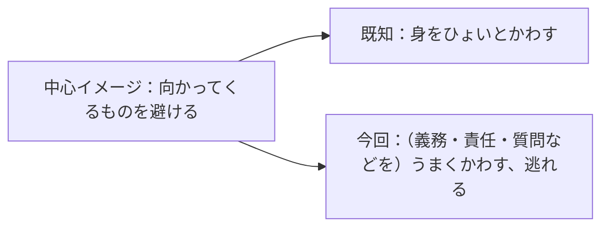

**重要語法：** `dodge a question`

---

## 3282. intersection

**品詞：** 名詞  
**発音：** /ˌɪntərˈsekʃən/

<small>よく知られている意味：交差点</small>

**見落としやすい意味（重要）：** **（数学・集合論での）共通部分、積集合**

**例文：** The shaded region represents the intersection of the two sets.

**和訳：** 色の付いた部分は、二つの集合の共通部分を表している。

**コアイメージ：** 二つの道が交わる場所が intersection。数学では二つの集合が重なる部分に注目し、共通する要素の集まりを指す。

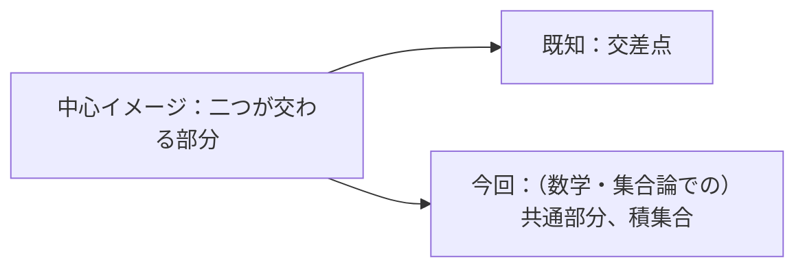

**重要語法：** `the intersection of A and B`

---

## 3283. posting

**品詞：** 名詞  
**発音：** /ˈpoʊstɪŋ/

<small>よく知られている意味：投稿・掲示</small>

**見落としやすい意味（重要）：** **（職場などへの）配属、赴任先、任務**

**例文：** Her first posting was at a small hospital in the mountains.

**和訳：** 彼女の最初の配属先は山間部の小さな病院だった。

**コアイメージ：** post は情報を掲示するだけでなく、人を任地に配置することも表す。そこから posting は配属という行為や、その赴任先を意味する。

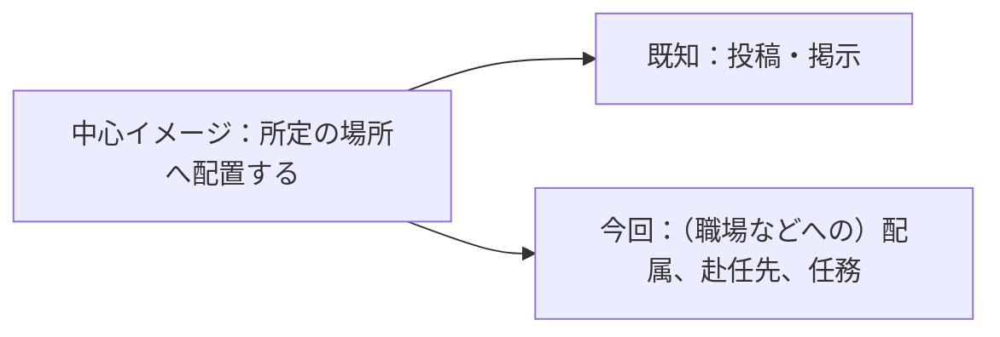

**重要語法：** `a posting to a regional office`

---

## 3284. purport

**品詞：** 名詞  
**発音：** /ˈpɜːrpɔːrt/

<small>よく知られている意味：（動詞）～だと称する</small>

**見落としやすい意味（重要）：** **要旨、趣旨**

**例文：** The purport of his letter was clear: he would not resign.

**和訳：** 彼の手紙の趣旨は明らかだった。辞職するつもりはないということだ。

**コアイメージ：** 文章が表向きに何を伝えようとしているか、という点に注目する。名詞の purport は、その内容をまとめた要旨や趣旨を指す。

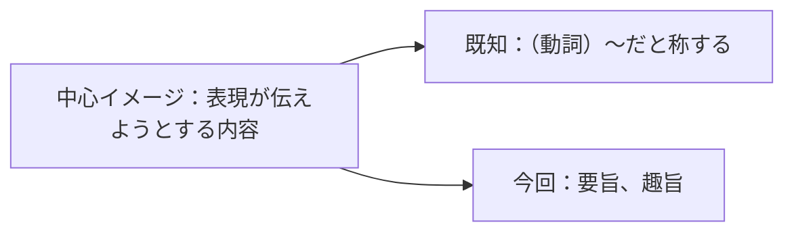

**重要語法：** `the purport of a statement`

---

## 3285. reservoir

**品詞：** 名詞  
**発音：** /ˈrezərvwɑːr/

<small>よく知られている意味：貯水池</small>

**見落としやすい意味（重要）：** **（知識・病原体・人材などの）貯蔵源、供給源**

**例文：** The village is a reservoir of traditional farming knowledge.

**和訳：** その村は伝統的な農業知識の宝庫だ。

**コアイメージ：** 水を蓄えておく場所が reservoir。知識や技能のような目に見えないものにも、豊富に蓄えられた供給源という発想を使える。

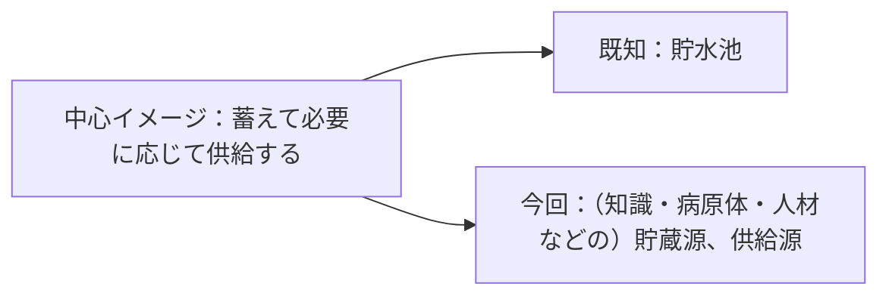

**重要語法：** `a reservoir of knowledge`

---

## 3286. scan

**品詞：** 動詞  
**発音：** /skæn/

<small>よく知られている意味：（機械で）読み取る</small>

**見落としやすい意味（重要）：** **（文章・顔・周囲などを）素早く見渡す、読み取る**

**例文：** She scanned the crowd for a familiar face.

**和訳：** 彼女は知っている顔を探して群衆をさっと見渡した。

**コアイメージ：** ある範囲を順に調べて情報を得る動きが中心にある。機械による読み取りだけでなく、視線で周囲や文章を素早く探る場合にも使う。

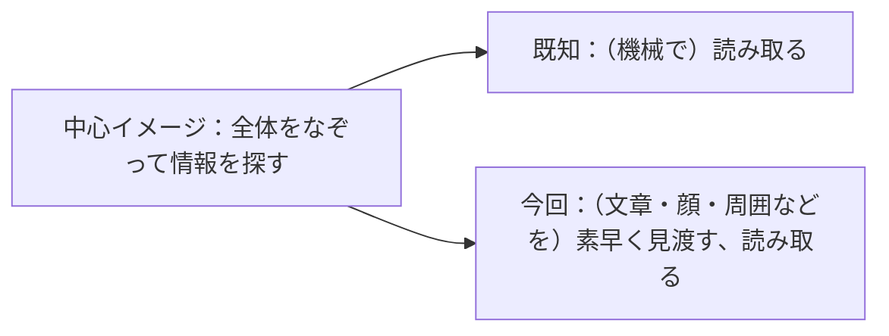

**重要語法：** `scan the room for someone`

---

## 3287. unearth

**品詞：** 動詞  
**発音：** /ʌnˈɜːrθ/

<small>よく知られている意味：地中から掘り出す</small>

**見落としやすい意味（重要）：** **（隠された情報・事実などを）掘り起こす、明らかにする**

**例文：** The journalist unearthed evidence of the fraud.

**和訳：** その記者は詐欺の証拠を掘り起こした。

**コアイメージ：** 土の中から埋もれたものを取り出す動詞。人に知られていなかった事実や証拠を見つけ出すことにも広がる。

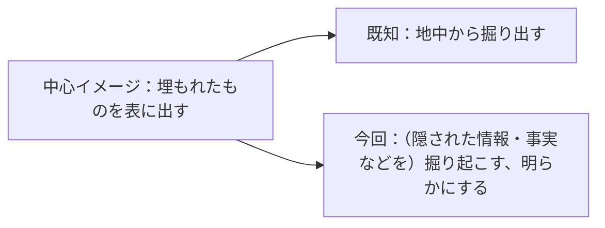

**重要語法：** `unearth evidence`

---

## 3288. whistle

**品詞：** 慣用句  
**発音：** /ˈwɪsəl/

<small>よく知られている意味：笛・口笛</small>

**見落としやすい意味（重要）：** **blow the whistle on：不正を告発する、内部告発する**

**例文：** An employee blew the whistle on unsafe practices at the factory.

**和訳：** 従業員が工場の危険な慣行を告発した。

**コアイメージ：** 笛を吹いて周囲に注意を促す場面を思い浮かべる。不正について警告を発し、外部に知らせることを blow the whistle on と言う。

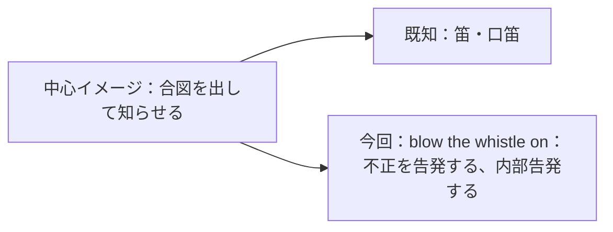

**重要語法：** `blow the whistle on wrongdoing`

---

## 3289. used

**品詞：** 構文  
**発音：** /juːst/

<small>よく知られている意味：使われた（use の過去分詞）</small>

**見落としやすい意味（重要）：** **used to + 動詞原形：以前は～したものだ（今は必ずしもそうではない）**

**例文：** I used to walk to school, but now I take the bus.

**和訳：** 以前は歩いて通学していたが、今はバスを使っている。

**コアイメージ：** used to のまとまりで、かつて続いていた習慣や状態を表す。動詞 use の受け身ではなく、現在との違いを意識して読む。

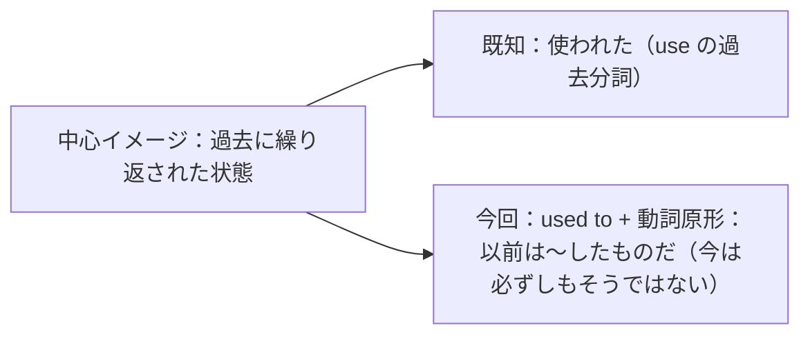

**重要語法：** `used to + 動詞原形`

---

## 3290. used

**品詞：** 構文  
**発音：** /juːst/

<small>よく知られている意味：使われた（use の過去分詞）</small>

**見落としやすい意味（重要）：** **be used to + 名詞・動名詞：～に慣れている**

**例文：** She is used to speaking in front of large audiences.

**和訳：** 彼女は大勢の聴衆の前で話すことに慣れている。

**コアイメージ：** be used to は、経験を積んで抵抗がなくなった状態を表す。ここでの to は前置詞なので、動作を続けるときは動名詞を置く。

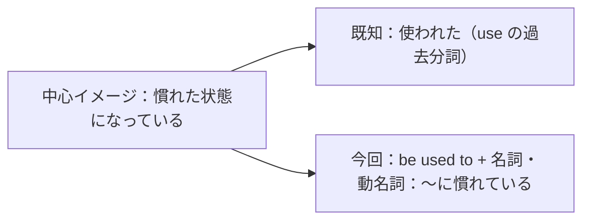

**重要語法：** `be used to + 名詞／動名詞`

---

## 3291. bulb

**品詞：** 名詞  
**発音：** /bʌlb/

<small>よく知られている意味：電球</small>

**見落としやすい意味（重要）：** **植物の球根、鱗茎**

**例文：** Plant the tulip bulbs before winter.

**和訳：** 冬になる前にチューリップの球根を植えなさい。

**コアイメージ：** 電球と球根には、丸くふくらんだ形の共通点がある。植物の話では、養分を蓄えて芽を出す球根を指す。

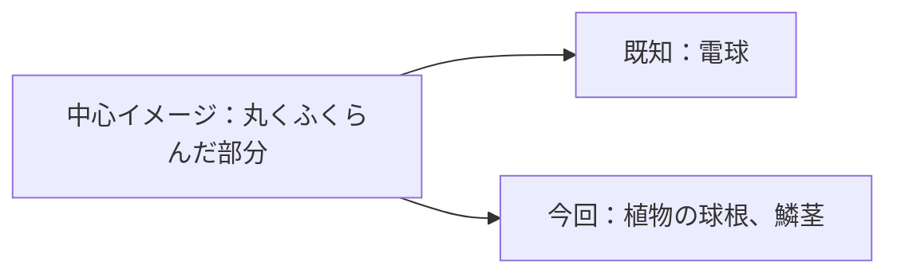

**重要語法：** `flower bulb`

---

## 3292. bureau

**品詞：** 名詞  
**発音：** /ˈbjʊroʊ/

<small>よく知られている意味：官庁の局・部門</small>

**見落としやすい意味（重要）：** **（主に米国英語で）引き出し付きの収納家具、たんす**

**例文：** He kept his socks in the top drawer of the bureau.

**和訳：** 彼は靴下をたんすの一番上の引き出しにしまっていた。

**コアイメージ：** bureau は事務机や仕事場と結び付いた語として使われてきた。米国英語では引き出しのある収納家具を指す場合があり、役所とは限らない。


**重要語法：** `a bureau drawer（主に米国英語）`

---

## 3293. blade

**品詞：** 名詞  
**発音：** /bleɪd/

<small>よく知られている意味：刃</small>

**見落としやすい意味（重要）：** **（草などの）細長い葉（blade of grass）**

**例文：** A blade of grass grew through a crack in the path.

**和訳：** 小道のひび割れから一本の草が伸びていた。

**コアイメージ：** 刃のように細長く薄い形が共通する。草では blade が一枚の細い葉を指し、a blade of grass という形がよく使われる。

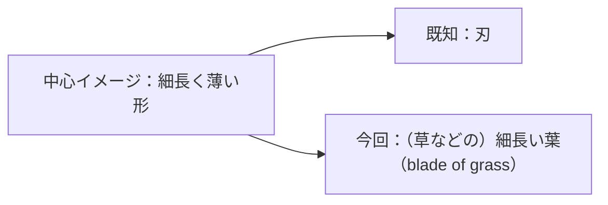

**重要語法：** `a blade of grass`

---

## 3294. hood

**品詞：** 名詞  
**発音：** /hʊd/

<small>よく知られている意味：（服の）フード</small>

**見落としやすい意味（重要）：** **（米国英語で）自動車のボンネット**

**例文：** He opened the hood to check the engine.

**和訳：** 彼はエンジンを点検するために車のボンネットを開けた。

**コアイメージ：** 頭を覆うフードも、車のエンジンを覆う部分も hood と呼ばれる。車の場合は米国英語の表現で、英国英語では bonnet が一般的。

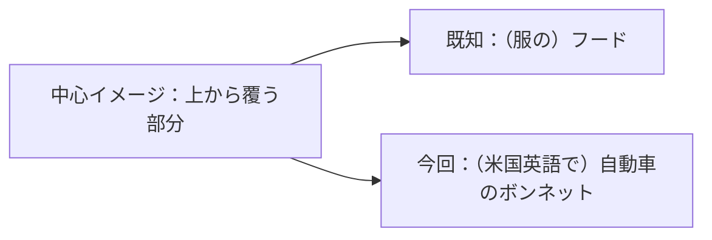

**重要語法：** `under the hood（米国英語）`

---

## 3295. knot

**品詞：** 慣用句  
**発音：** /nɑːt/

<small>よく知られている意味：結び目</small>

**見落としやすい意味（重要）：** **tie the knot：結婚する**

**例文：** They decided to tie the knot next spring.

**和訳：** 二人は来年の春に結婚することに決めた。

**コアイメージ：** ひもを結んで一つにする動きから、二人が人生を結び付ける比喩が生まれる。tie the knot は結婚するという慣用表現。

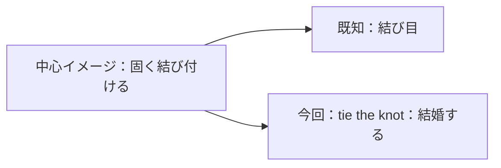

**重要語法：** `tie the knot`

---

## 3296. distinguished

**品詞：** 形容詞  
**発音：** /dɪˈstɪŋɡwɪʃt/

<small>よく知られている意味：区別された</small>

**見落としやすい意味（重要）：** **（人物・実績などが）著名な、卓越した、立派な**

**例文：** A distinguished scientist visited our school.

**和訳：** 著名な科学者が私たちの学校を訪れた。

**コアイメージ：** 多くの人から際立って区別されるという発想がある。そこから、功績や地位によって高く評価される人物を distinguished と形容する。

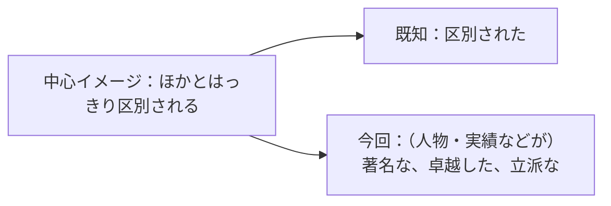

**重要語法：** `a distinguished career`

---

## 3297. usher

**品詞：** 動詞  
**発音：** /ˈʌʃər/

<small>よく知られている意味：案内係</small>

**見落としやすい意味（重要）：** **（新時代・変化などを）到来させる、導入する**

**例文：** The invention ushered in a new era of communication.

**和訳：** その発明は通信の新時代をもたらした。

**コアイメージ：** usher は人を席や場所へ導く役割を表す。比喩的には出来事や発明が新たな時代を招き入れることを表す。

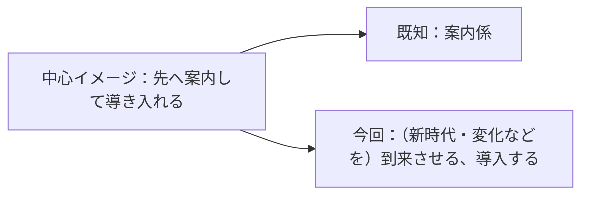

**重要語法：** `usher in a new era`

---

## 3298. quarry

**品詞：** 名詞  
**発音：** /ˈkwɔːri/

<small>よく知られている意味：採石場</small>

**見落としやすい意味（重要）：** **（追跡・探索の）対象、獲物**

**例文：** The detective followed his quarry into the station.

**和訳：** 刑事は追跡していた相手を駅の中まで追った。

**コアイメージ：** 採石場を表す quarry と、追跡対象を表す quarry は語源の異なる同綴りの語。後者では狩りの獲物から、追っている人物や対象へ意味が広がる。

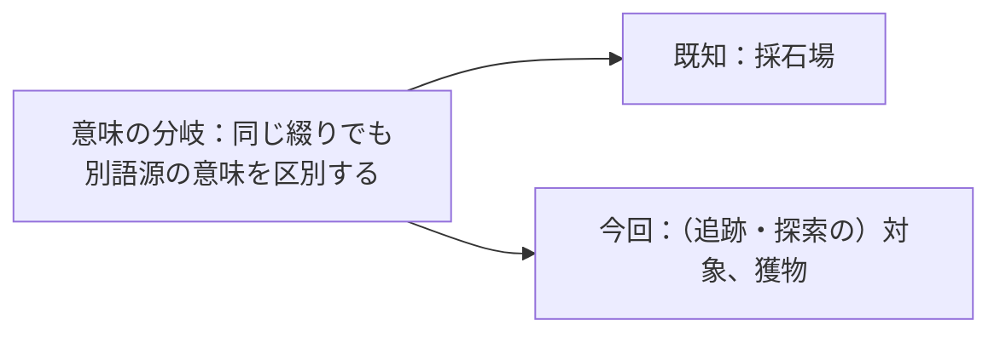

**重要語法：** `a hunter's quarry`

---

## 3299. woo

**品詞：** 動詞  
**発音：** /wuː/

<small>よく知られている意味：求愛する</small>

**見落としやすい意味（重要）：** **（支持者・票・顧客などを）得ようと働きかける**

**例文：** The company is trying to woo younger customers.

**和訳：** その企業は若い顧客を取り込もうとしている。

**コアイメージ：** 相手の心をつかもうとする点が中心にある。恋愛に限らず、票や支持、顧客を得ようとして積極的に働きかけることにも使う。

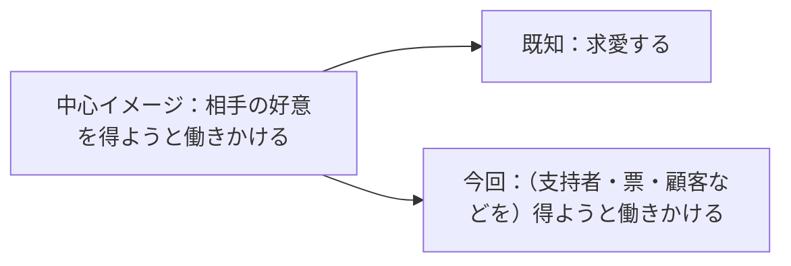

**重要語法：** `woo voters / customers`

---

## 3300. bastion

**品詞：** 名詞  
**発音：** /ˈbæstʃən/

<small>よく知られている意味：要塞</small>

**見落としやすい意味（重要）：** **（信条・思想・自由などを守る）最後の砦、牙城**

**例文：** The library remained a bastion of free thought.

**和訳：** その図書館は自由な思想を守る砦であり続けた。

**コアイメージ：** 敵の攻撃を防ぐ要塞が元のイメージ。価値観や制度を守り続ける集団や場所も、比喩的に bastion と呼べる。

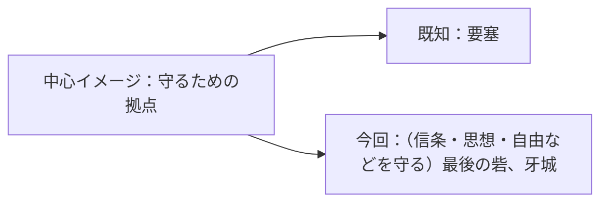

**重要語法：** `a bastion of democracy`

---

## 3301. catalogue

**品詞：** 動詞  
**発音：** /ˈkætəlɔːɡ/

<small>よく知られている意味：目録・カタログ</small>

**見落としやすい意味（重要）：** **（作品・資料・特徴などを）一覧表にする、列挙する**

**例文：** The researchers catalogued every object found at the site.

**和訳：** 研究者たちは遺跡で見つかった品を一つ残らず目録にまとめた。

**コアイメージ：** 目録とは物を項目ごとに整理した一覧のこと。その一覧を作る動作自体も catalogue という動詞で表せる。

```mermaid
flowchart LR
    A["中心イメージ：項目を整理して並べる"]
    B["既知：目録・カタログ"]
    C["今回：（作品・資料・特徴などを）一覧表にする、列挙する"]
    A --> B
    A --> C
```

**重要語法：** `catalogue the findings`

---

## 3302. committed

**品詞：** 形容詞  
**発音：** /kəˈmɪtɪd/

<small>よく知られている意味：（罪などを）犯した</small>

**見落としやすい意味（重要）：** **（目的・信念などに）強く献身している、熱心な**

**例文：** She is a committed advocate for children's education.

**和訳：** 彼女は子どもの教育に熱心に取り組む支援者だ。

**コアイメージ：** commit にはある行為に深く関与する感覚がある。信念や目標に継続的に力を注ぐ人は committed と評価される。

```mermaid
flowchart LR
    A["中心イメージ：一つのことにしっかり身を投じる"]
    B["既知：（罪などを）犯した"]
    C["今回：（目的・信念などに）強く献身している、熱心な"]
    A --> B
    A --> C
```

**重要語法：** `be committed to + 名詞／動名詞`

---

## 3303. congratulate

**品詞：** 慣用句  
**発音：** /kənˈɡrætʃəleɪt/

<small>よく知られている意味：祝福する</small>

**見落としやすい意味（重要）：** **congratulate oneself on：自分で自分を褒める、得意になる**

**例文：** He congratulated himself on finishing the task early.

**和訳：** 彼は仕事を早く終えたことを自分で褒めた。

**コアイメージ：** 達成を喜んで誰かを称賛するのが基本。目的語が oneself になると、自分の成果を自分で褒めたり得意になったりする意味になる。

```mermaid
flowchart LR
    A["中心イメージ：達成を喜んで評価する"]
    B["既知：祝福する"]
    C["今回：congratulate oneself on：自分で自分を褒める、得意になる"]
    A --> B
    A --> C
```

**重要語法：** `congratulate oneself on ...`

---

## 3304. credentials

**品詞：** 名詞  
**発音：** /krəˈdenʃəlz/

<small>よく知られている意味：資格・経歴証明</small>

**見落としやすい意味（重要）：** **（システムへのログインに使う）認証情報**

**例文：** Never share your login credentials by email.

**和訳：** ログイン用の認証情報をメールで共有してはいけない。

**コアイメージ：** 資格証明書は、その人がふさわしい人物だと確認する材料になる。同様にシステムでは、利用者の本人確認に使う情報を credentials と呼ぶ。

```mermaid
flowchart LR
    A["中心イメージ：本人の正当性を証明するもの"]
    B["既知：資格・経歴証明"]
    C["今回：（システムへのログインに使う）認証情報"]
    A --> B
    A --> C
```

**重要語法：** `login credentials`

---

## 3305. distress

**品詞：** 名詞  
**発音：** /dɪˈstres/

<small>よく知られている意味：精神的苦痛</small>

**見落としやすい意味（重要）：** **（船舶・航空機などが発する）遭難・緊急の救助要請**

**例文：** The crew sent a distress signal before the radio failed.

**和訳：** 無線機が故障する前に、乗組員は遭難信号を送った。

**コアイメージ：** distress は強い苦境や危機の状態を指す。海や空での緊急時には、救助を必要としていることを伝える信号にも現れる。

```mermaid
flowchart LR
    A["中心イメージ：助けが必要な切迫した状態"]
    B["既知：精神的苦痛"]
    C["今回：（船舶・航空機などが発する）遭難・緊急の救助要請"]
    A --> B
    A --> C
```

**重要語法：** `a distress signal / distress call`

---

## 3306. fed

**品詞：** 慣用句  
**発音：** /fed/

<small>よく知られている意味：餌を与えられた</small>

**見落としやすい意味（重要）：** **be fed up with：～にうんざりしている、飽き飽きしている**

**例文：** I'm fed up with these constant delays.

**和訳：** こう何度も遅れが続くのには、もううんざりだ。

**コアイメージ：** be fed up with は、同じことをもう十分だと感じる状態を表す決まった言い方。食事を与えられるという feed の直訳では意味を取りにくい。

```mermaid
flowchart LR
    A["中心イメージ：同じことを受け続けて限界になる"]
    B["既知：餌を与えられた"]
    C["今回：be fed up with：～にうんざりしている、飽き飽きしている"]
    A --> B
    A --> C
```

**重要語法：** `be fed up with + 名詞／動名詞`

---

## 3307. flirt

**品詞：** 慣用句  
**発音：** /flɜːrt/

<small>よく知られている意味：軽く口説く</small>

**見落としやすい意味（重要）：** **flirt with：危険・考え・可能性などに軽い気持ちで接する、試しに考える**

**例文：** The committee is flirting with the idea of changing the rules.

**和訳：** 委員会は規則を変える案を試しに検討している。

**コアイメージ：** 本格的に関係を結ぶ前に軽く近づく感覚がある。考えや危険に対しても、真剣に決めずに関心を向けることを flirt with と言う。

```mermaid
flowchart LR
    A["中心イメージ：深入りせず軽く近づく"]
    B["既知：軽く口説く"]
    C["今回：flirt with：危険・考え・可能性などに軽い気持ちで接する、試しに考える"]
    A --> B
    A --> C
```

**重要語法：** `flirt with an idea / danger`

---

## 3308. funnel

**品詞：** 動詞  
**発音：** /ˈfʌnəl/

<small>よく知られている意味：じょうご</small>

**見落としやすい意味（重要）：** **（資金・情報・人などを）特定の方向や経路へ集めて流す**

**例文：** The program funnels donations to schools in rural areas.

**和訳：** その制度は寄付金を地方の学校へ集中的に送る。

**コアイメージ：** じょうごは広く受け止めたものを細い出口へ流す道具。資金や情報を特定の経路や行き先へ誘導するときも funnel を使う。

```mermaid
flowchart LR
    A["中心イメージ：流れを狭い経路へ集める"]
    B["既知：じょうご"]
    C["今回：（資金・情報・人などを）特定の方向や経路へ集めて流す"]
    A --> B
    A --> C
```

**重要語法：** `funnel money into ...`

---

## 3309. knit

**品詞：** 動詞  
**発音：** /nɪt/

<small>よく知られている意味：編む</small>

**見落としやすい意味（重要）：** **（人・共同体などを）固く結びつける、団結させる**

**例文：** The shared experience knitted the group together.

**和訳：** 共通の経験がその集団の結束を強めた。

**コアイメージ：** 毛糸の目をつないで一枚の布を作るのが knit。人と人との結び付きが密になることにも同じイメージを用いる。

```mermaid
flowchart LR
    A["中心イメージ：細いものを絡めて一つにする"]
    B["既知：編む"]
    C["今回：（人・共同体などを）固く結びつける、団結させる"]
    A --> B
    A --> C
```

**重要語法：** `knit a community together`

---

## 3310. menace

**品詞：** 動詞  
**発音：** /ˈmenəs/

<small>よく知られている意味：脅威</small>

**見落としやすい意味（重要）：** **～を脅かす、危険にさらす**

**例文：** Rising sea levels menace coastal towns.

**和訳：** 海面上昇が沿岸の町々を脅かしている。

**コアイメージ：** 名詞では危険をもたらす脅威を表す。動詞になると、あるものが別のものを脅かすという関係を直接述べられる。

```mermaid
flowchart LR
    A["中心イメージ：危険を感じさせる存在"]
    B["既知：脅威"]
    C["今回：～を脅かす、危険にさらす"]
    A --> B
    A --> C
```

**重要語法：** `menace a community`

---

## 3311. orchestrate

**品詞：** 動詞  
**発音：** /ˈɔːrkɪstreɪt/

<small>よく知られている意味：オーケストラ用に編曲する</small>

**見落としやすい意味（重要）：** **（計画・陰謀・活動などを）巧みに組織する、仕組む**

**例文：** She orchestrated a campaign to protect the wetlands.

**和訳：** 彼女は湿地を守る運動を巧みに組織した。

**コアイメージ：** 楽器ごとの役割を組み合わせて一つの演奏を作るのが出発点。人や計画を調整して複雑な活動を進めることにも用いる。

```mermaid
flowchart LR
    A["中心イメージ：多くの要素を調整して動かす"]
    B["既知：オーケストラ用に編曲する"]
    C["今回：（計画・陰謀・活動などを）巧みに組織する、仕組む"]
    A --> B
    A --> C
```

**重要語法：** `orchestrate a campaign`

---

## 3312. plateau

**品詞：** 動詞  
**発音：** /plæˈtoʊ/

<small>よく知られている意味：高原</small>

**見落としやすい意味（重要）：** **増加や成長が頭打ちになる、横ばいになる**

**例文：** After three months, sales began to plateau.

**和訳：** 三か月後、売上げは頭打ちになり始めた。

**コアイメージ：** 高原は周囲より高くても上面は比較的平らな地形。数値の上昇が止まって横ばいになる様子を plateau という動詞で表す。

```mermaid
flowchart LR
    A["中心イメージ：高い所で平らになる"]
    B["既知：高原"]
    C["今回：増加や成長が頭打ちになる、横ばいになる"]
    A --> B
    A --> C
```

**重要語法：** `sales plateau`

---

## 3313. probation

**品詞：** 名詞  
**発音：** /proʊˈbeɪʃən/

<small>よく知られている意味：保護観察</small>

**見落としやすい意味（重要）：** **（雇用者の）試用期間**

**例文：** New employees spend three months on probation.

**和訳：** 新入社員には三か月の試用期間がある。

**コアイメージ：** 行動や適性を一定期間見守るという考えが共通する。司法の保護観察だけでなく、採用後の適性を確認する試用期間も probation と言う。

```mermaid
flowchart LR
    A["中心イメージ：一定期間、適性を見極める"]
    B["既知：保護観察"]
    C["今回：（雇用者の）試用期間"]
    A --> B
    A --> C
```

**重要語法：** `on probation / a probationary period`

---

## 3314. rack

**品詞：** 慣用句  
**発音：** /ræk/

<small>よく知られている意味：棚・物を置く台</small>

**見落としやすい意味（重要）：** **rack up：得点・利益・負債などを次々に積み重ねる**

**例文：** The team racked up six wins in a row.

**和訳：** そのチームは六連勝を積み重ねた。

**コアイメージ：** rack up は数量や成果が次々と加算されることを表す句動詞。得点や勝利だけでなく、負債を増やす場合にも使われる。

```mermaid
flowchart LR
    A["中心イメージ：数が次々に積み上がる"]
    B["既知：棚・物を置く台"]
    C["今回：rack up：得点・利益・負債などを次々に積み重ねる"]
    A --> B
    A --> C
```

**重要語法：** `rack up points / debt`

---

## 3315. rack

**品詞：** 慣用句  
**発音：** /ræk/

<small>よく知られている意味：棚・物を置く台</small>

**見落としやすい意味（重要）：** **rack one's brains：知恵を絞る、必死に考える**

**例文：** I racked my brains trying to remember his name.

**和訳：** 私は彼の名前を思い出そうと必死に知恵を絞った。

**コアイメージ：** rack one's brains は頭を酷使して考える慣用表現。棚を意味する rack と一語ずつ対応させず、ひとかたまりで覚える。

```mermaid
flowchart LR
    A["中心イメージ：頭を限界まで働かせる"]
    B["既知：棚・物を置く台"]
    C["今回：rack one's brains：知恵を絞る、必死に考える"]
    A --> B
    A --> C
```

**重要語法：** `rack one's brains`

---

## 3316. savvy

**品詞：** 形容詞  
**発音：** /ˈsævi/

<small>よく知られている意味：（名詞）実務的な知識</small>

**見落としやすい意味（重要）：** **（技術・状況などに）精通している、事情に通じた**

**例文：** We need a tech-savvy person to manage the website.

**和訳：** そのウェブサイトの管理には、技術に精通した人が必要だ。

**コアイメージ：** savvy は単なる知識の量より、実際の場面で使える理解を表す。形容詞では、その分野の事情をよく分かっている人を形容する。

```mermaid
flowchart LR
    A["中心イメージ：状況を分かってうまく動ける"]
    B["既知：（名詞）実務的な知識"]
    C["今回：（技術・状況などに）精通している、事情に通じた"]
    A --> B
    A --> C
```

**重要語法：** `tech-savvy / media-savvy`

---

## 3317. savvy

**品詞：** 名詞  
**発音：** /ˈsævi/

<small>よく知られている意味：（形容詞）事情に通じた</small>

**見落としやすい意味（重要）：** **実際的な知識、要領のよさ、判断力**

**例文：** Her business savvy helped the shop survive.

**和訳：** 彼女の商才のおかげで、その店は経営を続けられた。

**コアイメージ：** savvy の中心には実際の状況を見抜き、適切に判断する力がある。名詞なら、その分野に通じた知識や実務感覚を指す。

```mermaid
flowchart LR
    A["中心イメージ：実際に使える判断力"]
    B["既知：（形容詞）事情に通じた"]
    C["今回：実際的な知識、要領のよさ、判断力"]
    A --> B
    A --> C
```

**重要語法：** `business savvy`

---

## 3318. signpost

**品詞：** 動詞  
**発音：** /ˈsaɪnpoʊst/

<small>よく知られている意味：道標・案内標識</small>

**見落としやすい意味（重要）：** **（文書・説明で）要点や次の展開を明示する**

**例文：** The introduction clearly signposts the main argument.

**和訳：** 序論は中心となる論点を明確に示している。

**コアイメージ：** 道標は進む方向を読者や旅人に知らせる。文章でも、今どの話をしていて次に何を扱うかを示すことを signpost と呼べる。

```mermaid
flowchart LR
    A["中心イメージ：次に進む方向を示す"]
    B["既知：道標・案内標識"]
    C["今回：（文書・説明で）要点や次の展開を明示する"]
    A --> B
    A --> C
```

**重要語法：** `signpost the argument`

---

## 3319. slick

**品詞：** 形容詞  
**発音：** /slɪk/

<small>よく知られている意味：つるつるした・滑らかな</small>

**見落としやすい意味（重要）：** **（宣伝・話し方などが）巧妙でうさんくさい、口先のうまい**

**例文：** The proposal sounded slick, but it lacked real detail.

**和訳：** その提案は口当たりがよかったが、実質的な詳しさに欠けていた。

**コアイメージ：** 滑らかで引っ掛からないという表面の感覚が出発点。言葉や宣伝があまりに流暢で、かえって信用しにくい場合にも使う。

```mermaid
flowchart LR
    A["中心イメージ：引っ掛かりなく流れる"]
    B["既知：つるつるした・滑らかな"]
    C["今回：（宣伝・話し方などが）巧妙でうさんくさい、口先のうまい"]
    A --> B
    A --> C
```

**重要語法：** `slick advertising`

---

## 3320. spotlight

**品詞：** 動詞  
**発音：** /ˈspɑːtlaɪt/

<small>よく知られている意味：スポットライト</small>

**見落としやすい意味（重要）：** **（人物・問題などに）注目を集める**

**例文：** The report spotlights the difficulties faced by small farms.

**和訳：** その報告書は小規模農家が直面する困難に注目を集めている。

**コアイメージ：** 照明を一点に当てると、そこが周囲より目立つ。記事や報告が特定の問題を際立たせることも spotlight という動詞で表す。

```mermaid
flowchart LR
    A["中心イメージ：明るく照らして目立たせる"]
    B["既知：スポットライト"]
    C["今回：（人物・問題などに）注目を集める"]
    A --> B
    A --> C
```

**重要語法：** `spotlight an issue`

---

## 3321. stab

**品詞：** 慣用句  
**発音：** /stæb/

<small>よく知られている意味：突き刺す</small>

**見落としやすい意味（重要）：** **take a stab at：試しにやってみる、挑戦してみる**

**例文：** I'll take a stab at solving the puzzle before asking for help.

**和訳：** 人に助けを求める前に、そのパズルを自分で試しに解いてみるよ。

**コアイメージ：** stab は鋭く突く動作だが、take a stab at は「ひとまず一度やってみる」という慣用句。危険な動作として直訳せず、試行を表すまとまりで捉える。

```mermaid
flowchart LR
    A["中心イメージ：一度試しに手を出す"]
    B["既知：突き刺す"]
    C["今回：take a stab at：試しにやってみる、挑戦してみる"]
    A --> B
    A --> C
```

**重要語法：** `take a stab at + 名詞／動名詞`

---

## 3322. stitch

**品詞：** 慣用句  
**発音：** /stɪtʃ/

<small>よく知られている意味：縫い目・一針</small>

**見落としやすい意味（重要）：** **be in stitches：笑い転げている**

**例文：** The comedian's story had the whole audience in stitches.

**和訳：** そのコメディアンの話に観客はみな笑い転げた。

**コアイメージ：** be in stitches は、笑いすぎて体が痛くなるほど大笑いする状態を表す慣用句。縫い目の数を表す語義から機械的に訳さず、表現全体で覚える。

```mermaid
flowchart LR
    A["意味の分岐：単語の直訳と慣用表現を区別する"]
    B["既知：縫い目・一針"]
    C["今回：be in stitches：笑い転げている"]
    A --> B
    A --> C
```

**重要語法：** `be in stitches`

---

## 3323. stunt

**品詞：** 動詞  
**発音：** /stʌnt/

<small>よく知られている意味：離れ業・スタント</small>

**見落としやすい意味（重要）：** **成長・発達・進歩を妨げる**

**例文：** Poor soil can stunt the growth of young trees.

**和訳：** 痩せた土壌は若木の成長を妨げることがある。

**コアイメージ：** 名詞の stunt は見せ場となる離れ業を指す。一方、動詞 stunt は成長や発達を阻害する別の語義なので、目的語に注目して区別する。

```mermaid
flowchart LR
    A["意味の分岐：同じ綴りでも異なる語義を区別する"]
    B["既知：離れ業・スタント"]
    C["今回：成長・発達・進歩を妨げる"]
    A --> B
    A --> C
```

**重要語法：** `stunt growth / development`

---

## 3324. tentative

**品詞：** 形容詞  
**発音：** /ˈtentətɪv/

<small>よく知られている意味：仮の・暫定的な</small>

**見落としやすい意味（重要）：** **（動作・発言などが）ためらいがちな、おずおずとした**

**例文：** He took a tentative step onto the frozen pond.

**和訳：** 彼は凍った池の上におそるおそる一歩を踏み出した。

**コアイメージ：** 正式には決められず、確かさが足りないという感覚が共通する。計画なら仮の、行動なら自信がなくためらいがちな、という意味になる。

```mermaid
flowchart LR
    A["中心イメージ：まだ確信が持てない"]
    B["既知：仮の・暫定的な"]
    C["今回：（動作・発言などが）ためらいがちな、おずおずとした"]
    A --> B
    A --> C
```

**重要語法：** `a tentative smile / step`

---

## 3325. wholesale

**品詞：** 形容詞  
**発音：** /ˈhoʊlseɪl/

<small>よく知られている意味：卸売りの</small>

**見落としやすい意味（重要）：** **大規模で無差別な、全面的な**

**例文：** The school announced a wholesale change in its timetable.

**和訳：** 学校は時間割を全面的に変更すると発表した。

**コアイメージ：** 卸売りでは品物を一つずつでなく大量に扱う。そこから、物事が細部に限らず全体にわたることを wholesale と形容する。

```mermaid
flowchart LR
    A["中心イメージ：個別でなく一括して広く"]
    B["既知：卸売りの"]
    C["今回：大規模で無差別な、全面的な"]
    A --> B
    A --> C
```

**重要語法：** `wholesale changes`

---

## 3326. fever

**品詞：** 名詞  
**発音：** /ˈfiːvər/

<small>よく知られている意味：熱・発熱</small>

**見落としやすい意味（重要）：** **熱狂、夢中になっている状態**

**例文：** The city was swept up in football fever before the final.

**和訳：** 決勝戦を前に、街はサッカー熱に包まれた。

**コアイメージ：** 体温が上がる発熱のように、気持ちが強く高まる様子を表す。人々の熱狂や社会的なブームにも fever を使う。

```mermaid
flowchart LR
    A["中心イメージ：興奮が熱のように高まる"]
    B["既知：熱・発熱"]
    C["今回：熱狂、夢中になっている状態"]
    A --> B
    A --> C
```

**重要語法：** `football fever / election fever`

---

## 3327. saw

**品詞：** 名詞  
**発音：** /sɔː/

<small>よく知られている意味：のこぎり／see の過去形</small>

**見落としやすい意味（重要）：** **格言、古くからのことわざ**

**例文：** She dismissed the advice as a tired old saw.

**和訳：** 彼女はその助言を、聞き飽きた古いことわざとして退けた。

**コアイメージ：** ことわざを意味する saw は、のこぎりや see の過去形とは別の語義。同じ綴りでも文脈から名詞の「格言」だと見抜く必要がある。

```mermaid
flowchart LR
    A["意味の分岐：同じ綴りの別語義を文脈で区別する"]
    B["既知：のこぎり／see の過去形"]
    C["今回：格言、古くからのことわざ"]
    A --> B
    A --> C
```

**重要語法：** `an old saw`

---

## 3328. peel

**品詞：** 動詞  
**発音：** /piːl/

<small>よく知られている意味：（皮を）むく</small>

**見落としやすい意味（重要）：** **peel off：（集団・編隊などから）離れる**

**例文：** One cyclist peeled off from the group at the next junction.

**和訳：** 一人の自転車選手が次の分岐点で集団から離れた。

**コアイメージ：** 果物の皮を本体からはがすのが基本イメージ。人や車両が集団から分かれて離れる動きにも peel off を使う。

```mermaid
flowchart LR
    A["中心イメージ：ひとまとまりから離れる"]
    B["既知：（皮を）むく"]
    C["今回：peel off：（集団・編隊などから）離れる"]
    A --> B
    A --> C
```

**重要語法：** `peel off from the group`

---

## 3329. overtime

**品詞：** 名詞  
**発音：** /ˈoʊvərtaɪm/

<small>よく知られている意味：残業・時間外労働</small>

**見落としやすい意味（重要）：** **（スポーツでの）延長戦**

**例文：** The basketball game went into overtime after a tie.

**和訳：** 同点になったため、そのバスケットボールの試合は延長戦に入った。

**コアイメージ：** 定められた時間を超えて続けるのが共通点。仕事なら残業、競技なら規定時間後の延長戦になる。

```mermaid
flowchart LR
    A["中心イメージ：通常の時間を超える"]
    B["既知：残業・時間外労働"]
    C["今回：（スポーツでの）延長戦"]
    A --> B
    A --> C
```

**重要語法：** `go into overtime`

---

## 3330. pavement

**品詞：** 名詞  
**発音：** /ˈpeɪvmənt/

<small>よく知られている意味：舗装面・路面（米）</small>

**見落としやすい意味（重要）：** **（英国英語で）歩道**

**例文：** She waited on the pavement outside the shop.

**和訳：** 彼女は店の外の歩道で待っていた。

**コアイメージ：** pavement は舗装された地面を指す。英国英語では特に歩行者用の歩道を表すので、車道と取り違えないようにする。

```mermaid
flowchart LR
    A["中心イメージ：人が歩けるよう舗装した面"]
    B["既知：舗装面・路面（米）"]
    C["今回：（英国英語で）歩道"]
    A --> B
    A --> C
```

**重要語法：** `on the pavement（英国英語）`

---

## 3331. foul

**品詞：** 形容詞  
**発音：** /faʊl/

<small>よく知られている意味：反則の・不正な</small>

**見落としやすい意味（重要）：** **（天候が）荒れた、悪天候の**

**例文：** The fishing boats stayed in port because of foul weather.

**和訳：** 悪天候のため、漁船は港にとどまった。

**コアイメージ：** foul には不快で好ましくないという感覚がある。スポーツの反則に限らず、天候が荒れてひどい場合にも使う。

```mermaid
flowchart LR
    A["中心イメージ：好ましくない・ひどい状態"]
    B["既知：反則の・不正な"]
    C["今回：（天候が）荒れた、悪天候の"]
    A --> B
    A --> C
```

**重要語法：** `foul weather`

---

## 3332. litter

**品詞：** 名詞  
**発音：** /ˈlɪtər/

<small>よく知られている意味：散らかったごみ</small>

**見落としやすい意味（重要）：** **一度の出産で生まれた動物の子ども全体**

**例文：** The dog gave birth to a litter of six puppies.

**和訳：** その犬は一度に六匹の子犬を産んだ。

**コアイメージ：** litter にはごみ以外に、同じ出産で生まれた動物の子の一群を表す語義がある。動物の繁殖を扱う文脈では、数量を伴う a litter of ... に注目する。

```mermaid
flowchart LR
    A["意味の分岐：同じ綴りの異なる名詞義を区別する"]
    B["既知：散らかったごみ"]
    C["今回：一度の出産で生まれた動物の子ども全体"]
    A --> B
    A --> C
```

**重要語法：** `a litter of puppies / kittens`

---

## 3333. litter

**品詞：** 動詞  
**発音：** /ˈlɪtər/

<small>よく知られている意味：（ごみを）散らかす</small>

**見落としやすい意味（重要）：** **（場所・文章などに）～が散在している**

**例文：** The floor was littered with sheets of paper.

**和訳：** 床には紙があちこちに散らばっていた。

**コアイメージ：** ごみが散らばっている様子が出発点。ごみ以外の物が多数、無秩序に散在する状態も be littered with で表せる。

```mermaid
flowchart LR
    A["中心イメージ：小さなものがあちこちに散在する"]
    B["既知：（ごみを）散らかす"]
    C["今回：（場所・文章などに）～が散在している"]
    A --> B
    A --> C
```

**重要語法：** `be littered with ...`

---

## 3334. plaster

**品詞：** 動詞  
**発音：** /ˈplæstər/

<small>よく知られている意味：しっくい・ばんそうこう</small>

**見落としやすい意味（重要）：** **（壁などに掲示物を）大量に貼り付ける**

**例文：** The walls were plastered with colorful advertisements.

**和訳：** 壁には色鮮やかな広告がびっしり貼られていた。

**コアイメージ：** しっくいを広く塗って表面を覆う動きが基本。紙や広告を一面に貼り付けて覆う場合にも plaster を使う。

```mermaid
flowchart LR
    A["中心イメージ：表面をすっかり覆う"]
    B["既知：しっくい・ばんそうこう"]
    C["今回：（壁などに掲示物を）大量に貼り付ける"]
    A --> B
    A --> C
```

**重要語法：** `be plastered with posters`

---

## 3335. salvage

**品詞：** 動詞  
**発音：** /ˈsælvɪdʒ/

<small>よく知られている意味：（難破物などを）回収する</small>

**見落としやすい意味（重要）：** **（失われかけた評判・成果などを）なんとか取り戻す**

**例文：** Her apology helped salvage the team's reputation.

**和訳：** 彼女の謝罪はチームの評判を何とか取り戻す助けになった。

**コアイメージ：** 危機にある物のうち使えるものを救い出す、というイメージがある。失いかけた評判や成果を立て直すときにも使う。

```mermaid
flowchart LR
    A["中心イメージ：失われそうな価値を救い出す"]
    B["既知：（難破物などを）回収する"]
    C["今回：（失われかけた評判・成果などを）なんとか取り戻す"]
    A --> B
    A --> C
```

**重要語法：** `salvage a reputation / relationship`

---

## 3336. batter

**品詞：** 名詞  
**発音：** /ˈbætər/

<small>よく知られている意味：（動詞）繰り返し打つ</small>

**見落としやすい意味（重要）：** **小麦粉・卵・水などを混ぜた流動的な生地**

**例文：** Dip the vegetables in batter before frying them.

**和訳：** 野菜を揚げる前に衣の生地にくぐらせてください。

**コアイメージ：** 料理の batter は粉や液体を混ぜた、とろりとした生地を指す。打ちつけるという動詞の batter とは別の語義なので、料理の場面から判断する。

```mermaid
flowchart LR
    A["意味の分岐：同じ綴りの別語義を料理の文脈で区別する"]
    B["既知：（動詞）繰り返し打つ"]
    C["今回：小麦粉・卵・水などを混ぜた流動的な生地"]
    A --> B
    A --> C
```

**重要語法：** `dip ... in batter`

---

## 3337. speculative

**品詞：** 形容詞  
**発音：** /ˈspekjələtɪv/

<small>よく知られている意味：推測に基づく</small>

**見落としやすい意味（重要）：** **（株式取引などが）投機的な**

**例文：** The fund was criticized for its speculative trades.

**和訳：** その基金は投機的な取引を行ったことで批判された。

**コアイメージ：** 確実ではない予測をもとに考えるのが中心。金融の文脈では将来の値動きを予想して利益を狙う投機的な行為を表す。

```mermaid
flowchart LR
    A["中心イメージ：確かな保証のない見込みに賭ける"]
    B["既知：推測に基づく"]
    C["今回：（株式取引などが）投機的な"]
    A --> B
    A --> C
```

**重要語法：** `speculative investment / trading`

---

## 3338. attachment

**品詞：** 名詞  
**発音：** /əˈtætʃmənt/

<small>よく知られている意味：添付ファイル・付属物</small>

**見落としやすい意味（重要）：** **（人・場所などへの）強い愛着・情緒的な結びつき**

**例文：** She felt a strong attachment to the town where she grew up.

**和訳：** 彼女は育った町に強い愛着を感じていた。

**コアイメージ：** 物をほかの物に取り付けるという発想が基本。気持ちが人や場所に強く結び付いて離れない状態は愛着という意味になる。

```mermaid
flowchart LR
    A["中心イメージ：何かに強く結び付く"]
    B["既知：添付ファイル・付属物"]
    C["今回：（人・場所などへの）強い愛着・情緒的な結びつき"]
    A --> B
    A --> C
```

**重要語法：** `attachment to a place`

---

## 3339. authoritative

**品詞：** 形容詞  
**発音：** /əˈθɔːrəteɪtɪv/

<small>よく知られている意味：権威ある・信頼できる</small>

**見落としやすい意味（重要）：** **（口調・態度が）断定的・高圧的な**

**例文：** His authoritative tone made the students hesitate to ask questions.

**和訳：** 彼の高圧的な口調のため、生徒たちは質問するのをためらった。

**コアイメージ：** authority に由来し、確かな根拠がある印象も、逆に威圧的な態度も表せる。人の口調を修飾するときは、断定的で有無を言わせない響きになることがある。

```mermaid
flowchart LR
    A["中心イメージ：権威を示すように言い切る"]
    B["既知：権威ある・信頼できる"]
    C["今回：（口調・態度が）断定的・高圧的な"]
    A --> B
    A --> C
```

**重要語法：** `an authoritative tone`

---

## 3340. billing

**品詞：** 名詞  
**発音：** /ˈbɪlɪŋ/

<small>よく知られている意味：請求書の発行・請求</small>

**見落としやすい意味（重要）：** **（公演・映画での）出演順・宣伝上の扱い**

**例文：** The newcomer received top billing in the play.

**和訳：** その新人は舞台公演で最も目立つ出演者として扱われた。

**コアイメージ：** bill は料金の請求書だけでなく公演の告知にも関わる。出演者をどう掲げるかという表示上の扱いを billing と言う。

```mermaid
flowchart LR
    A["中心イメージ：名前や扱いを公に掲示する"]
    B["既知：請求書の発行・請求"]
    C["今回：（公演・映画での）出演順・宣伝上の扱い"]
    A --> B
    A --> C
```

**重要語法：** `top billing / share billing`

---

## 3341. binding

**品詞：** 形容詞  
**発音：** /ˈbaɪndɪŋ/

<small>よく知られている意味：製本・とじ</small>

**見落としやすい意味（重要）：** **法的な拘束力を持つ**

**例文：** The agreement is legally binding on both parties.

**和訳：** その合意は双方に対して法的拘束力を持つ。

**コアイメージ：** 本をとじてばらばらにならないようにするのが具体的な意味。契約や決定が当事者を縛り、守る義務を生じさせる場合は binding となる。

```mermaid
flowchart LR
    A["中心イメージ：相手を縛り自由を制限する"]
    B["既知：製本・とじ"]
    C["今回：法的な拘束力を持つ"]
    A --> B
    A --> C
```

**重要語法：** `legally binding on ...`

---

## 3342. conservation

**品詞：** 名詞  
**発音：** /ˌkɑːnsərˈveɪʃən/

<small>よく知られている意味：自然保護・保全</small>

**見落としやすい意味（重要）：** **（エネルギー・運動量などの）保存**

**例文：** The experiment illustrates the conservation of energy.

**和訳：** その実験はエネルギー保存の法則を示している。

**コアイメージ：** 自然を保護するのも、物理量を保つのも失われないようにする発想が共通する。物理ではエネルギーや運動量などが保存されることを指す。

```mermaid
flowchart LR
    A["中心イメージ：何かが失われず保たれる"]
    B["既知：自然保護・保全"]
    C["今回：（エネルギー・運動量などの）保存"]
    A --> B
    A --> C
```

**重要語法：** `conservation of energy / momentum`

---

## 3343. conspire

**品詞：** 動詞  
**発音：** /kənˈspaɪər/

<small>よく知られている意味：共謀する・陰謀を企てる</small>

**見落としやすい意味（重要）：** **（複数の事情・要因が）重なってある結果を生む**

**例文：** Several small mistakes conspired to delay the launch.

**和訳：** いくつもの小さなミスが重なって、開始が遅れた。

**コアイメージ：** 人々が力を合わせて秘密の計画を進める意味から、複数の事情が同じ結果を招く意味に広がる。この比喩用法では悪意のある人物が必要なわけではない。

```mermaid
flowchart LR
    A["中心イメージ：複数の力が同じ結果へ働く"]
    B["既知：共謀する・陰謀を企てる"]
    C["今回：（複数の事情・要因が）重なってある結果を生む"]
    A --> B
    A --> C
```

**重要語法：** `circumstances conspire to ...`

---

## 3344. dairy

**品詞：** 名詞  
**発音：** /ˈderi/

<small>よく知られている意味：乳製品の（形容詞）</small>

**見落としやすい意味（重要）：** **酪農場・乳製品を扱う店**

**例文：** The family ran a small dairy outside the city.

**和訳：** その家族は市の郊外で小さな酪農場を営んでいた。

**コアイメージ：** dairy は乳や乳製品に関わるという共通点を持つ。形容詞なら製品の種類を示し、名詞なら酪農場や乳製品を扱う店を表す。

```mermaid
flowchart LR
    A["中心イメージ：牛乳を生産・販売する場所"]
    B["既知：乳製品の（形容詞）"]
    C["今回：酪農場・乳製品を扱う店"]
    A --> B
    A --> C
```

**重要語法：** `a dairy farm / a dairy`

---

## 3345. ditch

**品詞：** 動詞  
**発音：** /dɪtʃ/

<small>よく知られている意味：溝・水路</small>

**見落としやすい意味（重要）：** **関係を一方的に断つ・見捨てる**

**例文：** The company ditched its former supplier without warning.

**和訳：** その会社は事前の知らせもなく以前の仕入れ先との取引を打ち切った。

**コアイメージ：** ditch は捨てたり手放したりする動詞としても使える。計画をやめるだけでなく、相手との関係を一方的に断つことを表す。

```mermaid
flowchart LR
    A["中心イメージ：何かを捨てて後に残す"]
    B["既知：溝・水路"]
    C["今回：関係を一方的に断つ・見捨てる"]
    A --> B
    A --> C
```

**重要語法：** `ditch someone / a plan`

---

## 3346. egalitarian

**品詞：** 名詞  
**発音：** /ɪˌɡælɪˈteriən/

<small>よく知られている意味：平等主義の</small>

**見落としやすい意味（重要）：** **平等主義者**

**例文：** As an egalitarian, she argued that everyone deserved equal opportunities.

**和訳：** 平等主義者として、彼女は誰にも等しい機会があるべきだと主張した。

**コアイメージ：** egalitarian は平等を重んじる考え方に関わる。形容詞として制度などを修飾するほか、その考えを持つ人を表す名詞にもなる。

```mermaid
flowchart LR
    A["中心イメージ：誰もが平等だと考える"]
    B["既知：平等主義の"]
    C["今回：平等主義者"]
    A --> B
    A --> C
```

**重要語法：** `an egalitarian / egalitarian values`

---

## 3347. fleece

**品詞：** 動詞  
**発音：** /fliːs/

<small>よく知られている意味：羊毛・フリース生地</small>

**見落としやすい意味（重要）：** **金をだまし取る・法外な代金を取る**

**例文：** The dishonest dealer fleeced tourists by charging triple the normal price.

**和訳：** その不誠実な業者は通常の三倍の代金を請求して観光客から金をだまし取った。

**コアイメージ：** 羊から毛を刈り取るイメージが比喩的に使われる。相手に不当な額を払わせて金銭を奪うことを fleece と言う。

```mermaid
flowchart LR
    A["中心イメージ：相手から価値あるものをむしり取る"]
    B["既知：羊毛・フリース生地"]
    C["今回：金をだまし取る・法外な代金を取る"]
    A --> B
    A --> C
```

**重要語法：** `fleece customers`

---

## 3348. foremost

**品詞：** 副詞  
**発音：** /ˈfɔːrmoʊst/

<small>よく知られている意味：最も重要な・第一の</small>

**見落としやすい意味（重要）：** **何よりもまず・第一に**

**例文：** We must first and foremost check the accuracy of the figures.

**和訳：** 私たちは何よりもまず数値の正確さを確認しなければならない。

**コアイメージ：** foremost は一番前にあるという感覚。形容詞では最重要の、副詞的な表現では他に先立ってまず、と解釈する。

```mermaid
flowchart LR
    A["中心イメージ：物事の最前列にある"]
    B["既知：最も重要な・第一の"]
    C["今回：何よりもまず・第一に"]
    A --> B
    A --> C
```

**重要語法：** `first and foremost`

---

## 3349. guru

**品詞：** 名詞  
**発音：** /ˈɡʊruː/

<small>よく知られている意味：宗教的な指導者</small>

**見落としやすい意味（重要）：** **（ビジネス・技術などの）第一人者・専門家**

**例文：** The company hired a security guru to review its systems.

**和訳：** その企業はシステムの点検のため、セキュリティーの第一人者を雇った。

**コアイメージ：** guru は人を教え導く存在を意味する。宗教に限らず技術や経営などの分野で豊富な知識を持つ専門家にも用いる。

```mermaid
flowchart LR
    A["中心イメージ：深い知識で人を導く"]
    B["既知：宗教的な指導者"]
    C["今回：（ビジネス・技術などの）第一人者・専門家"]
    A --> B
    A --> C
```

**重要語法：** `a tech guru / marketing guru`

---

## 3350. hereditary

**品詞：** 形容詞  
**発音：** /həˈredɪteri/

<small>よく知られている意味：遺伝性の</small>

**見落としやすい意味（重要）：** **（地位・称号・職務などが）世襲の**

**例文：** In that kingdom, the title was hereditary.

**和訳：** その王国では、その称号は世襲だった。

**コアイメージ：** 性質が親から子へ伝わることが基本。病気や特徴の遺伝だけでなく、称号や地位が家系を通じて継承される場合にも使う。

```mermaid
flowchart LR
    A["中心イメージ：親から子へ受け継がれる"]
    B["既知：遺伝性の"]
    C["今回：（地位・称号・職務などが）世襲の"]
    A --> B
    A --> C
```

**重要語法：** `a hereditary title`

---

## 3351. imposing

**品詞：** 形容詞  
**発音：** /ɪmˈpoʊzɪŋ/

<small>よく知られている意味：（負担などを）課している</small>

**見落としやすい意味（重要）：** **（建物・人物などが）堂々として威厳のある**

**例文：** An imposing stone castle stood on the hill.

**和訳：** 丘の上には堂々とした石造りの城が建っていた。

**コアイメージ：** imposing は大きさや風格によって人に強い印象を与える様子を表す。動詞 impose の進行形だけと考えず、建物や人物の形容詞として読む。

```mermaid
flowchart LR
    A["中心イメージ：周囲に強い存在感を与える"]
    B["既知：（負担などを）課している"]
    C["今回：（建物・人物などが）堂々として威厳のある"]
    A --> B
    A --> C
```

**重要語法：** `an imposing building`

---

## 3352. meditation

**品詞：** 名詞  
**発音：** /ˌmedɪˈteɪʃən/

<small>よく知られている意味：瞑想</small>

**見落としやすい意味（重要）：** **（ある主題についての）熟考・省察**

**例文：** Her essay is a meditation on the meaning of home.

**和訳：** 彼女の随筆は故郷の意味について深く考察したものだ。

**コアイメージ：** 瞑想は心を一つのことに集中させる営み。文章では、ある主題についてじっくり考えを巡らせた省察を指すことがある。

```mermaid
flowchart LR
    A["中心イメージ：一つの主題に深く心を向ける"]
    B["既知：瞑想"]
    C["今回：（ある主題についての）熟考・省察"]
    A --> B
    A --> C
```

**重要語法：** `a meditation on ...`

---

## 3353. narrowly

**品詞：** 副詞  
**発音：** /ˈneroʊli/

<small>よく知られている意味：狭く</small>

**見落としやすい意味（重要）：** **かろうじて・わずかな差で**

**例文：** Our team narrowly won the final by one point.

**和訳：** 私たちのチームは決勝戦でわずか一点差で勝った。

**コアイメージ：** narrow は幅が狭いことを表す。勝敗や危機との距離がごく小さい場合には、ぎりぎりで・かろうじてという意味になる。

```mermaid
flowchart LR
    A["中心イメージ：幅や差がごくわずか"]
    B["既知：狭く"]
    C["今回：かろうじて・わずかな差で"]
    A --> B
    A --> C
```

**重要語法：** `narrowly win / narrowly escape`

---

## 3354. pony

**品詞：** 動詞  
**発音：** /ˈpoʊni/

<small>よく知られている意味：子馬・ポニー</small>

**見落としやすい意味（重要）：** **pony up：しぶしぶ金銭を払う・支出する**

**例文：** Everyone had to pony up twenty dollars for the repair.

**和訳：** 修理のため、全員が二十ドルずつ出さなければならなかった。

**コアイメージ：** pony という動物名からは予測しにくいが、pony up は金銭を支払う口語的な句動詞。進んで払いたくない負担を出す場面でも使う。

```mermaid
flowchart LR
    A["中心イメージ：金銭を差し出す口語表現"]
    B["既知：子馬・ポニー"]
    C["今回：pony up：しぶしぶ金銭を払う・支出する"]
    A --> B
    A --> C
```

**重要語法：** `pony up the money`

---

## 3355. portfolio

**品詞：** 名詞  
**発音：** /pɔːrtˈfoʊlioʊ/

<small>よく知られている意味：作品集・投資資産の組合せ</small>

**見落としやすい意味（重要）：** **閣僚の担当職務・所管分野**

**例文：** The new minister was given the education portfolio.

**和訳：** その新任大臣は教育分野を担当することになった。

**コアイメージ：** portfolio は持ち歩く書類や、まとめて管理するものを指す語から広がった。政治では大臣に割り当てられた担当分野・職務を表す。

```mermaid
flowchart LR
    A["中心イメージ：担当として持つ仕事の範囲"]
    B["既知：作品集・投資資産の組合せ"]
    C["今回：閣僚の担当職務・所管分野"]
    A --> B
    A --> C
```

**重要語法：** `hold the education portfolio`

---

## 3356. quarrel

**品詞：** 名詞  
**発音：** /ˈkwɔːrəl/

<small>よく知られている意味：口げんか・争い</small>

**見落としやすい意味（重要）：** **have no quarrel with ～：～に異議・不満はない**

**例文：** I have no quarrel with the goal, but I question the method.

**和訳：** その目標には異論はないが、方法には疑問がある。

**コアイメージ：** quarrel は人どうしの口論を指すが、そのもとには考えの不一致がある。have no quarrel with は、相手の考えなどに異議がないという意味になる。

```mermaid
flowchart LR
    A["中心イメージ：意見や主張に異議がある"]
    B["既知：口げんか・争い"]
    C["今回：have no quarrel with ～：～に異議・不満はない"]
    A --> B
    A --> C
```

**重要語法：** `have no quarrel with ...`

---

## 3357. recapture

**品詞：** 動詞  
**発音：** /ˌriːˈkæptʃər/

<small>よく知られている意味：再び捕まえる</small>

**見落としやすい意味（重要）：** **（過去の雰囲気・感情・経験を）再現する**

**例文：** The novel recaptures the atmosphere of the old city.

**和訳：** その小説は昔の街の雰囲気をよみがえらせる。

**コアイメージ：** capture は何かをつかまえたり捉えたりすること。過去の感情や雰囲気を再び捉え直して再現する場合にも recapture を使える。

```mermaid
flowchart LR
    A["中心イメージ：失ったものをもう一度取り戻す"]
    B["既知：再び捕まえる"]
    C["今回：（過去の雰囲気・感情・経験を）再現する"]
    A --> B
    A --> C
```

**重要語法：** `recapture the mood`

---

## 3358. showing

**品詞：** 名詞  
**発音：** /ˈʃoʊɪŋ/

<small>よく知られている意味：見せること・上映</small>

**見落としやすい意味（重要）：** **（活動・競技などでの）出来栄え・成績**

**例文：** The team made a strong showing at the regional tournament.

**和訳：** そのチームは地域大会で好成績を収めた。

**コアイメージ：** show には人前に示すという考えがある。競技や仕事で実際に発揮した実力が showing として評価される。

```mermaid
flowchart LR
    A["中心イメージ：実際に見せた力や成果"]
    B["既知：見せること・上映"]
    C["今回：（活動・競技などでの）出来栄え・成績"]
    A --> B
    A --> C
```

**重要語法：** `make a strong showing`

---

## 3359. swath

**品詞：** 名詞  
**発音：** /swɑːθ/

<small>よく知られている意味：刈り取った帯状の部分</small>

**見落としやすい意味（重要）：** **（人々・分野などの）広い範囲・大きな部分**

**例文：** The new policy affects a wide swath of the population.

**和訳：** 新たな政策は幅広い層の人々に影響を与える。

**コアイメージ：** 草を刈った跡のような幅のある帯状の範囲が出発点。分野や人々の集まりのうち、広い部分を指す比喩にも使う。

```mermaid
flowchart LR
    A["中心イメージ：幅広く連続した一帯"]
    B["既知：刈り取った帯状の部分"]
    C["今回：（人々・分野などの）広い範囲・大きな部分"]
    A --> B
    A --> C
```

**重要語法：** `a wide swath of ...`

---

## 3360. turnout

**品詞：** 名詞  
**発音：** /ˈtɜːrnaʊt/

<small>よく知られている意味：（会合などの）出席者数</small>

**見落としやすい意味（重要）：** **一定期間の生産高・生産量**

**例文：** Daily turnout at the factory reached three hundred bicycles.

**和訳：** その工場の一日当たりの生産高は自転車三百台に達した。

**コアイメージ：** turnout はある活動から実際に出てきた人数や産出物の量を表す。集まりの参加者数に限らず、工場の生産量も指すことがある。

```mermaid
flowchart LR
    A["中心イメージ：活動の結果として外に出てくる量"]
    B["既知：（会合などの）出席者数"]
    C["今回：一定期間の生産高・生産量"]
    A --> B
    A --> C
```

**重要語法：** `factory turnout / daily turnout`

---
