# EasyVoca 完成教材｜Batch 042（前半・編集中）

採用済み候補のみ。全体順3281〜3360のうち、現時点で3281〜3320を収録。

## 3281. dodge

**品詞：** 動詞  
**発音：** /dɑːdʒ/

<small>よく知られている意味：身をひょいとかわす</small>

**見落としやすい意味（重要）：** **（義務・責任・質問などを）うまくかわす、逃れる**

**例文：** The spokesperson dodged the question about the missing funds.

**和訳：** 広報担当者は、行方不明の資金についての質問を巧みにかわした。

**コアイメージ：** 体に向かってくるものをさっと避けるのが出発点。質問や責任も、正面から受け止めずに避ければ dodge と言える。

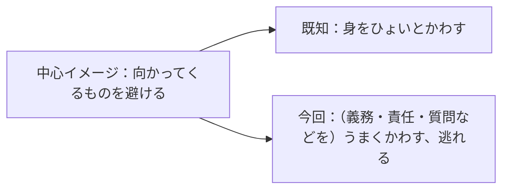

**重要語法：** `dodge a question`

---

## 3282. intersection

**品詞：** 名詞  
**発音：** /ˌɪntərˈsekʃən/

<small>よく知られている意味：交差点</small>

**見落としやすい意味（重要）：** **（数学・集合論での）共通部分、積集合**

**例文：** The shaded region represents the intersection of the two sets.

**和訳：** 色の付いた部分は、二つの集合の共通部分を表している。

**コアイメージ：** 二つの道が交わる場所が intersection。数学では二つの集合が重なる部分に注目し、共通する要素の集まりを指す。

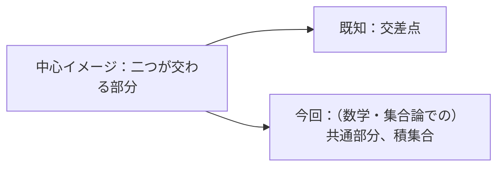

**重要語法：** `the intersection of A and B`

---

## 3283. posting

**品詞：** 名詞  
**発音：** /ˈpoʊstɪŋ/

<small>よく知られている意味：投稿・掲示</small>

**見落としやすい意味（重要）：** **（職場などへの）配属、赴任先、任務**

**例文：** Her first posting was at a small hospital in the mountains.

**和訳：** 彼女の最初の配属先は山間部の小さな病院だった。

**コアイメージ：** post は情報を掲示するだけでなく、人を任地に配置することも表す。そこから posting は配属という行為や、その赴任先を意味する。

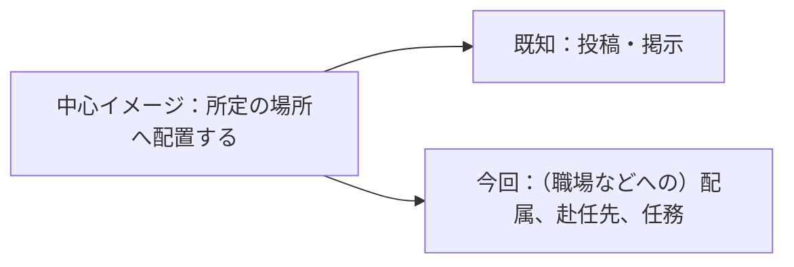

**重要語法：** `a posting to a regional office`

---

## 3284. purport

**品詞：** 名詞  
**発音：** /ˈpɜːrpɔːrt/

<small>よく知られている意味：（動詞）～だと称する</small>

**見落としやすい意味（重要）：** **要旨、趣旨**

**例文：** The purport of his letter was clear: he would not resign.

**和訳：** 彼の手紙の趣旨は明らかだった。辞職するつもりはないということだ。

**コアイメージ：** 文章が表向きに何を伝えようとしているか、という点に注目する。名詞の purport は、その内容をまとめた要旨や趣旨を指す。

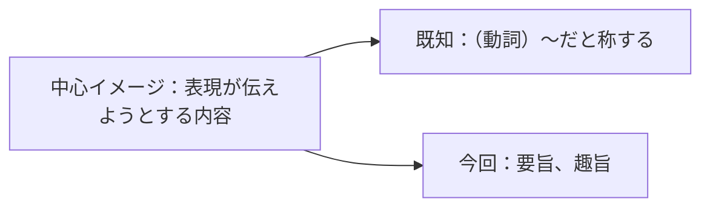

**重要語法：** `the purport of a statement`

---

## 3285. reservoir

**品詞：** 名詞  
**発音：** /ˈrezərvwɑːr/

<small>よく知られている意味：貯水池</small>

**見落としやすい意味（重要）：** **（知識・病原体・人材などの）貯蔵源、供給源**

**例文：** The village is a reservoir of traditional farming knowledge.

**和訳：** その村は伝統的な農業知識の宝庫だ。

**コアイメージ：** 水を蓄えておく場所が reservoir。知識や技能のような目に見えないものにも、豊富に蓄えられた供給源という発想を使える。

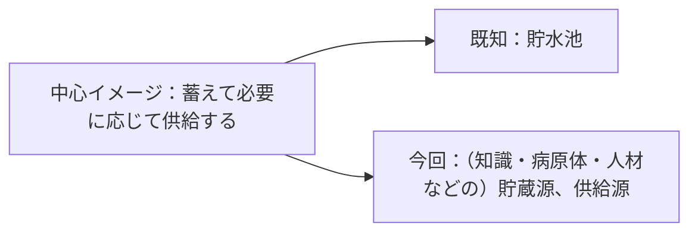

**重要語法：** `a reservoir of knowledge`

---

## 3286. scan

**品詞：** 動詞  
**発音：** /skæn/

<small>よく知られている意味：（機械で）読み取る</small>

**見落としやすい意味（重要）：** **（文章・顔・周囲などを）素早く見渡す、読み取る**

**例文：** She scanned the crowd for a familiar face.

**和訳：** 彼女は知っている顔を探して群衆をさっと見渡した。

**コアイメージ：** ある範囲を順に調べて情報を得る動きが中心にある。機械による読み取りだけでなく、視線で周囲や文章を素早く探る場合にも使う。

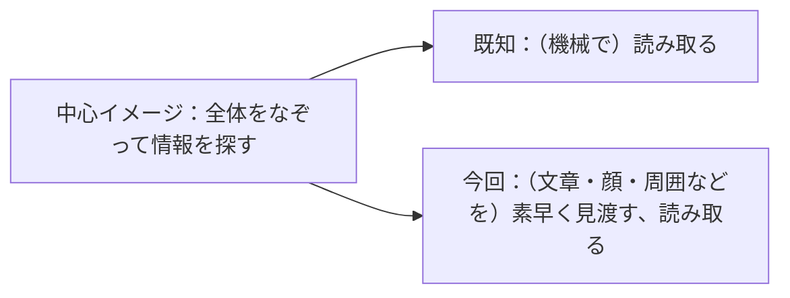

**重要語法：** `scan the room for someone`

---

## 3287. unearth

**品詞：** 動詞  
**発音：** /ʌnˈɜːrθ/

<small>よく知られている意味：地中から掘り出す</small>

**見落としやすい意味（重要）：** **（隠された情報・事実などを）掘り起こす、明らかにする**

**例文：** The journalist unearthed evidence of the fraud.

**和訳：** その記者は詐欺の証拠を掘り起こした。

**コアイメージ：** 土の中から埋もれたものを取り出す動詞。人に知られていなかった事実や証拠を見つけ出すことにも広がる。

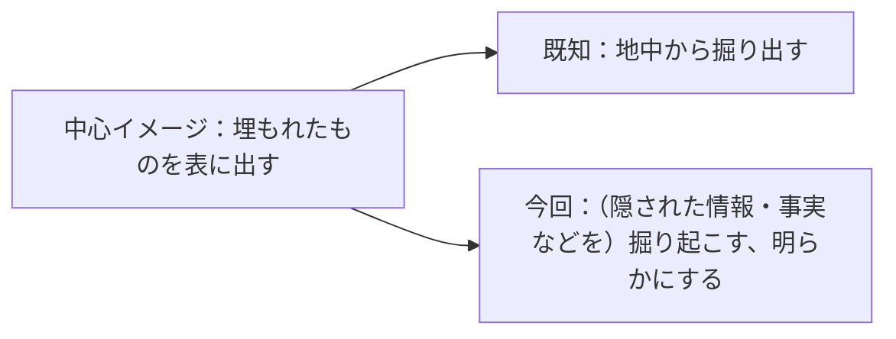

**重要語法：** `unearth evidence`

---

## 3288. whistle

**品詞：** 慣用句  
**発音：** /ˈwɪsəl/

<small>よく知られている意味：笛・口笛</small>

**見落としやすい意味（重要）：** **blow the whistle on：不正を告発する、内部告発する**

**例文：** An employee blew the whistle on unsafe practices at the factory.

**和訳：** 従業員が工場の危険な慣行を告発した。

**コアイメージ：** 笛を吹いて周囲に注意を促す場面を思い浮かべる。不正について警告を発し、外部に知らせることを blow the whistle on と言う。

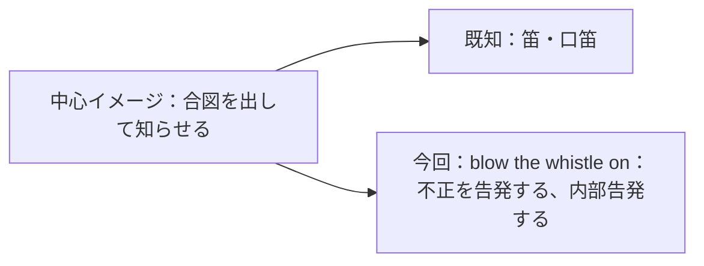

**重要語法：** `blow the whistle on wrongdoing`

---

## 3289. used

**品詞：** 構文  
**発音：** /juːst/

<small>よく知られている意味：使われた（use の過去分詞）</small>

**見落としやすい意味（重要）：** **used to + 動詞原形：以前は～したものだ（今は必ずしもそうではない）**

**例文：** I used to walk to school, but now I take the bus.

**和訳：** 以前は歩いて通学していたが、今はバスを使っている。

**コアイメージ：** used to のまとまりで、かつて続いていた習慣や状態を表す。動詞 use の受け身ではなく、現在との違いを意識して読む。

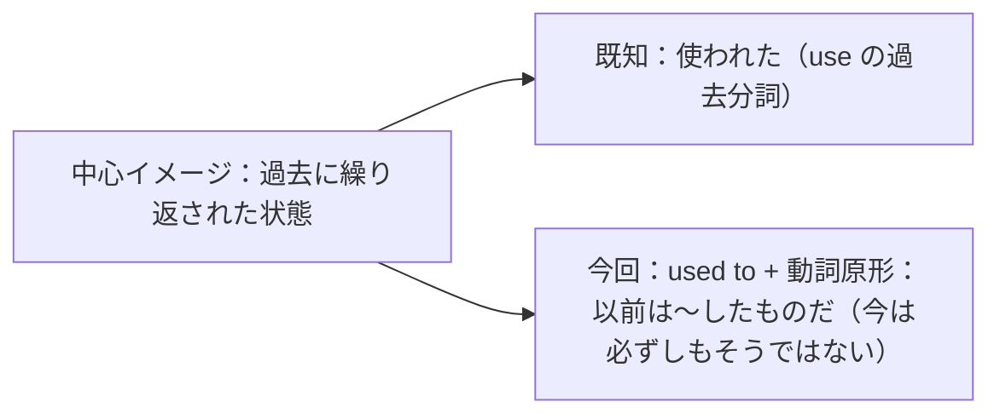

**重要語法：** `used to + 動詞原形`

---

## 3290. used

**品詞：** 構文  
**発音：** /juːst/

<small>よく知られている意味：使われた（use の過去分詞）</small>

**見落としやすい意味（重要）：** **be used to + 名詞・動名詞：～に慣れている**

**例文：** She is used to speaking in front of large audiences.

**和訳：** 彼女は大勢の聴衆の前で話すことに慣れている。

**コアイメージ：** be used to は、経験を積んで抵抗がなくなった状態を表す。ここでの to は前置詞なので、動作を続けるときは動名詞を置く。

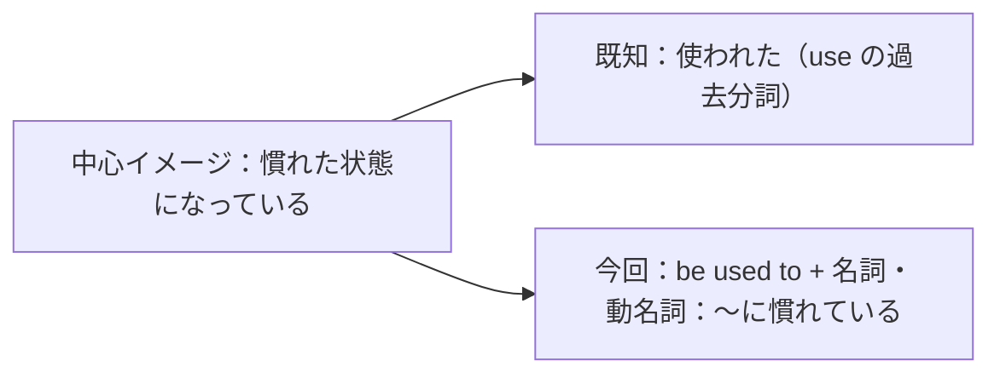

**重要語法：** `be used to + 名詞／動名詞`

---

## 3291. bulb

**品詞：** 名詞  
**発音：** /bʌlb/

<small>よく知られている意味：電球</small>

**見落としやすい意味（重要）：** **植物の球根、鱗茎**

**例文：** Plant the tulip bulbs before winter.

**和訳：** 冬になる前にチューリップの球根を植えなさい。

**コアイメージ：** 電球と球根には、丸くふくらんだ形の共通点がある。植物の話では、養分を蓄えて芽を出す球根を指す。

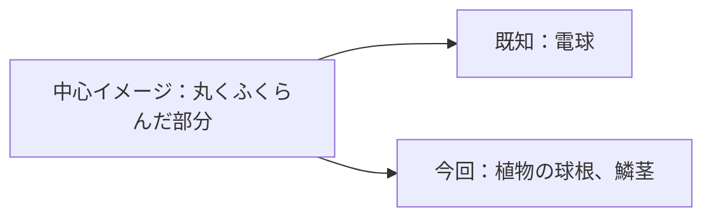

**重要語法：** `flower bulb`

---

## 3292. bureau

**品詞：** 名詞  
**発音：** /ˈbjʊroʊ/

<small>よく知られている意味：官庁の局・部門</small>

**見落としやすい意味（重要）：** **（主に米国英語で）引き出し付きの収納家具、たんす**

**例文：** He kept his socks in the top drawer of the bureau.

**和訳：** 彼は靴下をたんすの一番上の引き出しにしまっていた。

**コアイメージ：** bureau は事務机や仕事場と結び付いた語として使われてきた。米国英語では引き出しのある収納家具を指す場合があり、役所とは限らない。


**重要語法：** `a bureau drawer（主に米国英語）`

---

## 3293. blade

**品詞：** 名詞  
**発音：** /bleɪd/

<small>よく知られている意味：刃</small>

**見落としやすい意味（重要）：** **（草などの）細長い葉（blade of grass）**

**例文：** A blade of grass grew through a crack in the path.

**和訳：** 小道のひび割れから一本の草が伸びていた。

**コアイメージ：** 刃のように細長く薄い形が共通する。草では blade が一枚の細い葉を指し、a blade of grass という形がよく使われる。

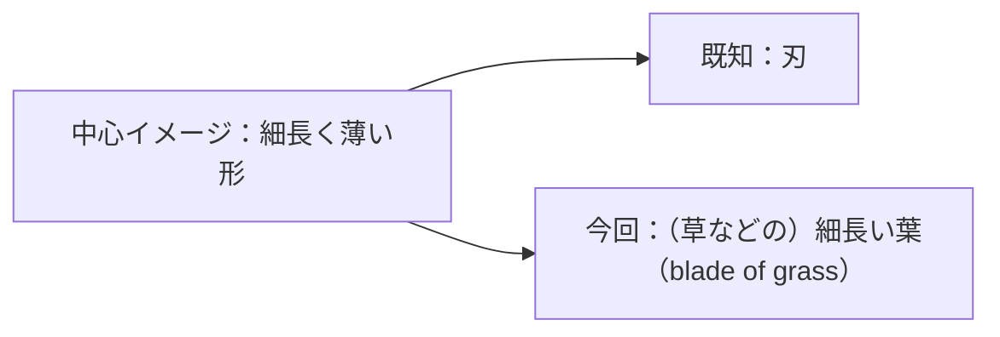

**重要語法：** `a blade of grass`

---

## 3294. hood

**品詞：** 名詞  
**発音：** /hʊd/

<small>よく知られている意味：（服の）フード</small>

**見落としやすい意味（重要）：** **（米国英語で）自動車のボンネット**

**例文：** He opened the hood to check the engine.

**和訳：** 彼はエンジンを点検するために車のボンネットを開けた。

**コアイメージ：** 頭を覆うフードも、車のエンジンを覆う部分も hood と呼ばれる。車の場合は米国英語の表現で、英国英語では bonnet が一般的。

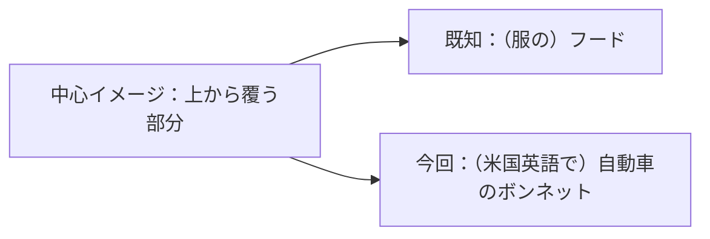

**重要語法：** `under the hood（米国英語）`

---

## 3295. knot

**品詞：** 慣用句  
**発音：** /nɑːt/

<small>よく知られている意味：結び目</small>

**見落としやすい意味（重要）：** **tie the knot：結婚する**

**例文：** They decided to tie the knot next spring.

**和訳：** 二人は来年の春に結婚することに決めた。

**コアイメージ：** ひもを結んで一つにする動きから、二人が人生を結び付ける比喩が生まれる。tie the knot は結婚するという慣用表現。

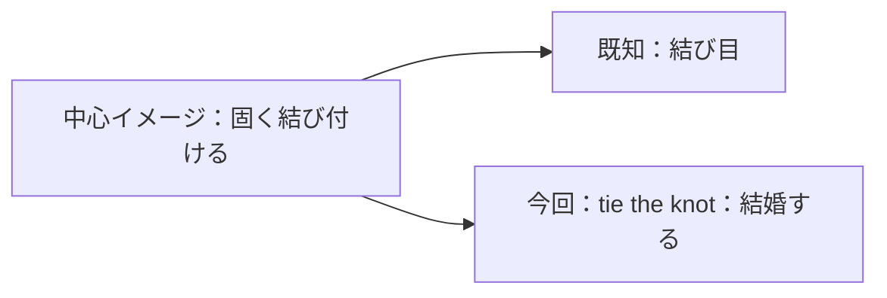

**重要語法：** `tie the knot`

---

## 3296. distinguished

**品詞：** 形容詞  
**発音：** /dɪˈstɪŋɡwɪʃt/

<small>よく知られている意味：区別された</small>

**見落としやすい意味（重要）：** **（人物・実績などが）著名な、卓越した、立派な**

**例文：** A distinguished scientist visited our school.

**和訳：** 著名な科学者が私たちの学校を訪れた。

**コアイメージ：** 多くの人から際立って区別されるという発想がある。そこから、功績や地位によって高く評価される人物を distinguished と形容する。

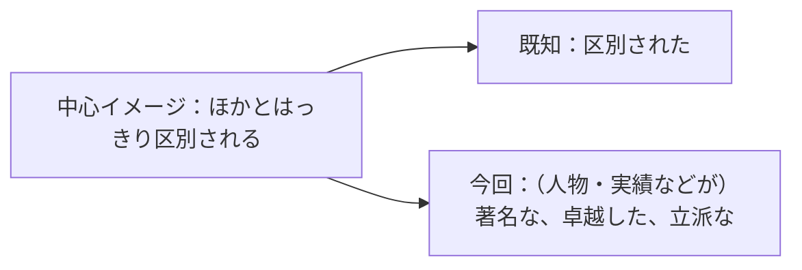

**重要語法：** `a distinguished career`

---

## 3297. usher

**品詞：** 動詞  
**発音：** /ˈʌʃər/

<small>よく知られている意味：案内係</small>

**見落としやすい意味（重要）：** **（新時代・変化などを）到来させる、導入する**

**例文：** The invention ushered in a new era of communication.

**和訳：** その発明は通信の新時代をもたらした。

**コアイメージ：** usher は人を席や場所へ導く役割を表す。比喩的には出来事や発明が新たな時代を招き入れることを表す。

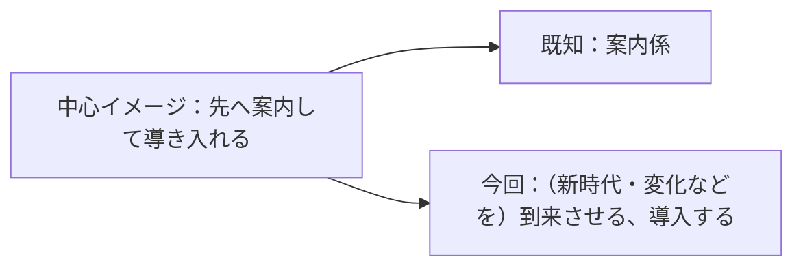

**重要語法：** `usher in a new era`

---

## 3298. quarry

**品詞：** 名詞  
**発音：** /ˈkwɔːri/

<small>よく知られている意味：採石場</small>

**見落としやすい意味（重要）：** **（追跡・探索の）対象、獲物**

**例文：** The detective followed his quarry into the station.

**和訳：** 刑事は追跡していた相手を駅の中まで追った。

**コアイメージ：** 採石場を表す quarry と、追跡対象を表す quarry は語源の異なる同綴りの語。後者では狩りの獲物から、追っている人物や対象へ意味が広がる。

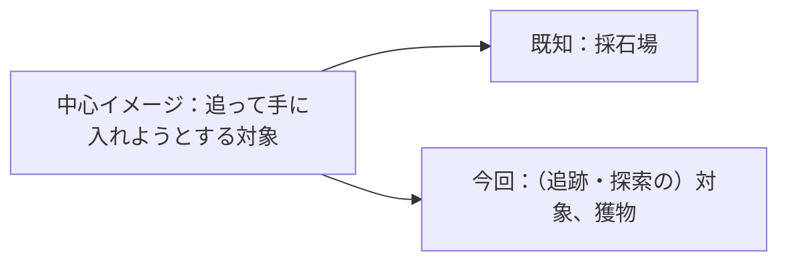

**重要語法：** `a hunter's quarry`

---

## 3299. woo

**品詞：** 動詞  
**発音：** /wuː/

<small>よく知られている意味：求愛する</small>

**見落としやすい意味（重要）：** **（支持者・票・顧客などを）得ようと働きかける**

**例文：** The company is trying to woo younger customers.

**和訳：** その企業は若い顧客を取り込もうとしている。

**コアイメージ：** 相手の心をつかもうとする点が中心にある。恋愛に限らず、票や支持、顧客を得ようとして積極的に働きかけることにも使う。

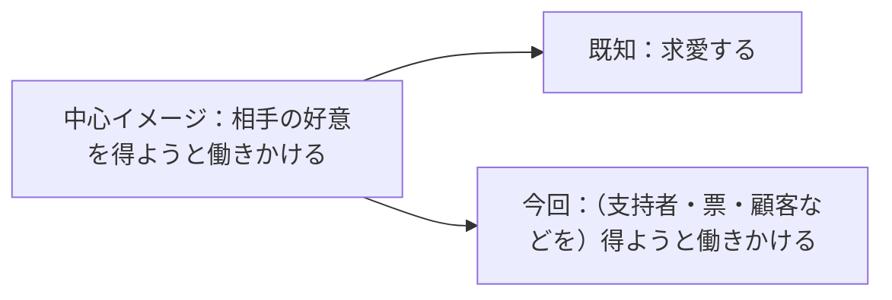

**重要語法：** `woo voters / customers`

---

## 3300. bastion

**品詞：** 名詞  
**発音：** /ˈbæstʃən/

<small>よく知られている意味：要塞</small>

**見落としやすい意味（重要）：** **（信条・思想・自由などを守る）最後の砦、牙城**

**例文：** The library remained a bastion of free thought.

**和訳：** その図書館は自由な思想を守る砦であり続けた。

**コアイメージ：** 敵の攻撃を防ぐ要塞が元のイメージ。価値観や制度を守り続ける集団や場所も、比喩的に bastion と呼べる。

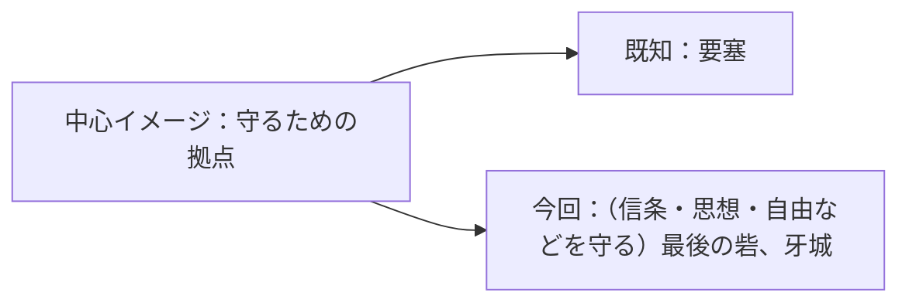

**重要語法：** `a bastion of democracy`

---

## 3301. catalogue

**品詞：** 動詞  
**発音：** /ˈkætəlɔːɡ/

<small>よく知られている意味：目録・カタログ</small>

**見落としやすい意味（重要）：** **（作品・資料・特徴などを）一覧表にする、列挙する**

**例文：** The researchers catalogued every object found at the site.

**和訳：** 研究者たちは遺跡で見つかった品を一つ残らず目録にまとめた。

**コアイメージ：** 目録とは物を項目ごとに整理した一覧のこと。その一覧を作る動作自体も catalogue という動詞で表せる。

```mermaid
flowchart LR
    A["中心イメージ：項目を整理して並べる"]
    B["既知：目録・カタログ"]
    C["今回：（作品・資料・特徴などを）一覧表にする、列挙する"]
    A --> B
    A --> C
```

**重要語法：** `catalogue the findings`

---

## 3302. committed

**品詞：** 形容詞  
**発音：** /kəˈmɪtɪd/

<small>よく知られている意味：（罪などを）犯した</small>

**見落としやすい意味（重要）：** **（目的・信念などに）強く献身している、熱心な**

**例文：** She is a committed advocate for children's education.

**和訳：** 彼女は子どもの教育に熱心に取り組む支援者だ。

**コアイメージ：** commit にはある行為に深く関与する感覚がある。信念や目標に継続的に力を注ぐ人は committed と評価される。

```mermaid
flowchart LR
    A["中心イメージ：一つのことにしっかり身を投じる"]
    B["既知：（罪などを）犯した"]
    C["今回：（目的・信念などに）強く献身している、熱心な"]
    A --> B
    A --> C
```

**重要語法：** `be committed to + 名詞／動名詞`

---

## 3303. congratulate

**品詞：** 慣用句  
**発音：** /kənˈɡrætʃəleɪt/

<small>よく知られている意味：祝福する</small>

**見落としやすい意味（重要）：** **congratulate oneself on：自分で自分を褒める、得意になる**

**例文：** He congratulated himself on finishing the task early.

**和訳：** 彼は仕事を早く終えたことを自分で褒めた。

**コアイメージ：** 達成を喜んで誰かを称賛するのが基本。目的語が oneself になると、自分の成果を自分で褒めたり得意になったりする意味になる。

```mermaid
flowchart LR
    A["中心イメージ：達成を喜んで評価する"]
    B["既知：祝福する"]
    C["今回：congratulate oneself on：自分で自分を褒める、得意になる"]
    A --> B
    A --> C
```

**重要語法：** `congratulate oneself on ...`

---

## 3304. credentials

**品詞：** 名詞  
**発音：** /krəˈdenʃəlz/

<small>よく知られている意味：資格・経歴証明</small>

**見落としやすい意味（重要）：** **（システムへのログインに使う）認証情報**

**例文：** Never share your login credentials by email.

**和訳：** ログイン用の認証情報をメールで共有してはいけない。

**コアイメージ：** 資格証明書は、その人がふさわしい人物だと確認する材料になる。同様にシステムでは、利用者の本人確認に使う情報を credentials と呼ぶ。

```mermaid
flowchart LR
    A["中心イメージ：本人の正当性を証明するもの"]
    B["既知：資格・経歴証明"]
    C["今回：（システムへのログインに使う）認証情報"]
    A --> B
    A --> C
```

**重要語法：** `login credentials`

---

## 3305. distress

**品詞：** 名詞  
**発音：** /dɪˈstres/

<small>よく知られている意味：精神的苦痛</small>

**見落としやすい意味（重要）：** **（船舶・航空機などが発する）遭難・緊急の救助要請**

**例文：** The crew sent a distress signal before the radio failed.

**和訳：** 無線機が故障する前に、乗組員は遭難信号を送った。

**コアイメージ：** distress は強い苦境や危機の状態を指す。海や空での緊急時には、救助を必要としていることを伝える信号にも現れる。

```mermaid
flowchart LR
    A["中心イメージ：助けが必要な切迫した状態"]
    B["既知：精神的苦痛"]
    C["今回：（船舶・航空機などが発する）遭難・緊急の救助要請"]
    A --> B
    A --> C
```

**重要語法：** `a distress signal / distress call`

---

## 3306. fed

**品詞：** 慣用句  
**発音：** /fed/

<small>よく知られている意味：餌を与えられた</small>

**見落としやすい意味（重要）：** **be fed up with：～にうんざりしている、飽き飽きしている**

**例文：** I'm fed up with these constant delays.

**和訳：** こう何度も遅れが続くのには、もううんざりだ。

**コアイメージ：** be fed up with は、同じことをもう十分だと感じる状態を表す決まった言い方。食事を与えられるという feed の直訳では意味を取りにくい。

```mermaid
flowchart LR
    A["中心イメージ：同じことを受け続けて限界になる"]
    B["既知：餌を与えられた"]
    C["今回：be fed up with：～にうんざりしている、飽き飽きしている"]
    A --> B
    A --> C
```

**重要語法：** `be fed up with + 名詞／動名詞`

---

## 3307. flirt

**品詞：** 慣用句  
**発音：** /flɜːrt/

<small>よく知られている意味：軽く口説く</small>

**見落としやすい意味（重要）：** **flirt with：危険・考え・可能性などに軽い気持ちで接する、試しに考える**

**例文：** The committee is flirting with the idea of changing the rules.

**和訳：** 委員会は規則を変える案を試しに検討している。

**コアイメージ：** 本格的に関係を結ぶ前に軽く近づく感覚がある。考えや危険に対しても、真剣に決めずに関心を向けることを flirt with と言う。

```mermaid
flowchart LR
    A["中心イメージ：深入りせず軽く近づく"]
    B["既知：軽く口説く"]
    C["今回：flirt with：危険・考え・可能性などに軽い気持ちで接する、試しに考える"]
    A --> B
    A --> C
```

**重要語法：** `flirt with an idea / danger`

---

## 3308. funnel

**品詞：** 動詞  
**発音：** /ˈfʌnəl/

<small>よく知られている意味：じょうご</small>

**見落としやすい意味（重要）：** **（資金・情報・人などを）特定の方向や経路へ集めて流す**

**例文：** The program funnels donations to schools in rural areas.

**和訳：** その制度は寄付金を地方の学校へ集中的に送る。

**コアイメージ：** じょうごは広く受け止めたものを細い出口へ流す道具。資金や情報を特定の経路や行き先へ誘導するときも funnel を使う。

```mermaid
flowchart LR
    A["中心イメージ：流れを狭い経路へ集める"]
    B["既知：じょうご"]
    C["今回：（資金・情報・人などを）特定の方向や経路へ集めて流す"]
    A --> B
    A --> C
```

**重要語法：** `funnel money into ...`

---

## 3309. knit

**品詞：** 動詞  
**発音：** /nɪt/

<small>よく知られている意味：編む</small>

**見落としやすい意味（重要）：** **（人・共同体などを）固く結びつける、団結させる**

**例文：** The shared experience knitted the group together.

**和訳：** 共通の経験がその集団の結束を強めた。

**コアイメージ：** 毛糸の目をつないで一枚の布を作るのが knit。人と人との結び付きが密になることにも同じイメージを用いる。

```mermaid
flowchart LR
    A["中心イメージ：細いものを絡めて一つにする"]
    B["既知：編む"]
    C["今回：（人・共同体などを）固く結びつける、団結させる"]
    A --> B
    A --> C
```

**重要語法：** `knit a community together`

---

## 3310. menace

**品詞：** 動詞  
**発音：** /ˈmenəs/

<small>よく知られている意味：脅威</small>

**見落としやすい意味（重要）：** **～を脅かす、危険にさらす**

**例文：** Rising sea levels menace coastal towns.

**和訳：** 海面上昇が沿岸の町々を脅かしている。

**コアイメージ：** 名詞では危険をもたらす脅威を表す。動詞になると、あるものが別のものを脅かすという関係を直接述べられる。

```mermaid
flowchart LR
    A["中心イメージ：危険を感じさせる存在"]
    B["既知：脅威"]
    C["今回：～を脅かす、危険にさらす"]
    A --> B
    A --> C
```

**重要語法：** `menace a community`

---

## 3311. orchestrate

**品詞：** 動詞  
**発音：** /ˈɔːrkɪstreɪt/

<small>よく知られている意味：オーケストラ用に編曲する</small>

**見落としやすい意味（重要）：** **（計画・陰謀・活動などを）巧みに組織する、仕組む**

**例文：** She orchestrated a campaign to protect the wetlands.

**和訳：** 彼女は湿地を守る運動を巧みに組織した。

**コアイメージ：** 楽器ごとの役割を組み合わせて一つの演奏を作るのが出発点。人や計画を調整して複雑な活動を進めることにも用いる。

```mermaid
flowchart LR
    A["中心イメージ：多くの要素を調整して動かす"]
    B["既知：オーケストラ用に編曲する"]
    C["今回：（計画・陰謀・活動などを）巧みに組織する、仕組む"]
    A --> B
    A --> C
```

**重要語法：** `orchestrate a campaign`

---

## 3312. plateau

**品詞：** 動詞  
**発音：** /plæˈtoʊ/

<small>よく知られている意味：高原</small>

**見落としやすい意味（重要）：** **増加や成長が頭打ちになる、横ばいになる**

**例文：** After three months, sales began to plateau.

**和訳：** 三か月後、売上げは頭打ちになり始めた。

**コアイメージ：** 高原は周囲より高くても上面は比較的平らな地形。数値の上昇が止まって横ばいになる様子を plateau という動詞で表す。

```mermaid
flowchart LR
    A["中心イメージ：高い所で平らになる"]
    B["既知：高原"]
    C["今回：増加や成長が頭打ちになる、横ばいになる"]
    A --> B
    A --> C
```

**重要語法：** `sales plateau`

---

## 3313. probation

**品詞：** 名詞  
**発音：** /proʊˈbeɪʃən/

<small>よく知られている意味：保護観察</small>

**見落としやすい意味（重要）：** **（雇用者の）試用期間**

**例文：** New employees spend three months on probation.

**和訳：** 新入社員には三か月の試用期間がある。

**コアイメージ：** 行動や適性を一定期間見守るという考えが共通する。司法の保護観察だけでなく、採用後の適性を確認する試用期間も probation と言う。

```mermaid
flowchart LR
    A["中心イメージ：一定期間、適性を見極める"]
    B["既知：保護観察"]
    C["今回：（雇用者の）試用期間"]
    A --> B
    A --> C
```

**重要語法：** `on probation / a probationary period`

---

## 3314. rack

**品詞：** 慣用句  
**発音：** /ræk/

<small>よく知られている意味：棚・物を置く台</small>

**見落としやすい意味（重要）：** **rack up：得点・利益・負債などを次々に積み重ねる**

**例文：** The team racked up six wins in a row.

**和訳：** そのチームは六連勝を積み重ねた。

**コアイメージ：** rack up は数量や成果が次々と加算されることを表す句動詞。得点や勝利だけでなく、負債を増やす場合にも使われる。

```mermaid
flowchart LR
    A["中心イメージ：数が次々に積み上がる"]
    B["既知：棚・物を置く台"]
    C["今回：rack up：得点・利益・負債などを次々に積み重ねる"]
    A --> B
    A --> C
```

**重要語法：** `rack up points / debt`

---

## 3315. rack

**品詞：** 慣用句  
**発音：** /ræk/

<small>よく知られている意味：棚・物を置く台</small>

**見落としやすい意味（重要）：** **rack one's brains：知恵を絞る、必死に考える**

**例文：** I racked my brains trying to remember his name.

**和訳：** 私は彼の名前を思い出そうと必死に知恵を絞った。

**コアイメージ：** rack one's brains は頭を酷使して考える慣用表現。棚を意味する rack と一語ずつ対応させず、ひとかたまりで覚える。

```mermaid
flowchart LR
    A["中心イメージ：頭を限界まで働かせる"]
    B["既知：棚・物を置く台"]
    C["今回：rack one's brains：知恵を絞る、必死に考える"]
    A --> B
    A --> C
```

**重要語法：** `rack one's brains`

---

## 3316. savvy

**品詞：** 形容詞  
**発音：** /ˈsævi/

<small>よく知られている意味：（名詞）実務的な知識</small>

**見落としやすい意味（重要）：** **（技術・状況などに）精通している、事情に通じた**

**例文：** We need a tech-savvy person to manage the website.

**和訳：** そのウェブサイトの管理には、技術に精通した人が必要だ。

**コアイメージ：** savvy は単なる知識の量より、実際の場面で使える理解を表す。形容詞では、その分野の事情をよく分かっている人を形容する。

```mermaid
flowchart LR
    A["中心イメージ：状況を分かってうまく動ける"]
    B["既知：（名詞）実務的な知識"]
    C["今回：（技術・状況などに）精通している、事情に通じた"]
    A --> B
    A --> C
```

**重要語法：** `tech-savvy / media-savvy`

---

## 3317. savvy

**品詞：** 名詞  
**発音：** /ˈsævi/

<small>よく知られている意味：（形容詞）事情に通じた</small>

**見落としやすい意味（重要）：** **実際的な知識、要領のよさ、判断力**

**例文：** Her business savvy helped the shop survive.

**和訳：** 彼女の商才のおかげで、その店は経営を続けられた。

**コアイメージ：** savvy の中心には実際の状況を見抜き、適切に判断する力がある。名詞なら、その分野に通じた知識や実務感覚を指す。

```mermaid
flowchart LR
    A["中心イメージ：実際に使える判断力"]
    B["既知：（形容詞）事情に通じた"]
    C["今回：実際的な知識、要領のよさ、判断力"]
    A --> B
    A --> C
```

**重要語法：** `business savvy`

---

## 3318. signpost

**品詞：** 動詞  
**発音：** /ˈsaɪnpoʊst/

<small>よく知られている意味：道標・案内標識</small>

**見落としやすい意味（重要）：** **（文書・説明で）要点や次の展開を明示する**

**例文：** The introduction clearly signposts the main argument.

**和訳：** 序論は中心となる論点を明確に示している。

**コアイメージ：** 道標は進む方向を読者や旅人に知らせる。文章でも、今どの話をしていて次に何を扱うかを示すことを signpost と呼べる。

```mermaid
flowchart LR
    A["中心イメージ：次に進む方向を示す"]
    B["既知：道標・案内標識"]
    C["今回：（文書・説明で）要点や次の展開を明示する"]
    A --> B
    A --> C
```

**重要語法：** `signpost the argument`

---

## 3319. slick

**品詞：** 形容詞  
**発音：** /slɪk/

<small>よく知られている意味：つるつるした・滑らかな</small>

**見落としやすい意味（重要）：** **（宣伝・話し方などが）巧妙でうさんくさい、口先のうまい**

**例文：** The proposal sounded slick, but it lacked real detail.

**和訳：** その提案は口当たりがよかったが、実質的な詳しさに欠けていた。

**コアイメージ：** 滑らかで引っ掛からないという表面の感覚が出発点。言葉や宣伝があまりに流暢で、かえって信用しにくい場合にも使う。

```mermaid
flowchart LR
    A["中心イメージ：引っ掛かりなく流れる"]
    B["既知：つるつるした・滑らかな"]
    C["今回：（宣伝・話し方などが）巧妙でうさんくさい、口先のうまい"]
    A --> B
    A --> C
```

**重要語法：** `slick advertising`

---

## 3320. spotlight

**品詞：** 動詞  
**発音：** /ˈspɑːtlaɪt/

<small>よく知られている意味：スポットライト</small>

**見落としやすい意味（重要）：** **（人物・問題などに）注目を集める**

**例文：** The report spotlights the difficulties faced by small farms.

**和訳：** その報告書は小規模農家が直面する困難に注目を集めている。

**コアイメージ：** 照明を一点に当てると、そこが周囲より目立つ。記事や報告が特定の問題を際立たせることも spotlight という動詞で表す。

```mermaid
flowchart LR
    A["中心イメージ：明るく照らして目立たせる"]
    B["既知：スポットライト"]
    C["今回：（人物・問題などに）注目を集める"]
    A --> B
    A --> C
```

**重要語法：** `spotlight an issue`

---
