# EasyVoca 完成教材｜Batch 043

採用済み語義のみを使用。global_order **3361〜3440**、全80カード。発音は主に米国英語を目安に記載し、必要な場合は地域差を併記しています。

## 3361｜vault

**単語**：vault  
**品詞**：動詞（verb）  
**発音**：/vɔːlt/

<small>よく知られている意味：金庫・地下貯蔵室</small>

### 見落としやすい意味

**障害物を飛び越える**

**例文**：The athlete vaulted the low fence in one smooth movement.

**和訳**：その選手は低い柵を一気に飛び越えた。

**コアイメージ**：vaultには弧を描いて跳ぶ動きがある。そこから、手や足を使って障害物を飛び越える動作を表す。

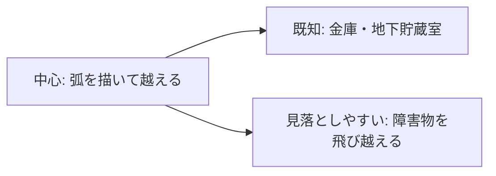

**重要語法**：vault over a fence

<small>index: 6589 ／ candidate_id: ev-06589-verb-01</small>

---

## 3362｜vulgar

**単語**：vulgar  
**品詞**：形容詞（adjective）  
**発音**：/ˈvʌlɡər/

<small>よく知られている意味：下品な・粗野な</small>

### 見落としやすい意味

**日常的・通俗的な言葉の**

**例文**：The text uses the vulgar tongue spoken by ordinary people.

**和訳**：その文章は一般の人々が話す日常の言葉を用いている。

**コアイメージ**：vulgarの古い中心には「一般の人々に属する」がある。そこから「通俗的な」と「洗練されていない」の両方向へ意味が広がった。

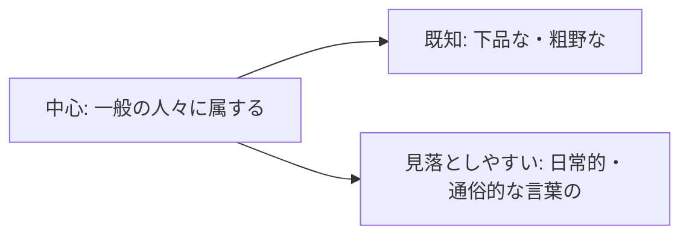

**重要語法**：Vulgar Latin（俗ラテン語）

<small>index: 6593 ／ candidate_id: ev-06593-adj-01</small>

---

## 3363｜wan

**単語**：wan  
**品詞**：形容詞（adjective）  
**発音**：/wɑːn/

<small>よく知られている意味：青白い・顔色が悪い</small>

### 見落としやすい意味

**光などがかすかな・弱々しい**

**例文**：A wan light came through the cloudy window.

**和訳**：曇った窓から弱々しい光が差し込んだ。

**コアイメージ**：wanは色や生気が乏しい様子を表す。人の顔色だけでなく、光の弱さにも使える。

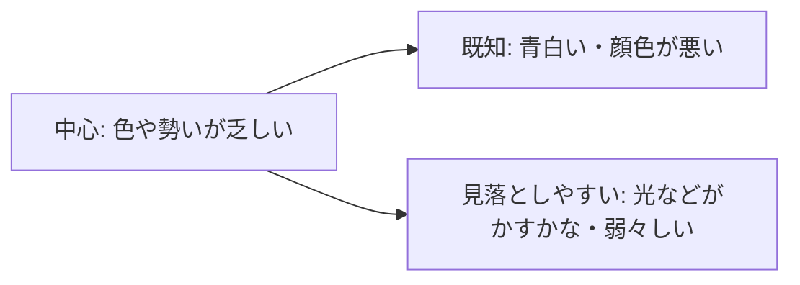

**重要語法**：wan light

<small>index: 6594 ／ candidate_id: ev-06594-adj-01</small>

---

## 3364｜belly

**単語**：belly  
**品詞**：動詞（verb）  
**発音**：/ˈbeli/

<small>よく知られている意味：腹・おなか</small>

### 見落としやすい意味

**ふくらむ・膨張する**

**例文**：The sails bellied out as the wind grew stronger.

**和訳**：風が強まるにつれて帆が大きくふくらんだ。

**コアイメージ**：bellyは丸く突き出した腹を指す。その形を動きに移し、布や帆などが外にふくらむ様子を表す。

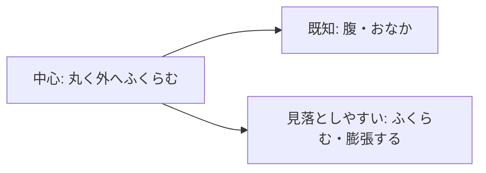

**重要語法**：belly out

<small>index: 6597 ／ candidate_id: ev-06597-verb-01</small>

---

## 3365｜reunion

**単語**：reunion  
**品詞**：名詞（noun）  
**発音**：/ˌriːˈjuːniən/

<small>よく知られている意味：再会</small>

### 見落としやすい意味

**同窓会・親族の集まりなど再会の行事**

**例文**：Our family holds a reunion every summer.

**和訳**：私たちの家族は毎年夏に親族の集まりを開く。

**コアイメージ**：reunionは離れていた人々が再び集まること。その再会そのものだけでなく、再会のために開く行事も指す。

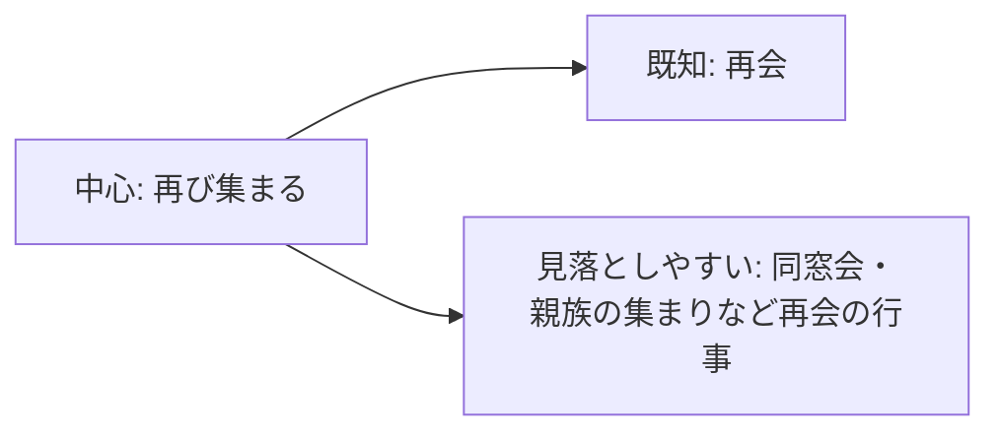

**重要語法**：family reunion; class reunion

<small>index: 6598 ／ candidate_id: ev-06598-noun-01</small>

---

## 3366｜sock

**単語**：sock  
**品詞**：動詞（verb）  
**発音**：/sɑːk/

<small>よく知られている意味：靴下</small>

### 見落としやすい意味

**（人を）拳で強く殴る**

**例文**：He socked the man during the argument.

**和訳**：彼は口論の最中にその男性を強く殴った。

**コアイメージ**：sockは名詞では靴下だが、動詞では口語的に強い一撃を加える意味を持つ。これは靴下の意味から素直に推測できない別の用法なので、区別して覚える。

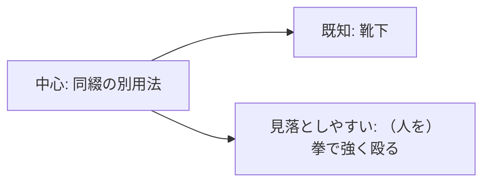

**重要語法**：sock someone in the face（強く殴る）

<small>index: 6600 ／ candidate_id: ev-06600-verb-01</small>

---

## 3367｜trainer

**単語**：trainer  
**品詞**：名詞（noun）  
**発音**：/ˈtreɪnər/

<small>よく知られている意味：指導者・トレーナー</small>

### 見落としやすい意味

**（主に英国英語）運動靴・スニーカー**

**例文**：I bought a comfortable pair of trainers for walking.

**和訳**：歩くために履き心地のよいスニーカーを一足買った。

**コアイメージ**：trainerは訓練する人だけでなく、運動用の靴も指す。特に英国英語では日常的にスニーカーの意味で使う。

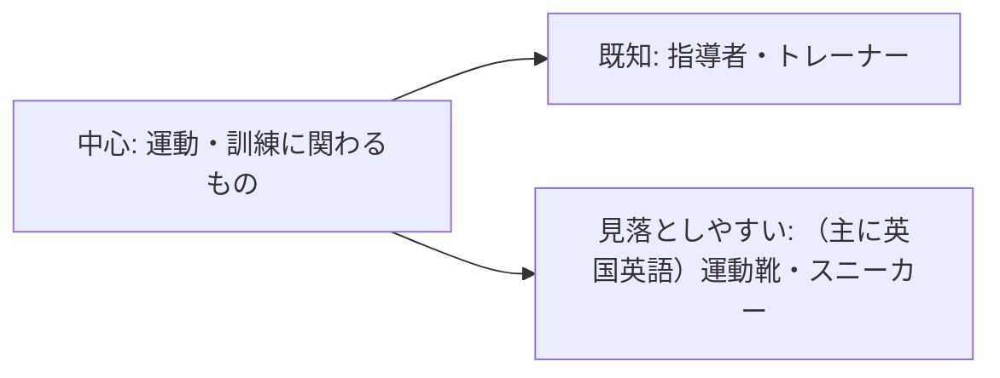

**重要語法**：a pair of trainers（英）

<small>index: 6602 ／ candidate_id: ev-06602-noun-01</small>

---

## 3368｜offence

**単語**：offence  
**品詞**：名詞（noun）  
**発音**：/əˈfens/

<small>よく知られている意味：違反・人を怒らせること</small>

### 見落としやすい意味

**（主にスポーツで）攻撃側・攻撃の戦術**

**例文**：The team's offence improved in the second half.

**和訳**：そのチームの攻撃は後半に改善した。

**コアイメージ**：offenceは相手に対して働きかける側という発想で、スポーツの攻撃にも使う。英国式の綴りで、米国式では通常offenseと書く。

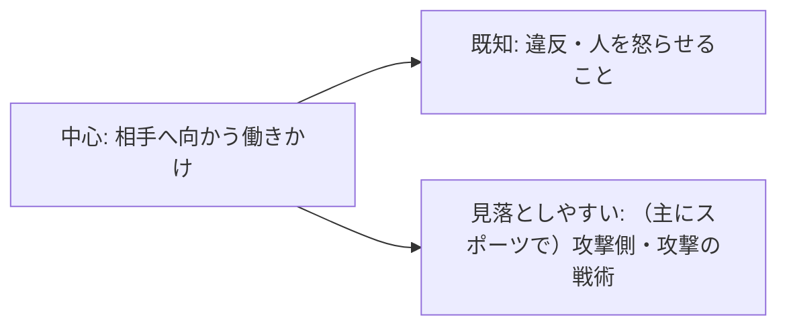

**重要語法**：offence and defence（英）

<small>index: 6604 ／ candidate_id: ev-06604-noun-01</small>

---

## 3369｜dove

**単語**：dove  
**品詞**：名詞（noun）  
**発音**：/dʌv/

<small>よく知られている意味：ハト</small>

### 見落としやすい意味

**対立より交渉を重視する穏健派の人**

**例文**：The diplomat was known as a dove who favored negotiations.

**和訳**：その外交官は交渉を重んじる穏健派として知られていた。

**コアイメージ**：ハトは平和を象徴する鳥とされる。その連想から、強硬策より対話を支持する人をdoveと呼ぶ。

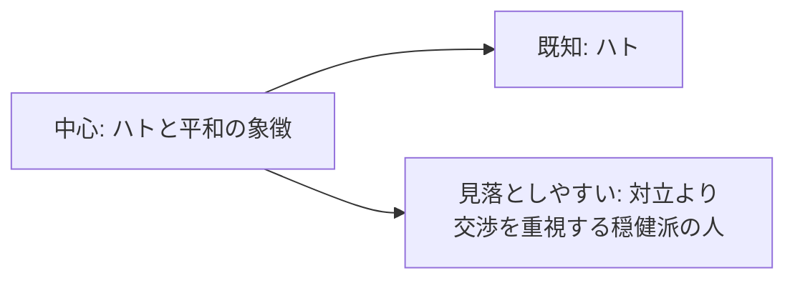

**重要語法**：a dove / a hawk

<small>index: 6605 ／ candidate_id: ev-06605-noun-01</small>

---

## 3370｜dove

**単語**：dove  
**品詞**：動詞（verb）  
**発音**：/doʊv/

<small>よく知られている意味：ハト（名詞）</small>

### 見落としやすい意味

**（主に米国英語）diveの過去形「飛び込んだ」**

**例文**：He dove into the lake to retrieve the ball.

**和訳**：彼はボールを取るために湖へ飛び込んだ。

**コアイメージ**：このdoveは鳥のdoveとは別で、動詞diveの過去形である。同じ綴りでも発音も語源も異なるため、文中で動詞として働くかを確認する。

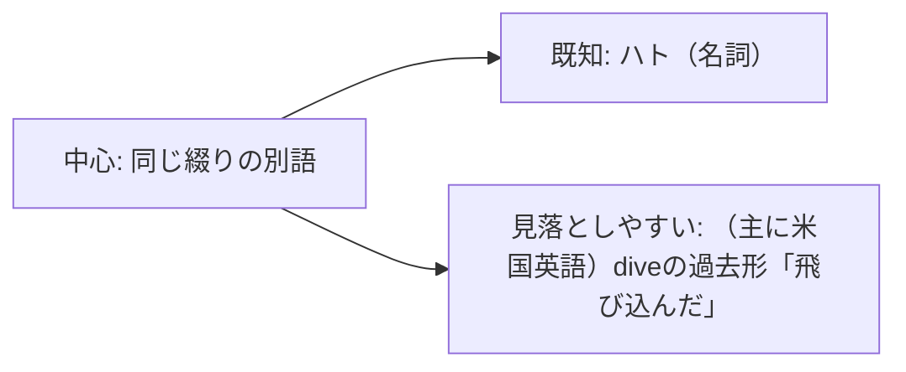

**重要語法**：dive–dove–dived（米で一般的）

<small>index: 6605 ／ candidate_id: ev-06605-verb-01</small>

---

## 3371｜weed

**単語**：weed  
**品詞**：動詞（verb）  
**発音**：/wiːd/

<small>よく知られている意味：雑草</small>

### 見落としやすい意味

**weed out ～：不要なもの・人を選別して取り除く**

**例文**：The editor weeded out repeated passages from the draft.

**和訳**：編集者は原稿から重複した部分を取り除いた。

**コアイメージ**：weedは不要な雑草を表す。動詞では雑草を抜くように、不要な要素を選別して除くという意味になる。

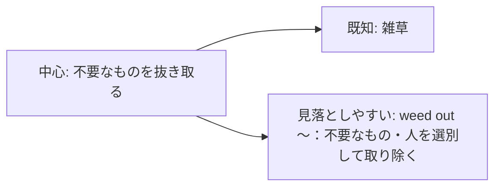

**重要語法**：weed out mistakes

<small>index: 6606 ／ candidate_id: ev-06606-verb-01</small>

---

## 3372｜salvation

**単語**：salvation  
**品詞**：名詞（noun）  
**発音**：/sælˈveɪʃən/

<small>よく知られている意味：宗教的な救済</small>

### 見落としやすい意味

**困難を切り抜ける救いとなる手段**

**例文**：A temporary loan proved the shop's salvation.

**和訳**：一時的な融資がその店を救う手段となった。

**コアイメージ**：salvationは危険や苦境から救われること。宗教的な救いだけでなく、現実の危機を乗り切る助けにも使える。

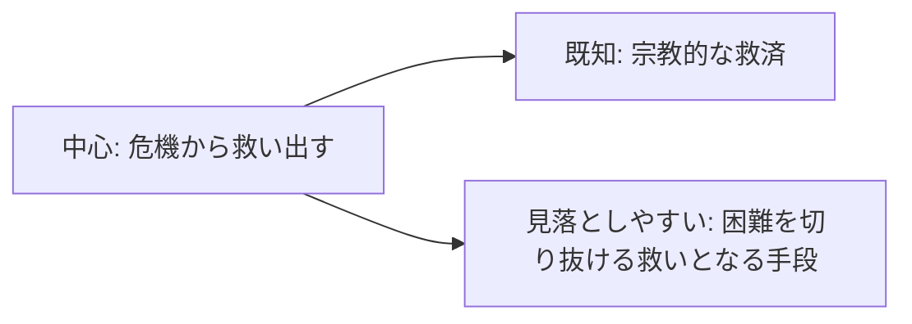

**重要語法**：be someone's salvation

<small>index: 6611 ／ candidate_id: ev-06611-noun-01</small>

---

## 3373｜bald

**単語**：bald  
**品詞**：形容詞（adjective）  
**発音**：/bɔːld/

<small>よく知られている意味：はげた・毛のない</small>

### 見落としやすい意味

**露骨な・飾らない**

**例文**：The report offered a bald statement of the facts.

**和訳**：報告書は事実を飾り気なくそのまま述べていた。

**コアイメージ**：baldは覆うものがない状態を表す。頭髪のなさから転じて、言葉に装飾や婉曲表現がない様子も指す。

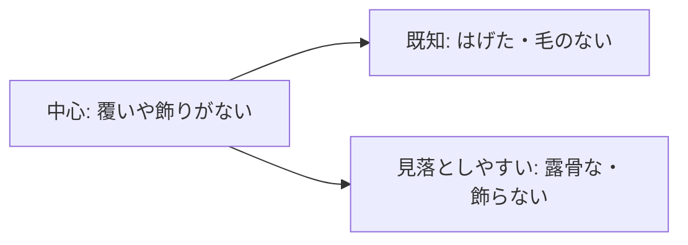

**重要語法**：a bald statement

<small>index: 6612 ／ candidate_id: ev-06612-adj-01</small>

---

## 3374｜insecure

**単語**：insecure  
**品詞**：形容詞（adjective）  
**発音**：/ˌɪnsɪˈkjʊr/

<small>よく知られている意味：自信がない・不安な</small>

### 見落としやすい意味

**しっかり固定されていない・不安定な**

**例文**：The ladder felt insecure against the wall.

**和訳**：はしごは壁に立て掛けても不安定に感じられた。

**コアイメージ**：secureはしっかり固定され安全な状態を指す。否定形のinsecureは気持ちの不安だけでなく、物理的な固定の弱さにも使う。

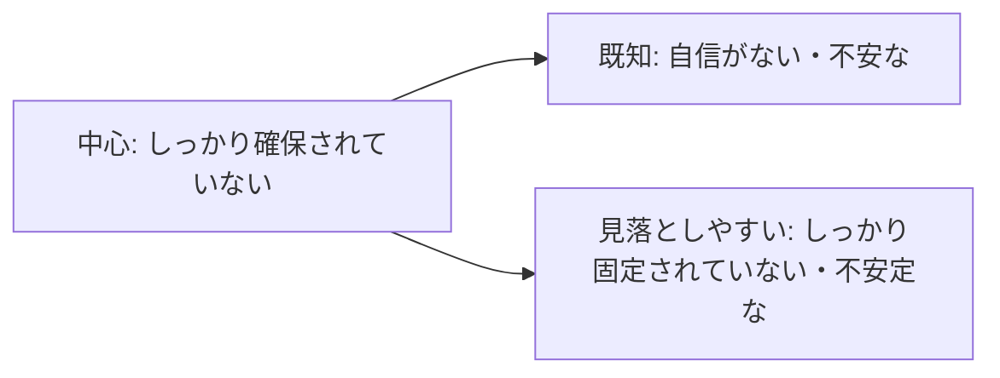

**重要語法**：an insecure attachment

<small>index: 6614 ／ candidate_id: ev-06614-adj-01</small>

---

## 3375｜variance

**単語**：variance  
**品詞**：名詞（noun）  
**発音**：/ˈveriəns/

<small>よく知られている意味：分散（統計）</small>

### 見落としやすい意味

**at variance with ～：～と食い違って・矛盾して**

**例文**：His account is at variance with the official record.

**和訳**：彼の説明は公式記録と食い違っている。

**コアイメージ**：varianceの核は同じでないこと、ずれがあること。数値のばらつきだけでなく、説明や立場が一致しない場合にも使う。

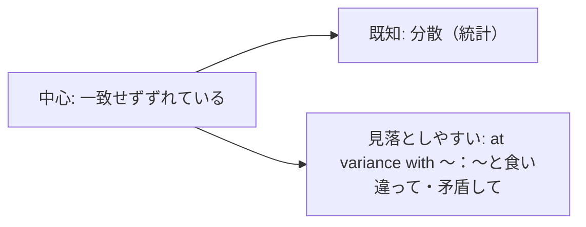

**重要語法**：at variance with

<small>index: 6615 ／ candidate_id: ev-06615-noun-01</small>

---

## 3376｜recess

**単語**：recess  
**品詞**：動詞（verb）  
**発音**：/rɪˈses/

<small>よく知られている意味：休憩時間・休会</small>

### 見落としやすい意味

**会議・議会を休会にする**

**例文**：The committee recessed for lunch at noon.

**和訳**：委員会は正午に昼食のため休会した。

**コアイメージ**：recessは活動をいったん中断する時間や状態を指す。動詞として使うと、会議などを一時休止にする意味になる。

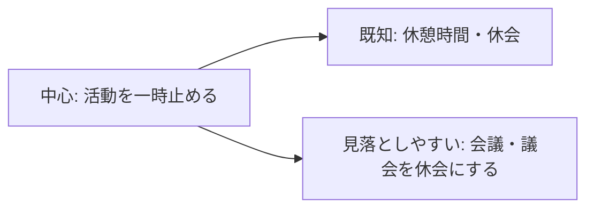

**重要語法**：recess the meeting

<small>index: 6616 ／ candidate_id: ev-06616-verb-01</small>

---

## 3377｜strap

**単語**：strap  
**品詞**：形容詞（adjective）  
**発音**：/stræp/

<small>よく知られている意味：ひも・帯</small>

### 見落としやすい意味

**be strapped for cash：お金に困っている**

**例文**：The club is strapped for cash this year.

**和訳**：そのクラブは今年、資金繰りに困っている。

**コアイメージ**：strapは物をきつく縛る帯を指す。strapped for cashでは、使えるお金が足りず身動きがとりにくい状態を表す。

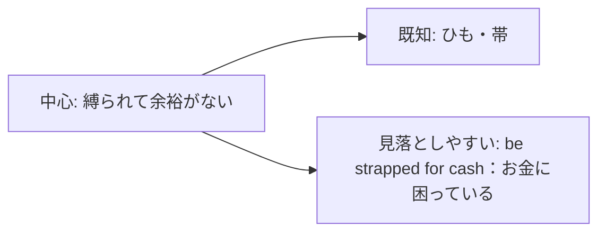

**重要語法**：be strapped for cash

<small>index: 6618 ／ candidate_id: ev-06618-adj-01</small>

---

## 3378｜suffice

**単語**：suffice  
**品詞**：動詞（verb）  
**発音**：/səˈfaɪs/

<small>よく知られている意味：十分である</small>

### 見落としやすい意味

**suffice it to say (that) ～：～と言えば十分だ**

**例文**：Suffice it to say that the plan did not work.

**和訳**：その計画はうまくいかなかったと言えば十分だ。

**コアイメージ**：sufficeは「十分である」という意味。定型表現suffice it to sayは、詳細を省いて要点だけ述べるときに使う。

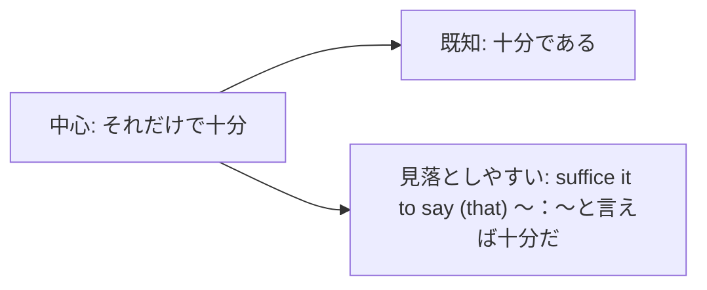

**重要語法**：suffice it to say (that) ...

<small>index: 6620 ／ candidate_id: ev-06620-verb-01</small>

---

## 3379｜jog

**単語**：jog  
**品詞**：動詞（verb）  
**発音**：/dʒɑːɡ/

<small>よく知られている意味：ゆっくり走る</small>

### 見落としやすい意味

**記憶を呼び起こす**

**例文**：That photograph jogged my memory of the trip.

**和訳**：その写真を見て旅行の記憶がよみがえった。

**コアイメージ**：jogには軽く揺さぶるという動きがある。記憶を軽く刺激して思い出させる意味でも使われる。

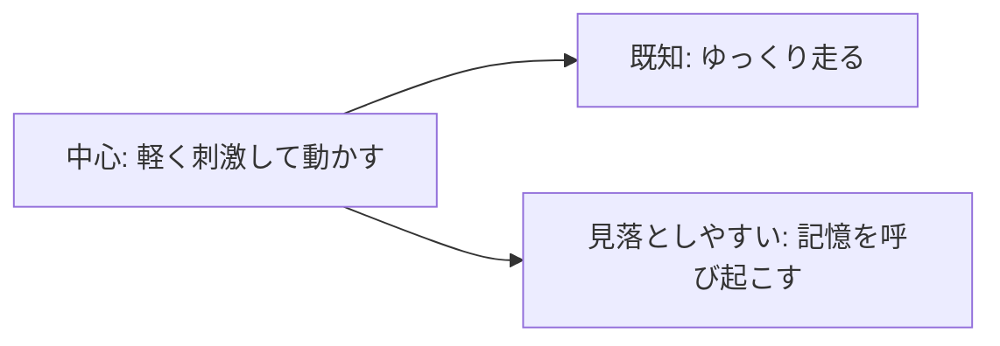

**重要語法**：jog someone's memory

<small>index: 6621 ／ candidate_id: ev-06621-verb-01</small>

---

## 3380｜resonate

**単語**：resonate  
**品詞**：動詞（verb）  
**発音**：/ˈrezəneɪt/

<small>よく知られている意味：響き渡る・共鳴する</small>

### 見落としやすい意味

**考えや言葉が心に響く・共感を呼ぶ**

**例文**：Her speech resonated with young voters.

**和訳**：彼女の演説は若い有権者の心に響いた。

**コアイメージ**：resonateは音が共鳴して広がること。比喩的に言葉や考えが人の内面に届き、共感を生むことを表す。

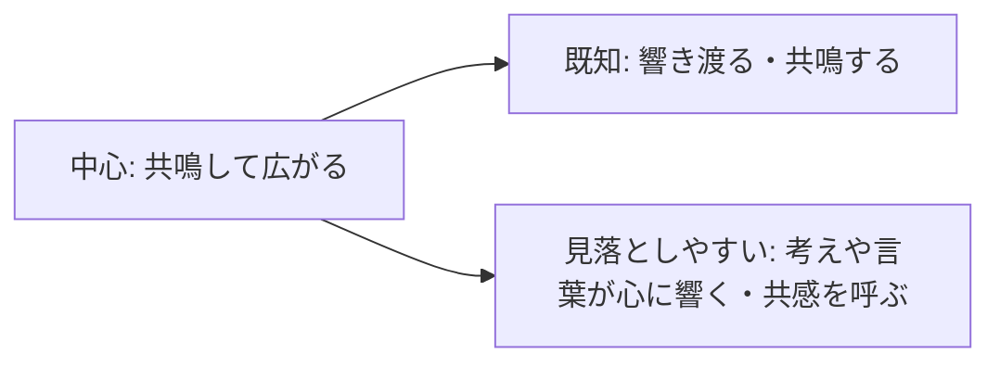

**重要語法**：resonate with

<small>index: 6626 ／ candidate_id: ev-06626-verb-01</small>

---

## 3381｜flatter

**単語**：flatter  
**品詞**：動詞（verb）  
**発音**：/ˈflætər/

<small>よく知られている意味：お世辞を言う</small>

### 見落としやすい意味

**（服や色などが、人を）引き立てる・魅力的に見せる**

**例文**：The dark jacket flatters his complexion.

**和訳**：その濃い色の上着は彼の顔色を引き立てる。

**コアイメージ**：flatterは相手をよく見せることと結び付く。言葉で持ち上げるだけでなく、服や色が外見をよく見せる場合にも使う。

```mermaid
flowchart LR
    A["中心: 実際以上によく見せる"]
    B["既知: お世辞を言う"]
    C["見落としやすい: （服や色などが、人を）引き立てる・魅力的に見せる"]
    A --> B
    A --> C
```

**重要語法**：a flattering color

<small>index: 6628 ／ candidate_id: ev-06628-verb-01</small>

---

## 3382｜flatter

**単語**：flatter  
**品詞**：動詞（verb）  
**発音**：/ˈflætər/

<small>よく知られている意味：お世辞を言う</small>

### 見落としやすい意味

**flatter oneself that ～：～だとうぬぼれる・思い込む**

**例文**：She flatters herself that she can solve every problem.

**和訳**：彼女はどんな問題でも解決できるとうぬぼれている。

**コアイメージ**：flatterは相手を持ち上げること。自分自身を持ち上げるflatter oneselfでは、根拠なく自信を持つ意味になる。

```mermaid
flowchart LR
    A["中心: 自分を持ち上げる"]
    B["既知: お世辞を言う"]
    C["見落としやすい: flatter oneself that ～：～だとうぬぼれる・思い込む"]
    A --> B
    A --> C
```

**重要語法**：flatter oneself that ...

<small>index: 6628 ／ candidate_id: ev-06628-verb-02</small>

---

## 3383｜attest

**単語**：attest  
**品詞**：動詞（verb）  
**発音**：/əˈtest/

<small>よく知られている意味：証明する・証言する</small>

### 見落としやすい意味

**証拠となって示す・裏付ける**

**例文**：The empty shelves attest to the sudden demand.

**和訳**：空っぽの棚が急な需要の高まりを物語っている。

**コアイメージ**：attestは事実を裏付けること。人が証言する場合だけでなく、目に見える状況が証拠になる場合にも使える。

```mermaid
flowchart LR
    A["中心: 事実を裏付ける"]
    B["既知: 証明する・証言する"]
    C["見落としやすい: 証拠となって示す・裏付ける"]
    A --> B
    A --> C
```

**重要語法**：attest to ...

<small>index: 6635 ／ candidate_id: ev-06635-verb-01</small>

---

## 3384｜backwater

**単語**：backwater  
**品詞**：名詞（noun）  
**発音**：/ˈbækwɔːtər/

<small>よく知られている意味：入り江のよどみ・支流</small>

### 見落としやすい意味

**発展や変化から取り残された地域・分野**

**例文**：The town was once an economic backwater.

**和訳**：その町はかつて経済発展から取り残された地域だった。

**コアイメージ**：backwaterは本流から外れた流れの緩い水域を指す。比喩的に、変化や発展の中心から離れた場所を表す。

```mermaid
flowchart LR
    A["中心: 本流から離れている"]
    B["既知: 入り江のよどみ・支流"]
    C["見落としやすい: 発展や変化から取り残された地域・分野"]
    A --> B
    A --> C
```

**重要語法**：an economic backwater

<small>index: 6636 ／ candidate_id: ev-06636-noun-01</small>

---

## 3385｜cardinal

**単語**：cardinal  
**品詞**：形容詞（adjective）  
**発音**：/ˈkɑːrdɪnəl/

<small>よく知られている意味：（鳥の）ショウジョウコウカンチョウ</small>

### 見落としやすい意味

**最も重要な・根本的な**

**例文**：Trust is a cardinal rule of good teamwork.

**和訳**：信頼はよいチームワークの根本原則だ。

**コアイメージ**：cardinalは中心的・第一級という意味を持つ。数や宗教上の名称だけでなく、原則や重要点を強調する形容詞となる。

```mermaid
flowchart LR
    A["中心: 中心となる最重要点"]
    B["既知: （鳥の）ショウジョウコウカンチョウ"]
    C["見落としやすい: 最も重要な・根本的な"]
    A --> B
    A --> C
```

**重要語法**：cardinal rule; cardinal importance

<small>index: 6638 ／ candidate_id: ev-06638-adj-01</small>

---

## 3386｜downright

**単語**：downright  
**品詞**：副詞（adverb）  
**発音**：/ˈdaʊnraɪt/

<small>よく知られている意味：率直な・正真正銘の</small>

### 見落としやすい意味

**まったく・実に**

**例文**：The instructions were downright confusing.

**和訳**：その説明はまったく分かりにくかった。

**コアイメージ**：downrightには遠回しでない、徹底したという強さがある。副詞では程度を強調し、「まったく」「実に」となる。

```mermaid
flowchart LR
    A["中心: 程度を強く言い切る"]
    B["既知: 率直な・正真正銘の"]
    C["見落としやすい: まったく・実に"]
    A --> B
    A --> C
```

**重要語法**：downright dangerous

<small>index: 6650 ／ candidate_id: ev-06650-adv-01</small>

---

## 3387｜evade

**単語**：evade  
**品詞**：動詞（verb）  
**発音**：/ɪˈveɪd/

<small>よく知られている意味：逃れる・回避する</small>

### 見落としやすい意味

**（質問・義務・責任を）巧妙に避ける**

**例文**：The official evaded questions about the budget.

**和訳**：その役人は予算についての質問を巧みにかわした。

**コアイメージ**：evadeは追ってくるものから逃れること。問いや責任を「追及されるもの」とみて、答えずにかわす意味になる。

```mermaid
flowchart LR
    A["中心: 追及をかわす"]
    B["既知: 逃れる・回避する"]
    C["見落としやすい: （質問・義務・責任を）巧妙に避ける"]
    A --> B
    A --> C
```

**重要語法**：evade a question; evade responsibility

<small>index: 6654 ／ candidate_id: ev-06654-verb-01</small>

---

## 3388｜evaporate

**単語**：evaporate  
**品詞**：動詞（verb）  
**発音**：/ɪˈvæpəreɪt/

<small>よく知られている意味：蒸発する</small>

### 見落としやすい意味

**希望・関心などが次第に消える**

**例文**：Their hopes evaporated after the final announcement.

**和訳**：最終発表のあと、彼らの希望は消え去った。

**コアイメージ**：水が蒸気になって姿を消すように、evaporateは抽象的なものが消えることにも使う。希望や関心がなくなる場面に自然に当てはまる。

```mermaid
flowchart LR
    A["中心: 形を失って消える"]
    B["既知: 蒸発する"]
    C["見落としやすい: 希望・関心などが次第に消える"]
    A --> B
    A --> C
```

**重要語法**：hope evaporates

<small>index: 6655 ／ candidate_id: ev-06655-verb-01</small>

---

## 3389｜faint

**単語**：faint  
**品詞**：動詞（verb）  
**発音**：/feɪnt/

<small>よく知られている意味：かすかな・弱い</small>

### 見落としやすい意味

**気絶する・失神する**

**例文**：She fainted after standing in the heat for too long.

**和訳**：彼女は暑い中で長時間立っていて気を失った。

**コアイメージ**：faintには力や意識が弱まる感覚がある。形容詞の「かすかな」とは別に、動詞では意識を失うことを指す。

```mermaid
flowchart LR
    A["中心: 力や意識が弱まる"]
    B["既知: かすかな・弱い"]
    C["見落としやすい: 気絶する・失神する"]
    A --> B
    A --> C
```

**重要語法**：faint from the heat

<small>index: 6656 ／ candidate_id: ev-06656-verb-01</small>

---

## 3390｜fetch

**単語**：fetch  
**品詞**：動詞（verb）  
**発音**：/fetʃ/

<small>よく知られている意味：取ってくる</small>

### 見落としやすい意味

**ある値段で売れる**

**例文**：The antique fetched a high price at auction.

**和訳**：その骨董品は競売で高値で売れた。

**コアイメージ**：fetchの基本は何かを引き寄せて得ること。売買では品物がいくらの価格を引き出すかを表す。

```mermaid
flowchart LR
    A["中心: 価値を引き出す"]
    B["既知: 取ってくる"]
    C["見落としやすい: ある値段で売れる"]
    A --> B
    A --> C
```

**重要語法**：fetch a high price

<small>index: 6658 ／ candidate_id: ev-06658-verb-01</small>

---

## 3391｜fracture

**単語**：fracture  
**品詞**：動詞（verb）  
**発音**：/ˈfræktʃər/

<small>よく知られている意味：骨折させる・折れる</small>

### 見落としやすい意味

**関係や団結を壊す・分裂させる**

**例文**：The scandal fractured the party's unity.

**和訳**：その不祥事は党の結束を壊した。

**コアイメージ**：fractureは一体だったものに割れ目が入ること。骨や物だけでなく、組織内の信頼や団結が割れる場合にも使う。

```mermaid
flowchart LR
    A["中心: 一体のものに割れ目が入る"]
    B["既知: 骨折させる・折れる"]
    C["見落としやすい: 関係や団結を壊す・分裂させる"]
    A --> B
    A --> C
```

**重要語法**：fracture relations

<small>index: 6659 ／ candidate_id: ev-06659-verb-01</small>

---

## 3392｜gloss

**単語**：gloss  
**品詞**：名詞（noun）  
**発音**：/ɡlɑːs/

<small>よく知られている意味：光沢・つや</small>

### 見落としやすい意味

**実態を覆い隠す見かけ・うわべ**

**例文**：The advertisement gave the product a gloss of luxury.

**和訳**：その広告は商品に高級そうなうわべを与えた。

**コアイメージ**：glossは表面を滑らかに光らせるつや。そこから中身とは別に、見かけだけをよく見せるものも指す。

```mermaid
flowchart LR
    A["中心: 表面をきれいに覆う"]
    B["既知: 光沢・つや"]
    C["見落としやすい: 実態を覆い隠す見かけ・うわべ"]
    A --> B
    A --> C
```

**重要語法**：put a gloss on ...

<small>index: 6660 ／ candidate_id: ev-06660-noun-01</small>

---

## 3393｜gloss

**単語**：gloss  
**品詞**：動詞（verb）  
**発音**：/ɡlɑːs/

<small>よく知られている意味：注釈を付ける・つやを出す</small>

### 見落としやすい意味

**不都合な事実を言い繕う**

**例文**：The summary glossed over several serious defects.

**和訳**：その要約は幾つかの重大な欠点をうまくごまかした。

**コアイメージ**：glossは表面を整えたり、説明を加えたりする働きを持つ。gloss overは不都合な点を表面上なめらかに見せ、深く扱わないことを表す。

```mermaid
flowchart LR
    A["中心: 表面を整えて見せる"]
    B["既知: 注釈を付ける・つやを出す"]
    C["見落としやすい: 不都合な事実を言い繕う"]
    A --> B
    A --> C
```

**重要語法**：gloss over a problem

<small>index: 6660 ／ candidate_id: ev-06660-verb-01</small>

---

## 3394｜grind

**単語**：grind  
**品詞**：名詞（noun）  
**発音**：/ɡraɪnd/

<small>よく知られている意味：すりつぶす・挽く</small>

### 見落としやすい意味

**単調で骨の折れる仕事**

**例文**：The daily commute became a tiring grind.

**和訳**：毎日の通勤は疲れる単調な作業になった。

**コアイメージ**：grindは繰り返し強くこする動作を表す。その反復から、終わりの見えない骨の折れる日課を指す。

```mermaid
flowchart LR
    A["中心: 同じ動きを何度も続ける"]
    B["既知: すりつぶす・挽く"]
    C["見落としやすい: 単調で骨の折れる仕事"]
    A --> B
    A --> C
```

**重要語法**：the daily grind

<small>index: 6662 ／ candidate_id: ev-06662-noun-01</small>

---

## 3395｜hysterical

**単語**：hysterical  
**品詞**：形容詞（adjective）  
**発音**：/hɪˈsterɪkəl/

<small>よく知られている意味：ヒステリックな・取り乱した</small>

### 見落としやすい意味

**（笑いなどが）異常なほど面白い・大笑いさせる**

**例文**：The comedian's new show was hysterical.

**和訳**：そのコメディアンの新しいショーは大笑いするほど面白かった。

**コアイメージ**：hystericalは感情が制御しにくいほど高まった状態を表す。笑いが止まらないほど面白い場面にも口語的に使われる。

```mermaid
flowchart LR
    A["中心: 感情が激しく高まる"]
    B["既知: ヒステリックな・取り乱した"]
    C["見落としやすい: （笑いなどが）異常なほど面白い・大笑いさせる"]
    A --> B
    A --> C
```

**重要語法**：hysterically funny

<small>index: 6664 ／ candidate_id: ev-06664-adj-01</small>

---

## 3396｜incarnation

**単語**：incarnation  
**品詞**：名詞（noun）  
**発音**：/ˌɪnkɑːrˈneɪʃən/

<small>よく知られている意味：化身・具現化</small>

### 見落としやすい意味

**思想や特徴を体現する新たな人物・形**

**例文**：The new design is the latest incarnation of the classic model.

**和訳**：新しいデザインはその定番モデルの最新の形だ。

**コアイメージ**：incarnationは何かが具体的な姿を取ること。同じ思想や製品が、時代に合わせて別の姿で現れたものにも使える。

```mermaid
flowchart LR
    A["中心: 別の形で具体化する"]
    B["既知: 化身・具現化"]
    C["見落としやすい: 思想や特徴を体現する新たな人物・形"]
    A --> B
    A --> C
```

**重要語法**：the latest incarnation

<small>index: 6667 ／ candidate_id: ev-06667-noun-01</small>

---

## 3397｜indifferent

**単語**：indifferent  
**品詞**：形容詞（adjective）  
**発音**：/ɪnˈdɪfrənt/

<small>よく知られている意味：無関心な</small>

### 見落としやすい意味

**出来が平凡な・さえない**

**例文**：He gave an indifferent performance in the final match.

**和訳**：彼は決勝戦でぱっとしない出来だった。

**コアイメージ**：indifferentには特に優れても劣ってもいない感覚がある。人の関心だけでなく、出来栄えを「平凡だ」と評価する場合にも使う。

```mermaid
flowchart LR
    A["中心: 際立った良さがない"]
    B["既知: 無関心な"]
    C["見落としやすい: 出来が平凡な・さえない"]
    A --> B
    A --> C
```

**重要語法**：an indifferent performance

<small>index: 6669 ／ candidate_id: ev-06669-adj-01</small>

---

## 3398｜involuntary

**単語**：involuntary  
**品詞**：形容詞（adjective）  
**発音**：/ɪnˈvɑːlənteri/

<small>よく知られている意味：無意識の・自動的な</small>

### 見落としやすい意味

**本人の意思に反した・不本意な**

**例文**：Their departure was involuntary after the department closed.

**和訳**：部門閉鎖により、彼らは不本意ながら職を離れた。

**コアイメージ**：voluntaryは自分の意思によること。involuntaryは反射的な動作だけでなく、本人が望んでいない決定にも使う。

```mermaid
flowchart LR
    A["中心: 自分の意思によらない"]
    B["既知: 無意識の・自動的な"]
    C["見落としやすい: 本人の意思に反した・不本意な"]
    A --> B
    A --> C
```

**重要語法**：involuntary departure

<small>index: 6672 ／ candidate_id: ev-06672-adj-01</small>

---

## 3399｜ivory

**単語**：ivory  
**品詞**：名詞（noun）  
**発音**：/ˈaɪvəri/

<small>よく知られている意味：象牙</small>

### 見落としやすい意味

**ivory tower：現実社会から隔絶した学問・知識人の世界**

**例文**：Some scholars are accused of living in an ivory tower.

**和訳**：一部の学者は現実離れした学問の世界にこもっていると批判される。

**コアイメージ**：ivory towerは世間の問題から離れた高い塔の比喩。象牙そのものの性質より、隔絶した場所のイメージが重要になる。

```mermaid
flowchart LR
    A["中心: 世間から隔てられた塔"]
    B["既知: 象牙"]
    C["見落としやすい: ivory tower：現実社会から隔絶した学問・知識人の世界"]
    A --> B
    A --> C
```

**重要語法**：live in an ivory tower

<small>index: 6673 ／ candidate_id: ev-06673-noun-01</small>

---

## 3400｜nestle

**単語**：nestle  
**品詞**：動詞（verb）  
**発音**：/ˈnesəl/

<small>よく知られている意味：寄り添う・身を寄せる</small>

### 見落としやすい意味

**ひっそりと位置する・抱かれるようにある**

**例文**：A small village nestles between the hills.

**和訳**：小さな村が丘と丘の間にひっそりとたたずんでいる。

**コアイメージ**：nestleは安全な場所に身を寄せること。人や動物だけでなく、地形に包まれるようにある場所にも使う。

```mermaid
flowchart LR
    A["中心: 包まれるように収まる"]
    B["既知: 寄り添う・身を寄せる"]
    C["見落としやすい: ひっそりと位置する・抱かれるようにある"]
    A --> B
    A --> C
```

**重要語法**：nestle among the hills

<small>index: 6688 ／ candidate_id: ev-06688-verb-01</small>

---

## 3401｜organizer

**単語**：organizer  
**品詞**：名詞（noun）  
**発音**：/ˈɔːrɡənaɪzər/

<small>よく知られている意味：主催者・まとめ役</small>

### 見落としやすい意味

**（予定や書類の）整理手帳・収納用品**

**例文**：She keeps important receipts in a desk organizer.

**和訳**：彼女は大切な領収書を机上の整理用品に入れている。

**コアイメージ**：organizerは物事を整理するもの・人を指す。人に限らず、予定や書類を整理する道具にも使われる。

```mermaid
flowchart LR
    A["中心: 整理して秩序立てる"]
    B["既知: 主催者・まとめ役"]
    C["見落としやすい: （予定や書類の）整理手帳・収納用品"]
    A --> B
    A --> C
```

**重要語法**：a desk organizer

<small>index: 6690 ／ candidate_id: ev-06690-noun-01</small>

---

## 3402｜pulp

**単語**：pulp  
**品詞**：名詞（noun）  
**発音**：/pʌlp/

<small>よく知られている意味：果肉・紙の原料</small>

### 見落としやすい意味

**安価な大衆娯楽雑誌**

**例文**：He collects old pulp magazines from the 1930s.

**和訳**：彼は1930年代の安価な大衆娯楽雑誌を集めている。

**コアイメージ**：pulpは紙を作る繊維状の原料。安いパルプ紙で大量に印刷された雑誌を、pulpと呼ぶようになった。

```mermaid
flowchart LR
    A["中心: 安価な紙の原料"]
    B["既知: 果肉・紙の原料"]
    C["見落としやすい: 安価な大衆娯楽雑誌"]
    A --> B
    A --> C
```

**重要語法**：pulp magazine; pulp fiction

<small>index: 6697 ／ candidate_id: ev-06697-noun-01</small>

---

## 3403｜pulp

**単語**：pulp  
**品詞**：動詞（verb）  
**発音**：/pʌlp/

<small>よく知られている意味：果肉・パルプ</small>

### 見落としやすい意味

**紙・出版物を破砕処理する**

**例文**：The publisher pulped thousands of unsold copies.

**和訳**：出版社は売れ残った本を何千冊も破砕処理した。

**コアイメージ**：pulpは紙の原料になる繊維状の物質。動詞では出版物を砕いて再びパルプ状にすることを表す。

```mermaid
flowchart LR
    A["中心: 紙を繊維状に戻す"]
    B["既知: 果肉・パルプ"]
    C["見落としやすい: 紙・出版物を破砕処理する"]
    A --> B
    A --> C
```

**重要語法**：pulp unsold books

<small>index: 6697 ／ candidate_id: ev-06697-verb-01</small>

---

## 3404｜rattle

**単語**：rattle  
**品詞**：動詞（verb）  
**発音**：/ˈrætəl/

<small>よく知られている意味：ガラガラ音を立てる</small>

### 見落としやすい意味

**（人を）動揺させる・うろたえさせる**

**例文**：The unexpected question rattled the speaker.

**和訳**：その予想外の質問は話し手を動揺させた。

**コアイメージ**：rattleは物を揺すってガタガタさせること。心が揺さぶられて落ち着きを失うことにも使う。

```mermaid
flowchart LR
    A["中心: 激しく揺さぶる"]
    B["既知: ガラガラ音を立てる"]
    C["見落としやすい: （人を）動揺させる・うろたえさせる"]
    A --> B
    A --> C
```

**重要語法**：be rattled by ...

<small>index: 6698 ／ candidate_id: ev-06698-verb-01</small>

---

## 3405｜streak

**単語**：streak  
**品詞**：名詞（noun）  
**発音**：/striːk/

<small>よく知られている意味：筋・縞模様</small>

### 見落としやすい意味

**連続記録・途切れない一連の出来事**

**例文**：The team is on a five-game winning streak.

**和訳**：そのチームは現在5連勝中だ。

**コアイメージ**：streakは一本につながった線や帯を表す。出来事が途切れず続くことを、一本の線に見立てる。

```mermaid
flowchart LR
    A["中心: 切れずにつながる線"]
    B["既知: 筋・縞模様"]
    C["見落としやすい: 連続記録・途切れない一連の出来事"]
    A --> B
    A --> C
```

**重要語法**：a winning streak

<small>index: 6715 ／ candidate_id: ev-06715-noun-01</small>

---

## 3406｜stump

**単語**：stump  
**品詞**：動詞（verb）  
**発音**：/stʌmp/

<small>よく知られている意味：切り株</small>

### 見落としやすい意味

**難問で答えに詰まらせる**

**例文**：That puzzle stumped even the experienced teacher.

**和訳**：そのパズルには経験豊かな先生でさえ答えに詰まった。

**コアイメージ**：stumpには前に進めなくするような感覚がある。問題で相手を立ち往生させるとき、動詞として使う。

```mermaid
flowchart LR
    A["中心: 行き詰まらせる"]
    B["既知: 切り株"]
    C["見落としやすい: 難問で答えに詰まらせる"]
    A --> B
    A --> C
```

**重要語法**：be stumped by a question

<small>index: 6716 ／ candidate_id: ev-06716-verb-01</small>

---

## 3407｜subsidiary

**単語**：subsidiary  
**品詞**：形容詞（adjective）  
**発音**：/səbˈsɪdieri/

<small>よく知られている意味：子会社（名詞）</small>

### 見落としやすい意味

**補助的な・従属的な**

**例文**：Cost is a subsidiary concern in this decision.

**和訳**：この決定では費用は二次的な問題だ。

**コアイメージ**：subsidiaryは主となるものを補い、その下に位置すること。会社の名詞用法だけでなく、重要度の低い補助的事項を形容する。

```mermaid
flowchart LR
    A["中心: 主となるものに従う"]
    B["既知: 子会社（名詞）"]
    C["見落としやすい: 補助的な・従属的な"]
    A --> B
    A --> C
```

**重要語法**：subsidiary to ...

<small>index: 6717 ／ candidate_id: ev-06717-adj-01</small>

---

## 3408｜susceptible

**単語**：susceptible  
**品詞**：形容詞（adjective）  
**発音**：/səˈseptəbəl/

<small>よく知られている意味：病気にかかりやすい</small>

### 見落としやすい意味

**（病気だけでなく考え・誘いなどの）影響を受けやすい**

**例文**：Young children are susceptible to advertising.

**和訳**：幼い子どもは広告の影響を受けやすい。

**コアイメージ**：susceptibleは外部からの影響を受け入れやすい状態を指す。対象は病気に限らず、情報や誘惑にも広がる。

```mermaid
flowchart LR
    A["中心: 外からの影響を受けやすい"]
    B["既知: 病気にかかりやすい"]
    C["見落としやすい: （病気だけでなく考え・誘いなどの）影響を受けやすい"]
    A --> B
    A --> C
```

**重要語法**：susceptible to ...

<small>index: 6719 ／ candidate_id: ev-06719-adj-01</small>

---

## 3409｜takeoff

**単語**：takeoff  
**品詞**：名詞（noun）  
**発音**：/ˈteɪkɔːf/

<small>よく知られている意味：離陸</small>

### 見落としやすい意味

**（事業・人気などの）急成長・飛躍**

**例文**：The app's popularity took off after a short video went viral.

**和訳**：短い動画が話題になったあと、そのアプリの人気は急上昇した。

**コアイメージ**：takeoffは地面から離れて一気に上昇すること。比喩的に事業や人気が急に伸びる局面を指す。

```mermaid
flowchart LR
    A["中心: 一気に上昇し始める"]
    B["既知: 離陸"]
    C["見落としやすい: （事業・人気などの）急成長・飛躍"]
    A --> B
    A --> C
```

**重要語法**：take off（動詞）; takeoff（名詞）

<small>index: 6720 ／ candidate_id: ev-06720-noun-01</small>

---

## 3410｜trump

**単語**：trump  
**品詞**：動詞（verb）  
**発音**：/trʌmp/

<small>よく知られている意味：切り札（名詞）</small>

### 見落としやすい意味

**より重要となって他をしのぐ**

**例文**：In an emergency, safety must trump convenience.

**和訳**：緊急時には利便性より安全が優先されなければならない。

**コアイメージ**：トランプゲームのtrumpは他の札に勝つ切り札。その力関係から、ある価値が別の価値より優先される意味になる。

```mermaid
flowchart LR
    A["中心: 他を上回る切り札"]
    B["既知: 切り札（名詞）"]
    C["見落としやすい: より重要となって他をしのぐ"]
    A --> B
    A --> C
```

**重要語法**：A trumps B

<small>index: 6722 ／ candidate_id: ev-06722-verb-01</small>

---

## 3411｜uphill

**単語**：uphill  
**品詞**：副詞（adverb）  
**発音**：/ˌʌpˈhɪl/

<small>よく知られている意味：坂を上って</small>

### 見落としやすい意味

**困難に逆らって**

**例文**：They kept fighting uphill against strong opposition.

**和訳**：彼らは強い反対に抗いながら闘い続けた。

**コアイメージ**：uphillは坂を上る方向で、進むのに力が要る。比喩的に、抵抗や障害に逆らって進む困難さを表す。

```mermaid
flowchart LR
    A["中心: 抵抗に逆らって上る"]
    B["既知: 坂を上って"]
    C["見落としやすい: 困難に逆らって"]
    A --> B
    A --> C
```

**重要語法**：fight uphill; an uphill battle

<small>index: 6724 ／ candidate_id: ev-06724-adv-01</small>

---

## 3412｜validate

**単語**：validate  
**品詞**：動詞（verb）  
**発音**：/ˈvælɪdeɪt/

<small>よく知られている意味：正当性を確認する</small>

### 見落としやすい意味

**（切符・乗車券などを）有効化する・使用認証する**

**例文**：You must validate your ticket before boarding the tram.

**和訳**：路面電車に乗る前に切符を有効化しなければならない。

**コアイメージ**：validateは何かを有効と認められる状態にすること。切符では刻印や認証をして、使用可能な状態にする意味となる。

```mermaid
flowchart LR
    A["中心: 有効なものとして認める"]
    B["既知: 正当性を確認する"]
    C["見落としやすい: （切符・乗車券などを）有効化する・使用認証する"]
    A --> B
    A --> C
```

**重要語法**：validate a ticket

<small>index: 6726 ／ candidate_id: ev-06726-verb-01</small>

---

## 3413｜rose

**単語**：rose  
**品詞**：動詞（verb）  
**発音**：/roʊz/

<small>よく知られている意味：バラ（花）</small>

### 見落としやすい意味

**riseの過去形「上昇した・立ち上がった」**

**例文**：The river rose rapidly after the storm.

**和訳**：嵐のあと、川の水位が急速に上がった。

**コアイメージ**：このroseは花の名詞ではなく、動詞riseの過去形である。偶然綴りが同じなので、主語と文の時制から見分ける。

```mermaid
flowchart LR
    A["中心: 同じ綴りの別語"]
    B["既知: バラ（花）"]
    C["見落としやすい: riseの過去形「上昇した・立ち上がった」"]
    A --> B
    A --> C
```

**重要語法**：rise–rose–risen

<small>index: 6730 ／ candidate_id: ev-06730-verb-01</small>

---

## 3414｜graduation

**単語**：graduation  
**品詞**：名詞（noun）  
**発音**：/ˌɡrædʒuˈeɪʃən/

<small>よく知られている意味：卒業式・卒業</small>

### 見落としやすい意味

**（計器・ものさしに刻まれた）目盛り**

**例文**：The ruler has fine graduations for precise measurements.

**和訳**：その定規には正確に測るための細かな目盛りが付いている。

**コアイメージ**：graduationには段階を区切るという発想がある。学年を進んで卒業することに加え、計器に刻まれた段階的な目盛りも表す。

```mermaid
flowchart LR
    A["中心: 段階を区切る"]
    B["既知: 卒業式・卒業"]
    C["見落としやすい: （計器・ものさしに刻まれた）目盛り"]
    A --> B
    A --> C
```

**重要語法**：graduations on a scale

<small>index: 6734 ／ candidate_id: ev-06734-noun-01</small>

---

## 3415｜handy

**単語**：handy  
**品詞**：形容詞（adjective）  
**発音**：/ˈhændi/

<small>よく知られている意味：便利な・手近な</small>

### 見落としやすい意味

**手先が器用な**

**例文**：My uncle is handy with tools and repairs everything himself.

**和訳**：私のおじは工具を使うのが器用で、何でも自分で修理する。

**コアイメージ**：handyは手を使って扱いやすいことに関わる。道具が便利なだけでなく、人が手先の作業に長けていることも表す。

```mermaid
flowchart LR
    A["中心: 手を上手に使える"]
    B["既知: 便利な・手近な"]
    C["見落としやすい: 手先が器用な"]
    A --> B
    A --> C
```

**重要語法**：be handy with tools

<small>index: 6736 ／ candidate_id: ev-06736-adj-01</small>

---

## 3416｜herb

**単語**：herb  
**品詞**：名詞（noun）  
**発音**：米 /ɝːb/・英 /hɜːb/

<small>よく知られている意味：香草・ハーブ</small>

### 見落としやすい意味

**herbの語頭hは米音では通常無音、英音では通常発音する**

**例文**：In American English, the h in herb is usually silent.

**和訳**：米国英語では、herbの語頭のhは通常発音しない。

**コアイメージ**：ここは語義の派生ではなく、同じ単語の発音の地域差を学ぶ項目。米国英語では語頭のhを通常発音せず、英国英語では通常発音する。

```mermaid
flowchart LR
    A["中心: 同じ語の地域別発音"]
    B["既知: 香草・ハーブ"]
    C["見落としやすい: herbの語頭hは米音では通常無音、英音では通常発音する"]
    A --> B
    A --> C
```

**重要語法**：米 /ɝːb/；英 /hɜːb/

<small>index: 6739 ／ candidate_id: ev-06739-noun-01</small>

---

## 3417｜disposal

**単語**：disposal  
**品詞**：名詞（noun）  
**発音**：/dɪˈspoʊzəl/

<small>よく知られている意味：廃棄・処分</small>

### 見落としやすい意味

**自由に利用できる権限・状態**

**例文**：The students had a microscope at their disposal.

**和訳**：学生たちは顕微鏡を自由に使える状態だった。

**コアイメージ**：disposalには物事を自分の判断で取り扱うという発想がある。at one's disposalなら、必要に応じて使えるよう備わっていることを表す。

```mermaid
flowchart LR
    A["中心: 自由に扱える状態"]
    B["既知: 廃棄・処分"]
    C["見落としやすい: 自由に利用できる権限・状態"]
    A --> B
    A --> C
```

**重要語法**：at one's disposal

<small>index: 6740 ／ candidate_id: ev-06740-noun-01</small>

---

## 3418｜ramp

**単語**：ramp  
**品詞**：動詞（verb）  
**発音**：/ræmp/

<small>よく知られている意味：傾斜路</small>

### 見落としやすい意味

**ramp up ～：（生産・活動・予算などを）急激に増強する**

**例文**：The company plans to ramp up production this spring.

**和訳**：その会社はこの春に生産を大幅に増強する予定だ。

**コアイメージ**：rampは傾斜をつけて上へ導くもの。ramp upは活動や数量を段階的、あるいは急速に引き上げる意味で使われる。

```mermaid
flowchart LR
    A["中心: 水準を上げる"]
    B["既知: 傾斜路"]
    C["見落としやすい: ramp up ～：（生産・活動・予算などを）急激に増強する"]
    A --> B
    A --> C
```

**重要語法**：ramp up production

<small>index: 6743 ／ candidate_id: ev-06743-verb-02</small>

---

## 3419｜dose

**単語**：dose  
**品詞**：動詞（verb）  
**発音**：/doʊs/

<small>よく知られている意味：一回分の薬の量</small>

### 見落としやすい意味

**（患者に薬などを一定量）投与する**

**例文**：The nurse dosed the patient according to the doctor's instructions.

**和訳**：看護師は医師の指示に従って患者に薬を投与した。

**コアイメージ**：doseは決められた一回分の量を表す。動詞では、その量を人に与えることを指す。

```mermaid
flowchart LR
    A["中心: 一定量を与える"]
    B["既知: 一回分の薬の量"]
    C["見落としやすい: （患者に薬などを一定量）投与する"]
    A --> B
    A --> C
```

**重要語法**：dose a patient with medicine

<small>index: 6744 ／ candidate_id: ev-06744-verb-01</small>

---

## 3420｜axis

**単語**：axis  
**品詞**：名詞（noun）  
**発音**：/ˈæksɪs/

<small>よく知られている意味：軸・中心線</small>

### 見落としやすい意味

**the Axis：第二次世界大戦中の枢軸国**

**例文**：Italy was one of the Axis powers during World War II.

**和訳**：イタリアは第二次世界大戦中の枢軸国の一つだった。

**コアイメージ**：axisは回転や結び付きを支える軸。the Axisは国々の連携を軸になぞらえた歴史上の固有の呼び名である。

```mermaid
flowchart LR
    A["中心: 結び付きを支える軸"]
    B["既知: 軸・中心線"]
    C["見落としやすい: the Axis：第二次世界大戦中の枢軸国"]
    A --> B
    A --> C
```

**重要語法**：the Axis powers

<small>index: 6747 ／ candidate_id: ev-06747-noun-01</small>

---

## 3421｜lap

**単語**：lap  
**品詞**：動詞（verb）  
**発音**：/læp/

<small>よく知られている意味：ひざの上</small>

### 見落としやすい意味

**一部が重なり合う**

**例文**：The roof tiles lap over one another to keep out rain.

**和訳**：屋根瓦は雨が入らないように互いの一部が重なっている。

**コアイメージ**：lapには物の端が別の部分を覆うように重なる意味がある。ひざの上という名詞の意味とは別に、動詞では重なり合う位置関係を表す。

```mermaid
flowchart LR
    A["中心: 一部を覆って重なる"]
    B["既知: ひざの上"]
    C["見落としやすい: 一部が重なり合う"]
    A --> B
    A --> C
```

**重要語法**：lap over one another

<small>index: 6749 ／ candidate_id: ev-06749-verb-01</small>

---

## 3422｜rotate

**単語**：rotate  
**品詞**：動詞（verb）  
**発音**：/ˈroʊteɪt/

<small>よく知られている意味：回転させる</small>

### 見落としやすい意味

**（仕事・担当者などを）定期的に交代させる**

**例文**：The manager rotates staff between departments every month.

**和訳**：管理者は毎月、職員を部署間で交代させる。

**コアイメージ**：rotateは順番に位置が入れ替わること。物体の回転だけでなく、担当者や役割を順繰りに交代させる場合にも使う。

```mermaid
flowchart LR
    A["中心: 順番に位置を入れ替える"]
    B["既知: 回転させる"]
    C["見落としやすい: （仕事・担当者などを）定期的に交代させる"]
    A --> B
    A --> C
```

**重要語法**：rotate staff; rotate duties

<small>index: 6751 ／ candidate_id: ev-06751-verb-01</small>

---

## 3423｜transcription

**単語**：transcription  
**品詞**：名詞（noun）  
**発音**：/trænˈskrɪpʃən/

<small>よく知られている意味：文字起こし・書き写し</small>

### 見落としやすい意味

**（生物学）DNAの情報をRNAに写す「転写」**

**例文**：Transcription produces RNA using DNA as a template.

**和訳**：転写ではDNAを鋳型としてRNAが作られる。

**コアイメージ**：transcriptionは情報を別の形に写し取ること。生物学ではDNAの塩基配列情報をRNAへ写す過程を指す。

```mermaid
flowchart LR
    A["中心: 情報を別の媒体へ写す"]
    B["既知: 文字起こし・書き写し"]
    C["見落としやすい: （生物学）DNAの情報をRNAに写す「転写」"]
    A --> B
    A --> C
```

**重要語法**：transcription of DNA into RNA

<small>index: 6752 ／ candidate_id: ev-06752-noun-01</small>

---

## 3424｜slack

**単語**：slack  
**品詞**：動詞（verb）  
**発音**：/slæk/

<small>よく知られている意味：緩んだ・たるんだ</small>

### 見落としやすい意味

**仕事をさぼる・怠ける**

**例文**：He began to slack off once the deadline was extended.

**和訳**：期限が延びると、彼は仕事を怠け始めた。

**コアイメージ**：slackは張りがなく緩んだ状態。仕事への集中や努力が緩むことから、怠ける意味になる。

```mermaid
flowchart LR
    A["中心: 張りや緊張が緩む"]
    B["既知: 緩んだ・たるんだ"]
    C["見落としやすい: 仕事をさぼる・怠ける"]
    A --> B
    A --> C
```

**重要語法**：slack off

<small>index: 6753 ／ candidate_id: ev-06753-verb-01</small>

---

## 3425｜buffer

**単語**：buffer  
**品詞**：名詞（noun）  
**発音**：/ˈbʌfər/

<small>よく知られている意味：緩衝材・一時保存領域</small>

### 見落としやすい意味

**対立勢力の間に置かれた緩衝地帯**

**例文**：The neutral zone acted as a buffer between the two armies.

**和訳**：その中立地帯は二つの軍の間で緩衝地帯の役割を果たした。

**コアイメージ**：bufferは衝突や衝撃を和らげるもの。物理的な緩衝材に限らず、対立する集団の間に置かれた地域も指す。

```mermaid
flowchart LR
    A["中心: 衝突を和らげる中間のもの"]
    B["既知: 緩衝材・一時保存領域"]
    C["見落としやすい: 対立勢力の間に置かれた緩衝地帯"]
    A --> B
    A --> C
```

**重要語法**：buffer zone; buffer state

<small>index: 6756 ／ candidate_id: ev-06756-noun-01</small>

---

## 3426｜degrade

**単語**：degrade  
**品詞**：動詞（verb）  
**発音**：/dɪˈɡreɪd/

<small>よく知られている意味：品質を低下させる</small>

### 見落としやすい意味

**人の品位を落とす・侮辱する**

**例文**：The humiliating remark degraded the employee.

**和訳**：その侮辱的な発言は従業員の尊厳を傷つけた。

**コアイメージ**：degradeは価値や水準を下げること。物の質だけでなく、人の尊厳を傷つけておとしめる場合にも使われる。

```mermaid
flowchart LR
    A["中心: 価値や地位を引き下げる"]
    B["既知: 品質を低下させる"]
    C["見落としやすい: 人の品位を落とす・侮辱する"]
    A --> B
    A --> C
```

**重要語法**：degrade someone

<small>index: 6761 ／ candidate_id: ev-06761-verb-01</small>

---

## 3427｜academy

**単語**：academy  
**品詞**：名詞（noun）  
**発音**：/əˈkædəmi/

<small>よく知られている意味：学校・養成所</small>

### 見落としやすい意味

**専門研究機関・学術団体**

**例文**：The academy brings together researchers from many fields.

**和訳**：その学術団体には多分野の研究者が集まっている。

**コアイメージ**：academyは知識や学問に関わる組織。授業を行う学校だけでなく、研究者が所属する学術団体も指す。

```mermaid
flowchart LR
    A["中心: 学問を担う組織"]
    B["既知: 学校・養成所"]
    C["見落としやすい: 専門研究機関・学術団体"]
    A --> B
    A --> C
```

**重要語法**：a national academy of sciences

<small>index: 6764 ／ candidate_id: ev-06764-noun-01</small>

---

## 3428｜authoritarian

**単語**：authoritarian  
**品詞**：名詞（noun）  
**発音**：/əˌθɔːrɪˈteriən/

<small>よく知られている意味：権威主義的な（形容詞）</small>

### 見落としやすい意味

**権威主義者・強権的な人物**

**例文**：The novel portrays an authoritarian who demands absolute obedience.

**和訳**：その小説は絶対服従を求める権威主義者を描いている。

**コアイメージ**：authoritarianは強い権威と服従を重んじる立場に関わる。形容詞だけでなく、そのような考えを持つ人を指す名詞にもなる。

```mermaid
flowchart LR
    A["中心: 権威と服従を重んじる"]
    B["既知: 権威主義的な（形容詞）"]
    C["見落としやすい: 権威主義者・強権的な人物"]
    A --> B
    A --> C
```

**重要語法**：an authoritarian（名詞）

<small>index: 6767 ／ candidate_id: ev-06767-noun-01</small>

---

## 3429｜closet

**単語**：closet  
**品詞**：形容詞（adjective）  
**発音**：/ˈklɑːzət/

<small>よく知られている意味：衣類収納・クローゼット</small>

### 見落としやすい意味

**（考え・立場などを）公表していない・隠れた**

**例文**：He was a closet supporter of the proposal for years.

**和訳**：彼は何年もの間、その提案をひそかに支持していた。

**コアイメージ**：closetは外から見えない収納場所。比喩的に、考えや好みを公表せず隠していることを形容する。

```mermaid
flowchart LR
    A["中心: 外から見えない所にしまう"]
    B["既知: 衣類収納・クローゼット"]
    C["見落としやすい: （考え・立場などを）公表していない・隠れた"]
    A --> B
    A --> C
```

**重要語法**：a closet supporter

<small>index: 6773 ／ candidate_id: ev-06773-adj-01</small>

---

## 3430｜conductor

**単語**：conductor  
**品詞**：名詞（noun）  
**発音**：/kənˈdʌktər/

<small>よく知られている意味：指揮者・車掌</small>

### 見落としやすい意味

**（電気・熱などの）導体**

**例文**：Copper is an excellent conductor of electricity.

**和訳**：銅は電気を非常によく通す導体だ。

**コアイメージ**：conductには導く・通すという意味がある。人を導く指揮者だけでなく、電気や熱を伝える物質もconductorという。

```mermaid
flowchart LR
    A["中心: 何かを通し導く"]
    B["既知: 指揮者・車掌"]
    C["見落としやすい: （電気・熱などの）導体"]
    A --> B
    A --> C
```

**重要語法**：a conductor of electricity

<small>index: 6774 ／ candidate_id: ev-06774-noun-01</small>

---

## 3431｜contention

**単語**：contention  
**品詞**：名詞（noun）  
**発音**：/kənˈtenʃən/

<small>よく知られている意味：争い・対立</small>

### 見落としやすい意味

**議論の主張・論点**

**例文**：Her main contention is that the figures are misleading.

**和訳**：彼女の主な主張は、その数値が誤解を招くということだ。

**コアイメージ**：contentionは議論の中で張り合うことに関わる。争う行為だけでなく、そこで唱える主張や論点を指す。

```mermaid
flowchart LR
    A["中心: 議論で主張を押し出す"]
    B["既知: 争い・対立"]
    C["見落としやすい: 議論の主張・論点"]
    A --> B
    A --> C
```

**重要語法**：the contention that ...

<small>index: 6775 ／ candidate_id: ev-06775-noun-01</small>

---

## 3432｜detain

**単語**：detain  
**品詞**：動詞（verb）  
**発音**：/dɪˈteɪn/

<small>よく知られている意味：拘束する・勾留する</small>

### 見落としやすい意味

**（用事・事情などで人を）引き留める・遅らせる**

**例文**：Sorry I'm late; an unexpected call detained me.

**和訳**：遅れてすみません。思いがけない電話に引き留められました。

**コアイメージ**：detainは人が予定どおり進むのを止めること。法的な拘束だけでなく、用事によって遅らせる場合にも使う。

```mermaid
flowchart LR
    A["中心: 進むのを一時止める"]
    B["既知: 拘束する・勾留する"]
    C["見落としやすい: （用事・事情などで人を）引き留める・遅らせる"]
    A --> B
    A --> C
```

**重要語法**：be detained by ...

<small>index: 6778 ／ candidate_id: ev-06778-verb-01</small>

---

## 3433｜eyebrow

**単語**：eyebrow  
**品詞**：名詞（noun）  
**発音**：/ˈaɪbraʊ/

<small>よく知られている意味：眉毛</small>

### 見落としやすい意味

**raise eyebrows：人々を驚かせる・不審を抱かせる**

**例文**：The sudden policy change raised eyebrows among teachers.

**和訳**：突然の方針変更は教師たちを驚かせた。

**コアイメージ**：人は驚いたり疑ったりすると眉を上げることがある。その動作から、raise eyebrowsは周囲の驚きや疑念を招く意味となる。

```mermaid
flowchart LR
    A["中心: 驚きで眉が上がる"]
    B["既知: 眉毛"]
    C["見落としやすい: raise eyebrows：人々を驚かせる・不審を抱かせる"]
    A --> B
    A --> C
```

**重要語法**：raise eyebrows

<small>index: 6785 ／ candidate_id: ev-06785-noun-01</small>

---

## 3434｜hamper

**単語**：hamper  
**品詞**：名詞（noun）  
**発音**：/ˈhæmpər/

<small>よく知られている意味：妨げる（動詞）</small>

### 見落としやすい意味

**ふた付きの大きなかご**

**例文**：She packed sandwiches in a large picnic hamper.

**和訳**：彼女は大きなピクニック用のかごにサンドイッチを詰めた。

**コアイメージ**：名詞hamperは物を入れる大きなかごを指す。動詞の「妨げる」とは用法が異なるので、文中での品詞を手掛かりに区別する。

```mermaid
flowchart LR
    A["中心: 同綴の別用法"]
    B["既知: 妨げる（動詞）"]
    C["見落としやすい: ふた付きの大きなかご"]
    A --> B
    A --> C
```

**重要語法**：a laundry hamper; a picnic hamper

<small>index: 6792 ／ candidate_id: ev-06792-noun-01</small>

---

## 3435｜herald

**単語**：herald  
**品詞**：動詞（verb）  
**発音**：/ˈherəld/

<small>よく知られている意味：先触れ・伝令</small>

### 見落としやすい意味

**出来事の到来を告げる・前兆となる**

**例文**：The first warm days herald the arrival of spring.

**和訳**：初めの暖かな日々は春の訪れを告げる。

**コアイメージ**：heraldは出来事を人々に知らせる役割を表す。人でなく、季節の兆しや変化そのものが次の出来事を告げる場合にも使う。

```mermaid
flowchart LR
    A["中心: 到来を知らせる"]
    B["既知: 先触れ・伝令"]
    C["見落としやすい: 出来事の到来を告げる・前兆となる"]
    A --> B
    A --> C
```

**重要語法**：herald a new era

<small>index: 6793 ／ candidate_id: ev-06793-verb-01</small>

---

## 3436｜hound

**単語**：hound  
**品詞**：動詞（verb）  
**発音**：/haʊnd/

<small>よく知られている意味：猟犬</small>

### 見落としやすい意味

**しつこく追及する・追い回す**

**例文**：Reporters hounded the actor with questions for weeks.

**和訳**：記者たちは何週間もその俳優を質問攻めにした。

**コアイメージ**：houndは獲物を追う猟犬。動詞では、相手をしつこく追い続け、質問や要求で追及することを表す。

```mermaid
flowchart LR
    A["中心: 獲物をしつこく追う"]
    B["既知: 猟犬"]
    C["見落としやすい: しつこく追及する・追い回す"]
    A --> B
    A --> C
```

**重要語法**：hound someone with questions

<small>index: 6795 ／ candidate_id: ev-06795-verb-01</small>

---

## 3437｜hover

**単語**：hover  
**品詞**：動詞（verb）  
**発音**：/ˈhʌvər/

<small>よく知られている意味：空中にとどまる</small>

### 見落としやすい意味

**決断できずに迷う**

**例文**：He hovered between accepting the offer and turning it down.

**和訳**：彼はその申し出を受けるか断るか決めかねていた。

**コアイメージ**：hoverは一か所の近くにとどまり、位置が定まらないこと。比喩的に、複数の選択肢の間で決断できない様子を表す。

```mermaid
flowchart LR
    A["中心: 一つに定まらずとどまる"]
    B["既知: 空中にとどまる"]
    C["見落としやすい: 決断できずに迷う"]
    A --> B
    A --> C
```

**重要語法**：hover between A and B

<small>index: 6796 ／ candidate_id: ev-06796-verb-01</small>

---

## 3438｜inquire

**単語**：inquire  
**品詞**：動詞（verb）  
**発音**：/ɪnˈkwaɪər/

<small>よく知られている意味：問い合わせる</small>

### 見落としやすい意味

**inquire into ～：～を詳しく調査する**

**例文**：The committee will inquire into the causes of the accident.

**和訳**：委員会は事故の原因を詳しく調査する予定だ。

**コアイメージ**：inquireは情報を求めること。inquire intoとすると、ある問題の内部まで調べて明らかにする意味になる。

```mermaid
flowchart LR
    A["中心: 問いを重ねて明らかにする"]
    B["既知: 問い合わせる"]
    C["見落としやすい: inquire into ～：～を詳しく調査する"]
    A --> B
    A --> C
```

**重要語法**：inquire into an incident

<small>index: 6801 ／ candidate_id: ev-06801-verb-01</small>

---

## 3439｜lash

**単語**：lash  
**品詞**：名詞（noun）  
**発音**：/læʃ/

<small>よく知られている意味：むち・激しい一撃</small>

### 見落としやすい意味

**（単数・複数で）まつ毛**

**例文**：A single lash fell across her cheek as she blinked.

**和訳**：まばたきをすると、一本のまつ毛が頬に落ちた。

**コアイメージ**：lashはむち状の細長いものを指すことがある。まぶたの縁にある細い毛もlash（ふつうeyelash）と呼ぶ。

```mermaid
flowchart LR
    A["中心: 細長く伸びるもの"]
    B["既知: むち・激しい一撃"]
    C["見落としやすい: （単数・複数で）まつ毛"]
    A --> B
    A --> C
```

**重要語法**：an eyelash; long lashes

<small>index: 6804 ／ candidate_id: ev-06804-noun-01</small>

---

## 3440｜lash

**単語**：lash  
**品詞**：動詞（verb）  
**発音**：/læʃ/

<small>よく知られている意味：むち打つ</small>

### 見落としやすい意味

**lash out at ～：（人・批判などに）激しく食ってかかる・非難する**

**例文**：The coach lashed out at critics after the defeat.

**和訳**：敗北のあと、コーチは批判者たちに激しく反論した。

**コアイメージ**：lashはむちで激しく打つ動作を表す。lash out atは言葉や態度で相手に激しく食ってかかることを意味する。

```mermaid
flowchart LR
    A["中心: 激しく打ちつける"]
    B["既知: むち打つ"]
    C["見落としやすい: lash out at ～：（人・批判などに）激しく食ってかかる・非難する"]
    A --> B
    A --> C
```

**重要語法**：lash out at ...

<small>index: 6804 ／ candidate_id: ev-06804-verb-01</small>
