# EasyVoca 完成教材｜Batch 044

- 対象：採用済み語義 global_order **3441〜3520**（80件）
- 並び順：`index` 昇順 → 同一index内で `candidate_id` 昇順
- データ：`content/data/batch_044.jsonl`
- 方針：例文は独自作成。既知の意味は補助的に、見落としやすい意味を中心に整理。図は概念的な関係であり、必ずしも語源を示さない。

## 01. loath

**品詞**：形容詞  
**発音**：/loʊθ/

<small>よく知られている意味：嫌がる気持ちの</small>

### 見落としやすい意味

**be loath to do：～するのを嫌がる・気が進まない**

**例文**：She was loath to leave the team before the final match.

**和訳**：彼女は決勝戦の前にチームを離れるのを嫌がった。

**コアイメージ**：気が進まず、行動に踏み出したくないという気持ちを表す形容詞。be loath to do で、何かをすることへの抵抗感を表す。

**図**：

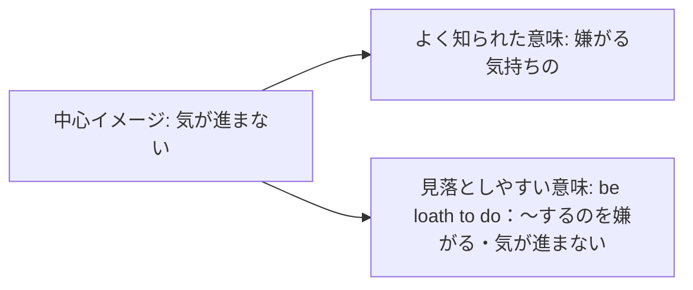

**重要語法**：`be loath to do（〜するのを嫌がる）`

<small>index: 6806 ／ candidate_id: `ev-06806-adj-01` ／ global_order: 3441</small>

---

## 02. lofty

**品詞**：形容詞  
**発音**：/ˈlɔːfti/

<small>よく知られている意味：非常に高い</small>

### 見落としやすい意味

**理想・思想が崇高な・高尚な**

**例文**：The volunteers worked toward the lofty goal of ending illiteracy.

**和訳**：ボランティアたちは、非識字をなくすという崇高な目標に向けて活動した。

**コアイメージ**：高さが並外れているという感覚が、物理的な高さから理想の高さへ広がる。目標や理念に用いれば、崇高で高尚という評価になる。

**図**：

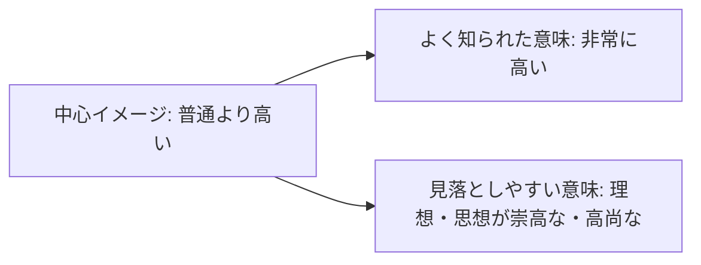

**重要語法**：`lofty ideals / a lofty goal`

<small>index: 6807 ／ candidate_id: `ev-06807-adj-01` ／ global_order: 3442</small>

---

## 03. muster

**品詞**：動詞  
**発音**：/ˈmʌstər/

<small>よく知られている意味：人員を集める</small>

### 見落としやすい意味

**（勇気・力・支持などを）奮い起こす・かき集める**

**例文**：He finally mustered the courage to apologize.

**和訳**：彼はついに勇気を奮い起こして謝った。

**コアイメージ**：必要なものを一か所に集め、使える状態にすることが中心。兵士だけでなく、勇気や力など心の中の資源にも使う。

**図**：

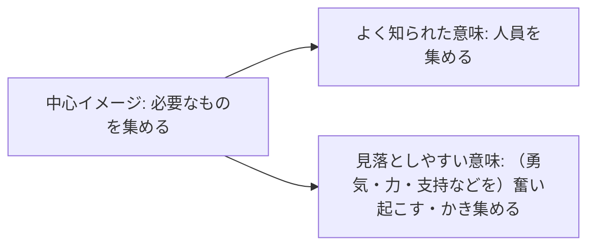

**重要語法**：`muster the courage to do`

<small>index: 6811 ／ candidate_id: `ev-06811-verb-01` ／ global_order: 3443</small>

---

## 04. payable

**品詞**：形容詞  
**発音**：/ˈpeɪəbəl/

<small>よく知られている意味：支払うべき</small>

### 見落としやすい意味

**payable to ～：～を受取人として支払われるべき**

**例文**：The check is payable to the school library.

**和訳**：その小切手の受取人は学校図書館に指定されている。

**コアイメージ**：お金を支払う義務や支払いの条件を示す語。payable to は金銭を受け取る相手を指定するので、単に『支払い可能』とは訳さない。

**図**：

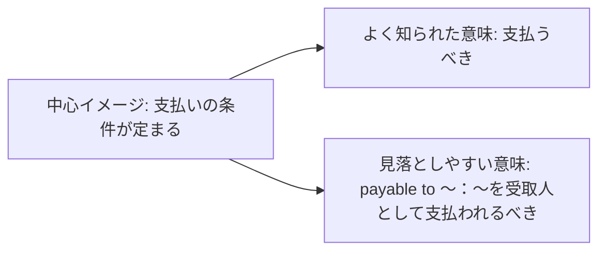

**重要語法**：`payable to A（受取人がAである）`

<small>index: 6819 ／ candidate_id: `ev-06819-adj-01` ／ global_order: 3444</small>

---

## 05. purse

**品詞**：動詞  
**発音**：/pɝːs/

<small>よく知られている意味：財布（名詞）</small>

### 見落としやすい意味

**唇をすぼめる**

**例文**：She pursed her lips when she heard the excuse.

**和訳**：その言い訳を聞いて、彼女は唇をきゅっとすぼめた。

**コアイメージ**：口を絞って閉じる動きが動詞の中心。財布の口をきゅっと締めるような形を唇に重ねて捉えると覚えやすい。

**図**：

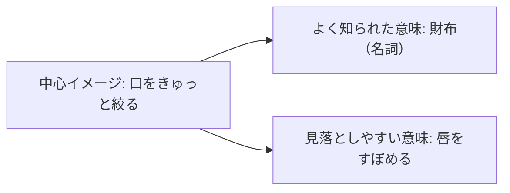

**重要語法**：`purse one's lips`

<small>index: 6825 ／ candidate_id: `ev-06825-verb-01` ／ global_order: 3445</small>

---

## 06. redundant

**品詞**：形容詞  
**発音**：/rɪˈdʌndənt/

<small>よく知られている意味：余分な・冗長な</small>

### 見落としやすい意味

**（主に英国英語で、雇用者から）余剰人員として解雇された**

**例文**：Several employees were made redundant after the merger.

**和訳**：合併後、数人の従業員が余剰人員として解雇された。

**コアイメージ**：必要量を超えて余っている状態を表す。文章なら『冗長』、英国の雇用文脈で人に使えば『余剰人員として解雇された』という意味になる。

**図**：

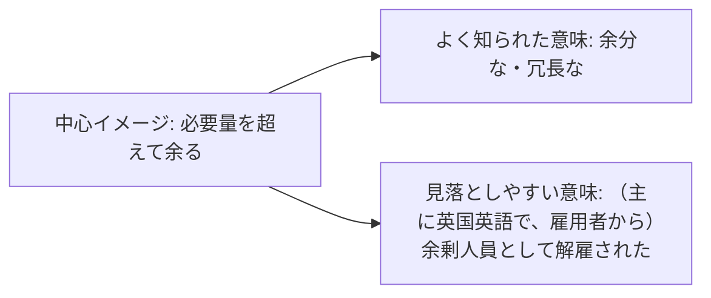

**重要語法**：`be made redundant（主に英国英語）`

<small>index: 6828 ／ candidate_id: `ev-06828-adj-01` ／ global_order: 3446</small>

---

## 07. saddle

**品詞**：動詞  
**発音**：/ˈsædəl/

<small>よく知られている意味：鞍（くら）</small>

### 見落としやすい意味

**人に責任・負担を押しつける**

**例文**：The manager saddled us with an impossible deadline.

**和訳**：その管理者は私たちに無理な締め切りを押しつけた。

**コアイメージ**：鞍を載せて背中に荷を負わせる光景から、責任や負担を他人に背負わせる意味へ広がる。saddle A with B で誰が何を負うかを確認する。

**図**：

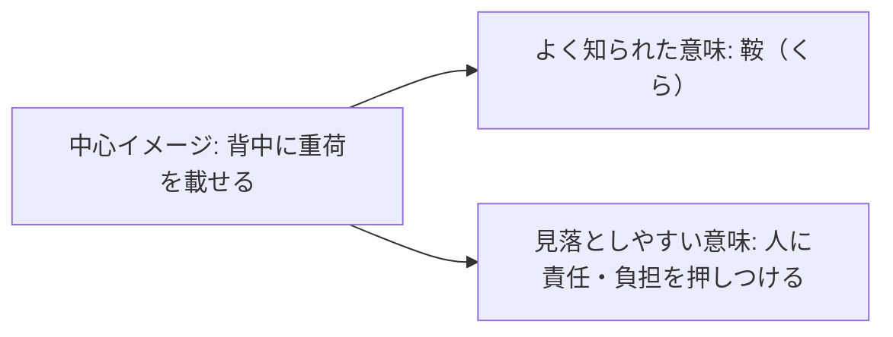

**重要語法**：`saddle A with B`

<small>index: 6830 ／ candidate_id: `ev-06830-verb-01` ／ global_order: 3447</small>

---

## 08. shroud

**品詞**：動詞  
**発音**：/ʃraʊd/

<small>よく知られている意味：覆い布・死に装束</small>

### 見落としやすい意味

**覆い隠す・不明瞭にする**

**例文**：The cause of the accident remains shrouded in mystery.

**和訳**：事故の原因は依然として謎に包まれている。

**コアイメージ**：布で覆い、外から見えないようにすることが中心。物だけでなく、事実や事情が見えない状態にも用いる。

**図**：

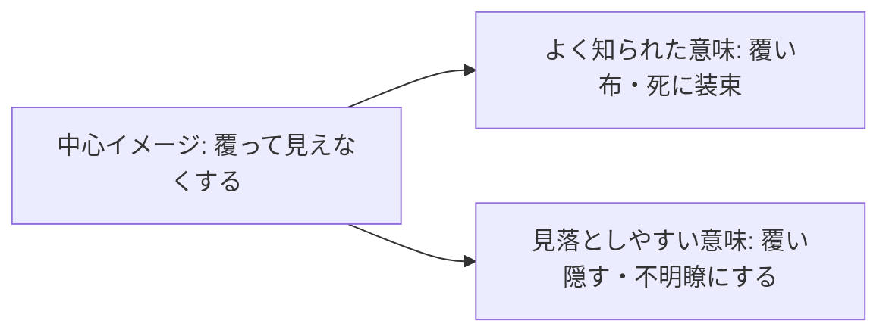

**重要語法**：`be shrouded in mystery`

<small>index: 6833 ／ candidate_id: `ev-06833-verb-01` ／ global_order: 3448</small>

---

## 09. spate

**品詞**：名詞  
**発音**：/speɪt/

<small>よく知られている意味：洪水・水の急増</small>

### 見落としやすい意味

**短期間に相次ぐ多数の出来事**

**例文**：The town has seen a spate of bicycle thefts this month.

**和訳**：その町では今月、自転車盗難が相次いでいる。

**コアイメージ**：大量の水が一気に押し寄せるように、出来事が短期間に続発するイメージ。単に数が多いだけでなく、立て続けに起こる感覚がある。

**図**：

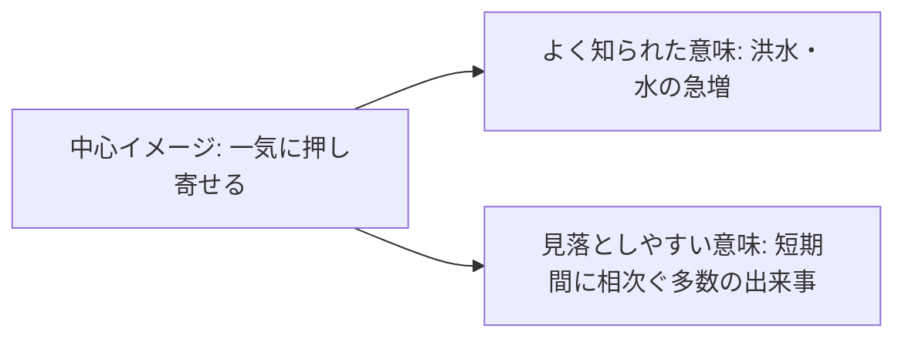

**重要語法**：`a spate of incidents / complaints`

<small>index: 6835 ／ candidate_id: `ev-06835-noun-01` ／ global_order: 3449</small>

---

## 10. stature

**品詞**：名詞  
**発音**：/ˈstætʃər/

<small>よく知られている意味：背丈・身長</small>

### 見落としやすい意味

**実績によって得た名声・地位**

**例文**：Her research earned her great stature in the scientific community.

**和訳**：彼女の研究は、科学界での高い評価と地位をもたらした。

**コアイメージ**：人がどれほど高く立っているかという『高さ』から、社会的評価の高さへ広がる。実績に裏付けられた地位・名声をいう。

**図**：

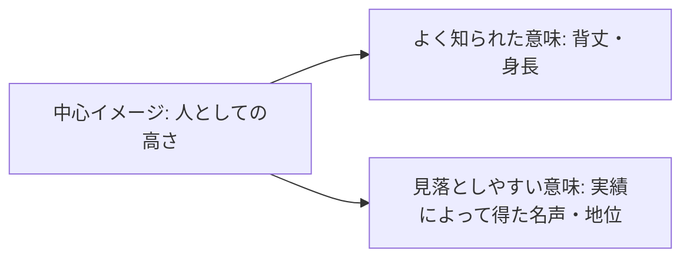

**重要語法**：`a person of stature`

<small>index: 6836 ／ candidate_id: `ev-06836-noun-01` ／ global_order: 3450</small>

---

## 11. subscribe

**品詞**：動詞  
**発音**：/səbˈskraɪb/

<small>よく知られている意味：定期購読する・登録する</small>

### 見落としやすい意味

**意見や思想に賛同する**

**例文**：I don't subscribe to the idea that money guarantees happiness.

**和訳**：私は、お金が幸福を保証するという考えには賛同しない。

**コアイメージ**：あるものを自分のものとして引き受け、継続的に関わる感覚がある。購読に加えて、意見や考えを支持する場合にも使う。

**図**：

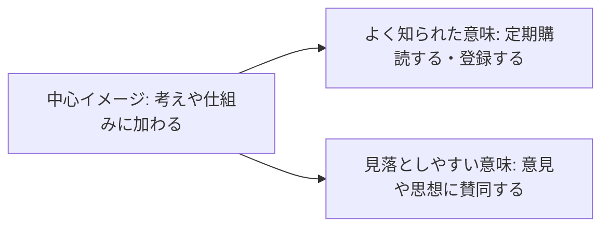

**重要語法**：`subscribe to a theory / view`

<small>index: 6837 ／ candidate_id: `ev-06837-verb-01` ／ global_order: 3451</small>

---

## 12. swarm

**品詞**：動詞  
**発音**：/swɔːrm/

<small>よく知られている意味：群れ（名詞）</small>

### 見落としやすい意味

**swarm with ～：～が群がる・～であふれている**

**例文**：The garden was swarming with bees.

**和訳**：その庭にはハチが群がっていた。

**コアイメージ**：小さな生き物や人が密集して動き回る光景が中心。場所を主語にして swarm with と言えば『〜でいっぱいだ』と表せる。

**図**：

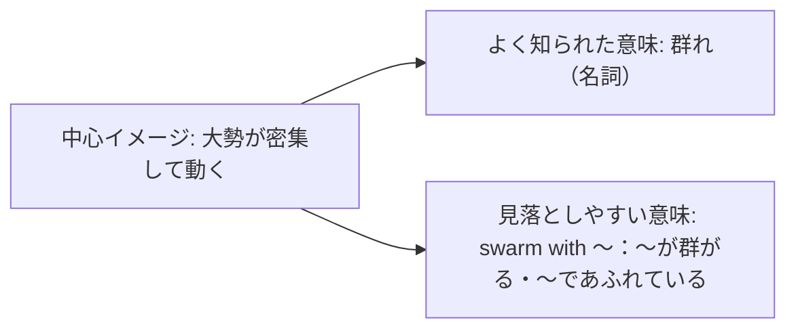

**重要語法**：`be swarming with A`

<small>index: 6841 ／ candidate_id: `ev-06841-verb-01` ／ global_order: 3452</small>

---

## 13. wed

**品詞**：動詞  
**発音**：/wed/

<small>よく知られている意味：結婚する</small>

### 見落としやすい意味

**（二つの発想・方法などを）結びつける・融合する**

**例文**：The new design weds traditional materials with modern technology.

**和訳**：その新しい設計は伝統的な素材と現代技術を融合させている。

**コアイメージ**：本来別々の二者を一つに結びつけることが中心。人と人の結婚だけでなく、考え方や方法を組み合わせる場面にも使う。

**図**：

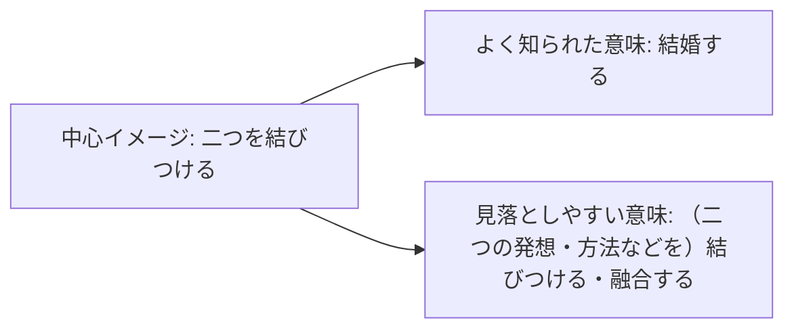

**重要語法**：`wed A to B / wed A with B`

<small>index: 6845 ／ candidate_id: `ev-06845-verb-01` ／ global_order: 3453</small>

---

## 14. wizard

**品詞**：名詞  
**発音**：/ˈwɪzərd/

<small>よく知られている意味：魔法使い</small>

### 見落としやすい意味

**ある分野の達人・名人**

**例文**：Ask Maya; she's a wizard at fixing old computers.

**和訳**：マヤに聞いてみて。彼女は古いパソコンの修理の達人だ。

**コアイメージ**：魔法のように難しいことをこなす人というたとえ。実際の魔法ではなく、ある技能に非常に優れた人を指す。

**図**：

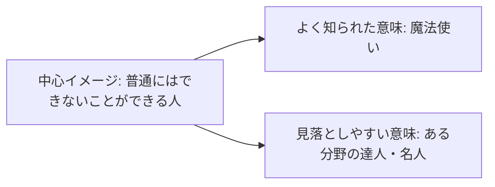

**重要語法**：`a wizard at / with something`

<small>index: 6846 ／ candidate_id: `ev-06846-noun-01` ／ global_order: 3454</small>

---

## 15. animate

**品詞**：形容詞  
**発音**：形容詞 /ˈænɪmət/

<small>よく知られている意味：活気づける（動詞）</small>

### 見落としやすい意味

**生命を持つ・生きている**

**例文**：The researchers compared animate and inanimate objects.

**和訳**：研究者たちは生物と無生物を比較した。

**コアイメージ**：生命や動きがあるという特徴を表す語。動詞では『生命・活気を与える』、形容詞では『生命を持つ』という向きになる。

**図**：

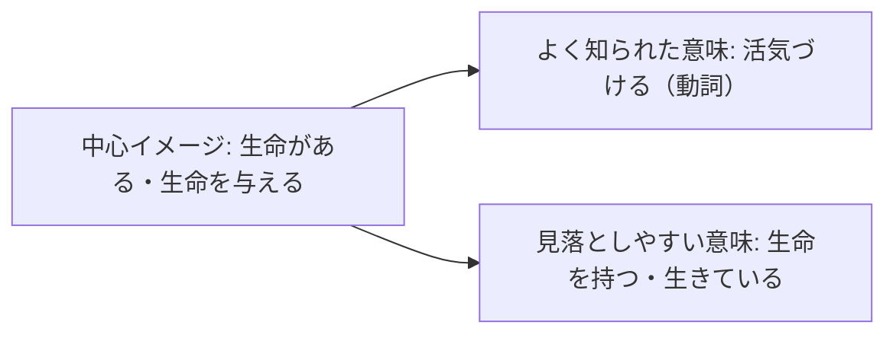

**重要語法**：`animate beings / animate objects`

<small>index: 6848 ／ candidate_id: `ev-06848-adj-01` ／ global_order: 3455</small>

---

## 16. anoint

**品詞**：動詞  
**発音**：/əˈnɔɪnt/

<small>よく知られている意味：油を塗る・聖別する</small>

### 見落としやすい意味

**後継者・指導者などに指名する**

**例文**：The party anointed her as its next leader.

**和訳**：その党は彼女を次の指導者に指名した。

**コアイメージ**：油を塗る儀式によって特別な役割を与える行為から、正式な候補者や後継者に選ぶ意味へ広がる。宗教的儀式の場面でなくても使う。

**図**：

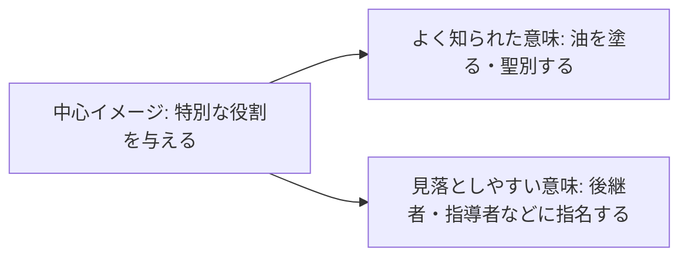

**重要語法**：`anoint A as B`

<small>index: 6849 ／ candidate_id: `ev-06849-verb-01` ／ global_order: 3456</small>

---

## 17. assimilate

**品詞**：動詞  
**発音**：/əˈsɪməleɪt/

<small>よく知られている意味：同化する・同化させる</small>

### 見落としやすい意味

**知識や情報を理解して吸収する**

**例文**：It takes time to assimilate so much new information.

**和訳**：これほど多くの新しい情報を理解して吸収するには時間がかかる。

**コアイメージ**：外から入ったものを自分の一部として取り込むことが中心。社会の中で同化するだけでなく、知識を理解し身につける意味にもなる。

**図**：

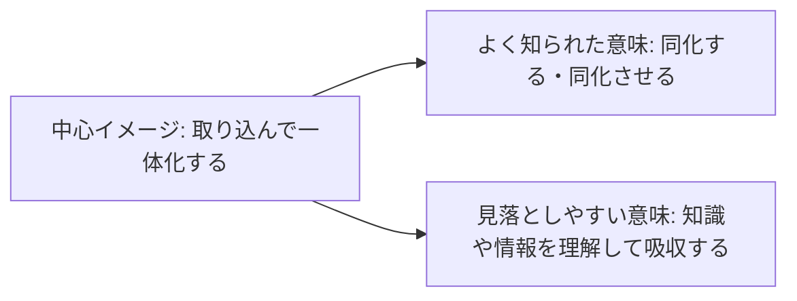

**重要語法**：`assimilate information / ideas`

<small>index: 6855 ／ candidate_id: `ev-06855-verb-01` ／ global_order: 3457</small>

---

## 18. classified

**品詞**：形容詞  
**発音**：/ˈklæsɪfaɪd/

<small>よく知られている意味：分類された</small>

### 見落としやすい意味

**機密扱いの・一般公開されない**

**例文**：The report contains classified information and cannot be published.

**和訳**：その報告書には機密情報が含まれるため、公表できない。

**コアイメージ**：情報を区分して扱うことが基本。公開範囲を制限する分類に入れられた情報なら、『機密扱いの』という意味になる。

**図**：

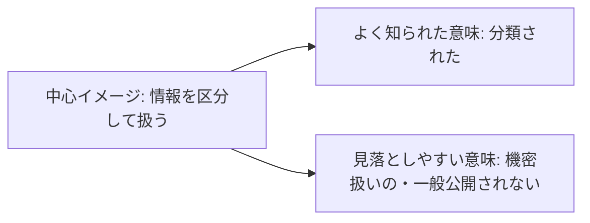

**重要語法**：`classified information / documents`

<small>index: 6870 ／ candidate_id: `ev-06870-adj-01` ／ global_order: 3458</small>

---

## 19. classified

**品詞**：名詞  
**発音**：/ˈklæsɪfaɪd/

<small>よく知られている意味：分類された（形容詞）</small>

### 見落としやすい意味

**新聞・雑誌の小さな分類広告**

**例文**：She found the apartment in the newspaper classifieds.

**和訳**：彼女は新聞の分類広告でそのアパートを見つけた。

**コアイメージ**：情報を種類別に並べたものという感覚がある。新聞では求人や賃貸などを分野ごとに分けた小さな広告を指す。

**図**：

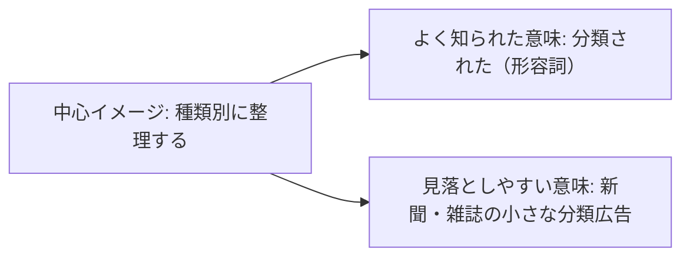

**重要語法**：`the classifieds（複数形が一般的）`

<small>index: 6870 ／ candidate_id: `ev-06870-noun-01` ／ global_order: 3459</small>

---

## 20. cum

**品詞**：前置詞  
**発音**：/kʌm/

<small>よく知られている意味：（一般的な基礎語義はない）</small>

### 見落としやすい意味

**A-cum-B：AとBを兼ねた・A兼Bの**

**例文**：The studio serves as a classroom-cum-workshop.

**和訳**：そのスタジオは教室と作業場を兼ねている。

**コアイメージ**：二つの役割を一つに重ねることを示す接続的な前置詞。A-cum-B は『Aであると同時にBでもある』と読む。

**図**：

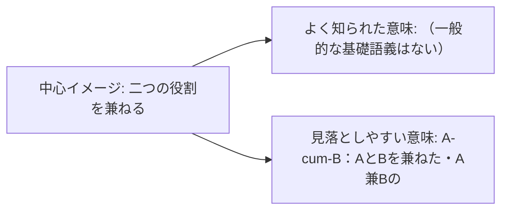

**重要語法**：`A-cum-B（A兼B、ハイフンを伴う）`

<small>index: 6880 ／ candidate_id: `ev-06880-preposition-01` ／ global_order: 3460</small>

---

## 21. devastating

**品詞**：形容詞  
**発音**：/ˈdevəsteɪtɪŋ/

<small>よく知られている意味：壊滅的な</small>

### 見落としやすい意味

**（批判・議論などが）痛烈で反論しにくい**

**例文**：The journalist delivered a devastating critique of the proposal.

**和訳**：その記者は提案に対して痛烈な批判を行った。

**コアイメージ**：相手や物事に強烈な打撃を与えることが中心。物理的破壊だけでなく、議論を崩すほど鋭い批判にも使う。

**図**：

```mermaid
flowchart LR
    A["中心イメージ: 強烈な打撃を与える"]
    B["よく知られた意味: 壊滅的な"]
    C["見落としやすい意味: （批判・議論などが）痛烈で反論しにくい"]
    A --> B
    A --> C
```

**重要語法**：`a devastating criticism / argument`

<small>index: 6885 ／ candidate_id: `ev-06885-adj-01` ／ global_order: 3461</small>

---

## 22. enactment

**品詞**：名詞  
**発音**：/ɪˈnæktmənt/

<small>よく知られている意味：法律の制定</small>

### 見落としやすい意味

**（劇・場面・出来事などの）上演・実演**

**例文**：The students prepared an enactment of a historical event.

**和訳**：生徒たちは歴史上の出来事を再現する実演を準備した。

**コアイメージ**：書かれたことや想定されたことを実際の形にするのが共通点。法律を効力あるものにする場合は『制定』、場面を演じる場合は『上演・実演』になる。

**図**：

```mermaid
flowchart LR
    A["中心イメージ: 決めた内容を実際に行う"]
    B["よく知られた意味: 法律の制定"]
    C["見落としやすい意味: （劇・場面・出来事などの）上演・実演"]
    A --> B
    A --> C
```

**重要語法**：`an enactment of an event`

<small>index: 6889 ／ candidate_id: `ev-06889-noun-01` ／ global_order: 3462</small>

---

## 23. foil

**品詞**：名詞  
**発音**：/fɔɪl/

<small>よく知られている意味：金属箔（はく）</small>

### 見落としやすい意味

**対照によって他者を引き立てる人・もの**

**例文**：The quiet brother serves as a foil to the talkative hero.

**和訳**：物静かな兄弟は、おしゃべりな主人公を際立たせる対照役になっている。

**コアイメージ**：物語では人物を対比させることで一方の特徴を際立たせる。金属箔という別義から無理に推測せず、『対照で引き立てる役』として覚える。

**図**：

```mermaid
flowchart LR
    A["中心イメージ: 文脈で異なる役割を持つ語"]
    B["よく知られた意味: 金属箔（はく）"]
    C["見落としやすい意味: 対照によって他者を引き立てる人・もの"]
    A --> B
    A --> C
```

**重要語法**：`a foil to A`

<small>index: 6898 ／ candidate_id: `ev-06898-noun-01` ／ global_order: 3463</small>

---

## 24. foil

**品詞**：動詞  
**発音**：/fɔɪl/

<small>よく知られている意味：金属箔（名詞）</small>

### 見落としやすい意味

**計画や企てを阻止する**

**例文**：A quick warning foiled the attempt to steal the painting.

**和訳**：素早い警告が、その絵を盗もうとする企てを阻止した。

**コアイメージ**：相手の企てが実現する前にくじき、失敗に終わらせる動作。名詞の『箔』とは形が同じでも、この動詞義は別に覚える方が正確。

**図**：

```mermaid
flowchart LR
    A["中心イメージ: 企ての成功をくじく"]
    B["よく知られた意味: 金属箔（名詞）"]
    C["見落としやすい意味: 計画や企てを阻止する"]
    A --> B
    A --> C
```

**重要語法**：`foil a plan / attempt`

<small>index: 6898 ／ candidate_id: `ev-06898-verb-01` ／ global_order: 3464</small>

---

## 25. grill

**品詞**：動詞  
**発音**：/ɡrɪl/

<small>よく知られている意味：直火で焼く</small>

### 見落としやすい意味

**厳しく質問して問いただす**

**例文**：The committee grilled the director about the missing funds.

**和訳**：委員会は使途不明の資金について理事を厳しく問いただした。

**コアイメージ**：強い熱を集中的に加えるように、相手へ厳しい質問を続けるたとえ。普通に尋ねるより圧迫感の強い動詞。

**図**：

```mermaid
flowchart LR
    A["中心イメージ: 強い圧力を加える"]
    B["よく知られた意味: 直火で焼く"]
    C["見落としやすい意味: 厳しく質問して問いただす"]
    A --> B
    A --> C
```

**重要語法**：`grill A about B`

<small>index: 6900 ／ candidate_id: `ev-06900-verb-01` ／ global_order: 3465</small>

---

## 26. insane

**品詞**：形容詞  
**発音**：/ɪnˈseɪn/

<small>よく知られている意味：正気でない</small>

### 見落としやすい意味

**（価格・量などが）常識外れに大きい・すさまじい**

**例文**：The rent in this neighborhood is insane.

**和訳**：この地域の家賃はとんでもなく高い。

**コアイメージ**：普通の基準から大きく外れているという感覚が、口語で程度の強調に使われる。金額や忙しさなどにも使うが、強いくだけた表現。

**図**：

```mermaid
flowchart LR
    A["中心イメージ: 普通の限度を大きく超える"]
    B["よく知られた意味: 正気でない"]
    C["見落としやすい意味: （価格・量などが）常識外れに大きい・すさまじい"]
    A --> B
    A --> C
```

**重要語法**：`insane prices / an insane amount（口語）`

<small>index: 6903 ／ candidate_id: `ev-06903-adj-01` ／ global_order: 3466</small>

---

## 27. parrot

**品詞**：動詞  
**発音**：/ˈpærət/

<small>よく知られている意味：オウム（鳥）</small>

### 見落としやすい意味

**意味を考えずに言葉を繰り返す**

**例文**：The child parroted the phrase without knowing what it meant.

**和訳**：その子は意味も分からず、その言葉を繰り返した。

**コアイメージ**：オウムの物まねのように、聞いた言葉をそのまま繰り返す動作。内容を理解したり自分の意見として述べたりするとは限らない。

**図**：

```mermaid
flowchart LR
    A["中心イメージ: 聞いた音をまねる"]
    B["よく知られた意味: オウム（鳥）"]
    C["見落としやすい意味: 意味を考えずに言葉を繰り返す"]
    A --> B
    A --> C
```

**重要語法**：`parrot a phrase / slogan`

<small>index: 6917 ／ candidate_id: `ev-06917-verb-01` ／ global_order: 3467</small>

---

## 28. penetration

**品詞**：名詞  
**発音**：/ˌpenəˈtreɪʃən/

<small>よく知られている意味：貫通・侵入</small>

### 見落としやすい意味

**market penetration：市場への浸透・普及率**

**例文**：The company's market penetration increased after the price cut.

**和訳**：値下げ後、その会社の市場浸透率は上がった。

**コアイメージ**：外側から内部へ入り込み、広がる様子が中心。市場なら商品が顧客へどの程度行き渡っているかを表す。

**図**：

```mermaid
flowchart LR
    A["中心イメージ: 内部へ入り込む"]
    B["よく知られた意味: 貫通・侵入"]
    C["見落としやすい意味: market penetration：市場への浸透・普及率"]
    A --> B
    A --> C
```

**重要語法**：`market penetration`

<small>index: 6921 ／ candidate_id: `ev-06921-noun-01` ／ global_order: 3468</small>

---

## 29. perpetual

**品詞**：形容詞  
**発音**：/pərˈpetʃuəl/

<small>よく知られている意味：永遠に続く</small>

### 見落としやすい意味

**（不平・争いなどが）絶えず繰り返される**

**例文**：Their perpetual arguments made meetings exhausting.

**和訳**：彼らが絶えず口論するので、会議はとても疲れるものになった。

**コアイメージ**：終わりが見えないほど続くという感覚。繰り返す不満や争いには、一回の出来事が永遠に続くのでなく何度も起こる意味になる。

**図**：

```mermaid
flowchart LR
    A["中心イメージ: 途切れないように続く"]
    B["よく知られた意味: 永遠に続く"]
    C["見落としやすい意味: （不平・争いなどが）絶えず繰り返される"]
    A --> B
    A --> C
```

**重要語法**：`perpetual complaints / arguments`

<small>index: 6922 ／ candidate_id: `ev-06922-adj-01` ／ global_order: 3469</small>

---

## 30. pier

**品詞**：名詞  
**発音**：/pɪr/

<small>よく知られている意味：桟橋</small>

### 見落としやすい意味

**（橋などを支える）橋脚・支柱**

**例文**：Engineers inspected the concrete piers supporting the bridge.

**和訳**：技術者たちは橋を支えるコンクリート製の橋脚を点検した。

**コアイメージ**：水辺や構造物で前方・上方を支える部分を指す。水中へ突き出た桟橋に加えて、橋の荷重を支える柱も pier という。

**図**：

```mermaid
flowchart LR
    A["中心イメージ: 構造物を支える突き出た部分"]
    B["よく知られた意味: 桟橋"]
    C["見落としやすい意味: （橋などを支える）橋脚・支柱"]
    A --> B
    A --> C
```

**重要語法**：`bridge pier`

<small>index: 6923 ／ candidate_id: `ev-06923-noun-01` ／ global_order: 3470</small>

---

## 31. prevailing

**品詞**：形容詞  
**発音**：/prɪˈveɪlɪŋ/

<small>よく知られている意味：打ち勝つ（prevail の動詞義）</small>

### 見落としやすい意味

**（意見・慣習などが）広く受け入れられた・支配的な**

**例文**：The prevailing view was that the plan would fail.

**和訳**：当時はその計画は失敗するという見方が支配的だった。

**コアイメージ**：競い合うものの中で優勢になることが中心。意見や慣習なら、特定の社会で広く受け入れられている状態を表す。

**図**：

```mermaid
flowchart LR
    A["中心イメージ: ほかより優勢である"]
    B["よく知られた意味: 打ち勝つ（prevail の動詞義）"]
    C["見落としやすい意味: （意見・慣習などが）広く受け入れられた・支配的な"]
    A --> B
    A --> C
```

**重要語法**：`the prevailing view / attitude`

<small>index: 6926 ／ candidate_id: `ev-06926-adj-01` ／ global_order: 3471</small>

---

## 32. purge

**品詞**：動詞  
**発音**：/pɝːdʒ/

<small>よく知られている意味：洗い清める</small>

### 見落としやすい意味

**政治的に追放・排除する**

**例文**：The new leader purged his rivals from the party.

**和訳**：新しい指導者は党から政敵を追放した。

**コアイメージ**：好ましくないと判断したものを取り除き、内部を『きれいにする』という発想。政治文脈では人を組織から追い出す強い表現になる。

**図**：

```mermaid
flowchart LR
    A["中心イメージ: 内部から取り除く"]
    B["よく知られた意味: 洗い清める"]
    C["見落としやすい意味: 政治的に追放・排除する"]
    A --> B
    A --> C
```

**重要語法**：`purge A from B`

<small>index: 6930 ／ candidate_id: `ev-06930-verb-01` ／ global_order: 3472</small>

---

## 33. raft

**品詞**：名詞  
**発音**：/ræft/

<small>よく知られている意味：いかだ</small>

### 見落としやすい意味

**多数・大量**

**例文**：The proposal raised a raft of new questions.

**和訳**：その提案によって多くの新たな疑問が生じた。

**コアイメージ**：a raft of は『大量の・多数の』というまとまりの表現。いかだという具体物から直訳せず、数の多さを表す決まり文句として扱う。

**図**：

```mermaid
flowchart LR
    A["中心イメージ: 一まとまりの多数"]
    B["よく知られた意味: いかだ"]
    C["見落としやすい意味: 多数・大量"]
    A --> B
    A --> C
```

**重要語法**：`a raft of questions / proposals`

<small>index: 6932 ／ candidate_id: `ev-06932-noun-01` ／ global_order: 3473</small>

---

## 34. sheltered

**品詞**：形容詞  
**発音**：/ˈʃeltərd/

<small>よく知られている意味：風雨などから守られた</small>

### 見落としやすい意味

**（保護されすぎて）世間知らずの・経験に乏しい**

**例文**：He had a sheltered childhood and knew little about life outside his town.

**和訳**：彼は過保護な環境で育ち、町の外の生活をほとんど知らなかった。

**コアイメージ**：外界の危険や刺激から守られていることが中心。人の経験に用いれば、保護されすぎて世の中を十分知らない状態になる。

**図**：

```mermaid
flowchart LR
    A["中心イメージ: 外界から保護される"]
    B["よく知られた意味: 風雨などから守られた"]
    C["見落としやすい意味: （保護されすぎて）世間知らずの・経験に乏しい"]
    A --> B
    A --> C
```

**重要語法**：`a sheltered upbringing / childhood`

<small>index: 6938 ／ candidate_id: `ev-06938-adj-01` ／ global_order: 3474</small>

---

## 35. volatility

**品詞**：名詞  
**発音**：/ˌvɑːləˈtɪləti/

<small>よく知られている意味：価格・数値の変動性</small>

### 見落としやすい意味

**（人の感情・気質の）不安定さ・変わりやすさ**

**例文**：Her emotional volatility made her reactions hard to predict.

**和訳**：彼女の感情は変わりやすく、反応を予測しにくかった。

**コアイメージ**：安定して同じ状態にとどまらず、急に変わる性質。市場の価格だけでなく、気分や気質の揺れにも用いる。

**図**：

```mermaid
flowchart LR
    A["中心イメージ: 急に変化しやすい"]
    B["よく知られた意味: 価格・数値の変動性"]
    C["見落としやすい意味: （人の感情・気質の）不安定さ・変わりやすさ"]
    A --> B
    A --> C
```

**重要語法**：`emotional volatility`

<small>index: 6945 ／ candidate_id: `ev-06945-noun-01` ／ global_order: 3475</small>

---

## 36. whoever

**品詞**：代名詞  
**発音**：/huːˈevər/

<small>よく知られている意味：誰でも・〜する人は誰でも</small>

### 見落としやすい意味

**（驚き・疑いを込めて）いったい誰が**

**例文**：Whoever would leave such a strange note?

**和訳**：いったい誰がこんな奇妙なメモを残すというのだろう。

**コアイメージ**：who を強め、相手が誰なのか分からない気持ちを前面に出す。文頭の疑問文では『誰でも』ではなく、驚きや疑いを含む問いになる。

**図**：

```mermaid
flowchart LR
    A["中心イメージ: 誰なのかを強く問う"]
    B["よく知られた意味: 誰でも・〜する人は誰でも"]
    C["見落としやすい意味: （驚き・疑いを込めて）いったい誰が"]
    A --> B
    A --> C
```

**重要語法**：`Whoever ...?（強調疑問）`

<small>index: 6947 ／ candidate_id: `ev-06947-pron-01` ／ global_order: 3476</small>

---

## 37. pencil

**品詞**：動詞  
**発音**：/ˈpensəl/

<small>よく知られている意味：鉛筆（名詞）</small>

### 見落としやすい意味

**pencil in ～：予定を仮に入れておく**

**例文**：Let's pencil in a meeting for next Thursday.

**和訳**：来週の木曜日に会議の予定をひとまず入れておこう。

**コアイメージ**：鉛筆で書いた予定は後から消して直せる。そこから、変更可能な仮の予定を入れておく意味になる。

**図**：

```mermaid
flowchart LR
    A["中心イメージ: 消して変更できるよう書く"]
    B["よく知られた意味: 鉛筆（名詞）"]
    C["見落としやすい意味: pencil in ～：予定を仮に入れておく"]
    A --> B
    A --> C
```

**重要語法**：`pencil in a meeting / appointment`

<small>index: 6950 ／ candidate_id: `ev-06950-verb-02` ／ global_order: 3477</small>

---

## 38. toe

**品詞**：名詞  
**発音**：/toʊ/

<small>よく知られている意味：足の指</small>

### 見落としやすい意味

**toe the line：規則・方針に従う**

**例文**：New employees are expected to toe the line.

**和訳**：新入社員は会社の方針に従うことを求められる。

**コアイメージ**：決められた線に足先をそろえる光景から、決まりや集団の方針に従う意味になる。line は line、動詞は toe である点にも注意。

**図**：

```mermaid
flowchart LR
    A["中心イメージ: 決められた線に足先をそろえる"]
    B["よく知られた意味: 足の指"]
    C["見落としやすい意味: toe the line：規則・方針に従う"]
    A --> B
    A --> C
```

**重要語法**：`toe the line`

<small>index: 6951 ／ candidate_id: `ev-06951-noun-01` ／ global_order: 3478</small>

---

## 39. chin

**品詞**：名詞  
**発音**：/tʃɪn/

<small>よく知られている意味：あご</small>

### 見落としやすい意味

**keep one's chin up：元気を出す・くじけない**

**例文**：Keep your chin up; one setback doesn't decide your future.

**和訳**：元気を出して。一度の挫折で将来が決まるわけじゃない。

**コアイメージ**：気落ちしてうつむくのと反対に、あごを上げて前を向く姿を思い描く。そこから『くじけないで』という励ましになる。

**図**：

```mermaid
flowchart LR
    A["中心イメージ: あごを上げて前を向く"]
    B["よく知られた意味: あご"]
    C["見落としやすい意味: keep one's chin up：元気を出す・くじけない"]
    A --> B
    A --> C
```

**重要語法**：`keep your chin up`

<small>index: 6952 ／ candidate_id: `ev-06952-noun-01` ／ global_order: 3479</small>

---

## 40. stuffed

**品詞**：形容詞  
**発音**：/stʌft/

<small>よく知られている意味：詰め物をされた・ぎっしり詰まった</small>

### 見落としやすい意味

**（食後などに）お腹がいっぱいの**

**例文**：I can't eat another bite; I'm stuffed.

**和訳**：もう一口も食べられない。お腹がいっぱいだ。

**コアイメージ**：中身がいっぱいに詰まって、これ以上入らない状態。食事のあと人について使うと、満腹というくだけた言い方になる。

**図**：

```mermaid
flowchart LR
    A["中心イメージ: 中がいっぱいに詰まる"]
    B["よく知られた意味: 詰め物をされた・ぎっしり詰まった"]
    C["見落としやすい意味: （食後などに）お腹がいっぱいの"]
    A --> B
    A --> C
```

**重要語法**：`I'm stuffed.（口語）`

<small>index: 6955 ／ candidate_id: `ev-06955-adj-01` ／ global_order: 3480</small>

---

## 41. definite

**品詞**：形容詞  
**発音**：/ˈdefɪnət/

<small>よく知られている意味：明確な・確実な</small>

### 見落としやすい意味

**the definite article：定冠詞（the）**

**例文**：English uses the definite article the before certain nouns.

**和訳**：英語では、特定の名詞の前に定冠詞 the を使う。

**コアイメージ**：指しているものを特定できるという性質が中心。文法では対象を特定する冠詞 the を definite article と呼ぶ。

**図**：

```mermaid
flowchart LR
    A["中心イメージ: 対象が特定されている"]
    B["よく知られた意味: 明確な・確実な"]
    C["見落としやすい意味: the definite article：定冠詞（the）"]
    A --> B
    A --> C
```

**重要語法**：`the definite article（定冠詞）`

<small>index: 6956 ／ candidate_id: `ev-06956-adj-01` ／ global_order: 3481</small>

---

## 42. demanding

**品詞**：形容詞  
**発音**：/dɪˈmændɪŋ/

<small>よく知られている意味：要求が多い（人）</small>

### 見落としやすい意味

**（仕事・課題などが）骨が折れる・厳しい**

**例文**：Nursing is a demanding job that requires patience.

**和訳**：看護の仕事は忍耐を要する大変な仕事だ。

**コアイメージ**：多くの努力や時間を要求するという感覚が中心。人だけでなく仕事や課題を主語にすると、負担が大きく骨が折れるという意味になる。

**図**：

```mermaid
flowchart LR
    A["中心イメージ: 多くのものを要求する"]
    B["よく知られた意味: 要求が多い（人）"]
    C["見落としやすい意味: （仕事・課題などが）骨が折れる・厳しい"]
    A --> B
    A --> C
```

**重要語法**：`a demanding job / task`

<small>index: 6958 ／ candidate_id: `ev-06958-adj-01` ／ global_order: 3482</small>

---

## 43. mercy

**品詞**：名詞  
**発音**：/ˈmɝːsi/

<small>よく知られている意味：慈悲・情け</small>

### 見落としやすい意味

**せめてもの救いとなる出来事**

**例文**：It was a mercy that the rain stopped before the festival.

**和訳**：祭りが始まる前に雨がやんだのは、せめてもの救いだった。

**コアイメージ**：つらい状況の中で苦しさを和らげるものに目を向ける表現。人が情けをかける行為だけでなく、幸運な出来事を『救い』と呼ぶことがある。

**図**：

```mermaid
flowchart LR
    A["中心イメージ: 苦しさを和らげる救い"]
    B["よく知られた意味: 慈悲・情け"]
    C["見落としやすい意味: せめてもの救いとなる出来事"]
    A --> B
    A --> C
```

**重要語法**：`It is a mercy that ...`

<small>index: 6959 ／ candidate_id: `ev-06959-noun-01` ／ global_order: 3483</small>

---

## 44. mercy

**品詞**：名詞  
**発音**：/ˈmɝːsi/

<small>よく知られている意味：慈悲・情け</small>

### 見落としやすい意味

**at the mercy of：～のなすがままで・～に左右されて**

**例文**：The small boats were at the mercy of the wind.

**和訳**：小さな船は風のなすがままだった。

**コアイメージ**：自分の運命を他者の慈悲に委ねる場面を思い浮かべる。at the mercy of は相手の力を制御できず、その影響下にある意味になる。

**図**：

```mermaid
flowchart LR
    A["中心イメージ: 自分の運命を相手に委ねる"]
    B["よく知られた意味: 慈悲・情け"]
    C["見落としやすい意味: at the mercy of：～のなすがままで・～に左右されて"]
    A --> B
    A --> C
```

**重要語法**：`at the mercy of A`

<small>index: 6959 ／ candidate_id: `ev-06959-noun-02` ／ global_order: 3484</small>

---

## 45. worm

**品詞**：動詞  
**発音**：/wɝːm/

<small>よく知られている意味：ミミズ・虫</small>

### 見落としやすい意味

**worm one's way into ～：巧みに取り入って入り込む**

**例文**：He wormed his way into the committee by flattering its members.

**和訳**：彼は委員たちにお世辞を言って、巧みに委員会へ入り込んだ。

**コアイメージ**：虫が細いすき間をくねくね進むように、少しずつ入り込む動きが中心。人間関係に用いれば、巧みに取り入って地位や集団に入り込む意味になる。

**図**：

```mermaid
flowchart LR
    A["中心イメージ: すき間を少しずつ進む"]
    B["よく知られた意味: ミミズ・虫"]
    C["見落としやすい意味: worm one's way into ～：巧みに取り入って入り込む"]
    A --> B
    A --> C
```

**重要語法**：`worm one's way into A`

<small>index: 6960 ／ candidate_id: `ev-06960-verb-01` ／ global_order: 3485</small>

---

## 46. blaze

**品詞**：動詞  
**発音**：/bleɪz/

<small>よく知られている意味：炎が激しく燃える</small>

### 見落としやすい意味

**blaze a trail：新しい道を切り開く・先駆けとなる**

**例文**：The scientist blazed a trail for future climate research.

**和訳**：その科学者は将来の気候研究への新しい道を切り開いた。

**コアイメージ**：未開の道に進む目印をつけて先に進むイメージの慣用句。blaze a trail は『炎を燃やす』の直訳でなく、先駆けとなることを表す。

**図**：

```mermaid
flowchart LR
    A["中心イメージ: 未開の道に目印をつける"]
    B["よく知られた意味: 炎が激しく燃える"]
    C["見落としやすい意味: blaze a trail：新しい道を切り開く・先駆けとなる"]
    A --> B
    A --> C
```

**重要語法**：`blaze a trail（先駆けとなる）`

<small>index: 6961 ／ candidate_id: `ev-06961-verb-01` ／ global_order: 3486</small>

---

## 47. crawl

**品詞**：動詞  
**発音**：/krɔːl/

<small>よく知られている意味：はう・ゆっくり進む</small>

### 見落としやすい意味

**多数のものがうようよいる**

**例文**：The old warehouse was crawling with rats.

**和訳**：古い倉庫にはネズミがうようよいた。

**コアイメージ**：生き物が地面をはって移動する様子から、あちこちが生き物だらけの光景を表せる。場所を主語にして be crawling with とするのが特徴。

**図**：

```mermaid
flowchart LR
    A["中心イメージ: あちこちをはい回る"]
    B["よく知られた意味: はう・ゆっくり進む"]
    C["見落としやすい意味: 多数のものがうようよいる"]
    A --> B
    A --> C
```

**重要語法**：`be crawling with A`

<small>index: 6963 ／ candidate_id: `ev-06963-verb-01` ／ global_order: 3487</small>

---

## 48. corpus

**品詞**：名詞  
**発音**：/ˈkɔːrpəs/

<small>よく知られている意味：身体・本体（学術語）</small>

### 見落としやすい意味

**研究のために集められた文章・言語資料の集合**

**例文**：The team built a corpus of conversations for language research.

**和訳**：そのチームは言語研究のために会話の資料集を構築した。

**コアイメージ**：研究対象をひとまとまりの本体として集めたものという発想。言語学では実際の文章や発話を体系的に集めた資料を指す。

**図**：

```mermaid
flowchart LR
    A["中心イメージ: まとまった資料の本体"]
    B["よく知られた意味: 身体・本体（学術語）"]
    C["見落としやすい意味: 研究のために集められた文章・言語資料の集合"]
    A --> B
    A --> C
```

**重要語法**：`a linguistic corpus（複数形 corpora / corpuses）`

<small>index: 6965 ／ candidate_id: `ev-06965-noun-01` ／ global_order: 3488</small>

---

## 49. inclusive

**品詞**：形容詞  
**発音**：/ɪnˈkluːsɪv/

<small>よく知られている意味：すべてを受け入れる</small>

### 見落としやすい意味

**（期間・数値の）両端を含む**

**例文**：The exhibition runs from May 3 to May 10, inclusive.

**和訳**：展示会は5月3日から10日まで、両日を含めて開催される。

**コアイメージ**：範囲から何も除外しないという感覚が中心。日付や数字の範囲を示すときは、始まりと終わりの両方を含むことを明示する。

**図**：

```mermaid
flowchart LR
    A["中心イメージ: 境界も含めて取り込む"]
    B["よく知られた意味: すべてを受け入れる"]
    C["見落としやすい意味: （期間・数値の）両端を含む"]
    A --> B
    A --> C
```

**重要語法**：`from A to B, inclusive`

<small>index: 6969 ／ candidate_id: `ev-06969-adj-01` ／ global_order: 3489</small>

---

## 50. intermediary

**品詞**：形容詞  
**発音**：/ˌɪntərˈmiːdieri/

<small>よく知られている意味：仲介者（名詞）</small>

### 見落としやすい意味

**中間的な・媒介となる**

**例文**：An intermediary organization helped the two groups communicate.

**和訳**：仲介機関が二つの団体の連絡を助けた。

**コアイメージ**：二者の間に位置してつなぐことが中心。名詞なら仲介する人や組織、形容詞なら仲介役となる性質を示す。

**図**：

```mermaid
flowchart LR
    A["中心イメージ: 二者の中間でつなぐ"]
    B["よく知られた意味: 仲介者（名詞）"]
    C["見落としやすい意味: 中間的な・媒介となる"]
    A --> B
    A --> C
```

**重要語法**：`an intermediary body / organization`

<small>index: 6976 ／ candidate_id: `ev-06976-adj-01` ／ global_order: 3490</small>

---

## 51. amenity

**品詞**：名詞  
**発音**：/əˈmenəti/

<small>よく知られている意味：快適さ・心地よさ</small>

### 見落としやすい意味

**（宿泊施設・建物などの）設備・便利なサービス**

**例文**：The hotel offers amenities such as a gym and free Wi-Fi.

**和訳**：そのホテルにはジムや無料Wi-Fiなどの設備・サービスがある。

**コアイメージ**：生活や滞在を快適にするという点が中心。複数形 amenities では、その快適さを実現する具体的な設備やサービスを指す。

**図**：

```mermaid
flowchart LR
    A["中心イメージ: 快適さをもたらすもの"]
    B["よく知られた意味: 快適さ・心地よさ"]
    C["見落としやすい意味: （宿泊施設・建物などの）設備・便利なサービス"]
    A --> B
    A --> C
```

**重要語法**：`hotel amenities / local amenities`

<small>index: 6981 ／ candidate_id: `ev-06981-noun-01` ／ global_order: 3491</small>

---

## 52. animation

**品詞**：名詞  
**発音**：/ˌænɪˈmeɪʃən/

<small>よく知られている意味：アニメーション・動画</small>

### 見落としやすい意味

**生き生きとした活気**

**例文**：She spoke with great animation about her travels.

**和訳**：彼女は旅行について実に生き生きと話した。

**コアイメージ**：物や人に生命や動きを感じさせることが中心。映像の動きだけでなく、話し方や表情に表れる活気も animation という。

**図**：

```mermaid
flowchart LR
    A["中心イメージ: 生き生きと動く"]
    B["よく知られた意味: アニメーション・動画"]
    C["見落としやすい意味: 生き生きとした活気"]
    A --> B
    A --> C
```

**重要語法**：`speak with animation`

<small>index: 6982 ／ candidate_id: `ev-06982-noun-01` ／ global_order: 3492</small>

---

## 53. barge

**品詞**：動詞  
**発音**：/bɑːrdʒ/

<small>よく知られている意味：平底の荷船</small>

### 見落としやすい意味

**無遠慮に押し入る**

**例文**：He barged into the office without knocking.

**和訳**：彼はノックもせずに事務所へずかずか入ってきた。

**コアイメージ**：大きな船が勢いよく押し進むような、遠慮のない入り方を表す。人の行動では、相手の都合を考えず押し入る印象を与える。

**図**：

```mermaid
flowchart LR
    A["中心イメージ: 勢いよく押し進む"]
    B["よく知られた意味: 平底の荷船"]
    C["見落としやすい意味: 無遠慮に押し入る"]
    A --> B
    A --> C
```

**重要語法**：`barge into a room`

<small>index: 6987 ／ candidate_id: `ev-06987-verb-01` ／ global_order: 3493</small>

---

## 54. beating

**品詞**：名詞  
**発音**：/ˈbiːtɪŋ/

<small>よく知られている意味：たたくこと</small>

### 見落としやすい意味

**（試合などでの）大敗・手痛い敗北**

**例文**：Our team took a beating in the final match.

**和訳**：私たちのチームは決勝戦で大敗した。

**コアイメージ**：繰り返し強い打撃を受けることが中心。試合の結果に使うと、相手に一方的に打ち負かされる意味になる。

**図**：

```mermaid
flowchart LR
    A["中心イメージ: 激しく打ちのめされる"]
    B["よく知られた意味: たたくこと"]
    C["見落としやすい意味: （試合などでの）大敗・手痛い敗北"]
    A --> B
    A --> C
```

**重要語法**：`take a beating`

<small>index: 6988 ／ candidate_id: `ev-06988-noun-01` ／ global_order: 3494</small>

---

## 55. booming

**品詞**：形容詞  
**発音**：/ˈbuːmɪŋ/

<small>よく知られている意味：急成長している・好景気の</small>

### 見落としやすい意味

**（声・音が）低く大きく響く**

**例文**：A booming voice echoed across the hall.

**和訳**：低く大きな声がホール中に響いた。

**コアイメージ**：勢いよく広がる大きな響きが中心。経済が勢いよく成長する意味もあるが、声や音では太く大きく響く様子を示す。

**図**：

```mermaid
flowchart LR
    A["中心イメージ: 勢いよく大きく響く"]
    B["よく知られた意味: 急成長している・好景気の"]
    C["見落としやすい意味: （声・音が）低く大きく響く"]
    A --> B
    A --> C
```

**重要語法**：`a booming voice`

<small>index: 6993 ／ candidate_id: `ev-06993-adj-01` ／ global_order: 3495</small>

---

## 56. bourgeois

**品詞**：形容詞  
**発音**：/ˈbʊrʒwɑː/

<small>よく知られている意味：ブルジョワ・中産階級（名詞）</small>

### 見落としやすい意味

**中流階級の慣習や価値観を重んじる**

**例文**：His parents expected him to follow a conventional bourgeois lifestyle.

**和訳**：両親は彼に、伝統的な中流階級の生活様式に従ってほしいと思っていた。

**コアイメージ**：社会階級としての中産階級に結びつく価値観や暮らし方を示す。形容詞では人の属性だけでなく、慣習や考え方にもかかる。

**図**：

```mermaid
flowchart LR
    A["中心イメージ: 中流階級の価値観に関わる"]
    B["よく知られた意味: ブルジョワ・中産階級（名詞）"]
    C["見落としやすい意味: 中流階級の慣習や価値観を重んじる"]
    A --> B
    A --> C
```

**重要語法**：`bourgeois values / lifestyle`

<small>index: 6994 ／ candidate_id: `ev-06994-adj-01` ／ global_order: 3496</small>

---

## 57. construe

**品詞**：動詞  
**発音**：/kənˈstruː/

<small>よく知られている意味：解釈する</small>

### 見落としやすい意味

**construe A as B：AをBという意味だと解釈する**

**例文**：Her silence was construed as agreement.

**和訳**：彼女の沈黙は同意を意味すると解釈された。

**コアイメージ**：発言や出来事に一定の意味づけを与えることが中心。construe A as B は『AをBだと解釈する』という対応を明示する。

**図**：

```mermaid
flowchart LR
    A["中心イメージ: 意味づけを組み立てる"]
    B["よく知られた意味: 解釈する"]
    C["見落としやすい意味: construe A as B：AをBという意味だと解釈する"]
    A --> B
    A --> C
```

**重要語法**：`construe A as B`

<small>index: 6999 ／ candidate_id: `ev-06999-verb-02` ／ global_order: 3497</small>

---

## 58. contender

**品詞**：名詞  
**発音**：/kənˈtendər/

<small>よく知られている意味：競争者・対抗馬</small>

### 見落としやすい意味

**（選挙・大会などの）有力候補・優勝争いの中心人物**

**例文**：She is now a serious contender for the championship.

**和訳**：彼女は今や優勝を十分に狙える有力候補だ。

**コアイメージ**：勝利や地位を目指して競い合っている人物が中心。ただ参加しているだけでなく、勝つ可能性のある強い候補という含みを持つ場合がある。

**図**：

```mermaid
flowchart LR
    A["中心イメージ: 勝利を目指して競う"]
    B["よく知られた意味: 競争者・対抗馬"]
    C["見落としやすい意味: （選挙・大会などの）有力候補・優勝争いの中心人物"]
    A --> B
    A --> C
```

**重要語法**：`a contender for the title`

<small>index: 7000 ／ candidate_id: `ev-07000-noun-01` ／ global_order: 3498</small>

---

## 59. continental

**品詞**：形容詞  
**発音**：/ˌkɑːntɪˈnentəl/

<small>よく知られている意味：大陸の</small>

### 見落としやすい意味

**（英国から見た）ヨーロッパ大陸の**

**例文**：Many British travelers spend their holidays in continental Europe.

**和訳**：多くの英国人旅行者は休暇をヨーロッパ大陸で過ごす。

**コアイメージ**：島と対比した大陸側を示す語。英国の文脈では、英国を除くヨーロッパ大陸の地域を特に指すことがある。

**図**：

```mermaid
flowchart LR
    A["中心イメージ: 島から見た大陸側"]
    B["よく知られた意味: 大陸の"]
    C["見落としやすい意味: （英国から見た）ヨーロッパ大陸の"]
    A --> B
    A --> C
```

**重要語法**：`continental Europe（英国との対比）`

<small>index: 7001 ／ candidate_id: `ev-07001-adjective-01` ／ global_order: 3499</small>

---

## 60. darling

**品詞**：名詞  
**発音**：/ˈdɑːrlɪŋ/

<small>よく知られている意味：大切な人・愛しい人</small>

### 見落としやすい意味

**ある集団や業界で特に人気を集める人物**

**例文**：The young actor quickly became the darling of the critics.

**和訳**：その若い俳優はたちまち批評家たちの人気者になった。

**コアイメージ**：特に大事にされ、好かれる存在という感覚が中心。親しい相手だけでなく、メディアや業界が特に持ち上げる人にも用いる。

**図**：

```mermaid
flowchart LR
    A["中心イメージ: 特別に愛される存在"]
    B["よく知られた意味: 大切な人・愛しい人"]
    C["見落としやすい意味: ある集団や業界で特に人気を集める人物"]
    A --> B
    A --> C
```

**重要語法**：`the darling of the media / critics`

<small>index: 7003 ／ candidate_id: `ev-07003-noun-01` ／ global_order: 3500</small>

---

## 61. dean

**品詞**：名詞  
**発音**：/diːn/

<small>よく知られている意味：学部長</small>

### 見落としやすい意味

**ある分野で最古参・第一人者の人物**

**例文**：She is widely regarded as the dean of local historians.

**和訳**：彼女は地元の歴史研究者の中で第一人者と広く見なされている。

**コアイメージ**：組織の上位者・長老格という感覚が、分野で経験や名声のある人へ広がる。大学の役職でなくても『最古参の第一人者』を表す。

**図**：

```mermaid
flowchart LR
    A["中心イメージ: 集団の長老・中心人物"]
    B["よく知られた意味: 学部長"]
    C["見落としやすい意味: ある分野で最古参・第一人者の人物"]
    A --> B
    A --> C
```

**重要語法**：`the dean of A`

<small>index: 7005 ／ candidate_id: `ev-07005-noun-01` ／ global_order: 3501</small>

---

## 62. dedicated

**品詞**：形容詞  
**発音**：/ˈdedɪkeɪtɪd/

<small>よく知られている意味：献身的な・熱心な</small>

### 見落としやすい意味

**特定の目的のために専用に設けられた**

**例文**：The research group uses a dedicated computer for its experiments.

**和訳**：その研究グループは実験専用のコンピューターを使っている。

**コアイメージ**：何か一つに向けて割り当てられていることが中心。人なら献身的、設備なら特定の用途に限って使う『専用の』という意味になる。

**図**：

```mermaid
flowchart LR
    A["中心イメージ: 一つの目的に割り当てる"]
    B["よく知られた意味: 献身的な・熱心な"]
    C["見落としやすい意味: 特定の目的のために専用に設けられた"]
    A --> B
    A --> C
```

**重要語法**：`a dedicated server / line`

<small>index: 7006 ／ candidate_id: `ev-07006-adjective-01` ／ global_order: 3502</small>

---

## 63. deflect

**品詞**：動詞  
**発音**：/dɪˈflekt/

<small>よく知られている意味：進行方向をそらす</small>

### 見落としやすい意味

**批判・質問・注意などをそらす**

**例文**：The spokesperson tried to deflect criticism of the policy.

**和訳**：広報担当者はその政策への批判をかわそうとした。

**コアイメージ**：こちらに向かってくるものの向きを変える動きが中心。物理的な衝撃だけでなく、批判や質問を別方向へそらす場合にも使う。

**図**：

```mermaid
flowchart LR
    A["中心イメージ: 向かってくるものをそらす"]
    B["よく知られた意味: 進行方向をそらす"]
    C["見落としやすい意味: 批判・質問・注意などをそらす"]
    A --> B
    A --> C
```

**重要語法**：`deflect criticism / attention`

<small>index: 7007 ／ candidate_id: `ev-07007-verb-01` ／ global_order: 3503</small>

---

## 64. dismissal

**品詞**：名詞  
**発音**：/dɪsˈmɪsəl/

<small>よく知られている意味：解雇・退けること</small>

### 見落としやすい意味

**訴え・申し立ての却下**

**例文**：The judge ordered the dismissal of the case.

**和訳**：裁判官はその訴えの却下を命じた。

**コアイメージ**：人や事柄を検討の場から退けることが中心。雇用なら解雇、法的手続きなら訴え・事件を審理対象から外す『却下』になる。

**図**：

```mermaid
flowchart LR
    A["中心イメージ: 場から退ける"]
    B["よく知られた意味: 解雇・退けること"]
    C["見落としやすい意味: 訴え・申し立ての却下"]
    A --> B
    A --> C
```

**重要語法**：`dismissal of a case / claim`

<small>index: 7010 ／ candidate_id: `ev-07010-noun-01` ／ global_order: 3504</small>

---

## 65. enlightenment

**品詞**：固有名詞  
**発音**：/ɪnˈlaɪtənmənt/

<small>よく知られている意味：啓発・悟り</small>

### 見落としやすい意味

**啓蒙時代、18世紀ヨーロッパを中心とする思想運動**

**例文**：The Enlightenment encouraged new ideas about reason and society.

**和訳**：啓蒙時代には、理性や社会についての新しい考えが広まった。

**コアイメージ**：知識や理性によって暗がりに光を当てるという比喩が中心。大文字の the Enlightenment は、ヨーロッパの歴史上の思想運動を指す固有名詞になる。

**図**：

```mermaid
flowchart LR
    A["中心イメージ: 理性の光で明らかにする"]
    B["よく知られた意味: 啓発・悟り"]
    C["見落としやすい意味: 啓蒙時代、18世紀ヨーロッパを中心とする思想運動"]
    A --> B
    A --> C
```

**重要語法**：`the Enlightenment（大文字で歴史用語）`

<small>index: 7013 ／ candidate_id: `ev-07013-proper-noun-01` ／ global_order: 3505</small>

---

## 66. er

**品詞**：間投詞  
**発音**：英国英語 /ɜː/

<small>よく知られている意味：一般的な語義はない（発話の間投詞）</small>

### 見落としやすい意味

**ええと、あのう（ためらいを表す）**

**例文**：Er, could you repeat the last question?

**和訳**：ええと、最後の質問をもう一度言ってもらえますか。

**コアイメージ**：すぐに言葉が出ないとき、考える間を埋める声を文字にしたもの。英国英語の会話文で、ためらいや言いよどみを表す。

**図**：

```mermaid
flowchart LR
    A["中心イメージ: 考えている間を埋める声"]
    B["よく知られた意味: 一般的な語義はない（発話の間投詞）"]
    C["見落としやすい意味: ええと、あのう（ためらいを表す）"]
    A --> B
    A --> C
```

**重要語法**：`Er, ...（英国英語の口語）`

<small>index: 7014 ／ candidate_id: `ev-07014-interjection-01` ／ global_order: 3506</small>

---

## 67. failing

**品詞**：名詞  
**発音**：/ˈfeɪlɪŋ/

<small>よく知られている意味：失敗すること</small>

### 見落としやすい意味

**欠点、弱点**

**例文**：His greatest failing is his impatience.

**和訳**：彼の最大の欠点は短気なところだ。

**コアイメージ**：十分にできない、期待に届かないという状態から個人の弱点を表す。名詞 a failing は『失敗という出来事』ではなく『性格などの欠点』にもなる。

**図**：

```mermaid
flowchart LR
    A["中心イメージ: 期待された水準に届かない"]
    B["よく知られた意味: 失敗すること"]
    C["見落としやすい意味: 欠点、弱点"]
    A --> B
    A --> C
```

**重要語法**：`a personal failing`

<small>index: 7017 ／ candidate_id: `ev-07017-noun-01` ／ global_order: 3507</small>

---

## 68. failing

**品詞**：前置詞  
**発音**：/ˈfeɪlɪŋ/

<small>よく知られている意味：失敗する（failの活用形）</small>

### 見落としやすい意味

**それが無理なら、〜が得られなければ**

**例文**：We can take the train or, failing that, a bus.

**和訳**：電車で行けるし、それが無理ならバスでも行ける。

**コアイメージ**：最初に考えた方法がうまくいかない場合を想定する。failing that は前の案が使えなければ別の方法へ切り替える表現。

**図**：

```mermaid
flowchart LR
    A["中心イメージ: 最初の選択肢がうまくいかない"]
    B["よく知られた意味: 失敗する（failの活用形）"]
    C["見落としやすい意味: それが無理なら、〜が得られなければ"]
    A --> B
    A --> C
```

**重要語法**：`failing that（それが無理なら）`

<small>index: 7017 ／ candidate_id: `ev-07017-preposition-01` ／ global_order: 3508</small>

---

## 69. feeding

**品詞**：熟語  
**発音**：/ˈfiːdɪŋ/

<small>よく知られている意味：餌を与えること・食事</small>

### 見落としやすい意味

**ある対象を手に入れようとして人々が激しく競い合う状況**

**例文**：The announcement triggered a feeding frenzy among investors.

**和訳**：その発表を受けて、投資家たちの間で激しい争奪戦が起きた。

**コアイメージ**：餌を求めて動物が一斉に群がる光景を、人々の競争にたとえる。feeding frenzy はある対象をめぐる熱狂的な争奪を示す。

**図**：

```mermaid
flowchart LR
    A["中心イメージ: 餌をめぐって一斉に群がる"]
    B["よく知られた意味: 餌を与えること・食事"]
    C["見落としやすい意味: ある対象を手に入れようとして人々が激しく競い合う状況"]
    A --> B
    A --> C
```

**重要語法**：`a feeding frenzy`

<small>index: 7018 ／ candidate_id: `ev-07018-idiom-01` ／ global_order: 3509</small>

---

## 70. frivolous

**品詞**：形容詞  
**発音**：/ˈfrɪvələs/

<small>よく知られている意味：軽薄な・ふざけた</small>

### 見落としやすい意味

**（訴訟・主張が）根拠薄弱で取り合う価値のない**

**例文**：The court rejected the frivolous lawsuit.

**和訳**：裁判所は根拠の乏しい訴訟を退けた。

**コアイメージ**：重大さや十分な理由を欠いているという点が共通する。法律文脈では、単に楽しげという意味ではなく、まともな根拠のない主張をいう。

**図**：

```mermaid
flowchart LR
    A["中心イメージ: 真剣さや十分な根拠がない"]
    B["よく知られた意味: 軽薄な・ふざけた"]
    C["見落としやすい意味: （訴訟・主張が）根拠薄弱で取り合う価値のない"]
    A --> B
    A --> C
```

**重要語法**：`a frivolous lawsuit / claim`

<small>index: 7020 ／ candidate_id: `ev-07020-adjective-01` ／ global_order: 3510</small>

---

## 71. gild

**品詞**：熟語  
**発音**：/ɡɪld/

<small>よく知られている意味：金めっきする</small>

### 見落としやすい意味

**既に十分よいものに手を加えて、かえって台無しにする**

**例文**：The garden is beautiful already; extra decorations would only gild the lily.

**和訳**：その庭はもう十分美しい。飾りを増やすのは余計なことだ。

**コアイメージ**：すでに美しいものをさらに金で飾る、という過剰な装飾のたとえ。gild the lily は、不要な手を加えることで本来のよさを損なうことを批判する。

**図**：

```mermaid
flowchart LR
    A["中心イメージ: 十分なものに余計な飾りを足す"]
    B["よく知られた意味: 金めっきする"]
    C["見落としやすい意味: 既に十分よいものに手を加えて、かえって台無しにする"]
    A --> B
    A --> C
```

**重要語法**：`gild the lily`

<small>index: 7022 ／ candidate_id: `ev-07022-idiom-01` ／ global_order: 3511</small>

---

## 72. grin

**品詞**：熟語  
**発音**：/ɡrɪn/

<small>よく知られている意味：歯を見せて笑う</small>

### 見落としやすい意味

**つらい状況を不平を言わずに耐える**

**例文**：The delay is frustrating, but we have to grin and bear it.

**和訳**：遅れにはいら立つけれど、文句を言わず耐えるしかない。

**コアイメージ**：つらくても表情を保ち、文句を言わずやり過ごす姿が中心。grin and bear it は、状況を変えられないときに我慢することをいう。

**図**：

```mermaid
flowchart LR
    A["中心イメージ: つらくても表情を保つ"]
    B["よく知られた意味: 歯を見せて笑う"]
    C["見落としやすい意味: つらい状況を不平を言わずに耐える"]
    A --> B
    A --> C
```

**重要語法**：`grin and bear it`

<small>index: 7026 ／ candidate_id: `ev-07026-idiom-01` ／ global_order: 3512</small>

---

## 73. handicap

**品詞**：動詞  
**発音**：/ˈhændikæp/

<small>よく知られている意味：不利な条件・ハンディキャップ（名詞）</small>

### 見落としやすい意味

**行動・活動の妨げとなる、不利にする**

**例文**：Limited funding handicapped the team throughout the project.

**和訳**：資金不足がプロジェクトの間ずっとそのチームの足かせになった。

**コアイメージ**：何かを進める上で不利な条件を与えるという感覚。名詞が『不利な条件』なら、動詞では『行動を妨げ、不利にする』となる。

**図**：

```mermaid
flowchart LR
    A["中心イメージ: 不利な条件を与える"]
    B["よく知られた意味: 不利な条件・ハンディキャップ（名詞）"]
    C["見落としやすい意味: 行動・活動の妨げとなる、不利にする"]
    A --> B
    A --> C
```

**重要語法**：`be handicapped by A`

<small>index: 7027 ／ candidate_id: `ev-07027-verb-01` ／ global_order: 3513</small>

---

## 74. incense

**品詞**：動詞  
**発音**：動詞 /ɪnˈsens/・名詞 /ˈɪnsens/

<small>よく知られている意味：香・お香（名詞）</small>

### 見落としやすい意味

**人を激怒させる**

**例文**：The unfair decision incensed the local residents.

**和訳**：その不公平な決定は地元住民を激怒させた。

**コアイメージ**：動詞 incense は、怒りに火をつけるように人を激しく怒らせる。名詞の『香』とは意味が大きく異なるため、品詞と強勢の違いをセットで覚える。

**図**：

```mermaid
flowchart LR
    A["中心イメージ: （動詞）怒りを燃え上がらせる"]
    B["よく知られた意味: 香・お香（名詞）"]
    C["見落としやすい意味: 人を激怒させる"]
    A --> B
    A --> C
```

**重要語法**：`be incensed by A / at A`

<small>index: 7031 ／ candidate_id: `ev-07031-verb-01` ／ global_order: 3514</small>

---

## 75. masculine

**品詞**：形容詞  
**発音**：/ˈmæskjəlɪn/

<small>よく知られている意味：男性的な</small>

### 見落としやすい意味

**（言語の名詞・形容詞などが）男性形の**

**例文**：In French, the word for book is a masculine noun.

**和訳**：フランス語では『本』を表す語は男性名詞だ。

**コアイメージ**：人間の性別に関する特徴から、文法上の分類を示す意味へ広がる。文法の『男性』は必ずしも指す物の性別を意味しない。

**図**：

```mermaid
flowchart LR
    A["中心イメージ: 男性という分類に属する"]
    B["よく知られた意味: 男性的な"]
    C["見落としやすい意味: （言語の名詞・形容詞などが）男性形の"]
    A --> B
    A --> C
```

**重要語法**：`masculine noun / gender`

<small>index: 7040 ／ candidate_id: `ev-07040-adjective-01` ／ global_order: 3515</small>

---

## 76. overrun

**品詞**：名詞  
**発音**：名詞 /ˈoʊvərʌn/

<small>よく知られている意味：押し寄せる・占領する（動詞）</small>

### 見落としやすい意味

**予算や期間の超過分**

**例文**：The project suffered a major cost overrun.

**和訳**：その事業では費用が予算を大幅に超過した。

**コアイメージ**：決められた境界を越えて進みすぎるという感覚。名詞では、予算や予定を超えた『超過分』そのものを指す。

**図**：

```mermaid
flowchart LR
    A["中心イメージ: 定めた限界を越える"]
    B["よく知られた意味: 押し寄せる・占領する（動詞）"]
    C["見落としやすい意味: 予算や期間の超過分"]
    A --> B
    A --> C
```

**重要語法**：`cost overrun / time overrun`

<small>index: 7049 ／ candidate_id: `ev-07049-noun-01` ／ global_order: 3516</small>

---

## 77. overrun

**品詞**：動詞  
**発音**：動詞 /ˌoʊvərˈrʌn/

<small>よく知られている意味：押し寄せる・侵入する</small>

### 見落としやすい意味

**予定時間・予算を超過する**

**例文**：The renovation overran its budget by twenty percent.

**和訳**：その改修工事は予算を20パーセント超過した。

**コアイメージ**：予定していた範囲を越えて進むことが中心。時間や費用を目的語にとれば、設定した上限を超過する意味になる。

**図**：

```mermaid
flowchart LR
    A["中心イメージ: 予定の範囲を越えて進む"]
    B["よく知られた意味: 押し寄せる・侵入する"]
    C["見落としやすい意味: 予定時間・予算を超過する"]
    A --> B
    A --> C
```

**重要語法**：`overrun a budget / overrun by ten minutes`

<small>index: 7049 ／ candidate_id: `ev-07049-verb-01` ／ global_order: 3517</small>

---

## 78. parole

**品詞**：動詞  
**発音**：/pəˈroʊl/

<small>よく知られている意味：仮釈放（名詞）</small>

### 見落としやすい意味

**受刑者を仮釈放する**

**例文**：The prisoner was paroled after many years.

**和訳**：その受刑者は長年の服役を経て仮釈放された。

**コアイメージ**：一定の条件の下で刑務所の外で過ごすことを認める制度を表す。名詞の『仮釈放』だけでなく、動詞として『仮釈放する』とも使う。

**図**：

```mermaid
flowchart LR
    A["中心イメージ: 条件つきで釈放する"]
    B["よく知られた意味: 仮釈放（名詞）"]
    C["見落としやすい意味: 受刑者を仮釈放する"]
    A --> B
    A --> C
```

**重要語法**：`be paroled`

<small>index: 7050 ／ candidate_id: `ev-07050-verb-01` ／ global_order: 3518</small>

---

## 79. rod

**品詞**：熟語  
**発音**：/rɑːd/

<small>よく知られている意味：棒・さお</small>

### 見落としやすい意味

**厳しく強権的に支配する**

**例文**：The ruler governed the country with a rod of iron.

**和訳**：その支配者は国を厳しい強権で治めた。

**コアイメージ**：硬い鉄の棒で人を従わせるような厳格な支配をたとえる。rule with a rod of iron は、寛容さのない強権的な統治を表す。

**図**：

```mermaid
flowchart LR
    A["中心イメージ: 硬い棒で厳しく従わせる"]
    B["よく知られた意味: 棒・さお"]
    C["見落としやすい意味: 厳しく強権的に支配する"]
    A --> B
    A --> C
```

**重要語法**：`rule with a rod of iron`

<small>index: 7057 ／ candidate_id: `ev-07057-idiom-01` ／ global_order: 3519</small>

---

## 80. shave

**品詞**：熟語  
**発音**：/ʃeɪv/

<small>よく知られている意味：ひげや毛をそる</small>

### 見落としやすい意味

**危険や失敗を間一髪で免れること**

**例文**：We had a close shave when the train doors closed just behind us.

**和訳**：電車のドアが私たちのすぐ後ろで閉まり、危ういところだった。

**コアイメージ**：刃物が皮膚のすぐ近くを通るような、ほんのわずかな差を表す比喩。a close shave は危険や失敗を間一髪で免れた体験をいう。

**図**：

```mermaid
flowchart LR
    A["中心イメージ: ほんのわずかな差でかすめる"]
    B["よく知られた意味: ひげや毛をそる"]
    C["見落としやすい意味: 危険や失敗を間一髪で免れること"]
    A --> B
    A --> C
```

**重要語法**：`have a close shave`

<small>index: 7058 ／ candidate_id: `ev-07058-idiom-01` ／ global_order: 3520</small>

---

