# EasyVoca｜完成教材バッチ045

担当範囲：global_order 3521–3600（`main` 採用済み語義、`index`・`candidate_id` 昇順）

## 3521. shave

**品詞**：phrasal verb　 **発音**：/ʃeɪv/

<small>よく知られている意味：ひげをそる</small>

### 見落としやすい意味

**時間や費用などを一定量減らす**

**例文**：The new route will shave ten minutes off the journey.

**和訳**：新しいルートなら移動時間を10分短縮できる。

**コアイメージ**：中心は「表面から少しずつ削り取る」というイメージです。ひげをそる動作から、時間や費用の一部を削って減らす意味へ広がります。

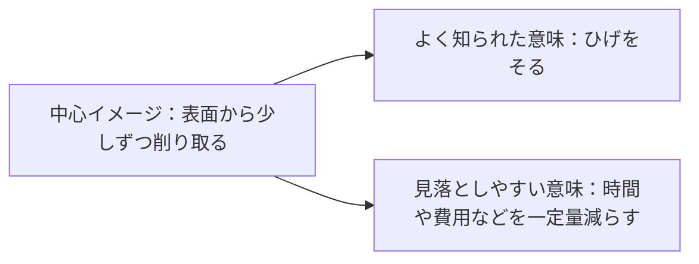

**重要語法**：shave X off Y（YからXを削減する）

<small>index: 7058 / candidate_id: `ev-07058-phrasal-verb-01`</small>

## 3522. shrug

**品詞**：phrasal verb　 **発音**：/ʃrʌɡ/

<small>よく知られている意味：肩をすくめる</small>

### 見落としやすい意味

**心配や非難を気にせず受け流す**

**例文**：She shrugged off the criticism and continued her work.

**和訳**：彼女は批判を受け流し、仕事を続けた。

**コアイメージ**：中心は「肩を動かして反応を退ける」というイメージです。肩をすくめて気にしない態度が、批判や心配を自分から払いのける表現になります。

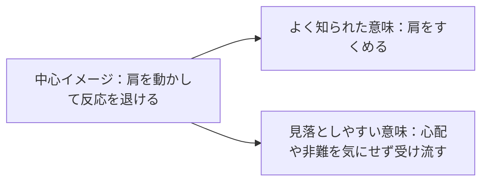

**重要語法**：shrug off criticism（批判を受け流す）

<small>index: 7059 / candidate_id: `ev-07059-phrasal-verb-01`</small>

## 3523. shrug

**品詞**：phrasal verb　 **発音**：/ʃrʌɡ/

<small>よく知られている意味：肩をすくめる</small>

### 見落としやすい意味

**好ましくない影響や評判を振り払う**

**例文**：The company struggled to shrug off its poor reputation.

**和訳**：その会社は悪い評判を払拭するのに苦労した。

**コアイメージ**：中心は「まとわりつくものを振り払う」というイメージです。肩をすくめて離す動作が比喩的に、悪影響や評判を振り払う意味になります。

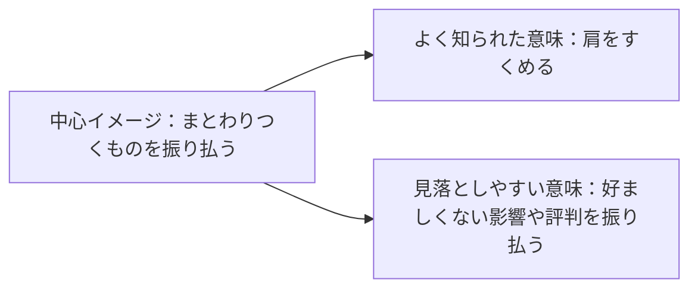

**重要語法**：shrug off a reputation（評判を払拭する）

<small>index: 7059 / candidate_id: `ev-07059-phrasal-verb-02`</small>

## 3524. stare

**品詞**：idiom　 **発音**：/ster/

<small>よく知られている意味：じっと見つめる</small>

### 見落としやすい意味

**答えや事実が目の前にはっきり存在する**

**例文**：The answer had been staring us in the face all along.

**和訳**：答えは最初から私たちの目の前にあった。

**コアイメージ**：中心は「目の前にあるものが強く視線を引く」というイメージです。物がこちらを見つめ返すほど目立つという比喩から、答えが明白なのに見逃している状況を表します。

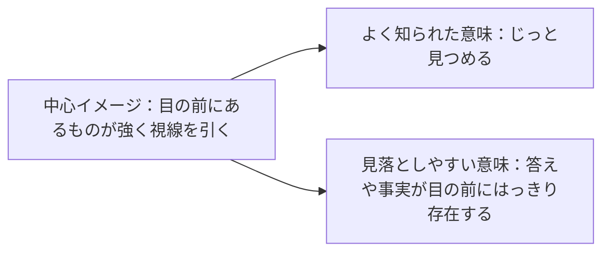

**重要語法**：stare someone in the face（人の目の前に明白にある）

<small>index: 7062 / candidate_id: `ev-07062-idiom-01`</small>

## 3525. ta

**品詞**：interjection　 **発音**：/tɑː/

<small>よく知られている意味：感謝を示す短い言葉</small>

### 見落としやすい意味

**ありがとう（主に英国のくだけた表現）**

**例文**：Ta for helping me with these bags!

**和訳**：荷物を運ぶのを手伝ってくれて、ありがとう！

**コアイメージ**：中心は「短く気軽に感謝を伝える」というイメージです。改まった thank you を短く言う英国口語の表現です。別の物を指す単語だと考えず、会話の感謝表現として理解します。

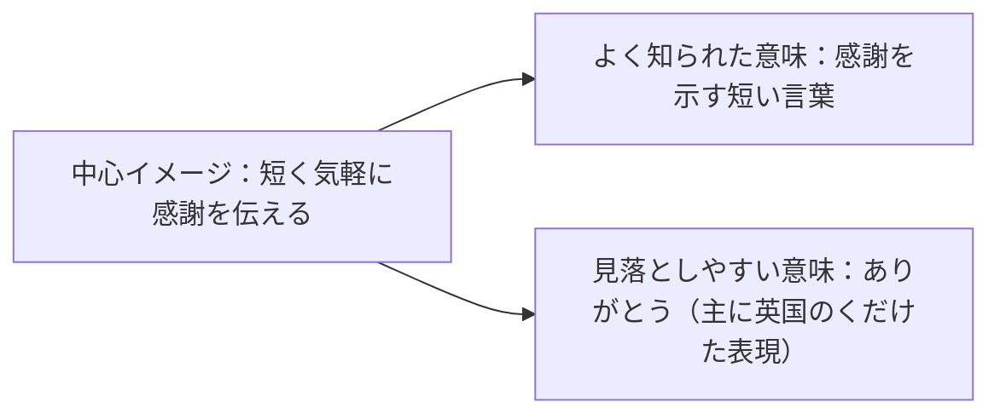

**重要語法**：ta（主に英国のくだけた『ありがとう』）

<small>index: 7066 / candidate_id: `ev-07066-interjection-01`</small>

## 3526. teem

**品詞**：phrasal verb　 **発音**：/tiːm/

<small>よく知られている意味：たくさん存在する</small>

### 見落としやすい意味

**〜であふれている、多数が存在する**

**例文**：The shallow water teems with tiny fish.

**和訳**：その浅瀬には小さな魚がたくさんいる。

**コアイメージ**：中心は「内部に多数が満ちて動く」というイメージです。場所の中が生き物などでいっぱいになるイメージです。with を伴い、何があふれているかを示すことが多いです。

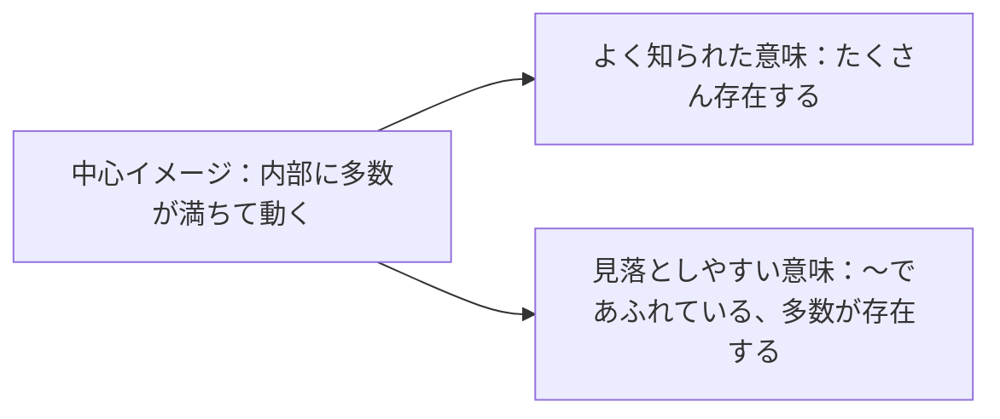

**重要語法**：teem with ...（〜であふれる）

<small>index: 7067 / candidate_id: `ev-07067-phrasal-verb-01`</small>

## 3527. tighten

**品詞**：idiom　 **発音**：/ˈtaɪtən/

<small>よく知られている意味：きつく締める</small>

### 見落としやすい意味

**支出を控えて生活費を切り詰める**

**例文**：As prices rose, we had to tighten our belts.

**和訳**：物価が上がったので、私たちは生活費を切り詰めなければならなかった。

**コアイメージ**：中心は「ベルトを締めて余裕を減らす」というイメージです。ベルトをきつく締める動作を、暮らしの余裕を減らして節約することに重ねた慣用句です。

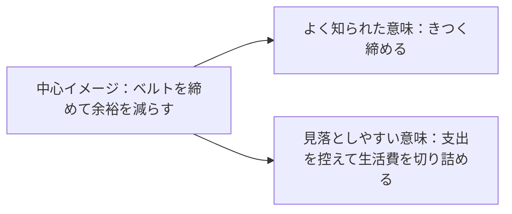

**重要語法**：tighten one's belt（倹約する）

<small>index: 7068 / candidate_id: `ev-07068-idiom-01`</small>

## 3528. vantage

**品詞**：phrase　 **発音**：/ˈvæntɪdʒ/

<small>よく知られている意味：有利な場所・見晴らし</small>

### 見落としやすい意味

**物事を考える上での観点・立場**

**例文**：From a historian's vantage point, the change was inevitable.

**和訳**：歴史家の観点から見ると、その変化は避けられなかった。

**コアイメージ**：中心は「物を見る位置が判断を変える」というイメージです。高い場所からの見晴らしという空間的な位置を、物事を評価する立場や観点に置き換えます。

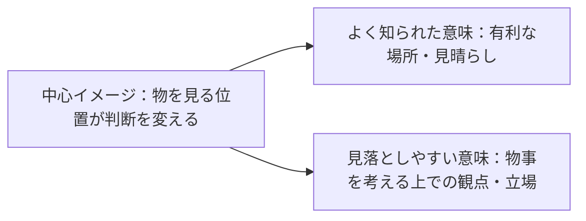

**重要語法**：from a ... vantage point（〜という観点から）

<small>index: 7076 / candidate_id: `ev-07076-phrase-01`</small>

## 3529. vest

**品詞**：verb　 **発音**：/vest/

<small>よく知られている意味：ベスト（袖なしの服）</small>

### 見落としやすい意味

**権限・権利を正式に与える、帰属させる**

**例文**：The law vests final authority in the local council.

**和訳**：法律は最終決定権を地方議会に与えている。

**コアイメージ**：中心は「権限を特定の主体に着せる・持たせる」というイメージです。何かがある主体に備わるという感覚から、権利や権限が法的にその主体に帰属する意味になります。

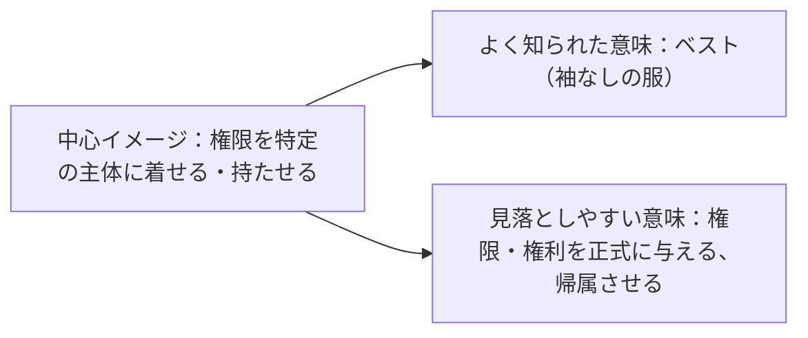

**重要語法**：vest A in B（AをBに与える）

<small>index: 7077 / candidate_id: `ev-07077-verb-01`</small>

## 3530. mid

**品詞**：adjective　 **発音**：/mɪd/

<small>よく知られている意味：中間の</small>

### 見落としやすい意味

**いまひとつの、平凡な（口語・俗語）**

**例文**：The movie looked promising, but it was pretty mid.

**和訳**：その映画は期待できそうだったが、実際はかなり平凡だった。

**コアイメージ**：中心は「評価の真ん中にとどまる」というイメージです。高評価でも低評価でもない中間という意味が、くだけた言葉で『特に良くない・平凡だ』という評価になります。

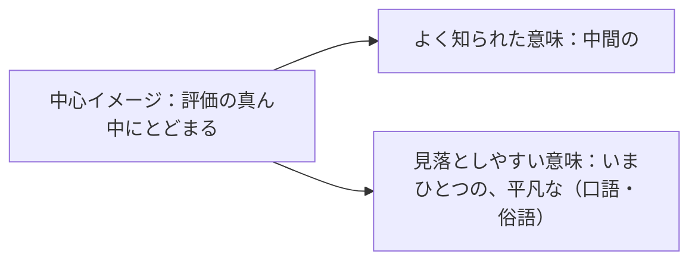

**重要語法**：mid（俗語・くだけた評価）

<small>index: 7081 / candidate_id: `ev-07081-adjective-01`</small>

## 3531. breathe

**品詞**：idiom　 **発音**：/briːð/

<small>よく知られている意味：呼吸する</small>

### 見落としやすい意味

**活動・計画などに活気や新しい力を与える**

**例文**：The new coach breathed fresh life into the team.

**和訳**：新しいコーチはチームに新たな活気を吹き込んだ。

**コアイメージ**：中心は「息を吹き込んで生命を与える」というイメージです。呼吸が生命を支えることから、活動や組織に新しい勢いを与えるという比喩になります。

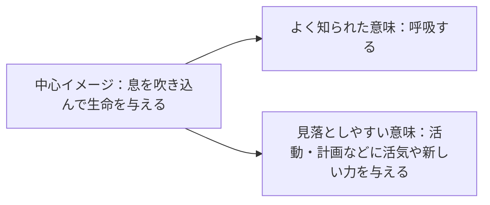

**重要語法**：breathe new/fresh life into ...（〜に新しい活力を与える）

<small>index: 7083 / candidate_id: `ev-07083-idiom-01`</small>

## 3532. ham

**品詞**：phrasal verb　 **発音**：/hæm/

<small>よく知られている意味：ハム（肉）</small>

### 見落としやすい意味

**大げさでわざとらしい演技をする**

**例文**：The actor hammed it up during the final scene.

**和訳**：その俳優は最後の場面で大げさな演技をした。

**コアイメージ**：中心は「人前で演技を誇張する」というイメージです。目立つように演じるという口語的な使い方です。ham it up で、自然な演技より大げさに振る舞うことを表します。


**重要語法**：ham it up（大げさに演じる）

<small>index: 7084 / candidate_id: `ev-07084-phrasal-verb-01`</small>

## 3533. elbow

**品詞**：verb　 **発音**：/ˈelboʊ/

<small>よく知られている意味：肘（名詞）</small>

### 見落としやすい意味

**肘で押す、押し分けて進む**

**例文**：She elbowed her way through the crowded station.

**和訳**：彼女は混雑した駅で人を押し分けて進んだ。

**コアイメージ**：中心は「肘で道を開く」というイメージです。体の部位を表す名詞が動詞となり、肘を使って人を押す動作や、押し分けて前へ進む行為を表します。

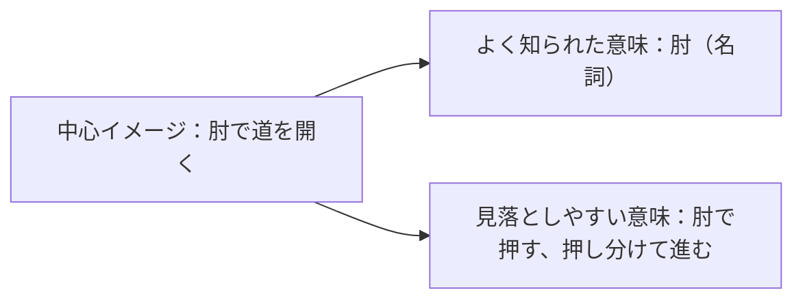

**重要語法**：elbow one's way through ...（〜を押し分ける）

<small>index: 7091 / candidate_id: `ev-07091-verb-01`</small>

## 3534. lightly

**品詞**：idiom　 **発音**：/ˈlaɪtli/

<small>よく知られている意味：軽く・そっと</small>

### 見落としやすい意味

**軽く考えたり軽視したりすべきではない**

**例文**：The safety warning should not be taken lightly.

**和訳**：その安全上の警告を軽く受け止めてはならない。

**コアイメージ**：中心は「重みを小さく見積もる」というイメージです。軽さを重視しなくてもよいという判断に重ねた表現です。否定形で、重大さを見落としてはいけないと警告します。

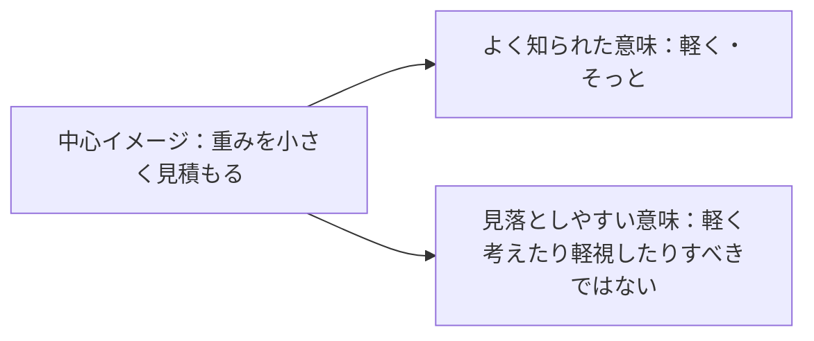

**重要語法**：not take ... lightly（〜を軽視しない）

<small>index: 7093 / candidate_id: `ev-07093-idiom-01`</small>

## 3535. stuck

**品詞**：adjective　 **発音**：/stʌk/

<small>よく知られている意味：動けない・くっついた</small>

### 見落としやすい意味

**（問題に行き詰まって）どうしてよいか分からない**

**例文**：I'm stuck on the final question of the worksheet.

**和訳**：私はプリントの最後の問題で行き詰まっている。

**コアイメージ**：中心は「先へ進めず止まる」というイメージです。物が動かなくなる状態を、思考や問題解決が先に進まなくなる状況へ広げた意味です。

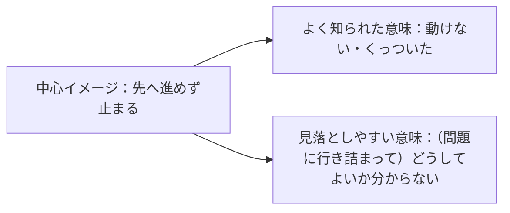

**重要語法**：be stuck on ...（〜で行き詰まる）

<small>index: 7094 / candidate_id: `ev-07094-adjective-01`</small>

## 3536. plum

**品詞**：adjective　 **発音**：/plʌm/

<small>よく知られている意味：スモモ</small>

### 見落としやすい意味

**魅力的で条件のよい、誰もが欲しがるような**

**例文**：She landed a plum job at a research institute.

**和訳**：彼女は研究機関でとても条件のよい仕事を得た。

**コアイメージ**：中心は「価値が高く欲しがられるもの」というイメージです。おいしい実の価値を連想させる比喩から、誰もが手に入れたい好条件の仕事や役目を表します。

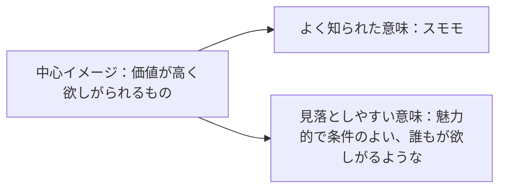

**重要語法**：a plum job（好条件の仕事）

<small>index: 7095 / candidate_id: `ev-07095-adjective-01`</small>

## 3537. comfortably

**品詞**：phrase　 **発音**：/ˈkʌmftəbli/

<small>よく知られている意味：快適に</small>

### 見落としやすい意味

**生活に困らない程度に経済的余裕がある**

**例文**：After years of saving, the couple were comfortably off.

**和訳**：長年の貯蓄のおかげで、その夫婦には生活に困らない余裕があった。

**コアイメージ**：中心は「暮らしに十分な余裕がある」というイメージです。不自由なく快適という意味が、生活費を心配せずに済む経済状態へつながります。

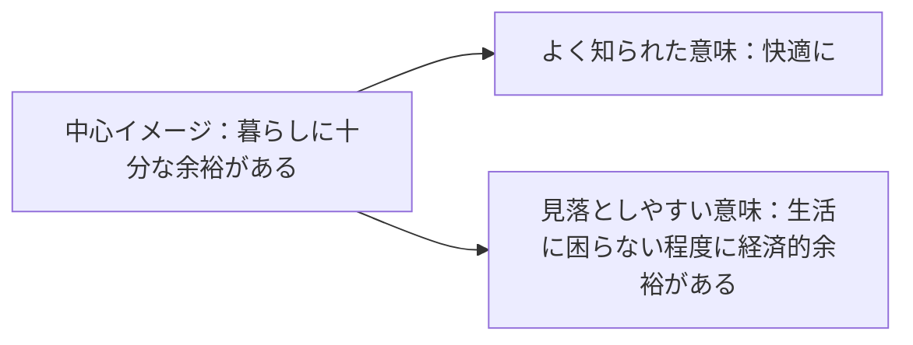

**重要語法**：comfortably off（経済的に余裕がある）

<small>index: 7096 / candidate_id: `ev-07096-phrase-01`</small>

## 3538. mint

**品詞**：adjective　 **発音**：/mɪnt/

<small>よく知られている意味：ミント・ハッカ</small>

### 見落としやすい意味

**未使用で新品同様の**

**例文**：The secondhand camera was still in mint condition.

**和訳**：その中古カメラはまだ新品同様の状態だった。

**コアイメージ**：中心は「傷や使用感のない新しさ」というイメージです。造幣局で作られたばかりの硬貨のような新品の状態から、中古品でもほぼ未使用の良好な状態を表します。

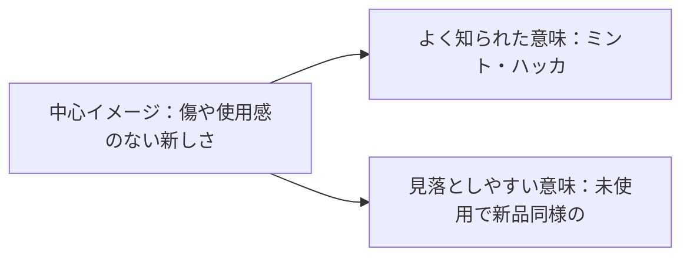

**重要語法**：in mint condition（新品同様の状態で）

<small>index: 7098 / candidate_id: `ev-07098-adjective-01`</small>

## 3539. mint

**品詞**：noun　 **発音**：/mɪnt/

<small>よく知られている意味：ミント・ハッカ</small>

### 見落としやすい意味

**大金、多額の金銭**

**例文**：He made a mint by selling his old collection.

**和訳**：彼は昔のコレクションを売って大金を稼いだ。

**コアイメージ**：中心は「貨幣が大量に生み出される」というイメージです。mint には造幣局の意味もあります。お金を作る場所から連想して、くだけた表現で大金を指します。

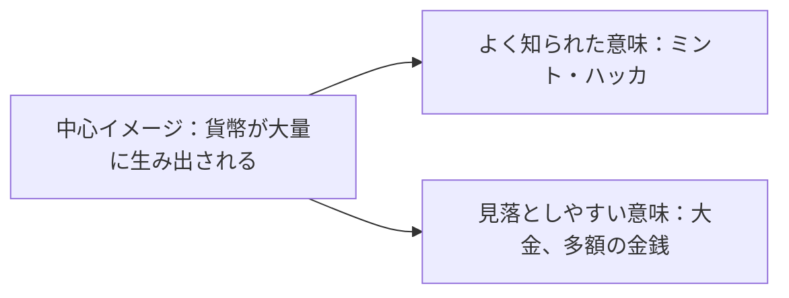

**重要語法**：make a mint（大金を稼ぐ）

<small>index: 7098 / candidate_id: `ev-07098-noun-01`</small>

## 3540. cube

**品詞**：verb　 **発音**：/kjuːb/

<small>よく知られている意味：立方体（名詞）</small>

### 見落としやすい意味

**数を3乗する**

**例文**：Cube the number before dividing the result by two.

**和訳**：その数を3乗してから、結果を2で割りなさい。

**コアイメージ**：中心は「同じ量を三つ掛け合わせる」というイメージです。立方体の体積を求める計算に基づき、数を3乗する動詞として使われます。

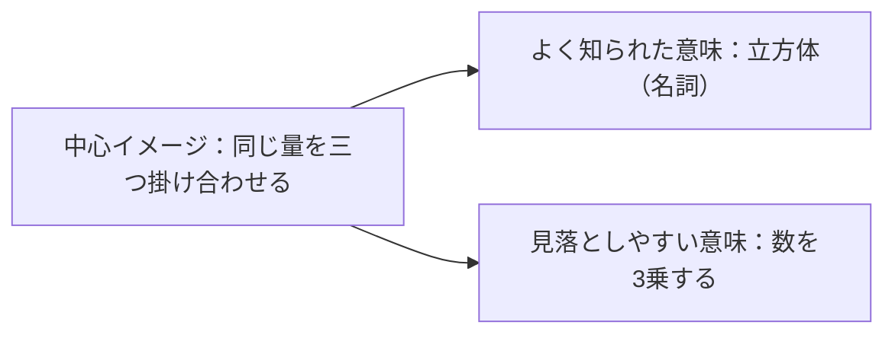

**重要語法**：cube a number（数を3乗する）

<small>index: 7101 / candidate_id: `ev-07101-verb-01`</small>

## 3541. persuasion

**品詞**：noun　 **発音**：/pərˈsweɪʒən/

<small>よく知られている意味：説得</small>

### 見落としやすい意味

**信念や宗教上の立場、考え方の系統**

**例文**：People of many political persuasions attended the discussion.

**和訳**：さまざまな政治的立場の人々が討論に参加した。

**コアイメージ**：中心は「考えをある方向に導く」というイメージです。誰かを説得して考えを動かすという意味から、人が持つ思想や信条の方向性そのものも表します。

```mermaid
flowchart LR
    A["中心イメージ：考えをある方向に導く"]
    B["よく知られた意味：説得"]
    C["見落としやすい意味：信念や宗教上の立場、考え方の系統"]
    A --> B
    A --> C
```

**重要語法**：people of every persuasion（さまざまな立場の人々）

<small>index: 7103 / candidate_id: `ev-07103-noun-01`</small>

## 3542. orphan

**品詞**：verb　 **発音**：/ˈɔːrfən/

<small>よく知られている意味：孤児（名詞）</small>

### 見落としやすい意味

**子どもを孤児にする**

**例文**：The disaster orphaned several children in the village.

**和訳**：その災害によって村の何人かの子どもが孤児になった。

**コアイメージ**：中心は「親のいない状態にする」というイメージです。孤児という人の状態を表す名詞が動詞となり、子どもをその状態にすることを表します。

```mermaid
flowchart LR
    A["中心イメージ：親のいない状態にする"]
    B["よく知られた意味：孤児（名詞）"]
    C["見落としやすい意味：子どもを孤児にする"]
    A --> B
    A --> C
```

**重要語法**：be orphaned（孤児になる）

<small>index: 7108 / candidate_id: `ev-07108-verb-01`</small>

## 3543. cloak

**品詞**：verb　 **発音**：/kloʊk/

<small>よく知られている意味：マント（名詞）</small>

### 見落としやすい意味

**事実・意図などを覆い隠す**

**例文**：The statement cloaked the real problem in vague language.

**和訳**：その声明は曖昧な言葉で本当の問題を覆い隠していた。

**コアイメージ**：中心は「覆いを掛けて見えなくする」というイメージです。マントが物を隠すように、言葉や外見で本当の意図や事実を見えにくくする比喩です。

```mermaid
flowchart LR
    A["中心イメージ：覆いを掛けて見えなくする"]
    B["よく知られた意味：マント（名詞）"]
    C["見落としやすい意味：事実・意図などを覆い隠す"]
    A --> B
    A --> C
```

**重要語法**：cloak A in B（AをBで覆い隠す）

<small>index: 7110 / candidate_id: `ev-07110-verb-01`</small>

## 3544. binary

**品詞**：adjective　 **発音**：/ˈbaɪnəri/

<small>よく知られている意味：二進法の・二つからなる</small>

### 見落としやすい意味

**二つの選択肢しかない、二者択一の**

**例文**：The debate was framed as a binary choice between success and failure.

**和訳**：その議論は成功か失敗かの二者択一として提示された。

**コアイメージ**：中心は「二つに分ける」というイメージです。二進法の二つの値という考えが、選択肢を二つだけに限定する議論へ広がります。

```mermaid
flowchart LR
    A["中心イメージ：二つに分ける"]
    B["よく知られた意味：二進法の・二つからなる"]
    C["見落としやすい意味：二つの選択肢しかない、二者択一の"]
    A --> B
    A --> C
```

**重要語法**：a binary choice（二者択一）

<small>index: 7112 / candidate_id: `ev-07112-adjective-01`</small>

## 3545. clutter

**品詞**：verb　 **発音**：/ˈklʌtər/

<small>よく知られている意味：散らかった物（名詞）</small>

### 見落としやすい意味

**物を雑然と置いて空間をふさぐ**

**例文**：Old boxes cluttered the narrow hallway.

**和訳**：古い箱が狭い廊下を雑然とふさいでいた。

**コアイメージ**：中心は「物が増えて空間を埋める」というイメージです。散らかった物を表す名詞が動詞となり、物を置いて場所を雑然と占めることを表します。

```mermaid
flowchart LR
    A["中心イメージ：物が増えて空間を埋める"]
    B["よく知られた意味：散らかった物（名詞）"]
    C["見落としやすい意味：物を雑然と置いて空間をふさぐ"]
    A --> B
    A --> C
```

**重要語法**：clutter a room（部屋を物で散らかす）

<small>index: 7118 / candidate_id: `ev-07118-verb-01`</small>

## 3546. abide

**品詞**：idiom　 **発音**：/əˈbaɪd/

<small>よく知られている意味：〜を我慢する</small>

### 見落としやすい意味

**どうしても〜を我慢できない、ひどく嫌う**

**例文**：I can't abide people who lie to their friends.

**和訳**：私は友人にうそをつく人をどうしても我慢できない。

**コアイメージ**：中心は「嫌なことを耐えて受け入れる」というイメージです。abide の耐えるという感覚を否定すると、『到底受け入れられない』という強い嫌悪になります。

```mermaid
flowchart LR
    A["中心イメージ：嫌なことを耐えて受け入れる"]
    B["よく知られた意味：〜を我慢する"]
    C["見落としやすい意味：どうしても〜を我慢できない、ひどく嫌う"]
    A --> B
    A --> C
```

**重要語法**：can't abide ...（〜がどうしても嫌だ）

<small>index: 7122 / candidate_id: `ev-07122-idiom-01`</small>

## 3547. abide

**品詞**：phrasal verb　 **発音**：/əˈbaɪd/

<small>よく知られている意味：我慢する・耐える</small>

### 見落としやすい意味

**規則・決定・約束を守る**

**例文**：All participants must abide by the safety rules.

**和訳**：参加者は全員、安全規則に従わなければならない。

**コアイメージ**：中心は「定められたものの中にとどまる」というイメージです。決められた条件に沿って行動し続ける感覚から、規則や約束を守るという意味になります。

```mermaid
flowchart LR
    A["中心イメージ：定められたものの中にとどまる"]
    B["よく知られた意味：我慢する・耐える"]
    C["見落としやすい意味：規則・決定・約束を守る"]
    A --> B
    A --> C
```

**重要語法**：abide by a rule/decision（規則・決定に従う）

<small>index: 7122 / candidate_id: `ev-07122-phrasal-verb-01`</small>

## 3548. allure

**品詞**：verb　 **発音**：/əˈlʊr/

<small>よく知られている意味：魅力（名詞）</small>

### 見落としやすい意味

**強く心を引きつける、誘惑する**

**例文**：The prospect of a peaceful life allured many visitors.

**和訳**：穏やかな生活への期待が多くの訪問者を引きつけた。

**コアイメージ**：中心は「魅力で相手をこちらへ誘う」というイメージです。名詞の魅力が動詞となり、その魅力で人の心を引きつけることを表します。やや文語的な響きがあります。

```mermaid
flowchart LR
    A["中心イメージ：魅力で相手をこちらへ誘う"]
    B["よく知られた意味：魅力（名詞）"]
    C["見落としやすい意味：強く心を引きつける、誘惑する"]
    A --> B
    A --> C
```

**重要語法**：allure someone（人を魅了する；やや文語的）

<small>index: 7124 / candidate_id: `ev-07124-verb-01`</small>

## 3549. arsenal

**品詞**：noun　 **発音**：/ˈɑːrsənəl/

<small>よく知られている意味：武器庫</small>

### 見落としやすい意味

**豊富にそろった手段・能力・知識など**

**例文**：The teacher had an arsenal of ways to explain the concept.

**和訳**：その教師には、その概念を説明するための豊富な方法があった。

**コアイメージ**：中心は「必要な道具を豊富に備える」というイメージです。武器を備蓄する場所から、問題に対応する多様な手段や知識の蓄えを表す比喩になります。

```mermaid
flowchart LR
    A["中心イメージ：必要な道具を豊富に備える"]
    B["よく知られた意味：武器庫"]
    C["見落としやすい意味：豊富にそろった手段・能力・知識など"]
    A --> B
    A --> C
```

**重要語法**：an arsenal of techniques（多彩な手法）

<small>index: 7128 / candidate_id: `ev-07128-noun-01`</small>

## 3550. baron

**品詞**：noun　 **発音**：/ˈbærən/

<small>よく知られている意味：男爵</small>

### 見落としやすい意味

**特定業界を強く支配する大物**

**例文**：A powerful media baron bought the newspaper.

**和訳**：有力なメディア業界の大物がその新聞社を買収した。

**コアイメージ**：中心は「大きな権力を持つ人物」というイメージです。貴族の称号が、特定の産業で強い影響力を持つ人物の呼び名へ転じます。

```mermaid
flowchart LR
    A["中心イメージ：大きな権力を持つ人物"]
    B["よく知られた意味：男爵"]
    C["見落としやすい意味：特定業界を強く支配する大物"]
    A --> B
    A --> C
```

**重要語法**：a media/oil baron（メディア・石油業界の大物）

<small>index: 7130 / candidate_id: `ev-07130-noun-01`</small>

## 3551. basin

**品詞**：noun　 **発音**：/ˈbeɪsən/

<small>よく知られている意味：洗面器・水鉢</small>

### 見落としやすい意味

**河川の流域**

**例文**：The river basin receives heavy rain every summer.

**和訳**：その河川の流域には毎年夏に大量の雨が降る。

**コアイメージ**：中心は「水を集めるくぼみ」というイメージです。水を受け止める器の形を広い地形に重ね、雨水が一つの川へ集まる地域を指します。

```mermaid
flowchart LR
    A["中心イメージ：水を集めるくぼみ"]
    B["よく知られた意味：洗面器・水鉢"]
    C["見落としやすい意味：河川の流域"]
    A --> B
    A --> C
```

**重要語法**：river basin（河川流域）

<small>index: 7131 / candidate_id: `ev-07131-noun-01`</small>

## 3552. bodily

**品詞**：adverb　 **発音**：/ˈbɑːdəli/

<small>よく知られている意味：身体の（形容詞）</small>

### 見落としやすい意味

**身体ごと、丸ごと持ち上げて**

**例文**：Two workers lifted the heavy box bodily onto the truck.

**和訳**：作業員二人が重い箱を丸ごと持ち上げてトラックに載せた。

**コアイメージ**：中心は「物全体をそのまま動かす」というイメージです。一部分だけではなく物体全体を動かす点が強調されます。身体の動きを伴う様子から、丸ごと持ち上げる意味になります。

```mermaid
flowchart LR
    A["中心イメージ：物全体をそのまま動かす"]
    B["よく知られた意味：身体の（形容詞）"]
    C["見落としやすい意味：身体ごと、丸ごと持ち上げて"]
    A --> B
    A --> C
```

**重要語法**：lift/carry ... bodily（〜を丸ごと持ち上げる・運ぶ）

<small>index: 7134 / candidate_id: `ev-07134-adverb-01`</small>

## 3553. brace

**品詞**：verb　 **発音**：/breɪs/

<small>よく知られている意味：支柱・補強する</small>

### 見落としやすい意味

**困難に備えて身構える、心構えをする**

**例文**：Residents braced for the arrival of a strong storm.

**和訳**：住民たちは強い嵐の到来に備えて身構えた。

**コアイメージ**：中心は「衝撃を受け止めるように支える」というイメージです。体を支えて衝撃に備える動作から、困難な出来事に心の準備をする意味へ広がります。

```mermaid
flowchart LR
    A["中心イメージ：衝撃を受け止めるように支える"]
    B["よく知られた意味：支柱・補強する"]
    C["見落としやすい意味：困難に備えて身構える、心構えをする"]
    A --> B
    A --> C
```

**重要語法**：brace for ...（〜に備える）

<small>index: 7137 / candidate_id: `ev-07137-verb-01`</small>

## 3554. buff

**品詞**：noun　 **発音**：/bʌf/

<small>よく知られている意味：磨く・筋肉質の</small>

### 見落としやすい意味

**特定分野の熱心な愛好者、詳しい人**

**例文**：As a history buff, he visits museums whenever he travels.

**和訳**：歴史好きの彼は旅行するたびに博物館を訪れる。

**コアイメージ**：中心は「一つの分野に熱中して詳しくなる」というイメージです。趣味や分野に強い関心を持つ人を表すくだけた名詞です。単なる初心者ではなく熱心な愛好者を指します。

```mermaid
flowchart LR
    A["中心イメージ：一つの分野に熱中して詳しくなる"]
    B["よく知られた意味：磨く・筋肉質の"]
    C["見落としやすい意味：特定分野の熱心な愛好者、詳しい人"]
    A --> B
    A --> C
```

**重要語法**：a history/film buff（歴史・映画の愛好家）

<small>index: 7139 / candidate_id: `ev-07139-noun-01`</small>

## 3555. casually

**品詞**：adverb　 **発音**：/ˈkæʒuəli/

<small>よく知られている意味：気軽に・略式に</small>

### 見落としやすい意味

**何気なく、特に深く考えずに**

**例文**：She casually mentioned that she knew the author.

**和訳**：彼女はその作家と知り合いだと何気なく口にした。

**コアイメージ**：中心は「特別な構えをせず行う」というイメージです。改まらず自然に行動する感覚から、深く考えず何げなく言ったりしたりする様子を表します。

```mermaid
flowchart LR
    A["中心イメージ：特別な構えをせず行う"]
    B["よく知られた意味：気軽に・略式に"]
    C["見落としやすい意味：何気なく、特に深く考えずに"]
    A --> B
    A --> C
```

**重要語法**：casually mention（何気なく言及する）

<small>index: 7141 / candidate_id: `ev-07141-adverb-01`</small>

## 3556. circus

**品詞**：noun　 **発音**：/ˈsɜːrkəs/

<small>よく知られている意味：サーカス</small>

### 見落としやすい意味

**騒々しく混乱した大騒ぎ**

**例文**：The press conference turned into a complete circus.

**和訳**：記者会見はすっかり大混乱になった。

**コアイメージ**：中心は「大勢が入り交じる騒がしい場」というイメージです。サーカスのにぎやかさを秩序のない騒ぎに重ね、混乱した場面を批判的に表します。

```mermaid
flowchart LR
    A["中心イメージ：大勢が入り交じる騒がしい場"]
    B["よく知られた意味：サーカス"]
    C["見落としやすい意味：騒々しく混乱した大騒ぎ"]
    A --> B
    A --> C
```

**重要語法**：turn into a circus（大騒ぎになる）

<small>index: 7143 / candidate_id: `ev-07143-noun-01`</small>

## 3557. commonplace

**品詞**：noun　 **発音**：/ˈkɑːmənpleɪs/

<small>よく知られている意味：ありふれた（形容詞）</small>

### 見落としやすい意味

**内容の乏しいありきたりな発言、決まり文句**

**例文**：The speech offered little beyond a series of commonplaces.

**和訳**：その演説には、ありきたりな決まり文句以外ほとんど中身がなかった。

**コアイメージ**：中心は「何度も繰り返される平凡さ」というイメージです。ありふれているという形容詞の感覚が名詞になり、内容の薄い言い回しや陳腐な発言を指します。

```mermaid
flowchart LR
    A["中心イメージ：何度も繰り返される平凡さ"]
    B["よく知られた意味：ありふれた（形容詞）"]
    C["見落としやすい意味：内容の乏しいありきたりな発言、決まり文句"]
    A --> B
    A --> C
```

**重要語法**：a commonplace（陳腐な言葉・言い回し）

<small>index: 7146 / candidate_id: `ev-07146-noun-01`</small>

## 3558. confide

**品詞**：phrasal verb　 **発音**：/kənˈfaɪd/

<small>よく知られている意味：秘密を打ち明ける</small>

### 見落としやすい意味

**人を信頼して秘密や個人的なことを打ち明ける**

**例文**：She confided in her teacher about her worries.

**和訳**：彼女は心配事を先生に打ち明けた。

**コアイメージ**：中心は「相手を信頼して内面を預ける」というイメージです。他人には話しにくいことを信頼する人へ伝える感覚です。confide in の後には信頼して打ち明ける相手が来ます。

```mermaid
flowchart LR
    A["中心イメージ：相手を信頼して内面を預ける"]
    B["よく知られた意味：秘密を打ち明ける"]
    C["見落としやすい意味：人を信頼して秘密や個人的なことを打ち明ける"]
    A --> B
    A --> C
```

**重要語法**：confide in someone（人を信頼して打ち明ける）

<small>index: 7148 / candidate_id: `ev-07148-phrasal-verb-01`</small>

## 3559. dangerously

**品詞**：adverb　 **発音**：/ˈdeɪndʒərəsli/

<small>よく知られている意味：危険な方法で</small>

### 見落としやすい意味

**危険なほど、もう少しで悪い状態に至るほど**

**例文**：The team came dangerously close to missing the deadline.

**和訳**：チームは危うく締め切りに間に合わなくなるところだった。

**コアイメージ**：中心は「悪い境界に近づきすぎる」というイメージです。危険な行為そのものだけでなく、悪い結果に至りそうなほど程度が高いことを表します。

```mermaid
flowchart LR
    A["中心イメージ：悪い境界に近づきすぎる"]
    B["よく知られた意味：危険な方法で"]
    C["見落としやすい意味：危険なほど、もう少しで悪い状態に至るほど"]
    A --> B
    A --> C
```

**重要語法**：dangerously close to ...（危うく〜しそうな）

<small>index: 7150 / candidate_id: `ev-07150-adverb-01`</small>

## 3560. disarm

**品詞**：verb　 **発音**：/dɪsˈɑːrm/

<small>よく知られている意味：武装を解除する</small>

### 見落としやすい意味

**相手の警戒心を解く、好感を抱かせる**

**例文**：Her friendly manner quickly disarmed the nervous guests.

**和訳**：彼女の親しみやすい態度で、緊張していた客たちはすぐに警戒を解いた。

**コアイメージ**：中心は「相手の防御を取り去る」というイメージです。武器を取り上げて攻撃できなくすることから、心理的な警戒や反発を和らげる比喩になります。

```mermaid
flowchart LR
    A["中心イメージ：相手の防御を取り去る"]
    B["よく知られた意味：武装を解除する"]
    C["見落としやすい意味：相手の警戒心を解く、好感を抱かせる"]
    A --> B
    A --> C
```

**重要語法**：disarm someone's suspicions（人の疑念を和らげる）

<small>index: 7154 / candidate_id: `ev-07154-verb-01`</small>
