# EasyVoca｜完成教材バッチ045

担当範囲：global_order 3521–3600（`main` 採用済み語義、`index`・`candidate_id` 昇順）

## 3521. shave

**品詞**：phrasal verb　 **発音**：/ʃeɪv/

<small>よく知られている意味：ひげをそる</small>

### 見落としやすい意味

**時間や費用などを一定量減らす**

**例文**：The new route will shave ten minutes off the journey.

**和訳**：新しいルートなら移動時間を10分短縮できる。

**コアイメージ**：中心は「表面から少しずつ削り取る」というイメージです。ひげをそる動作から、時間や費用の一部を削って減らす意味へ広がります。

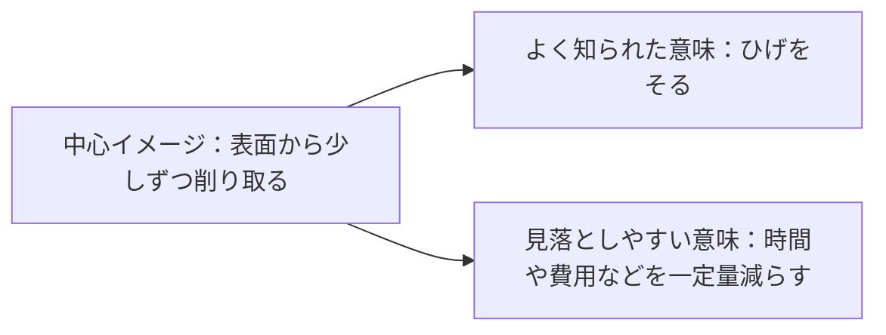

**重要語法**：shave X off Y（YからXを削減する）

<small>index: 7058 / candidate_id: `ev-07058-phrasal-verb-01`</small>

## 3522. shrug

**品詞**：phrasal verb　 **発音**：/ʃrʌɡ/

<small>よく知られている意味：肩をすくめる</small>

### 見落としやすい意味

**心配や非難を気にせず受け流す**

**例文**：She shrugged off the criticism and continued her work.

**和訳**：彼女は批判を受け流し、仕事を続けた。

**コアイメージ**：中心は「肩を動かして反応を退ける」というイメージです。肩をすくめて気にしない態度が、批判や心配を自分から払いのける表現になります。

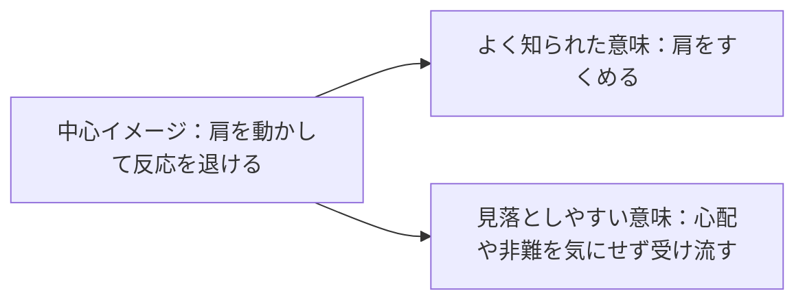

**重要語法**：shrug off criticism（批判を受け流す）

<small>index: 7059 / candidate_id: `ev-07059-phrasal-verb-01`</small>

## 3523. shrug

**品詞**：phrasal verb　 **発音**：/ʃrʌɡ/

<small>よく知られている意味：肩をすくめる</small>

### 見落としやすい意味

**好ましくない影響や評判を振り払う**

**例文**：The company struggled to shrug off its poor reputation.

**和訳**：その会社は悪い評判を払拭するのに苦労した。

**コアイメージ**：中心は「まとわりつくものを振り払う」というイメージです。肩をすくめて離す動作が比喩的に、悪影響や評判を振り払う意味になります。

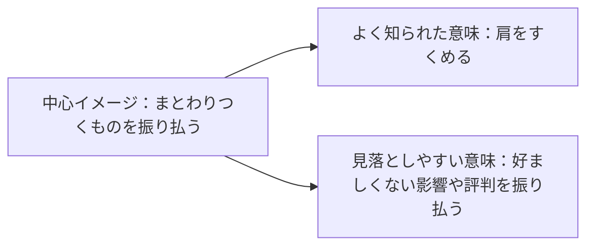

**重要語法**：shrug off a reputation（評判を払拭する）

<small>index: 7059 / candidate_id: `ev-07059-phrasal-verb-02`</small>

## 3524. stare

**品詞**：idiom　 **発音**：/ster/

<small>よく知られている意味：じっと見つめる</small>

### 見落としやすい意味

**答えや事実が目の前にはっきり存在する**

**例文**：The answer had been staring us in the face all along.

**和訳**：答えは最初から私たちの目の前にあった。

**コアイメージ**：中心は「目の前にあるものが強く視線を引く」というイメージです。物がこちらを見つめ返すほど目立つという比喩から、答えが明白なのに見逃している状況を表します。

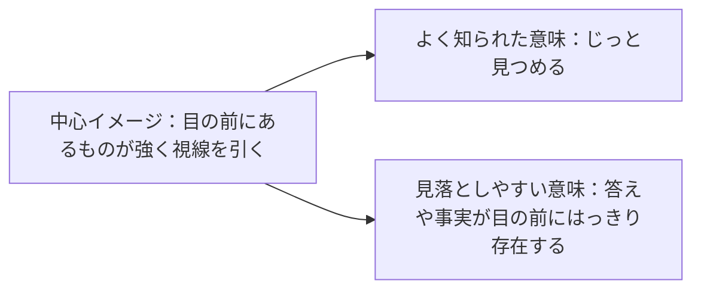

**重要語法**：stare someone in the face（人の目の前に明白にある）

<small>index: 7062 / candidate_id: `ev-07062-idiom-01`</small>

## 3525. ta

**品詞**：interjection　 **発音**：/tɑː/

<small>よく知られている意味：感謝を示す短い言葉</small>

### 見落としやすい意味

**ありがとう（主に英国のくだけた表現）**

**例文**：Ta for helping me with these bags!

**和訳**：荷物を運ぶのを手伝ってくれて、ありがとう！

**コアイメージ**：中心は「短く気軽に感謝を伝える」というイメージです。改まった thank you を短く言う英国口語の表現です。別の物を指す単語だと考えず、会話の感謝表現として理解します。

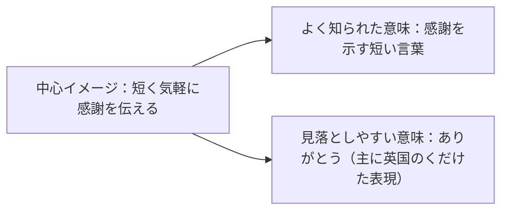

**重要語法**：ta（主に英国のくだけた『ありがとう』）

<small>index: 7066 / candidate_id: `ev-07066-interjection-01`</small>

## 3526. teem

**品詞**：phrasal verb　 **発音**：/tiːm/

<small>よく知られている意味：たくさん存在する</small>

### 見落としやすい意味

**〜であふれている、多数が存在する**

**例文**：The shallow water teems with tiny fish.

**和訳**：その浅瀬には小さな魚がたくさんいる。

**コアイメージ**：中心は「内部に多数が満ちて動く」というイメージです。場所の中が生き物などでいっぱいになるイメージです。with を伴い、何があふれているかを示すことが多いです。

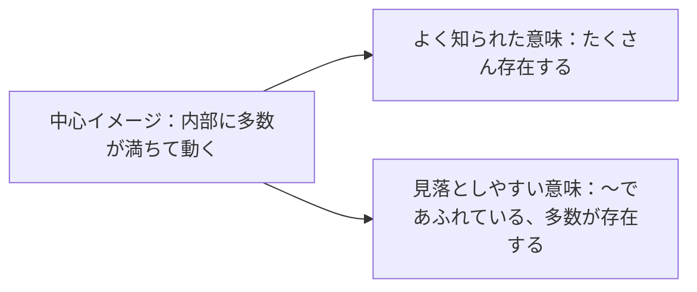

**重要語法**：teem with ...（〜であふれる）

<small>index: 7067 / candidate_id: `ev-07067-phrasal-verb-01`</small>

## 3527. tighten

**品詞**：idiom　 **発音**：/ˈtaɪtən/

<small>よく知られている意味：きつく締める</small>

### 見落としやすい意味

**支出を控えて生活費を切り詰める**

**例文**：As prices rose, we had to tighten our belts.

**和訳**：物価が上がったので、私たちは生活費を切り詰めなければならなかった。

**コアイメージ**：中心は「ベルトを締めて余裕を減らす」というイメージです。ベルトをきつく締める動作を、暮らしの余裕を減らして節約することに重ねた慣用句です。

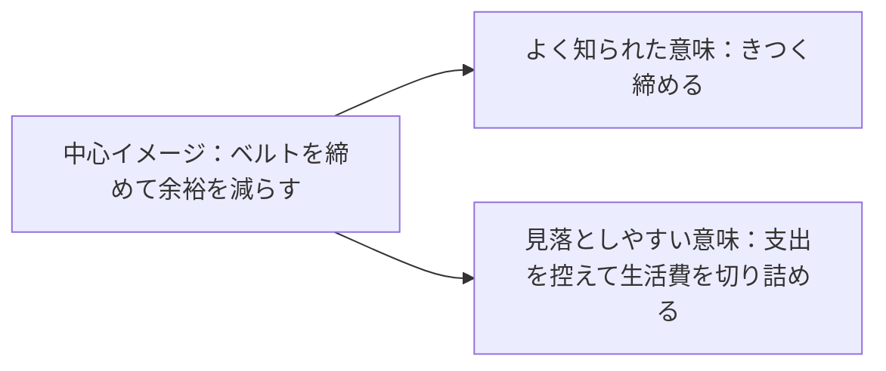

**重要語法**：tighten one's belt（倹約する）

<small>index: 7068 / candidate_id: `ev-07068-idiom-01`</small>

## 3528. vantage

**品詞**：phrase　 **発音**：/ˈvæntɪdʒ/

<small>よく知られている意味：有利な場所・見晴らし</small>

### 見落としやすい意味

**物事を考える上での観点・立場**

**例文**：From a historian's vantage point, the change was inevitable.

**和訳**：歴史家の観点から見ると、その変化は避けられなかった。

**コアイメージ**：中心は「物を見る位置が判断を変える」というイメージです。高い場所からの見晴らしという空間的な位置を、物事を評価する立場や観点に置き換えます。

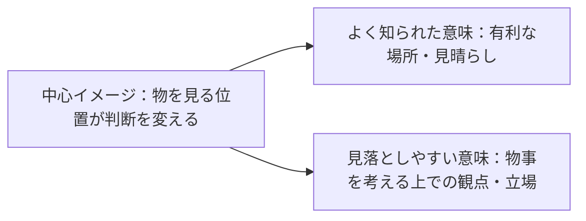

**重要語法**：from a ... vantage point（〜という観点から）

<small>index: 7076 / candidate_id: `ev-07076-phrase-01`</small>

## 3529. vest

**品詞**：verb　 **発音**：/vest/

<small>よく知られている意味：ベスト（袖なしの服）</small>

### 見落としやすい意味

**権限・権利を正式に与える、帰属させる**

**例文**：The law vests final authority in the local council.

**和訳**：法律は最終決定権を地方議会に与えている。

**コアイメージ**：中心は「権限を特定の主体に着せる・持たせる」というイメージです。何かがある主体に備わるという感覚から、権利や権限が法的にその主体に帰属する意味になります。

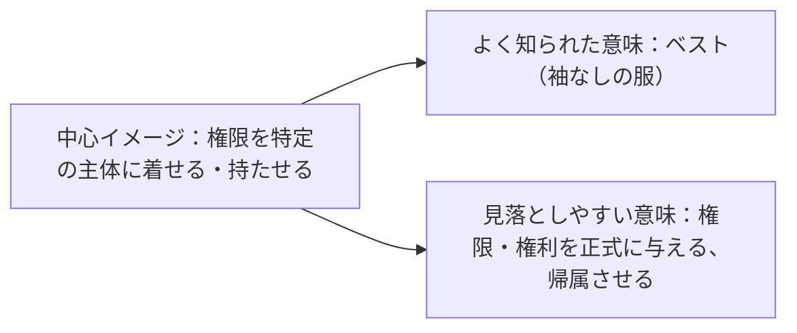

**重要語法**：vest A in B（AをBに与える）

<small>index: 7077 / candidate_id: `ev-07077-verb-01`</small>

## 3530. mid

**品詞**：adjective　 **発音**：/mɪd/

<small>よく知られている意味：中間の</small>

### 見落としやすい意味

**いまひとつの、平凡な（口語・俗語）**

**例文**：The movie looked promising, but it was pretty mid.

**和訳**：その映画は期待できそうだったが、実際はかなり平凡だった。

**コアイメージ**：中心は「評価の真ん中にとどまる」というイメージです。高評価でも低評価でもない中間という意味が、くだけた言葉で『特に良くない・平凡だ』という評価になります。

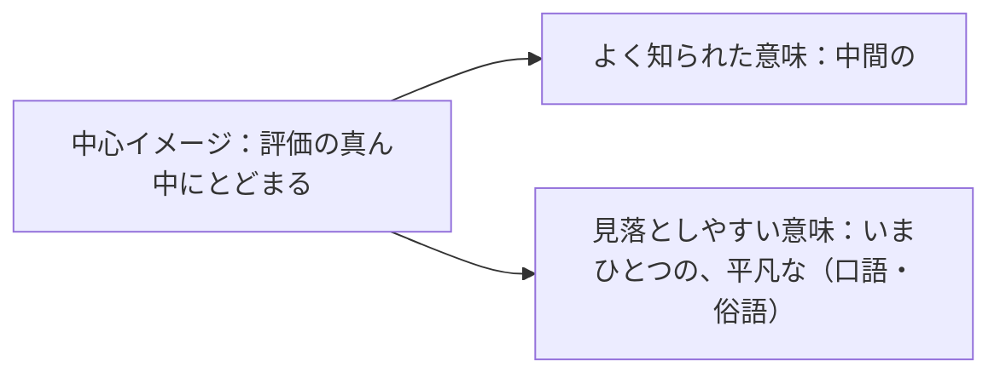

**重要語法**：mid（俗語・くだけた評価）

<small>index: 7081 / candidate_id: `ev-07081-adjective-01`</small>

## 3531. breathe

**品詞**：idiom　 **発音**：/briːð/

<small>よく知られている意味：呼吸する</small>

### 見落としやすい意味

**活動・計画などに活気や新しい力を与える**

**例文**：The new coach breathed fresh life into the team.

**和訳**：新しいコーチはチームに新たな活気を吹き込んだ。

**コアイメージ**：中心は「息を吹き込んで生命を与える」というイメージです。呼吸が生命を支えることから、活動や組織に新しい勢いを与えるという比喩になります。

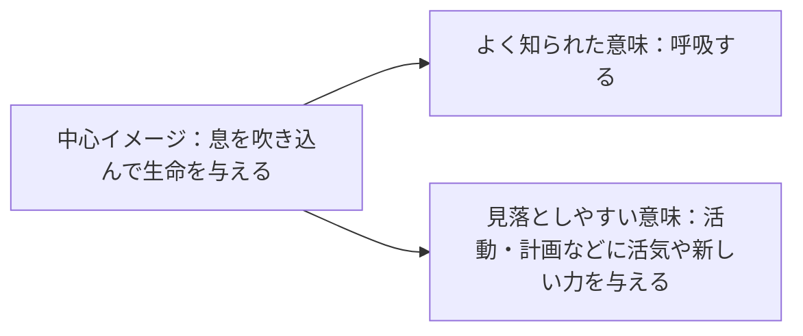

**重要語法**：breathe new/fresh life into ...（〜に新しい活力を与える）

<small>index: 7083 / candidate_id: `ev-07083-idiom-01`</small>

## 3532. ham

**品詞**：phrasal verb　 **発音**：/hæm/

<small>よく知られている意味：ハム（肉）</small>

### 見落としやすい意味

**大げさでわざとらしい演技をする**

**例文**：The actor hammed it up during the final scene.

**和訳**：その俳優は最後の場面で大げさな演技をした。

**コアイメージ**：中心は「人前で演技を誇張する」というイメージです。目立つように演じるという口語的な使い方です。ham it up で、自然な演技より大げさに振る舞うことを表します。


**重要語法**：ham it up（大げさに演じる）

<small>index: 7084 / candidate_id: `ev-07084-phrasal-verb-01`</small>

## 3533. elbow

**品詞**：verb　 **発音**：/ˈelboʊ/

<small>よく知られている意味：肘（名詞）</small>

### 見落としやすい意味

**肘で押す、押し分けて進む**

**例文**：She elbowed her way through the crowded station.

**和訳**：彼女は混雑した駅で人を押し分けて進んだ。

**コアイメージ**：中心は「肘で道を開く」というイメージです。体の部位を表す名詞が動詞となり、肘を使って人を押す動作や、押し分けて前へ進む行為を表します。

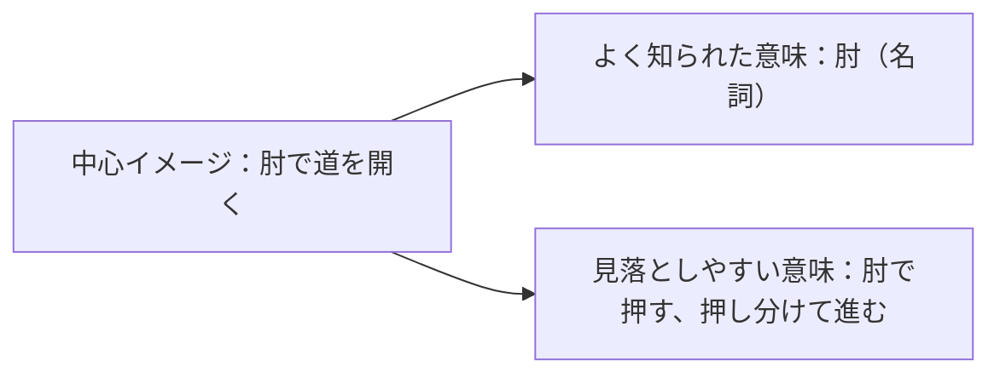

**重要語法**：elbow one's way through ...（〜を押し分ける）

<small>index: 7091 / candidate_id: `ev-07091-verb-01`</small>

## 3534. lightly

**品詞**：idiom　 **発音**：/ˈlaɪtli/

<small>よく知られている意味：軽く・そっと</small>

### 見落としやすい意味

**軽く考えたり軽視したりすべきではない**

**例文**：The safety warning should not be taken lightly.

**和訳**：その安全上の警告を軽く受け止めてはならない。

**コアイメージ**：中心は「重みを小さく見積もる」というイメージです。軽さを重視しなくてもよいという判断に重ねた表現です。否定形で、重大さを見落としてはいけないと警告します。

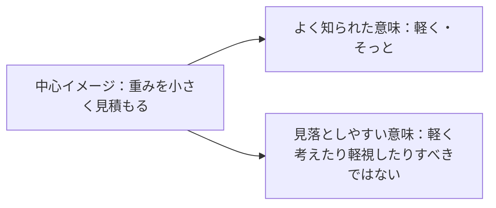

**重要語法**：not take ... lightly（〜を軽視しない）

<small>index: 7093 / candidate_id: `ev-07093-idiom-01`</small>

## 3535. stuck

**品詞**：adjective　 **発音**：/stʌk/

<small>よく知られている意味：動けない・くっついた</small>

### 見落としやすい意味

**（問題に行き詰まって）どうしてよいか分からない**

**例文**：I'm stuck on the final question of the worksheet.

**和訳**：私はプリントの最後の問題で行き詰まっている。

**コアイメージ**：中心は「先へ進めず止まる」というイメージです。物が動かなくなる状態を、思考や問題解決が先に進まなくなる状況へ広げた意味です。

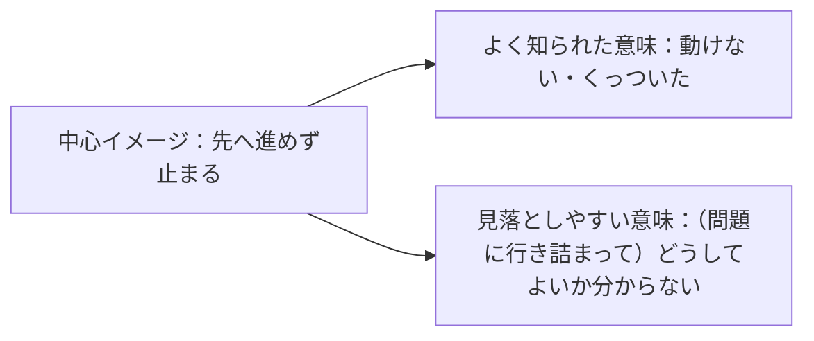

**重要語法**：be stuck on ...（〜で行き詰まる）

<small>index: 7094 / candidate_id: `ev-07094-adjective-01`</small>

## 3536. plum

**品詞**：adjective　 **発音**：/plʌm/

<small>よく知られている意味：スモモ</small>

### 見落としやすい意味

**魅力的で条件のよい、誰もが欲しがるような**

**例文**：She landed a plum job at a research institute.

**和訳**：彼女は研究機関でとても条件のよい仕事を得た。

**コアイメージ**：中心は「価値が高く欲しがられるもの」というイメージです。おいしい実の価値を連想させる比喩から、誰もが手に入れたい好条件の仕事や役目を表します。

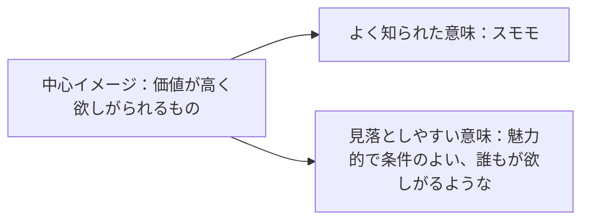

**重要語法**：a plum job（好条件の仕事）

<small>index: 7095 / candidate_id: `ev-07095-adjective-01`</small>

## 3537. comfortably

**品詞**：phrase　 **発音**：/ˈkʌmftəbli/

<small>よく知られている意味：快適に</small>

### 見落としやすい意味

**生活に困らない程度に経済的余裕がある**

**例文**：After years of saving, the couple were comfortably off.

**和訳**：長年の貯蓄のおかげで、その夫婦には生活に困らない余裕があった。

**コアイメージ**：中心は「暮らしに十分な余裕がある」というイメージです。不自由なく快適という意味が、生活費を心配せずに済む経済状態へつながります。

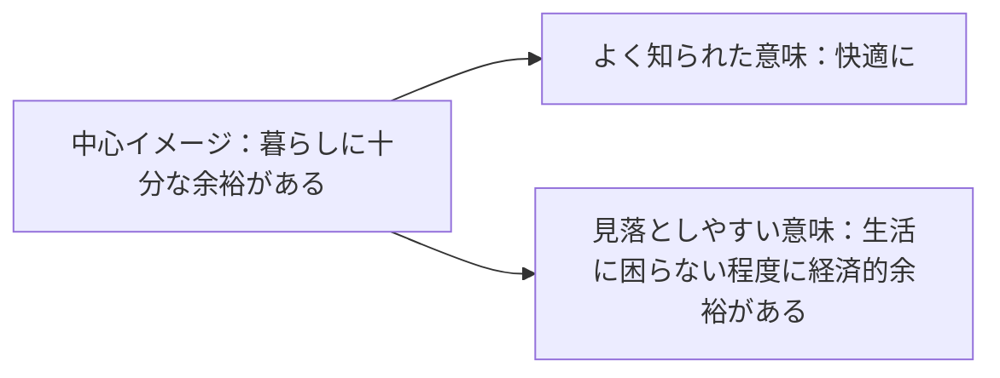

**重要語法**：comfortably off（経済的に余裕がある）

<small>index: 7096 / candidate_id: `ev-07096-phrase-01`</small>

## 3538. mint

**品詞**：adjective　 **発音**：/mɪnt/

<small>よく知られている意味：ミント・ハッカ</small>

### 見落としやすい意味

**未使用で新品同様の**

**例文**：The secondhand camera was still in mint condition.

**和訳**：その中古カメラはまだ新品同様の状態だった。

**コアイメージ**：中心は「傷や使用感のない新しさ」というイメージです。造幣局で作られたばかりの硬貨のような新品の状態から、中古品でもほぼ未使用の良好な状態を表します。

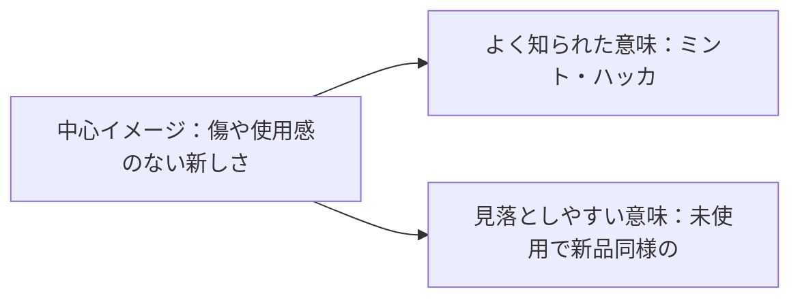

**重要語法**：in mint condition（新品同様の状態で）

<small>index: 7098 / candidate_id: `ev-07098-adjective-01`</small>

## 3539. mint

**品詞**：noun　 **発音**：/mɪnt/

<small>よく知られている意味：ミント・ハッカ</small>

### 見落としやすい意味

**大金、多額の金銭**

**例文**：He made a mint by selling his old collection.

**和訳**：彼は昔のコレクションを売って大金を稼いだ。

**コアイメージ**：中心は「貨幣が大量に生み出される」というイメージです。mint には造幣局の意味もあります。お金を作る場所から連想して、くだけた表現で大金を指します。

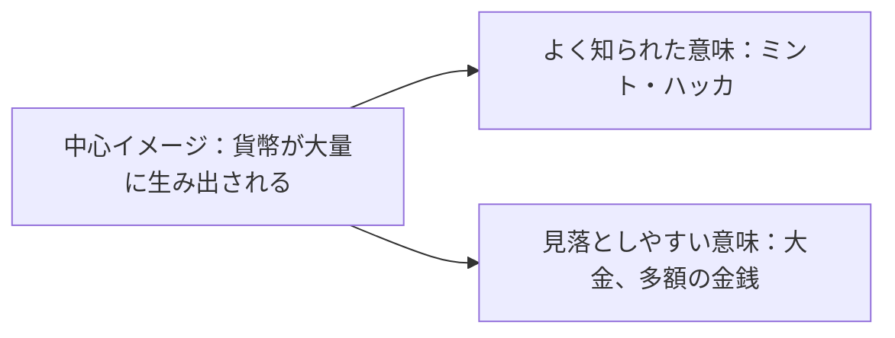

**重要語法**：make a mint（大金を稼ぐ）

<small>index: 7098 / candidate_id: `ev-07098-noun-01`</small>

## 3540. cube

**品詞**：verb　 **発音**：/kjuːb/

<small>よく知られている意味：立方体（名詞）</small>

### 見落としやすい意味

**数を3乗する**

**例文**：Cube the number before dividing the result by two.

**和訳**：その数を3乗してから、結果を2で割りなさい。

**コアイメージ**：中心は「同じ量を三つ掛け合わせる」というイメージです。立方体の体積を求める計算に基づき、数を3乗する動詞として使われます。

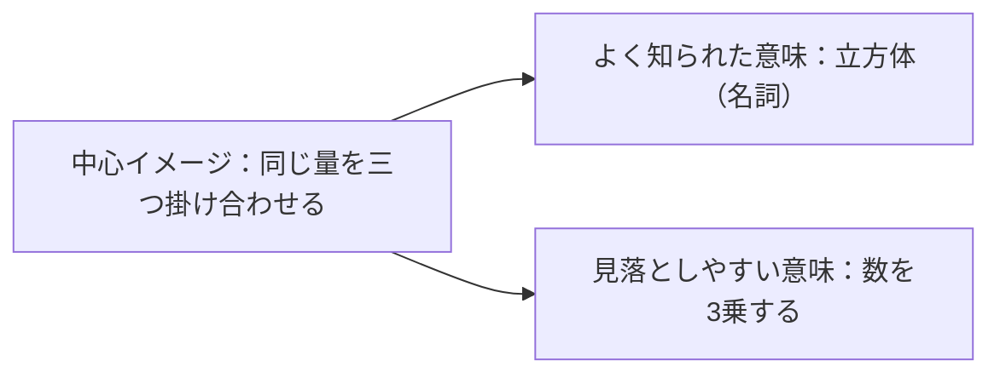

**重要語法**：cube a number（数を3乗する）

<small>index: 7101 / candidate_id: `ev-07101-verb-01`</small>

## 3541. persuasion

**品詞**：noun　 **発音**：/pərˈsweɪʒən/

<small>よく知られている意味：説得</small>

### 見落としやすい意味

**信念や宗教上の立場、考え方の系統**

**例文**：People of many political persuasions attended the discussion.

**和訳**：さまざまな政治的立場の人々が討論に参加した。

**コアイメージ**：中心は「考えをある方向に導く」というイメージです。誰かを説得して考えを動かすという意味から、人が持つ思想や信条の方向性そのものも表します。

```mermaid
flowchart LR
    A["中心イメージ：考えをある方向に導く"]
    B["よく知られた意味：説得"]
    C["見落としやすい意味：信念や宗教上の立場、考え方の系統"]
    A --> B
    A --> C
```

**重要語法**：people of every persuasion（さまざまな立場の人々）

<small>index: 7103 / candidate_id: `ev-07103-noun-01`</small>

## 3542. orphan

**品詞**：verb　 **発音**：/ˈɔːrfən/

<small>よく知られている意味：孤児（名詞）</small>

### 見落としやすい意味

**子どもを孤児にする**

**例文**：The disaster orphaned several children in the village.

**和訳**：その災害によって村の何人かの子どもが孤児になった。

**コアイメージ**：中心は「親のいない状態にする」というイメージです。孤児という人の状態を表す名詞が動詞となり、子どもをその状態にすることを表します。

```mermaid
flowchart LR
    A["中心イメージ：親のいない状態にする"]
    B["よく知られた意味：孤児（名詞）"]
    C["見落としやすい意味：子どもを孤児にする"]
    A --> B
    A --> C
```

**重要語法**：be orphaned（孤児になる）

<small>index: 7108 / candidate_id: `ev-07108-verb-01`</small>

## 3543. cloak

**品詞**：verb　 **発音**：/kloʊk/

<small>よく知られている意味：マント（名詞）</small>

### 見落としやすい意味

**事実・意図などを覆い隠す**

**例文**：The statement cloaked the real problem in vague language.

**和訳**：その声明は曖昧な言葉で本当の問題を覆い隠していた。

**コアイメージ**：中心は「覆いを掛けて見えなくする」というイメージです。マントが物を隠すように、言葉や外見で本当の意図や事実を見えにくくする比喩です。

```mermaid
flowchart LR
    A["中心イメージ：覆いを掛けて見えなくする"]
    B["よく知られた意味：マント（名詞）"]
    C["見落としやすい意味：事実・意図などを覆い隠す"]
    A --> B
    A --> C
```

**重要語法**：cloak A in B（AをBで覆い隠す）

<small>index: 7110 / candidate_id: `ev-07110-verb-01`</small>

## 3544. binary

**品詞**：adjective　 **発音**：/ˈbaɪnəri/

<small>よく知られている意味：二進法の・二つからなる</small>

### 見落としやすい意味

**二つの選択肢しかない、二者択一の**

**例文**：The debate was framed as a binary choice between success and failure.

**和訳**：その議論は成功か失敗かの二者択一として提示された。

**コアイメージ**：中心は「二つに分ける」というイメージです。二進法の二つの値という考えが、選択肢を二つだけに限定する議論へ広がります。

```mermaid
flowchart LR
    A["中心イメージ：二つに分ける"]
    B["よく知られた意味：二進法の・二つからなる"]
    C["見落としやすい意味：二つの選択肢しかない、二者択一の"]
    A --> B
    A --> C
```

**重要語法**：a binary choice（二者択一）

<small>index: 7112 / candidate_id: `ev-07112-adjective-01`</small>

## 3545. clutter

**品詞**：verb　 **発音**：/ˈklʌtər/

<small>よく知られている意味：散らかった物（名詞）</small>

### 見落としやすい意味

**物を雑然と置いて空間をふさぐ**

**例文**：Old boxes cluttered the narrow hallway.

**和訳**：古い箱が狭い廊下を雑然とふさいでいた。

**コアイメージ**：中心は「物が増えて空間を埋める」というイメージです。散らかった物を表す名詞が動詞となり、物を置いて場所を雑然と占めることを表します。

```mermaid
flowchart LR
    A["中心イメージ：物が増えて空間を埋める"]
    B["よく知られた意味：散らかった物（名詞）"]
    C["見落としやすい意味：物を雑然と置いて空間をふさぐ"]
    A --> B
    A --> C
```

**重要語法**：clutter a room（部屋を物で散らかす）

<small>index: 7118 / candidate_id: `ev-07118-verb-01`</small>

## 3546. abide

**品詞**：idiom　 **発音**：/əˈbaɪd/

<small>よく知られている意味：〜を我慢する</small>

### 見落としやすい意味

**どうしても〜を我慢できない、ひどく嫌う**

**例文**：I can't abide people who lie to their friends.

**和訳**：私は友人にうそをつく人をどうしても我慢できない。

**コアイメージ**：中心は「嫌なことを耐えて受け入れる」というイメージです。abide の耐えるという感覚を否定すると、『到底受け入れられない』という強い嫌悪になります。

```mermaid
flowchart LR
    A["中心イメージ：嫌なことを耐えて受け入れる"]
    B["よく知られた意味：〜を我慢する"]
    C["見落としやすい意味：どうしても〜を我慢できない、ひどく嫌う"]
    A --> B
    A --> C
```

**重要語法**：can't abide ...（〜がどうしても嫌だ）

<small>index: 7122 / candidate_id: `ev-07122-idiom-01`</small>

## 3547. abide

**品詞**：phrasal verb　 **発音**：/əˈbaɪd/

<small>よく知られている意味：我慢する・耐える</small>

### 見落としやすい意味

**規則・決定・約束を守る**

**例文**：All participants must abide by the safety rules.

**和訳**：参加者は全員、安全規則に従わなければならない。

**コアイメージ**：中心は「定められたものの中にとどまる」というイメージです。決められた条件に沿って行動し続ける感覚から、規則や約束を守るという意味になります。

```mermaid
flowchart LR
    A["中心イメージ：定められたものの中にとどまる"]
    B["よく知られた意味：我慢する・耐える"]
    C["見落としやすい意味：規則・決定・約束を守る"]
    A --> B
    A --> C
```

**重要語法**：abide by a rule/decision（規則・決定に従う）

<small>index: 7122 / candidate_id: `ev-07122-phrasal-verb-01`</small>

## 3548. allure

**品詞**：verb　 **発音**：/əˈlʊr/

<small>よく知られている意味：魅力（名詞）</small>

### 見落としやすい意味

**強く心を引きつける、誘惑する**

**例文**：The prospect of a peaceful life allured many visitors.

**和訳**：穏やかな生活への期待が多くの訪問者を引きつけた。

**コアイメージ**：中心は「魅力で相手をこちらへ誘う」というイメージです。名詞の魅力が動詞となり、その魅力で人の心を引きつけることを表します。やや文語的な響きがあります。

```mermaid
flowchart LR
    A["中心イメージ：魅力で相手をこちらへ誘う"]
    B["よく知られた意味：魅力（名詞）"]
    C["見落としやすい意味：強く心を引きつける、誘惑する"]
    A --> B
    A --> C
```

**重要語法**：allure someone（人を魅了する；やや文語的）

<small>index: 7124 / candidate_id: `ev-07124-verb-01`</small>

## 3549. arsenal

**品詞**：noun　 **発音**：/ˈɑːrsənəl/

<small>よく知られている意味：武器庫</small>

### 見落としやすい意味

**豊富にそろった手段・能力・知識など**

**例文**：The teacher had an arsenal of ways to explain the concept.

**和訳**：その教師には、その概念を説明するための豊富な方法があった。

**コアイメージ**：中心は「必要な道具を豊富に備える」というイメージです。武器を備蓄する場所から、問題に対応する多様な手段や知識の蓄えを表す比喩になります。

```mermaid
flowchart LR
    A["中心イメージ：必要な道具を豊富に備える"]
    B["よく知られた意味：武器庫"]
    C["見落としやすい意味：豊富にそろった手段・能力・知識など"]
    A --> B
    A --> C
```

**重要語法**：an arsenal of techniques（多彩な手法）

<small>index: 7128 / candidate_id: `ev-07128-noun-01`</small>

## 3550. baron

**品詞**：noun　 **発音**：/ˈbærən/

<small>よく知られている意味：男爵</small>

### 見落としやすい意味

**特定業界を強く支配する大物**

**例文**：A powerful media baron bought the newspaper.

**和訳**：有力なメディア業界の大物がその新聞社を買収した。

**コアイメージ**：中心は「大きな権力を持つ人物」というイメージです。貴族の称号が、特定の産業で強い影響力を持つ人物の呼び名へ転じます。

```mermaid
flowchart LR
    A["中心イメージ：大きな権力を持つ人物"]
    B["よく知られた意味：男爵"]
    C["見落としやすい意味：特定業界を強く支配する大物"]
    A --> B
    A --> C
```

**重要語法**：a media/oil baron（メディア・石油業界の大物）

<small>index: 7130 / candidate_id: `ev-07130-noun-01`</small>

## 3551. basin

**品詞**：noun　 **発音**：/ˈbeɪsən/

<small>よく知られている意味：洗面器・水鉢</small>

### 見落としやすい意味

**河川の流域**

**例文**：The river basin receives heavy rain every summer.

**和訳**：その河川の流域には毎年夏に大量の雨が降る。

**コアイメージ**：中心は「水を集めるくぼみ」というイメージです。水を受け止める器の形を広い地形に重ね、雨水が一つの川へ集まる地域を指します。

```mermaid
flowchart LR
    A["中心イメージ：水を集めるくぼみ"]
    B["よく知られた意味：洗面器・水鉢"]
    C["見落としやすい意味：河川の流域"]
    A --> B
    A --> C
```

**重要語法**：river basin（河川流域）

<small>index: 7131 / candidate_id: `ev-07131-noun-01`</small>

## 3552. bodily

**品詞**：adverb　 **発音**：/ˈbɑːdəli/

<small>よく知られている意味：身体の（形容詞）</small>

### 見落としやすい意味

**身体ごと、丸ごと持ち上げて**

**例文**：Two workers lifted the heavy box bodily onto the truck.

**和訳**：作業員二人が重い箱を丸ごと持ち上げてトラックに載せた。

**コアイメージ**：中心は「物全体をそのまま動かす」というイメージです。一部分だけではなく物体全体を動かす点が強調されます。身体の動きを伴う様子から、丸ごと持ち上げる意味になります。

```mermaid
flowchart LR
    A["中心イメージ：物全体をそのまま動かす"]
    B["よく知られた意味：身体の（形容詞）"]
    C["見落としやすい意味：身体ごと、丸ごと持ち上げて"]
    A --> B
    A --> C
```

**重要語法**：lift/carry ... bodily（〜を丸ごと持ち上げる・運ぶ）

<small>index: 7134 / candidate_id: `ev-07134-adverb-01`</small>

## 3553. brace

**品詞**：verb　 **発音**：/breɪs/

<small>よく知られている意味：支柱・補強する</small>

### 見落としやすい意味

**困難に備えて身構える、心構えをする**

**例文**：Residents braced for the arrival of a strong storm.

**和訳**：住民たちは強い嵐の到来に備えて身構えた。

**コアイメージ**：中心は「衝撃を受け止めるように支える」というイメージです。体を支えて衝撃に備える動作から、困難な出来事に心の準備をする意味へ広がります。

```mermaid
flowchart LR
    A["中心イメージ：衝撃を受け止めるように支える"]
    B["よく知られた意味：支柱・補強する"]
    C["見落としやすい意味：困難に備えて身構える、心構えをする"]
    A --> B
    A --> C
```

**重要語法**：brace for ...（〜に備える）

<small>index: 7137 / candidate_id: `ev-07137-verb-01`</small>

## 3554. buff

**品詞**：noun　 **発音**：/bʌf/

<small>よく知られている意味：磨く・筋肉質の</small>

### 見落としやすい意味

**特定分野の熱心な愛好者、詳しい人**

**例文**：As a history buff, he visits museums whenever he travels.

**和訳**：歴史好きの彼は旅行するたびに博物館を訪れる。

**コアイメージ**：中心は「一つの分野に熱中して詳しくなる」というイメージです。趣味や分野に強い関心を持つ人を表すくだけた名詞です。単なる初心者ではなく熱心な愛好者を指します。

```mermaid
flowchart LR
    A["中心イメージ：一つの分野に熱中して詳しくなる"]
    B["よく知られた意味：磨く・筋肉質の"]
    C["見落としやすい意味：特定分野の熱心な愛好者、詳しい人"]
    A --> B
    A --> C
```

**重要語法**：a history/film buff（歴史・映画の愛好家）

<small>index: 7139 / candidate_id: `ev-07139-noun-01`</small>

## 3555. casually

**品詞**：adverb　 **発音**：/ˈkæʒuəli/

<small>よく知られている意味：気軽に・略式に</small>

### 見落としやすい意味

**何気なく、特に深く考えずに**

**例文**：She casually mentioned that she knew the author.

**和訳**：彼女はその作家と知り合いだと何気なく口にした。

**コアイメージ**：中心は「特別な構えをせず行う」というイメージです。改まらず自然に行動する感覚から、深く考えず何げなく言ったりしたりする様子を表します。

```mermaid
flowchart LR
    A["中心イメージ：特別な構えをせず行う"]
    B["よく知られた意味：気軽に・略式に"]
    C["見落としやすい意味：何気なく、特に深く考えずに"]
    A --> B
    A --> C
```

**重要語法**：casually mention（何気なく言及する）

<small>index: 7141 / candidate_id: `ev-07141-adverb-01`</small>

## 3556. circus

**品詞**：noun　 **発音**：/ˈsɜːrkəs/

<small>よく知られている意味：サーカス</small>

### 見落としやすい意味

**騒々しく混乱した大騒ぎ**

**例文**：The press conference turned into a complete circus.

**和訳**：記者会見はすっかり大混乱になった。

**コアイメージ**：中心は「大勢が入り交じる騒がしい場」というイメージです。サーカスのにぎやかさを秩序のない騒ぎに重ね、混乱した場面を批判的に表します。

```mermaid
flowchart LR
    A["中心イメージ：大勢が入り交じる騒がしい場"]
    B["よく知られた意味：サーカス"]
    C["見落としやすい意味：騒々しく混乱した大騒ぎ"]
    A --> B
    A --> C
```

**重要語法**：turn into a circus（大騒ぎになる）

<small>index: 7143 / candidate_id: `ev-07143-noun-01`</small>

## 3557. commonplace

**品詞**：noun　 **発音**：/ˈkɑːmənpleɪs/

<small>よく知られている意味：ありふれた（形容詞）</small>

### 見落としやすい意味

**内容の乏しいありきたりな発言、決まり文句**

**例文**：The speech offered little beyond a series of commonplaces.

**和訳**：その演説には、ありきたりな決まり文句以外ほとんど中身がなかった。

**コアイメージ**：中心は「何度も繰り返される平凡さ」というイメージです。ありふれているという形容詞の感覚が名詞になり、内容の薄い言い回しや陳腐な発言を指します。

```mermaid
flowchart LR
    A["中心イメージ：何度も繰り返される平凡さ"]
    B["よく知られた意味：ありふれた（形容詞）"]
    C["見落としやすい意味：内容の乏しいありきたりな発言、決まり文句"]
    A --> B
    A --> C
```

**重要語法**：a commonplace（陳腐な言葉・言い回し）

<small>index: 7146 / candidate_id: `ev-07146-noun-01`</small>

## 3558. confide

**品詞**：phrasal verb　 **発音**：/kənˈfaɪd/

<small>よく知られている意味：秘密を打ち明ける</small>

### 見落としやすい意味

**人を信頼して秘密や個人的なことを打ち明ける**

**例文**：She confided in her teacher about her worries.

**和訳**：彼女は心配事を先生に打ち明けた。

**コアイメージ**：中心は「相手を信頼して内面を預ける」というイメージです。他人には話しにくいことを信頼する人へ伝える感覚です。confide in の後には信頼して打ち明ける相手が来ます。

```mermaid
flowchart LR
    A["中心イメージ：相手を信頼して内面を預ける"]
    B["よく知られた意味：秘密を打ち明ける"]
    C["見落としやすい意味：人を信頼して秘密や個人的なことを打ち明ける"]
    A --> B
    A --> C
```

**重要語法**：confide in someone（人を信頼して打ち明ける）

<small>index: 7148 / candidate_id: `ev-07148-phrasal-verb-01`</small>

## 3559. dangerously

**品詞**：adverb　 **発音**：/ˈdeɪndʒərəsli/

<small>よく知られている意味：危険な方法で</small>

### 見落としやすい意味

**危険なほど、もう少しで悪い状態に至るほど**

**例文**：The team came dangerously close to missing the deadline.

**和訳**：チームは危うく締め切りに間に合わなくなるところだった。

**コアイメージ**：中心は「悪い境界に近づきすぎる」というイメージです。危険な行為そのものだけでなく、悪い結果に至りそうなほど程度が高いことを表します。

```mermaid
flowchart LR
    A["中心イメージ：悪い境界に近づきすぎる"]
    B["よく知られた意味：危険な方法で"]
    C["見落としやすい意味：危険なほど、もう少しで悪い状態に至るほど"]
    A --> B
    A --> C
```

**重要語法**：dangerously close to ...（危うく〜しそうな）

<small>index: 7150 / candidate_id: `ev-07150-adverb-01`</small>

## 3560. disarm

**品詞**：verb　 **発音**：/dɪsˈɑːrm/

<small>よく知られている意味：武装を解除する</small>

### 見落としやすい意味

**相手の警戒心を解く、好感を抱かせる**

**例文**：Her friendly manner quickly disarmed the nervous guests.

**和訳**：彼女の親しみやすい態度で、緊張していた客たちはすぐに警戒を解いた。

**コアイメージ**：中心は「相手の防御を取り去る」というイメージです。武器を取り上げて攻撃できなくすることから、心理的な警戒や反発を和らげる比喩になります。

```mermaid
flowchart LR
    A["中心イメージ：相手の防御を取り去る"]
    B["よく知られた意味：武装を解除する"]
    C["見落としやすい意味：相手の警戒心を解く、好感を抱かせる"]
    A --> B
    A --> C
```

**重要語法**：disarm someone's suspicions（人の疑念を和らげる）

<small>index: 7154 / candidate_id: `ev-07154-verb-01`</small>

## 3561. earnest

**品詞**：idiom　 **発音**：/ˈɜːrnɪst/

<small>よく知られている意味：真剣な・熱心な</small>

### 見落としやすい意味

**（いよいよ）本格的に、真剣に**

**例文**：The renovation began in earnest after the summer break.

**和訳**：改修工事は夏休みの後に本格的に始まった。

**コアイメージ**：中心は「真剣さを伴う実行」というイメージです。気持ちが真剣である状態から、行動が単なる準備ではなく本格的に進むことを表します。

```mermaid
flowchart LR
    A["中心イメージ：真剣さを伴う実行"]
    B["よく知られた意味：真剣な・熱心な"]
    C["見落としやすい意味：（いよいよ）本格的に、真剣に"]
    A --> B
    A --> C
```

**重要語法**：in earnest（本格的に・真剣に）

<small>index: 7158 / candidate_id: `ev-07158-idiom-01`</small>

## 3562. expansive

**品詞**：adjective　 **発音**：/ɪkˈspænsɪv/

<small>よく知られている意味：広がりのある</small>

### 見落としやすい意味

**打ち解けて話好きな、気さくな**

**例文**：He grew more expansive as the interview went on.

**和訳**：インタビューが進むにつれて、彼は打ち解けてよく話すようになった。

**コアイメージ**：中心は「内側から外へ広がる」というイメージです。空間が広がる意味が、気分や会話が開放的になり、話が弾む様子へつながります。

```mermaid
flowchart LR
    A["中心イメージ：内側から外へ広がる"]
    B["よく知られた意味：広がりのある"]
    C["見落としやすい意味：打ち解けて話好きな、気さくな"]
    A --> B
    A --> C
```

**重要語法**：become expansive（打ち解けて話し始める）

<small>index: 7165 / candidate_id: `ev-07165-adjective-01`</small>

## 3563. grease

**品詞**：idiom　 **発音**：/ɡriːs/

<small>よく知られている意味：油脂・油を塗る</small>

### 見落としやすい意味

**（人に）ひそかに賄賂を渡す**

**例文**：The businessman tried to grease the official's palm.

**和訳**：その実業家は役人にひそかに賄賂を渡そうとした。

**コアイメージ**：中心は「油を塗って動きを滑らかにする」というイメージです。物の動きを油でよくする感覚を、不正な金銭で相手を動かそうとする比喩に転用した慣用句です。

```mermaid
flowchart LR
    A["中心イメージ：油を塗って動きを滑らかにする"]
    B["よく知られた意味：油脂・油を塗る"]
    C["見落としやすい意味：（人に）ひそかに賄賂を渡す"]
    A --> B
    A --> C
```

**重要語法**：grease someone's palm（人に賄賂を渡す）

<small>index: 7172 / candidate_id: `ev-07172-idiom-01`</small>

## 3564. heed

**品詞**：noun　 **発音**：/hiːd/

<small>よく知られている意味：注意を払う（動詞）</small>

### 見落としやすい意味

**注意、考慮**

**例文**：Please pay heed to the signs along the path.

**和訳**：道沿いの標識に注意を払ってください。

**コアイメージ**：中心は「大事な情報へ注意を向ける」というイメージです。heed は動詞だけでなく、耳を傾けたり配慮したりする『注意』を表す名詞にもなります。

```mermaid
flowchart LR
    A["中心イメージ：大事な情報へ注意を向ける"]
    B["よく知られた意味：注意を払う（動詞）"]
    C["見落としやすい意味：注意、考慮"]
    A --> B
    A --> C
```

**重要語法**：pay heed to ...（〜に注意を払う）

<small>index: 7175 / candidate_id: `ev-07175-noun-01`</small>

## 3565. hourly

**品詞**：adjective　 **発音**：/ˈaʊərli/

<small>よく知られている意味：毎時の・1時間ごとの</small>

### 見落としやすい意味

**時給で支払われる**

**例文**：The company hired additional hourly workers.

**和訳**：その会社は時給制の従業員を追加で雇った。

**コアイメージ**：中心は「1時間を単位に考える」というイメージです。一定時間ごとという意味が、給料を1時間単位で計算し支払う雇用形態を表します。

```mermaid
flowchart LR
    A["中心イメージ：1時間を単位に考える"]
    B["よく知られた意味：毎時の・1時間ごとの"]
    C["見落としやすい意味：時給で支払われる"]
    A --> B
    A --> C
```

**重要語法**：hourly worker / hourly wage（時給制の労働者／時給）

<small>index: 7178 / candidate_id: `ev-07178-adjective-01`</small>

## 3566. infinitely

**品詞**：adverb　 **発音**：/ˈɪnfɪnətli/

<small>よく知られている意味：無限に</small>

### 見落としやすい意味

**比較にならないほど、はるかに**

**例文**：This solution is infinitely better than the old one.

**和訳**：この解決策は以前のものよりはるかに優れている。

**コアイメージ**：中心は「差が際立つほど大きい」というイメージです。無限という誇張から、比べられないほど程度の差が大きいことを強調します。

```mermaid
flowchart LR
    A["中心イメージ：差が際立つほど大きい"]
    B["よく知られた意味：無限に"]
    C["見落としやすい意味：比較にならないほど、はるかに"]
    A --> B
    A --> C
```

**重要語法**：infinitely better（はるかに良い）

<small>index: 7181 / candidate_id: `ev-07181-adverb-01`</small>

## 3567. interface

**品詞**：verb　 **発音**：/ˈɪntərfeɪs/

<small>よく知られている意味：接点・画面の操作部分（名詞）</small>

### 見落としやすい意味

**システム・人・組織などが連携する**

**例文**：The new system interfaces with our existing database.

**和訳**：新しいシステムは既存のデータベースと連携する。

**コアイメージ**：中心は「異なるものの境界でつながる」というイメージです。二つのシステムの接点を表す名詞が動詞となり、相互に情報をやり取りしたり連携したりする意味になります。

```mermaid
flowchart LR
    A["中心イメージ：異なるものの境界でつながる"]
    B["よく知られた意味：接点・画面の操作部分（名詞）"]
    C["見落としやすい意味：システム・人・組織などが連携する"]
    A --> B
    A --> C
```

**重要語法**：interface with ...（〜と連携する）

<small>index: 7183 / candidate_id: `ev-07183-verb-01`</small>

## 3568. lit

**品詞**：adjective　 **発音**：/lɪt/

<small>よく知られている意味：明かりがついた・lightの過去形</small>

### 見落としやすい意味

**非常に楽しい、盛り上がっている（口語）**

**例文**：The party was lit from beginning to end.

**和訳**：そのパーティーは最初から最後まで大盛り上がりだった。

**コアイメージ**：中心は「場に熱気が灯る」というイメージです。明るく燃えるイメージから、口語では場が活気に満ち、とても楽しいという評価を表します。

```mermaid
flowchart LR
    A["中心イメージ：場に熱気が灯る"]
    B["よく知られた意味：明かりがついた・lightの過去形"]
    C["見落としやすい意味：非常に楽しい、盛り上がっている（口語）"]
    A --> B
    A --> C
```

**重要語法**：lit（俗語；盛り上がった）

<small>index: 7188 / candidate_id: `ev-07188-adjective-01`</small>

## 3569. mute

**品詞**：verb　 **発音**：/mjuːt/

<small>よく知られている意味：無言の・音を出さない</small>

### 見落としやすい意味

**批判・反論・声などを抑える、封じる**

**例文**：The announcement did little to mute public criticism.

**和訳**：その発表は世間の批判をほとんど抑えられなかった。

**コアイメージ**：中心は「音量を下げて目立たなくする」というイメージです。音を消す動作から、反論や不安などの表れを弱めるという比喩になります。

```mermaid
flowchart LR
    A["中心イメージ：音量を下げて目立たなくする"]
    B["よく知られた意味：無言の・音を出さない"]
    C["見落としやすい意味：批判・反論・声などを抑える、封じる"]
    A --> B
    A --> C
```

**重要語法**：mute criticism（批判を抑える）

<small>index: 7194 / candidate_id: `ev-07194-verb-01`</small>

## 3570. overhaul

**品詞**：noun　 **発音**：/ˈoʊvərhɔːl/

<small>よく知られている意味：機械の分解修理</small>

### 見落としやすい意味

**大規模な制度改革・全面的改修**

**例文**：The education system needs a thorough overhaul.

**和訳**：その教育制度には抜本的な改革が必要だ。

**コアイメージ**：中心は「仕組みを隅々まで点検し直す」というイメージです。機械の大がかりな修理を、制度や組織の全面的な見直しへ広げた名詞用法です。

```mermaid
flowchart LR
    A["中心イメージ：仕組みを隅々まで点検し直す"]
    B["よく知られた意味：機械の分解修理"]
    C["見落としやすい意味：大規模な制度改革・全面的改修"]
    A --> B
    A --> C
```

**重要語法**：a thorough overhaul（全面的な改革）

<small>index: 7201 / candidate_id: `ev-07201-noun-01`</small>

## 3571. overhaul

**品詞**：verb　 **発音**：/ˌoʊvərˈhɔːl/

<small>よく知られている意味：機械を徹底修理する</small>

### 見落としやすい意味

**制度・組織を抜本的に見直す**

**例文**：The city plans to overhaul its public transport system.

**和訳**：市は公共交通制度を抜本的に見直す予定だ。

**コアイメージ**：中心は「構造を根本から組み直す」というイメージです。機械を分解して直す動作が、制度や組織の仕組みを根本から改める行為に重なります。

```mermaid
flowchart LR
    A["中心イメージ：構造を根本から組み直す"]
    B["よく知られた意味：機械を徹底修理する"]
    C["見落としやすい意味：制度・組織を抜本的に見直す"]
    A --> B
    A --> C
```

**重要語法**：overhaul a system（制度を抜本的に改める）

<small>index: 7201 / candidate_id: `ev-07201-verb-01`</small>

## 3572. parochial

**品詞**：adjective　 **発音**：/pəˈroʊkiəl/

<small>よく知られている意味：教区・地域社会の</small>

### 見落としやすい意味

**視野が狭い、身近なことにしか関心がない**

**例文**：The article presents a parochial view of international trade.

**和訳**：その記事は国際貿易を視野の狭い観点から見ている。

**コアイメージ**：中心は「自分の身近な範囲にとどまる」というイメージです。特定の地域や教区に限られる感覚から、広い世界を考えない狭い視野を批判的に表します。

```mermaid
flowchart LR
    A["中心イメージ：自分の身近な範囲にとどまる"]
    B["よく知られた意味：教区・地域社会の"]
    C["見落としやすい意味：視野が狭い、身近なことにしか関心がない"]
    A --> B
    A --> C
```

**重要語法**：a parochial view（視野の狭い見方）

<small>index: 7203 / candidate_id: `ev-07203-adjective-01`</small>

## 3573. perennial

**品詞**：adjective　 **発音**：/pəˈreniəl/

<small>よく知られている意味：多年生の植物の</small>

### 見落としやすい意味

**長く続く、繰り返し起こる**

**例文**：Traffic congestion is a perennial problem in this city.

**和訳**：交通渋滞はこの都市で繰り返し起こる問題だ。

**コアイメージ**：中心は「何年も生き続ける」というイメージです。植物が何年にもわたって生き続ける性質から、問題が長く続いたり繰り返されたりする意味になります。

```mermaid
flowchart LR
    A["中心イメージ：何年も生き続ける"]
    B["よく知られた意味：多年生の植物の"]
    C["見落としやすい意味：長く続く、繰り返し起こる"]
    A --> B
    A --> C
```

**重要語法**：a perennial problem（繰り返される問題）

<small>index: 7205 / candidate_id: `ev-07205-adjective-01`</small>

## 3574. prone

**品詞**：adjective　 **発音**：/proʊn/

<small>よく知られている意味：〜しがちな</small>

### 見落としやすい意味

**うつ伏せになった、伏せた姿勢の**

**例文**：The patient lay prone on the examination table.

**和訳**：患者は診察台の上でうつ伏せになっていた。

**コアイメージ**：中心は「体を前へ伏せる」というイメージです。人の体がうつ伏せの姿勢にあるという具体的な意味があります。物事が起きやすいという抽象的な用法とは区別します。

```mermaid
flowchart LR
    A["中心イメージ：体を前へ伏せる"]
    B["よく知られた意味：〜しがちな"]
    C["見落としやすい意味：うつ伏せになった、伏せた姿勢の"]
    A --> B
    A --> C
```

**重要語法**：lie prone（うつ伏せに横たわる）

<small>index: 7209 / candidate_id: `ev-07209-adjective-01`</small>

## 3575. reactionary

**品詞**：noun　 **発音**：/riˈækʃəneri/

<small>よく知られている意味：反動的な（形容詞）</small>

### 見落としやすい意味

**政治・社会の変化に反対する反動主義者**

**例文**：The columnist described the politician as a reactionary.

**和訳**：そのコラムニストはその政治家を反動主義者と評した。

**コアイメージ**：中心は「変化に反発して以前へ戻ろうとする」というイメージです。社会の変化への反発という意味が、その立場を取る人物を指す名詞にもなります。

```mermaid
flowchart LR
    A["中心イメージ：変化に反発して以前へ戻ろうとする"]
    B["よく知られた意味：反動的な（形容詞）"]
    C["見落としやすい意味：政治・社会の変化に反対する反動主義者"]
    A --> B
    A --> C
```

**重要語法**：a reactionary（反動主義者）

<small>index: 7214 / candidate_id: `ev-07214-noun-01`</small>

## 3576. relish

**品詞**：verb　 **発音**：/ˈrelɪʃ/

<small>よく知られている意味：薬味・風味（名詞）</small>

### 見落としやすい意味

**（体験・考えなどを）大いに楽しむ**

**例文**：She relished the chance to work on a new project.

**和訳**：彼女は新しい計画に取り組む機会を大いに楽しんだ。

**コアイメージ**：中心は「味わって喜ぶ」というイメージです。食べ物の風味を楽しむ感覚から、機会や経験を心から楽しむ動詞の意味へ広がります。

```mermaid
flowchart LR
    A["中心イメージ：味わって喜ぶ"]
    B["よく知られた意味：薬味・風味（名詞）"]
    C["見落としやすい意味：（体験・考えなどを）大いに楽しむ"]
    A --> B
    A --> C
```

**重要語法**：relish the chance to ...（〜する機会を喜ぶ）

<small>index: 7216 / candidate_id: `ev-07216-verb-01`</small>

## 3577. revisit

**品詞**：verb　 **発音**：/ˌriːˈvɪzɪt/

<small>よく知られている意味：再び訪れる</small>

### 見落としやすい意味

**議論・判断・問題を改めて検討する**

**例文**：The committee will revisit the proposal next month.

**和訳**：委員会は来月その提案を改めて検討する。

**コアイメージ**：中心は「もう一度そこへ立ち戻る」というイメージです。場所を再訪することから、以前の判断や話題に戻って見直す行為を表します。

```mermaid
flowchart LR
    A["中心イメージ：もう一度そこへ立ち戻る"]
    B["よく知られた意味：再び訪れる"]
    C["見落としやすい意味：議論・判断・問題を改めて検討する"]
    A --> B
    A --> C
```

**重要語法**：revisit an issue/decision（問題・決定を再検討する）

<small>index: 7217 / candidate_id: `ev-07217-verb-01`</small>

## 3578. shaky

**品詞**：adjective　 **発音**：/ˈʃeɪki/

<small>よく知られている意味：ぐらぐら揺れる</small>

### 見落としやすい意味

**根拠が弱く信頼できない、不安定な**

**例文**：The argument rests on shaky evidence.

**和訳**：その主張は信頼性の低い根拠に基づいている。

**コアイメージ**：中心は「土台がぐらついている」というイメージです。物理的な不安定さを、論拠が弱く判断を支えられない状態へ重ねた比喩です。

```mermaid
flowchart LR
    A["中心イメージ：土台がぐらついている"]
    B["よく知られた意味：ぐらぐら揺れる"]
    C["見落としやすい意味：根拠が弱く信頼できない、不安定な"]
    A --> B
    A --> C
```

**重要語法**：shaky evidence（頼りない証拠）

<small>index: 7219 / candidate_id: `ev-07219-adjective-01`</small>

## 3579. smack

**品詞**：adverb　 **発音**：/smæk/

<small>よく知られている意味：平手打ち・強く打つ</small>

### 見落としやすい意味

**まさに、ちょうど（その位置に）**

**例文**：The taxi stopped smack in front of the station.

**和訳**：タクシーは駅のまさに正面に止まった。

**コアイメージ**：中心は「狙った一点にぴたりと当たる」というイメージです。強く直接当たる感覚から、場所がまさにその位置であることを強調する副詞になります。

```mermaid
flowchart LR
    A["中心イメージ：狙った一点にぴたりと当たる"]
    B["よく知られた意味：平手打ち・強く打つ"]
    C["見落としやすい意味：まさに、ちょうど（その位置に）"]
    A --> B
    A --> C
```

**重要語法**：smack in the middle of ...（〜のちょうど真ん中に）

<small>index: 7221 / candidate_id: `ev-07221-adverb-01`</small>

## 3580. swirl

**品詞**：verb　 **発音**：/swɜːrl/

<small>よく知られている意味：渦を巻いて回る</small>

### 見落としやすい意味

**考え・噂・感情などが渦巻く**

**例文**：Rumors swirled around the sudden resignation.

**和訳**：突然の辞任をめぐって噂が渦巻いた。

**コアイメージ**：中心は「いくつものものが回り続ける」というイメージです。水や風が渦巻く動きから、噂や感情があちこちに広がって収まらない様子を表します。

```mermaid
flowchart LR
    A["中心イメージ：いくつものものが回り続ける"]
    B["よく知られた意味：渦を巻いて回る"]
    C["見落としやすい意味：考え・噂・感情などが渦巻く"]
    A --> B
    A --> C
```

**重要語法**：rumors swirl（噂が飛び交う）

<small>index: 7225 / candidate_id: `ev-07225-verb-01`</small>

## 3581. tablet

**品詞**：noun　 **発音**：/ˈtæblət/

<small>よく知られている意味：タブレット端末・板状の物</small>

### 見落としやすい意味

**薬などの錠剤**

**例文**：Take one tablet with water after breakfast.

**和訳**：朝食後に錠剤を1錠、水で飲んでください。

**コアイメージ**：中心は「小さく平たい固まり」というイメージです。平たい板の形から、押し固めた小型の薬を指す意味があります。電子機器だけで解釈しないことが大切です。

```mermaid
flowchart LR
    A["中心イメージ：小さく平たい固まり"]
    B["よく知られた意味：タブレット端末・板状の物"]
    C["見落としやすい意味：薬などの錠剤"]
    A --> B
    A --> C
```

**重要語法**：a pain-relief tablet（痛み止めの錠剤）

<small>index: 7226 / candidate_id: `ev-07226-noun-01`</small>

## 3582. teeth

**品詞**：idiom　 **発音**：/tiːθ/

<small>よく知られている意味：歯</small>

### 見落としやすい意味

**法律・制度などに実際の強制力や実効性を与える**

**例文**：The new rules give the law real teeth.

**和訳**：新しい規則によってその法律には実効性が生まれる。

**コアイメージ**：中心は「かみついて力を及ぼす」というイメージです。歯が実際にかみつく力を持つことから、法律が違反を抑止・処罰できる強制力を表します。

```mermaid
flowchart LR
    A["中心イメージ：かみついて力を及ぼす"]
    B["よく知られた意味：歯"]
    C["見落としやすい意味：法律・制度などに実際の強制力や実効性を与える"]
    A --> B
    A --> C
```

**重要語法**：give a law teeth（法律に実効性を持たせる）

<small>index: 7227 / candidate_id: `ev-07227-idiom-01`</small>

## 3583. territorial

**品詞**：adjective　 **発音**：/ˌterəˈtɔːriəl/

<small>よく知られている意味：領土の</small>

### 見落としやすい意味

**縄張り意識が強い、自分の領域を守ろうとする**

**例文**：Our dog gets territorial when another dog enters the yard.

**和訳**：別の犬が庭に入ってくると、うちの犬は縄張りを守ろうとする。

**コアイメージ**：中心は「自分の領域を守る」というイメージです。土地や領域に関する意味が、自分の場所や担当範囲を他人に譲りたくない態度へ広がります。

```mermaid
flowchart LR
    A["中心イメージ：自分の領域を守る"]
    B["よく知られた意味：領土の"]
    C["見落としやすい意味：縄張り意識が強い、自分の領域を守ろうとする"]
    A --> B
    A --> C
```

**重要語法**：get territorial（縄張り意識を強める）

<small>index: 7228 / candidate_id: `ev-07228-adjective-01`</small>

## 3584. trouser

**品詞**：verb　 **発音**：/ˈtraʊzər/

<small>よく知られている意味：ズボン（名詞、英国英語の trousers）</small>

### 見落としやすい意味

**金銭・利益を懐に入れる（主に英国）**

**例文**：The executive trousered a substantial bonus.

**和訳**：その役員は多額のボーナスを懐に入れた。

**コアイメージ**：中心は「ポケットに収めて自分のものにする」というイメージです。ズボンのポケットにお金をしまう動作から、金銭や利益を受け取るという英国のくだけた動詞になります。

```mermaid
flowchart LR
    A["中心イメージ：ポケットに収めて自分のものにする"]
    B["よく知られた意味：ズボン（名詞、英国英語の trousers）"]
    C["見落としやすい意味：金銭・利益を懐に入れる（主に英国）"]
    A --> B
    A --> C
```

**重要語法**：trouser a profit/bonus（利益・ボーナスを懐に入れる；主に英国）

<small>index: 7231 / candidate_id: `ev-07231-verb-01`</small>

## 3585. ward

**品詞**：phrasal verb　 **発音**：/wɔːrd/

<small>よく知られている意味：病棟・区画（名詞）</small>

### 見落としやすい意味

**害・危険などを防ぎ寄せつけない**

**例文**：The thick curtains help ward off the summer heat.

**和訳**：厚いカーテンは夏の暑さを防ぐのに役立つ。

**コアイメージ**：中心は「外から来るものを寄せつけない」というイメージです。危険や害になるものを自分から遠ざける動作を表します。off を伴って、防ぐ対象を示すことが一般的です。

```mermaid
flowchart LR
    A["中心イメージ：外から来るものを寄せつけない"]
    B["よく知られた意味：病棟・区画（名詞）"]
    C["見落としやすい意味：害・危険などを防ぎ寄せつけない"]
    A --> B
    A --> C
```

**重要語法**：ward off ...（〜を防ぐ）

<small>index: 7239 / candidate_id: `ev-07239-phrasal-verb-01`</small>

## 3586. zip

**品詞**：noun　 **発音**：/zɪp/

<small>よく知られている意味：ファスナー・郵便番号（米国）</small>

### 見落としやすい意味

**何もないこと、ゼロ**

**例文**：The search turned up zip.

**和訳**：捜索では何も見つからなかった。

**コアイメージ**：中心は「結果が空っぽである」というイメージです。くだけた会話で、成果や数量がまったくないことを強調して zip と言います。

```mermaid
flowchart LR
    A["中心イメージ：結果が空っぽである"]
    B["よく知られた意味：ファスナー・郵便番号（米国）"]
    C["見落としやすい意味：何もないこと、ゼロ"]
    A --> B
    A --> C
```

**重要語法**：zip（口語で『ゼロ・何もなし』）

<small>index: 7240 / candidate_id: `ev-07240-noun-01`</small>

## 3587. zip

**品詞**：verb　 **発音**：/zɪp/

<small>よく知られている意味：ファスナーを閉める</small>

### 見落としやすい意味

**勢いよく素早く進む、移動する**

**例文**：A cyclist zipped past us on the narrow road.

**和訳**：自転車の人が狭い道で私たちの横をさっと通り過ぎた。

**コアイメージ**：中心は「一直線に素早く動く」というイメージです。ファスナーが一気に進むような軽快さから、人や物が素早く移動することを表します。

```mermaid
flowchart LR
    A["中心イメージ：一直線に素早く動く"]
    B["よく知られた意味：ファスナーを閉める"]
    C["見落としやすい意味：勢いよく素早く進む、移動する"]
    A --> B
    A --> C
```

**重要語法**：zip past/through ...（〜をさっと通り抜ける）

<small>index: 7240 / candidate_id: `ev-07240-verb-01`</small>

## 3588. breaking

**品詞**：adjective　 **発音**：/ˈbreɪkɪŋ/

<small>よく知られている意味：壊すこと・割ること</small>

### 見落としやすい意味

**（ニュースが）今入ってきたばかりの速報の**

**例文**：The channel interrupted its program with breaking news.

**和訳**：そのチャンネルは番組を中断して速報を伝えた。

**コアイメージ**：中心は「いま起きて情報が飛び込む」というイメージです。出来事が進行中で、情報が今まさに伝えられていることを breaking news と表します。

```mermaid
flowchart LR
    A["中心イメージ：いま起きて情報が飛び込む"]
    B["よく知られた意味：壊すこと・割ること"]
    C["見落としやすい意味：（ニュースが）今入ってきたばかりの速報の"]
    A --> B
    A --> C
```

**重要語法**：breaking news（ニュース速報）

<small>index: 7244 / candidate_id: `ev-07244-adjective-01`</small>

## 3589. mushroom

**品詞**：verb　 **発音**：/ˈmʌʃruːm/

<small>よく知られている意味：キノコ（名詞）</small>

### 見落としやすい意味

**急速に増大・拡大する**

**例文**：Small cafés have mushroomed across the neighborhood.

**和訳**：その地域では小さなカフェが急速に増えている。

**コアイメージ**：中心は「短期間で一気に広がる」というイメージです。キノコが急に生えて増えるように、人や施設や問題などが短期間に増加する様子を表します。

```mermaid
flowchart LR
    A["中心イメージ：短期間で一気に広がる"]
    B["よく知られた意味：キノコ（名詞）"]
    C["見落としやすい意味：急速に増大・拡大する"]
    A --> B
    A --> C
```

**重要語法**：mushroom across ...（〜の各地で急増する）

<small>index: 7245 / candidate_id: `ev-07245-verb-01`</small>

## 3590. uneasy

**品詞**：adjective　 **発音**：/ʌnˈiːzi/

<small>よく知られている意味：不安な・落ち着かない</small>

### 見落としやすい意味

**（平和・関係・協定などが）不安定な**

**例文**：The two countries maintained an uneasy peace.

**和訳**：その二国間では不安定な平和が保たれていた。

**コアイメージ**：中心は「表面上は保たれていても安心できない」というイメージです。人が落ち着かない心理から、協定や関係がいつ崩れてもおかしくない不安定な状態に広がります。

```mermaid
flowchart LR
    A["中心イメージ：表面上は保たれていても安心できない"]
    B["よく知られた意味：不安な・落ち着かない"]
    C["見落としやすい意味：（平和・関係・協定などが）不安定な"]
    A --> B
    A --> C
```

**重要語法**：an uneasy peace（不安定な平和）

<small>index: 7249 / candidate_id: `ev-07249-adjective-01`</small>

## 3591. sponge

**品詞**：phrasal verb　 **発音**：/spʌndʒ/

<small>よく知られている意味：スポンジ</small>

### 見落としやすい意味

**他人の金や厚意に頼って暮らす、たかる**

**例文**：He spent years sponging off his relatives.

**和訳**：彼は何年もの間、親類に金銭面で頼って暮らしていた。

**コアイメージ**：中心は「周りから吸い取る」というイメージです。スポンジが液体を吸い込む動作を、他人の金銭や親切を一方的に利用する態度に重ねた口語表現です。

```mermaid
flowchart LR
    A["中心イメージ：周りから吸い取る"]
    B["よく知られた意味：スポンジ"]
    C["見落としやすい意味：他人の金や厚意に頼って暮らす、たかる"]
    A --> B
    A --> C
```

**重要語法**：sponge off someone（人にたかる・頼る）

<small>index: 7251 / candidate_id: `ev-07251-phrasal-verb-01`</small>

## 3592. sticky

**品詞**：adjective　 **発音**：/ˈstɪki/

<small>よく知られている意味：ねばねばした</small>

### 見落としやすい意味

**解決が厄介な、扱いにくい**

**例文**：The committee faced a sticky question about funding.

**和訳**：委員会は資金調達に関する厄介な問題に直面した。

**コアイメージ**：中心は「くっついて簡単には離れない」というイメージです。粘着物の扱いにくさを、簡単には解決できない難題や微妙な状況に重ねています。

```mermaid
flowchart LR
    A["中心イメージ：くっついて簡単には離れない"]
    B["よく知られた意味：ねばねばした"]
    C["見落としやすい意味：解決が厄介な、扱いにくい"]
    A --> B
    A --> C
```

**重要語法**：a sticky issue/situation（厄介な問題・状況）

<small>index: 7253 / candidate_id: `ev-07253-adjective-01`</small>

## 3593. salon

**品詞**：noun　 **発音**：/səˈlɑːn/

<small>よく知られている意味：美容室</small>

### 見落としやすい意味

**芸術家・知識人たちが集う社交・談論の会**

**例文**：The novelist hosted a salon for young artists.

**和訳**：その小説家は若い芸術家たちのために談論の会を開いた。

**コアイメージ**：中心は「人が集まって交流する場所」というイメージです。人々が集う部屋という歴史的な用法から、芸術や思想について語り合う社交の集まりを表します。

```mermaid
flowchart LR
    A["中心イメージ：人が集まって交流する場所"]
    B["よく知られた意味：美容室"]
    C["見落としやすい意味：芸術家・知識人たちが集う社交・談論の会"]
    A --> B
    A --> C
```

**重要語法**：a literary salon（文学サロン）

<small>index: 7256 / candidate_id: `ev-07256-noun-01`</small>

## 3594. fuse

**品詞**：verb　 **発音**：/fjuːz/

<small>よく知られている意味：ヒューズ（名詞）</small>

### 見落としやすい意味

**複数のものを融合・一体化させる**

**例文**：The musician fuses jazz with traditional folk songs.

**和訳**：その音楽家はジャズと伝統的な民謡を融合させる。

**コアイメージ**：中心は「別々のものを一つにつなぐ」というイメージです。異なる要素が熱などによって一体になる感覚から、文化や技法を結びつける意味になります。

```mermaid
flowchart LR
    A["中心イメージ：別々のものを一つにつなぐ"]
    B["よく知られた意味：ヒューズ（名詞）"]
    C["見落としやすい意味：複数のものを融合・一体化させる"]
    A --> B
    A --> C
```

**重要語法**：fuse A with B（AとBを融合させる）

<small>index: 7257 / candidate_id: `ev-07257-verb-01`</small>

## 3595. wicked

**品詞**：adjective　 **発音**：/ˈwɪkɪd/

<small>よく知られている意味：邪悪な・ひどい</small>

### 見落としやすい意味

**すばらしい、とても良い**

**例文**：That final guitar solo was wicked!

**和訳**：あの最後のギターソロは最高だった！

**コアイメージ**：中心は「強い印象を与える」というイメージです。もともとの否定的な強さを誇張した口語では、逆に『すごい・最高だ』という褒め言葉になります。文脈で判断します。

```mermaid
flowchart LR
    A["中心イメージ：強い印象を与える"]
    B["よく知られた意味：邪悪な・ひどい"]
    C["見落としやすい意味：すばらしい、とても良い"]
    A --> B
    A --> C
```

**重要語法**：wicked（口語で『すごく良い』）

<small>index: 7258 / candidate_id: `ev-07258-adjective-01`</small>

## 3596. candid

**品詞**：adjective　 **発音**：/ˈkændɪd/

<small>よく知られている意味：率直な・包み隠さない</small>

### 見落としやすい意味

**ポーズを取らせず自然な姿を写した**

**例文**：The exhibition included candid photos of everyday life.

**和訳**：その展示には日常生活の自然な姿を写した写真が含まれていた。

**コアイメージ**：中心は「作り込まずありのままを示す」というイメージです。言葉が率直で飾らない意味が、人物にポーズを取らせず自然な場面を撮った写真にも使われます。

```mermaid
flowchart LR
    A["中心イメージ：作り込まずありのままを示す"]
    B["よく知られた意味：率直な・包み隠さない"]
    C["見落としやすい意味：ポーズを取らせず自然な姿を写した"]
    A --> B
    A --> C
```

**重要語法**：a candid photograph（自然な瞬間を写した写真）

<small>index: 7259 / candidate_id: `ev-07259-adjective-01`</small>

## 3597. remotely

**品詞**：adverb　 **発音**：/rɪˈmoʊtli/

<small>よく知られている意味：遠くから・遠隔で</small>

### 見落としやすい意味

**（否定表現を強めて）少しも、全く**

**例文**：I'm not remotely interested in that offer.

**和訳**：私はその申し出には全く興味がない。

**コアイメージ**：中心は「可能性が少しでも近くにあるか」というイメージです。not とともに用いると、わずかにでも該当する余地がないという強い否定になります。

```mermaid
flowchart LR
    A["中心イメージ：可能性が少しでも近くにあるか"]
    B["よく知られた意味：遠くから・遠隔で"]
    C["見落としやすい意味：（否定表現を強めて）少しも、全く"]
    A --> B
    A --> C
```

**重要語法**：not remotely ...（少しも〜ない）

<small>index: 7261 / candidate_id: `ev-07261-adverb-01`</small>

## 3598. farce

**品詞**：noun　 **発音**：/fɑːrs/

<small>よく知られている意味：笑劇・どたばた喜劇</small>

### 見落としやすい意味

**ばかげた茶番、形式だけの無意味な行為**

**例文**：The hearing became a farce when nobody answered the questions.

**和訳**：誰も質問に答えず、その公聴会は茶番になった。

**コアイメージ**：中心は「まじめに見せたものが滑稽になる」というイメージです。本来は笑いを誘う劇の形式から、真剣であるべき物事が形だけでばかげている状態を表します。

```mermaid
flowchart LR
    A["中心イメージ：まじめに見せたものが滑稽になる"]
    B["よく知られた意味：笑劇・どたばた喜劇"]
    C["見落としやすい意味：ばかげた茶番、形式だけの無意味な行為"]
    A --> B
    A --> C
```

**重要語法**：a complete farce（まったくの茶番）

<small>index: 7266 / candidate_id: `ev-07266-noun-01`</small>

## 3599. dilute

**品詞**：verb　 **発音**：/daɪˈluːt/

<small>よく知られている意味：液体を薄める</small>

### 見落としやすい意味

**影響力・価値・効果などを弱める**

**例文**：Too many exceptions would dilute the effect of the new rule.

**和訳**：例外が多すぎると、新しい規則の効果が弱まるだろう。

**コアイメージ**：中心は「濃さを下げる」というイメージです。液体を薄めて成分の濃度を下げる動作を、影響力・価値・意図などを弱くする意味へ広げます。

```mermaid
flowchart LR
    A["中心イメージ：濃さを下げる"]
    B["よく知られた意味：液体を薄める"]
    C["見落としやすい意味：影響力・価値・効果などを弱める"]
    A --> B
    A --> C
```

**重要語法**：dilute the impact/effect（影響・効果を弱める）

<small>index: 7267 / candidate_id: `ev-07267-verb-01`</small>

## 3600. badge

**品詞**：idiom　 **発音**：/bædʒ/

<small>よく知られている意味：バッジ・記章</small>

### 見落としやすい意味

**誇りとして掲げる証し**

**例文**：She wore the criticism as a badge of honor.

**和訳**：彼女はその批判さえも誇りの証しと考えた。

**コアイメージ**：中心は「人に示す印・しるし」というイメージです。バッジが所属や功績を外に示すことから、経験や評価を誇らしい証しとして示す比喩になります。

```mermaid
flowchart LR
    A["中心イメージ：人に示す印・しるし"]
    B["よく知られた意味：バッジ・記章"]
    C["見落としやすい意味：誇りとして掲げる証し"]
    A --> B
    A --> C
```

**重要語法**：a badge of honor（誇りの証し）

<small>index: 7274 / candidate_id: `ev-07274-idiom-01`</small>
