# EasyVoca｜完成教材バッチ045

担当範囲：global_order 3521–3600（`main` 採用済み語義、`index`・`candidate_id` 昇順）

## 3521. shave

**品詞**：phrasal verb　 **発音**：/ʃeɪv/

<small>よく知られている意味：ひげをそる</small>

### 見落としやすい意味

**時間や費用などを一定量減らす**

**例文**：The new route will shave ten minutes off the journey.

**和訳**：新しいルートなら移動時間を10分短縮できる。

**コアイメージ**：中心は「表面から少しずつ削り取る」というイメージです。ひげをそる動作から、時間や費用の一部を削って減らす意味へ広がります。

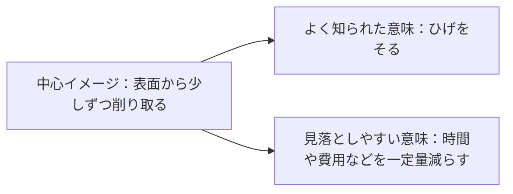

**重要語法**：shave X off Y（YからXを削減する）

<small>index: 7058 / candidate_id: `ev-07058-phrasal-verb-01`</small>

## 3522. shrug

**品詞**：phrasal verb　 **発音**：/ʃrʌɡ/

<small>よく知られている意味：肩をすくめる</small>

### 見落としやすい意味

**心配や非難を気にせず受け流す**

**例文**：She shrugged off the criticism and continued her work.

**和訳**：彼女は批判を受け流し、仕事を続けた。

**コアイメージ**：中心は「肩を動かして反応を退ける」というイメージです。肩をすくめて気にしない態度が、批判や心配を自分から払いのける表現になります。

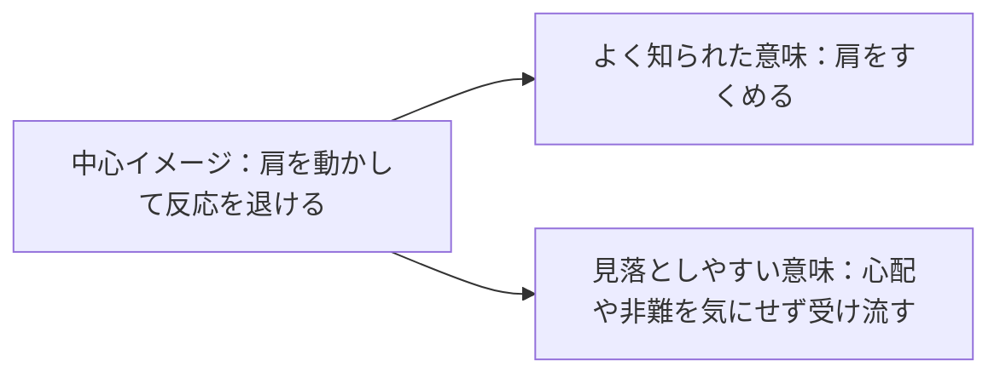

**重要語法**：shrug off criticism（批判を受け流す）

<small>index: 7059 / candidate_id: `ev-07059-phrasal-verb-01`</small>

## 3523. shrug

**品詞**：phrasal verb　 **発音**：/ʃrʌɡ/

<small>よく知られている意味：肩をすくめる</small>

### 見落としやすい意味

**好ましくない影響や評判を振り払う**

**例文**：The company struggled to shrug off its poor reputation.

**和訳**：その会社は悪い評判を払拭するのに苦労した。

**コアイメージ**：中心は「まとわりつくものを振り払う」というイメージです。肩をすくめて離す動作が比喩的に、悪影響や評判を振り払う意味になります。

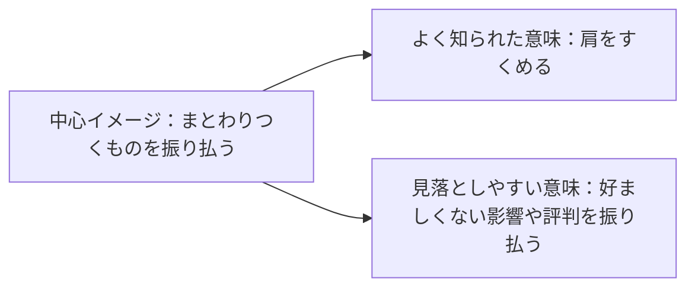

**重要語法**：shrug off a reputation（評判を払拭する）

<small>index: 7059 / candidate_id: `ev-07059-phrasal-verb-02`</small>

## 3524. stare

**品詞**：idiom　 **発音**：/ster/

<small>よく知られている意味：じっと見つめる</small>

### 見落としやすい意味

**答えや事実が目の前にはっきり存在する**

**例文**：The answer had been staring us in the face all along.

**和訳**：答えは最初から私たちの目の前にあった。

**コアイメージ**：中心は「目の前にあるものが強く視線を引く」というイメージです。物がこちらを見つめ返すほど目立つという比喩から、答えが明白なのに見逃している状況を表します。

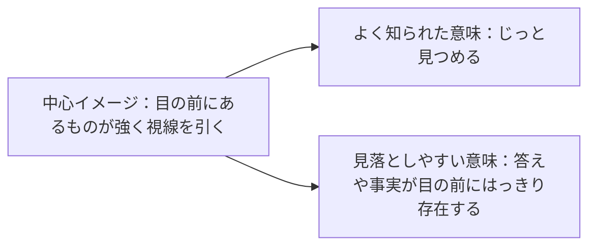

**重要語法**：stare someone in the face（人の目の前に明白にある）

<small>index: 7062 / candidate_id: `ev-07062-idiom-01`</small>

## 3525. ta

**品詞**：interjection　 **発音**：/tɑː/

<small>よく知られている意味：感謝を示す短い言葉</small>

### 見落としやすい意味

**ありがとう（主に英国のくだけた表現）**

**例文**：Ta for helping me with these bags!

**和訳**：荷物を運ぶのを手伝ってくれて、ありがとう！

**コアイメージ**：中心は「短く気軽に感謝を伝える」というイメージです。改まった thank you を短く言う英国口語の表現です。別の物を指す単語だと考えず、会話の感謝表現として理解します。

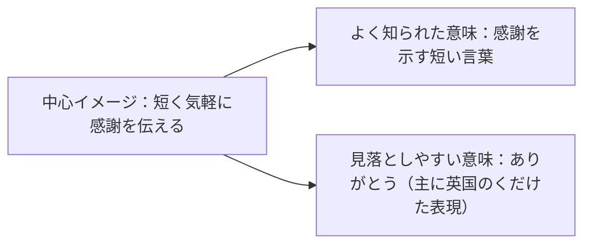

**重要語法**：ta（主に英国のくだけた『ありがとう』）

<small>index: 7066 / candidate_id: `ev-07066-interjection-01`</small>

## 3526. teem

**品詞**：phrasal verb　 **発音**：/tiːm/

<small>よく知られている意味：たくさん存在する</small>

### 見落としやすい意味

**〜であふれている、多数が存在する**

**例文**：The shallow water teems with tiny fish.

**和訳**：その浅瀬には小さな魚がたくさんいる。

**コアイメージ**：中心は「内部に多数が満ちて動く」というイメージです。場所の中が生き物などでいっぱいになるイメージです。with を伴い、何があふれているかを示すことが多いです。

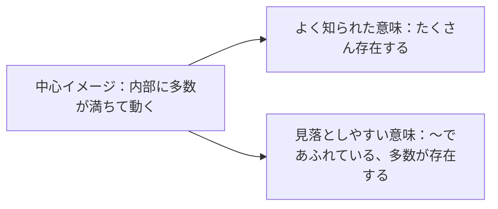

**重要語法**：teem with ...（〜であふれる）

<small>index: 7067 / candidate_id: `ev-07067-phrasal-verb-01`</small>

## 3527. tighten

**品詞**：idiom　 **発音**：/ˈtaɪtən/

<small>よく知られている意味：きつく締める</small>

### 見落としやすい意味

**支出を控えて生活費を切り詰める**

**例文**：As prices rose, we had to tighten our belts.

**和訳**：物価が上がったので、私たちは生活費を切り詰めなければならなかった。

**コアイメージ**：中心は「ベルトを締めて余裕を減らす」というイメージです。ベルトをきつく締める動作を、暮らしの余裕を減らして節約することに重ねた慣用句です。

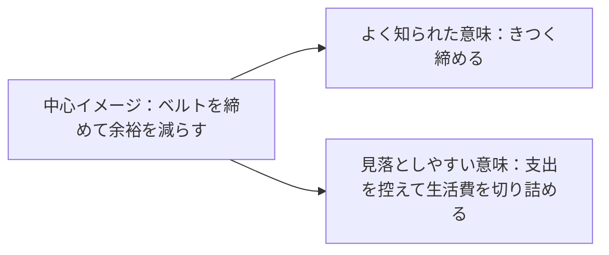

**重要語法**：tighten one's belt（倹約する）

<small>index: 7068 / candidate_id: `ev-07068-idiom-01`</small>

## 3528. vantage

**品詞**：phrase　 **発音**：/ˈvæntɪdʒ/

<small>よく知られている意味：有利な場所・見晴らし</small>

### 見落としやすい意味

**物事を考える上での観点・立場**

**例文**：From a historian's vantage point, the change was inevitable.

**和訳**：歴史家の観点から見ると、その変化は避けられなかった。

**コアイメージ**：中心は「物を見る位置が判断を変える」というイメージです。高い場所からの見晴らしという空間的な位置を、物事を評価する立場や観点に置き換えます。

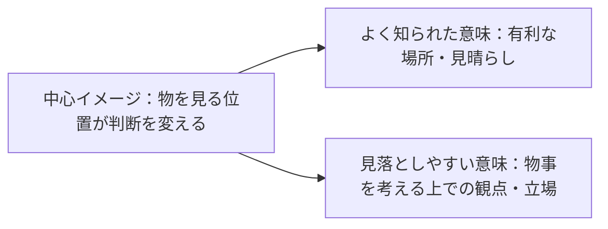

**重要語法**：from a ... vantage point（〜という観点から）

<small>index: 7076 / candidate_id: `ev-07076-phrase-01`</small>

## 3529. vest

**品詞**：verb　 **発音**：/vest/

<small>よく知られている意味：ベスト（袖なしの服）</small>

### 見落としやすい意味

**権限・権利を正式に与える、帰属させる**

**例文**：The law vests final authority in the local council.

**和訳**：法律は最終決定権を地方議会に与えている。

**コアイメージ**：中心は「権限を特定の主体に着せる・持たせる」というイメージです。何かがある主体に備わるという感覚から、権利や権限が法的にその主体に帰属する意味になります。

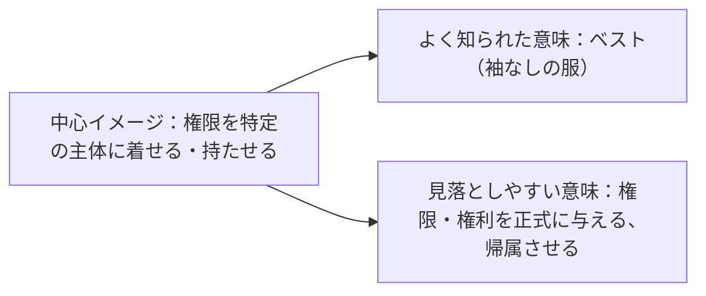

**重要語法**：vest A in B（AをBに与える）

<small>index: 7077 / candidate_id: `ev-07077-verb-01`</small>

## 3530. mid

**品詞**：adjective　 **発音**：/mɪd/

<small>よく知られている意味：中間の</small>

### 見落としやすい意味

**いまひとつの、平凡な（口語・俗語）**

**例文**：The movie looked promising, but it was pretty mid.

**和訳**：その映画は期待できそうだったが、実際はかなり平凡だった。

**コアイメージ**：中心は「評価の真ん中にとどまる」というイメージです。高評価でも低評価でもない中間という意味が、くだけた言葉で『特に良くない・平凡だ』という評価になります。

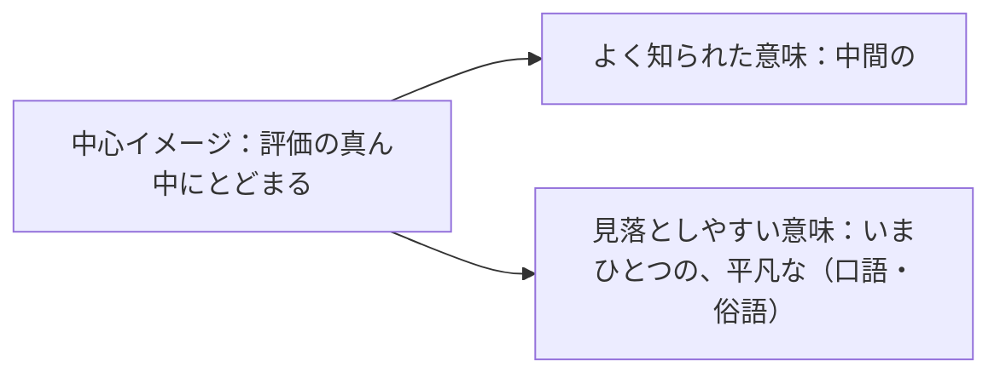

**重要語法**：mid（俗語・くだけた評価）

<small>index: 7081 / candidate_id: `ev-07081-adjective-01`</small>

## 3531. breathe

**品詞**：idiom　 **発音**：/briːð/

<small>よく知られている意味：呼吸する</small>

### 見落としやすい意味

**活動・計画などに活気や新しい力を与える**

**例文**：The new coach breathed fresh life into the team.

**和訳**：新しいコーチはチームに新たな活気を吹き込んだ。

**コアイメージ**：中心は「息を吹き込んで生命を与える」というイメージです。呼吸が生命を支えることから、活動や組織に新しい勢いを与えるという比喩になります。

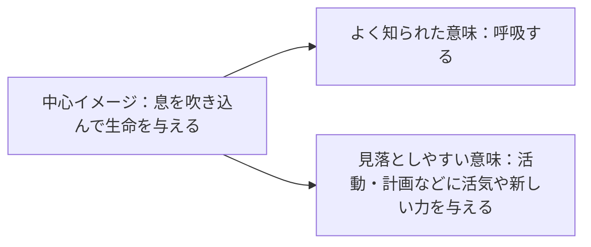

**重要語法**：breathe new/fresh life into ...（〜に新しい活力を与える）

<small>index: 7083 / candidate_id: `ev-07083-idiom-01`</small>

## 3532. ham

**品詞**：phrasal verb　 **発音**：/hæm/

<small>よく知られている意味：ハム（肉）</small>

### 見落としやすい意味

**大げさでわざとらしい演技をする**

**例文**：The actor hammed it up during the final scene.

**和訳**：その俳優は最後の場面で大げさな演技をした。

**コアイメージ**：中心は「人前で演技を誇張する」というイメージです。目立つように演じるという口語的な使い方です。ham it up で、自然な演技より大げさに振る舞うことを表します。

**重要語法**：ham it up（大げさに演じる）

<small>index: 7084 / candidate_id: `ev-07084-phrasal-verb-01`</small>

## 3533. elbow

**品詞**：verb　 **発音**：/ˈelboʊ/

<small>よく知られている意味：肘（名詞）</small>

### 見落としやすい意味

**肘で押す、押し分けて進む**

**例文**：She elbowed her way through the crowded station.

**和訳**：彼女は混雑した駅で人を押し分けて進んだ。

**コアイメージ**：中心は「肘で道を開く」というイメージです。体の部位を表す名詞が動詞となり、肘を使って人を押す動作や、押し分けて前へ進む行為を表します。

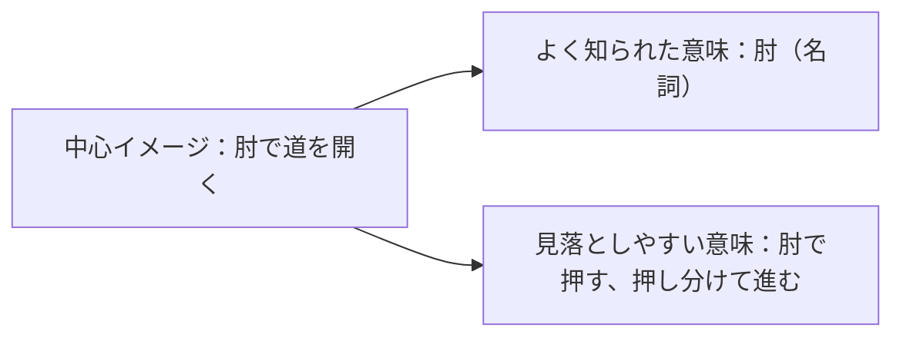

**重要語法**：elbow one's way through ...（〜を押し分ける）

<small>index: 7091 / candidate_id: `ev-07091-verb-01`</small>

## 3534. lightly

**品詞**：idiom　 **発音**：/ˈlaɪtli/

<small>よく知られている意味：軽く・そっと</small>

### 見落としやすい意味

**軽く考えたり軽視したりすべきではない**

**例文**：The safety warning should not be taken lightly.

**和訳**：その安全上の警告を軽く受け止めてはならない。

**コアイメージ**：中心は「重みを小さく見積もる」というイメージです。軽さを重視しなくてもよいという判断に重ねた表現です。否定形で、重大さを見落としてはいけないと警告します。

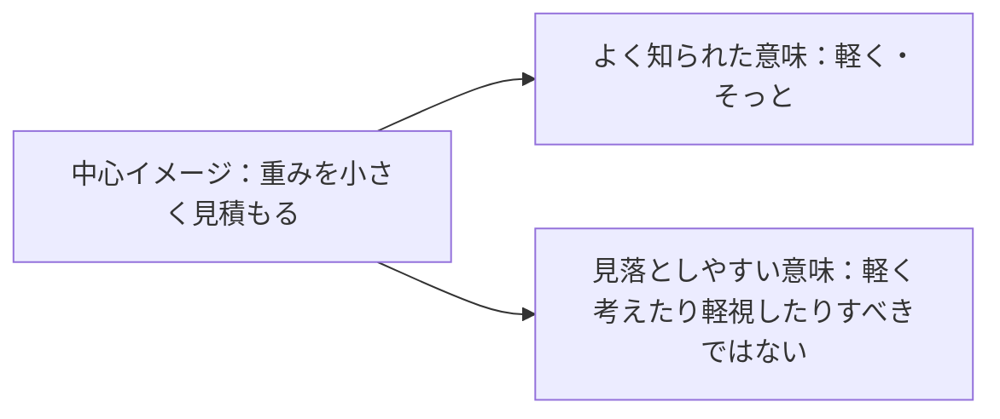

**重要語法**：not take ... lightly（〜を軽視しない）

<small>index: 7093 / candidate_id: `ev-07093-idiom-01`</small>

## 3535. stuck

**品詞**：adjective　 **発音**：/stʌk/

<small>よく知られている意味：動けない・くっついた</small>

### 見落としやすい意味

**（問題に行き詰まって）どうしてよいか分からない**

**例文**：I'm stuck on the final question of the worksheet.

**和訳**：私はプリントの最後の問題で行き詰まっている。

**コアイメージ**：中心は「先へ進めず止まる」というイメージです。物が動かなくなる状態を、思考や問題解決が先に進まなくなる状況へ広げた意味です。

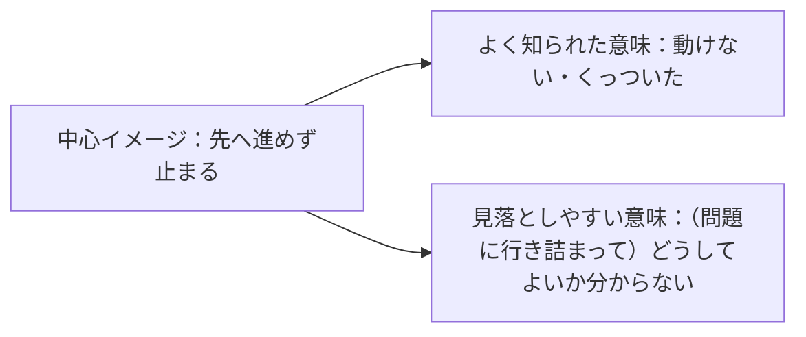

**重要語法**：be stuck on ...（〜で行き詰まる）

<small>index: 7094 / candidate_id: `ev-07094-adjective-01`</small>

## 3536. plum

**品詞**：adjective　 **発音**：/plʌm/

<small>よく知られている意味：スモモ</small>

### 見落としやすい意味

**魅力的で条件のよい、誰もが欲しがるような**

**例文**：She landed a plum job at a research institute.

**和訳**：彼女は研究機関でとても条件のよい仕事を得た。

**コアイメージ**：中心は「価値が高く欲しがられるもの」というイメージです。おいしい実の価値を連想させる比喩から、誰もが手に入れたい好条件の仕事や役目を表します。

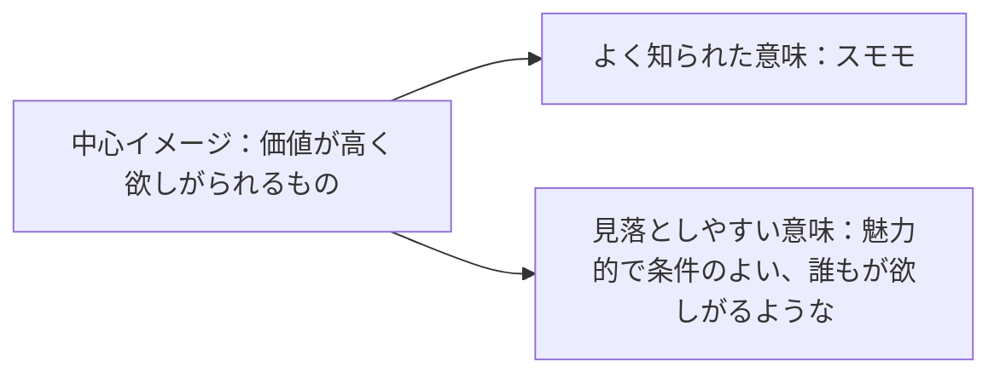

**重要語法**：a plum job（好条件の仕事）

<small>index: 7095 / candidate_id: `ev-07095-adjective-01`</small>

## 3537. comfortably

**品詞**：phrase　 **発音**：/ˈkʌmftəbli/

<small>よく知られている意味：快適に</small>

### 見落としやすい意味

**生活に困らない程度に経済的余裕がある**

**例文**：After years of saving, the couple were comfortably off.

**和訳**：長年の貯蓄のおかげで、その夫婦には生活に困らない余裕があった。

**コアイメージ**：中心は「暮らしに十分な余裕がある」というイメージです。不自由なく快適という意味が、生活費を心配せずに済む経済状態へつながります。

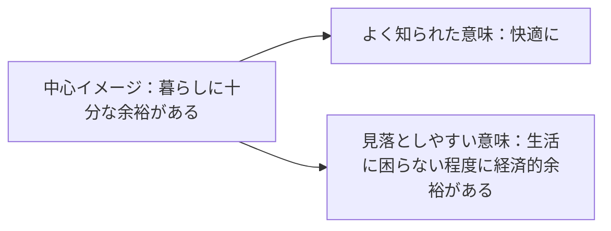

**重要語法**：comfortably off（経済的に余裕がある）

<small>index: 7096 / candidate_id: `ev-07096-phrase-01`</small>

## 3538. mint

**品詞**：adjective　 **発音**：/mɪnt/

<small>よく知られている意味：ミント・ハッカ</small>

### 見落としやすい意味

**未使用で新品同様の**

**例文**：The secondhand camera was still in mint condition.

**和訳**：その中古カメラはまだ新品同様の状態だった。

**コアイメージ**：中心は「傷や使用感のない新しさ」というイメージです。造幣局で作られたばかりの硬貨のような新品の状態から、中古品でもほぼ未使用の良好な状態を表します。

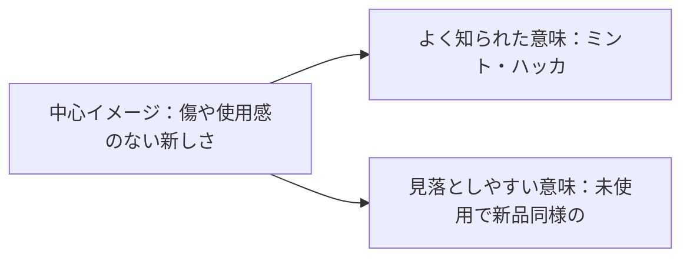

**重要語法**：in mint condition（新品同様の状態で）

<small>index: 7098 / candidate_id: `ev-07098-adjective-01`</small>

## 3539. mint

**品詞**：noun　 **発音**：/mɪnt/

<small>よく知られている意味：ミント・ハッカ</small>

### 見落としやすい意味

**大金、多額の金銭**

**例文**：He made a mint by selling his old collection.

**和訳**：彼は昔のコレクションを売って大金を稼いだ。

**コアイメージ**：中心は「貨幣が大量に生み出される」というイメージです。mint には造幣局の意味もあります。お金を作る場所から連想して、くだけた表現で大金を指します。

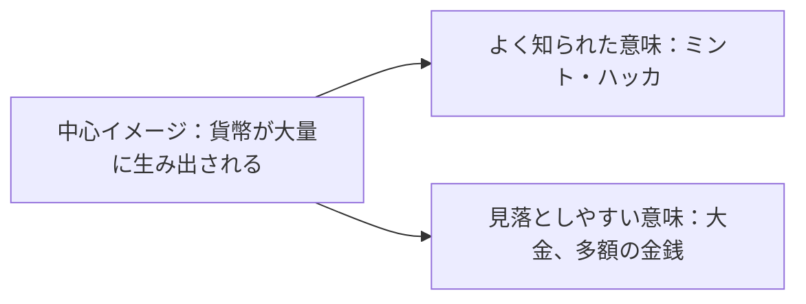

**重要語法**：make a mint（大金を稼ぐ）

<small>index: 7098 / candidate_id: `ev-07098-noun-01`</small>

## 3540. cube

**品詞**：verb　 **発音**：/kjuːb/

<small>よく知られている意味：立方体（名詞）</small>

### 見落としやすい意味

**数を3乗する**

**例文**：Cube the number before dividing the result by two.

**和訳**：その数を3乗してから、結果を2で割りなさい。

**コアイメージ**：中心は「同じ量を三つ掛け合わせる」というイメージです。立方体の体積を求める計算に基づき、数を3乗する動詞として使われます。

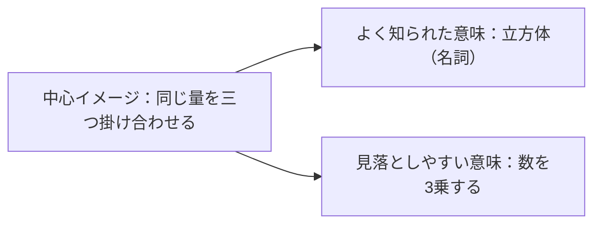

**重要語法**：cube a number（数を3乗する）

<small>index: 7101 / candidate_id: `ev-07101-verb-01`</small>
