# EasyVoca 完成教材｜Batch 046

- 採用済み語義の順序：global_order 3601〜3680
- 対象：80件（mainの採用済み候補をindex → candidate_id順に整列）
- 各カードは既存の採用候補から作成。例文・説明・模式図は独自作成。

## 3601. banish

**品詞：** 動詞（verb）  
**発音：** /ˈbænɪʃ/

<small>よく知られている意味：追放する</small>

### 見落としやすい意味

**考え・恐怖などを頭から追い払う**

**例文：** She tried to banish the fear of failure from her mind.

**和訳：** 彼女は失敗への恐怖を頭から追い払おうとした。

**コアイメージ：** 人をある土地から追放するように、心に居座る不安や疑念も外へ追い出すと捉える。物理的な追放が心理的な排除に広がった用法。

**図：**

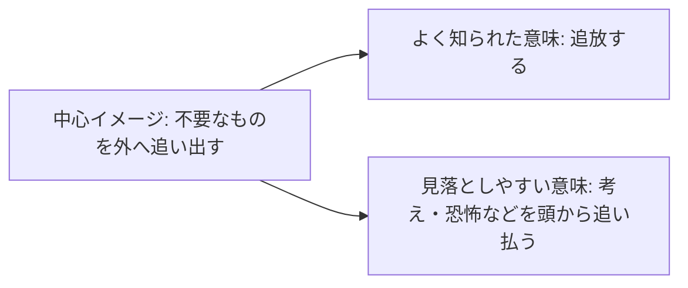

**重要語法：** banish doubts / fears from one's mind

<small>index: 7275 ／ candidate_id: `ev-07275-verb-01`</small>

---

## 3602. booster

**品詞：** 名詞（noun）  
**発音：** /ˈbuːstər/

<small>よく知られている意味：追加接種・増幅装置</small>

### 見落としやすい意味

**ある事業・地域などを熱心に応援・宣伝する人**

**例文：** Local boosters promoted the town's new arts festival.

**和訳：** 地元の熱心な支援者たちが町の新しい芸術祭を宣伝した。

**コアイメージ：** boosterは勢いを強めるものを表す。装置だけでなく、地域や事業を後押しする熱心な人にも使う。

**図：**

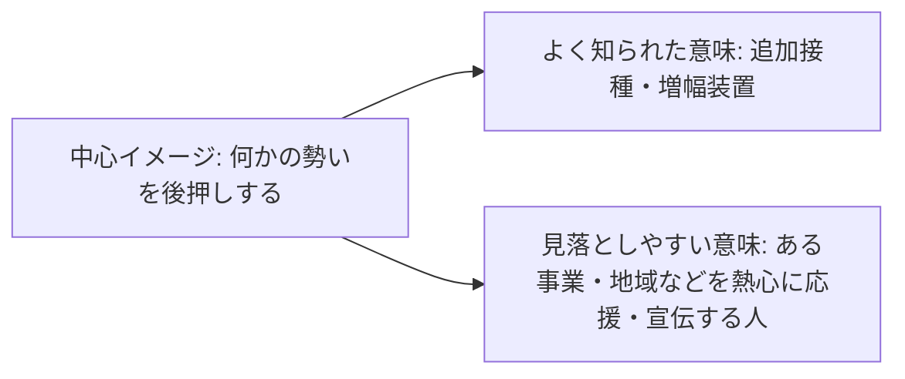

**重要語法：** a tourism booster; local boosters

<small>index: 7278 ／ candidate_id: `ev-07278-noun-01`</small>

---

## 3603. cherish

**品詞：** 動詞（verb）  
**発音：** /ˈtʃerɪʃ/

<small>よく知られている意味：（人や思い出を）大切にする</small>

### 見落としやすい意味

**希望・夢・信念を大切に心に抱く**

**例文：** She cherished the hope of seeing her family again.

**和訳：** 彼女は家族に再会する希望を大切に抱き続けた。

**コアイメージ：** 人や思い出を大切に守る感覚が、希望や信念にも向かう。実現していない願いも心に持ち続けられる。

**図：**

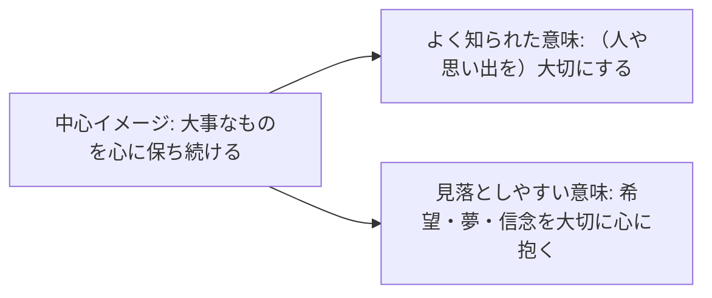

**重要語法：** cherish a hope / dream / belief

<small>index: 7284 ／ candidate_id: `ev-07284-verb-01`</small>

---

## 3604. coinage

**品詞：** 名詞（noun）  
**発音：** /ˈkɔɪnɪdʒ/

<small>よく知られている意味：硬貨の製造・鋳造</small>

### 見落としやすい意味

**新語・新表現、またはそれを作ること**

**例文：** The writer introduced a clever coinage to describe the trend.

**和訳：** その作家は、その流行を表す巧みな新語を生み出した。

**コアイメージ：** 硬貨を鋳造するように、新しい言葉や表現を生み出すこともcoinageという。作られた新語そのものを指すこともある。

**図：**

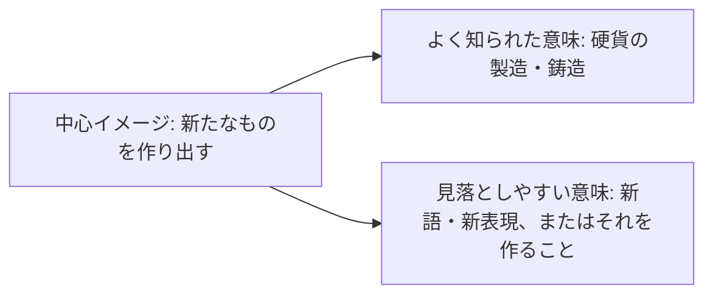

**重要語法：** a recent coinage; the coinage of a term

<small>index: 7285 ／ candidate_id: `ev-07285-noun-01`</small>

---

## 3605. confound

**品詞：** 動詞（verb）  
**発音：** /kənˈfaʊnd/

<small>よく知られている意味：混乱させる</small>

### 見落としやすい意味

**予測・期待を覆して驚かせる**

**例文：** The results confounded the experts' predictions.

**和訳：** その結果は専門家たちの予測を覆した。

**コアイメージ：** 想定した筋道が崩れると、人は戸惑う。confoundは混乱させるだけでなく、予想や期待を裏切る結果を表せる。

**図：**

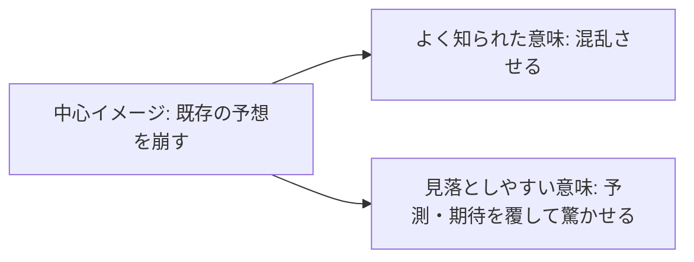

**重要語法：** confound expectations / predictions

<small>index: 7286 ／ candidate_id: `ev-07286-verb-01`</small>

---

## 3606. cram

**品詞：** 動詞（verb）  
**発音：** /kræm/

<small>よく知られている意味：ぎゅうぎゅうに詰め込む</small>

### 見落としやすい意味

**試験のために短期間で詰め込み勉強する**

**例文：** He crammed for the history exam all weekend.

**和訳：** 彼は週末じゅう歴史の試験に向けて詰め込み勉強をした。

**コアイメージ：** 物を限られた空間に押し込むように、知識を短時間で頭に詰め込む。試験直前の集中的な勉強に使われる。

**図：**

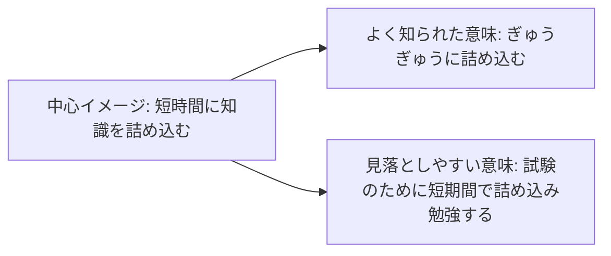

**重要語法：** cram for an exam

<small>index: 7290 ／ candidate_id: `ev-07290-verb-01`</small>

---

## 3607. decency

**品詞：** 熟語（idiom）  
**発音：** /ˈdiːsənsi/

<small>よく知られている意味：礼儀・品位</small>

### 見落としやすい意味

**最低限の礼儀として〜する**

**例文：** You could at least have the decency to reply.

**和訳：** せめて返事をするくらいの礼儀はわきまえてほしい。

**コアイメージ：** decencyは他人に対する基本的な礼儀を表す。have the decency to doは、当然すべきことさえしない相手を非難する場合が多い。

**図：**

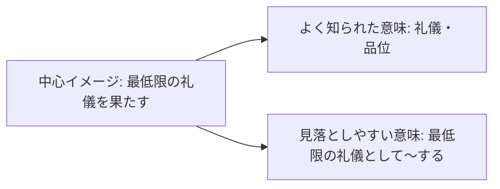

**重要語法：** have the decency to do

<small>index: 7295 ／ candidate_id: `ev-07295-idiom-01`</small>

---

## 3608. drove

**品詞：** 名詞（noun）  
**発音：** /droʊv/

<small>よく知られている意味：driveの過去形「運転した」</small>

### 見落としやすい意味

**大勢の人の群れ（複数形）**

**例文：** Visitors arrived in droves after the exhibition opened.

**和訳：** 展覧会が始まると、大勢の来場者が押し寄せた。

**コアイメージ：** droveには群れ・集団を表す名詞もある。特にin drovesは、多数の人が次々に集まる様子を表す。

**図：**

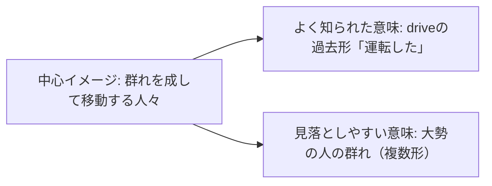

**重要語法：** in droves（大挙して）

<small>index: 7300 ／ candidate_id: `ev-07300-noun-01`</small>

---

## 3609. earmark

**品詞：** 動詞（verb）  
**発音：** /ˈɪrmɑːrk/

<small>よく知られている意味：目印を付ける</small>

### 見落としやすい意味

**特定の用途のために予算・資源を確保する**

**例文：** The city earmarked funds for repairing old bridges.

**和訳：** 市は古い橋の修理に使う資金を確保した。

**コアイメージ：** もともとは特定できるよう印を付ける発想。予算や資源に用途の印を付け、ほかに使わないよう取り分ける意味になる。

**図：**

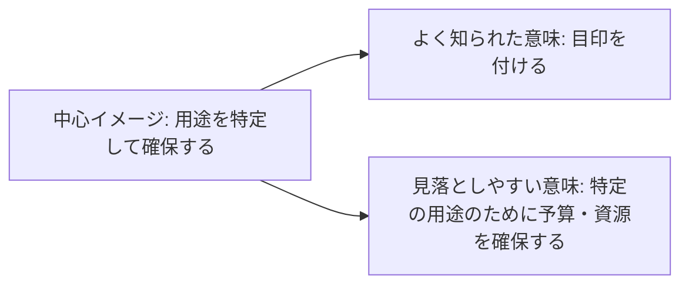

**重要語法：** earmark funds for something

<small>index: 7301 ／ candidate_id: `ev-07301-verb-01`</small>

---

## 3610. eloquent

**品詞：** 形容詞（adjective）  
**発音：** /ˈeləkwənt/

<small>よく知られている意味：雄弁な</small>

### 見落としやすい意味

**言葉を使わずに強く物語る**

**例文：** Her silence was an eloquent answer.

**和訳：** 彼女の沈黙は、言葉以上に雄弁な答えだった。

**コアイメージ：** eloquentの中心は、思いや意味が強く伝わること。言葉が上手な人だけでなく、沈黙や表情にも使える。

**図：**

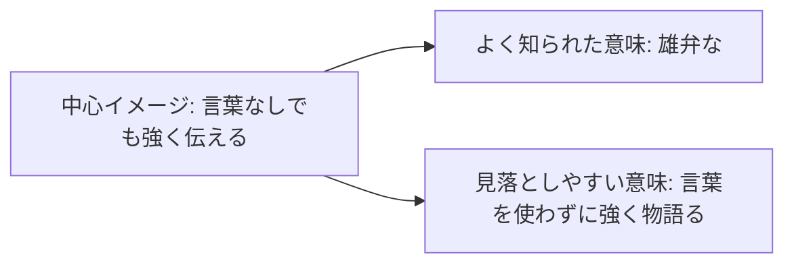

**重要語法：** an eloquent silence; eloquent testimony

<small>index: 7302 ／ candidate_id: `ev-07302-adjective-01`</small>

---

## 3611. elude

**品詞：** 動詞（verb）  
**発音：** /ɪˈluːd/

<small>よく知られている意味：追跡や捕獲を逃れる</small>

### 見落としやすい意味

**理解・記憶・把握ができない**

**例文：** The answer continued to elude me.

**和訳：** その答えはどうしても思い浮かばなかった。

**コアイメージ：** 捕まえようとする相手が逃げるのと同様に、答えや記憶が頭の中でつかまらない。『私が逃れる』でなく『答えが私を逃れる』という形になる。

**図：**

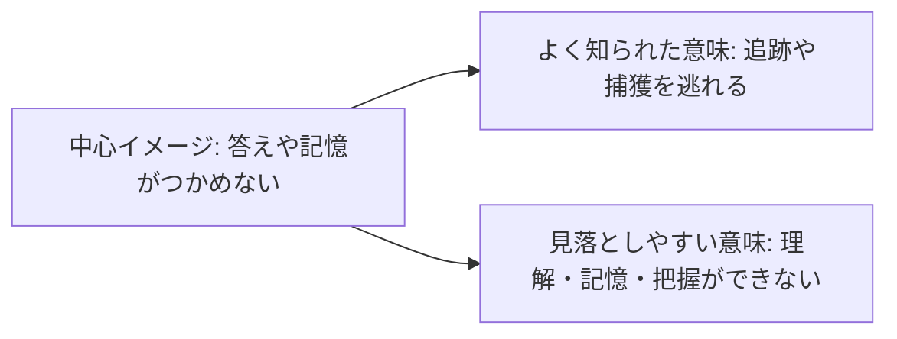

**重要語法：** The answer / name eludes me.

<small>index: 7303 ／ candidate_id: `ev-07303-verb-01`</small>

---

## 3612. flatly

**品詞：** 副詞（adverb）  
**発音：** /ˈflætli/

<small>よく知られている意味：平らに・単調に</small>

### 見落としやすい意味

**断固として、きっぱりと**

**例文：** She flatly refused the offer.

**和訳：** 彼女はその申し出をきっぱり断った。

**コアイメージ：** flatlyは発言の調子に起伏や曖昧さがないことを表せる。拒絶や否定では、ためらいや譲歩のない言い方になる。

**図：**

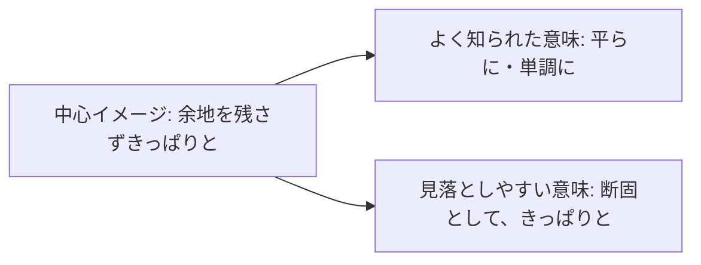

**重要語法：** flatly refuse / deny

<small>index: 7308 ／ candidate_id: `ev-07308-adverb-01`</small>

---

## 3613. fuzzy

**品詞：** 形容詞（adjective）  
**発音：** /ˈfʌzi/

<small>よく知られている意味：毛羽立った</small>

### 見落としやすい意味

**記憶・輪郭・論点などがはっきりしない**

**例文：** My memory of that day is still fuzzy.

**和訳：** その日の記憶は今もぼんやりしている。

**コアイメージ：** 毛羽立った輪郭は境界がはっきり見えない。その見えにくさが記憶や考えの不明確さに広がった。

**図：**

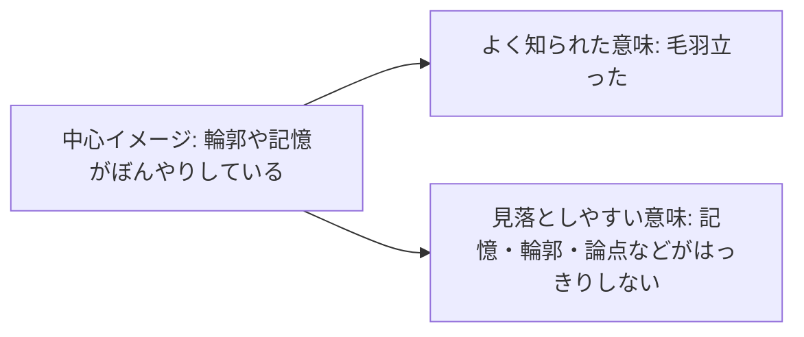

**重要語法：** a fuzzy memory; fuzzy logic

<small>index: 7313 ／ candidate_id: `ev-07313-adjective-01`</small>

---

## 3614. goodness

**品詞：** 間投詞（interjection）  
**発音：** /ˈɡʊdnəs/

<small>よく知られている意味：善良さ・よさ</small>

### 見落としやすい意味

**なんてことだ、まあ（驚き）**

**例文：** Oh my goodness, the train is already here!

**和訳：** まあ大変、もう電車が来ている！

**コアイメージ：** goodnessは善良さを表す名詞だが、感嘆表現では意味を逐語的に訳さない。oh my goodness全体で驚きや戸惑いを表す。

**図：**

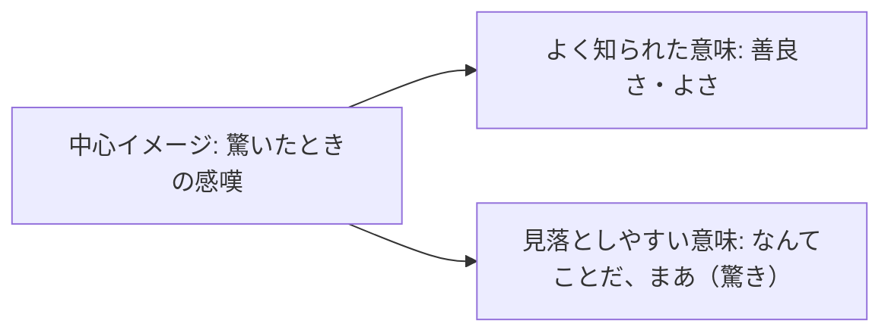

**重要語法：** Oh my goodness!

<small>index: 7317 ／ candidate_id: `ev-07317-interjection-01`</small>

---

## 3615. honeymoon

**品詞：** 名詞（noun）  
**発音：** /ˈhʌnimuːn/

<small>よく知られている意味：新婚旅行・新婚期</small>

### 見落としやすい意味

**関係や制度の始まりの理想的で順調な時期**

**例文：** The new manager's honeymoon with the staff lasted only a month.

**和訳：** 新任マネジャーと職員たちの良好な関係は、最初の1か月しか続かなかった。

**コアイメージ：** 新婚初期の幸福で摩擦が少ない期間からの比喩。新しい政権や上司と周囲との間の、問題が表面化する前の良好な時期にも使う。

**図：**

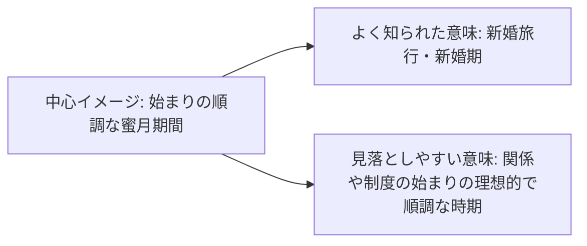

**重要語法：** a political honeymoon; honeymoon period

<small>index: 7322 ／ candidate_id: `ev-07322-noun-01`</small>

---

## 3616. hopefully

**品詞：** 文副詞（sentence adverb）  
**発音：** /ˈhoʊpfəli/

<small>よく知られている意味：希望を抱いた様子で</small>

### 見落としやすい意味

**うまくいけば、願わくば**

**例文：** Hopefully, the weather will improve by Friday.

**和訳：** うまくいけば、金曜日までには天気が回復するだろう。

**コアイメージ：** 動作の様子を説明する副詞から、話し手の期待を示す文副詞としても使われる。文頭のhopefullyは、誰かが希望に満ちた表情で動作する意味とは限らない。

**図：**

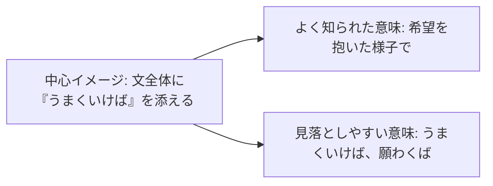

**重要語法：** Hopefully, ...（願わくば〜）

<small>index: 7323 ／ candidate_id: `ev-07323-sentence-adverb-01`</small>

---

## 3617. hung

**品詞：** 形容詞（adjective）  
**発音：** /hʌŋ/

<small>よく知られている意味：つるされた（hangの過去分詞）</small>

### 見落としやすい意味

**（議会が）どの党も過半数を持たない**

**例文：** The election produced a hung parliament.

**和訳：** 選挙の結果、どの政党も過半数を持たない議会となった。

**コアイメージ：** 議席の配分が一つの政党に決着しない状態をhung parliamentという。吊り下げられた議会と直訳しない政治用語。

**図：**

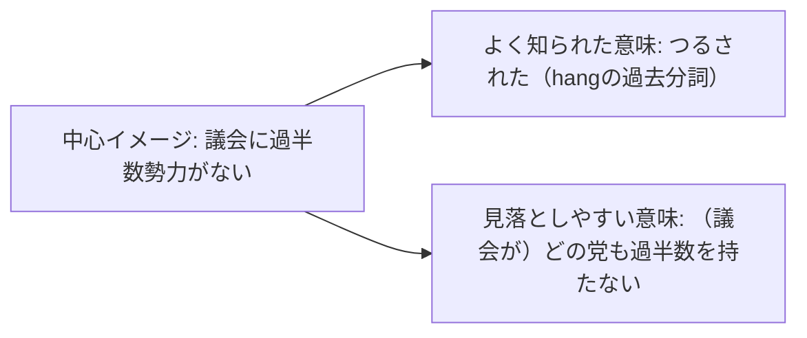

**重要語法：** a hung parliament

<small>index: 7326 ／ candidate_id: `ev-07326-adjective-01`</small>

---

## 3618. immerse

**品詞：** 動詞（verb）  
**発音：** /ɪˈmɜːrs/

<small>よく知られている意味：液体に沈める</small>

### 見落としやすい意味

**ある活動・学習などに深く没頭する**

**例文：** She immersed herself in the language during her stay.

**和訳：** 滞在中、彼女はその言語の学習に没頭した。

**コアイメージ：** 水に体をすっかり浸すように、活動や環境に深く入り込む。周囲のことを忘れるほど集中する意味になる。

**図：**

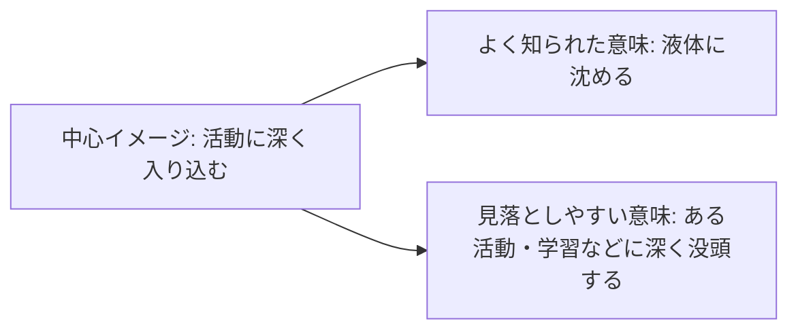

**重要語法：** immerse oneself in something

<small>index: 7330 ／ candidate_id: `ev-07330-verb-01`</small>

---

## 3619. inaugurate

**品詞：** 動詞（verb）  
**発音：** /ɪˈnɔːɡjəreɪt/

<small>よく知られている意味：就任式を行う</small>

### 見落としやすい意味

**新しい活動や時代の始まりを告げる**

**例文：** The discovery inaugurated a new era of research.

**和訳：** その発見は研究の新時代の幕開けとなった。

**コアイメージ：** 就任や式典は新たな役割の始まりを示す。そこから、発見や改革が新時代を切り開く場合にも使える。

**図：**

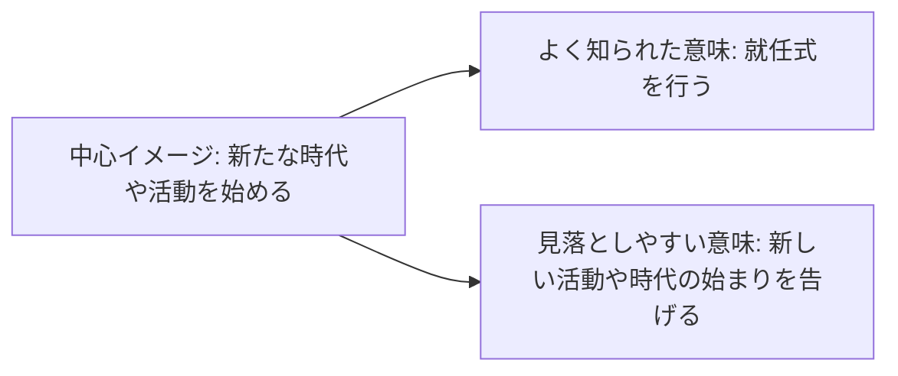

**重要語法：** inaugurate a new era / program

<small>index: 7333 ／ candidate_id: `ev-07333-verb-01`</small>

---

## 3620. knight

**品詞：** 動詞（verb）  
**発音：** /naɪt/

<small>よく知られている意味：騎士（名詞）</small>

### 見落としやすい意味

**人物にナイト爵を授ける**

**例文：** The queen knighted the scientist for her work.

**和訳：** 女王はその科学者の功績をたたえてナイト爵を授けた。

**コアイメージ：** knightは騎士を表す名詞であると同時に、称号を授ける動詞にもなる。『騎士にする』という働きが動詞の意味。

**図：**

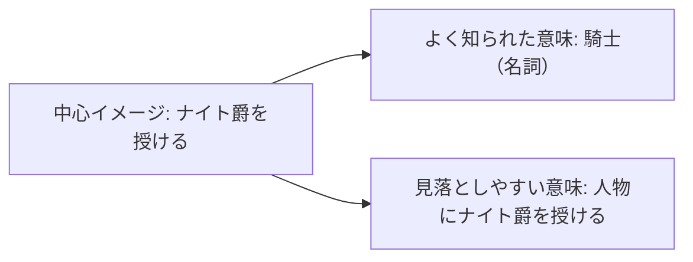

**重要語法：** be knighted for one's services

<small>index: 7339 ／ candidate_id: `ev-07339-verb-01`</small>

---

## 3621. knowingly

**品詞：** 副詞（adverb）  
**発音：** /ˈnoʊɪŋli/

<small>よく知られている意味：物知りそうに・意味ありげに</small>

### 見落としやすい意味

**事情を知った上で故意に、承知で**

**例文：** The company knowingly sold defective products.

**和訳：** その会社は欠陥を承知のうえで製品を販売した。

**コアイメージ：** 知っている様子を示すだけでなく、知識があった状態で意図的に行動したことも表す。責任を問う文章では『承知で』が重要。

**図：**

```mermaid
flowchart LR
    A["中心イメージ: 事実を知りながら故意に"]
    B["よく知られた意味: 物知りそうに・意味ありげに"]
    C["見落としやすい意味: 事情を知った上で故意に、承知で"]
    A --> B
    A --> C
```

**重要語法：** knowingly violate a rule

<small>index: 7340 ／ candidate_id: `ev-07340-adverb-01`</small>

---

## 3622. mammoth

**品詞：** 形容詞（adjective）  
**発音：** /ˈmæməθ/

<small>よく知られている意味：マンモス（動物）</small>

### 見落としやすい意味

**非常に大きい、途方もない規模の**

**例文：** The team faced a mammoth task.

**和訳：** チームは途方もなく大きな課題に直面した。

**コアイメージ：** 巨大な動物マンモスの大きさを比喩に使う。仕事、費用、計画などの規模が非常に大きいことを示す。

**図：**

```mermaid
flowchart LR
    A["中心イメージ: 巨大な規模の"]
    B["よく知られた意味: マンモス（動物）"]
    C["見落としやすい意味: 非常に大きい、途方もない規模の"]
    A --> B
    A --> C
```

**重要語法：** a mammoth task / project

<small>index: 7348 ／ candidate_id: `ev-07348-adjective-01`</small>

---

## 3623. massage

**品詞：** 動詞（verb）  
**発音：** /məˈsɑːʒ/

<small>よく知られている意味：体をもむ</small>

### 見落としやすい意味

**数値・情報を都合よく加工・操作する**

**例文：** The figures were massaged to make sales look stronger.

**和訳：** 売上がよく見えるように数字が都合よく操作された。

**コアイメージ：** 手で形を整える行為から、データを望ましい見え方に整える比喩になった。中立的な調整ではなく、恣意的な操作を含む場合がある。

**図：**

```mermaid
flowchart LR
    A["中心イメージ: 情報や数字を都合よく操作する"]
    B["よく知られた意味: 体をもむ"]
    C["見落としやすい意味: 数値・情報を都合よく加工・操作する"]
    A --> B
    A --> C
```

**重要語法：** massage the figures / data

<small>index: 7349 ／ candidate_id: `ev-07349-verb-01`</small>

---

## 3624. navy

**品詞：** 形容詞（adjective）  
**発音：** /ˈneɪvi/

<small>よく知られている意味：海軍</small>

### 見落としやすい意味

**濃紺色の**

**例文：** He wore a navy jacket to the ceremony.

**和訳：** 彼は式典に紺色の上着を着ていった。

**コアイメージ：** navyは海軍を指すが、海軍の制服に結びつく濃い青色も表す。服や色の説明なら色名として読む。

**図：**

```mermaid
flowchart LR
    A["中心イメージ: 濃い青色・紺色"]
    B["よく知られた意味: 海軍"]
    C["見落としやすい意味: 濃紺色の"]
    A --> B
    A --> C
```

**重要語法：** navy blue; a navy suit

<small>index: 7356 ／ candidate_id: `ev-07356-adjective-01`</small>

---

## 3625. orbit

**品詞：** 名詞（noun）  
**発音：** /ˈɔːrbɪt/

<small>よく知られている意味：天体の軌道</small>

### 見落としやすい意味

**ある人物・組織の影響圏、人間関係の範囲**

**例文：** The adviser remained in the president's orbit for years.

**和訳：** その顧問は何年もの間、大統領の側近グループにとどまった。

**コアイメージ：** 天体が中心の周囲を回るように、人や組織の周囲にも影響を受ける人々が集まる。社会的なつながりや影響圏を表せる。

**図：**

```mermaid
flowchart LR
    A["中心イメージ: 人や組織の影響が及ぶ範囲"]
    B["よく知られた意味: 天体の軌道"]
    C["見落としやすい意味: ある人物・組織の影響圏、人間関係の範囲"]
    A --> B
    A --> C
```

**重要語法：** in someone's orbit

<small>index: 7361 ／ candidate_id: `ev-07361-noun-01`</small>

---

## 3626. outward

**品詞：** 形容詞（adjective）  
**発音：** /ˈaʊtwərd/

<small>よく知られている意味：外へ向かう</small>

### 見落としやすい意味

**外見上の、表に現れた**

**例文：** Despite his outward calm, he was nervous.

**和訳：** 外見は落ち着いていたが、彼は緊張していた。

**コアイメージ：** outwardは内面でなく外側に向いた、または外から見えることを示す。内心と表情が一致しない場面で重要になる。

**図：**

```mermaid
flowchart LR
    A["中心イメージ: 外から見える表面的な"]
    B["よく知られた意味: 外へ向かう"]
    C["見落としやすい意味: 外見上の、表に現れた"]
    A --> B
    A --> C
```

**重要語法：** outward appearance / calm

<small>index: 7364 ／ candidate_id: `ev-07364-adjective-01`</small>

---

## 3627. pantheon

**品詞：** 名詞（noun）  
**発音：** /ˈpænθiɑːn/

<small>よく知られている意味：（神話の）神々全体</small>

### 見落としやすい意味

**ある分野で偉大とみなされる人々の一群・殿堂**

**例文：** She earned a place in the pantheon of great writers.

**和訳：** 彼女は偉大な作家たちの列に名を連ねた。

**コアイメージ：** 神々が並ぶ集まりから、特別に偉大とされる人物たちの集まりへ意味が広がった。所属するだけで高い評価が含まれる。

**図：**

```mermaid
flowchart LR
    A["中心イメージ: その分野の偉大な人々の仲間"]
    B["よく知られた意味: （神話の）神々全体"]
    C["見落としやすい意味: ある分野で偉大とみなされる人々の一群・殿堂"]
    A --> B
    A --> C
```

**重要語法：** the pantheon of great artists

<small>index: 7365 ／ candidate_id: `ev-07365-noun-01`</small>

---

## 3628. perverse

**品詞：** 形容詞（adjective）  
**発音：** /pərˈvɜːrs/

<small>よく知られている意味：ひねくれた・道理に反する</small>

### 見落としやすい意味

**意図に反して悪い結果を生む、ひねくれた**

**例文：** The rule had the perverse effect of increasing waste.

**和訳：** その規則は、かえって廃棄物を増やすという逆効果を生んだ。

**コアイメージ：** 本来望ましい方向とは逆に進むという感覚が中心。perverse effectは、善意の対策が逆効果になる場面に使う。

**図：**

```mermaid
flowchart LR
    A["中心イメージ: 狙いとは逆の悪影響をもたらす"]
    B["よく知られた意味: ひねくれた・道理に反する"]
    C["見落としやすい意味: 意図に反して悪い結果を生む、ひねくれた"]
    A --> B
    A --> C
```

**重要語法：** a perverse effect / incentive

<small>index: 7369 ／ candidate_id: `ev-07369-adjective-01`</small>

---

## 3629. pipeline

**品詞：** 熟語（idiom）  
**発音：** /ˈpaɪplaɪn/

<small>よく知られている意味：パイプライン・配管</small>

### 見落としやすい意味

**計画中で、実現に向けた準備が進んでいる**

**例文：** Several new treatments are in the pipeline.

**和訳：** 新しい治療法がいくつか開発・準備段階にある。

**コアイメージ：** 配管の中を物が次の地点へ運ばれるように、計画も実現へ向けて段階的に進む。in the pipelineはすでに完成したことを意味しない。

**図：**

```mermaid
flowchart LR
    A["中心イメージ: 計画が進行中で実現を待つ"]
    B["よく知られた意味: パイプライン・配管"]
    C["見落としやすい意味: 計画中で、実現に向けた準備が進んでいる"]
    A --> B
    A --> C
```

**重要語法：** in the pipeline

<small>index: 7373 ／ candidate_id: `ev-07373-idiom-01`</small>

---

## 3630. proverbial

**品詞：** 形容詞（adjective）  
**発音：** /prəˈvɜːrbiəl/

<small>よく知られている意味：ことわざの</small>

### 見落としやすい意味

**広く知られた、例の**

**例文：** He finally found the proverbial needle in a haystack.

**和訳：** 彼はついに、干し草の山から針を探すような難題を解決した。

**コアイメージ：** ことわざで知られる典型的な例を指す形容詞。実際のことわざに限らず、広く共有されるイメージを『あの有名な』という感じで示す。

**図：**

```mermaid
flowchart LR
    A["中心イメージ: 誰もが知っている『例の』"]
    B["よく知られた意味: ことわざの"]
    C["見落としやすい意味: 広く知られた、例の"]
    A --> B
    A --> C
```

**重要語法：** the proverbial needle in a haystack

<small>index: 7385 ／ candidate_id: `ev-07385-adjective-01`</small>

---

## 3631. radiate

**品詞：** 動詞（verb）  
**発音：** /ˈreɪdieɪt/

<small>よく知られている意味：熱・光を放射する</small>

### 見落としやすい意味

**自信・幸福・温かさなどを周囲に感じさせる**

**例文：** She radiated confidence during the interview.

**和訳：** 面接中、彼女からは自信があふれていた。

**コアイメージ：** 光や熱が中心から周囲へ広がるように、感情や人柄も周囲に伝わる。本人が何かを直接言わなくても感じ取れる。

**図：**

```mermaid
flowchart LR
    A["中心イメージ: 感情や雰囲気が周囲に伝わる"]
    B["よく知られた意味: 熱・光を放射する"]
    C["見落としやすい意味: 自信・幸福・温かさなどを周囲に感じさせる"]
    A --> B
    A --> C
```

**重要語法：** radiate confidence / warmth

<small>index: 7386 ／ candidate_id: `ev-07386-verb-01`</small>

---

## 3632. rake

**品詞：** 句動詞（phrasal verb）  
**発音：** /reɪk/

<small>よく知られている意味：熊手でかき集める</small>

### 見落としやすい意味

**多額の金銭・利益を稼ぐ、得る**

**例文：** The film raked in millions during its first week.

**和訳：** その映画は公開初週に何百万もの収益を上げた。

**コアイメージ：** 熊手で落ち葉を集める動作が、金銭や利益を大量に得る比喩になった。rake inで『荒稼ぎする』という意味を表す。

**図：**

```mermaid
flowchart LR
    A["中心イメージ: 利益などを大量にかき集める"]
    B["よく知られた意味: 熊手でかき集める"]
    C["見落としやすい意味: 多額の金銭・利益を稼ぐ、得る"]
    A --> B
    A --> C
```

**重要語法：** rake in money / profits

<small>index: 7387 ／ candidate_id: `ev-07387-phrasal-verb-01`</small>

---

## 3633. retrospect

**品詞：** 慣用句（phrase）  
**発音：** /ˈretrəspekt/

<small>よく知られている意味：回想・振り返り</small>

### 見落としやすい意味

**今から過去を振り返って考えると**

**例文：** In retrospect, we should have asked more questions.

**和訳：** 振り返ってみれば、私たちはもっと質問すべきだった。

**コアイメージ：** 過去へ視線を向けることがretrospectの基本。in retrospectは文全体にかかり、後から得た視点で判断することを表す。

**図：**

```mermaid
flowchart LR
    A["中心イメージ: 後から振り返ってみると"]
    B["よく知られた意味: 回想・振り返り"]
    C["見落としやすい意味: 今から過去を振り返って考えると"]
    A --> B
    A --> C
```

**重要語法：** in retrospect

<small>index: 7394 ／ candidate_id: `ev-07394-phrase-01`</small>

---

## 3634. ripple

**品詞：** 動詞（verb）  
**発音：** /ˈrɪpəl/

<small>よく知られている意味：水面のさざ波</small>

### 見落としやすい意味

**影響が周囲へ次第に波及する**

**例文：** The effects of the decision rippled through the industry.

**和訳：** その決定の影響は業界全体へと波及した。

**コアイメージ：** 水面の小さな波紋が外へ広がるように、一つの出来事の影響も周囲へ伝わる。変化が連鎖して広がる様子を表す。

**図：**

```mermaid
flowchart LR
    A["中心イメージ: 影響が次々と波及する"]
    B["よく知られた意味: 水面のさざ波"]
    C["見落としやすい意味: 影響が周囲へ次第に波及する"]
    A --> B
    A --> C
```

**重要語法：** ripple through a community / market

<small>index: 7395 ／ candidate_id: `ev-07395-verb-01`</small>

---

## 3635. rosy

**品詞：** 形容詞（adjective）  
**発音：** /ˈroʊzi/

<small>よく知られている意味：バラ色の・赤みがかった</small>

### 見落としやすい意味

**将来の見通しが明るい、楽観的な**

**例文：** The outlook for the project is not as rosy as expected.

**和訳：** その計画の見通しは期待したほど明るくない。

**コアイメージ：** 明るいバラ色が、希望に満ちた将来のイメージへつながる。rosy outlookは単に色ではなく、好調な予測を表す。

**図：**

```mermaid
flowchart LR
    A["中心イメージ: 将来が明るい・楽観的な"]
    B["よく知られた意味: バラ色の・赤みがかった"]
    C["見落としやすい意味: 将来の見通しが明るい、楽観的な"]
    A --> B
    A --> C
```

**重要語法：** a rosy outlook / future

<small>index: 7398 ／ candidate_id: `ev-07398-adjective-01`</small>

---

## 3636. seizure

**品詞：** 名詞（noun）  
**発音：** /ˈsiːʒər/

<small>よく知られている意味：押収・奪取</small>

### 見落としやすい意味

**（身体・神経の）発作**

**例文：** The child had a seizure and was taken to a hospital.

**和訳：** その子どもは発作を起こし、病院へ運ばれた。

**コアイメージ：** seizureは何かを突然つかむ・支配する出来事を表す語から派生した名詞。医療の文脈では、突然起こる発作を指す独立した専門用法として理解する。

**図：**

```mermaid
flowchart LR
    A["中心イメージ: 突然起こる身体的な発作"]
    B["よく知られた意味: 押収・奪取"]
    C["見落としやすい意味: （身体・神経の）発作"]
    A --> B
    A --> C
```

**重要語法：** have a seizure

<small>index: 7399 ／ candidate_id: `ev-07399-noun-01`</small>

---

## 3637. stalk

**品詞：** 動詞（verb）  
**発音：** /stɔːk/

<small>よく知られている意味：茎・（獲物に）忍び寄る</small>

### 見落としやすい意味

**怒って大股で歩く、つかつか立ち去る**

**例文：** He stalked out of the room without a word.

**和訳：** 彼は一言も言わず、大股で部屋から出ていった。

**コアイメージ：** stalkには堂々と、こわばった足取りで歩く動詞義もある。stalk outでは怒りや不満が歩き方に表れる。

**図：**

```mermaid
flowchart LR
    A["中心イメージ: 怒って大股で歩く"]
    B["よく知られた意味: 茎・（獲物に）忍び寄る"]
    C["見落としやすい意味: 怒って大股で歩く、つかつか立ち去る"]
    A --> B
    A --> C
```

**重要語法：** stalk out of a room

<small>index: 7405 ／ candidate_id: `ev-07405-verb-01`</small>

---

## 3638. stalk

**品詞：** 動詞（verb）  
**発音：** /stɔːk/

<small>よく知られている意味：植物の茎</small>

### 見落としやすい意味

**相手に気づかれないよう追跡する**

**例文：** The cat stalked a bird in the garden.

**和訳：** 猫は庭で鳥に気づかれないように忍び寄った。

**コアイメージ：** 茎を表す名詞とは別に、獲物をひそかに追う動詞として使う。相手との距離を慎重に詰める動作が中心。

**図：**

```mermaid
flowchart LR
    A["中心イメージ: 気づかれないように忍び寄る"]
    B["よく知られた意味: 植物の茎"]
    C["見落としやすい意味: 相手に気づかれないよう追跡する"]
    A --> B
    A --> C
```

**重要語法：** stalk prey; stalk a deer

<small>index: 7405 ／ candidate_id: `ev-07405-verb-02`</small>

---

## 3639. subdue

**品詞：** 動詞（verb）  
**発音：** /səbˈduː/

<small>よく知られている意味：敵を制圧する</small>

### 見落としやすい意味

**気持ち・反応・表現などを抑える**

**例文：** She struggled to subdue her anger.

**和訳：** 彼女は怒りを抑えるのに苦労した。

**コアイメージ：** 外部の抵抗を押さえ込む動作を内面にも向けられる。怒りや興奮が表に出ないよう制御する意味。

**図：**

```mermaid
flowchart LR
    A["中心イメージ: 感情や反応を抑え込む"]
    B["よく知られた意味: 敵を制圧する"]
    C["見落としやすい意味: 気持ち・反応・表現などを抑える"]
    A --> B
    A --> C
```

**重要語法：** subdue one's anger / excitement

<small>index: 7406 ／ candidate_id: `ev-07406-verb-01`</small>

---

## 3640. tacky

**品詞：** 形容詞（adjective）  
**発音：** /ˈtæki/

<small>よく知られている意味：安っぽい・趣味の悪い</small>

### 見落としやすい意味

**（塗料などが）まだ乾かずべたつく**

**例文：** The paint still feels tacky.

**和訳：** その塗料はまだべたべたしている。

**コアイメージ：** tackyには表面がわずかに粘りつくという物理的な意味がある。『趣味が悪い』という評価語と区別し、塗料などの文脈では触感を読む。

**図：**

```mermaid
flowchart LR
    A["中心イメージ: 乾ききらずべたつく"]
    B["よく知られた意味: 安っぽい・趣味の悪い"]
    C["見落としやすい意味: （塗料などが）まだ乾かずべたつく"]
    A --> B
    A --> C
```

**重要語法：** tacky paint / glue

<small>index: 7408 ／ candidate_id: `ev-07408-adjective-01`</small>

---

## 3641. timeline

**品詞：** 名詞（noun）  
**発音：** /ˈtaɪmlaɪn/

<small>よく知られている意味：年表・時系列表</small>

### 見落としやすい意味

**SNSなどで投稿が時間順に表示される一覧**

**例文：** The post appeared on my timeline this morning.

**和訳：** その投稿は今朝、私のタイムラインに表示された。

**コアイメージ：** 出来事を時系列で並べるという構造は同じ。歴史上の出来事からSNS上の投稿へ対象が変わった用法。

**図：**

```mermaid
flowchart LR
    A["中心イメージ: 投稿が並ぶSNSの表示欄"]
    B["よく知られた意味: 年表・時系列表"]
    C["見落としやすい意味: SNSなどで投稿が時間順に表示される一覧"]
    A --> B
    A --> C
```

**重要語法：** social media timeline

<small>index: 7411 ／ candidate_id: `ev-07411-noun-01`</small>

---

## 3642. toast

**品詞：** 名詞（noun）  
**発音：** /toʊst/

<small>よく知られている意味：トーストしたパン</small>

### 見落としやすい意味

**祝意・敬意を表す短い挨拶、乾杯の言葉**

**例文：** She offered a toast to the graduates.

**和訳：** 彼女は卒業生に向けて乾杯の言葉を述べた。

**コアイメージ：** toastには食べ物とは別に、祝いの席で相手の健康や成功を願う言葉という名詞義がある。式典の文脈ではパンではなく祝意を表す。

**図：**

```mermaid
flowchart LR
    A["中心イメージ: 乾杯の挨拶・祝辞"]
    B["よく知られた意味: トーストしたパン"]
    C["見落としやすい意味: 祝意・敬意を表す短い挨拶、乾杯の言葉"]
    A --> B
    A --> C
```

**重要語法：** propose / offer a toast to someone

<small>index: 7412 ／ candidate_id: `ev-07412-noun-01`</small>

---

## 3643. trumpet

**品詞：** 動詞（verb）  
**発音：** /ˈtrʌmpɪt/

<small>よく知られている意味：トランペット（楽器）</small>

### 見落としやすい意味

**成功・功績・主張などを大々的に吹聴する**

**例文：** The company trumpeted its latest achievements.

**和訳：** その会社は最新の実績を大々的に宣伝した。

**コアイメージ：** トランペットの音が遠くまで響くように、功績や主張を多くの人へ強く知らせる。控えめな報告ではなく、目立つ宣伝の響きがある。

**図：**

```mermaid
flowchart LR
    A["中心イメージ: 大声で宣伝する・吹聴する"]
    B["よく知られた意味: トランペット（楽器）"]
    C["見落としやすい意味: 成功・功績・主張などを大々的に吹聴する"]
    A --> B
    A --> C
```

**重要語法：** trumpet one's success

<small>index: 7415 ／ candidate_id: `ev-07415-verb-01`</small>

---

## 3644. vet

**品詞：** 動詞（verb）  
**発音：** /vet/

<small>よく知られている意味：獣医師</small>

### 見落としやすい意味

**人物・資料の適格性や正確さを慎重に審査する**

**例文：** All applicants are carefully vetted before interviews.

**和訳：** 応募者は全員、面接前に慎重に審査される。

**コアイメージ：** vetはもとは獣医師を指す語だが、動詞として専門的に調べるという意味を持つ。人物や情報を信頼してよいか確かめる場面で使う。

**図：**

```mermaid
flowchart LR
    A["中心イメージ: 適格性や内容を慎重に審査する"]
    B["よく知られた意味: 獣医師"]
    C["見落としやすい意味: 人物・資料の適格性や正確さを慎重に審査する"]
    A --> B
    A --> C
```

**重要語法：** vet a candidate / source

<small>index: 7419 ／ candidate_id: `ev-07419-verb-01`</small>

---

## 3645. virtuous

**品詞：** 熟語（idiom）  
**発音：** /ˈvɜːrtʃuəs/

<small>よく知られている意味：道徳的に立派な</small>

### 見落としやすい意味

**よい変化が次のよい変化を生む好循環**

**例文：** Lower costs attracted more customers, creating a virtuous circle.

**和訳：** 費用の低下が顧客をさらに呼び込み、好循環が生まれた。

**コアイメージ：** virtuousは『よい』性質を表す。virtuous circleでは、一つの改善が次の改善を生み、互いに強め合う循環を指す。

**図：**

```mermaid
flowchart LR
    A["中心イメージ: よい変化が連鎖する"]
    B["よく知られた意味: 道徳的に立派な"]
    C["見落としやすい意味: よい変化が次のよい変化を生む好循環"]
    A --> B
    A --> C
```

**重要語法：** a virtuous circle / cycle

<small>index: 7420 ／ candidate_id: `ev-07420-idiom-01`</small>

---

## 3646. weary

**品詞：** 形容詞（adjective）  
**発音：** /ˈwɪri/

<small>よく知られている意味：疲れた</small>

### 見落としやすい意味

**〜にうんざりした、飽き飽きした**

**例文：** Residents grew weary of the repeated delays.

**和訳：** 住民たちは度重なる遅延にうんざりしてきた。

**コアイメージ：** 疲労は体だけでなく、同じ不快な状況が続くときにも生じる。weary ofは『〜に飽き飽きした』という心理的な疲れを表す。

**図：**

```mermaid
flowchart LR
    A["中心イメージ: 繰り返しにうんざりした"]
    B["よく知られた意味: 疲れた"]
    C["見落としやすい意味: 〜にうんざりした、飽き飽きした"]
    A --> B
    A --> C
```

**重要語法：** grow weary of something; wary ofと混同しない

<small>index: 7424 ／ candidate_id: `ev-07424-adjective-01`</small>

---

## 3647. winning

**品詞：** 形容詞（adjective）  
**発音：** /ˈwɪnɪŋ/

<small>よく知られている意味：勝っている</small>

### 見落としやすい意味

**人を引きつける魅力的な**

**例文：** Her winning smile put everyone at ease.

**和訳：** 彼女の魅力的な笑顔は皆の緊張をほぐした。

**コアイメージ：** 相手を『勝ち取る』ような魅力から、感じのよい表情や態度を表す。試合に勝つという字義だけではない。

**図：**

```mermaid
flowchart LR
    A["中心イメージ: 人を引きつける"]
    B["よく知られた意味: 勝っている"]
    C["見落としやすい意味: 人を引きつける魅力的な"]
    A --> B
    A --> C
```

**重要語法：** a winning smile / personality

<small>index: 7427 ／ candidate_id: `ev-07427-adjective-01`</small>

---

## 3648. worldly

**品詞：** 形容詞（adjective）  
**発音：** /ˈwɜːrldli/

<small>よく知られている意味：この世の・世俗的な</small>

### 見落としやすい意味

**世慣れた、世間の事情に通じた**

**例文：** His worldly advice helped me avoid a costly mistake.

**和訳：** 世慣れた彼の助言のおかげで、大きな損失につながる失敗を避けられた。

**コアイメージ：** worldlyは現実の世の中に関わることを示す。そこから実社会をよく知る、経験豊富な人の性質を表す。

**図：**

```mermaid
flowchart LR
    A["中心イメージ: 世間経験が豊富な"]
    B["よく知られた意味: この世の・世俗的な"]
    C["見落としやすい意味: 世慣れた、世間の事情に通じた"]
    A --> B
    A --> C
```

**重要語法：** worldly wisdom / experience

<small>index: 7428 ／ candidate_id: `ev-07428-adjective-01`</small>

---

## 3649. bucket

**品詞：** 熟語（idiom）  
**発音：** /ˈbʌkɪt/

<small>よく知られている意味：バケツ</small>

### 見落としやすい意味

**死ぬまでに一度は達成・経験したいことの一覧**

**例文：** Seeing the northern lights is on her bucket list.

**和訳：** オーロラを見ることは、彼女が生きているうちに実現したいことの一つだ。

**コアイメージ：** bucket listは単語bucketの字義だけでは訳せない定型表現。『死ぬまでにしてみたいこと』を並べた一覧を指す。

**図：**

```mermaid
flowchart LR
    A["中心イメージ: 一生のうちにやりたいことの一覧"]
    B["よく知られた意味: バケツ"]
    C["見落としやすい意味: 死ぬまでに一度は達成・経験したいことの一覧"]
    A --> B
    A --> C
```

**重要語法：** bucket list; on one's bucket list

<small>index: 7434 ／ candidate_id: `ev-07434-idiom-01`</small>

---

## 3650. worse

**品詞：** 熟語（idiom）  
**発音：** /wɜːrs/

<small>よく知られている意味：より悪い（badの比較級）</small>

### 見落としやすい意味

**疲れた、くたびれた、傷んだ**

**例文：** After the long journey, the shoes looked the worse for wear.

**和訳：** 長旅のあと、その靴はかなりくたびれて見えた。

**コアイメージ：** wearには使用による摩耗・疲れという意味がある。the worse for wear全体で、人や物が消耗している様子を表す。

**図：**

```mermaid
flowchart LR
    A["中心イメージ: 疲れたり傷んだりした"]
    B["よく知られた意味: より悪い（badの比較級）"]
    C["見落としやすい意味: 疲れた、くたびれた、傷んだ"]
    A --> B
    A --> C
```

**重要語法：** the worse for wear

<small>index: 7437 ／ candidate_id: `ev-07437-idiom-01`</small>

---

## 3651. comb

**品詞：** 動詞（verb）  
**発音：** /koʊm/

<small>よく知られている意味：くしで髪をとかす</small>

### 見落としやすい意味

**場所や資料をくまなく徹底的に捜索する**

**例文：** Researchers combed through the records for clues.

**和訳：** 研究者たちは手がかりを求めて記録をくまなく調べた。

**コアイメージ：** くしの歯を細かく通すように、情報や場所を隅々まで調べる。大まかに見るだけではなく、取りこぼしを防ぐイメージ。

**図：**

```mermaid
flowchart LR
    A["中心イメージ: 細かい所まで徹底して探す"]
    B["よく知られた意味: くしで髪をとかす"]
    C["見落としやすい意味: 場所や資料をくまなく徹底的に捜索する"]
    A --> B
    A --> C
```

**重要語法：** comb through records / a file

<small>index: 7438 ／ candidate_id: `ev-07438-verb-01`</small>

---

## 3652. lid

**品詞：** 熟語（idiom）  
**発音：** /lɪd/

<small>よく知られている意味：ふた</small>

### 見落としやすい意味

**感情・支出・秘密などを抑え、広がらないようにする**

**例文：** The team struggled to keep a lid on costs.

**和訳：** チームは費用の増加を抑えるのに苦労した。

**コアイメージ：** ふたをして中身が外に出ないようにする動作が比喩になる。費用、秘密、感情などが広がるのを抑制する。

**図：**

```mermaid
flowchart LR
    A["中心イメージ: 広がりを抑えて制御する"]
    B["よく知られた意味: ふた"]
    C["見落としやすい意味: 感情・支出・秘密などを抑え、広がらないようにする"]
    A --> B
    A --> C
```

**重要語法：** keep a lid on costs / emotions

<small>index: 7446 ／ candidate_id: `ev-07446-idiom-01`</small>

---

## 3653. interpreter

**品詞：** 名詞（noun）  
**発音：** /ɪnˈtɜːrprətər/

<small>よく知られている意味：通訳者</small>

### 見落としやすい意味

**プログラムを逐次解釈して実行するソフトウェア**

**例文：** The interpreter runs each line of code in turn.

**和訳：** そのインタープリターはコードを1行ずつ順に実行する。

**コアイメージ：** 人間の通訳者は言語の意味を別の形で伝える。コンピューターでは命令を読み解きながら実行するソフトウェアを指す。

**図：**

```mermaid
flowchart LR
    A["中心イメージ: コードを読み取り実行するプログラム"]
    B["よく知られた意味: 通訳者"]
    C["見落としやすい意味: プログラムを逐次解釈して実行するソフトウェア"]
    A --> B
    A --> C
```

**重要語法：** a Python interpreter

<small>index: 7448 ／ candidate_id: `ev-07448-noun-01`</small>

---

## 3654. dated

**品詞：** 形容詞（adjective）  
**発音：** /ˈdeɪtɪd/

<small>よく知られている意味：日付が付けられた</small>

### 見落としやすい意味

**時代遅れの、古臭い**

**例文：** The website's design already looks dated.

**和訳：** そのウェブサイトのデザインはすでに古くさく見える。

**コアイメージ：** 日付が付いているという意味から、古い時代の特徴が表に出ているという評価にもなる。単に古いだけでなく、今の感覚に合わないニュアンスがある。

**図：**

```mermaid
flowchart LR
    A["中心イメージ: 古くさく時代に合わない"]
    B["よく知られた意味: 日付が付けられた"]
    C["見落としやすい意味: 時代遅れの、古臭い"]
    A --> B
    A --> C
```

**重要語法：** look / feel dated

<small>index: 7451 ／ candidate_id: `ev-07451-adjective-01`</small>

---

## 3655. paddle

**品詞：** 熟語（idiom）  
**発音：** /ˈpædəl/

<small>よく知られている意味：水をこぐ道具・櫂</small>

### 見落としやすい意味

**頼れる手段がなく困った状態にある**

**例文：** Without the files, we were up the creek without a paddle.

**和訳：** 必要なファイルがなく、私たちは打つ手のない状態だった。

**コアイメージ：** 流れのある小川で櫂を失うと、行きたい方向へ進めない。その状況を比喩にした熟語で、解決手段がなく困っていることを表す。

**図：**

```mermaid
flowchart LR
    A["中心イメージ: 打つ手がなく困った状態"]
    B["よく知られた意味: 水をこぐ道具・櫂"]
    C["見落としやすい意味: 頼れる手段がなく困った状態にある"]
    A --> B
    A --> C
```

**重要語法：** up the creek without a paddle

<small>index: 7454 ／ candidate_id: `ev-07454-idiom-01`</small>

---

## 3656. whereby

**品詞：** 接続表現（conjunction）  
**発音：** /werˈbaɪ/

<small>よく知られている意味：where＝どこで・by＝〜によって</small>

### 見落としやすい意味

**それによって、そうできるような（方法で）**

**例文：** They devised a system whereby students could share notes safely.

**和訳：** 彼らは生徒が安全にノートを共有できる仕組みを考案した。

**コアイメージ：** wherebyは前に述べた方法・制度と、その方法で可能になることをつなぐ。『その方法によって』と捉えると関係が明確になる。

**図：**

```mermaid
flowchart LR
    A["中心イメージ: それによって実現できる方法を示す"]
    B["よく知られた意味: where＝どこで・by＝〜によって"]
    C["見落としやすい意味: それによって、そうできるような（方法で）"]
    A --> B
    A --> C
```

**重要語法：** a system whereby ...（それによって〜できる仕組み）

<small>index: 7456 ／ candidate_id: `ev-07456-conjunction-01`</small>

---

## 3657. indefinite

**品詞：** 形容詞（adjective）  
**発音：** /ɪnˈdefənət/

<small>よく知られている意味：はっきりしない・不定の</small>

### 見落としやすい意味

**期限・終了時期が決められていない、無期限の**

**例文：** The strike was extended for an indefinite period.

**和訳：** ストライキは終了期限を決めずに延長された。

**コアイメージ：** definiteは境界や内容が明確なこと。indefiniteはその境界が決められておらず、期間ならいつ終わるか未定という意味になる。

**図：**

```mermaid
flowchart LR
    A["中心イメージ: 終了時期が定められていない"]
    B["よく知られた意味: はっきりしない・不定の"]
    C["見落としやすい意味: 期限・終了時期が決められていない、無期限の"]
    A --> B
    A --> C
```

**重要語法：** for an indefinite period; indefinitely

<small>index: 7457 ／ candidate_id: `ev-07457-adjective-01`</small>

---

## 3658. impoverished

**品詞：** 形容詞（adjective）  
**発音：** /ɪmˈpɑːvərɪʃt/

<small>よく知られている意味：経済的に貧しい</small>

### 見落としやすい意味

**表現・発想・考えなどが貧弱な**

**例文：** The report criticized the impoverished debate on education.

**和訳：** その報告書は教育をめぐる議論の貧弱さを批判した。

**コアイメージ：** 貧しさは金銭だけでなく、考えや表現の不足にも使われる。議論の内容が乏しく、十分な広がりがないことを示す。

**図：**

```mermaid
flowchart LR
    A["中心イメージ: 表現や考えが豊かさに欠ける"]
    B["よく知られた意味: 経済的に貧しい"]
    C["見落としやすい意味: 表現・発想・考えなどが貧弱な"]
    A --> B
    A --> C
```

**重要語法：** impoverished language / imagination

<small>index: 7463 ／ candidate_id: `ev-07463-adjective-01`</small>

---

## 3659. proprietary

**品詞：** 形容詞（adjective）  
**発音：** /prəˈpraɪəteri/

<small>よく知られている意味：所有権に関する</small>

### 見落としやすい意味

**特定の企業や所有者が独占的に管理している**

**例文：** The device uses proprietary software.

**和訳：** その機器は特定企業が独占管理するソフトウェアを使っている。

**コアイメージ：** proprietaryは所有者に属するという感覚が中心。技術の文脈では、誰もが自由に利用・改変できるとは限らないことが重要になる。

**図：**

```mermaid
flowchart LR
    A["中心イメージ: 特定の所有者が独占管理する"]
    B["よく知られた意味: 所有権に関する"]
    C["見落としやすい意味: 特定の企業や所有者が独占的に管理している"]
    A --> B
    A --> C
```

**重要語法：** proprietary software / technology

<small>index: 7464 ／ candidate_id: `ev-07464-adjective-01`</small>

---

## 3660. encode

**品詞：** 動詞（verb）  
**発音：** /ɪnˈkoʊd/

<small>よく知られている意味：情報を符号化する</small>

### 見落としやすい意味

**遺伝子がタンパク質などの情報を指定する**

**例文：** This gene encodes a protein involved in growth.

**和訳：** この遺伝子は成長に関わるタンパク質の情報を指定している。

**コアイメージ：** encodeは情報を決まった形で表すこと。生物学では、遺伝子がタンパク質などを作るための情報を持つ関係を表す。

**図：**

```mermaid
flowchart LR
    A["中心イメージ: 遺伝情報として指定する"]
    B["よく知られた意味: 情報を符号化する"]
    C["見落としやすい意味: 遺伝子がタンパク質などの情報を指定する"]
    A --> B
    A --> C
```

**重要語法：** a gene encodes a protein

<small>index: 7465 ／ candidate_id: `ev-07465-verb-01`</small>

---

## 3661. censor

**品詞：** 動詞（verb）  
**発音：** /ˈsensər/

<small>よく知られている意味：検閲官（名詞）</small>

### 見落としやすい意味

**報道・表現などを検閲し削除・制限する**

**例文：** The article was censored before publication.

**和訳：** その記事は公開前に検閲された。

**コアイメージ：** censorは情報を審査して制限する立場の人を指す名詞でもある。同じ形の動詞は、その審査や削除を実行することを表す。

**図：**

```mermaid
flowchart LR
    A["中心イメージ: 表現内容を検閲して制限する"]
    B["よく知られた意味: 検閲官（名詞）"]
    C["見落としやすい意味: 報道・表現などを検閲し削除・制限する"]
    A --> B
    A --> C
```

**重要語法：** censor news / a film

<small>index: 7466 ／ candidate_id: `ev-07466-verb-01`</small>

---

## 3662. churn

**品詞：** 句動詞（phrasal verb）  
**発音：** /tʃɜːrn/

<small>よく知られている意味：かき混ぜる</small>

### 見落としやすい意味

**大量に、次々と作り出す（しばしば質が低い）**

**例文：** The studio keeps churning out cheap sequels.

**和訳：** その制作会社は低予算の続編を次々と量産している。

**コアイメージ：** 液体を絶えずかき回す動きから、生産を休みなく続ける比喩になる。churn outは量が多く、質への批判を含むことがある。

**図：**

```mermaid
flowchart LR
    A["中心イメージ: 大量に次々と作り出す"]
    B["よく知られた意味: かき混ぜる"]
    C["見落としやすい意味: 大量に、次々と作り出す（しばしば質が低い）"]
    A --> B
    A --> C
```

**重要語法：** churn out products / articles

<small>index: 7467 ／ candidate_id: `ev-07467-phrasal-verb-01`</small>

---

## 3663. adept

**品詞：** 名詞（noun）  
**発音：** /əˈdept/

<small>よく知られている意味：熟達した（形容詞）</small>

### 見落としやすい意味

**ある技能に熟達した人**

**例文：** As an adept at negotiation, she settled the dispute quickly.

**和訳：** 交渉の達人である彼女は、その争いをすぐに解決した。

**コアイメージ：** adeptは『熟練している』という性質を表すだけでなく、そのような人を指す名詞にもなる。前に冠詞anがあれば名詞用法を考える。

**図：**

```mermaid
flowchart LR
    A["中心イメージ: 技に長けた人"]
    B["よく知られた意味: 熟達した（形容詞）"]
    C["見落としやすい意味: ある技能に熟達した人"]
    A --> B
    A --> C
```

**重要語法：** an adept at something

<small>index: 7472 ／ candidate_id: `ev-07472-noun-01`</small>

---

## 3664. animated

**品詞：** 形容詞（adjective）  
**発音：** /ˈænəmeɪtɪd/

<small>よく知られている意味：アニメ化された</small>

### 見落としやすい意味

**生き生きとした、熱のこもった**

**例文：** They had an animated discussion after class.

**和訳：** 彼らは放課後、熱のこもった議論をした。

**コアイメージ：** animateは命を吹き込む、活気づけるという感覚を持つ。animatedは絵が動くだけでなく、人の表情や会話が生き生きしていることも表す。

**図：**

```mermaid
flowchart LR
    A["中心イメージ: 生き生きとして熱のこもった"]
    B["よく知られた意味: アニメ化された"]
    C["見落としやすい意味: 生き生きとした、熱のこもった"]
    A --> B
    A --> C
```

**重要語法：** an animated discussion / expression

<small>index: 7476 ／ candidate_id: `ev-07476-adjective-01`</small>

---

## 3665. antidote

**品詞：** 名詞（noun）  
**発音：** /ˈæntidoʊt/

<small>よく知られている意味：毒に対する解毒剤</small>

### 見落としやすい意味

**不満・退屈・問題などの悪影響を和らげるもの**

**例文：** A walk outside can be an antidote to stress.

**和訳：** 外を散歩することはストレスを和らげる助けになる。

**コアイメージ：** 毒を打ち消す解毒剤の役割を、心理的・社会的な問題にも広げる。嫌な状態の影響を弱める手段や活動を指す。

**図：**

```mermaid
flowchart LR
    A["中心イメージ: 悪影響を和らげるもの"]
    B["よく知られた意味: 毒に対する解毒剤"]
    C["見落としやすい意味: 不満・退屈・問題などの悪影響を和らげるもの"]
    A --> B
    A --> C
```

**重要語法：** an antidote to stress / boredom

<small>index: 7477 ／ candidate_id: `ev-07477-noun-01`</small>

---

## 3666. apparatus

**品詞：** 名詞（noun）  
**発音：** /ˌæpəˈrætəs/

<small>よく知られている意味：装置・実験器具</small>

### 見落としやすい意味

**国家・政党などの制度的な機構・組織**

**例文：** The party apparatus organized the campaign.

**和訳：** 党の組織機構がその選挙運動を取り仕切った。

**コアイメージ：** apparatusは複数の部品が役割を分担して動く仕組み。機械だけでなく、国家や政党の運営組織にも使われる。

**図：**

```mermaid
flowchart LR
    A["中心イメージ: 制度を動かす組織機構"]
    B["よく知られた意味: 装置・実験器具"]
    C["見落としやすい意味: 国家・政党などの制度的な機構・組織"]
    A --> B
    A --> C
```

**重要語法：** the state / party apparatus

<small>index: 7478 ／ candidate_id: `ev-07478-noun-01`</small>

---

## 3667. bluff

**品詞：** 名詞（noun）  
**発音：** /blʌf/

<small>よく知られている意味：はったり・虚勢</small>

### 見落としやすい意味

**崖、急な斜面**

**例文：** A narrow path ran along the top of the bluff.

**和訳：** 切り立った崖の上に細い道が続いていた。

**コアイメージ：** bluffには『はったり』とは別に地形を表す名詞義がある。両者を無理に同じ比喩で結びつけず、地理の文脈では崖と判断する。

**図：**

```mermaid
flowchart LR
    A["中心イメージ: 険しく切り立った崖"]
    B["よく知られた意味: はったり・虚勢"]
    C["見落としやすい意味: 崖、急な斜面"]
    A --> B
    A --> C
```

**重要語法：** a steep bluff; a river bluff

<small>index: 7481 ／ candidate_id: `ev-07481-noun-01`</small>

---

## 3668. blunt

**品詞：** 動詞（verb）  
**発音：** /blʌnt/

<small>よく知られている意味：先が丸い・刃が鈍い</small>

### 見落としやすい意味

**感情・影響などを弱める**

**例文：** Nothing could blunt her excitement.

**和訳：** 彼女の興奮を弱められるものは何もなかった。

**コアイメージ：** 鋭い刃の切れ味を鈍くするように、感情や効果の強さも弱められる。抽象名詞が目的語ならこの比喩を考える。

**図：**

```mermaid
flowchart LR
    A["中心イメージ: 感情や影響の強さを弱める"]
    B["よく知られた意味: 先が丸い・刃が鈍い"]
    C["見落としやすい意味: 感情・影響などを弱める"]
    A --> B
    A --> C
```

**重要語法：** blunt the impact / pain

<small>index: 7482 ／ candidate_id: `ev-07482-verb-01`</small>

---

## 3669. breathless

**品詞：** 形容詞（adjective）  
**発音：** /ˈbreθləs/

<small>よく知られている意味：息切れした</small>

### 見落としやすい意味

**興奮・期待・緊張で息をのむような**

**例文：** The audience waited in breathless anticipation.

**和訳：** 観客たちは息をのむような期待の中で待っていた。

**コアイメージ：** 息が止まりそうになるのは運動の後だけではない。強い期待や驚きで息をのむ状態にも使う。

**図：**

```mermaid
flowchart LR
    A["中心イメージ: 期待や緊張で息をのむ"]
    B["よく知られた意味: 息切れした"]
    C["見落としやすい意味: 興奮・期待・緊張で息をのむような"]
    A --> B
    A --> C
```

**重要語法：** breathless anticipation / excitement

<small>index: 7483 ／ candidate_id: `ev-07483-adjective-01`</small>

---

## 3670. climber

**品詞：** 慣用句（phrase）  
**発音：** /ˈklaɪmər/

<small>よく知られている意味：登山者・よじ登る人</small>

### 見落としやすい意味

**上流階級に取り入って社会的地位を上げようとする人**

**例文：** He was dismissed as a social climber.

**和訳：** 彼は社会的地位を上げるために人に取り入る人だと見なされた。

**コアイメージ：** 物理的に上へ登るイメージを、社会的地位の上昇に重ねている。social climberは出世のために人間関係を利用する否定的な響きを持つ。

**図：**

```mermaid
flowchart LR
    A["中心イメージ: 地位を求めて上流に近づく人"]
    B["よく知られた意味: 登山者・よじ登る人"]
    C["見落としやすい意味: 上流階級に取り入って社会的地位を上げようとする人"]
    A --> B
    A --> C
```

**重要語法：** a social climber

<small>index: 7488 ／ candidate_id: `ev-07488-phrase-01`</small>

---

## 3671. cobbled

**品詞：** 句動詞（過去分詞形）（phrasal verb (past participle)）  
**発音：** /ˈkɑːbəld/

<small>よく知られている意味：石畳が敷かれた</small>

### 見落としやすい意味

**あり合わせのものを急いで寄せ集めて作る**

**例文：** They cobbled together a plan in one afternoon.

**和訳：** 彼らは午後の短い時間で、あり合わせの案を寄せ集めて計画を作った。

**コアイメージ：** cobble togetherは材料や案を寄せ集めて急ごしらえする表現。完成度よりも、その場で何とか形にした点に焦点がある。

**図：**

```mermaid
flowchart LR
    A["中心イメージ: あり合わせで急いで作り上げた"]
    B["よく知られた意味: 石畳が敷かれた"]
    C["見落としやすい意味: あり合わせのものを急いで寄せ集めて作る"]
    A --> B
    A --> C
```

**重要語法：** cobble together a plan / solution

<small>index: 7489 ／ candidate_id: `ev-07489-phrasal-verb--past-participle--01`</small>

---

## 3672. cohort

**品詞：** 名詞（noun）  
**発音：** /ˈkoʊhɔːrt/

<small>よく知られている意味：仲間・同じ集団の人々</small>

### 見落としやすい意味

**同じ条件・時期・特徴に基づいて追跡する集団**

**例文：** Researchers followed a cohort of students for ten years.

**和訳：** 研究者たちは、同じ条件でまとめた生徒の集団を10年間追跡調査した。

**コアイメージ：** cohortはまとまりとして扱う人々の集団。研究や統計では、同じ年齢や経験などの条件に基づいて区切った集団を指す。

**図：**

```mermaid
flowchart LR
    A["中心イメージ: 共通条件を持つ調査対象集団"]
    B["よく知られた意味: 仲間・同じ集団の人々"]
    C["見落としやすい意味: 同じ条件・時期・特徴に基づいて追跡する集団"]
    A --> B
    A --> C
```

**重要語法：** a birth cohort; cohort study

<small>index: 7490 ／ candidate_id: `ev-07490-noun-01`</small>

---

## 3673. concoct

**品詞：** 動詞（verb）  
**発音：** /kənˈkɑːkt/

<small>よく知られている意味：材料を混ぜて作る</small>

### 見落としやすい意味

**話・説明・言い訳をでっち上げる**

**例文：** He concocted an excuse for missing the meeting.

**和訳：** 彼は会議を欠席したことの言い訳をでっち上げた。

**コアイメージ：** 材料を混ぜて新しいものを作るように、事実や思いつきを組み合わせて説明を作る。言い訳などでは作り話という疑いを含む。

**図：**

```mermaid
flowchart LR
    A["中心イメージ: 口実や話をでっち上げる"]
    B["よく知られた意味: 材料を混ぜて作る"]
    C["見落としやすい意味: 話・説明・言い訳をでっち上げる"]
    A --> B
    A --> C
```

**重要語法：** concoct an excuse / story

<small>index: 7491 ／ candidate_id: `ev-07491-verb-01`</small>

---

## 3674. conspicuous

**品詞：** 熟語（idiom）  
**発音：** /kənˈspɪkjuəs/

<small>よく知られている意味：目立つ・人目を引く</small>

### 見落としやすい意味

**いるはずの場にいないことで不在が目立つ**

**例文：** The director was conspicuous by her absence at the ceremony.

**和訳：** その式典では、監督が出席しなかったことがかえって目立った。

**コアイメージ：** conspicuousは人目を引くこと。conspicuous by one's absenceは、その人がいるはずなのにいないため不在が強く意識される逆説的な表現。

**図：**

```mermaid
flowchart LR
    A["中心イメージ: 不在であることがかえって目立つ"]
    B["よく知られた意味: 目立つ・人目を引く"]
    C["見落としやすい意味: いるはずの場にいないことで不在が目立つ"]
    A --> B
    A --> C
```

**重要語法：** conspicuous by one's absence

<small>index: 7492 ／ candidate_id: `ev-07492-idiom-01`</small>

---

## 3675. crocodile

**品詞：** 熟語（idiom）  
**発音：** /ˈkrɑːkədaɪl/

<small>よく知られている意味：ワニ</small>

### 見落としやすい意味

**うわべだけの悲しみ、偽りの涙**

**例文：** The official shed crocodile tears over the budget cuts.

**和訳：** その役人は予算削減について、うわべだけの悲しみを示した。

**コアイメージ：** crocodile tearsは文字どおりの動物の涙ではない定型表現。悲しんでいるように見せるが、本心からではないことを批判する。

**図：**

```mermaid
flowchart LR
    A["中心イメージ: 本心を伴わない偽りの悲しみ"]
    B["よく知られた意味: ワニ"]
    C["見落としやすい意味: うわべだけの悲しみ、偽りの涙"]
    A --> B
    A --> C
```

**重要語法：** shed crocodile tears

<small>index: 7495 ／ candidate_id: `ev-07495-idiom-01`</small>

---

## 3676. docket

**品詞：** 名詞（noun）  
**発音：** /ˈdɑːkɪt/

<small>よく知られている意味：予定表・案件一覧</small>

### 見落としやすい意味

**裁判所で扱う予定の事件・訴訟の一覧**

**例文：** The judge reviewed the cases on today's docket.

**和訳：** 裁判官はその日の審理予定に載った事件を確認した。

**コアイメージ：** docketは処理すべき案件を記録した一覧という考えが中心。法律の文脈では、裁判所で扱う事件や手続の記録・予定を指す。

**図：**

```mermaid
flowchart LR
    A["中心イメージ: 裁判所が扱う事件の一覧"]
    B["よく知られた意味: 予定表・案件一覧"]
    C["見落としやすい意味: 裁判所で扱う予定の事件・訴訟の一覧"]
    A --> B
    A --> C
```

**重要語法：** court docket; on the docket

<small>index: 7500 ／ candidate_id: `ev-07500-noun-01`</small>

---

## 3677. docket

**品詞：** 名詞（noun）  
**発音：** /ˈdɑːkɪt/

<small>よく知られている意味：裁判所の事件一覧</small>

### 見落としやすい意味

**物品の配送内容・出荷元・配送先を記した伝票**

**例文：** The warehouse clerk checked the delivery docket.

**和訳：** 倉庫の担当者は配送伝票を確認した。

**コアイメージ：** docketは案件や内容を記した記録票という広い概念を持つ。物流、特に英語圏の一部の用法では、配送品や送り先を記す伝票になる。

**図：**

```mermaid
flowchart LR
    A["中心イメージ: 配送内容を記した伝票"]
    B["よく知られた意味: 裁判所の事件一覧"]
    C["見落としやすい意味: 物品の配送内容・出荷元・配送先を記した伝票"]
    A --> B
    A --> C
```

**重要語法：** delivery docket（主に英・豪などの用法）

<small>index: 7500 ／ candidate_id: `ev-07500-noun-02`</small>

---

## 3678. downhill

**品詞：** 副詞（adverb）  
**発音：** /ˌdaʊnˈhɪl/

<small>よく知られている意味：坂を下って</small>

### 見落としやすい意味

**状況が悪化する方向へ**

**例文：** Things went downhill after the first delay.

**和訳：** 最初の遅延のあと、状況は悪化していった。

**コアイメージ：** 坂を下る動きが、質や状況の低下という比喩になる。go downhillなら物理的な移動でなく、状態が悪化することが多い。

**図：**

```mermaid
flowchart LR
    A["中心イメージ: 状況が悪い方向に進んで"]
    B["よく知られた意味: 坂を下って"]
    C["見落としやすい意味: 状況が悪化する方向へ"]
    A --> B
    A --> C
```

**重要語法：** go downhill

<small>index: 7501 ／ candidate_id: `ev-07501-adv-01`</small>

---

## 3679. elevated

**品詞：** 形容詞（adjective）  
**発音：** /ˈeləveɪtɪd/

<small>よく知られている意味：高い位置にある</small>

### 見落としやすい意味

**格調の高い・高尚な**

**例文：** The essay was written in an elevated style.

**和訳：** その随筆は格調の高い文体で書かれていた。

**コアイメージ：** 位置を高めるという発想が、言葉や思想の水準を高くする比喩につながる。文章の文体を評する場合は物理的な高さではない。

**図：**

```mermaid
flowchart LR
    A["中心イメージ: 表現が格調高い"]
    B["よく知られた意味: 高い位置にある"]
    C["見落としやすい意味: 格調の高い・高尚な"]
    A --> B
    A --> C
```

**重要語法：** elevated language / style

<small>index: 7503 ／ candidate_id: `ev-07503-adj-01`</small>

---

## 3680. fell

**品詞：** 動詞（verb）  
**発音：** /fel/

<small>よく知られている意味：fallの過去形「落ちた」</small>

### 見落としやすい意味

**木などを切り倒す・人を打ち倒す**

**例文：** The workers will fell the damaged tree tomorrow.

**和訳：** 作業員たちは明日、傷んだ木を切り倒す予定だ。

**コアイメージ：** fellにはfallの過去形と、別の動詞『倒す・切り倒す』がある。目的語に木などが続くなら、過去形ではなく他動詞fellを考える。

**図：**

```mermaid
flowchart LR
    A["中心イメージ: 木などを切り倒す"]
    B["よく知られた意味: fallの過去形「落ちた」"]
    C["見落としやすい意味: 木などを切り倒す・人を打ち倒す"]
    A --> B
    A --> C
```

**重要語法：** fell a tree; felled（この動詞の過去形）

<small>index: 7508 ／ candidate_id: `ev-07508-verb-01`</small>

---

