# EasyVoca 完成教材 — Batch 047

> 対象：採用済み語義 global_order 3681〜3760。全80件を candidate_id 昇順の規則に従い掲載。

## 3681. firing

**品詞：** noun　**発音：** /ˈfaɪərɪŋ/

<small>よく知られている意味：発砲・発射</small>

### 見落としやすい意味：解雇・職を辞めさせること

**例文：** The firing of the coach surprised the entire team.

**和訳：** そのコーチの解雇はチーム全体を驚かせた。

**コアイメージ：** fire には弾を発射する用法だけでなく、人を職から解く用法もある。firing はその動作を名詞にした語なので、雇用や職場が話題なら「解雇」を選ぶ。

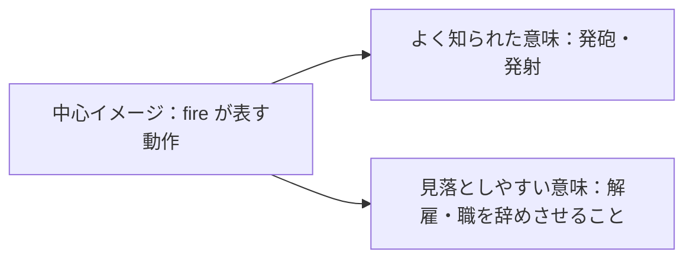

**重要語法：** `the firing of an employee`

<small>index: 7510 / candidate_id: ev-07510-noun-01</small>

---

## 3682. glare

**品詞：** verb　**発音：** /ɡler/

<small>よく知られている意味：（人を）にらむ</small>

### 見落としやすい意味：光がぎらぎら照りつける

**例文：** The afternoon sun glared through the window.

**和訳：** 午後の日差しが窓からぎらぎらと照りつけた。

**コアイメージ：** glare の共通点は、強くて不快なほどこちらに向けられることだ。視線なら「にらむ」、太陽や光なら「ぎらぎら照りつける」になる。

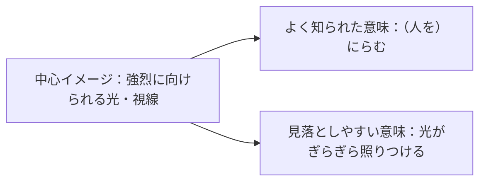

**重要語法：** `glare through the window`

<small>index: 7516 / candidate_id: ev-07516-verb-01</small>

---

## 3683. glare

**品詞：** verb　**発音：** /ɡler/

<small>よく知られている意味：（光が）ぎらつく</small>

### 見落としやすい意味：人を鋭くにらみつける

**例文：** She glared at the man who interrupted her.

**和訳：** 彼女は話を遮った男性を鋭くにらみつけた。

**コアイメージ：** glare は相手に圧迫感を与えるような強さを表す。光については「まぶしく照る」、人の目については「にらみつける」となる。

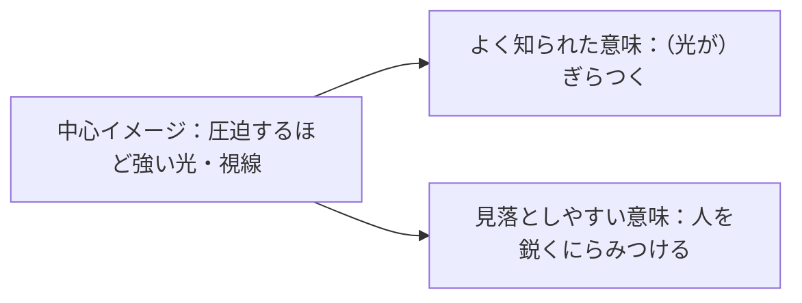

**重要語法：** `glare at someone`

<small>index: 7516 / candidate_id: ev-07516-verb-02</small>

---

## 3684. harness

**品詞：** verb　**発音：** /ˈhɑːrnɪs/

<small>よく知られている意味：馬具・引き具</small>

### 見落としやすい意味：能力や資源を活用する

**例文：** The village harnessed the power of the river to produce electricity.

**和訳：** その村は川の力を活用して発電した。

**コアイメージ：** harness はもともと動物の力を制御して役立てるための装具だ。動詞では、エネルギーや才能などの力を目的に合わせて利用することへ広がる。

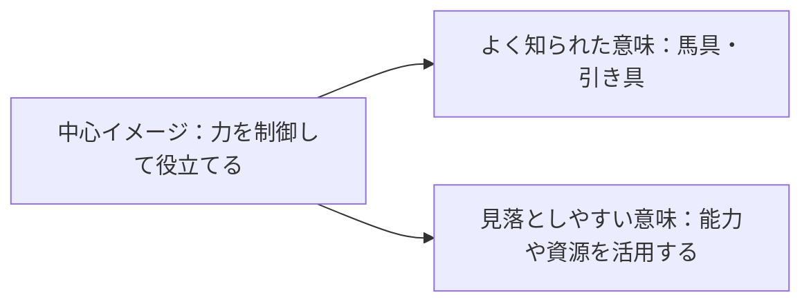

**重要語法：** `harness renewable energy`

<small>index: 7520 / candidate_id: ev-07520-verb-01</small>

---

## 3685. haze

**品詞：** verb　**発音：** /heɪz/

<small>よく知られている意味：かすみ・もや</small>

### 見落としやすい意味：新人などに屈辱的な行為を強いていじめる

**例文：** The school strictly prohibits hazing new students.

**和訳：** その学校は新入生へのいじめを厳しく禁じている。

**コアイメージ：** haze は「もやがかかる」という語としても知られるが、新人への嫌がらせを表す別の動詞用法がある。新人研修や学校の文脈では、天候ではなく不当な扱いを示す。

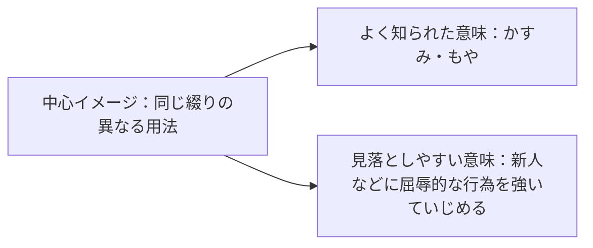

**重要語法：** `hazing of new students`

<small>index: 7521 / candidate_id: ev-07521-verb-01</small>

---

## 3686. impotent

**品詞：** adjective　**発音：** /ˈɪmpətənt/

<small>よく知られている意味：（身体的に）不能な</small>

### 見落としやすい意味：無力な・影響力のない

**例文：** The committee felt impotent to stop the spread of false rumors.

**和訳：** 委員会は誤ったうわさの拡散を止める力がないと感じた。

**コアイメージ：** impotent の中心には、必要な力が欠けているという考えがある。身体の働きだけでなく、組織や人が状況を変えられない場合にも用いる。

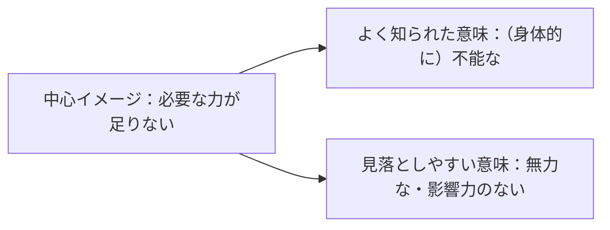

**重要語法：** `feel impotent to change ...`

<small>index: 7525 / candidate_id: ev-07525-adj-01</small>

---

## 3687. insulate

**品詞：** verb　**発音：** /ˈɪnsəleɪt/

<small>よく知られている意味：断熱する・絶縁する</small>

### 見落としやすい意味：影響から切り離す・隔離する

**例文：** The new policy is designed to insulate schools from political pressure.

**和訳：** 新しい方針は学校を政治的圧力から守るためのものだ。

**コアイメージ：** insulate は、あるものを外からの影響が届かないように包む発想を持つ。熱や電気を遮るだけでなく、圧力や批判などから隔てることも表せる。

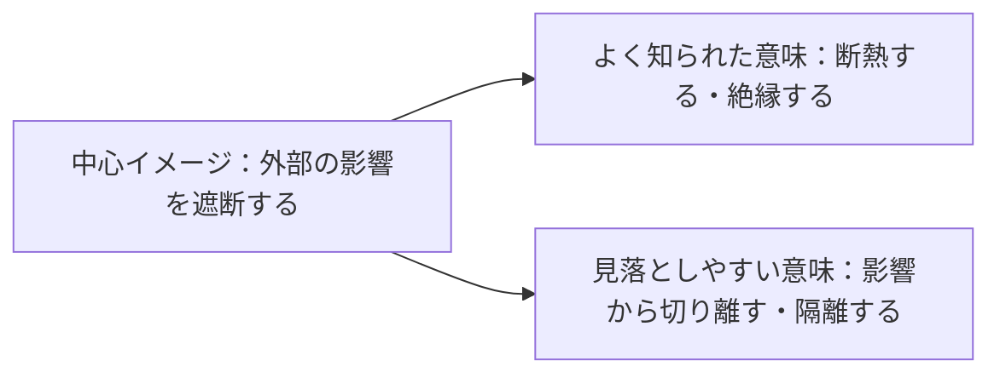

**重要語法：** `insulate A from B`

<small>index: 7528 / candidate_id: ev-07528-verb-01</small>

---

## 3688. mobility

**品詞：** noun　**発音：** /moʊˈbɪləti/

<small>よく知られている意味：移動のしやすさ</small>

### 見落としやすい意味：社会階層や職業上の地位を移動できること

**例文：** Access to education can improve social mobility.

**和訳：** 教育を受ける機会が増えると、社会階層を移動しやすくなる場合がある。

**コアイメージ：** mobility はある位置から別の位置へ移れる性質を指す。位置が地理的な場所なら移動性、社会の中の地位なら階層移動の可能性になる。

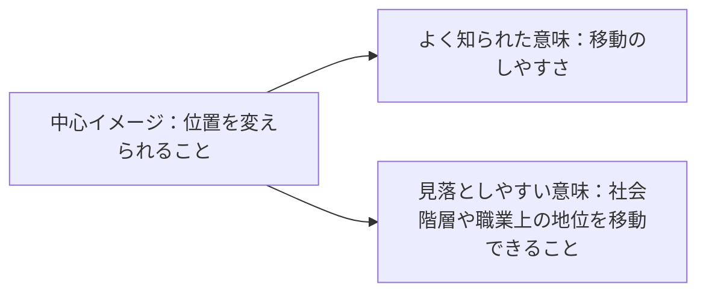

**重要語法：** `social mobility; upward mobility`

<small>index: 7536 / candidate_id: ev-07536-noun-01</small>

---

## 3689. plotter

**品詞：** noun　**発音：** /ˈplɑːtər/

<small>よく知られている意味：図面作成機・プロッター</small>

### 見落としやすい意味：陰謀を企てる人物

**例文：** The plotters secretly met to discuss their plan.

**和訳：** 陰謀を企てた人々は計画について話し合うため、ひそかに集まった。

**コアイメージ：** plot は図や筋書きを組み立てる意味と、陰謀を企てる意味を持つ。plotter は機械を指す場合もあるが、人なら秘密の計画を立てる者を指しうる。

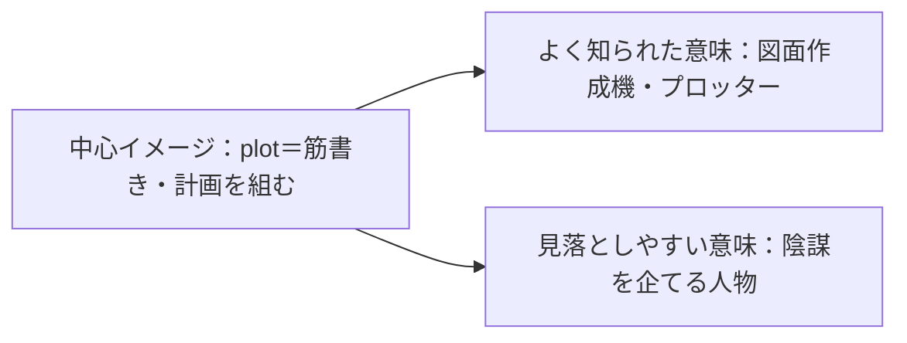

**重要語法：** `political plotter`

<small>index: 7546 / candidate_id: ev-07546-noun-01</small>

---

## 3690. plow

**品詞：** verb　**発音：** /plaʊ/

<small>よく知られている意味：土地を耕す</small>

### 見落としやすい意味：大量の仕事や読み物を苦労して片付ける

**例文：** I spent the evening plowing through a stack of reports.

**和訳：** 私は夕方いっぱい、山積みの報告書を苦労して読み進めた。

**コアイメージ：** plow は土を押し分けながら進む動きを表す。plow through ではその粘り強い前進が、面倒な仕事や大量の文章を片付ける比喩になる。

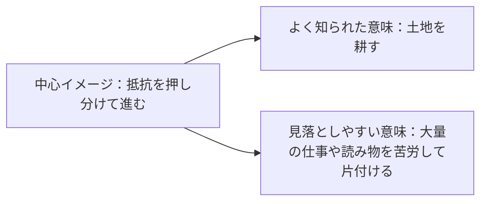

**重要語法：** `plow through paperwork`

<small>index: 7547 / candidate_id: ev-07547-verb-01</small>

---

## 3691. psychic

**品詞：** adjective　**発音：** /ˈsaɪkɪk/

<small>よく知られている意味：超常的な・霊的な</small>

### 見落としやすい意味：精神・心に関する

**例文：** The novel explores the character's psychic conflicts.

**和訳：** その小説は登場人物の内面的な葛藤を描いている。

**コアイメージ：** psychic は目に見えない心の働きに関係する言葉だ。超常現象に限らず、心理や精神内部の活動を表す硬い文脈でも使われる。

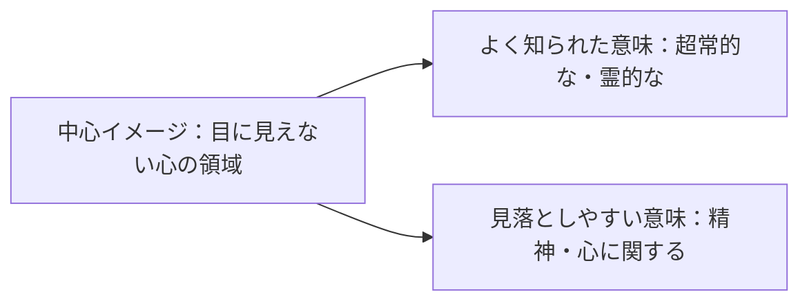

**重要語法：** `psychic conflict; psychic life`

<small>index: 7552 / candidate_id: ev-07552-adj-01</small>

---

## 3692. psychic

**品詞：** noun　**発音：** /ˈsaɪkɪk/

<small>よく知られている意味：精神の・心の</small>

### 見落としやすい意味：霊能力者・超能力者を名乗る人

**例文：** A psychic claimed she could predict the future.

**和訳：** ある霊能力者を名乗る女性は未来を予言できると主張した。

**コアイメージ：** psychic は精神に関わる形容詞としても使われる。同じ語が人を表す名詞になると、超常的な能力を持つとされる人を指す。

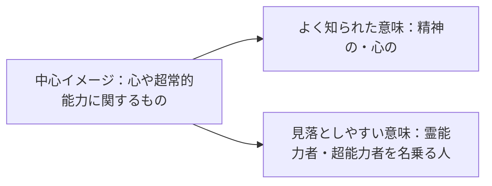

**重要語法：** `consult a psychic`

<small>index: 7552 / candidate_id: ev-07552-noun-01</small>

---

## 3693. racket

**品詞：** noun　**発音：** /ˈrækɪt/

<small>よく知られている意味：テニスなどのラケット</small>

### 見落としやすい意味：不正な金もうけの仕組み

**例文：** Police uncovered a racket selling fake tickets.

**和訳：** 警察は偽のチケットを売る不正な金もうけの仕組みを暴いた。

**コアイメージ：** racket にはスポーツ用具とは別に、不正な商売や組織的な稼ぎ口を指す名詞用法がある。犯罪や詐欺が話題なら用具と取り違えない。

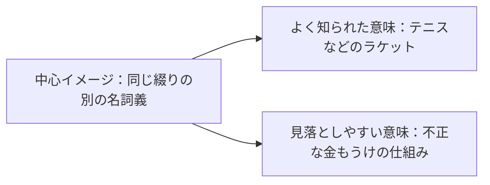

**重要語法：** `protection racket; criminal racket`

<small>index: 7553 / candidate_id: ev-07553-noun-01</small>

---

## 3694. recreate

**品詞：** verb　**発音：** （省略）

<small>よく知られている意味：再現する・作り直す</small>

### 見落としやすい意味：余暇を楽しむ・気晴らしをする

**例文：** The visitors can hike, swim, and recreate in the park.

**和訳：** 来園者はその公園でハイキングや水泳をして余暇を楽しめる。

**コアイメージ：** recreate には何かを再び作る用法に加え、気晴らしや余暇を楽しむ別の動詞用法がある。自然やレジャーが話題なら recreation に近い意味で読める。

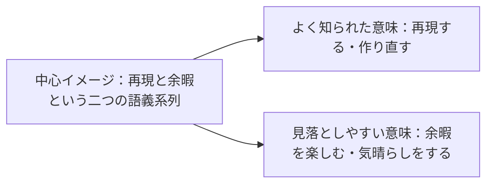

**重要語法：** `recreate outdoors`

<small>index: 7555 / candidate_id: ev-07555-verb-01</small>

---

## 3695. refinement

**品詞：** noun　**発音：** /rɪˈfaɪnmənt/

<small>よく知られている意味：改良・洗練</small>

### 見落としやすい意味：意味・意見などの微妙な差異

**例文：** The translation preserves subtle refinements of meaning.

**和訳：** その翻訳は意味の微妙な違いを保っている。

**コアイメージ：** refinement は物事を細かく整え、粗さを取り除くことを表す。物の質を高める「改良」だけでなく、意味を精密に分けた際の細かな違いも指す。

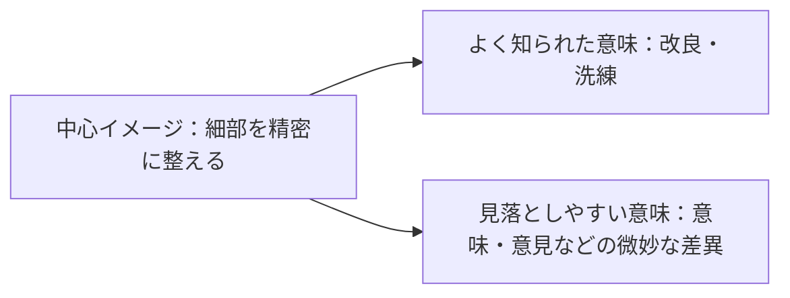

**重要語法：** `refinements of meaning`

<small>index: 7556 / candidate_id: ev-07556-noun-01</small>

---

## 3696. rig

**品詞：** noun　**発音：** /rɪɡ/

<small>よく知られている意味：装備・仕掛け</small>

### 見落としやすい意味：掘削設備・作業用の大型装置

**例文：** The workers repaired the offshore drilling rig.

**和訳：** 作業員たちは沖合の掘削設備を修理した。

**コアイメージ：** rig は特定の仕事を行うために組み立てた装置や一式の装備を指す。船の索具だけでなく、石油やガスを掘る大型設備にも使われる。

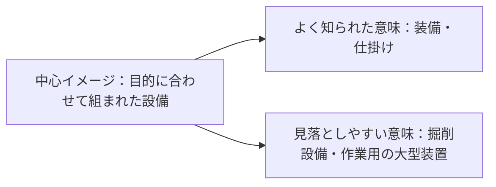

**重要語法：** `oil rig; drilling rig`

<small>index: 7561 / candidate_id: ev-07561-noun-01</small>

---

## 3697. rig

**品詞：** verb　**発音：** /rɪɡ/

<small>よく知られている意味：装備を取り付ける</small>

### 見落としやすい意味：結果や手続きを不正に操作する

**例文：** The officials were accused of trying to rig the vote.

**和訳：** 担当者たちは投票結果を不正に操作しようとしたとして非難された。

**コアイメージ：** rig は仕組みを人為的に整える動詞としても使われる。その操作が公平性を損なう文脈では、結果を不正に仕組むという意味になる。

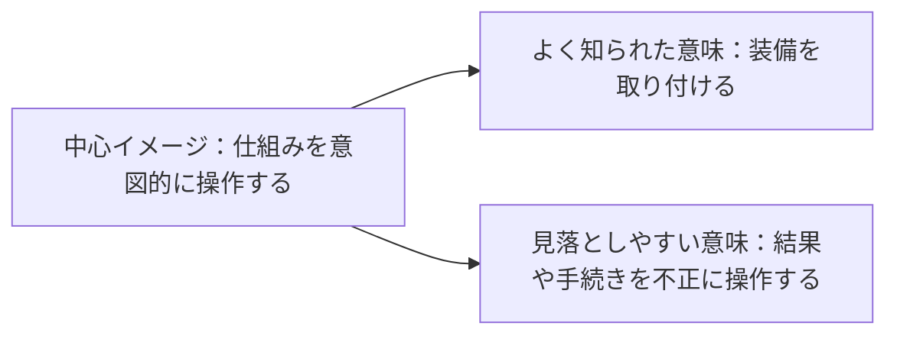

**重要語法：** `rig a vote; rig a contest`

<small>index: 7561 / candidate_id: ev-07561-verb-01</small>

---

## 3698. socialize

**品詞：** verb　**発音：** /ˈsoʊʃəlaɪz/

<small>よく知られている意味：人と交流する</small>

### 見落としやすい意味：社会生活への適応を身につけさせる

**例文：** Children learn to share and cooperate as they are socialized.

**和訳：** 子どもは社会生活への適応を身につける中で、分かち合いや協力を学ぶ。

**コアイメージ：** socialize の中心には、人が社会の一員として振る舞うことがある。自分が交流する場合だけでなく、他者に社会の規範や行動を身につけさせる場合にも使う。

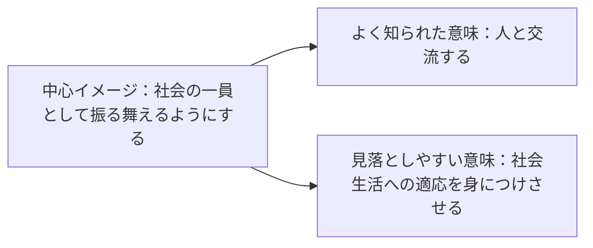

**重要語法：** `socialize children`

<small>index: 7565 / candidate_id: ev-07565-verb-01</small>

---

## 3699. sovereign

**品詞：** noun　**発音：** /ˈsɑːvrən/

<small>よく知られている意味：主権を持つ・独立した</small>

### 見落としやすい意味：君主・統治者

**例文：** The sovereign addressed the nation in a short speech.

**和訳：** 君主は短い演説で国民に語りかけた。

**コアイメージ：** sovereign は最終的な統治権を持つことを表す。形容詞なら独立した国家の主権、名詞ならその権威を担う君主を表す。

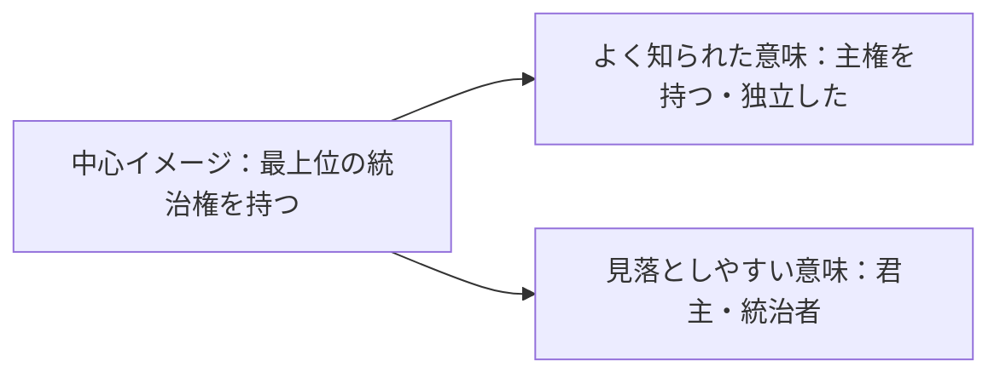

**重要語法：** `the sovereign`

<small>index: 7567 / candidate_id: ev-07567-noun-01</small>

---

## 3700. specter

**品詞：** noun　**発音：** /ˈspektər/

<small>よく知られている意味：幽霊・亡霊</small>

### 見落としやすい意味：不吉な可能性・迫り来る脅威

**例文：** The specter of a water shortage worried the farmers.

**和訳：** 水不足の恐れが農家の人々を不安にさせた。

**コアイメージ：** specter は姿を現した幽霊を思わせる言葉だ。まだ起こっていない悪い出来事が影のように付きまとうとき、迫り来る不安や脅威を表す。

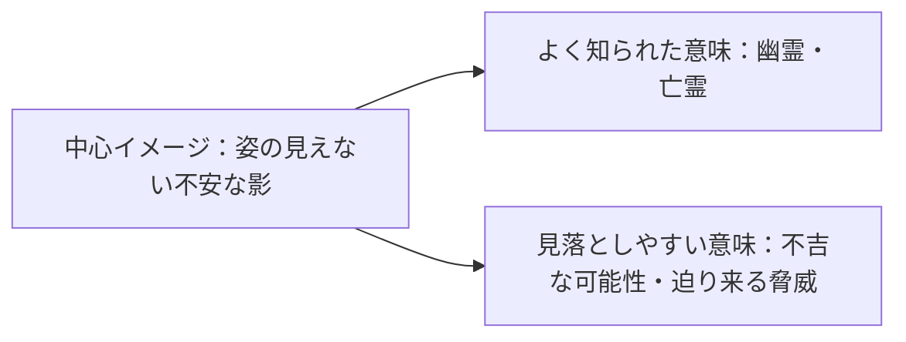

**重要語法：** `the specter of recession`

<small>index: 7568 / candidate_id: ev-07568-noun-01</small>

---

## 3701. syndicate

**品詞：** noun　**発音：** /ˈsɪndɪkət/

<small>よく知られている意味：共同事業体・企業連合</small>

### 見落としやすい意味：結束した犯罪組織・犯罪者の集団

**例文：** Investigators traced the stolen goods to a crime syndicate.

**和訳：** 捜査員は盗品の流れをある犯罪組織に突き止めた。

**コアイメージ：** syndicate は共通の目的を持って結び付いた集団だ。合法的な共同事業体にも、組織的な犯罪を行う集団にも使われる。

```mermaid
flowchart LR
    A["中心イメージ：目的のために結び付く組織"]
    B["よく知られた意味：共同事業体・企業連合"]
    C["見落としやすい意味：結束した犯罪組織・犯罪者の集団"]
    A --> B
    A --> C
```

**重要語法：** `crime syndicate`

<small>index: 7576 / candidate_id: ev-07576-noun-01</small>

---

## 3702. syndicate

**品詞：** verb　**発音：** /ˈsɪndɪkeɪt/

<small>よく知られている意味：共同事業体を組織する</small>

### 見落としやすい意味：記事や番組を複数の媒体に配信する

**例文：** Several newspapers syndicated the journalist's weekly column.

**和訳：** 複数の新聞社がその記者の週刊コラムを配信掲載した。

**コアイメージ：** syndicate には複数の媒体に同じ記事や番組を流通させる動詞用法がある。共同利用の仕組みでコンテンツを広く届けるイメージだ。

```mermaid
flowchart LR
    A["中心イメージ：複数の参加者で共同利用する"]
    B["よく知られた意味：共同事業体を組織する"]
    C["見落としやすい意味：記事や番組を複数の媒体に配信する"]
    A --> B
    A --> C
```

**重要語法：** `syndicated column; syndicate a show`

<small>index: 7576 / candidate_id: ev-07576-verb-01</small>

---

## 3703. tab

**品詞：** noun　**発音：** /tæb/

<small>よく知られている意味：つまみ・見出しラベル</small>

### 見落としやすい意味：飲食店などの勘定

**例文：** Don't worry about lunch; I'll pick up the tab.

**和訳：** 昼食代は気にしないで。私が払うよ。

**コアイメージ：** tab は小さな記録や一覧の意味につながる名詞だ。店での注文を記録した勘定書きから、支払うべき飲食代を指す。

```mermaid
flowchart LR
    A["中心イメージ：注文や支払いの記録"]
    B["よく知られた意味：つまみ・見出しラベル"]
    C["見落としやすい意味：飲食店などの勘定"]
    A --> B
    A --> C
```

**重要語法：** `pick up the tab; run a tab`

<small>index: 7578 / candidate_id: ev-07578-noun-01</small>

---

## 3704. tab

**品詞：** noun　**発音：** /tæb/

<small>よく知られている意味：つまみ・見出しラベル</small>

### 見落としやすい意味：監視・動向を把握するための継続的な記録

**例文：** The editor keeps tabs on changes to the draft.

**和訳：** 編集者は原稿への変更を継続的に把握している。

**コアイメージ：** tab には個々の事柄を記録して追う発想がある。複数形 tabs を使う keep tabs on は、対象の動きを継続して把握する慣用表現だ。

```mermaid
flowchart LR
    A["中心イメージ：記録を付けて追跡する"]
    B["よく知られた意味：つまみ・見出しラベル"]
    C["見落としやすい意味：監視・動向を把握するための継続的な記録"]
    A --> B
    A --> C
```

**重要語法：** `keep tabs on ...`

<small>index: 7578 / candidate_id: ev-07578-noun-02</small>

---

## 3705. tease

**品詞：** verb　**発音：** /tiːz/

<small>よく知られている意味：からかう・いじめる</small>

### 見落としやすい意味：期待・関心をあおって満足させずにおく

**例文：** The trailer teased the audience with glimpses of the new film.

**和訳：** 予告編は新作映画をちらりと見せて観客の期待をあおった。

**コアイメージ：** tease は相手を刺激し、反応を引き出しながらすぐには満足させないことを表す。人をからかう行為から、情報を少し見せて関心を高める用法へ広がる。

```mermaid
flowchart LR
    A["中心イメージ：刺激して期待を引き延ばす"]
    B["よく知られた意味：からかう・いじめる"]
    C["見落としやすい意味：期待・関心をあおって満足させずにおく"]
    A --> B
    A --> C
```

**重要語法：** `tease the audience; teaser trailer`

<small>index: 7580 / candidate_id: ev-07580-verb-01</small>

---

## 3706. technician

**品詞：** noun　**発音：** /tekˈnɪʃən/

<small>よく知られている意味：技術者・技師</small>

### 見落としやすい意味：芸術や知的技法に優れた熟練者

**例文：** She is a brilliant technician on the piano.

**和訳：** 彼女はピアノ演奏の技巧に非常に優れている。

**コアイメージ：** technician は技術を正確に使いこなす人だ。工場や研究室の技師に限らず、音楽や芸術の技法に長けた人も表せる。

```mermaid
flowchart LR
    A["中心イメージ：技法を高度に使いこなす人"]
    B["よく知られた意味：技術者・技師"]
    C["見落としやすい意味：芸術や知的技法に優れた熟練者"]
    A --> B
    A --> C
```

**重要語法：** `a superb technician on the piano`

<small>index: 7581 / candidate_id: ev-07581-noun-01</small>

---

## 3707. turnover

**品詞：** noun　**発音：** /ˈtɜːrnoʊvər/

<small>よく知られている意味：ひっくり返ること</small>

### 見落としやすい意味：一定期間の売上高・取引額

**例文：** The store's annual turnover reached a new high.

**和訳：** その店の年間売上高は過去最高に達した。

**コアイメージ：** turnover は物や人やお金が入れ替わり、回転することを表す。商業の文脈では一定期間に商品が販売され、金額が積み上がることから売上高を指す。

```mermaid
flowchart LR
    A["中心イメージ：一定期間の回転・入れ替わり"]
    B["よく知られた意味：ひっくり返ること"]
    C["見落としやすい意味：一定期間の売上高・取引額"]
    A --> B
    A --> C
```

**重要語法：** `annual turnover（英語圏で用法差あり）`

<small>index: 7586 / candidate_id: ev-07586-noun-01</small>

---

## 3708. turnover

**品詞：** noun　**発音：** /ˈtɜːrnoʊvər/

<small>よく知られている意味：ひっくり返ること・回転</small>

### 見落としやすい意味：従業員が退職・交代する割合

**例文：** High staff turnover makes training more difficult.

**和訳：** 従業員の入れ替わりが多いと研修が難しくなる。

**コアイメージ：** turnover は構成するものが次々に入れ替わる動きを表す。職場では退職や採用によって従業員が交代する度合いを意味する。

```mermaid
flowchart LR
    A["中心イメージ：人が継続的に入れ替わる"]
    B["よく知られた意味：ひっくり返ること・回転"]
    C["見落としやすい意味：従業員が退職・交代する割合"]
    A --> B
    A --> C
```

**重要語法：** `staff turnover; employee turnover`

<small>index: 7586 / candidate_id: ev-07586-noun-02</small>

---

## 3709. undercut

**品詞：** verb　**発音：** /ˌʌndərˈkʌt/

<small>よく知られている意味：下を切り取る</small>

### 見落としやすい意味：競争相手より安く売る

**例文：** The shop undercut its rivals by offering lower prices.

**和訳：** その店は競合店より安い価格を提示して対抗した。

**コアイメージ：** undercut は文字どおり下の部分を切る動作から、相手の価格より低く設定する用法につながる。競争の文脈では単なる値下げでなく、他社より安く売ることをいう。

```mermaid
flowchart LR
    A["中心イメージ：下側に切り込む・下回る"]
    B["よく知られた意味：下を切り取る"]
    C["見落としやすい意味：競争相手より安く売る"]
    A --> B
    A --> C
```

**重要語法：** `undercut competitors on price`

<small>index: 7587 / candidate_id: ev-07587-verb-01</small>

---

## 3710. undercut

**品詞：** verb　**発音：** /ˌʌndərˈkʌt/

<small>よく知られている意味：下を切り取る・安値で売る</small>

### 見落としやすい意味：主張・努力・信用などの効果を損なう

**例文：** The new evidence undercut his original argument.

**和訳：** 新しい証拠は彼の当初の主張の説得力を弱めた。

**コアイメージ：** undercut は支えとなる下部を削るようなイメージだ。物理的な支えから転じて、議論の根拠や信用を弱くすることを表す。

```mermaid
flowchart LR
    A["中心イメージ：土台を下から削る"]
    B["よく知られた意味：下を切り取る・安値で売る"]
    C["見落としやすい意味：主張・努力・信用などの効果を損なう"]
    A --> B
    A --> C
```

**重要語法：** `undercut an argument; undercut confidence`

<small>index: 7587 / candidate_id: ev-07587-verb-02</small>

---

## 3711. uneven

**品詞：** adjective　**発音：** /ʌnˈiːvən/

<small>よく知られている意味：平らでない・でこぼこの</small>

### 見落としやすい意味：出来や質にむらがある

**例文：** The actor gave an uneven performance throughout the play.

**和訳：** その俳優の演技は劇を通して出来にむらがあった。

**コアイメージ：** uneven は均一でない状態を表す。地面なら高さがそろわないこと、演技や品質なら良い部分と悪い部分が混在することになる。

```mermaid
flowchart LR
    A["中心イメージ：均一さがない・そろわない"]
    B["よく知られた意味：平らでない・でこぼこの"]
    C["見落としやすい意味：出来や質にむらがある"]
    A --> B
    A --> C
```

**重要語法：** `uneven quality; uneven performance`

<small>index: 7588 / candidate_id: ev-07588-adj-01</small>

---

## 3712. uphold

**品詞：** verb　**発音：** /ʌpˈhoʊld/

<small>よく知られている意味：持ち上げる・支える</small>

### 見落としやすい意味：（判決・決定などを）支持して有効と認める

**例文：** The appeals court upheld the original decision.

**和訳：** 控訴裁判所は最初の判決を支持し、その効力を維持した。

**コアイメージ：** uphold は何かを下に落とさず支えておくという考えが中心だ。意見を支持するだけでなく、裁判では判断を覆さず有効なものとして維持する。

```mermaid
flowchart LR
    A["中心イメージ：判断を支えて維持する"]
    B["よく知られた意味：持ち上げる・支える"]
    C["見落としやすい意味：（判決・決定などを）支持して有効と認める"]
    A --> B
    A --> C
```

**重要語法：** `uphold a ruling; uphold a conviction`

<small>index: 7591 / candidate_id: ev-07591-verb-01</small>

---

## 3713. upside

**品詞：** noun　**発音：** /ˈʌpsaɪd/

<small>よく知られている意味：上側・上向きの側</small>

### 見落としやすい意味：有利な面・潜在的な利益や上昇余地

**例文：** The plan has risks, but its potential upside is substantial.

**和訳：** その計画には危険もあるが、得られる可能性のある利益は大きい。

**コアイメージ：** upside は物の上側や上向きの方向を表す。評価や投資の文脈では、悪い面に対する良い面や、上方に伸びる余地を指す。

```mermaid
flowchart LR
    A["中心イメージ：上向きの可能性"]
    B["よく知られた意味：上側・上向きの側"]
    C["見落としやすい意味：有利な面・潜在的な利益や上昇余地"]
    A --> B
    A --> C
```

**重要語法：** `potential upside; upside of a decision`

<small>index: 7592 / candidate_id: ev-07592-noun-01</small>

---

## 3714. accessory

**品詞：** noun　**発音：** /əkˈsesəri/

<small>よく知られている意味：付属品・アクセサリー</small>

### 見落としやすい意味：犯罪を手助けした共犯者

**例文：** The driver was charged as an accessory to the theft.

**和訳：** 運転手はその窃盗を手助けした共犯者として起訴された。

**コアイメージ：** accessory は主要なものに付随して働くものだ。犯罪の文脈では、主犯ではなく犯罪を助けた人物を指す名詞になる。

```mermaid
flowchart LR
    A["中心イメージ：主となる行為を補助するもの"]
    B["よく知られた意味：付属品・アクセサリー"]
    C["見落としやすい意味：犯罪を手助けした共犯者"]
    A --> B
    A --> C
```

**重要語法：** `accessory to a crime`

<small>index: 7598 / candidate_id: ev-07598-noun-01</small>

---

## 3715. austerity

**品詞：** noun　**発音：** /ɔːˈsterəti/

<small>よく知られている意味：質素・厳格さ</small>

### 見落としやすい意味：政府による財政緊縮・支出抑制政策

**例文：** The government introduced austerity measures to reduce its deficit.

**和訳：** 政府は財政赤字を減らすため緊縮策を導入した。

**コアイメージ：** austerity は余分なものを抑えた厳しい状態を指す。個人の生活では質素さ、財政では公的支出を抑える政策を表す。

```mermaid
flowchart LR
    A["中心イメージ：余分を削って厳しく抑える"]
    B["よく知られた意味：質素・厳格さ"]
    C["見落としやすい意味：政府による財政緊縮・支出抑制政策"]
    A --> B
    A --> C
```

**重要語法：** `austerity measures; fiscal austerity`

<small>index: 7604 / candidate_id: ev-07604-noun-01</small>

---

## 3716. brilliance

**品詞：** noun　**発音：** /ˈbrɪljəns/

<small>よく知られている意味：才気・卓越した能力</small>

### 見落としやすい意味：まぶしい光の輝き

**例文：** The brilliance of the headlights made it hard to see.

**和訳：** ヘッドライトのまぶしい輝きで前が見えにくかった。

**コアイメージ：** brilliance は強く輝く性質を表す。比喩では知性が際立つことを表すが、実際の光が強くまぶしい状態にも使う。

```mermaid
flowchart LR
    A["中心イメージ：まばゆく際立つ輝き"]
    B["よく知られた意味：才気・卓越した能力"]
    C["見落としやすい意味：まぶしい光の輝き"]
    A --> B
    A --> C
```

**重要語法：** `the brilliance of the light`

<small>index: 7611 / candidate_id: ev-07611-noun-01</small>

---

## 3717. chorus

**品詞：** verb　**発音：** /ˈkɔːrəs/

<small>よく知られている意味：合唱・合唱団</small>

### 見落としやすい意味：大勢で一斉に口をそろえて言う

**例文：** The students chorused, 'We agree!'

**和訳：** 生徒たちは「賛成です！」と口をそろえて言った。

**コアイメージ：** chorus は多くの声が一つになって響くことだ。名詞なら合唱を、動詞なら複数の人が同時に同じことを言う動作を表す。

```mermaid
flowchart LR
    A["中心イメージ：声を一斉に合わせる"]
    B["よく知られた意味：合唱・合唱団"]
    C["見落としやすい意味：大勢で一斉に口をそろえて言う"]
    A --> B
    A --> C
```

**重要語法：** `chorus a reply; chorus in unison`

<small>index: 7616 / candidate_id: ev-07616-verb-01</small>

---

## 3718. converse

**品詞：** adjective　**発音：** /ˈkɑːnvɜːrs/

<small>よく知られている意味：会話する（動詞）</small>

### 見落としやすい意味：関係や順序が逆になった

**例文：** The converse relationship also holds in this case.

**和訳：** この場合は逆の関係も成り立つ。

**コアイメージ：** 形容詞 converse は、向きや順序を反対にして対応させる意味を持つ。会話する動詞 converse とは用法が異なるので、品詞を確かめて読む。

```mermaid
flowchart LR
    A["中心イメージ：逆向きの対応関係"]
    B["よく知られた意味：会話する（動詞）"]
    C["見落としやすい意味：関係や順序が逆になった"]
    A --> B
    A --> C
```

**重要語法：** `the converse relation`

<small>index: 7630 / candidate_id: ev-07630-adj-01</small>

---

## 3719. converse

**品詞：** noun　**発音：** /ˈkɑːnvɜːrs/

<small>よく知られている意味：会話する（動詞）</small>

### 見落としやすい意味：逆の命題

**例文：** The converse of the statement is not always true.

**和訳：** その命題の逆は必ずしも正しいとは限らない。

**コアイメージ：** 名詞 converse は、前後の関係を入れ替えた「逆」を表す。数学や論理では、元の命題とその逆が同じ真偽になるとは限らない。

```mermaid
flowchart LR
    A["中心イメージ：関係の向きを逆にする"]
    B["よく知られた意味：会話する（動詞）"]
    C["見落としやすい意味：逆の命題"]
    A --> B
    A --> C
```

**重要語法：** `the converse of a proposition`

<small>index: 7630 / candidate_id: ev-07630-noun-02</small>

---

## 3720. converse

**品詞：** verb　**発音：** /kənˈvɜːrs/

<small>よく知られている意味：逆の・反対の（形容詞）</small>

### 見落としやすい意味：会話する・言葉を交わす

**例文：** The two scientists conversed about the results after the meeting.

**和訳：** 二人の科学者は会議後に結果について会話した。

**コアイメージ：** 動詞 converse は人が互いに言葉を交わすことを表す。逆を表す形容詞・名詞とは異なる意味系列なので、文の構造とアクセントから区別する。

```mermaid
flowchart LR
    A["中心イメージ：言葉を互いに交わす"]
    B["よく知られた意味：逆の・反対の（形容詞）"]
    C["見落としやすい意味：会話する・言葉を交わす"]
    A --> B
    A --> C
```

**重要語法：** `converse with someone`

<small>index: 7630 / candidate_id: ev-07630-verb-01</small>

---

## 3721. depose

**品詞：** verb　**発音：** /dɪˈpoʊz/

<small>よく知られている意味：王位・地位から追放する</small>

### 見落としやすい意味：宣誓の上で証言する

**例文：** The witness deposed that the records were accurate.

**和訳：** 証人はその記録が正確だと宣誓の上で証言した。

**コアイメージ：** depose には地位から退かせる意味とは別に、法的手続きの中で宣誓して証言する用法がある。法廷や証言の文脈では、権力者の解任と混同しない。

```mermaid
flowchart LR
    A["中心イメージ：法的文脈で定着した別義"]
    B["よく知られた意味：王位・地位から追放する"]
    C["見落としやすい意味：宣誓の上で証言する"]
    A --> B
    A --> C
```

**重要語法：** `depose under oath`

<small>index: 7634 / candidate_id: ev-07634-verb-01</small>

---

## 3722. depressed

**品詞：** adjective　**発音：** /dɪˈprest/

<small>よく知られている意味：気分が落ち込んだ</small>

### 見落としやすい意味：景気・価格・需要などが低迷した

**例文：** Depressed demand forced the company to lower its prices.

**和訳：** 需要の低迷によって、その会社は価格を下げざるを得なかった。

**コアイメージ：** depressed は本来の水準より下に押し下げられた状態を表す。気分については落胆、経済については価格や需要の低迷を意味する。

```mermaid
flowchart LR
    A["中心イメージ：通常より下に押し下げられた状態"]
    B["よく知られた意味：気分が落ち込んだ"]
    C["見落としやすい意味：景気・価格・需要などが低迷した"]
    A --> B
    A --> C
```

**重要語法：** `depressed prices; depressed demand`

<small>index: 7635 / candidate_id: ev-07635-adj-01</small>

---

## 3723. don

**品詞：** noun　**発音：** /dɑːn/

<small>よく知られている意味：首領・ドン</small>

### 見落としやすい意味：英国の大学教員・指導者

**例文：** An Oxford don gave a lecture on medieval literature.

**和訳：** オックスフォード大学の教員が中世文学について講義した。

**コアイメージ：** don は尊敬や地位を伴う人物の呼び名として使われてきた。英国の大学については、その大学に所属する教員や研究者を指す。

```mermaid
flowchart LR
    A["中心イメージ：地位ある人物への呼称"]
    B["よく知られた意味：首領・ドン"]
    C["見落としやすい意味：英国の大学教員・指導者"]
    A --> B
    A --> C
```

**重要語法：** `an Oxford don`

<small>index: 7639 / candidate_id: ev-07639-noun-02</small>

---

## 3724. don

**品詞：** verb　**発音：** /dɑːn/

<small>よく知られている意味：首領・ドン（名詞）</small>

### 見落としやすい意味：衣類を身につける

**例文：** She donned a warm coat before leaving the house.

**和訳：** 彼女は家を出る前に暖かいコートを身につけた。

**コアイメージ：** 動詞 don は衣服や帽子などを身につけることを表す。人を指す名詞 don とは品詞も意味も違い、文章ではやや改まった言い方だ。

```mermaid
flowchart LR
    A["中心イメージ：衣類を身につける動作"]
    B["よく知られた意味：首領・ドン（名詞）"]
    C["見落としやすい意味：衣類を身につける"]
    A --> B
    A --> C
```

**重要語法：** `don a coat; don a helmet`

<small>index: 7639 / candidate_id: ev-07639-verb-01</small>

---

## 3725. dramatize

**品詞：** verb　**発音：** /ˈdrɑːmətaɪz/

<small>よく知られている意味：劇にする・脚色する</small>

### 見落としやすい意味：出来事を大げさに表現・脚色する

**例文：** The article dramatized a minor disagreement between the two friends.

**和訳：** その記事は二人の友人の小さな意見の相違を大げさに描いた。

**コアイメージ：** dramatize は出来事を劇のように目立たせる動詞だ。事実を舞台用にするだけでなく、実際以上に劇的に見せるという意味にもなる。

```mermaid
flowchart LR
    A["中心イメージ：出来事を劇的に見せる"]
    B["よく知られた意味：劇にする・脚色する"]
    C["見落としやすい意味：出来事を大げさに表現・脚色する"]
    A --> B
    A --> C
```

**重要語法：** `dramatize an incident`

<small>index: 7640 / candidate_id: ev-07640-verb-01</small>

---

## 3726. embroidery

**品詞：** noun　**発音：** /ɪmˈbrɔɪdəri/

<small>よく知られている意味：刺しゅう</small>

### 見落としやすい意味：話を面白くするための脚色や誇張

**例文：** Her account contained some embroidery, but the main facts were true.

**和訳：** 彼女の説明には多少の脚色があったが、主要な事実は本当だった。

**コアイメージ：** embroidery は布に飾りを加える刺しゅうを指す。話に余分な飾りを加える比喩では、事実を面白くするための脚色や誇張になる。

```mermaid
flowchart LR
    A["中心イメージ：元のものに飾りを加える"]
    B["よく知られた意味：刺しゅう"]
    C["見落としやすい意味：話を面白くするための脚色や誇張"]
    A --> B
    A --> C
```

**重要語法：** `embroidery in an account`

<small>index: 7645 / candidate_id: ev-07645-noun-01</small>

---

## 3727. eve

**品詞：** noun　**発音：** /iːv/

<small>よく知られている意味：前夜・前日</small>

### 見落としやすい意味：出来事の直前の時期

**例文：** On the eve of a major reform, the staff felt both hope and anxiety.

**和訳：** 大きな改革を目前にして、職員たちは期待と不安の両方を感じていた。

**コアイメージ：** eve は何かが始まる直前を指す。日付の前夜だけでなく、変革や出来事が起こる直前の時期にも広げて使える。

```mermaid
flowchart LR
    A["中心イメージ：大事な出来事のすぐ前"]
    B["よく知られた意味：前夜・前日"]
    C["見落としやすい意味：出来事の直前の時期"]
    A --> B
    A --> C
```

**重要語法：** `on the eve of change`

<small>index: 7649 / candidate_id: ev-07649-noun-01</small>

---

## 3728. exemplary

**品詞：** adjective　**発音：** /ɪɡˈzempləri/

<small>よく知られている意味：模範的な</small>

### 見落としやすい意味：見せしめとなる・戒めを与える

**例文：** The authorities imposed an exemplary fine to discourage similar offenses.

**和訳：** 当局は同様の違反を防ぐため、見せしめとなる罰金を科した。

**コアイメージ：** exemplary は「例となる」という意味を中心に持つ。良い手本となる場合だけでなく、他者への戒めの例となる処罰にも使われる。

```mermaid
flowchart LR
    A["中心イメージ：他者に示す例・手本"]
    B["よく知られた意味：模範的な"]
    C["見落としやすい意味：見せしめとなる・戒めを与える"]
    A --> B
    A --> C
```

**重要語法：** `exemplary punishment; exemplary damages`

<small>index: 7650 / candidate_id: ev-07650-adj-01</small>

---

## 3729. expressly

**品詞：** adverb　**発音：** /ɪkˈspresli/

<small>よく知られている意味：（express＝）急行の・速達の</small>

### 見落としやすい意味：明確に・特にその目的のために

**例文：** This room was built expressly for music practice.

**和訳：** この部屋は音楽の練習のために特別に造られた。

**コアイメージ：** expressly はある意図をはっきり示したり、特定の目的に合わせたりする副詞だ。「速い」という express のイメージだけに頼らず、目的を明示する働きに注目する。

```mermaid
flowchart LR
    A["中心イメージ：意図・目的を明確にする"]
    B["よく知られた意味：（express＝）急行の・速達の"]
    C["見落としやすい意味：明確に・特にその目的のために"]
    A --> B
    A --> C
```

**重要語法：** `expressly for ...; expressly prohibited`

<small>index: 7652 / candidate_id: ev-07652-adv-01</small>

---

## 3730. fiber

**品詞：** noun　**発音：** /ˈfaɪbər/

<small>よく知られている意味：繊維・食物繊維</small>

### 見落としやすい意味：人格・気骨・道徳的な強さ

**例文：** Her moral fiber helped her stand by her principles.

**和訳：** 彼女の道徳的な強さが、信念を守る支えとなった。

**コアイメージ：** fiber は物を形づくる細い繊維を表す。比喩では、人の人格を内側から支える芯や精神的な強さを指す。

```mermaid
flowchart LR
    A["中心イメージ：内側から全体を支える芯"]
    B["よく知られた意味：繊維・食物繊維"]
    C["見落としやすい意味：人格・気骨・道徳的な強さ"]
    A --> B
    A --> C
```

**重要語法：** `moral fiber`

<small>index: 7655 / candidate_id: ev-07655-noun-01</small>

---

## 3731. fitting

**品詞：** noun　**発音：** /ˈfɪtɪŋ/

<small>よく知られている意味：ふさわしい・適切な</small>

### 見落としやすい意味：設備や備え付けの器具類

**例文：** The apartment has modern kitchen fittings.

**和訳：** そのアパートには現代的な台所設備が備え付けられている。

**コアイメージ：** fitting は物が所定の場所に合うという発想を持つ。形容詞なら「適切な」、名詞では建物や設備に合うよう設置された器具を指す。

```mermaid
flowchart LR
    A["中心イメージ：場所・用途に合うもの"]
    B["よく知られた意味：ふさわしい・適切な"]
    C["見落としやすい意味：設備や備え付けの器具類"]
    A --> B
    A --> C
```

**重要語法：** `kitchen fittings; bathroom fittings`

<small>index: 7657 / candidate_id: ev-07657-noun-01</small>

---

## 3732. fraternity

**品詞：** noun　**発音：** /frəˈtɜːrnəti/

<small>よく知られている意味：兄弟愛・友愛</small>

### 見落としやすい意味：同じ職業や目的を持つ仲間集団

**例文：** The medical fraternity welcomed the new research.

**和訳：** 医学界の人々はその新しい研究を歓迎した。

**コアイメージ：** fraternity は共通のつながりを持つ仲間同士の関係を表す。兄弟愛のような結び付きから、同じ専門分野に属する人々の集団を指すようになる。

```mermaid
flowchart LR
    A["中心イメージ：共通のつながりで結ばれた仲間"]
    B["よく知られた意味：兄弟愛・友愛"]
    C["見落としやすい意味：同じ職業や目的を持つ仲間集団"]
    A --> B
    A --> C
```

**重要語法：** `the medical fraternity`

<small>index: 7660 / candidate_id: ev-07660-noun-01</small>

---

## 3733. gilded

**品詞：** adjective　**発音：** /ˈɡɪldɪd/

<small>よく知られている意味：金箔を貼った</small>

### 見落としやすい意味：見かけだけ華やかで実質に乏しい

**例文：** The city's gilded image hid widespread poverty.

**和訳：** その都市の華やかな外見の陰には、広範な貧困が隠れていた。

**コアイメージ：** gild は表面を金で覆うことだ。外側だけが輝いて見える様子から、実質が伴わない見せかけの華やかさを表せる。

```mermaid
flowchart LR
    A["中心イメージ：表面だけ金色に輝かせる"]
    B["よく知られた意味：金箔を貼った"]
    C["見落としやすい意味：見かけだけ華やかで実質に乏しい"]
    A --> B
    A --> C
```

**重要語法：** `a gilded image; gilded promises`

<small>index: 7661 / candidate_id: ev-07661-adj-01</small>

---

## 3734. hatch

**品詞：** verb　**発音：** /hætʃ/

<small>よく知られている意味：卵からかえる</small>

### 見落としやすい意味：計画や陰謀を考え出す

**例文：** The students hatched a plan for a surprise celebration.

**和訳：** 生徒たちはサプライズのお祝いをする計画を考え出した。

**コアイメージ：** hatch は卵の中で育ったものが外に現れる動きだ。考えが内部で練られて形になるという比喩から、計画をひそかに考え出す意味につながる。

```mermaid
flowchart LR
    A["中心イメージ：中で育ったものが生まれる"]
    B["よく知られた意味：卵からかえる"]
    C["見落としやすい意味：計画や陰謀を考え出す"]
    A --> B
    A --> C
```

**重要語法：** `hatch a plan; hatch a plot`

<small>index: 7665 / candidate_id: ev-07665-verb-01</small>

---

## 3735. hog

**品詞：** verb　**発音：** /hɑːɡ/

<small>よく知られている意味：豚</small>

### 見落としやすい意味：必要以上に独占する

**例文：** He tends to hog the microphone during discussions.

**和訳：** 彼は話し合いの間、マイクを独り占めしがちだ。

**コアイメージ：** hog は豚を指す語だが、動詞では他人の分まで取ってしまうような独占を表す。注意や時間、場所などにも使える。

```mermaid
flowchart LR
    A["中心イメージ：必要以上に自分のものにする"]
    B["よく知られた意味：豚"]
    C["見落としやすい意味：必要以上に独占する"]
    A --> B
    A --> C
```

**重要語法：** `hog the spotlight; hog all the space`

<small>index: 7667 / candidate_id: ev-07667-verb-01</small>

---

## 3736. ignite

**品詞：** verb　**発音：** /ɪɡˈnaɪt/

<small>よく知られている意味：火をつける・燃え上がらせる</small>

### 見落としやすい意味：感情や関心をかき立てる

**例文：** The science fair ignited her interest in astronomy.

**和訳：** 科学祭をきっかけに、彼女の天文学への関心が強くなった。

**コアイメージ：** ignite は火を付けて燃え始めさせることだ。好奇心や議論などが急に活発になることも、火がつくように表現できる。

```mermaid
flowchart LR
    A["中心イメージ：火がつき勢いが生まれる"]
    B["よく知られた意味：火をつける・燃え上がらせる"]
    C["見落としやすい意味：感情や関心をかき立てる"]
    A --> B
    A --> C
```

**重要語法：** `ignite interest; ignite debate`

<small>index: 7669 / candidate_id: ev-07669-verb-01</small>

---

## 3737. instrumental

**品詞：** adjective　**発音：** /ˌɪnstrəˈmentəl/

<small>よく知られている意味：楽器の・器楽の</small>

### 見落としやすい意味：成功などの達成に重要な役割を果たす

**例文：** Her research was instrumental in improving the town's water supply.

**和訳：** 彼女の研究は町の水道改善に重要な役割を果たした。

**コアイメージ：** instrument は目的達成のための道具や手段を意味する。instrumental は音楽の「楽器の」だけでなく、成果を生むうえで重要な働きをしたことを示す。

```mermaid
flowchart LR
    A["中心イメージ：目的を達するための手段"]
    B["よく知られた意味：楽器の・器楽の"]
    C["見落としやすい意味：成功などの達成に重要な役割を果たす"]
    A --> B
    A --> C
```

**重要語法：** `be instrumental in doing ...`

<small>index: 7678 / candidate_id: ev-07678-adj-01</small>

---

## 3738. interstate

**品詞：** noun　**発音：** /ˈɪntərsteɪt/

<small>よく知られている意味：州と州の間の（形容詞）</small>

### 見落としやすい意味：アメリカの州間高速道路

**例文：** We left the interstate and followed a smaller road.

**和訳：** 私たちは州間高速道路を降りて、より小さな道を進んだ。

**コアイメージ：** interstate は州と州を結ぶことを表す。アメリカ英語では形容詞だけでなく、州間高速道路そのものを表す名詞としても使う。

```mermaid
flowchart LR
    A["中心イメージ：州境を越えて結ぶ道路網"]
    B["よく知られた意味：州と州の間の（形容詞）"]
    C["見落としやすい意味：アメリカの州間高速道路"]
    A --> B
    A --> C
```

**重要語法：** `take the interstate; get off the interstate`

<small>index: 7680 / candidate_id: ev-07680-noun-01</small>

---

## 3739. jade

**品詞：** verb　**発音：** /dʒeɪd/

<small>よく知られている意味：ひすい・翡翠</small>

### 見落としやすい意味：人を疲れさせる・うんざりさせる

**例文：** Months of repetitive work had jaded the entire team.

**和訳：** 何か月も単調な作業が続き、チーム全員がうんざりしていた。

**コアイメージ：** 動詞 jade は長く続く負担や刺激によって人を疲れさせ、飽きさせる意味だ。宝石を指す名詞 jade とは別の用法なので、動詞としての働きを見分ける。

```mermaid
flowchart LR
    A["中心イメージ：繰り返しに疲れ果てる"]
    B["よく知られた意味：ひすい・翡翠"]
    C["見落としやすい意味：人を疲れさせる・うんざりさせる"]
    A --> B
    A --> C
```

**重要語法：** `be jaded by routine`

<small>index: 7682 / candidate_id: ev-07682-verb-01</small>

---

## 3740. lame

**品詞：** adjective　**発音：** /leɪm/

<small>よく知られている意味：足が不自由な</small>

### 見落としやすい意味：説得力や効果がない・お粗末な

**例文：** His explanation for missing the deadline sounded lame.

**和訳：** 締め切りに遅れた理由についての彼の説明は説得力に欠けた。

**コアイメージ：** lame には十分に機能できないという評価的な用法がある。身体の状態だけでなく、言い訳や冗談が弱くて効果のないことも表す。

```mermaid
flowchart LR
    A["中心イメージ：十分な力・効果がない"]
    B["よく知られた意味：足が不自由な"]
    C["見落としやすい意味：説得力や効果がない・お粗末な"]
    A --> B
    A --> C
```

**重要語法：** `a lame excuse; a lame argument`

<small>index: 7683 / candidate_id: ev-07683-adj-01</small>

---

## 3741. launder

**品詞：** verb　**発音：** /ˈlɔːndər/

<small>よく知られている意味：衣類などを洗濯する</small>

### 見落としやすい意味：不正取得した金銭の出所を隠して合法に見せる

**例文：** The criminals used several accounts to launder the stolen money.

**和訳：** 犯罪者たちは盗んだ金の出所を隠すため、複数の口座を使った。

**コアイメージ：** launder の基本は洗ってきれいにすることだ。金銭については不正な出所を見えにくくし、合法に得たように装うことを指す。

```mermaid
flowchart LR
    A["中心イメージ：汚れ・不正の痕跡を見えなくする"]
    B["よく知られた意味：衣類などを洗濯する"]
    C["見落としやすい意味：不正取得した金銭の出所を隠して合法に見せる"]
    A --> B
    A --> C
```

**重要語法：** `launder money; money laundering`

<small>index: 7685 / candidate_id: ev-07685-verb-01</small>

---

## 3742. marshal

**品詞：** verb　**発音：** /ˈmɑːrʃəl/

<small>よく知られている意味：元帥・保安官（名詞）</small>

### 見落としやすい意味：論拠や情報を整理してまとめる

**例文：** The researcher marshaled the evidence before writing her conclusion.

**和訳：** 研究者は結論を書く前に証拠を整理してまとめた。

**コアイメージ：** marshal は人や物を秩序立てて配置することに関係する。動詞では資料・事実・論拠を集め、筋道立てて整理する意味になる。

```mermaid
flowchart LR
    A["中心イメージ：要素を順序立てて配置する"]
    B["よく知られた意味：元帥・保安官（名詞）"]
    C["見落としやすい意味：論拠や情報を整理してまとめる"]
    A --> B
    A --> C
```

**重要語法：** `marshal the evidence; marshal arguments`

<small>index: 7694 / candidate_id: ev-07694-verb-01</small>

---

## 3743. navigate

**品詞：** verb　**発音：** /ˈnævəɡeɪt/

<small>よく知られている意味：船を操縦する・航海する</small>

### 見落としやすい意味：困難な状況をうまく切り抜ける

**例文：** She navigated the difficult transition with patience.

**和訳：** 彼女は忍耐強く、その難しい移行期を乗り切った。

**コアイメージ：** navigate は障害を避けながら適切な経路を見つけて進むことだ。船や道の案内だけでなく、複雑な状況をうまく切り抜けることにも使う。

```mermaid
flowchart LR
    A["中心イメージ：障害の中で進路を見つける"]
    B["よく知られた意味：船を操縦する・航海する"]
    C["見落としやすい意味：困難な状況をうまく切り抜ける"]
    A --> B
    A --> C
```

**重要語法：** `navigate a difficult situation`

<small>index: 7701 / candidate_id: ev-07701-verb-01</small>

---

## 3744. orderly

**品詞：** noun　**発音：** /ˈɔːrdərli/

<small>よく知られている意味：整然とした・規則正しい</small>

### 見落としやすい意味：病院などの雑務係・付き添い係

**例文：** A hospital orderly helped move the patient to another room.

**和訳：** 病院の係員が患者を別の部屋へ移動させるのを手伝った。

**コアイメージ：** orderly は形容詞では物事が秩序立っていることを表す。同じ綴りの名詞は、病院などで決まった補助業務を担う職員を指す。

```mermaid
flowchart LR
    A["中心イメージ：決まった役割を果たす人・整然とした状態"]
    B["よく知られた意味：整然とした・規則正しい"]
    C["見落としやすい意味：病院などの雑務係・付き添い係"]
    A --> B
    A --> C
```

**重要語法：** `hospital orderly`

<small>index: 7707 / candidate_id: ev-07707-noun-01</small>

---

## 3745. packaging

**品詞：** noun　**発音：** /ˈpækɪdʒɪŋ/

<small>よく知られている意味：包装・梱包</small>

### 見落としやすい意味：商品・考えをどう見せるかという演出や提示方法

**例文：** The packaging of the message was as important as its content.

**和訳：** そのメッセージは内容だけでなく、伝え方も同じくらい重要だった。

**コアイメージ：** packaging は中身を包んで外からどう見えるかを決めることだ。商品の外装だけでなく、考えや情報の提示・演出方法にも使う。

```mermaid
flowchart LR
    A["中心イメージ：中身をどう見せて届けるか"]
    B["よく知られた意味：包装・梱包"]
    C["見落としやすい意味：商品・考えをどう見せるかという演出や提示方法"]
    A --> B
    A --> C
```

**重要語法：** `the packaging of an idea`

<small>index: 7709 / candidate_id: ev-07709-noun-01</small>

---

## 3746. periodical

**品詞：** noun　**発音：** /ˌpɪriˈɑːdɪkəl/

<small>よく知られている意味：定期的な（形容詞）</small>

### 見落としやすい意味：定期刊行物・雑誌

**例文：** Her essay appeared in a literary periodical.

**和訳：** 彼女の評論は文芸雑誌に掲載された。

**コアイメージ：** periodical は一定の期間ごとに繰り返すことを表す。名詞では定期的に発行される雑誌や学術誌などの刊行物を指す。

```mermaid
flowchart LR
    A["中心イメージ：決まった周期で現れるもの"]
    B["よく知られた意味：定期的な（形容詞）"]
    C["見落としやすい意味：定期刊行物・雑誌"]
    A --> B
    A --> C
```

**重要語法：** `a scholarly periodical`

<small>index: 7713 / candidate_id: ev-07713-noun-01</small>

---

## 3747. ramble

**品詞：** verb　**発音：** /ˈræmbəl/

<small>よく知られている意味：あてもなく歩き回る</small>

### 見落としやすい意味：まとまりなく長々と話す

**例文：** The speaker rambled on about his childhood for half an hour.

**和訳：** 講演者は30分もの間、子どもの頃のことをまとまりなく話し続けた。

**コアイメージ：** ramble は決まった道筋なしに歩き回ることだ。話については、筋道からそれながら長々と話す意味になる。

```mermaid
flowchart LR
    A["中心イメージ：定まった道筋なく進む"]
    B["よく知られた意味：あてもなく歩き回る"]
    C["見落としやすい意味：まとまりなく長々と話す"]
    A --> B
    A --> C
```

**重要語法：** `ramble on about ...`

<small>index: 7725 / candidate_id: ev-07725-verb-01</small>

---

## 3748. recital

**品詞：** noun　**発音：** /rɪˈsaɪtəl/

<small>よく知られている意味：独奏会・発表会</small>

### 見落としやすい意味：出来事や事実を詳しく述べる説明

**例文：** Her detailed recital of the events helped the investigators.

**和訳：** 彼女が出来事を詳しく説明したことは捜査員の助けになった。

**コアイメージ：** recital は順を追って何かを述べたり披露したりすることだ。演奏を披露する場だけでなく、事実や出来事を詳しく語る説明を指す。

```mermaid
flowchart LR
    A["中心イメージ：内容を順に述べて示す"]
    B["よく知られた意味：独奏会・発表会"]
    C["見落としやすい意味：出来事や事実を詳しく述べる説明"]
    A --> B
    A --> C
```

**重要語法：** `a recital of the facts`

<small>index: 7727 / candidate_id: ev-07727-noun-01</small>

---

## 3749. recorder

**品詞：** noun　**発音：** /rɪˈkɔːrdər/

<small>よく知られている意味：録音機・記録係</small>

### 見落としやすい意味：縦笛のリコーダー

**例文：** My younger sister is learning to play the recorder.

**和訳：** 妹は縦笛のリコーダーを吹く練習をしている。

**コアイメージ：** recorder は録音装置を表すだけでなく、縦笛の一種の名称でもある。楽器と機械は同じ綴りの定着した名詞義なので、play the があれば楽器と判断できる。

```mermaid
flowchart LR
    A["中心イメージ：同じ綴りの道具名"]
    B["よく知られた意味：録音機・記録係"]
    C["見落としやすい意味：縦笛のリコーダー"]
    A --> B
    A --> C
```

**重要語法：** `play the recorder`

<small>index: 7728 / candidate_id: ev-07728-noun-01</small>

---

## 3750. reel

**品詞：** verb　**発音：** /riːl/

<small>よく知られている意味：糸巻き・リール（名詞）</small>

### 見落としやすい意味：よろめく・足元がふらつく

**例文：** He reeled across the deck as the boat rocked.

**和訳：** 船が揺れる中、彼は甲板をよろめきながら進んだ。

**コアイメージ：** reel はしっかりした姿勢を保てず、左右に揺れながら動くことを表す動詞だ。釣り糸などのリールという名詞と取り違えないようにする。

```mermaid
flowchart LR
    A["中心イメージ：揺れて安定を失う動き"]
    B["よく知られた意味：糸巻き・リール（名詞）"]
    C["見落としやすい意味：よろめく・足元がふらつく"]
    A --> B
    A --> C
```

**重要語法：** `reel from shock; reel backward`

<small>index: 7729 / candidate_id: ev-07729-verb-01</small>

---

## 3751. slippery

**品詞：** adjective　**発音：** /ˈslɪpəri/

<small>よく知られている意味：滑りやすい</small>

### 見落としやすい意味：信用しにくい・ずる賢い

**例文：** The politician gave a slippery answer to every question.

**和訳：** その政治家はどの質問に対しても、はぐらかすような答えをした。

**コアイメージ：** slippery は滑ってつかみどころがない状態を表す。人や説明については、言質を取れず信用しにくい性質を表す比喩になる。

```mermaid
flowchart LR
    A["中心イメージ：つかもうとしても滑り抜ける"]
    B["よく知られた意味：滑りやすい"]
    C["見落としやすい意味：信用しにくい・ずる賢い"]
    A --> B
    A --> C
```

**重要語法：** `a slippery answer; a slippery character`

<small>index: 7740 / candidate_id: ev-07740-adj-01</small>

---

## 3752. stat

**品詞：** adverb　**発音：** /stæt/

<small>よく知られている意味：統計・数字（stat の名詞用法）</small>

### 見落としやすい意味：ただちに・至急

**例文：** The doctor asked for the test results, stat.

**和訳：** 医師は検査結果を至急持ってくるよう求めた。

**コアイメージ：** 副詞 stat はラテン語の「ただちに」に由来する医療現場などの表現だ。統計を意味する名詞 stat とは別由来なので、文脈と品詞で区別する。

```mermaid
flowchart LR
    A["中心イメージ：同じ綴りの別系統の短い語"]
    B["よく知られた意味：統計・数字（stat の名詞用法）"]
    C["見落としやすい意味：ただちに・至急"]
    A --> B
    A --> C
```

**重要語法：** `do it stat; stat request`

<small>index: 7747 / candidate_id: ev-07747-adv-01</small>

---

## 3753. stud

**品詞：** verb　**発音：** /stʌd/

<small>よく知られている意味：飾りびょう・留め具</small>

### 見落としやすい意味：点在させる・ちりばめる

**例文：** The ceiling was studded with small lights.

**和訳：** 天井には小さな照明が点々と取り付けられていた。

**コアイメージ：** stud は表面に付けるびょうや突起を表す。動詞では、それらを打つように多くのものを点々と配置することを意味する。

```mermaid
flowchart LR
    A["中心イメージ：表面に点々と打ち付ける"]
    B["よく知られた意味：飾りびょう・留め具"]
    C["見落としやすい意味：点在させる・ちりばめる"]
    A --> B
    A --> C
```

**重要語法：** `be studded with ...`

<small>index: 7751 / candidate_id: ev-07751-verb-01</small>

---

## 3754. subtitle

**品詞：** noun　**発音：** /ˈsʌbtaɪtəl/

<small>よく知られている意味：映画などの字幕</small>

### 見落としやすい意味：作品・論文などの副題

**例文：** The book's subtitle explains its focus on climate policy.

**和訳：** その本の副題は、気候政策に焦点を当てていることを説明している。

**コアイメージ：** subtitle は main title を補う下位の題名を表す。映像では画面下に現れる字幕、書籍では主題名に添えられる副題を指す。

```mermaid
flowchart LR
    A["中心イメージ：主となる題名を補う表記"]
    B["よく知られた意味：映画などの字幕"]
    C["見落としやすい意味：作品・論文などの副題"]
    A --> B
    A --> C
```

**重要語法：** `a book's subtitle`

<small>index: 7752 / candidate_id: ev-07752-noun-01</small>

---

## 3755. suggestive

**品詞：** adjective　**発音：** /səɡˈdʒestɪv/

<small>よく知られている意味：暗示的な・思わせぶりな</small>

### 見落としやすい意味：何かを強く示唆する

**例文：** The data were suggestive of an unexpected connection.

**和訳：** そのデータは予想外のつながりがあることを示唆していた。

**コアイメージ：** suggestive は何かを直接断定せず、その存在をうかがわせる性質を表す。印象だけでなく、証拠や兆候が一定の可能性を強く示す場合にも使われる。

```mermaid
flowchart LR
    A["中心イメージ：直接言わずに可能性を示す"]
    B["よく知られた意味：暗示的な・思わせぶりな"]
    C["見落としやすい意味：何かを強く示唆する"]
    A --> B
    A --> C
```

**重要語法：** `suggestive of ...`

<small>index: 7754 / candidate_id: ev-07754-adj-01</small>

---

## 3756. taint

**品詞：** verb　**発音：** /teɪnt/

<small>よく知られている意味：汚染する・汚す</small>

### 見落としやすい意味：信用や評価に疑いを生じさせる

**例文：** The scandal tainted the company's reputation.

**和訳：** その不祥事によって会社の評判に傷がついた。

**コアイメージ：** taint は純粋だったものに望ましくないものが混じり、価値を損なうことだ。物理的な汚染だけでなく、名声や証言の信頼性を損なう意味になる。

```mermaid
flowchart LR
    A["中心イメージ：汚れが混じり信頼を損なう"]
    B["よく知られた意味：汚染する・汚す"]
    C["見落としやすい意味：信用や評価に疑いを生じさせる"]
    A --> B
    A --> C
```

**重要語法：** `taint a reputation; tainted evidence`

<small>index: 7756 / candidate_id: ev-07756-verb-01</small>

---

## 3757. tilt

**品詞：** noun　**発音：** /tɪlt/

<small>よく知られている意味：傾斜・傾き</small>

### 見落としやすい意味：偏向・片寄った傾向

**例文：** The report showed a clear tilt toward urban interests.

**和訳：** その報告書には都市部の利益を重視する明らかな偏りが見られた。

**コアイメージ：** tilt は片側へ傾くことを表す。物理的な角度だけでなく、判断や政策が一方に偏った傾向を示す場合にも使う。

```mermaid
flowchart LR
    A["中心イメージ：片側に重心が傾く"]
    B["よく知られた意味：傾斜・傾き"]
    C["見落としやすい意味：偏向・片寄った傾向"]
    A --> B
    A --> C
```

**重要語法：** `a tilt toward ...`

<small>index: 7759 / candidate_id: ev-07759-noun-01</small>

---

## 3758. unto

**品詞：** preposition　**発音：** /ˈʌntuː/

<small>よく知られている意味：（古風）〜へ・〜に</small>

### 見落としやすい意味：（a law unto oneself の形で）独自のルールで行動する

**例文：** He acts as a law unto himself and ignores the team's rules.

**和訳：** 彼はチームの規則を無視し、自分だけのルールで行動している。

**コアイメージ：** unto は古風な前置詞で「〜に」に近い意味を表す。ただし a law unto oneself は語句全体で「自分だけの規則で行動する人」という慣用表現なので、単語ごとの直訳を避ける。

```mermaid
flowchart LR
    A["中心イメージ：自分自身に対して法となる"]
    B["よく知られた意味：（古風）〜へ・〜に"]
    C["見落としやすい意味：（a law unto oneself の形で）独自のルールで行動する"]
    A --> B
    A --> C
```

**重要語法：** `a law unto oneself`

<small>index: 7764 / candidate_id: ev-07764-prep-01</small>

---

## 3759. void

**品詞：** adjective　**発音：** /vɔɪd/

<small>よく知られている意味：空の・何もない</small>

### 見落としやすい意味：法的効力を持たない・無効の

**例文：** The court declared the agreement void.

**和訳：** 裁判所はその合意を無効だと判断した。

**コアイメージ：** void は中身や効力となるものが欠けている状態を表す。空っぽという物理的な意味から、法的には契約などに効力がない状態を指す。

```mermaid
flowchart LR
    A["中心イメージ：中身・効力が存在しない"]
    B["よく知られた意味：空の・何もない"]
    C["見落としやすい意味：法的効力を持たない・無効の"]
    A --> B
    A --> C
```

**重要語法：** `null and void; declare a contract void`

<small>index: 7767 / candidate_id: ev-07767-adj-01</small>

---

## 3760. void

**品詞：** noun　**発音：** /vɔɪd/

<small>よく知られている意味：空間・空白</small>

### 見落としやすい意味：喪失によって生まれた空虚・埋められない穴

**例文：** Her departure left a void that was hard to fill.

**和訳：** 彼女が去ったことで、埋めがたい心の空白が生まれた。

**コアイメージ：** void は何もない空間や欠けた部分を指す。大切な人や物が失われた文脈では、その不在によって生まれた空虚さを表す。

```mermaid
flowchart LR
    A["中心イメージ：何かが失われた空いた場所"]
    B["よく知られた意味：空間・空白"]
    C["見落としやすい意味：喪失によって生まれた空虚・埋められない穴"]
    A --> B
    A --> C
```

**重要語法：** `fill the void; leave a void`

<small>index: 7767 / candidate_id: ev-07767-noun-01</small>

---

