# EasyVoca 完成教材 — Batch 048

担当範囲：採用済み語義の通算 **3761–3840**（80件）。

各カードは既に `main` で `accepted` とされた語義を元に作成しています。例文とコアイメージの説明は独自作成です。発音表記は目安となるIPAです。

---

### 01. void

- **品詞**：verb
- **発音**：/vɔɪd/
- <small>よく知られている意味：空の・無効な</small>

**見落としやすい意味**

> **契約・決定などを無効にする**

**例文**：The judge voided the contract because it was signed under pressure.

**和訳**：裁判官は、その契約が圧力を受けて署名されたものだったため無効にした。

**コアイメージ**：void は「中身や効力がない」という状態を表せる。動詞では、契約や決定が持っていた法的効力をなくすことをいう。

**図**

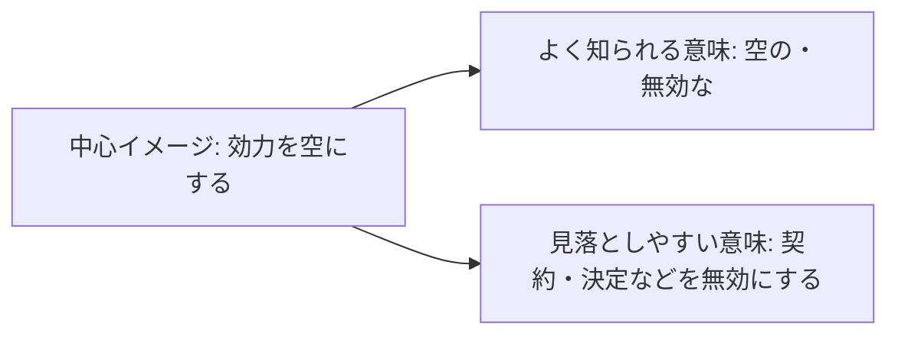

**重要語法**：void an agreement

<small>global_order: 3761 / index: 7767 / candidate_id: ev-07767-verb-02</small>

---

### 02. wedge

- **品詞**：verb
- **発音**：/wɛdʒ/
- <small>よく知られている意味：くさび・割り込む</small>

**見落としやすい意味**

> **人や集団の間に対立・隔たりを生む**

**例文**：The dispute wedged the two groups further apart.

**和訳**：その争いは二つの集団の隔たりをさらに広げた。

**コアイメージ**：くさびは隙間に入り、二つのものを押し離す。比喩的には、人や集団の間に入り込んだ問題が関係を引き離す。

**図**

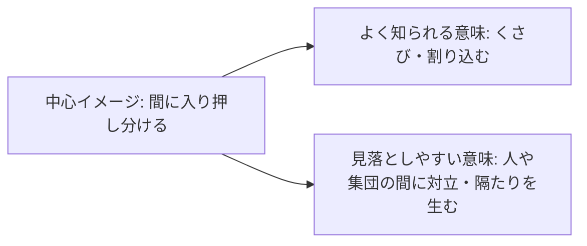

**重要語法**：drive a wedge between

<small>global_order: 3762 / index: 7768 / candidate_id: ev-07768-verb-01</small>

---

### 03. wrestle

- **品詞**：verb
- **発音**：/ˈrɛsəl/
- <small>よく知られている意味：取っ組み合う</small>

**見落としやすい意味**

> **難しい問題と真剣に取り組む**

**例文**：She wrestled with the decision for weeks.

**和訳**：彼女は何週間もその決断に真剣に悩んだ。

**コアイメージ**：体を使って相手と組み合うのが基本の姿。答えの出ない問題に対しても、格闘するように粘り強く向き合う。

**図**

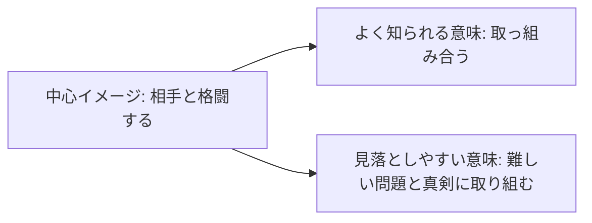

**重要語法**：wrestle with a problem

<small>global_order: 3763 / index: 7772 / candidate_id: ev-07772-verb-01</small>

---

### 04. bush

- **品詞**：noun
- **発音**：/bʊʃ/
- <small>よく知られている意味：茂み・低木</small>

**見落としやすい意味**

> **（特にオーストラリアで）町から離れた未開の土地・奥地**

**例文**：They spent a week hiking in the Australian bush.

**和訳**：彼らはオーストラリアの奥地で一週間ハイキングをした。

**コアイメージ**：bush は木々や低木の茂みを指す。特にオーストラリア英語では、そのような自然が広がる町から遠い地域全体を表す。

**図**

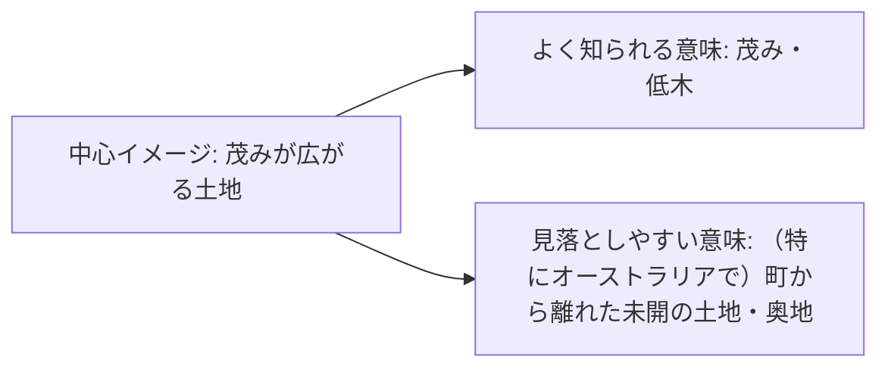

**重要語法**：out in the bush

<small>global_order: 3764 / index: 7775 / candidate_id: ev-07775-noun-01</small>

---

### 05. cheek

- **品詞**：noun
- **発音**：/tʃiːk/
- <small>よく知られている意味：頬</small>

**見落としやすい意味**

> **生意気さ・厚かましさ**

**例文**：He had the cheek to blame me for his mistake.

**和訳**：彼は厚かましくも、自分の失敗を私のせいにした。

**コアイメージ**：顔の一部を指す cheek には、相手に遠慮せずずうずうしく振る舞うという別義もある。have the cheek to は、その厚かましさへの驚きや非難を表す。

**図**

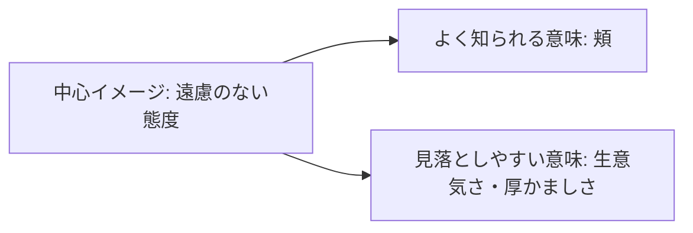

**重要語法**：have the cheek to

<small>global_order: 3765 / index: 7778 / candidate_id: ev-07778-noun-01</small>

---

### 06. cheek

- **品詞**：verb
- **発音**：/tʃiːk/
- <small>よく知られている意味：頬</small>

**見落としやすい意味**

> **生意気な口をきく**

**例文**：The pupil cheeked the teacher and was told to apologize.

**和訳**：その生徒は先生に生意気な口をきき、謝るよう言われた。

**コアイメージ**：名詞 cheek が「生意気さ」を表すとき、動詞ではそれを言葉や応答で示す。特にイギリス英語で、目上の人に失礼な口をきく場面に使う。

**図**

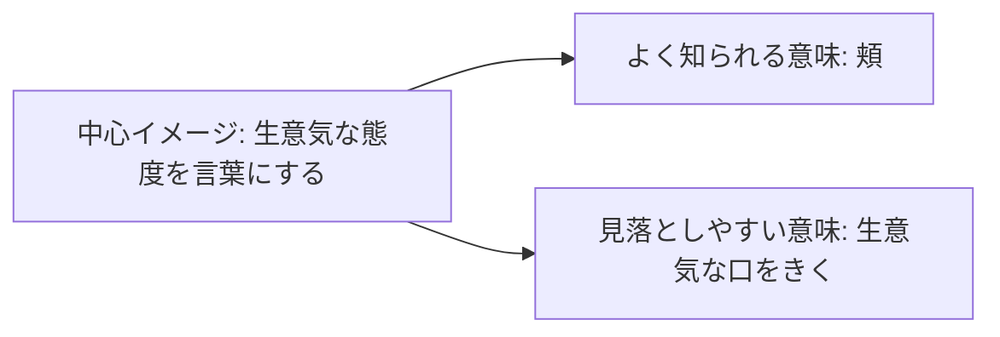

**重要語法**：cheek one's superior

<small>global_order: 3766 / index: 7778 / candidate_id: ev-07778-verb-02</small>

---

### 07. ripe

- **品詞**：adjective
- **発音**：/raɪp/
- <small>よく知られている意味：果物などが熟した</small>

**見落としやすい意味**

> **機会などが熟して好都合な**

**例文**：The time is ripe for a change in policy.

**和訳**：方針を変えるには今がちょうどよい時期だ。

**コアイメージ**：果物は時間を経て食べごろになる。同じように、状況や機会が整って何かを実行するのに適した時期になったことを表す。

**図**

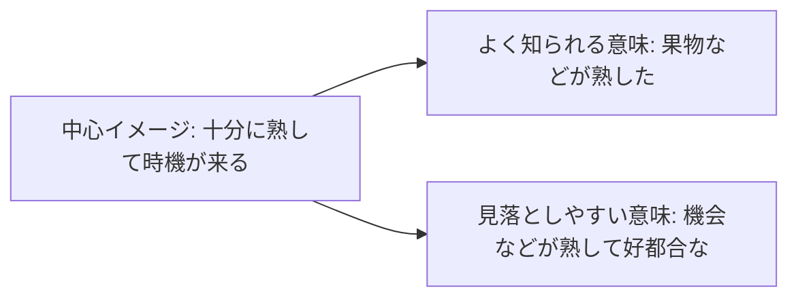

**重要語法**：a ripe opportunity

<small>global_order: 3767 / index: 7783 / candidate_id: ev-07783-adj-01</small>

---

### 08. rash

- **品詞**：adjective
- **発音**：/ræʃ/
- <small>よく知られている意味：発疹（名詞）</small>

**見落としやすい意味**

> **早まった・軽率な**

**例文**：It would be rash to make a decision without checking the facts.

**和訳**：事実を確かめずに決めるのは軽率だろう。

**コアイメージ**：形容詞 rash は、十分に考えないで行動に出る様子を表す。名詞の「発疹」とは語源が異なる同じ綴りの語なので、無理に意味を結びつけない。

**図**

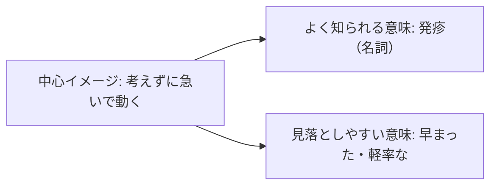

**重要語法**：a rash decision

<small>global_order: 3768 / index: 7786 / candidate_id: ev-07786-adj-02</small>

---

### 09. rash

- **品詞**：noun
- **発音**：/ræʃ/
- <small>よく知られている意味：発疹</small>

**見落としやすい意味**

> **同種の好ましくない出来事の相次ぐ発生**

**例文**：The town saw a rash of bicycle thefts last month.

**和訳**：先月、その町では自転車の盗難が相次いだ。

**コアイメージ**：発疹が次々に現れるように、好ましくない出来事が短期間に続くイメージで使う。a rash of の後には複数の事件や問題がよく続く。

**図**

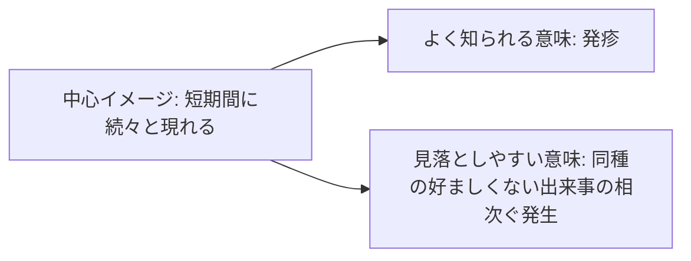

**重要語法**：a rash of + 複数の好ましくない出来事

<small>global_order: 3769 / index: 7786 / candidate_id: ev-07786-noun-01</small>

---

### 10. alignment

- **品詞**：noun
- **発音**：/əˈlaɪnmənt/
- <small>よく知られている意味：一直線にそろえること</small>

**見落としやすい意味**

> **見解・利益・方針が一致していること**

**例文**：The agreement reflects a close alignment of their interests.

**和訳**：その合意は両者の利害がよく一致していることを示している。

**コアイメージ**：物が同じ線や方向にそろっているのが出発点。立場・目標・利害についても、互いの向きが一致していることを表す。

**図**

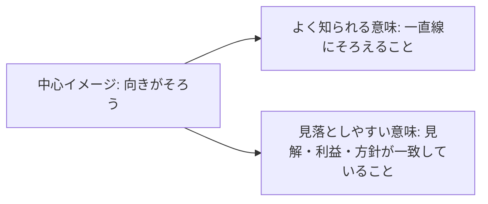

**重要語法**：alignment of interests

<small>global_order: 3770 / index: 7793 / candidate_id: ev-07793-noun-01</small>

---

### 11. clutch

- **品詞**：noun
- **発音**：/klʌtʃ/
- <small>よく知られている意味：しっかりつかむこと・車のクラッチ</small>

**見落としやすい意味**

> **ひとまとまりの集団・一群**

**例文**：A clutch of eggs lay hidden beneath the leaves.

**和訳**：葉の下にはひとまとまりの卵が隠れていた。

**コアイメージ**：clutch には「しっかりつかむ」という基本イメージがある。そこから、卵などがまとまった一群を指す名詞としても使われる。

**図**

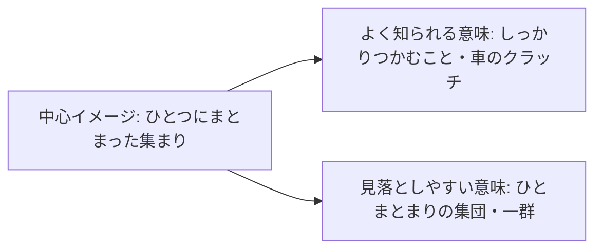

**重要語法**：a clutch of eggs

<small>global_order: 3771 / index: 7794 / candidate_id: ev-07794-noun-01</small>

---

### 12. fiddle

- **品詞**：verb
- **発音**：/ˈfɪdəl/
- <small>よく知られている意味：バイオリンを弾く・いじる</small>

**見落としやすい意味**

> **数値や証拠にこっそり手を加える**

**例文**：The accountant fiddled the figures to hide the loss.

**和訳**：その会計担当者は損失を隠すため数字を不正に操作した。

**コアイメージ**：指先で細かくいじったり調整したりする動きが土台。数字や記録にひそかに手を加える場合は、不正な操作を含意する。

**図**

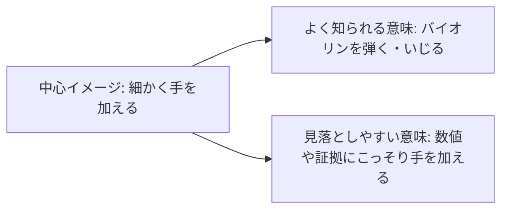

**重要語法**：fiddle the figures

<small>global_order: 3772 / index: 7799 / candidate_id: ev-07799-verb-01</small>

---

### 13. primer

- **品詞**：noun
- **発音**：/ˈpraɪmər/
- <small>よく知られている意味：下塗り剤</small>

**見落としやすい意味**

> **基礎を学ぶための入門書**

**例文**：This short primer explains the basics of genetics.

**和訳**：この短い入門書は遺伝学の基礎を説明している。

**コアイメージ**：下塗り剤は本格的な塗装の前に使う。学習の primer も、本格的に学ぶ前の基礎を身につけるためのものを指す。

**図**

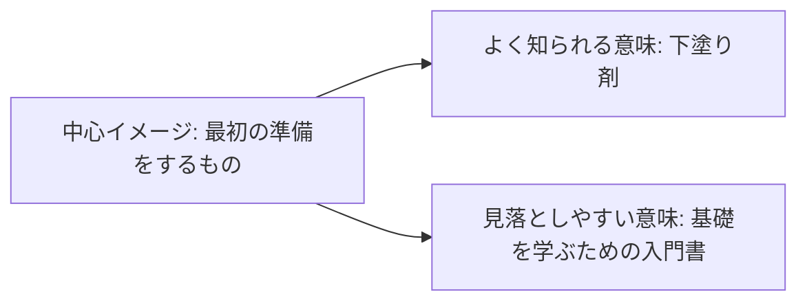

**重要語法**：a primer on economics

<small>global_order: 3773 / index: 7801 / candidate_id: ev-07801-noun-01</small>

---

### 14. acting

- **品詞**：adjective
- **発音**：/ˈæktɪŋ/
- <small>よく知られている意味：演技・演じること</small>

**見落としやすい意味**

> **代理の・暫定的に職務を務める**

**例文**：She is serving as acting director until a replacement is appointed.

**和訳**：後任が任命されるまで、彼女が局長代理を務めている。

**コアイメージ**：acting は役割を実際に演じたり果たしたりすることと関係する。役職名の前では、正式な就任者の代わりにその職務を務める意味になる。

**図**

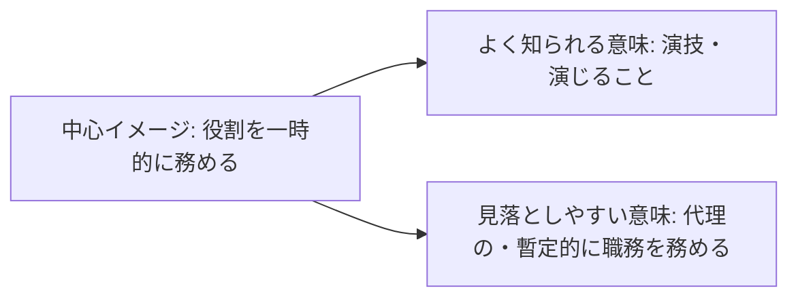

**重要語法**：acting director

<small>global_order: 3774 / index: 7806 / candidate_id: ev-07806-adj-01</small>

---

### 15. awaken

- **品詞**：verb
- **発音**：/əˈweɪkən/
- <small>よく知られている意味：眠りから目覚めさせる</small>

**見落としやすい意味**

> **人に重要な事実を気づかせる**

**例文**：The documentary awakened viewers to the scale of the problem.

**和訳**：そのドキュメンタリーは視聴者に問題の大きさを気づかせた。

**コアイメージ**：眠っていた人が目を覚ますのが具体的な意味。知らなかった事実や問題に心の目が開くことにも使う。

**図**

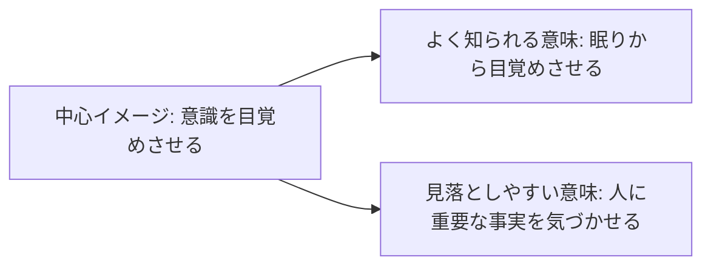

**重要語法**：awaken awareness

<small>global_order: 3775 / index: 7814 / candidate_id: ev-07814-verb-01</small>

---

### 16. ax

- **品詞**：verb
- **発音**：/æks/
- <small>よく知られている意味：おの</small>

**見落としやすい意味**

> **計画や予算を廃止・打ち切りにする**

**例文**：The company axed its expansion plan after the review.

**和訳**：その会社は見直しを経て拡大計画を打ち切った。

**コアイメージ**：おので木を切る動作から、計画・事業・予算などをばっさり削る意味が生まれる。突然または大幅な打ち切りを表すことが多い。

**図**

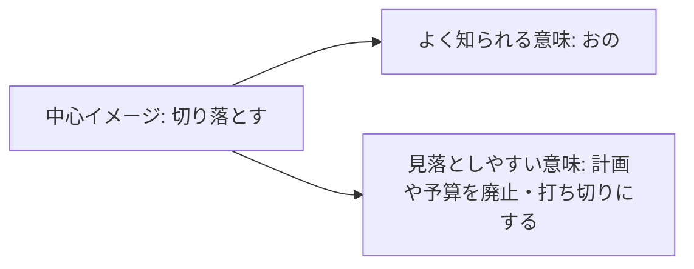

**重要語法**：ax the proposal

<small>global_order: 3776 / index: 7815 / candidate_id: ev-07815-verb-01</small>

---

### 17. bombard

- **品詞**：verb
- **発音**：/bɑmˈbɑrd/
- <small>よく知られている意味：爆撃する</small>

**見落としやすい意味**

> **質問などを次々に浴びせる**

**例文**：The reporters bombarded the mayor with questions.

**和訳**：記者たちは市長に次々と質問を浴びせた。

**コアイメージ**：爆弾が次々に降ってくるような集中攻撃が基本のイメージ。質問や要求を絶え間なく浴びせることにも使う。

**図**

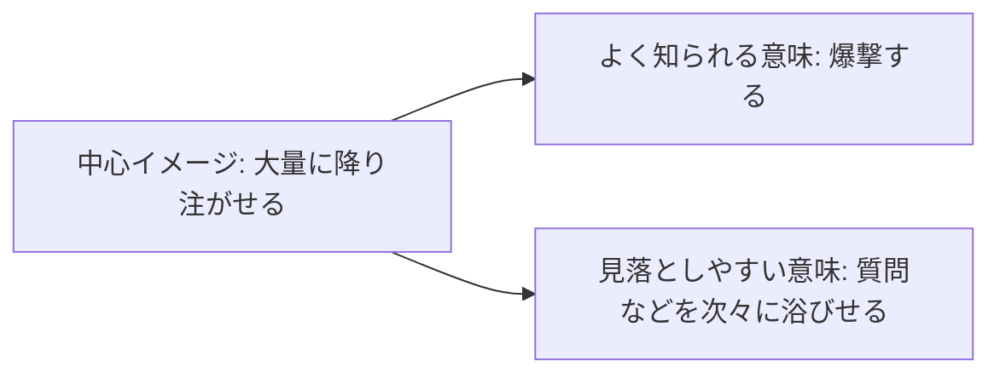

**重要語法**：bombard with questions

<small>global_order: 3777 / index: 7818 / candidate_id: ev-07818-verb-01</small>

---

### 18. bristle

- **品詞**：verb
- **発音**：/ˈbrɪsəl/
- <small>よく知られている意味：剛毛・毛を逆立てる</small>

**見落としやすい意味**

> **不快感や反発で身構える**

**例文**：He bristled at the suggestion that he was careless.

**和訳**：自分が不注意だと言われ、彼はむっとした。

**コアイメージ**：動物が警戒すると毛を逆立てる。人については、批判や無礼な発言に反発し、身構える態度を表す。

**図**

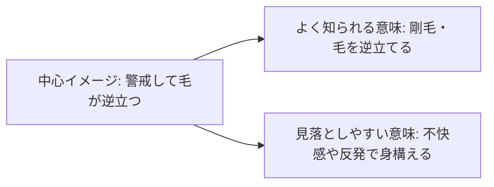

**重要語法**：bristle at criticism

<small>global_order: 3778 / index: 7821 / candidate_id: ev-07821-verb-01</small>

---

### 19. checker

- **品詞**：verb
- **発音**：/ˈtʃɛkər/
- <small>よく知られている意味：検査する人・チェッカー</small>

**見落としやすい意味**

> **格子模様や市松模様を付ける**

**例文**：The designer checkered the fabric with small blue squares.

**和訳**：デザイナーはその布に小さな青い格子模様を付けた。

**コアイメージ**：checker はチェック柄のような四角い区画を思わせる。動詞では、表面をそのような格子状の模様にすることをいう。

**図**

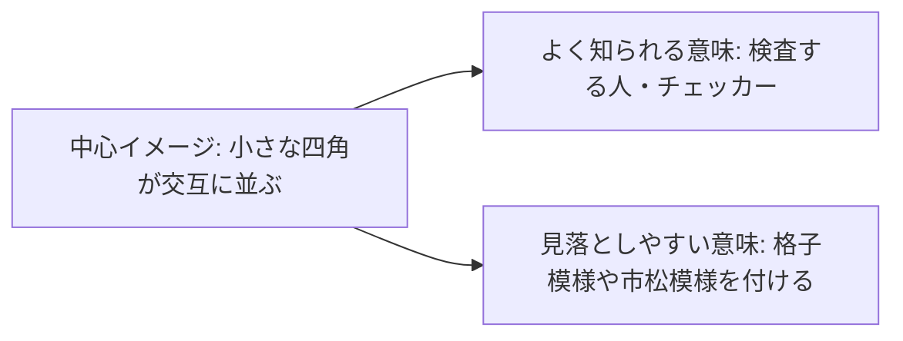

**重要語法**：a checkered pattern

<small>global_order: 3779 / index: 7824 / candidate_id: ev-07824-verb-01</small>

---

### 20. crest

- **品詞**：verb
- **発音**：/krɛst/
- <small>よく知られている意味：頂上・とさか</small>

**見落としやすい意味**

> **頂点に達する**

**例文**：The wave crested just before reaching the shore.

**和訳**：波は岸に着く直前に頂点に達した。

**コアイメージ**：crest は波のてっぺんや山の頂を表す。動詞では、波や動きが最も高い位置に達することをいう。

**図**

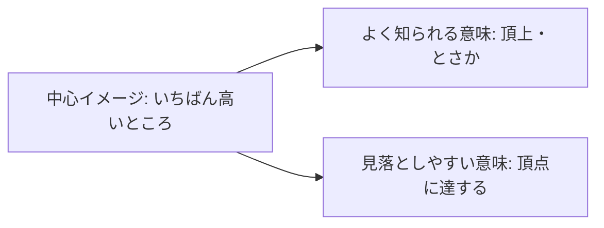

**重要語法**：a wave crests

<small>global_order: 3780 / index: 7832 / candidate_id: ev-07832-verb-01</small>

---

### 21. crow

- **品詞**：verb
- **発音**：/kroʊ/
- <small>よく知られている意味：カラス</small>

**見落としやすい意味**

> **得意になって自慢する**

**例文**：He crowed about his victory all afternoon.

**和訳**：彼は午後じゅう勝利を得意げに自慢していた。

**コアイメージ**：鳥の大きな鳴き声から、誇らしげに声を上げる様子を連想できる。人については、成功を得意になって言いふらす意味になる。

**図**

```mermaid
flowchart LR
    A["中心イメージ: 大きな声で勝ち誇る"]
    B["よく知られる意味: カラス"]
    C["見落としやすい意味: 得意になって自慢する"]
    A --> B
    A --> C
```

**重要語法**：crow about success

<small>global_order: 3781 / index: 7833 / candidate_id: ev-07833-verb-01</small>

---

### 22. dazzle

- **品詞**：verb
- **発音**：/ˈdæzəl/
- <small>よく知られている意味：強い光で目をくらませる</small>

**見落としやすい意味**

> **才能や技で強い感銘を与える**

**例文**：Her piano performance dazzled the audience.

**和訳**：彼女のピアノ演奏は観客を魅了した。

**コアイメージ**：まぶしい光は見る人を一瞬圧倒する。同じように、優れた才能や技巧が相手に強い印象を与えることを表す。

**図**

```mermaid
flowchart LR
    A["中心イメージ: 強烈で圧倒される"]
    B["よく知られる意味: 強い光で目をくらませる"]
    C["見落としやすい意味: 才能や技で強い感銘を与える"]
    A --> B
    A --> C
```

**重要語法**：dazzle the audience

<small>global_order: 3782 / index: 7834 / candidate_id: ev-07834-verb-01</small>

---

### 23. disciplinary

- **品詞**：adjective
- **発音**：/ˈdɪsəplɪnɛri/
- <small>よく知られている意味：規律・懲戒に関する</small>

**見落としやすい意味**

> **学問分野に関する**

**例文**：The study crosses traditional disciplinary boundaries.

**和訳**：その研究は従来の学問分野の境界を越えている。

**コアイメージ**：discipline は「規律」だけでなく「学問分野」も意味する。disciplinary が研究や境界を修飾すると、その学問分野に関わることを示す。

**図**

```mermaid
flowchart LR
    A["中心イメージ: それぞれの専門分野"]
    B["よく知られる意味: 規律・懲戒に関する"]
    C["見落としやすい意味: 学問分野に関する"]
    A --> B
    A --> C
```

**重要語法**：disciplinary boundaries

<small>global_order: 3783 / index: 7839 / candidate_id: ev-07839-adj-01</small>

---

### 24. diverge

- **品詞**：verb
- **発音**：/daɪˈvɝːdʒ/
- <small>よく知られている意味：道などが分かれる</small>

**見落としやすい意味**

> **見解などが食い違う**

**例文**：Their opinions diverged on how to solve the problem.

**和訳**：その問題の解決方法について、彼らの意見は食い違った。

**コアイメージ**：一本の道が別々の方向へ分かれていくのが基本の姿。意見や考え方も、同じ方向に進まなくなると diverge する。

**図**

```mermaid
flowchart LR
    A["中心イメージ: 同じ道から離れる"]
    B["よく知られる意味: 道などが分かれる"]
    C["見落としやすい意味: 見解などが食い違う"]
    A --> B
    A --> C
```

**重要語法**：opinions diverge

<small>global_order: 3784 / index: 7843 / candidate_id: ev-07843-verb-01</small>

---

### 25. dwarf

- **品詞**：verb
- **発音**：/dwɔːrf/
- <small>よく知られている意味：小人・小さい人</small>

**見落としやすい意味**

> **比較対象を小さく見せるほど上回る**

**例文**：The new stadium dwarfs the old one in size.

**和訳**：新しい競技場は古いものを大きさで圧倒している。

**コアイメージ**：dwarf は小さい存在を表す名詞でもある。動詞では、あるものが非常に大きく、比較相手を小さく見せてしまうことをいう。

**図**

```mermaid
flowchart LR
    A["中心イメージ: 比較相手を小さく見せる"]
    B["よく知られる意味: 小人・小さい人"]
    C["見落としやすい意味: 比較対象を小さく見せるほど上回る"]
    A --> B
    A --> C
```

**重要語法**：dwarf the previous total

<small>global_order: 3785 / index: 7845 / candidate_id: ev-07845-verb-01</small>

---

### 26. embellish

- **品詞**：verb
- **発音**：/ɪmˈbɛlɪʃ/
- <small>よく知られている意味：装飾する</small>

**見落としやすい意味**

> **話に脚色や余分な説明を加える**

**例文**：He embellished the story to make it sound more dramatic.

**和訳**：彼は話をより劇的に聞こえるよう脚色した。

**コアイメージ**：物に飾りを加えて見栄えをよくするのが具体的な意味。話や事実に対して使うと、余計な描写や脚色を付け足すことになる。

**図**

```mermaid
flowchart LR
    A["中心イメージ: 飾りを付け加える"]
    B["よく知られる意味: 装飾する"]
    C["見落としやすい意味: 話に脚色や余分な説明を加える"]
    A --> B
    A --> C
```

**重要語法**：embellish a story

<small>global_order: 3786 / index: 7846 / candidate_id: ev-07846-verb-01</small>

---

### 27. forced

- **品詞**：adjective
- **発音**：/fɔːrst/
- <small>よく知られている意味：強制された</small>

**見落としやすい意味**

> **わざとらしい・自然でない**

**例文**：She gave a forced smile when she heard the joke.

**和訳**：その冗談を聞き、彼女はぎこちなく作り笑いをした。

**コアイメージ**：外から力を加えて何かをさせるのが force の基本。笑顔や笑いが forced なら、心から自然に出たものではなく無理に作ったものだ。

**図**

```mermaid
flowchart LR
    A["中心イメージ: 自然には出てこない"]
    B["よく知られる意味: 強制された"]
    C["見落としやすい意味: わざとらしい・自然でない"]
    A --> B
    A --> C
```

**重要語法**：a forced smile

<small>global_order: 3787 / index: 7855 / candidate_id: ev-07855-adj-01</small>

---

### 28. friction

- **品詞**：noun
- **発音**：/ˈfrɪkʃən/
- <small>よく知られている意味：物体間の摩擦</small>

**見落としやすい意味**

> **人間関係や集団間の摩擦・対立**

**例文**：The change caused friction between the two departments.

**和訳**：その変更は二つの部署の間に対立を生んだ。

**コアイメージ**：物がこすれ合うと抵抗が生まれる。人や集団でも、考え方や利害がぶつかると関係に摩擦が生じる。

**図**

```mermaid
flowchart LR
    A["中心イメージ: 接触すると抵抗が生じる"]
    B["よく知られる意味: 物体間の摩擦"]
    C["見落としやすい意味: 人間関係や集団間の摩擦・対立"]
    A --> B
    A --> C
```

**重要語法**：friction between groups

<small>global_order: 3788 / index: 7857 / candidate_id: ev-07857-noun-01</small>

---

### 29. fugitive

- **品詞**：adjective
- **発音**：/ˈfjuːdʒɪtɪv/
- <small>よく知られている意味：逃亡者</small>

**見落としやすい意味**

> **ほんの短い間しか続かない・はかない**

**例文**：A fugitive smile crossed her face and vanished.

**和訳**：一瞬だけ微笑みが彼女の顔をよぎり、消えた。

**コアイメージ**：fugitive には「逃げ去る」という感覚がある。感情や印象を表す文語的な形容詞では、すぐに現れて消えるはかなさを示す。

**図**

```mermaid
flowchart LR
    A["中心イメージ: すぐに去ってしまう"]
    B["よく知られる意味: 逃亡者"]
    C["見落としやすい意味: ほんの短い間しか続かない・はかない"]
    A --> B
    A --> C
```

**重要語法**：文語・改まった用法。感情や印象など、長く続かないものに使う。

<small>global_order: 3789 / index: 7859 / candidate_id: ev-07859-adj-01</small>

---

### 30. grapple

- **品詞**：verb
- **発音**：/ˈɡræpəl/
- <small>よく知られている意味：つかみ合う</small>

**見落としやすい意味**

> **難題に取り組み、解決しようとする**

**例文**：The city is grappling with rising housing costs.

**和訳**：その都市は住宅費の上昇という難題に取り組んでいる。

**コアイメージ**：相手をつかんで取っ組み合うのが元の姿。難題に対しても、逃げずに向き合って解決しようとすることを表す。

**図**

```mermaid
flowchart LR
    A["中心イメージ: しっかり組み付いて格闘する"]
    B["よく知られる意味: つかみ合う"]
    C["見落としやすい意味: 難題に取り組み、解決しようとする"]
    A --> B
    A --> C
```

**重要語法**：grapple with the issue

<small>global_order: 3790 / index: 7861 / candidate_id: ev-07861-verb-01</small>

---

### 31. graze

- **品詞**：verb
- **発音**：/ɡreɪz/
- <small>よく知られている意味：家畜などが草を食べる</small>

**見落としやすい意味**

> **食べ物を少しずつつまみ食いする**

**例文**：We grazed on fruit and crackers during the trip.

**和訳**：旅行中、私たちは果物やクラッカーを少しずつつまんだ。

**コアイメージ**：草食動物が移動しながら少しずつ草を食べる様子が土台。人にも、まとまった食事ではなく軽くつまみ続ける意味で使う。

**図**

```mermaid
flowchart LR
    A["中心イメージ: 少しずつ食べ続ける"]
    B["よく知られる意味: 家畜などが草を食べる"]
    C["見落としやすい意味: 食べ物を少しずつつまみ食いする"]
    A --> B
    A --> C
```

**重要語法**：graze through snacks

<small>global_order: 3791 / index: 7862 / candidate_id: ev-07862-verb-01</small>

---

### 32. graze

- **品詞**：verb
- **発音**：/ɡreɪz/
- <small>よく知られている意味：家畜などが草を食べる</small>

**見落としやすい意味**

> **表面を軽くこする・かすめる**

**例文**：The ball grazed the edge of the table.

**和訳**：ボールは机の端をかすめた。

**コアイメージ**：graze には「表面を軽くこする」という別の動詞の意味がある。強くぶつかるのではなく、ぎりぎり触れながら通る様子を表す。

**図**

```mermaid
flowchart LR
    A["中心イメージ: 表面に軽く触れる"]
    B["よく知られる意味: 家畜などが草を食べる"]
    C["見落としやすい意味: 表面を軽くこする・かすめる"]
    A --> B
    A --> C
```

**重要語法**：graze the edge of a table

<small>global_order: 3792 / index: 7862 / candidate_id: ev-07862-verb-02</small>

---

### 33. hallmark

- **品詞**：noun
- **発音**：/ˈhɔːlmɑːrk/
- <small>よく知られている意味：品質を示す刻印</small>

**見落としやすい意味**

> **典型的な特徴・目立つしるし**

**例文**：Patience is a hallmark of her teaching style.

**和訳**：忍耐強さは彼女の教え方の特徴だ。

**コアイメージ**：貴金属の品質を示す刻印のように、そのものを見分けるしるしがある。そこから、人・時代・物事に特有の目立つ特徴を表す。

**図**

```mermaid
flowchart LR
    A["中心イメージ: 見分けるための印"]
    B["よく知られる意味: 品質を示す刻印"]
    C["見落としやすい意味: 典型的な特徴・目立つしるし"]
    A --> B
    A --> C
```

**重要語法**：hallmark of the era

<small>global_order: 3793 / index: 7865 / candidate_id: ev-07865-noun-01</small>

---

### 34. junkie

- **品詞**：noun
- **発音**：/ˈdʒʌŋki/
- <small>よく知られている意味：薬物依存者</small>

**見落としやすい意味**

> **ある活動や情報に夢中になっている人**

**例文**：As a news junkie, he checks the headlines every hour.

**和訳**：ニュース好きの彼は、毎時間見出しを確認している。

**コアイメージ**：もともと依存に関する口語表現。比喩的には、ニュースやスポーツなど特定のことが大好きで夢中になる人を指す。

**図**

```mermaid
flowchart LR
    A["中心イメージ: 何かに強くのめり込む"]
    B["よく知られる意味: 薬物依存者"]
    C["見落としやすい意味: ある活動や情報に夢中になっている人"]
    A --> B
    A --> C
```

**重要語法**：a news junkie

<small>global_order: 3794 / index: 7871 / candidate_id: ev-07871-noun-01</small>

---

### 35. justified

- **品詞**：adjective
- **発音**：/ˈdʒʌstəfaɪd/
- <small>よく知られている意味：正当化された</small>

**見落としやすい意味**

> **行の左右端がそろうように文字間隔を調整した**

**例文**：The document is easier to read with left-aligned text than fully justified text.

**和訳**：その文書は、両端ぞろえの文字より左ぞろえの文字の方が読みやすい。

**コアイメージ**：文章の組版では justify が文字の配置を調整する意味を持つ。fully justified は、左右両端がそろうように文字間隔を調整した状態を示す。

**図**

```mermaid
flowchart LR
    A["中心イメージ: 行の端をそろえる"]
    B["よく知られる意味: 正当化された"]
    C["見落としやすい意味: 行の左右端がそろうように文字間隔を調整した"]
    A --> B
    A --> C
```

**重要語法**：fully justified text

<small>global_order: 3795 / index: 7872 / candidate_id: ev-07872-adj-01</small>

---

### 36. maiden

- **品詞**：adjective
- **発音**：/ˈmeɪdən/
- <small>よく知られている意味：乙女・未婚の女性</small>

**見落としやすい意味**

> **初めての・最初の**

**例文**：The ship completed its maiden voyage without trouble.

**和訳**：その船は初航海を無事に終えた。

**コアイメージ**：maiden は古くから「未婚の女性」などを表す。形容詞では、初めて行われる旅や試みを表す定型的な使い方がある。

**図**

```mermaid
flowchart LR
    A["中心イメージ: 初めて経験する"]
    B["よく知られる意味: 乙女・未婚の女性"]
    C["見落としやすい意味: 初めての・最初の"]
    A --> B
    A --> C
```

**重要語法**：maiden voyage

<small>global_order: 3796 / index: 7879 / candidate_id: ev-07879-adj-01</small>

---

### 37. moat

- **品詞**：noun
- **発音**：/moʊt/
- <small>よく知られている意味：城の周囲の堀</small>

**見落としやすい意味**

> **競合他社の参入を防ぐ持続的な競争優位**

**例文**：A trusted brand can give a company a strong economic moat.

**和訳**：信頼されるブランドは企業に強力な競争上の防御力を与えうる。

**コアイメージ**：城の堀は外から敵が入りにくくする。ビジネスでは、競合相手が簡単には参入できない強みを比喩的に表す。

**図**

```mermaid
flowchart LR
    A["中心イメージ: 周囲から守る障壁"]
    B["よく知られる意味: 城の周囲の堀"]
    C["見落としやすい意味: 競合他社の参入を防ぐ持続的な競争優位"]
    A --> B
    A --> C
```

**重要語法**：economic moat

<small>global_order: 3797 / index: 7882 / candidate_id: ev-07882-noun-01</small>

---

### 38. muddle

- **品詞**：verb
- **発音**：/ˈmʌdəl/
- <small>よく知られている意味：混乱させる</small>

**見落としやすい意味**

> **不十分ながらも何とか切り抜ける**

**例文**：We muddled through the project despite the delays.

**和訳**：私たちは遅れがあったものの、何とかその計画をやり遂げた。

**コアイメージ**：muddle には物事がごちゃごちゃしている感覚がある。muddle through では、十分に整っていなくても何とか先へ進み切ることをいう。

**図**

```mermaid
flowchart LR
    A["中心イメージ: 混乱の中でも進む"]
    B["よく知られる意味: 混乱させる"]
    C["見落としやすい意味: 不十分ながらも何とか切り抜ける"]
    A --> B
    A --> C
```

**重要語法**：muddle through

<small>global_order: 3798 / index: 7884 / candidate_id: ev-07884-verb-01</small>

---

### 39. nursing

- **品詞**：noun
- **発音**：/ˈnɝːsɪŋ/
- <small>よく知られている意味：看護・介護</small>

**見落としやすい意味**

> **授乳・母乳を与えること**

**例文**：The center provides a quiet room for nursing.

**和訳**：その施設には授乳のための静かな部屋が用意されている。

**コアイメージ**：nurse には病人を看護するほか、乳児に乳を与える意味もある。nursing は文脈によって授乳そのものを指す。

**図**

```mermaid
flowchart LR
    A["中心イメージ: 世話をして育てる"]
    B["よく知られる意味: 看護・介護"]
    C["見落としやすい意味: 授乳・母乳を与えること"]
    A --> B
    A --> C
```

**重要語法**：nursing a baby

<small>global_order: 3799 / index: 7888 / candidate_id: ev-07888-noun-01</small>

---

### 40. pinpoint

- **品詞**：verb
- **発音**：/ˈpɪnpɔɪnt/
- <small>よく知られている意味：地図上の一点・位置を示す</small>

**見落としやすい意味**

> **正確な場所や原因を突き止める**

**例文**：Engineers pinpointed the cause of the failure.

**和訳**：技術者たちは故障の原因を正確に突き止めた。

**コアイメージ**：ピンの先のようにごく小さな一点を指定するイメージ。場所だけでなく、原因や問題の核心を正確に特定することにも使う。

**図**

```mermaid
flowchart LR
    A["中心イメージ: 小さな一点に絞る"]
    B["よく知られる意味: 地図上の一点・位置を示す"]
    C["見落としやすい意味: 正確な場所や原因を突き止める"]
    A --> B
    A --> C
```

**重要語法**：pinpoint the cause

<small>global_order: 3800 / index: 7893 / candidate_id: ev-07893-verb-01</small>

---

### 41. predatory

- **品詞**：adjective
- **発音**：/ˈprɛdətɔːri/
- <small>よく知られている意味：捕食性の</small>

**見落としやすい意味**

> **相手の弱みにつけ込んで搾取する**

**例文**：The new rule aims to prevent predatory lending.

**和訳**：新しい規則は弱みにつけ込む貸し付けを防ぐことを目指している。

**コアイメージ**：捕食者が獲物を狙う姿が基本。人や企業については、弱い立場の相手につけ込んで不当に利益を得る行為を表す。

**図**

```mermaid
flowchart LR
    A["中心イメージ: 獲物を狙って利益を得る"]
    B["よく知られる意味: 捕食性の"]
    C["見落としやすい意味: 相手の弱みにつけ込んで搾取する"]
    A --> B
    A --> C
```

**重要語法**：predatory lending

<small>global_order: 3801 / index: 7896 / candidate_id: ev-07896-adj-01</small>

---

### 42. runway

- **品詞**：noun
- **発音**：/ˈrʌnweɪ/
- <small>よく知られている意味：飛行機の滑走路</small>

**見落としやすい意味**

> **ファッションショーでモデルが歩く細長い舞台**

**例文**：The models walked down the runway in bright coats.

**和訳**：モデルたちは鮮やかなコートを着てランウェーを歩いた。

**コアイメージ**：滑走路もファッションショーの舞台も、前方へ進む細長い道という形が共通する。服飾の文脈ではモデルが歩く舞台をいう。

**図**

```mermaid
flowchart LR
    A["中心イメージ: 細長く歩くための通路"]
    B["よく知られる意味: 飛行機の滑走路"]
    C["見落としやすい意味: ファッションショーでモデルが歩く細長い舞台"]
    A --> B
    A --> C
```

**重要語法**：fashion runway

<small>global_order: 3802 / index: 7907 / candidate_id: ev-07907-noun-01</small>

---

### 43. shipwreck

- **品詞**：verb
- **発音**：/ˈʃɪprɛk/
- <small>よく知られている意味：船を難破させる</small>

**見落としやすい意味**

> **計画などを完全に失敗させる**

**例文**：A last-minute dispute shipwrecked the peace talks.

**和訳**：直前に起きた争いが和平交渉を頓挫させた。

**コアイメージ**：船が難破すると目的地まで進めなくなる。そのイメージを計画や交渉に重ね、成功への道を完全に断つことを表す。

**図**

```mermaid
flowchart LR
    A["中心イメージ: 航行が完全に破綻する"]
    B["よく知られる意味: 船を難破させる"]
    C["見落としやすい意味: 計画などを完全に失敗させる"]
    A --> B
    A --> C
```

**重要語法**：shipwreck the plan

<small>global_order: 3803 / index: 7912 / candidate_id: ev-07912-verb-01</small>

---

### 44. sprinkle

- **品詞**：verb
- **発音**：/ˈsprɪŋkəl/
- <small>よく知られている意味：水や粉を振りかける</small>

**見落としやすい意味**

> **あちこちに少量ずつ散らす**

**例文**：She sprinkled personal stories throughout her lecture.

**和訳**：彼女は講義のあちこちに個人的な話を少しずつ織り交ぜた。

**コアイメージ**：水滴や粉を一か所に集めず散らす動きが土台。話や文章にも、短い例やコメントをところどころに加える意味で使う。

**図**

```mermaid
flowchart LR
    A["中心イメージ: 少量をあちこちに散らす"]
    B["よく知られる意味: 水や粉を振りかける"]
    C["見落としやすい意味: あちこちに少量ずつ散らす"]
    A --> B
    A --> C
```

**重要語法**：sprinkle comments throughout

<small>global_order: 3804 / index: 7916 / candidate_id: ev-07916-verb-01</small>

---

### 45. sucker

- **品詞**：noun
- **発音**：/ˈsʌkər/
- <small>よく知られている意味：吸盤・吸うもの</small>

**見落としやすい意味**

> **だまされやすい人・かも**

**例文**：The dishonest salesman took him for a sucker.

**和訳**：その不誠実な販売員は彼を簡単にだませる相手だと思った。

**コアイメージ**：口語の sucker は、うまい話を信じて損をしやすい人を見下して指すことがある。物を吸う道具という意味とは区別して覚える。

**図**

```mermaid
flowchart LR
    A["中心イメージ: だまされやすい標的"]
    B["よく知られる意味: 吸盤・吸うもの"]
    C["見落としやすい意味: だまされやすい人・かも"]
    A --> B
    A --> C
```

**重要語法**：a sucker for a scam

<small>global_order: 3805 / index: 7922 / candidate_id: ev-07922-noun-01</small>

---

### 46. suite

- **品詞**：noun
- **発音**：/swiːt/
- <small>よく知られている意味：ホテルなどの続き部屋</small>

**見落としやすい意味**

> **組曲**

**例文**：The orchestra performed a suite from the ballet.

**和訳**：オーケストラはそのバレエからの組曲を演奏した。

**コアイメージ**：suite は関連する部屋がひと続きになったものを指す。音楽では、いくつかの楽曲をまとめて構成した組曲をいう。

**図**

```mermaid
flowchart LR
    A["中心イメージ: 関連するものをひと組にする"]
    B["よく知られる意味: ホテルなどの続き部屋"]
    C["見落としやすい意味: 組曲"]
    A --> B
    A --> C
```

**重要語法**：a piano suite

<small>global_order: 3806 / index: 7923 / candidate_id: ev-07923-noun-01</small>

---

### 47. suite

- **品詞**：noun
- **発音**：/swiːt/
- <small>よく知られている意味：ホテルなどの続き部屋</small>

**見落としやすい意味**

> **一式そろった家具**

**例文**：They bought a matching three-piece suite for the living room.

**和訳**：彼らは居間用に同じデザインの三点セット家具を買った。

**コアイメージ**：suite の中心には、関連するものが一組になっているという感覚がある。イギリス英語では、同じデザインでそろえたソファなどの家具一式を指す。

**図**

```mermaid
flowchart LR
    A["中心イメージ: そろって一式になる"]
    B["よく知られる意味: ホテルなどの続き部屋"]
    C["見落としやすい意味: 一式そろった家具"]
    A --> B
    A --> C
```

**重要語法**：a furniture suite

<small>global_order: 3807 / index: 7923 / candidate_id: ev-07923-noun-02</small>

---

### 48. viability

- **品詞**：noun
- **発音**：/ˌvaɪəˈbɪləti/
- <small>よく知られている意味：生存できること</small>

**見落としやすい意味**

> **計画・事業が現実に成立し続けられる見込み**

**例文**：The investors questioned the financial viability of the project.

**和訳**：投資家たちはその事業が財政的に成り立つかどうか疑問視した。

**コアイメージ**：viable は生命が維持できることにも使う。計画や事業では、現実の条件下で成立し、継続できる見込みを表す。

**図**

```mermaid
flowchart LR
    A["中心イメージ: 生き残って続けられる"]
    B["よく知られる意味: 生存できること"]
    C["見落としやすい意味: 計画・事業が現実に成立し続けられる見込み"]
    A --> B
    A --> C
```

**重要語法**：economic viability

<small>global_order: 3808 / index: 7937 / candidate_id: ev-07937-noun-01</small>

---

### 49. drawer

- **品詞**：noun
- **発音**：/ˈdrɔːr/
- <small>よく知られている意味：引き出し</small>

**見落としやすい意味**

> **小切手などの振出人**

**例文**：The drawer signed the check before handing it over.

**和訳**：振出人は小切手を渡す前に署名した。

**コアイメージ**：drawer は draw する人や物を指せる。金融では、支払いを指図する小切手などを振り出した人という意味になる。

**図**

```mermaid
flowchart LR
    A["中心イメージ: 何かを引き出す人"]
    B["よく知られる意味: 引き出し"]
    C["見落としやすい意味: 小切手などの振出人"]
    A --> B
    A --> C
```

**重要語法**：the drawer of a cheque

<small>global_order: 3809 / index: 7945 / candidate_id: ev-07945-noun-01</small>

---

### 50. runner

- **品詞**：noun
- **発音**：/ˈrʌnər/
- <small>よく知られている意味：走る人</small>

**見落としやすい意味**

> **植物から伸びて新たな株を生む走出枝**

**例文**：The strawberry plant sent out runners that took root nearby.

**和訳**：そのイチゴの株は周囲に根付く走出枝を伸ばした。

**コアイメージ**：人が走るように、植物の細い茎が地表を横へ伸びる。その茎から新しい株が育つとき、runner と呼ぶ。

**図**

```mermaid
flowchart LR
    A["中心イメージ: 地表を走るように伸びる"]
    B["よく知られる意味: 走る人"]
    C["見落としやすい意味: 植物から伸びて新たな株を生む走出枝"]
    A --> B
    A --> C
```

**重要語法**：a strawberry runner

<small>global_order: 3810 / index: 7946 / candidate_id: ev-07946-noun-01</small>

---

### 51. runner

- **品詞**：noun
- **発音**：/ˈrʌnər/
- <small>よく知られている意味：走る人</small>

**見落としやすい意味**

> **細長いじゅうたん・敷物**

**例文**：A long red runner covered the center of the hallway.

**和訳**：細長い赤い敷物が廊下の中央を覆っていた。

**コアイメージ**：runner は走る人以外に、長い方向へ伸びる細いものにも使う。廊下や階段に敷く細長いじゅうたんを表す。

**図**

```mermaid
flowchart LR
    A["中心イメージ: 長く伸びるもの"]
    B["よく知られる意味: 走る人"]
    C["見落としやすい意味: 細長いじゅうたん・敷物"]
    A --> B
    A --> C
```

**重要語法**：a hallway runner

<small>global_order: 3811 / index: 7946 / candidate_id: ev-07946-noun-02</small>

---

### 52. tick

- **品詞**：noun
- **発音**：/tɪk/
- <small>よく知られている意味：時計のカチカチ音</small>

**見落としやすい意味**

> **寄生するマダニなど**

**例文**：We found a tick on the dog's fur after the walk.

**和訳**：散歩の後、犬の毛にマダニが付いているのを見つけた。

**コアイメージ**：tick には時計の音とは別に、動物に付く小さな寄生生物という名詞の意味がある。音から推測するのではなく、文脈で判別する。

**図**

```mermaid
flowchart LR
    A["中心イメージ: 同じ綴りの別名詞"]
    B["よく知られる意味: 時計のカチカチ音"]
    C["見落としやすい意味: 寄生するマダニなど"]
    A --> B
    A --> C
```

**重要語法**：a tick on an animal

<small>global_order: 3812 / index: 7949 / candidate_id: ev-07949-noun-01</small>

---

### 53. tick

- **品詞**：noun
- **発音**：/tɪk/
- <small>よく知られている意味：時計のカチカチ音</small>

**見落としやすい意味**

> **チェック印**

**例文**：Put a tick next to each correct answer.

**和訳**：正しい答えの横にチェック印を付けなさい。

**コアイメージ**：tick は短いカチッという音だけでなく、正しさや確認を示す小さな印も指す。特にイギリス英語でチェックマークの意味になる。

**図**

```mermaid
flowchart LR
    A["中心イメージ: 小さなしるしを付ける"]
    B["よく知られる意味: 時計のカチカチ音"]
    C["見落としやすい意味: チェック印"]
    A --> B
    A --> C
```

**重要語法**：put a tick in the box

<small>global_order: 3813 / index: 7949 / candidate_id: ev-07949-noun-02</small>

---

### 54. tick

- **品詞**：verb
- **発音**：/tɪk/
- <small>よく知られている意味：時計がカチカチ鳴る</small>

**見落としやすい意味**

> **（what makes someone tick の形で）人を動かす動機になる**

**例文**：The coach wants to know what makes each player tick.

**和訳**：コーチは選手一人ひとりを動かしているものを知りたがっている。

**コアイメージ**：時計が刻み続ける仕組みを、人の内面に重ねた表現。what makes someone tick は、その人を動かす興味・動機・性格を問う。

**図**

```mermaid
flowchart LR
    A["中心イメージ: 動き続ける仕組み"]
    B["よく知られる意味: 時計がカチカチ鳴る"]
    C["見落としやすい意味: （what makes someone tick の形で）人を動かす動機になる"]
    A --> B
    A --> C
```

**重要語法**：what makes someone tick

<small>global_order: 3814 / index: 7949 / candidate_id: ev-07949-verb-01</small>

---

### 55. nursery

- **品詞**：noun
- **発音**：/ˈnɝːsəri/
- <small>よく知られている意味：保育園・子ども部屋</small>

**見落としやすい意味**

> **植物の苗を育てる施設**

**例文**：We bought young trees from a local nursery.

**和訳**：私たちは地元の苗木園で若木を買った。

**コアイメージ**：nursery は小さい子どもを育てる場所を指す。植物についても、苗や若木を育てる場所という同じ発想で使う。

**図**

```mermaid
flowchart LR
    A["中心イメージ: 幼いものを育てる場所"]
    B["よく知られる意味: 保育園・子ども部屋"]
    C["見落としやすい意味: 植物の苗を育てる施設"]
    A --> B
    A --> C
```

**重要語法**：a plant nursery

<small>global_order: 3815 / index: 7950 / candidate_id: ev-07950-noun-01</small>

---

### 56. mortar

- **品詞**：noun
- **発音**：/ˈmɔːrtər/
- <small>よく知られている意味：建築用のモルタル</small>

**見落としやすい意味**

> **（すりこぎと組にして使う）すり鉢**

**例文**：She crushed the herbs in a mortar with a pestle.

**和訳**：彼女はすりこぎを使ってすり鉢の中でハーブを砕いた。

**コアイメージ**：建築材料を表す mortar とは別に、材料をすりつぶす容器を指す。すりこぎの pestle と対で現れるときは、すり鉢の意味になる。

**図**

```mermaid
flowchart LR
    A["中心イメージ: 同じ綴りの別の道具"]
    B["よく知られる意味: 建築用のモルタル"]
    C["見落としやすい意味: （すりこぎと組にして使う）すり鉢"]
    A --> B
    A --> C
```

**重要語法**：mortar and pestle

<small>global_order: 3816 / index: 7952 / candidate_id: ev-07952-noun-01</small>

---

### 57. stern

- **品詞**：noun
- **発音**：/stɝːn/
- <small>よく知られている意味：厳格な・険しい</small>

**見落としやすい意味**

> **船尾・船の後部**

**例文**：We stood at the stern and watched the waves behind us.

**和訳**：私たちは船尾に立ち、後方の波を眺めた。

**コアイメージ**：形容詞 stern の「厳しい」とは別に、名詞には船の後部という意味がある。船の位置を表す文章では bow が船首、stern が船尾だ。

**図**

```mermaid
flowchart LR
    A["中心イメージ: 船の後ろ側"]
    B["よく知られる意味: 厳格な・険しい"]
    C["見落としやすい意味: 船尾・船の後部"]
    A --> B
    A --> C
```

**重要語法**：the stern of a vessel

<small>global_order: 3817 / index: 7954 / candidate_id: ev-07954-noun-01</small>

---

### 58. temporal

- **品詞**：adjective
- **発音**：/ˈtɛmpərəl/
- <small>よく知られている意味：時間に関する</small>

**見落としやすい意味**

> **世俗的な・現世の**

**例文**：The ruler held both religious and temporal power.

**和訳**：その支配者は宗教的権力と世俗的権力の両方を持っていた。

**コアイメージ**：temporal には時間に関する意味のほか、永遠・宗教的なものと対になる現世的な意味がある。権力や事柄を修飾すると、世俗の社会に属することを表す。

**図**

```mermaid
flowchart LR
    A["中心イメージ: この世の暮らしに属する"]
    B["よく知られる意味: 時間に関する"]
    C["見落としやすい意味: 世俗的な・現世の"]
    A --> B
    A --> C
```

**重要語法**：temporal power

<small>global_order: 3818 / index: 7955 / candidate_id: ev-07955-adj-01</small>

---

### 59. chilly

- **品詞**：adjective
- **発音**：/ˈtʃɪli/
- <small>よく知られている意味：肌寒い</small>

**見落としやすい意味**

> **（態度・歓迎などが）冷淡な・よそよそしい**

**例文**：The plan received a chilly reception from local residents.

**和訳**：その計画は地元住民から冷淡に迎えられた。

**コアイメージ**：冷たい空気に触れると距離を感じる。歓迎や態度に chilly を使うと、温かみや親しみのない反応を表す。

**図**

```mermaid
flowchart LR
    A["中心イメージ: 冷たさを感じさせる"]
    B["よく知られる意味: 肌寒い"]
    C["見落としやすい意味: （態度・歓迎などが）冷淡な・よそよそしい"]
    A --> B
    A --> C
```

**重要語法**：a chilly reception

<small>global_order: 3819 / index: 7958 / candidate_id: ev-07958-adj-01</small>

---

### 60. facet

- **品詞**：noun
- **発音**：/ˈfæsɪt/
- <small>よく知られている意味：宝石のカット面</small>

**見落としやすい意味**

> **問題や事物の一側面**

**例文**：The report examines another facet of the problem.

**和訳**：その報告書は問題の別の側面を検討している。

**コアイメージ**：宝石には向きの異なる多くの面がある。複雑な問題も見る角度によって異なる側面があり、その一つを facet と呼ぶ。

**図**

```mermaid
flowchart LR
    A["中心イメージ: 多面体の一つの面"]
    B["よく知られる意味: 宝石のカット面"]
    C["見落としやすい意味: 問題や事物の一側面"]
    A --> B
    A --> C
```

**重要語法**：another facet of the issue

<small>global_order: 3820 / index: 7961 / candidate_id: ev-07961-noun-01</small>

---

### 61. sequel

- **品詞**：noun
- **発音**：/ˈsiːkwəl/
- <small>よく知られている意味：映画や小説の続編</small>

**見落としやすい意味**

> **後に続く出来事・結果**

**例文**：The immediate sequel to the dispute was a public apology.

**和訳**：その論争の直後に続いた出来事は、公の謝罪だった。

**コアイメージ**：sequel は前にあるものの後へ続くという関係を表す。物語の続編だけでなく、事件の後に起きる出来事や結果も指せる。

**図**

```mermaid
flowchart LR
    A["中心イメージ: 後から続いて起こる"]
    B["よく知られる意味: 映画や小説の続編"]
    C["見落としやすい意味: 後に続く出来事・結果"]
    A --> B
    A --> C
```

**重要語法**：a sequel to the crisis

<small>global_order: 3821 / index: 7962 / candidate_id: ev-07962-noun-01</small>

---

### 62. accrue

- **品詞**：verb
- **発音**：/əˈkruː/
- <small>よく知られている意味：利子などが積み重なる</small>

**見落としやすい意味**

> **（利益・権利などが）人に生じる・帰属する**

**例文**：Most of the benefits accrue to larger companies.

**和訳**：利益の大部分はより大きな企業にもたらされる。

**コアイメージ**：利子や利益が時間とともに生じて積み重なるのが基本。accrue to の形では、その利益や権利が誰のものになるかを示す。

**図**

```mermaid
flowchart LR
    A["中心イメージ: 少しずつ生じて帰属する"]
    B["よく知られる意味: 利子などが積み重なる"]
    C["見落としやすい意味: （利益・権利などが）人に生じる・帰属する"]
    A --> B
    A --> C
```

**重要語法**：benefits accrue to someone

<small>global_order: 3822 / index: 7967 / candidate_id: ev-07967-verb-01</small>

---

### 63. airy

- **品詞**：adjective
- **発音**：/ˈɛri/
- <small>よく知られている意味：風通しがよい</small>

**見落としやすい意味**

> **現実味がない・空想的な**

**例文**：The committee rejected his airy speculation.

**和訳**：委員会は彼の現実味のない憶測を退けた。

**コアイメージ**：空気のように軽く、しっかり地面に結びついていないイメージ。考えや憶測については、具体的な根拠が乏しいことを表す。

**図**

```mermaid
flowchart LR
    A["中心イメージ: 地に足がつかない"]
    B["よく知られる意味: 風通しがよい"]
    C["見落としやすい意味: 現実味がない・空想的な"]
    A --> B
    A --> C
```

**重要語法**：airy speculation

<small>global_order: 3823 / index: 7971 / candidate_id: ev-07971-adj-01</small>

---

### 64. audits

- **品詞**：verb
- **発音**：/ˈɔːdɪts/
- <small>よく知られている意味：会計を監査する</small>

**見落としやすい意味**

> **（大学の授業を）単位取得せず聴講する**

**例文**：She audits a history course without earning credit.

**和訳**：彼女は単位を取らずに歴史の授業を聴講している。

**コアイメージ**：audit の基本には、内容をよく確かめる行為がある。大学の授業では、単位取得を目的とせず授業を聴く意味にもなる。

**図**

```mermaid
flowchart LR
    A["中心イメージ: 内容を確認するために参加する"]
    B["よく知られる意味: 会計を監査する"]
    C["見落としやすい意味: （大学の授業を）単位取得せず聴講する"]
    A --> B
    A --> C
```

**重要語法**：audits a course

<small>global_order: 3824 / index: 7979 / candidate_id: ev-07979-verb-01</small>

---

### 65. bandwidth

- **品詞**：noun
- **発音**：/ˈbændwɪdθ/
- <small>よく知られている意味：通信の帯域幅</small>

**見落としやすい意味**

> **作業や相談に対応できる時間的・精神的な余力**

**例文**：I don't have the bandwidth to take on another project this week.

**和訳**：今週は別の仕事まで引き受ける余裕がない。

**コアイメージ**：通信回線には一度に扱える情報量の限界がある。人にも比喩的に使い、時間や気力の面で対応できる余力を表す。

**図**

```mermaid
flowchart LR
    A["中心イメージ: 処理できる量の上限"]
    B["よく知られる意味: 通信の帯域幅"]
    C["見落としやすい意味: 作業や相談に対応できる時間的・精神的な余力"]
    A --> B
    A --> C
```

**重要語法**：have the bandwidth to help

<small>global_order: 3825 / index: 7980 / candidate_id: ev-07980-noun-01</small>

---

### 66. bun

- **品詞**：noun
- **発音**：/bʌn/
- <small>よく知られている意味：丸いパン</small>

**見落としやすい意味**

> **後頭部などにまとめたお団子状の髪型**

**例文**：She wore her hair in a neat bun.

**和訳**：彼女は髪をきれいなお団子にまとめていた。

**コアイメージ**：bun は丸みのあるパンを表す。髪をひとまとめにして丸く巻いた形も、見た目の共通点から bun と呼ぶ。

**図**

```mermaid
flowchart LR
    A["中心イメージ: 丸くまとめた形"]
    B["よく知られる意味: 丸いパン"]
    C["見落としやすい意味: 後頭部などにまとめたお団子状の髪型"]
    A --> B
    A --> C
```

**重要語法**：wear hair in a bun

<small>global_order: 3826 / index: 7986 / candidate_id: ev-07986-noun-01</small>

---

### 67. cab

- **品詞**：noun
- **発音**：/kæb/
- <small>よく知られている意味：タクシー</small>

**見落としやすい意味**

> **列車やトラックなどの運転室**

**例文**：The driver climbed into the truck's cab.

**和訳**：運転手はトラックの運転室に乗り込んだ。

**コアイメージ**：cab は乗り物の人が座る区画を表す。タクシーだけでなく、トラックや列車の運転席を囲む空間も指す。

**図**

```mermaid
flowchart LR
    A["中心イメージ: 運転者のための区画"]
    B["よく知られる意味: タクシー"]
    C["見落としやすい意味: 列車やトラックなどの運転室"]
    A --> B
    A --> C
```

**重要語法**：the driver's cab

<small>global_order: 3827 / index: 7988 / candidate_id: ev-07988-noun-01</small>

---

### 68. camper

- **品詞**：noun
- **発音**：/ˈkæmpər/
- <small>よく知られている意味：キャンプをする人</small>

**見落としやすい意味**

> **居住・宿泊設備付きのキャンピング車両**

**例文**：They drove around the island in a small camper.

**和訳**：彼らは小型のキャンピング車で島を巡った。

**コアイメージ**：camper はキャンプをする人を指すだけではない。寝泊まりする設備を備えた車両自体を表すこともある。

**図**

```mermaid
flowchart LR
    A["中心イメージ: 泊まりながら移動する"]
    B["よく知られる意味: キャンプをする人"]
    C["見落としやすい意味: 居住・宿泊設備付きのキャンピング車両"]
    A --> B
    A --> C
```

**重要語法**：travel in a camper

<small>global_order: 3828 / index: 7991 / candidate_id: ev-07991-noun-01</small>

---

### 69. canon

- **品詞**：noun
- **発音**：/ˈkænən/
- <small>よく知られている意味：宗教上の正典</small>

**見落としやすい意味**

> **ある分野で正統と認められる原則や規範**

**例文**：The architect challenged the traditional canon of design.

**和訳**：その建築家は伝統的なデザインの規範に異議を唱えた。

**コアイメージ**：canon は権威ある基準や正統とされるもののまとまりを表す。宗教の正典から、芸術や学問の原則・規範にも意味が広がる。

**図**

```mermaid
flowchart LR
    A["中心イメージ: 標準として認められたもの"]
    B["よく知られる意味: 宗教上の正典"]
    C["見落としやすい意味: ある分野で正統と認められる原則や規範"]
    A --> B
    A --> C
```

**重要語法**：the literary canon

<small>global_order: 3829 / index: 7992 / candidate_id: ev-07992-noun-01</small>

---

### 70. canon

- **品詞**：noun
- **発音**：/ˈkænən/
- <small>よく知られている意味：宗教上の正典</small>

**見落としやすい意味**

> **複数の声部が順に同じ旋律を模倣する楽曲**

**例文**：The choir sang a simple canon in three parts.

**和訳**：合唱団は三声の簡単なカノンを歌った。

**コアイメージ**：音楽の canon は別の声部が同じ旋律を時間差で始める形式。ある声部を次の声部が追いかけるように重なる。

**図**

```mermaid
flowchart LR
    A["中心イメージ: 同じ旋律を追いかける"]
    B["よく知られる意味: 宗教上の正典"]
    C["見落としやすい意味: 複数の声部が順に同じ旋律を模倣する楽曲"]
    A --> B
    A --> C
```

**重要語法**：a musical canon

<small>global_order: 3830 / index: 7992 / candidate_id: ev-07992-noun-02</small>

---

### 71. carp

- **品詞**：verb
- **発音**：/kɑːrp/
- <small>よく知られている意味：魚のコイ</small>

**見落としやすい意味**

> **ささいなことに難癖をつける**

**例文**：He kept carping about tiny mistakes.

**和訳**：彼はささいなミスについて難癖をつけ続けた。

**コアイメージ**：動詞 carp は、細かいことをしつこく批判する意味を持つ。魚の名前との意味のつながりを無理に作らず、carp about の形で覚える。

**図**

```mermaid
flowchart LR
    A["中心イメージ: 小さな欠点を責め立てる"]
    B["よく知られる意味: 魚のコイ"]
    C["見落としやすい意味: ささいなことに難癖をつける"]
    A --> B
    A --> C
```

**重要語法**：carp about minor matters

<small>global_order: 3831 / index: 7993 / candidate_id: ev-07993-verb-01</small>

---

### 72. centerpiece

- **品詞**：noun
- **発音**：/ˈsɛntərpiːs/
- <small>よく知られている意味：テーブル中央の飾り</small>

**見落としやすい意味**

> **最も注目される中心的な存在・特徴**

**例文**：Education is the centerpiece of the new policy.

**和訳**：教育は新しい政策の中心をなす柱だ。

**コアイメージ**：テーブルの中央に置かれて注目を集める飾りが原義。計画や議論では、最も重要で目立つ要素を指す。

**図**

```mermaid
flowchart LR
    A["中心イメージ: 中心に置かれる目玉"]
    B["よく知られる意味: テーブル中央の飾り"]
    C["見落としやすい意味: 最も注目される中心的な存在・特徴"]
    A --> B
    A --> C
```

**重要語法**：the centerpiece of a plan

<small>global_order: 3832 / index: 7994 / candidate_id: ev-07994-noun-01</small>

---

### 73. chatter

- **品詞**：verb
- **発音**：/ˈtʃætər/
- <small>よく知られている意味：ぺちゃくちゃ話す</small>

**見落としやすい意味**

> **（歯が寒さや緊張で）がたがた鳴る**

**例文**：Her teeth chattered in the cold.

**和訳**：寒さで彼女の歯ががたがた鳴った。

**コアイメージ**：chatter は短く細かい音が続くことを表す。人の話し声だけでなく、寒さや緊張で歯が小刻みに鳴ることにも使う。

**図**

```mermaid
flowchart LR
    A["中心イメージ: 小さな音が続く"]
    B["よく知られる意味: ぺちゃくちゃ話す"]
    C["見落としやすい意味: （歯が寒さや緊張で）がたがた鳴る"]
    A --> B
    A --> C
```

**重要語法**：teeth chatter

<small>global_order: 3833 / index: 7995 / candidate_id: ev-07995-verb-01</small>

---

### 74. conduit

- **品詞**：noun
- **発音**：/ˈkɑːnduɪt/
- <small>よく知られている意味：管・導管</small>

**見落としやすい意味**

> **情報・資金などを運ぶ仲介経路や仲介役**

**例文**：The group acted as a conduit for information between the villages.

**和訳**：その団体は村々の間で情報を伝える仲介役を務めた。

**コアイメージ**：導管は水や電気を一方から他方へ運ぶ。同じイメージで、情報や資金を届ける組織・人・仕組みを指す。

**図**

```mermaid
flowchart LR
    A["中心イメージ: 何かを通す経路"]
    B["よく知られる意味: 管・導管"]
    C["見落としやすい意味: 情報・資金などを運ぶ仲介経路や仲介役"]
    A --> B
    A --> C
```

<small>global_order: 3834 / index: 8001 / candidate_id: ev-08001-noun-01</small>

---

### 75. damp

- **品詞**：verb
- **発音**：/dæmp/
- <small>よく知られている意味：湿った</small>

**見落としやすい意味**

> **勢い・熱意・効果を弱める**

**例文**：The disappointing result damped their enthusiasm.

**和訳**：残念な結果が彼らの熱意を弱めた。

**コアイメージ**：水気があると火や勢いが弱まるイメージが土台。熱意・期待・効果など、抽象的な勢いを抑える意味にも使う。

**図**

```mermaid
flowchart LR
    A["中心イメージ: 勢いをしずめる"]
    B["よく知られる意味: 湿った"]
    C["見落としやすい意味: 勢い・熱意・効果を弱める"]
    A --> B
    A --> C
```

<small>global_order: 3835 / index: 8007 / candidate_id: ev-08007-verb-01</small>

---

### 76. deductible

- **品詞**：noun
- **発音**：/dɪˈdʌktəbəl/
- <small>よく知られている意味：税額などから控除できる（形容詞）</small>

**見落としやすい意味**

> **（税の計算で）控除できる金額**

**例文**：The accountant reviewed the deductibles listed in the tax records.

**和訳**：会計士は税務記録に挙げられた控除対象額を確認した。

**コアイメージ**：deduct は総額から何かを差し引くこと。形容詞は差し引ける性質を表し、名詞では差し引きの対象となる金額を指す場合がある。

**図**

```mermaid
flowchart LR
    A["中心イメージ: 差し引ける金額"]
    B["よく知られる意味: 税額などから控除できる（形容詞）"]
    C["見落としやすい意味: （税の計算で）控除できる金額"]
    A --> B
    A --> C
```

<small>global_order: 3836 / index: 8009 / candidate_id: ev-08009-noun-01</small>

---

### 77. detention

- **品詞**：noun
- **発音**：/dɪˈtɛnʃən/
- <small>よく知られている意味：拘留・留置</small>

**見落としやすい意味**

> **学校での居残り指導**

**例文**：He got detention for repeatedly disrupting class.

**和訳**：彼は授業を何度も妨げたため居残り指導になった。

**コアイメージ**：detain は人を引き留めること。学校では罰や指導として、授業後も生徒を学校に残すことを detention と呼ぶ。

**図**

```mermaid
flowchart LR
    A["中心イメージ: その場にとどめる"]
    B["よく知られる意味: 拘留・留置"]
    C["見落としやすい意味: 学校での居残り指導"]
    A --> B
    A --> C
```

<small>global_order: 3837 / index: 8013 / candidate_id: ev-08013-noun-01</small>

---

### 78. deterrent

- **品詞**：adjective
- **発音**：/dɪˈtɝːənt/
- <small>よく知られている意味：抑止力（名詞）</small>

**見落としやすい意味**

> **抑止効果のある**

**例文**：The extra lighting is intended to have a deterrent effect.

**和訳**：追加の照明は抑止効果をもたらすことを意図している。

**コアイメージ**：deter は行動を起こさないようにさせること。形容詞 deterrent は、何かを思いとどまらせる効果を持つことを表す。

**図**

```mermaid
flowchart LR
    A["中心イメージ: 行動を思いとどまらせる"]
    B["よく知られる意味: 抑止力（名詞）"]
    C["見落としやすい意味: 抑止効果のある"]
    A --> B
    A --> C
```

<small>global_order: 3838 / index: 8015 / candidate_id: ev-08015-adjective-01</small>

---

### 79. duke

- **品詞**：verb
- **発音**：/duːk/
- <small>よく知られている意味：公爵</small>

**見落としやすい意味**

> **duke it out：争って決着をつける**

**例文**：The two teams will duke it out in the final.

**和訳**：二つのチームは決勝で勝負をつける。

**コアイメージ**：duke it out は勝負や言い争いで決着をつける口語的な表現。公爵という名詞から直訳せず、ひとかたまりの慣用句として覚える。

**図**

```mermaid
flowchart LR
    A["中心イメージ: 互いに争って決着をつける"]
    B["よく知られる意味: 公爵"]
    C["見落としやすい意味: duke it out：争って決着をつける"]
    A --> B
    A --> C
```

<small>global_order: 3839 / index: 8020 / candidate_id: ev-08020-verb-01</small>

---

### 80. enshrine

- **品詞**：verb
- **発音**：/ɪnˈʃraɪn/
- <small>よく知られている意味：神聖な場所に安置する</small>

**見落としやすい意味**

> **原則や権利を大切なものとして守り続ける**

**例文**：The constitution enshrines freedom of speech.

**和訳**：その憲法は言論の自由を重要な権利として保障している。

**コアイメージ**：神聖なものを祠に納めて大切に守るのが元のイメージ。原則や権利を法律などに明記し、尊重されるものとして守る意味にもなる。

**図**

```mermaid
flowchart LR
    A["中心イメージ: 大切なものを守り置く"]
    B["よく知られる意味: 神聖な場所に安置する"]
    C["見落としやすい意味: 原則や権利を大切なものとして守り続ける"]
    A --> B
    A --> C
```

<small>global_order: 3840 / index: 8021 / candidate_id: ev-08021-verb-01</small>
