# EasyVoca 完成教材｜バッチ049

対象：global_order 3841〜3920（採用済み語義80件）。例文・説明・図は本教材向けに作成。

### 3841. generously

**品詞：** 副詞  
**発音：** /ˈdʒenərəsli/

<small>よく知られている意味：気前よく</small>

#### 見落としやすい意味

**十分な大きさで・たっぷりと**

**例文：** The apartment was generously sized for a family of four.

**和訳：** そのアパートは4人家族には十分すぎるほど広かった。

**コアイメージ：** 必要な量を惜しまず与える感覚が中心にある。人に対する気前のよさだけでなく、広さや量に余裕があることも表せる。

**図：**

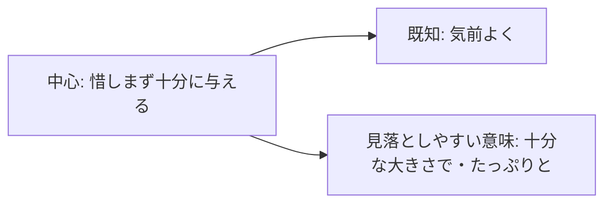

**重要語法：** `generously sized`

---

### 3842. glean

**品詞：** 動詞  
**発音：** /ɡliːn/

<small>よく知られている意味：落ち穂を拾う</small>

#### 見落としやすい意味

**情報を少しずつ苦労して集める**

**例文：** We gleaned useful clues from the short interview.

**和訳：** 私たちは短いインタビューから有益な手がかりを少しずつ集めた。

**コアイメージ：** 収穫後の畑に残った穂を一つずつ拾うのが出発点。そこから、散らばった情報を注意深く集める意味へ広がる。

**図：**

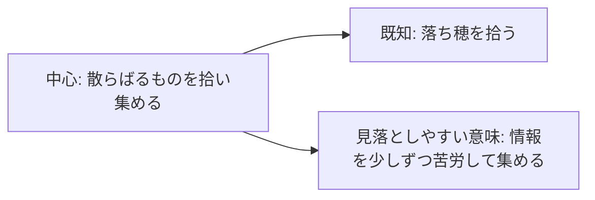

**重要語法：** `glean information from ...`

---

### 3843. greenhouse

**品詞：** 形容詞  
**発音：** /ˈɡriːnhaʊs/

<small>よく知られている意味：温室</small>

#### 見落としやすい意味

**温室効果に関する（greenhouse gas）**

**例文：** The city aims to reduce greenhouse gas emissions.

**和訳：** その市は温室効果ガスの排出削減を目指している。

**コアイメージ：** 温室は内部に熱を閉じ込める空間である。その保温の働きになぞらえ、地球の熱を逃しにくくする現象を表す。

**図：**

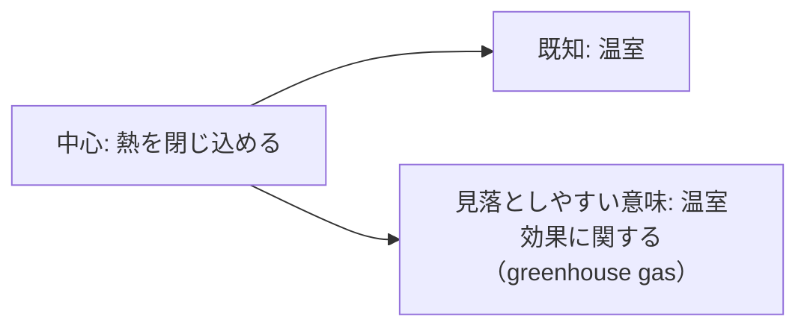

**重要語法：** `greenhouse gas`、`greenhouse effect`

---

### 3844. gush

**品詞：** 動詞  
**発音：** /ɡʌʃ/

<small>よく知られている意味：勢いよく噴き出す</small>

#### 見落としやすい意味

**熱っぽく大げさに褒める**

**例文：** The reviewer gushed about the young actor's performance.

**和訳：** その批評家は若い俳優の演技を熱っぽく褒めちぎった。

**コアイメージ：** 液体が勢いよくあふれ出す動きを思い浮かべる。言葉や感情が抑えきれないほど流れ出ると、大げさに褒めることになる。

**図：**

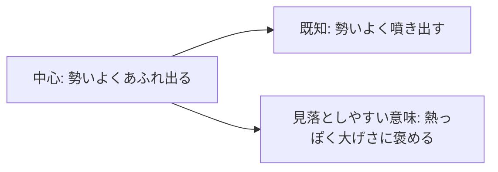

**重要語法：** `gush about / over ...`

---

### 3845. illiterate

**品詞：** 形容詞  
**発音：** /ɪˈlɪtərət/

<small>よく知られている意味：読み書きのできない</small>

#### 見落としやすい意味

**特定の分野の知識・技能を欠く**

**例文：** Many people are financially illiterate despite earning a steady income.

**和訳：** 安定した収入があっても、金融の知識に乏しい人は多い。

**コアイメージ：** 文字を読めないことが基本のイメージ。対象となる分野を限定すると、その分野の基本的な知識や技能がないことを指す。

**図：**

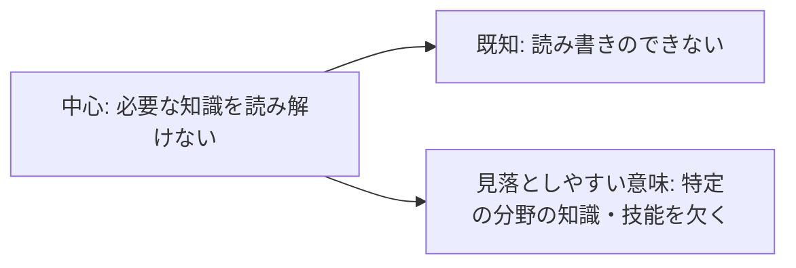

**重要語法：** `financially illiterate`、`computer illiterate`

---

### 3846. imposition

**品詞：** 名詞  
**発音：** /ˌɪmpəˈzɪʃən/

<small>よく知られている意味：課すこと・賦課</small>

#### 見落としやすい意味

**迷惑な要求・押しつけがましい負担**

**例文：** I hope asking you to stay late isn't an imposition.

**和訳：** 遅くまで残ってもらうのが迷惑でなければよいのですが。

**コアイメージ：** 何かを相手の上に課すという発想が中心にある。課されるものが頼み事なら、相手にとって押しつけがましい負担になる。

**図：**

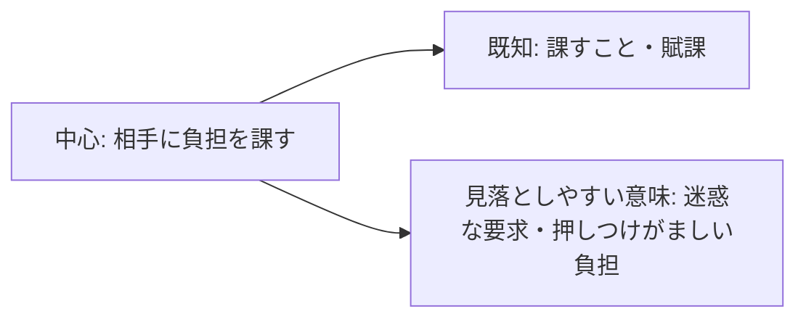

**重要語法：** `be an imposition`

---

### 3847. infectious

**品詞：** 形容詞  
**発音：** /ɪnˈfekʃəs/

<small>よく知られている意味：伝染性の</small>

#### 見落としやすい意味

**笑いや熱意などが周囲に伝わる**

**例文：** Her infectious enthusiasm inspired the whole team.

**和訳：** 彼女の伝わりやすい熱意がチーム全員を奮い立たせた。

**コアイメージ：** ある人から別の人へ広がることが共通点。病気だけでなく、笑いや熱意が周囲へ次々と伝わる場合にも使う。

**図：**

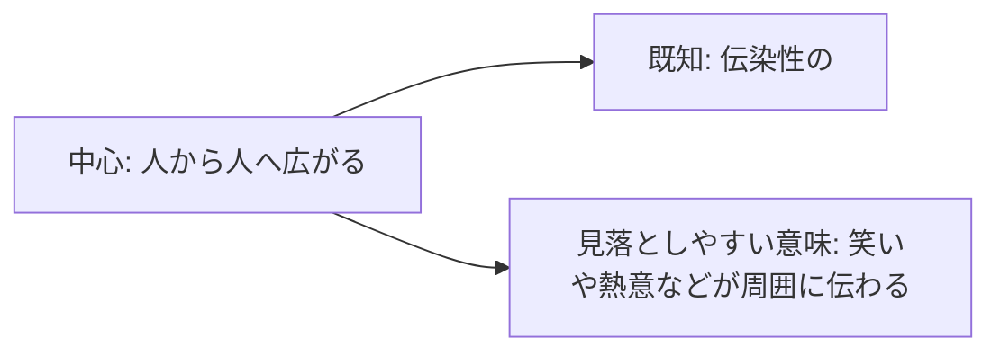

**重要語法：** `infectious laughter`、`infectious enthusiasm`

---

### 3848. lefty

**品詞：** 名詞  
**発音：** /ˈlefti/

<small>よく知られている意味：左利きの人</small>

#### 見落としやすい意味

**左派の人**

**例文：** The article described him as a committed lefty.

**和訳：** その記事は彼を筋金入りの左派と評していた。

**コアイメージ：** left は位置だけでなく政治的な左側の立場も指す。lefty はくだけた言い方で、その立場の人を表すことがある。

**図：**

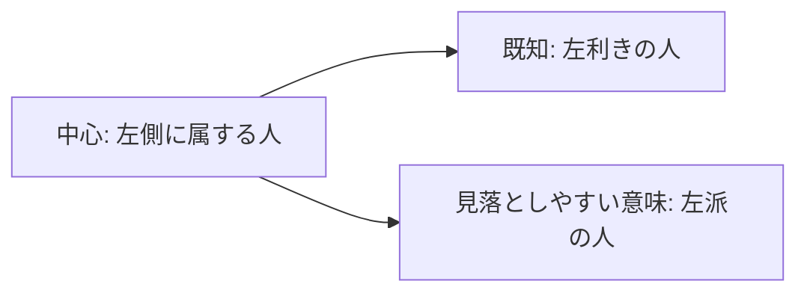

**重要語法：** `口語的な表現。政治的文脈での意味を確認する。`

---

### 3849. libel

**品詞：** 動詞  
**発音：** /ˈlaɪbəl/

<small>よく知られている意味：文書による名誉毀損</small>

#### 見落としやすい意味

**印刷物や文章で名誉を傷つける**

**例文：** The writer was accused of libeling a local official online.

**和訳：** その筆者はネット上で地元の公職者の名誉を傷つけたとして非難された。

**コアイメージ：** 人の評判を傷つける文章という名詞から、文章で名誉を損なう行為を表す動詞になる。書かれた言葉に関わる点が重要。

**図：**

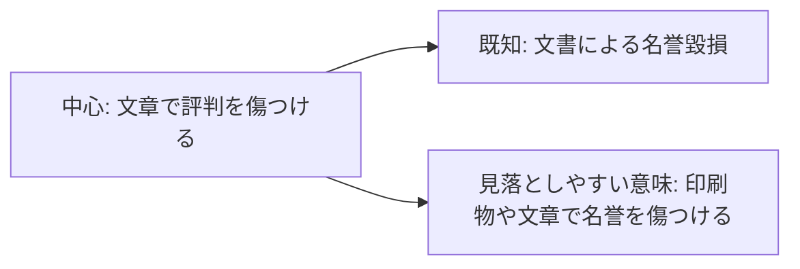

**重要語法：** `libel someone`

---

### 3850. lieu

**品詞：** 名詞  
**発音：** /luː/

<small>よく知られている意味：場所・代わりとなる位置</small>

#### 見落としやすい意味

**in lieu of：～の代わりに**

**例文：** Employees received extra leave in lieu of a cash bonus.

**和訳：** 従業員には現金の賞与の代わりに追加の休暇が与えられた。

**コアイメージ：** あるものが占める場所を別のものが引き受ける感覚。現在は特に in lieu of の形で「～の代わりに」を表す。

**図：**

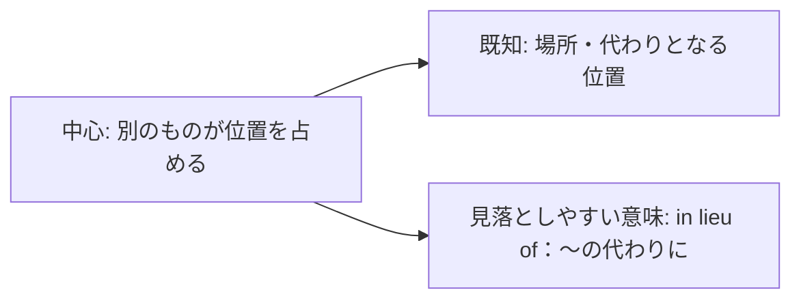

**重要語法：** `in lieu of ...`

---

### 3851. mastery

**品詞：** 名詞  
**発音：** /ˈmæstəri/

<small>よく知られている意味：熟達・習得</small>

#### 見落としやすい意味

**対象を自在に操る支配力**

**例文：** The general wanted complete mastery over the region.

**和訳：** その将軍はその地域を完全に支配しようとした。

**コアイメージ：** 対象を思いどおりに扱える状態が核となる。技能を自在に使いこなすなら熟達、他者や土地を思いどおりに動かすなら支配力となる。

**図：**

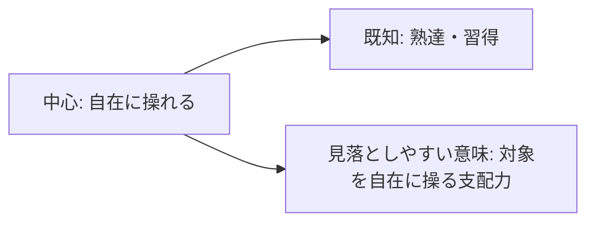

**重要語法：** `mastery over ...`

---

### 3852. monopolize

**品詞：** 動詞  
**発音：** /məˈnɑːpəlaɪz/

<small>よく知られている意味：市場を独占する</small>

#### 見落としやすい意味

**話題・時間・注意を独占する**

**例文：** One student monopolized the discussion with lengthy comments.

**和訳：** ある生徒が長い発言を繰り返し、討論の時間を独占した。

**コアイメージ：** あるものをほかの人に渡さず一人で占めるのが中心。市場だけでなく、会話や時間、注目にも用いられる。

**図：**

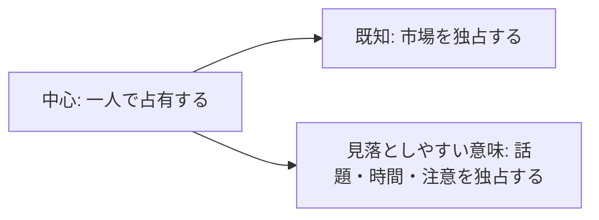

**重要語法：** `monopolize someone's time`、`monopolize the conversation`

---

### 3853. nugget

**品詞：** 名詞  
**発音：** /ˈnʌɡɪt/

<small>よく知られている意味：小さな金塊・食品の一口大の塊</small>

#### 見落としやすい意味

**情報や知恵の価値あるひとかけら**

**例文：** The guide shared a nugget of wisdom about studying every day.

**和訳：** その案内役は毎日学ぶことについて貴重な知恵を一つ教えてくれた。

**コアイメージ：** 小さいが価値のある塊を思い浮かべる。情報や知恵も、凝縮された価値ある一片として表せる。

**図：**

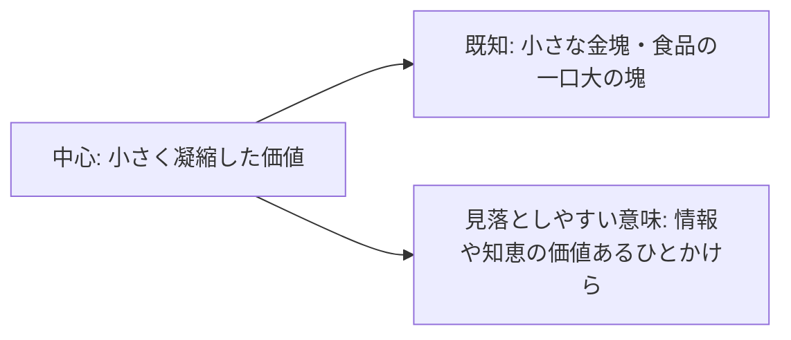

**重要語法：** `a nugget of wisdom`、`a nugget of information`

---

### 3854. obscene

**品詞：** 形容詞  
**発音：** /əbˈsiːn/

<small>よく知られている意味：わいせつな</small>

#### 見落としやすい意味

**金額・利益などが法外で不快なほど大きい**

**例文：** The manager received an obscene amount of money for one day's work.

**和訳：** その管理職は一日の仕事で不快なほど法外な額の金を受け取った。

**コアイメージ：** 社会的に許しがたいほど度を越している、という強い否定的評価が共通する。金額や利益にも使われる。

**図：**

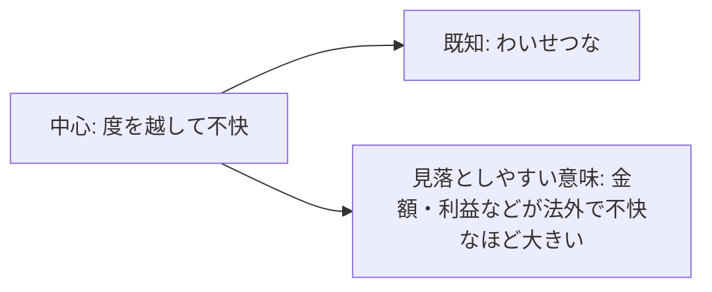

**重要語法：** `an obscene amount of money`

---

### 3855. peg

**品詞：** 動詞  
**発音：** /peɡ/

<small>よく知られている意味：留めくぎ・洗濯ばさみ</small>

#### 見落としやすい意味

**価格・為替水準などを一定の値に固定する**

**例文：** The central bank pegged the currency to the dollar.

**和訳：** 中央銀行はその通貨の価値をドルに連動するよう固定した。

**コアイメージ：** くぎで物を留めて動かなくするのが基本。数値や為替相場を基準に結びつけて固定する意味へ広がる。

**図：**

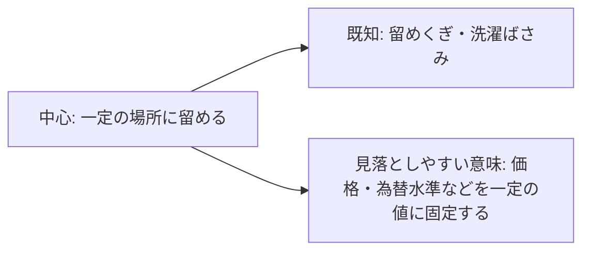

**重要語法：** `peg A to B`

---

### 3856. popularly

**品詞：** 副詞  
**発音：** /ˈpɑːpjələrli/

<small>よく知られている意味：一般に人気を得て</small>

#### 見落としやすい意味

**一般には～という名で（popularly known as）**

**例文：** The building is popularly known as the Glass House.

**和訳：** その建物は一般に「ガラスの家」として知られている。

**コアイメージ：** popular は多くの人々に関わることを表す。ここでは人気の程度ではなく、一般の人々が何と呼んでいるかを示す。

**図：**

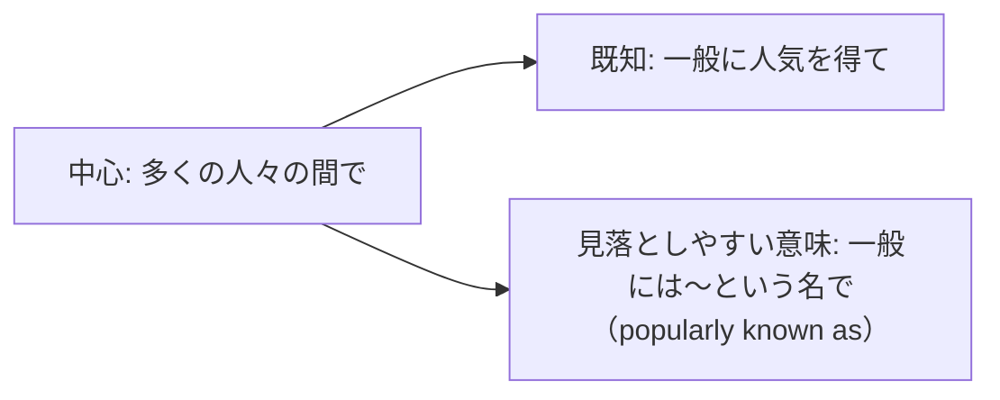

**重要語法：** `be popularly known as ...`

---

### 3857. priceless

**品詞：** 形容詞  
**発音：** /ˈpraɪsləs/

<small>よく知られている意味：値段がつけられないほど貴重な</small>

#### 見落としやすい意味

**表情・反応などが非常に面白く絶妙な**

**例文：** His shocked expression was priceless.

**和訳：** 彼の驚いた表情は実におかしかった。

**コアイメージ：** 値段をつけられないほど特別だ、という評価が中心。物の貴重さから、反応や表情が最高に面白いというくだけた褒め方にもなる。

**図：**

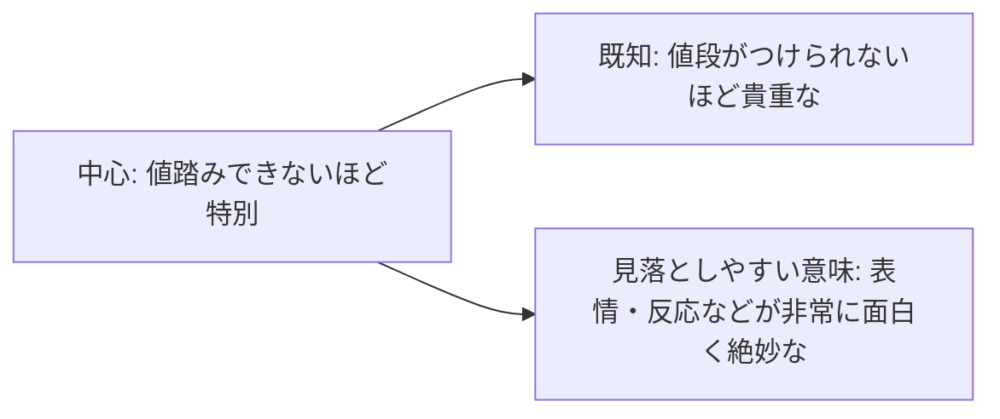

**重要語法：** `That was priceless!`

---

### 3858. prod

**品詞：** 動詞  
**発音：** /prɑːd/

<small>よく知られている意味：突く・つつく</small>

#### 見落としやすい意味

**行動するよう促す・せき立てる**

**例文：** Her friends prodded her to apply for the scholarship.

**和訳：** 友人たちは彼女に奨学金へ応募するよう促した。

**コアイメージ：** 先のとがったものでつつき、動かそうとする感覚。人に対しては行動を起こすよう刺激する意味になる。

**図：**

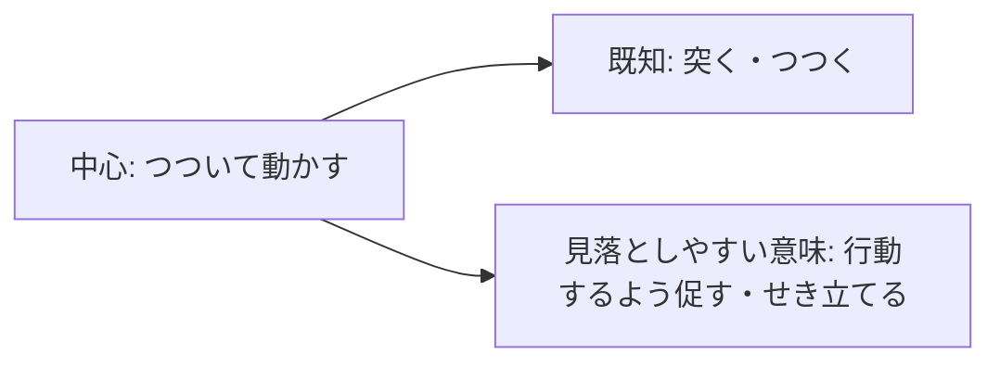

**重要語法：** `prod someone to do ...`

---

### 3859. profess

**品詞：** 動詞  
**発音：** /prəˈfes/

<small>よく知られている意味：公言する</small>

#### 見落としやすい意味

**必ずしも本心でなく公言する・装って述べる**

**例文：** She professed to be calm, but her hands were shaking.

**和訳：** 彼女は平静だと言い張ったが、手は震えていた。

**コアイメージ：** 自分の考えや状態を公に述べるのが中心。口にした内容が本心と一致する保証はなく、装って言う含みを持つこともある。

**図：**

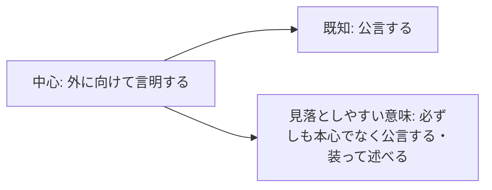

**重要語法：** `profess to do / be ...`

---

### 3860. progressively

**品詞：** 副詞  
**発音：** /prəˈɡresɪvli/

<small>よく知られている意味：進歩的に</small>

#### 見落としやすい意味

**徐々に・段階的に**

**例文：** The weather became progressively worse throughout the day.

**和訳：** 天気は一日を通して徐々に悪くなった。

**コアイメージ：** 進み具合を一段ずつ積み重ねる感覚。良くなることに限らず、悪化や増減が段階的に進む場合にも使う。

**図：**

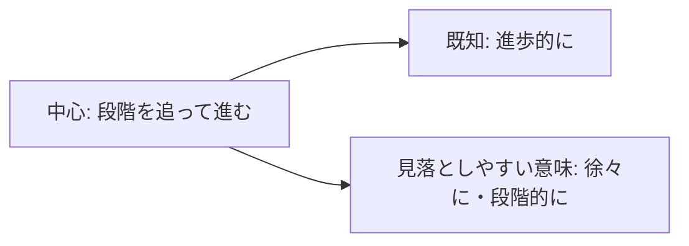

**重要語法：** `progressively worse`、`progressively more difficult`

---

### 3861. puff

**品詞：** 動詞  
**発音：** /pʌf/

<small>よく知られている意味：息をふっと吹く</small>

#### 見落としやすい意味

**大げさに持ち上げて称賛する**

**例文：** The publisher puffed the new novel as a masterpiece.

**和訳：** 出版社は新作小説を傑作だと大げさに持ち上げた。

**コアイメージ：** 息を吹き込んで物をふくらませるイメージがある。評価を実際以上に大きくふくらませると、誇張した称賛になる。

**図：**

```mermaid
flowchart LR
    A["中心: 実物以上にふくらませる"]
    B["既知: 息をふっと吹く"]
    C["見落としやすい意味: 大げさに持ち上げて称賛する"]
    A --> B
    A --> C
```

**重要語法：** `puff a product as ...`

---

### 3862. resurrect

**品詞：** 動詞  
**発音：** /ˌrezəˈrekt/

<small>よく知られている意味：死者をよみがえらせる</small>

#### 見落としやすい意味

**廃れた制度・計画などを復活させる**

**例文：** The council resurrected a plan that had been abandoned years ago.

**和訳：** 市議会は何年も前に断念された計画を復活させた。

**コアイメージ：** 死んだものが再び動き出すというイメージ。使われなくなった計画や制度も、もう一度活動を始めれば「復活」する。

**図：**

```mermaid
flowchart LR
    A["中心: 止まったものを再び動かす"]
    B["既知: 死者をよみがえらせる"]
    C["見落としやすい意味: 廃れた制度・計画などを復活させる"]
    A --> B
    A --> C
```

**重要語法：** `resurrect a plan`、`resurrect an idea`

---

### 3863. scoff

**品詞：** 動詞  
**発音：** /skɑːf/

<small>よく知られている意味：嘲笑する</small>

#### 見落としやすい意味

**scoff at：～を鼻で笑い信じようとしない**

**例文：** Some critics scoffed at the idea of a four-day workweek.

**和訳：** 一部の批評家は週4日勤務という考えを鼻で笑った。

**コアイメージ：** 相手の考えを軽く見て笑い飛ばす態度が中心にある。scoff at で意見や可能性を真面目に受け止めず、信じようとしない様子を表す。

**図：**

```mermaid
flowchart LR
    A["中心: 軽く見て笑い飛ばす"]
    B["既知: 嘲笑する"]
    C["見落としやすい意味: scoff at：～を鼻で笑い信じようとしない"]
    A --> B
    A --> C
```

**重要語法：** `scoff at ...`

---

### 3864. skim

**品詞：** 動詞  
**発音：** /skɪm/

<small>よく知られている意味：ざっと読む・表面のものをすくう</small>

#### 見落としやすい意味

**表面すれすれを素早くかすめて進む**

**例文：** Swallows skimmed over the water at sunset.

**和訳：** 夕暮れにツバメが水面すれすれを飛んだ。

**コアイメージ：** 表面だけをかすめる動きが中心。文章なら全体を軽くなぞって読むこと、空中の動きなら水面などの近くをすばやく進むことになる。

**図：**

```mermaid
flowchart LR
    A["中心: 表面を軽くなぞる"]
    B["既知: ざっと読む・表面のものをすくう"]
    C["見落としやすい意味: 表面すれすれを素早くかすめて進む"]
    A --> B
    A --> C
```

**重要語法：** `skim over / across ...`

---

### 3865. slender

**品詞：** 形容詞  
**発音：** /ˈslendər/

<small>よく知られている意味：ほっそりした</small>

#### 見落としやすい意味

**可能性・望みなどがごくわずかな**

**例文：** The team has only a slender chance of winning.

**和訳：** そのチームが勝つ見込みはごくわずかしかない。

**コアイメージ：** 幅が細く、量が少ないという感覚。体形だけでなく、成功の可能性や望みの小ささにも当てはまる。

**図：**

```mermaid
flowchart LR
    A["中心: 幅や量がごく小さい"]
    B["既知: ほっそりした"]
    C["見落としやすい意味: 可能性・望みなどがごくわずかな"]
    A --> B
    A --> C
```

**重要語法：** `a slender chance`、`slender hopes`

---

### 3866. stalwart

**品詞：** 名詞  
**発音：** /ˈstɔːlwərt/

<small>よく知られている意味：頑健な・揺るぎない</small>

#### 見落としやすい意味

**忠実で頼りになる支持者**

**例文：** The party's stalwarts defended its longtime principles.

**和訳：** その党の忠実な支持者たちは長年の理念を守った。

**コアイメージ：** 強くて簡単には揺らがない人のイメージ。形容詞としての堅固さが、人を指す名詞では頼れる支持者という意味になる。

**図：**

```mermaid
flowchart LR
    A["中心: 揺るがず支える"]
    B["既知: 頑健な・揺るぎない"]
    C["見落としやすい意味: 忠実で頼りになる支持者"]
    A --> B
    A --> C
```

**重要語法：** `party stalwarts`

---

### 3867. synthesize

**品詞：** 動詞  
**発音：** /ˈsɪnθəsaɪz/

<small>よく知られている意味：化学的に合成する</small>

#### 見落としやすい意味

**複数の情報・意見を統合して結論を作る**

**例文：** The essay synthesizes ideas from history and psychology.

**和訳：** その論文は歴史学と心理学の考えを統合している。

**コアイメージ：** 別々の要素を組み合わせ、新しい一つのまとまりを作るのが核。物質を合成する場合も、複数の情報を統合する場合も共通する。

**図：**

```mermaid
flowchart LR
    A["中心: 複数の要素を組み合わせる"]
    B["既知: 化学的に合成する"]
    C["見落としやすい意味: 複数の情報・意見を統合して結論を作る"]
    A --> B
    A --> C
```

**重要語法：** `synthesize evidence`、`synthesize findings`

---

### 3868. telegraph

**品詞：** 動詞  
**発音：** /ˈtelɪɡræf/

<small>よく知られている意味：電信を打つ</small>

#### 見落としやすい意味

**態度などで意図や今後の行動を明らかに示す**

**例文：** Her hesitation telegraphed that she was unsure.

**和訳：** 彼女がためらったことで、自信がないことがはっきり伝わった。

**コアイメージ：** 離れた相手に信号を送ることが基本。意図して言葉にしなくても、表情や態度が次の行動や本音を先に伝えることがある。

**図：**

```mermaid
flowchart LR
    A["中心: 手がかりを先に送る"]
    B["既知: 電信を打つ"]
    C["見落としやすい意味: 態度などで意図や今後の行動を明らかに示す"]
    A --> B
    A --> C
```

**重要語法：** `telegraph one's intentions`

---

### 3869. trailer

**品詞：** 名詞  
**発音：** /ˈtreɪlər/

<small>よく知られている意味：けん引される車両</small>

#### 見落としやすい意味

**映画や番組の予告編**

**例文：** The trailer made me want to see the whole film.

**和訳：** その予告編を見て映画全編を見たくなった。

**コアイメージ：** 本編に付いて回る短い紹介映像という使い方がある。車のトレーラーと同じ語形でも、映画の文脈では公開前に作品を紹介する予告編を指す。

**図：**

```mermaid
flowchart LR
    A["中心: 本体に付随するもの"]
    B["既知: けん引される車両"]
    C["見落としやすい意味: 映画や番組の予告編"]
    A --> B
    A --> C
```

**重要語法：** `a movie trailer`、`a trailer for ...`

---

### 3870. trooper

**品詞：** 名詞  
**発音：** /ˈtruːpər/

<small>よく知られている意味：隊員・兵士</small>

#### 見落としやすい意味

**困難にも音を上げず頑張る人（a trooper）**

**例文：** She handled all the unexpected problems like a real trooper.

**和訳：** 彼女は予期せぬ問題の数々にも弱音を吐かず立派に対処した。

**コアイメージ：** 困難な任務にも踏みとどまる隊員を思い浮かべる。日常会話では、つらい状況でも文句を言わず頑張る人をほめる。

**図：**

```mermaid
flowchart LR
    A["中心: 困難にも踏みとどまる"]
    B["既知: 隊員・兵士"]
    C["見落としやすい意味: 困難にも音を上げず頑張る人（a trooper）"]
    A --> B
    A --> C
```

**重要語法：** `be a real trooper`

---

### 3871. turf

**品詞：** 名詞  
**発音：** /tɝːf/

<small>よく知られている意味：芝生・芝</small>

#### 見落としやすい意味

**活動領域・支配権や影響力の及ぶ範囲**

**例文：** The rival firms were competing on each other's turf.

**和訳：** 競合する会社同士が互いの事業領域で競争していた。

**コアイメージ：** 地面の一区画が出発点。そこから、自分の活動場所や支配権が及ぶ範囲を意味するようになる。

**図：**

```mermaid
flowchart LR
    A["中心: 自分の縄張りとなる土地"]
    B["既知: 芝生・芝"]
    C["見落としやすい意味: 活動領域・支配権や影響力の及ぶ範囲"]
    A --> B
    A --> C
```

**重要語法：** `on someone's turf`、`defend one's turf`

---

### 3872. unravel

**品詞：** 動詞  
**発音：** /ʌnˈrævəl/

<small>よく知られている意味：絡まった糸をほどく</small>

#### 見落としやすい意味

**複雑な謎・問題を解明する**

**例文：** Researchers finally unraveled the cause of the strange signal.

**和訳：** 研究者たちはついにその奇妙な信号の原因を解明した。

**コアイメージ：** もつれた糸を一本ずつほぐす動きが中心。複雑な問題を順に整理して理解することにも使われる。

**図：**

```mermaid
flowchart LR
    A["中心: もつれを解いて明らかにする"]
    B["既知: 絡まった糸をほどく"]
    C["見落としやすい意味: 複雑な謎・問題を解明する"]
    A --> B
    A --> C
```

**重要語法：** `unravel a mystery`

---

### 3873. unravel

**品詞：** 動詞  
**発音：** /ʌnˈrævəl/

<small>よく知られている意味：絡まった糸をほどく・謎を解明する</small>

#### 見落としやすい意味

**計画・成果・秩序などが崩れる／崩す**

**例文：** Their carefully arranged agreement began to unravel.

**和訳：** 慎重にまとめられた彼らの合意が崩れ始めた。

**コアイメージ：** 編まれたものの糸がほどけると、全体の形が保てなくなる。計画や秩序がばらばらになる意味は、この「結びつきが解ける」方向から理解できる。

**図：**

```mermaid
flowchart LR
    A["中心: 結びつきがほどける"]
    B["既知: 絡まった糸をほどく・謎を解明する"]
    C["見落としやすい意味: 計画・成果・秩序などが崩れる／崩す"]
    A --> B
    A --> C
```

**重要語法：** `an agreement unravels`、`a plan unravels`

---

### 3874. upshot

**品詞：** 名詞  
**発音：** /ˈʌpʃɑːt/

<small>よく知られている意味：結末・結果</small>

#### 見落としやすい意味

**the upshot is that：結局のところ～という結果になる**

**例文：** The upshot is that we will need a larger budget.

**和訳：** 結局のところ、より大きな予算が必要だということだ。

**コアイメージ：** いろいろな経緯を経た末に残る結論や結果を指す。the upshot is that の形では、議論の要点を最後にまとめる。

**図：**

```mermaid
flowchart LR
    A["中心: 経過の末に残る結論"]
    B["既知: 結末・結果"]
    C["見落としやすい意味: the upshot is that：結局のところ～という結果になる"]
    A --> B
    A --> C
```

**重要語法：** `the upshot is that ...`

---

### 3875. utilitarian

**品詞：** 形容詞  
**発音：** /juːˌtɪlɪˈteəriən/

<small>よく知られている意味：功利主義の</small>

#### 見落としやすい意味

**実用性を他の価値より優先する**

**例文：** The office had a utilitarian design with almost no decoration.

**和訳：** その事務所は飾りがほとんどない実用本位の設計だった。

**コアイメージ：** 役に立つことを何より優先する考え方が核。美しさや個性よりも、機能を満たすかどうかを重視する場合に使う。

**図：**

```mermaid
flowchart LR
    A["中心: 役に立つことを優先する"]
    B["既知: 功利主義の"]
    C["見落としやすい意味: 実用性を他の価値より優先する"]
    A --> B
    A --> C
```

**重要語法：** `a utilitarian design`、`utilitarian approach`

---

### 3876. whitewashed

**品詞：** 形容詞  
**発音：** /ˈwaɪtwɑːʃt/

<small>よく知られている意味：白く塗られた</small>

#### 見落としやすい意味

**不祥事を隠した・都合よく美化した**

**例文：** Critics called the report a whitewashed account of the scandal.

**和訳：** 批判者たちはその報告書を、不祥事を都合よく美化した説明だと呼んだ。

**コアイメージ：** 表面に白い塗料を塗って汚れを見えなくするのが具体的なイメージ。比喩的には、不都合な事実を隠し、きれいに見せかけることをいう。

**図：**

```mermaid
flowchart LR
    A["中心: 表面を覆って欠点を隠す"]
    B["既知: 白く塗られた"]
    C["見落としやすい意味: 不祥事を隠した・都合よく美化した"]
    A --> B
    A --> C
```

**重要語法：** `a whitewashed report`

---

### 3877. practise

**品詞：** 動詞  
**発音：** /ˈpræktɪs/

<small>よく知られている意味：練習する</small>

#### 見落としやすい意味

**医師・弁護士などとして職業に従事する**

**例文：** After qualifying, she decided to practise medicine in a rural town.

**和訳：** 資格を取った後、彼女は地方の町で医師として働くことにした。

**コアイメージ：** 知識や技術を実際に使うという感覚が共通する。練習の先に、専門資格を使って職業を営む意味がある。

**図：**

```mermaid
flowchart LR
    A["中心: 身につけた技術を実践する"]
    B["既知: 練習する"]
    C["見落としやすい意味: 医師・弁護士などとして職業に従事する"]
    A --> B
    A --> C
```

**重要語法：** `practise medicine`、`practise law`、`主に英式綴りの動詞。米式は practice。`

---

### 3878. organized

**品詞：** 形容詞  
**発音：** /ˈɔːrɡənaɪzd/

<small>よく知られている意味：整理された・組織立った</small>

#### 見落としやすい意味

**労働組合を組織した・組合に属する**

**例文：** The company began negotiations with organized labor.

**和訳：** その会社は労働組合側との交渉を始めた。

**コアイメージ：** 人々がまとまった組織をつくるのが中心。労働の文脈では、労働者が組合を組織している状態や組合側を表す。

**図：**

```mermaid
flowchart LR
    A["中心: 人々が組織としてまとまる"]
    B["既知: 整理された・組織立った"]
    C["見落としやすい意味: 労働組合を組織した・組合に属する"]
    A --> B
    A --> C
```

**重要語法：** `organized labor`、`organized workers`

---

### 3879. scarf

**品詞：** 動詞  
**発音：** /skɑːrf/

<small>よく知られている意味：スカーフ・首巻き</small>

#### 見落としやすい意味

**scarf down：食べ物をがつがつ食べる**

**例文：** We scarfed down lunch before the train arrived.

**和訳：** 私たちは列車が来る前に昼食を急いで平らげた。

**コアイメージ：** この動詞は衣類の名詞とは別に、食べ物を勢いよく食べる口語表現として使う。特に scarf down の形で覚えると読み違えにくい。

**図：**

```mermaid
flowchart LR
    A["中心: 食べ物を勢いよく平らげる"]
    B["既知: スカーフ・首巻き"]
    C["見落としやすい意味: scarf down：食べ物をがつがつ食べる"]
    A --> B
    A --> C
```

**重要語法：** `scarf down ...（口語）`

---

### 3880. frustrated

**品詞：** 形容詞  
**発音：** /ˈfrʌstreɪtɪd/

<small>よく知られている意味：いらいらした・欲求不満の</small>

#### 見落としやすい意味

**計画や試みが阻まれて実現しなかった**

**例文：** The archive describes a frustrated attempt to reform the tax system.

**和訳：** その資料館の記録には、妨げられて実現しなかった税制改革の試みが記されている。

**コアイメージ：** 進もうとする動きが障害物によって止められるのが共通イメージ。人の気持ちならいらだち、計画や試みなら達成できなかったことを表す。

**図：**

```mermaid
flowchart LR
    A["中心: 障害によって実現が阻まれる"]
    B["既知: いらいらした・欲求不満の"]
    C["見落としやすい意味: 計画や試みが阻まれて実現しなかった"]
    A --> B
    A --> C
```

**重要語法：** `a frustrated attempt`、`frustrated ambitions`

