# EasyVoca 学習カード — Batch 050

採用済み候補のうち global_order **3921〜4000**（80語義）。既知の意味は補足、見落としやすい意味が学習の中心です。例文はオリジナルです。発音は米語を中心とする目安です。

## 01. inaccessible

- **品詞**：adjective
- **発音**：/ˌɪnəkˈsɛsəbəl/
- <small>よく知られている意味：到達できない</small>

### 見落としやすい意味：内容が難解でとっつきにくい

**例文**：The article is inaccessible to readers without a background in physics.

**和訳**：その記事は物理学の知識がない読者には難解だ。

**コアイメージの説明**：近づけないのは場所だけとは限らない。知識の壁があるため内容を理解しにくい場合にも使う。

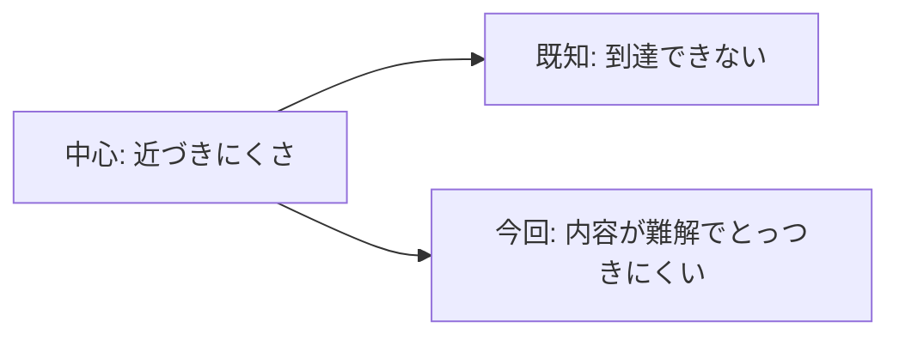

**重要語法**：inaccessible to readers：読者にとって理解しにくい


---

## 02. inclination

- **品詞**：noun
- **発音**：/ˌɪnkləˈneɪʃən/
- <small>よく知られている意味：好み・傾向</small>

### 見落としやすい意味：土地・面などの傾斜

**例文**：The inclination of the roof allows rainwater to run off.

**和訳**：屋根の傾斜のおかげで雨水が流れ落ちる。

**コアイメージの説明**：心がある方向へ向くという比喩の前に、面そのものが傾くイメージがある。物理的な角度や傾斜を指せる。

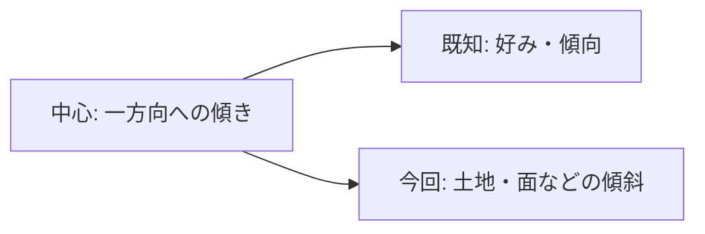

**重要語法**：inclination of the roof：屋根の傾斜


---

## 03. inclined

- **品詞**：adjective
- **発音**：/ɪnˈklaɪnd/
- <small>よく知られている意味：傾斜した</small>

### 見落としやすい意味：be inclined to ～：～する傾向・気持ちがある

**例文**：I'm inclined to agree with her explanation.

**和訳**：私は彼女の説明に賛成する気持ちがある。

**コアイメージの説明**：物体が一方向に傾く様子を、考えや気持ちの向きに重ねる。断定ではなく、そうしたい気持ちや傾向を表せる。

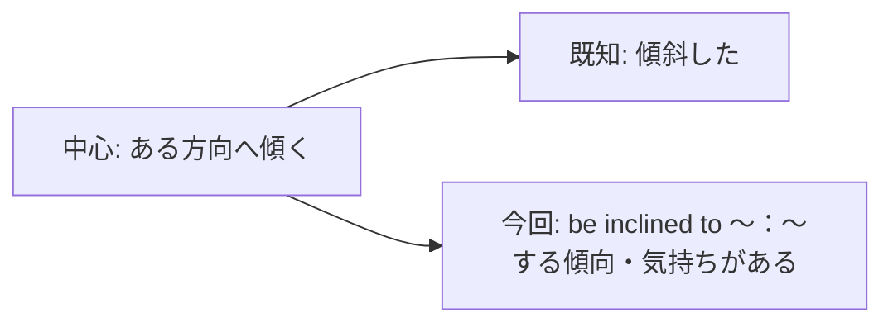

**重要語法**：be inclined to do：〜する気持ち・傾向がある


---

## 04. infiltrate

- **品詞**：verb
- **発音**：/ˈɪnfɪltreɪt/
- <small>よく知られている意味：秘密裏に潜入する</small>

### 見落としやすい意味：液体などが内部にしみ込む・浸透する

**例文**：Water slowly infiltrated the dry soil.

**和訳**：水が乾いた土にゆっくりとしみ込んだ。

**コアイメージの説明**：外側から内部へ少しずつ入り込むことが中心にある。人が組織へ潜入する場合にも、液体が物質へ浸透する場合にも使う。

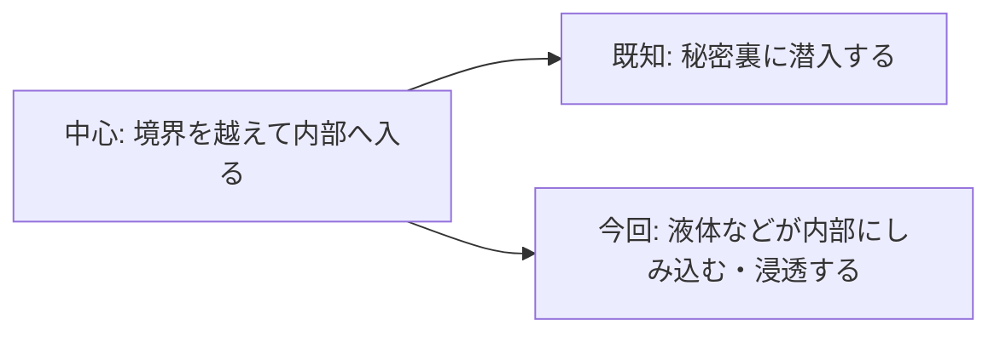


---

## 05. inscribe

- **品詞**：verb
- **発音**：/ɪnˈskraɪb/
- <small>よく知られている意味：文字を刻む</small>

### 見落としやすい意味：記憶・心に深く刻みつける

**例文**：That moment was inscribed in her memory.

**和訳**：その瞬間は彼女の記憶に深く刻まれた。

**コアイメージの説明**：表面に文字を刻んで残すことから、心に消えない印象を残す比喩へ広がる。強く記憶に残る様子を表す。

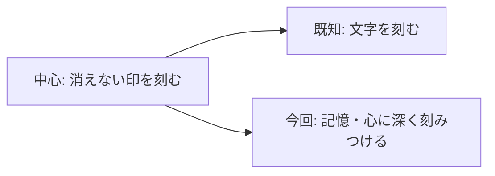

**重要語法**：be inscribed in one's memory：記憶に刻まれる


---

## 06. juicy

- **品詞**：adjective
- **発音**：/ˈdʒuːsi/
- <small>よく知られている意味：水分が多い</small>

### 見落としやすい意味：利益が大きい・もうけになる

**例文**：She turned down a juicy offer from a rival company.

**和訳**：彼女は競合企業からの好条件の申し出を断った。

**コアイメージの説明**：果実に汁がたっぷりある感覚から、魅力的な利益が詰まった話にも広がる。くだけた文脈では条件のよい仕事や契約を指す。

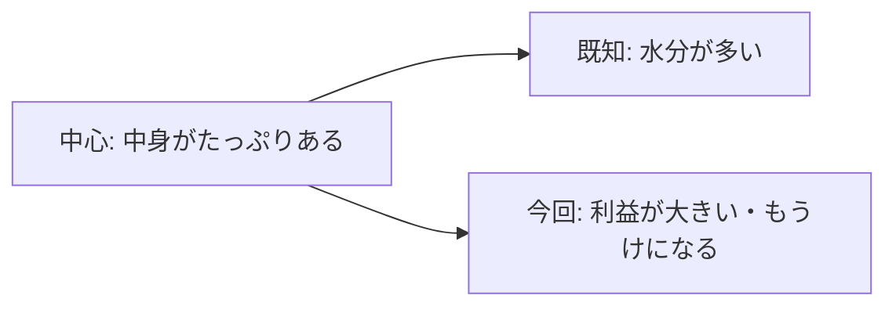

**重要語法**：a juicy offer：うまみの大きい申し出


---

## 07. melodrama

- **品詞**：noun
- **発音**：/ˈmɛləˌdrɑːmə/
- <small>よく知られている意味：感傷的な劇</small>

### 見落としやすい意味：感情を大げさに表す言動や騒ぎ

**例文**：I don't want any melodrama over a small mistake.

**和訳**：小さなミスのことで大げさな騒ぎは起こしてほしくない。

**コアイメージの説明**：劇の中で感情を強調する演出が基本にある。日常の場面でも、必要以上に感情的な反応や騒ぎを指せる。

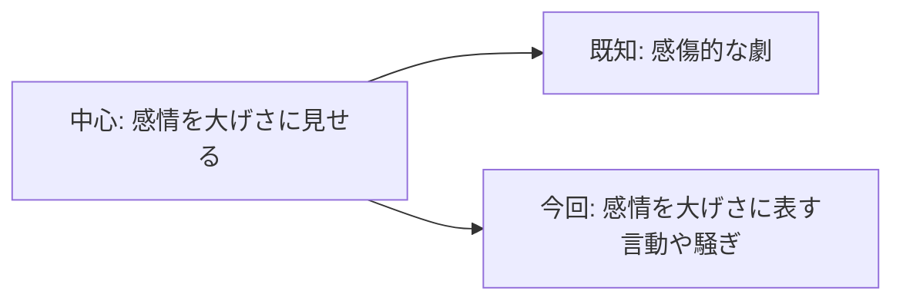


---

## 08. murky

- **品詞**：adjective
- **発音**：/ˈmɜːrki/
- <small>よく知られている意味：水などが濁った</small>

### 見落としやすい意味：事情・行動が不透明で疑わしい

**例文**：The company refused to explain its murky financial dealings.

**和訳**：その会社は不透明な資金取引について説明を拒んだ。

**コアイメージの説明**：水が濁って底が見えないことが出発点。事情やお金の動きが見えず、疑いが生じる状態にも使う。

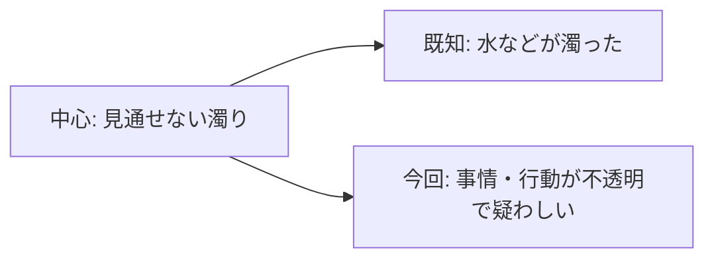

**重要語法**：murky dealings：不透明で疑わしい取引


---

## 09. nominally

- **品詞**：adverb
- **発音**：/ˈnɑːmɪnəli/
- <small>よく知られている意味：名目上は</small>

### 見落としやすい意味：名目上だけで、実質的にはそうでない

**例文**：She is nominally the leader, but others make the decisions.

**和訳**：肩書の上では彼女がリーダーだが、決定はほかの人たちが下している。

**コアイメージの説明**：名前や肩書だけを見る視点を表す。表面上の立場と実際の権限が違うとき、対比が生まれる。

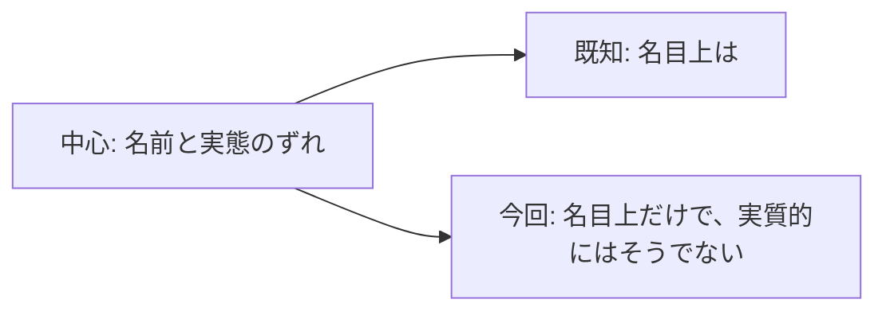

**重要語法**：nominally ..., but ...：名目上は…だが実際は…


---

## 10. outbound

- **品詞**：adjective
- **発音**：/ˈaʊtbaʊnd/
- <small>よく知られている意味：外へ向かう</small>

### 見落としやすい意味：電話・営業活動などで外向きに発信する

**例文**：The team made fifty outbound calls to potential customers.

**和訳**：チームは見込み客に50件の営業電話をかけた。

**コアイメージの説明**：出発点から外へ向かうという方向性が共通する。移動だけでなく、自分たちから相手に発信する電話や営業活動にも使う。

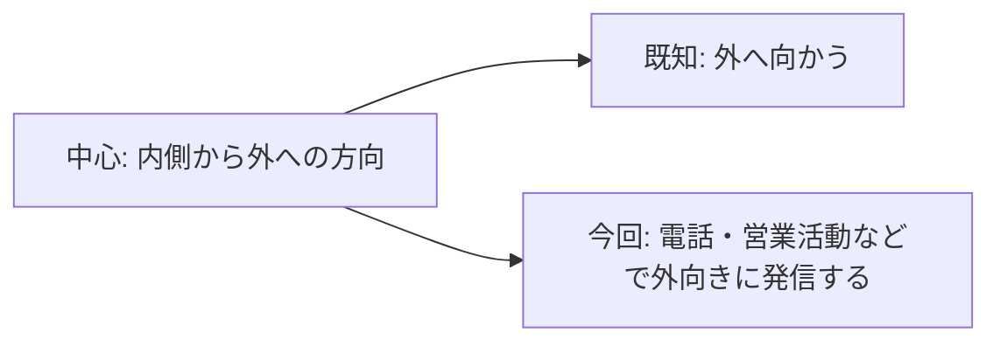

**重要語法**：outbound calls：発信電話


---

## 11. override

- **品詞**：verb
- **発音**：/ˌoʊvərˈraɪd/
- <small>よく知られている意味：設定を上書きする</small>

### 見落としやすい意味：対立する事情・懸念に優先する

**例文**：Public safety must override short-term profits.

**和訳**：公共の安全は短期的な利益より優先されなければならない。

**コアイメージの説明**：一方の判断がもう一方より上位に立ち、その効力を抑えるイメージ。設定の上書きから、価値や事情の優先にも使う。

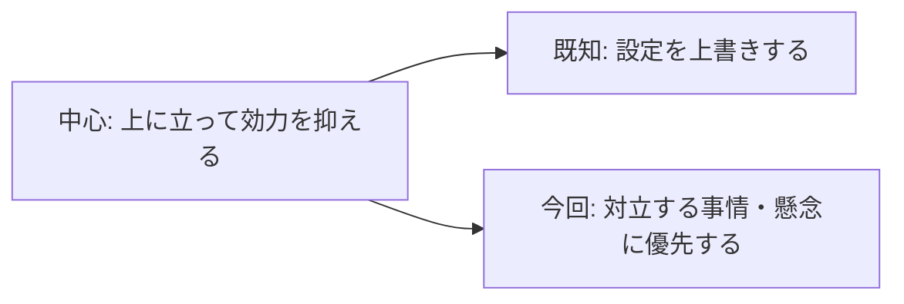

**重要語法**：A overrides B：AがBに優先する


---

## 12. pastel

- **品詞**：adjective
- **発音**：/pæˈstɛl/
- <small>よく知られている意味：淡い色の</small>

### 見落としやすい意味：（色・描写が）淡く弱々しい

**例文**：The painting uses pastel shades rather than bold colors.

**和訳**：その絵は鮮やかな色ではなく淡い色調を使っている。

**コアイメージの説明**：強い色を和らげた柔らかな色合いが中心。描写に使うと、目立つ強さより控えめな印象を与える。

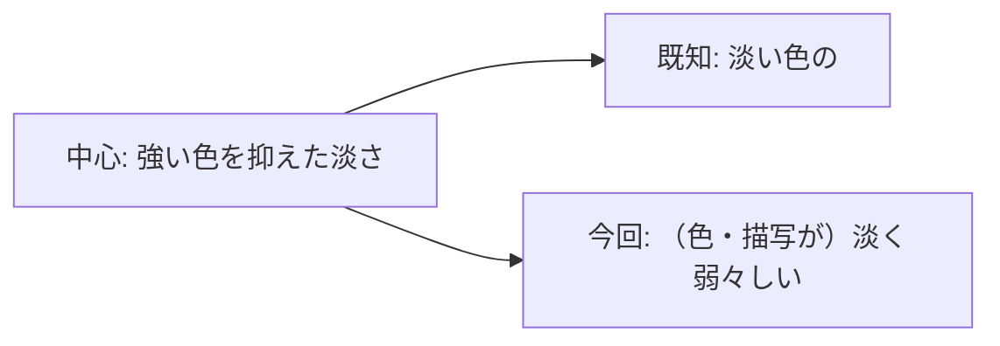

**重要語法**：pastel shades：淡い色調


---

## 13. pejorative

- **品詞**：noun
- **発音**：/pɪˈdʒɔːrətɪv/
- <small>よく知られている意味：軽蔑的な（形容詞）</small>

### 見落としやすい意味：軽蔑語・侮蔑表現

**例文**：The historian avoided pejoratives when describing the group.

**和訳**：その歴史家は、その集団を説明するとき侮蔑語を避けた。

**コアイメージの説明**：単に説明するのでなく、低く見ている評価を言葉に含ませることが中心。形容詞だけでなく、そうした語そのものを表す名詞にもなる。

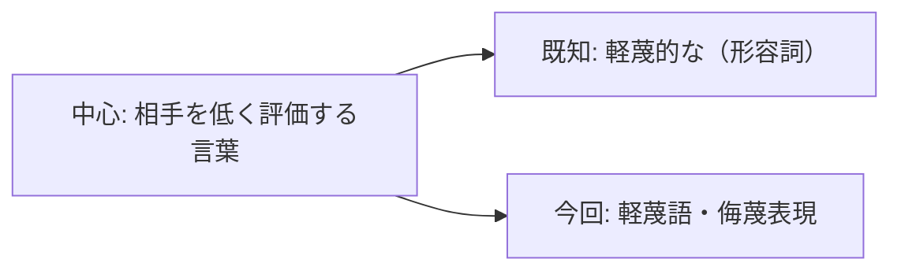

**重要語法**：a pejorative：軽蔑的な呼び名


---

## 14. perceived

- **品詞**：adjective
- **発音**：/pərˈsiːvd/
- <small>よく知られている意味：知覚された</small>

### 見落としやすい意味：五感によらず直感・推論で認識された

**例文**：The perceived risk was greater than the actual risk.

**和訳**：認識されていた危険は実際の危険より大きかった。

**コアイメージの説明**：人が何かを認識することが中心で、必ずしも目で見た事実ではない。経験や推測から抱いた印象と客観的事実を区別する。

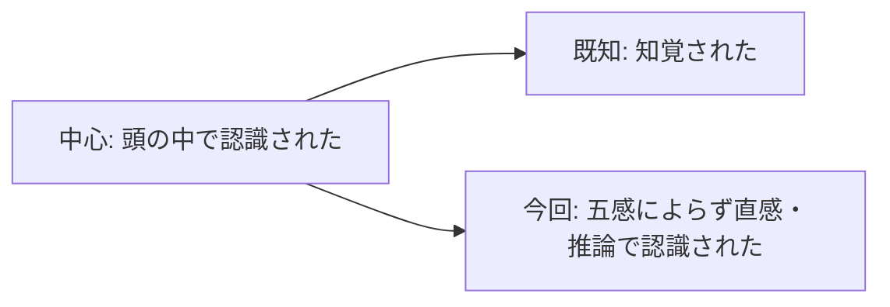

**重要語法**：perceived risk：認識上の危険


---

## 15. photographic

- **品詞**：adjective
- **発音**：/ˌfoʊtəˈɡræfɪk/
- <small>よく知られている意味：写真に関する</small>

### 見落としやすい意味：写真のように精密で忠実な

**例文**：He has a photographic memory for faces.

**和訳**：彼は顔を写真のように正確に記憶できる。

**コアイメージの説明**：写真が細部を忠実に記録することから、記憶や描写の精密さに広がる。撮影そのものを指さない形容にもなる。

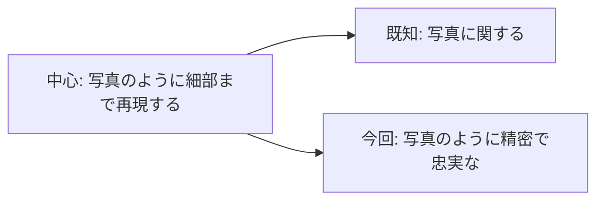

**重要語法**：photographic memory：非常に正確な記憶力


---

## 16. pickup

- **品詞**：noun
- **発音**：/ˈpɪkʌp/
- <small>よく知られている意味：迎え・拾い上げ</small>

### 見落としやすい意味：売上・景気などの回復や増加

**例文**：There was a pickup in sales after the holiday.

**和訳**：連休後、売上に回復が見られた。

**コアイメージの説明**：何かを持ち上げる方向の動きが出発点。減っていた売上や活動が上向く変化にも使われる。

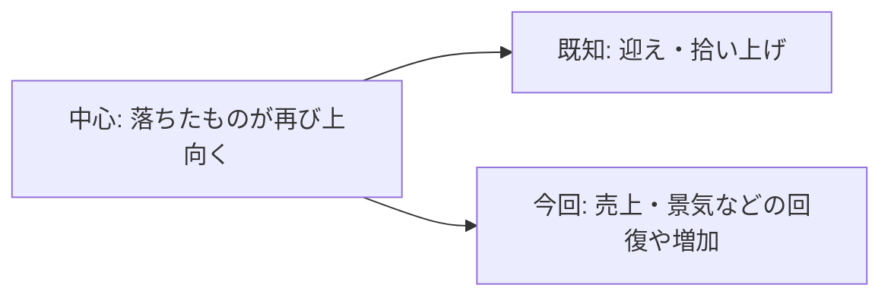

**重要語法**：a pickup in sales：売上の回復


---

## 17. precinct

- **品詞**：noun
- **発音**：/ˈpriːsɪŋkt/
- <small>よく知られている意味：警察の管轄区域</small>

### 見落としやすい意味：米国などの選挙での投票区

**例文**：Turnout was especially high in this precinct.

**和訳**：この投票区では投票率が特に高かった。

**コアイメージの説明**：一定の目的のため区切った区域が中心。警察が担当する範囲だけでなく、米国の選挙で投票を集計する区域にも使う。

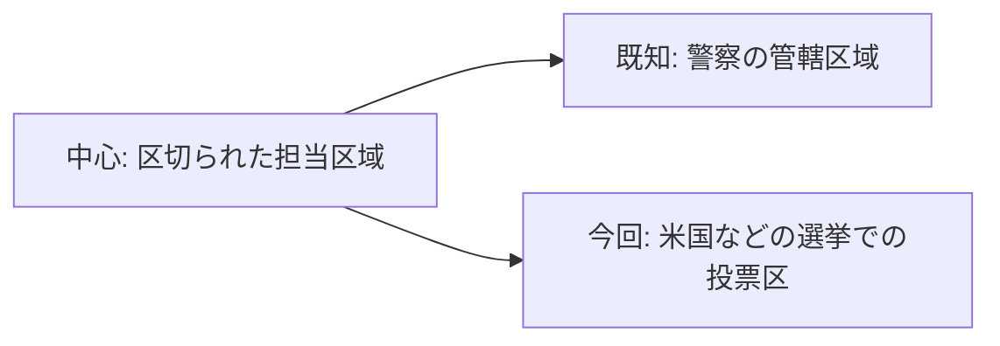

**重要語法**：voting precinct：投票区


---

## 18. prep

- **品詞**：verb
- **発音**：/prɛp/
- <small>よく知られている意味：予習・準備（名詞）</small>

### 見落としやすい意味：準備する・下ごしらえをする

**例文**：We need to prep the room before the guests arrive.

**和訳**：客が到着する前に部屋を準備する必要がある。

**コアイメージの説明**：本番に向けて必要なものを整えるという発想。名詞だけでなく、部屋や食材を準備する動詞としても使う。

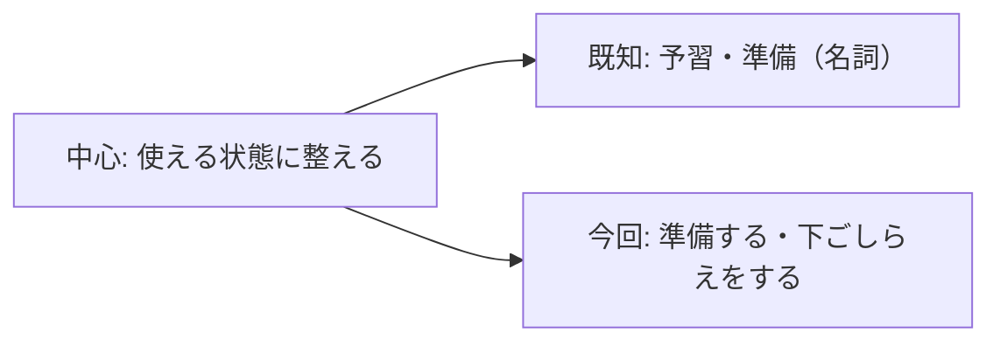

**重要語法**：prep A for B：Bに向けてAを準備する


---

## 19. quarterback

- **品詞**：verb
- **発音**：/ˈkwɔːrtərbæk/
- <small>よく知られている意味：アメフトの司令塔</small>

### 見落としやすい意味：チームや計画の実行を指揮する

**例文**：Maya will quarterback the new community project.

**和訳**：マヤが新しい地域プロジェクトを指揮する予定だ。

**コアイメージの説明**：試合の司令塔が仲間に指示を出す役割から生じた比喩。仕事や計画でも実行を取りまとめる動詞になる。

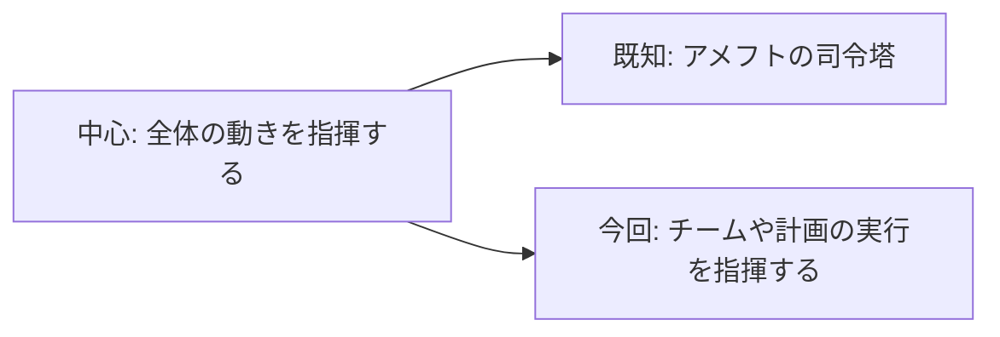


---

## 20. radioactive

- **品詞**：adjective
- **発音**：/ˌreɪdioʊˈæktɪv/
- <small>よく知られている意味：放射性の</small>

### 見落としやすい意味：政治的に危険視され触れにくい

**例文**：After the scandal, the proposal became politically radioactive.

**和訳**：不祥事の後、その提案は政治的に触れにくいものになった。

**コアイメージの説明**：近づくことに危険を感じるイメージを比喩的に使う。政治的な反発が大きく、関係すると不利益を受けそうな話題にも当てはまる。

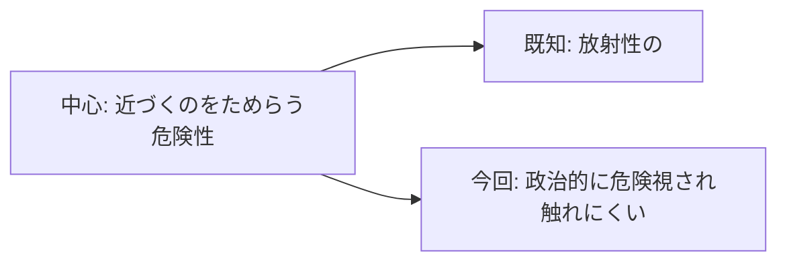

**重要語法**：politically radioactive：政治的に危険視される


---

## 21. rationalize

- **品詞**：verb
- **発音**：/ˈræʃənəlaɪz/
- <small>よく知られている意味：合理化する</small>

### 見落としやすい意味：もっともらしい理屈を付けて自己正当化する

**例文**：He tried to rationalize his rude behavior as honesty.

**和訳**：彼は無礼な振る舞いを正直さだとして正当化しようとした。

**コアイメージの説明**：理屈で説明できる形に整えることが中心。ただしその理屈が、都合の悪い行動の言い訳になる場合がある。

```mermaid
flowchart LR
    A["中心: 理屈を組み立てて納得させる"]
    B["既知: 合理化する"]
    C["今回: もっともらしい理屈を付けて自己正当化する"]
    A --> B
    A --> C
```

**重要語法**：rationalize A as B：AをBだとして正当化する


---

## 22. relaxation

- **品詞**：noun
- **発音**：/ˌriːlækˈseɪʃən/
- <small>よく知られている意味：くつろぎ</small>

### 見落としやすい意味：規制・制限の緩和

**例文**：Businesses welcomed the relaxation of the rules.

**和訳**：企業はその規則の緩和を歓迎した。

**コアイメージの説明**：緊張や締め付けが弱まる変化が中心。人の体がほぐれる場合だけでなく、規制が緩くなる場合にも使う。

```mermaid
flowchart LR
    A["中心: 張りつめたものを緩める"]
    B["既知: くつろぎ"]
    C["今回: 規制・制限の緩和"]
    A --> B
    A --> C
```

**重要語法**：relaxation of restrictions：制限の緩和


---

## 23. repudiate

- **品詞**：verb
- **発音**：/rɪˈpjuːdieɪt/
- <small>よく知られている意味：意見を否定する</small>

### 見落としやすい意味：契約・責任の履行を正式に拒絶する

**例文**：The company repudiated its obligation under the agreement.

**和訳**：その会社は契約に基づく義務の履行を拒絶した。

**コアイメージの説明**：主張や責任を自分のものとして認めないことが中心。単なる反論より強く、契約上の義務を退ける場合にも使う。

```mermaid
flowchart LR
    A["中心: 認めて引き受けることを拒む"]
    B["既知: 意見を否定する"]
    C["今回: 契約・責任の履行を正式に拒絶する"]
    A --> B
    A --> C
```

**重要語法**：repudiate an obligation：義務を拒絶する


---

## 24. secondhand

- **品詞**：adjective
- **発音**：/ˌsɛkəndˈhænd/
- <small>よく知られている意味：中古の</small>

### 見落としやすい意味：人づてに得た・直接体験していない

**例文**：The report was based on secondhand information.

**和訳**：その報告書は人づての情報に基づいていた。

**コアイメージの説明**：新品が別の持ち主を経て届くのと同様、情報も直接でなく人を経由して伝わる。体験や証言の間接性を表せる。

```mermaid
flowchart LR
    A["中心: 直接でなく一度人を経る"]
    B["既知: 中古の"]
    C["今回: 人づてに得た・直接体験していない"]
    A --> B
    A --> C
```

**重要語法**：secondhand information：伝聞情報


---

## 25. sermon

- **品詞**：noun
- **発音**：/ˈsɜːrmən/
- <small>よく知られている意味：宗教的な説教</small>

### 見落としやすい意味：説教くさい小言・道徳的な非難

**例文**：I asked for advice, not a sermon about responsibility.

**和訳**：私は助言を求めたのであって、責任についての説教を求めたのではない。

**コアイメージの説明**：人に守るべき道を説くことが中心。宗教的な説教から、相手を責めるような長い小言にも広がる。

```mermaid
flowchart LR
    A["中心: 正しい行動を説き聞かせる"]
    B["既知: 宗教的な説教"]
    C["今回: 説教くさい小言・道徳的な非難"]
    A --> B
    A --> C
```

**重要語法**：give someone a sermon：人に長々と説教する


---

## 26. shutdown

- **品詞**：noun
- **発音**：/ˈʃʌtdaʊn/
- <small>よく知られている意味：機械などの停止</small>

### 見落としやすい意味：政府機関の予算不足などによる業務停止

**例文**：The budget dispute led to a partial government shutdown.

**和訳**：予算をめぐる対立で政府機関の業務が一部停止した。

**コアイメージの説明**：動いていた仕組みを止めるというイメージが中心。機械だけでなく、予算が成立せず政府機関の業務が止まる場合もいう。

```mermaid
flowchart LR
    A["中心: 機能を止める"]
    B["既知: 機械などの停止"]
    C["今回: 政府機関の予算不足などによる業務停止"]
    A --> B
    A --> C
```

**重要語法**：government shutdown：政府機関の業務停止


---

## 27. skew

- **品詞**：verb
- **発音**：/skjuː/
- <small>よく知られている意味：斜めにする</small>

### 見落としやすい意味：データ・印象を偏らせる・ゆがめる

**例文**：A few extreme values can skew the average.

**和訳**：少数の極端な値によって平均がゆがむことがある。

**コアイメージの説明**：位置を斜めにずらす動きから、データや判断が偏ることを表す。基準からずれて全体像が正しく見えなくなる。

```mermaid
flowchart LR
    A["中心: まっすぐな基準からずらす"]
    B["既知: 斜めにする"]
    C["今回: データ・印象を偏らせる・ゆがめる"]
    A --> B
    A --> C
```

**重要語法**：skew the results：結果を偏らせる


---

## 28. skimming

- **品詞**：noun
- **発音**：/ˈskɪmɪŋ/
- <small>よく知られている意味：文章をざっと読むこと</small>

### 見落としやすい意味：カード情報などを不正に読み取ること

**例文**：The bank warned customers about card skimming.

**和訳**：銀行は顧客にカード情報の不正読み取りについて警告した。

**コアイメージの説明**：表面をなぞって必要なものを取り出す感覚が共通する。文章を流し読む意味とは別に、機器からカード情報を不正に抜き取ることを指す。

```mermaid
flowchart LR
    A["中心: 表面から情報をすくい取る"]
    B["既知: 文章をざっと読むこと"]
    C["今回: カード情報などを不正に読み取ること"]
    A --> B
    A --> C
```

**重要語法**：card skimming：カード情報の不正読み取り


---

## 29. sniff

- **品詞**：verb
- **発音**：/snɪf/
- <small>よく知られている意味：においをかぐ</small>

### 見落としやすい意味：sniff at：～を鼻であしらう・軽視する

**例文**：Some critics sniffed at the idea of a free concert.

**和訳**：一部の批評家は無料コンサートという案を鼻であしらった。

**コアイメージの説明**：鼻で小さく反応する動作から、相手をまともに評価しない態度を連想する。sniff at は軽蔑や冷笑を表す。

```mermaid
flowchart LR
    A["中心: 鼻で反応して退ける"]
    B["既知: においをかぐ"]
    C["今回: sniff at：～を鼻であしらう・軽視する"]
    A --> B
    A --> C
```

**重要語法**：sniff at an idea：案を鼻であしらう


---

## 30. sprang

- **品詞**：verb
- **発音**：/spræŋ/
- <small>よく知られている意味：spring の過去形・跳ねた</small>

### 見落としやすい意味：spring from：～に起因する・～から生まれる（sprangは過去形）

**例文**：The idea sprang from a conversation with a teacher.

**和訳**：その着想は先生との会話から生まれた。

**コアイメージの説明**：一点から急に飛び出す動きが中心。考えや問題があるきっかけを起源として生じる場合にも使う。

```mermaid
flowchart LR
    A["中心: ある源から飛び出す"]
    B["既知: spring の過去形・跳ねた"]
    C["今回: spring from：～に起因する・～から生まれる（sprangは過去形）"]
    A --> B
    A --> C
```

**重要語法**：spring from A：Aに由来する。sprang は過去形


---

## 31. stave

- **品詞**：verb
- **発音**：/steɪv/
- <small>よく知られている意味：stave の基本義：樽板・棒</small>

### 見落としやすい意味：stave off ～：悪い事態を食い止める・先延ばしにする

**例文**：The emergency funds helped stave off bankruptcy.

**和訳**：緊急資金は倒産を食い止める助けになった。

**コアイメージの説明**：迫る危険を一時的に遠ざけるような感覚。stave off は危機や悪化を防ぐ、または先延ばしにする定型表現。

```mermaid
flowchart LR
    A["中心: 危険を押し返して遠ざける"]
    B["既知: stave の基本義：樽板・棒"]
    C["今回: stave off ～：悪い事態を食い止める・先延ばしにする"]
    A --> B
    A --> C
```

**重要語法**：stave off a crisis：危機を食い止める


---

## 32. stink

- **品詞**：verb
- **発音**：/stɪŋk/
- <small>よく知られている意味：悪臭を放つ</small>

### 見落としやすい意味：ひどい・不快で容認できない状態である

**例文**：The whole arrangement stinks of corruption.

**和訳**：その取り決め全体には汚職の臭いがする。

**コアイメージの説明**：鼻につく嫌な臭いから、状況への強い嫌悪や疑念へ広がる。実際の臭いではなく、不正だと感じるときにも使う。

```mermaid
flowchart LR
    A["中心: 強い不快感を引き起こす"]
    B["既知: 悪臭を放つ"]
    C["今回: ひどい・不快で容認できない状態である"]
    A --> B
    A --> C
```

**重要語法**：stink of corruption：汚職の臭いがする


---

## 33. tar

- **品詞**：verb
- **発音**：/tɑːr/
- <small>よく知られている意味：タール・舗装材</small>

### 見落としやすい意味：人に汚名を着せる（tar someone）

**例文**：The false rumor tarred his reputation.

**和訳**：その誤ったうわさは彼の評判を傷つけた。

**コアイメージの説明**：粘りつく黒い汚れを付ける動作が基本。人の評判に落ちにくい汚名を付ける比喩に発展する。

```mermaid
flowchart LR
    A["中心: 黒い汚れを付ける"]
    B["既知: タール・舗装材"]
    C["今回: 人に汚名を着せる（tar someone）"]
    A --> B
    A --> C
```

**重要語法**：tar someone with a label：人に不名誉なレッテルを貼る


---

## 34. trickle

- **品詞**：verb
- **発音**：/ˈtrɪkəl/
- <small>よく知られている意味：水がちょろちょろ流れる</small>

### 見落としやすい意味：情報・人・資金が少しずつ入ってくる

**例文**：News of the decision began to trickle out.

**和訳**：その決定に関する情報が少しずつ外に漏れ始めた。

**コアイメージの説明**：水が細く途切れがちに流れる様子が中心。情報や資金、人の移動が少量ずつ進むことにも使う。

```mermaid
flowchart LR
    A["中心: 細く少量ずつ動く"]
    B["既知: 水がちょろちょろ流れる"]
    C["今回: 情報・人・資金が少しずつ入ってくる"]
    A --> B
    A --> C
```

**重要語法**：trickle out：少しずつ漏れ伝わる


---

## 35. vocal

- **品詞**：adjective
- **発音**：/ˈvoʊkəl/
- <small>よく知られている意味：声の・発声の</small>

### 見落としやすい意味：自分の意見を積極的に強く表明する

**例文**：Parents were vocal in their opposition to the plan.

**和訳**：保護者たちはその計画への反対をはっきり表明した。

**コアイメージの説明**：声に関係するという基本から、意見を積極的に声に出す意味へ広がる。単に声が大きいというより、立場を明確に示す。

```mermaid
flowchart LR
    A["中心: 声を外に出す"]
    B["既知: 声の・発声の"]
    C["今回: 自分の意見を積極的に強く表明する"]
    A --> B
    A --> C
```

**重要語法**：be vocal about A：Aについて積極的に発言する


---

## 36. wade

- **品詞**：verb
- **発音**：/weɪd/
- <small>よく知られている意味：水の中を歩く</small>

### 見落としやすい意味：wade through ～：大量で難しい情報を苦労して読み進める

**例文**：She spent hours wading through the legal documents.

**和訳**：彼女は法律文書を何時間もかけて苦労して読み進めた。

**コアイメージの説明**：水の抵抗を受けながら進む動きがもと。大量で読みにくい文章を、時間をかけて処理する比喩になる。

```mermaid
flowchart LR
    A["中心: 抵抗を受けつつ前へ進む"]
    B["既知: 水の中を歩く"]
    C["今回: wade through ～：大量で難しい情報を苦労して読み進める"]
    A --> B
    A --> C
```

**重要語法**：wade through documents：文書を苦労して読み進める


---

## 37. won

- **品詞**：noun
- **発音**：/wʌn/
- <small>よく知られている意味：win の過去分詞 won：勝った</small>

### 見落としやすい意味：韓国の通貨単位ウォン

**例文**：The ticket costs ten thousand won.

**和訳**：そのチケットは1万ウォンだ。

**コアイメージの説明**：同じ綴りの won でも、勝つという動詞の形とは別の名詞がある。韓国のお金の単位として金額の後ろに置かれる。

```mermaid
flowchart LR
    A["中心: 韓国の通貨を表す単位"]
    B["既知: win の過去分詞 won：勝った"]
    C["今回: 韓国の通貨単位ウォン"]
    A --> B
    A --> C
```

**重要語法**：数詞 + won：〜ウォン（通貨単位）


---

## 38. awake

- **品詞**：adjective
- **発音**：/əˈweɪk/
- <small>よく知られている意味：目を覚ましている</small>

### 見落としやすい意味：問題などを認識し注意を払っている

**例文**：We must stay awake to the risks of misinformation.

**和訳**：私たちは誤情報の危険に注意を払い続けなければならない。

**コアイメージの説明**：眠っていない状態から、物事を見逃さない注意深さに広がる。awake to は危険や問題を認識していることをいう。

```mermaid
flowchart LR
    A["中心: 意識が向いて気づく"]
    B["既知: 目を覚ましている"]
    C["今回: 問題などを認識し注意を払っている"]
    A --> B
    A --> C
```

**重要語法**：be awake to a danger：危険に気づいている


---

## 39. okay

- **品詞**：verb
- **発音**：/oʊˈkeɪ/
- <small>よく知られている意味：大丈夫な・よい</small>

### 見落としやすい意味：提案・支出などを承認する

**例文**：The director okayed the extra spending.

**和訳**：責任者は追加支出を承認した。

**コアイメージの説明**：問題ないと判断することを相手に伝えるイメージ。okay は形容詞や応答語だけでなく、提案や費用を承認する動詞になる。

```mermaid
flowchart LR
    A["中心: 問題なしとして認める"]
    B["既知: 大丈夫な・よい"]
    C["今回: 提案・支出などを承認する"]
    A --> B
    A --> C
```

**重要語法**：okay a proposal：提案を承認する


---

## 40. windy

- **品詞**：adjective
- **発音**：/ˈwɪndi/
- <small>よく知られている意味：風の強い</small>

### 見落としやすい意味：話や文章が長々しく冗長な

**例文**：His windy speech left the audience impatient.

**和訳**：彼の冗長な演説に聴衆はいら立った。

**コアイメージの説明**：風や息が長く吹く感じを、言葉が必要以上に続く様子に重ねる。話や文章が中身の割に長いという否定的な評価になる。

```mermaid
flowchart LR
    A["中心: 息や言葉が長く流れ続ける"]
    B["既知: 風の強い"]
    C["今回: 話や文章が長々しく冗長な"]
    A --> B
    A --> C
```

**重要語法**：a windy speech：長々しく冗長な演説


---

## 41. remembrance

- **品詞**：noun
- **発音**：/rɪˈmɛmbrəns/
- <small>よく知られている意味：記憶・思い出</small>

### 見落としやすい意味：故人や戦争犠牲者を追悼すること

**例文**：The town held a ceremony in remembrance of those who died.

**和訳**：町は亡くなった人々を追悼する式典を開いた。

**コアイメージの説明**：過去の人や出来事を記憶にとどめることが中心。敬意を込めて故人を思い起こす行為も表す。

```mermaid
flowchart LR
    A["中心: 忘れず心にとどめる"]
    B["既知: 記憶・思い出"]
    C["今回: 故人や戦争犠牲者を追悼すること"]
    A --> B
    A --> C
```

**重要語法**：in remembrance of A：Aを追悼して


---

## 42. carnival

- **品詞**：noun
- **発音**：/ˈkɑːrnəvəl/
- <small>よく知られている意味：謝肉祭・祝祭</small>

### 見落としやすい意味：移動遊園地・縁日（米語）

**例文**：The children rode a Ferris wheel at the summer carnival.

**和訳**：子どもたちは夏の移動遊園地で観覧車に乗った。

**コアイメージの説明**：人が集まるにぎやかな催しが共通点。米語では屋台や遊具が並ぶ縁日・移動遊園地を指す場合がある。

```mermaid
flowchart LR
    A["中心: 人が集まりにぎわう催し"]
    B["既知: 謝肉祭・祝祭"]
    C["今回: 移動遊園地・縁日（米語）"]
    A --> B
    A --> C
```

**重要語法**：a traveling carnival：移動遊園地


---

## 43. velocity

- **品詞**：noun
- **発音**：/vəˈlɑːsəti/
- <small>よく知られている意味：物体の速度</small>

### 見落としやすい意味：売上や変化などの進む速さ

**例文**：The team tracked the velocity of online sales.

**和訳**：チームはオンライン売上の伸びる速さを追跡した。

**コアイメージの説明**：一定の時間にどれだけ進むかという速さの概念が中心。物理的な移動を離れ、売上や事業の変化の速さにも使う。

```mermaid
flowchart LR
    A["中心: 変化が進む速さ"]
    B["既知: 物体の速度"]
    C["今回: 売上や変化などの進む速さ"]
    A --> B
    A --> C
```

**重要語法**：sales velocity：売上の進む速さ


---

## 44. limb

- **品詞**：idiom
- **発音**：/lɪm/
- <small>よく知られている意味：手足・木の枝</small>

### 見落としやすい意味：out on a limb：支持や保護がなく不利・孤立した状態で

**例文**：He went out on a limb to defend the unpopular idea.

**和訳**：彼は不人気な案を擁護するためにあえて危険な立場に立った。

**コアイメージの説明**：木の枝先に出ると支えが乏しくなる様子が比喩のもと。人の支持が少ない中で、危険を冒して立場を表明する。

```mermaid
flowchart LR
    A["中心: 支えが届きにくい枝先"]
    B["既知: 手足・木の枝"]
    C["今回: out on a limb：支持や保護がなく不利・孤立した状態で"]
    A --> B
    A --> C
```

**重要語法**：go out on a limb：危険を冒して意見を述べる


---

## 45. coarse

- **品詞**：adjective
- **発音**：/kɔːrs/
- <small>よく知られている意味：目の粗い・ざらざらした</small>

### 見落としやすい意味：下品で洗練されていない

**例文**：The comedian apologized for his coarse jokes.

**和訳**：そのコメディアンは下品な冗談について謝罪した。

**コアイメージの説明**：表面のきめが粗くなめらかでないことが基本。言葉遣いや振る舞いが繊細さを欠き、下品に感じられる場合にも使う。

```mermaid
flowchart LR
    A["中心: 細やかさがない"]
    B["既知: 目の粗い・ざらざらした"]
    C["今回: 下品で洗練されていない"]
    A --> B
    A --> C
```

**重要語法**：coarse language：下品な言葉遣い


---

## 46. caravan

- **品詞**：noun
- **発音**：/ˈkærəvæn/
- <small>よく知られている意味：隊商・車列</small>

### 見落としやすい意味：キャンピングトレーラー（英語圏の一部）

**例文**：We stayed in a caravan beside the lake.

**和訳**：私たちは湖畔のキャンピングトレーラーに泊まった。

**コアイメージの説明**：人や荷物が移動するまとまりのイメージが背景。英国などでは、移動先に置いて滞在するトレーラー式の宿泊設備を指すことがある。

```mermaid
flowchart LR
    A["中心: 一緒に移動する生活空間"]
    B["既知: 隊商・車列"]
    C["今回: キャンピングトレーラー（英語圏の一部）"]
    A --> B
    A --> C
```

**重要語法**：stay in a caravan：キャンピングトレーラーに泊まる


---

## 47. tread

- **品詞**：verb
- **発音**：/trɛd/
- <small>よく知られている意味：踏む・歩く</small>

### 見落としやすい意味：tread carefully：慎重に行動する

**例文**：You should tread carefully when discussing personal matters.

**和訳**：個人的な話題を議論するときは慎重に振る舞うべきだ。

**コアイメージの説明**：一歩ずつどこに足を置くか注意するのが基本。発言や判断でも、危険を避けながら慎重に進むことを表せる。

```mermaid
flowchart LR
    A["中心: 足の置き方を選ぶ"]
    B["既知: 踏む・歩く"]
    C["今回: tread carefully：慎重に行動する"]
    A --> B
    A --> C
```

**重要語法**：tread carefully：慎重に行動する


---

## 48. refreshing

- **品詞**：adjective
- **発音**：/rɪˈfrɛʃɪŋ/
- <small>よく知られている意味：気分をさっぱりさせる</small>

### 見落としやすい意味：目新しくて好ましい・新鮮に感じられる

**例文**：It was refreshing to hear someone admit a mistake.

**和訳**：誰かが自分の過ちを認めるのを聞くのは新鮮で好ましかった。

**コアイメージの説明**：疲れた状態に新鮮な空気が入って元気になる感覚。考え方や態度が意外なほど率直で、好ましく感じるときにも使う。

```mermaid
flowchart LR
    A["中心: 新しい空気が入る"]
    B["既知: 気分をさっぱりさせる"]
    C["今回: 目新しくて好ましい・新鮮に感じられる"]
    A --> B
    A --> C
```

**重要語法**：It's refreshing to do：〜するのは新鮮で気持ちよい


---

## 49. ferocious

- **品詞**：adjective
- **発音**：/fəˈroʊʃəs/
- <small>よく知られている意味：獰猛な</small>

### 見落としやすい意味：競争・批判・議論などが非常に激しい

**例文**：The two companies faced ferocious competition.

**和訳**：その2社は非常に激しい競争に直面した。

**コアイメージの説明**：獣の荒々しさが表す強烈な勢いが中心。競争や批判が容赦なく激しいことも表す。

```mermaid
flowchart LR
    A["中心: 強い勢いでぶつかる"]
    B["既知: 獰猛な"]
    C["今回: 競争・批判・議論などが非常に激しい"]
    A --> B
    A --> C
```

**重要語法**：ferocious competition：激烈な競争


---

## 50. compulsion

- **品詞**：noun
- **発音**：/kəmˈpʌlʃən/
- <small>よく知られている意味：抑えがたい衝動</small>

### 見落としやすい意味：外部から課される強制・義務

**例文**：Attendance is by compulsion rather than choice.

**和訳**：出席は本人の選択ではなく強制によるものだ。

**コアイメージの説明**：本人の自由な判断を押しのける力が中心。内面の衝動のほか、外から課される強制にも使う。

```mermaid
flowchart LR
    A["中心: 自分の意思を超える圧力"]
    B["既知: 抑えがたい衝動"]
    C["今回: 外部から課される強制・義務"]
    A --> B
    A --> C
```

**重要語法**：under compulsion：強制されて


---

## 51. arc

- **品詞**：noun
- **発音**：/ɑːrk/
- <small>よく知られている意味：弧・弓なりの線</small>

### 見落としやすい意味：物語・登場人物の長期的な展開（character arc）

**例文**：Her character arc shows a gradual change from fear to courage.

**和訳**：彼女の人物像の展開には、恐れから勇気への段階的な変化が描かれている。

**コアイメージの説明**：弧には始まりから終わりまでの連続した形がある。物語でも、人物や出来事が時間を通してたどる変化の道筋を表す。

```mermaid
flowchart LR
    A["中心: 始点から終点へ曲線で進む"]
    B["既知: 弧・弓なりの線"]
    C["今回: 物語・登場人物の長期的な展開（character arc）"]
    A --> B
    A --> C
```

**重要語法**：character arc：人物の成長・変化の過程


---

## 52. attainment

- **品詞**：noun
- **発音**：/əˈteɪnmənt/
- <small>よく知られている意味：目標の達成</small>

### 見落としやすい意味：到達した学力・能力の水準

**例文**：The report compares reading attainment across schools.

**和訳**：その報告書は学校間の読解力の到達水準を比較している。

**コアイメージの説明**：目標に届くことを中心にした語。教育では達成した行為だけでなく、現在到達している学力や能力の水準を表す。

```mermaid
flowchart LR
    A["中心: 努力して到達した水準"]
    B["既知: 目標の達成"]
    C["今回: 到達した学力・能力の水準"]
    A --> B
    A --> C
```

**重要語法**：educational attainment：教育上の到達度


---

## 53. bead

- **品詞**：verb
- **発音**：/biːd/
- <small>よく知られている意味：ビーズ・小玉</small>

### 見落としやすい意味：液体が小さな粒・しずく状になる

**例文**：Drops of water beaded on the waxed surface.

**和訳**：ろうを塗った表面で水が小さな粒になった。

**コアイメージの説明**：ビーズのような丸い粒の形が中心。液体が広がらず、表面に小さな水滴を作る動詞にもなる。

```mermaid
flowchart LR
    A["中心: 丸く小さな粒になる"]
    B["既知: ビーズ・小玉"]
    C["今回: 液体が小さな粒・しずく状になる"]
    A --> B
    A --> C
```

**重要語法**：water beads on A：水がAの表面で玉になる


---

## 54. breathing

- **品詞**：noun
- **発音**：/ˈbriːðɪŋ/
- <small>よく知られている意味：呼吸</small>

### 見落としやすい意味：breathing room：考えたり対処したりする余裕

**例文**：The deadline extension gave us some breathing room.

**和訳**：締め切りの延長で私たちには少し余裕ができた。

**コアイメージの説明**：呼吸するための空きが必要なように、仕事や判断にも余白が必要となる。breathing room は時間や資金、心の余裕を表す。

```mermaid
flowchart LR
    A["中心: 息をつける空間"]
    B["既知: 呼吸"]
    C["今回: breathing room：考えたり対処したりする余裕"]
    A --> B
    A --> C
```

**重要語法**：give someone breathing room：人に余裕を与える


---

## 55. brood

- **品詞**：verb
- **発音**：/bruːd/
- <small>よく知られている意味：ひな・一腹の子</small>

### 見落としやすい意味：不安や不満を抱えて思い悩む

**例文**：She brooded over the criticism for days.

**和訳**：彼女はその批判について何日も思い悩んだ。

**コアイメージの説明**：鳥が卵の上に長く座り続けることから、一つのことに気持ちをとどめる意味が生まれる。嫌な出来事を繰り返し考える場合に使う。

```mermaid
flowchart LR
    A["中心: 一つの考えにじっととどまる"]
    B["既知: ひな・一腹の子"]
    C["今回: 不安や不満を抱えて思い悩む"]
    A --> B
    A --> C
```

**重要語法**：brood over A：Aをくよくよ考える


---

## 56. chalk

- **品詞**：verb
- **発音**：/tʃɔːk/
- <small>よく知られている意味：チョークで書く</small>

### 見落としやすい意味：chalk up to：原因を～に帰する

**例文**：They chalked the delay up to bad weather.

**和訳**：彼らは遅延の原因を悪天候だと考えた。

**コアイメージの説明**：起きたことを記録し、どこに分類するか決める感覚がある。chalk A up to B はAの原因をBに帰する表現。

```mermaid
flowchart LR
    A["中心: 結果を記録して理由を付ける"]
    B["既知: チョークで書く"]
    C["今回: chalk up to：原因を～に帰する"]
    A --> B
    A --> C
```

**重要語法**：chalk A up to B：AをBのせい・おかげと考える


---

## 57. chestnut

- **品詞**：idiom
- **発音**：/ˈtʃɛsnʌt/
- <small>よく知られている意味：栗の実</small>

### 見落としやすい意味：old chestnut：使い古された話題・冗談

**例文**：He told the same old chestnut about his school days.

**和訳**：彼は学生時代について例の使い古された話をした。

**コアイメージの説明**：毎度登場するなじみ深い話という比喩を考える。old chestnut は新鮮味のない冗談や話題を表す決まった表現。

```mermaid
flowchart LR
    A["中心: 何度も出てくるおなじみのもの"]
    B["既知: 栗の実"]
    C["今回: old chestnut：使い古された話題・冗談"]
    A --> B
    A --> C
```

**重要語法**：an old chestnut：使い古された話・冗談


---

## 58. clad

- **品詞**：adjective
- **発音**：/klæd/
- <small>よく知られている意味：服を着た</small>

### 見落としやすい意味：金属などの薄い層で外側を覆われた

**例文**：The building has a steel-clad exterior.

**和訳**：その建物の外側は鋼板で覆われている。

**コアイメージの説明**：体を服で覆う様子が基本。素材を外側にまとわせるように、建物や物体の表面を覆う場合にも使う。

```mermaid
flowchart LR
    A["中心: 外側を覆う"]
    B["既知: 服を着た"]
    C["今回: 金属などの薄い層で外側を覆われた"]
    A --> B
    A --> C
```

**重要語法**：steel-clad：鋼板で覆われた


---

## 59. coffin

- **品詞**：noun
- **発音**：/ˈkɔːfɪn/
- <small>よく知られている意味：棺</small>

### 見落としやすい意味：nail in the coffin：失敗を決定づける最後の打撃

**例文**：Losing their main investor was the final nail in the coffin.

**和訳**：主要投資家を失ったことが、失敗を決定づける最後の一撃となった。

**コアイメージの説明**：棺を閉じる最後の釘という比喩。すでに苦しい状況に、再起を難しくする決定的な出来事が加わる。

```mermaid
flowchart LR
    A["中心: 終わりを決定づける一撃"]
    B["既知: 棺"]
    C["今回: nail in the coffin：失敗を決定づける最後の打撃"]
    A --> B
    A --> C
```

**重要語法**：the final nail in the coffin：とどめを刺す出来事


---

## 60. constitutionally

- **品詞**：adverb
- **発音**：/ˌkɑːnstɪˈtuːʃənəli/
- <small>よく知られている意味：憲法上・制度上</small>

### 見落としやすい意味：生まれつき・体質的に（constitutionally unable）

**例文**：He seems constitutionally unable to arrive on time.

**和訳**：彼はどうしても時間どおりに到着できない性分のようだ。

**コアイメージの説明**：constitution には身体や人の生来の性質という意味もある。そこから、制度でなく体質や性格に由来する傾向を表す。

```mermaid
flowchart LR
    A["中心: 生まれつき備わる性質"]
    B["既知: 憲法上・制度上"]
    C["今回: 生まれつき・体質的に（constitutionally unable）"]
    A --> B
    A --> C
```

**重要語法**：constitutionally unable to do：生まれつき〜が苦手である


---

## 61. consummate

- **品詞**：adjective
- **発音**：/ˈkɑːnsəmət/
- <small>よく知られている意味：（動詞）完成させる</small>

### 見落としやすい意味：非の打ちどころのない、熟達した

**例文**：She is a consummate professional who handles crises calmly.

**和訳**：彼女は危機にも冷静に対処する、非の打ちどころのない専門家だ。

**コアイメージの説明**：不足なく完成した状態という感覚が共通する。形容詞では技術や態度が極めて優れていることを指す。

```mermaid
flowchart LR
    A["中心: あらゆる点で完成度が高い"]
    B["既知: （動詞）完成させる"]
    C["今回: 非の打ちどころのない、熟達した"]
    A --> B
    A --> C
```

**重要語法**：consummate professional：熟達した専門家。形容詞は語末を /ət/ と発音


---

## 62. consummate

- **品詞**：verb
- **発音**：/ˈkɑːnsəmeɪt/
- <small>よく知られている意味：（形容詞）熟達した</small>

### 見落としやすい意味：完全な状態に仕上げる

**例文**：The two countries met to consummate the agreement.

**和訳**：両国はその合意を最終的に成立させるために会談した。

**コアイメージの説明**：物事を完結した状態まで持っていくのが中心。動詞では交渉や合意を正式に完成・成立させる。

```mermaid
flowchart LR
    A["中心: 最終段階まで仕上げる"]
    B["既知: （形容詞）熟達した"]
    C["今回: 完全な状態に仕上げる"]
    A --> B
    A --> C
```

**重要語法**：consummate an agreement：合意を正式に成立させる。動詞は語末を /eɪt/ と発音


---

## 63. culled

- **品詞**：verb
- **発音**：/kʌld/
- <small>よく知られている意味：（動物などを）間引く</small>

### 見落としやすい意味：複数の資料から必要な情報を選び抜く（cull from）

**例文**：The facts were culled from dozens of interviews.

**和訳**：その事実は何十件ものインタビューから選び抜かれた。

**コアイメージの説明**：集団の中から一部だけを取り出すことが中心。取り除く意味のほか、資料から役立つ情報を選ぶ場合にも使う。

```mermaid
flowchart LR
    A["中心: 多くの中から選び取る"]
    B["既知: （動物などを）間引く"]
    C["今回: 複数の資料から必要な情報を選び抜く（cull from）"]
    A --> B
    A --> C
```

**重要語法**：cull A from B：BからAを選び抜く。culled は過去形・過去分詞


---

## 64. dangle

- **品詞**：verb
- **発音**：/ˈdæŋɡəl/
- <small>よく知られている意味：ぶら下げる</small>

### 見落としやすい意味：dangle ～ in front of 人：欲しいものをちらつかせて誘う

**例文**：The firm dangled a large bonus in front of new recruits.

**和訳**：その会社は新入社員に高額の賞与をちらつかせた。

**コアイメージの説明**：手の届きそうな位置に物をぶら下げる感覚が基本。報酬や機会を見せて人の気を引く比喩になる。

```mermaid
flowchart LR
    A["中心: 目の前に魅力的なものを揺らす"]
    B["既知: ぶら下げる"]
    C["今回: dangle ～ in front of 人：欲しいものをちらつかせて誘う"]
    A --> B
    A --> C
```

**重要語法**：dangle A in front of B：BにAをちらつかせる


---

## 65. detour

- **品詞**：verb
- **発音**：/ˈdiːtʊr/
- <small>よく知られている意味：回り道（名詞）</small>

### 見落としやすい意味：本筋から外れて寄り道する・迂回する

**例文**：We detoured around the flooded road.

**和訳**：私たちは冠水した道路を迂回した。

**コアイメージの説明**：まっすぐな道を外れて別の経路を取ることが中心。名詞だけでなく、実際に迂回する動詞として使える。

```mermaid
flowchart LR
    A["中心: 通常の経路から外れる"]
    B["既知: 回り道（名詞）"]
    C["今回: 本筋から外れて寄り道する・迂回する"]
    A --> B
    A --> C
```

**重要語法**：detour around A：Aを迂回する


---

## 66. dire

- **品詞**：adjective
- **発音**：/daɪr/
- <small>よく知られている意味：恐ろしい</small>

### 見落としやすい意味：状況が極めて深刻で希望が乏しい

**例文**：The village is in dire need of clean water.

**和訳**：その村は安全な水を切実に必要としている。

**コアイメージの説明**：危険や災難が切迫している印象を表す。単に怖いだけでなく、状況や必要が非常に深刻なことを強調する。

```mermaid
flowchart LR
    A["中心: 危険が迫った深刻さ"]
    B["既知: 恐ろしい"]
    C["今回: 状況が極めて深刻で希望が乏しい"]
    A --> B
    A --> C
```

**重要語法**：in dire need of A：Aを切実に必要として


---

## 67. drip

- **品詞**：verb
- **発音**：/drɪp/
- <small>よく知られている意味：水滴が落ちる</small>

### 見落としやすい意味：情報などを少しずつ流す・小出しにする

**例文**：The agency dripped details of the plan to reporters.

**和訳**：その機関は計画の詳細を記者たちに少しずつ流した。

**コアイメージの説明**：液体が一滴ずつ落ちる様子が基本。情報もまとめて出さず、少量ずつ公開することを表せる。

```mermaid
flowchart LR
    A["中心: 一滴ずつ小出しにする"]
    B["既知: 水滴が落ちる"]
    C["今回: 情報などを少しずつ流す・小出しにする"]
    A --> B
    A --> C
```

**重要語法**：drip information to A：Aに情報を小出しにする


---

## 68. dysfunctional

- **品詞**：adjective
- **発音**：/dɪsˈfʌŋkʃənəl/
- <small>よく知られている意味：機械などが機能不全の</small>

### 見落としやすい意味：家族・組織などが正常に機能していない

**例文**：The committee became dysfunctional because its members could not cooperate.

**和訳**：委員会は委員同士が協力できず、正常に機能しなくなった。

**コアイメージの説明**：求められる働きが果たせないことが中心。機械だけでなく、人間関係や組織の仕組みがうまく回らない状態にも使う。

```mermaid
flowchart LR
    A["中心: 本来の役割が働かない"]
    B["既知: 機械などが機能不全の"]
    C["今回: 家族・組織などが正常に機能していない"]
    A --> B
    A --> C
```

**重要語法**：a dysfunctional organization：機能不全の組織


---

## 69. esteem

- **品詞**：verb
- **発音**：/ɪˈstiːm/
- <small>よく知られている意味：尊敬する</small>

### 見落としやすい意味：人・物事を特定のものと見なす

**例文**：The ancient text was esteemed a masterpiece by later scholars.

**和訳**：その古文書は後の学者たちによって傑作と見なされた。

**コアイメージの説明**：人や物の価値を心の中で評価することが中心。尊敬する場合だけでなく、特定のものとして見なす用法にもなる。

```mermaid
flowchart LR
    A["中心: 価値を判断して位置づける"]
    B["既知: 尊敬する"]
    C["今回: 人・物事を特定のものと見なす"]
    A --> B
    A --> C
```

**重要語法**：esteem A B：AをBと見なす（格式ばった用法）


---

## 70. faded

- **品詞**：adjective
- **発音**：/ˈfeɪdɪd/
- <small>よく知られている意味：色あせた</small>

### 見落としやすい意味：かつての勢い・美しさ・名声が衰えた

**例文**：The town still remembers its faded glory as a trading port.

**和訳**：その町は交易港として栄えたかつての面影を今も覚えている。

**コアイメージの説明**：色が薄れて目立たなくなる様子から、勢いや名声が衰える意味へ広がる。過去の栄光が今は弱まっているときに使う。

```mermaid
flowchart LR
    A["中心: かつての鮮やかさが失われる"]
    B["既知: 色あせた"]
    C["今回: かつての勢い・美しさ・名声が衰えた"]
    A --> B
    A --> C
```

**重要語法**：faded glory：衰えたかつての栄光


---

## 71. fiery

- **品詞**：adjective
- **発音**：/ˈfaɪəri/
- <small>よく知られている意味：火のような</small>

### 見落としやすい意味：性格・演説・議論などが激しく情熱的な

**例文**：The mayor gave a fiery speech about education reform.

**和訳**：市長は教育改革について情熱的で激しい演説をした。

**コアイメージの説明**：炎の強い熱さや勢いが中心。感情や議論が非常に熱を帯びている様子を表す。

```mermaid
flowchart LR
    A["中心: 炎のように強い熱量"]
    B["既知: 火のような"]
    C["今回: 性格・演説・議論などが激しく情熱的な"]
    A --> B
    A --> C
```

**重要語法**：fiery speech：激しく情熱的な演説


---

## 72. fledgling

- **品詞**：adjective
- **発音**：/ˈflɛdʒlɪŋ/
- <small>よく知られている意味：巣立ち直後の若鳥</small>

### 見落としやすい意味：生まれたばかりで経験が浅い

**例文**：The fledgling company needs experienced advisers.

**和訳**：その設立間もない会社には経験豊富な助言者が必要だ。

**コアイメージの説明**：まだ飛び慣れていない若鳥が基本のイメージ。新しい企業や活動が、成長途上で経験の浅い状態を表す。

```mermaid
flowchart LR
    A["中心: 始まったばかりで未熟"]
    B["既知: 巣立ち直後の若鳥"]
    C["今回: 生まれたばかりで経験が浅い"]
    A --> B
    A --> C
```

**重要語法**：a fledgling company：設立間もない会社


---

## 73. floating

- **品詞**：adjective
- **発音**：/ˈfloʊtɪŋ/
- <small>よく知られている意味：水に浮かぶ</small>

### 見落としやすい意味：特定の政党・立場にまだ決めていない

**例文**：The party hopes to win over floating voters.

**和訳**：その政党は支持先を決めていない有権者を取り込もうとしている。

**コアイメージの説明**：一か所に固定されず浮いて動くことが中心。意見や支持先がまだ確定していない人を表す。

```mermaid
flowchart LR
    A["中心: 定まらず動き続ける"]
    B["既知: 水に浮かぶ"]
    C["今回: 特定の政党・立場にまだ決めていない"]
    A --> B
    A --> C
```

**重要語法**：floating voters：浮動票を持つ有権者


---

## 74. footing

- **品詞**：noun
- **発音**：/ˈfʊtɪŋ/
- <small>よく知られている意味：足場・立ち位置</small>

### 見落としやすい意味：立場・関係の基盤（on an equal footing：対等な立場で）

**例文**：Both sides should negotiate on an equal footing.

**和訳**：双方は対等な立場で交渉するべきだ。

**コアイメージの説明**：足を置いて立てる土台というイメージが中心。交渉や関係の中での立場や条件の平等さにも使う。

```mermaid
flowchart LR
    A["中心: 安定して立つ基盤"]
    B["既知: 足場・立ち位置"]
    C["今回: 立場・関係の基盤（on an equal footing：対等な立場で）"]
    A --> B
    A --> C
```

**重要語法**：on an equal footing：対等な立場で


---

## 75. glue

- **品詞**：verb
- **発音**：/ɡluː/
- <small>よく知られている意味：接着剤でくっつける</small>

### 見落としやすい意味：be glued to：画面や場所から離れられないほど夢中になる

**例文**：The children were glued to the screen during the final match.

**和訳**：決勝戦の間、子どもたちは画面にくぎ付けだった。

**コアイメージの説明**：接着剤で固定されて動けない状態を比喩にする。画面や話から目を離せないほど夢中になっていることを表す。

```mermaid
flowchart LR
    A["中心: 離れられないほど結びつく"]
    B["既知: 接着剤でくっつける"]
    C["今回: be glued to：画面や場所から離れられないほど夢中になる"]
    A --> B
    A --> C
```

**重要語法**：be glued to the screen：画面にくぎ付けになる


---

## 76. gospel

- **品詞**：noun
- **発音**：/ˈɡɑːspəl/
- <small>よく知られている意味：福音・キリスト教の教え</small>

### 見落としやすい意味：疑いなく正しいと受け入れられた教え・真実

**例文**：Don't take every claim in that book as gospel.

**和訳**：その本の主張をすべて無条件に正しいと信じてはいけない。

**コアイメージの説明**：絶対に正しいものとして受け止める教えという考えが中心。宗教を離れて、疑わず信じられる情報や主張にも使う。

```mermaid
flowchart LR
    A["中心: 疑わず信じる教え"]
    B["既知: 福音・キリスト教の教え"]
    C["今回: 疑いなく正しいと受け入れられた教え・真実"]
    A --> B
    A --> C
```

**重要語法**：take A as gospel：Aを疑いなく信じる


---

## 77. gratuitous

- **品詞**：adjective
- **発音**：/ɡrəˈtuːətəs/
- <small>よく知られている意味：無料の</small>

### 見落としやすい意味：不要で正当な理由がない、余計な

**例文**：The film was criticized for its gratuitous violence.

**和訳**：その映画は不必要な暴力描写で批判された。

**コアイメージの説明**：必要な理由や対価がなく与えられるという感覚が背景。文脈によっては、正当化できない余計な行為への批判になる。

```mermaid
flowchart LR
    A["中心: 求められていない余計さ"]
    B["既知: 無料の"]
    C["今回: 不要で正当な理由がない、余計な"]
    A --> B
    A --> C
```

**重要語法**：gratuitous insult：不必要で失礼な侮辱


---

## 78. groom

- **品詞**：verb
- **発音**：/ɡruːm/
- <small>よく知られている意味：身だしなみを整える</small>

### 見落としやすい意味：特定の職務や将来の役割に向けて育成する

**例文**：The firm is grooming her to become its next chief executive.

**和訳**：その会社は彼女を次の最高経営責任者に育てようとしている。

**コアイメージの説明**：外見を整え、望ましい状態に仕上げることが基本。人材の能力や経験を整えて将来の役職に備えさせる意味にもなる。

```mermaid
flowchart LR
    A["中心: 目的に向けて丁寧に整える"]
    B["既知: 身だしなみを整える"]
    C["今回: 特定の職務や将来の役割に向けて育成する"]
    A --> B
    A --> C
```

**重要語法**：groom A for B：AをBに向けて育成する


---

## 79. hijacked

- **品詞**：verb
- **発音**：/ˈhaɪdʒækt/
- <small>よく知られている意味：乗り物を乗っ取った</small>

### 見落としやすい意味：会議・議論・計画などを乗っ取って本来の目的からそらす

**例文**：The discussion was hijacked by complaints unrelated to the topic.

**和訳**：その議論は本題と関係のない苦情に乗っ取られた。

**コアイメージの説明**：本来の運行を奪って進路を変えることが中心。会議や議論の方向を強引に変える場合にも使う。

```mermaid
flowchart LR
    A["中心: 進行の主導権を奪う"]
    B["既知: 乗り物を乗っ取った"]
    C["今回: 会議・議論・計画などを乗っ取って本来の目的からそらす"]
    A --> B
    A --> C
```

**重要語法**：hijack a discussion：議論を乗っ取る。hijacked は過去形・過去分詞


---

## 80. hurl

- **品詞**：verb
- **発音**：/hɜːrl/
- <small>よく知られている意味：勢いよく投げる</small>

### 見落としやすい意味：非難・侮辱・悪口などを激しく浴びせる

**例文**：Protesters hurled accusations at the officials.

**和訳**：抗議者たちは当局者たちに激しい非難を浴びせた。

**コアイメージの説明**：物を激しく投げつける動きが基本。言葉や非難を強い勢いで相手に向ける場合にも使う。

```mermaid
flowchart LR
    A["中心: 強い力で相手にぶつける"]
    B["既知: 勢いよく投げる"]
    C["今回: 非難・侮辱・悪口などを激しく浴びせる"]
    A --> B
    A --> C
```

**重要語法**：hurl accusations at A：Aに非難を浴びせる

