# EasyVoca 完成教材｜Batch 051

- 対象：採用済み語義の通算 **4001〜4080**（80件）
- 並び順：`index` 昇順、同一 `index` は `candidate_id` 昇順
- 発音：米語を基準とする簡略IPA（強勢・音節区切りは省略、学習上の目安）
- 例文は本教材のために作成したオリジナル英文です。

## 4001. infancy

**品詞：** noun  
**発音：** /ɪnfənsi/

<sub>よく知られている意味：乳児期</sub>

### 見落としやすい意味

**事業や分野などの発展の初期段階（in its infancy）**

**例文**  
The technology is still in its infancy, but early results are promising.

**和訳**  
その技術はまだ発展の初期段階だが、初期の成果は有望だ。

**コアイメージ**  
infancy は、まだ成長しきっていない幼い時期を指す。人だけでなく、技術や事業が始まったばかりで発展途上にある状態にも使う。

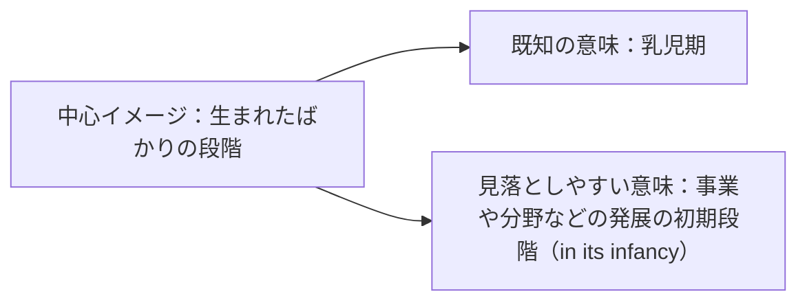

**重要語法：** `in its infancy`

<sub>識別情報：index 8490 ／ ev-08490-noun-01</sub>

---

## 4002. invocation

**品詞：** noun  
**発音：** /ɪnvəkeɪʃən/

<sub>よく知られている意味：祈り、祈願</sub>

### 見落としやすい意味

**法令・権利・権威などを根拠として持ち出すこと**

**例文**  
The policy changed after the company's invocation of a safety rule.

**和訳**  
会社が安全規則を根拠として持ち出した後、その方針は変わった。

**コアイメージ**  
invocation の中心には、何かを呼び出して力を借りる発想がある。祈りで神に呼びかける場合だけでなく、規則や権利を根拠として援用する場合にも使う。

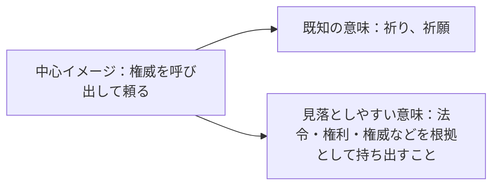

**重要語法：** `invocation of a rule`

<sub>識別情報：index 8498 ／ ev-08498-noun-01</sub>

---

## 4003. legion

**品詞：** adjective  
**発音：** /lidʒən/

<sub>よく知られている意味：軍団、大群</sub>

### 見落としやすい意味

**非常に多数の、無数の**

**例文**  
The challenges facing the new mayor are legion.

**和訳**  
新市長が直面する課題は数え切れないほど多い。

**コアイメージ**  
legion は多数の人が集まった軍団を表す。その大きな数のイメージから、形容詞として課題などが非常に多いことを表す。

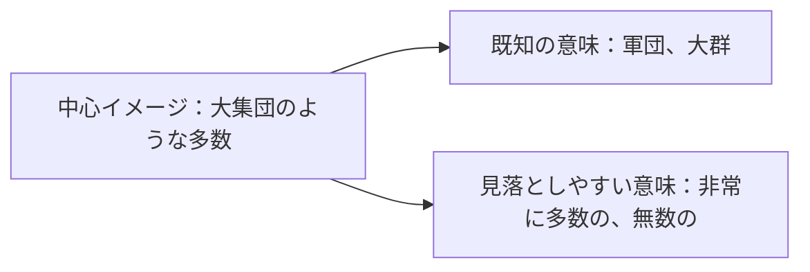

**重要語法：** `be legion`

<sub>識別情報：index 8502 ／ ev-08502-adjective-01</sub>

---

## 4004. loft

**品詞：** verb  
**発音：** /lɔft/

<sub>よく知られている意味：屋根裏、ロフト</sub>

### 見落としやすい意味

**（球などを）高く打ち上げる**

**例文**  
She lofted the ball over the goalkeeper's head.

**和訳**  
彼女はゴールキーパーの頭上へボールを高く蹴り上げた。

**コアイメージ**  
loft には高い場所というイメージがある。動詞ではボールなどを空中の高い位置へ送り出す動作を表す。

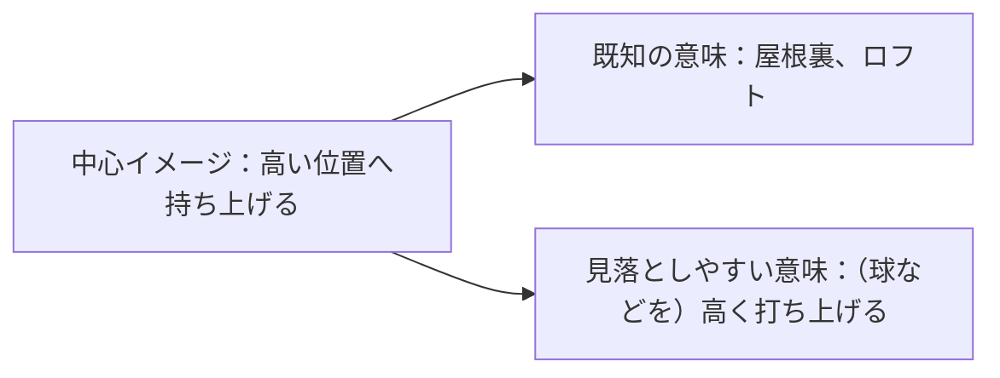

**重要語法：** `loft a ball`

<sub>識別情報：index 8507 ／ ev-08507-verb-01</sub>

---

## 4005. mat

**品詞：** verb  
**発音：** /mæt/

<sub>よく知られている意味：敷物、マット</sub>

### 見落としやすい意味

**（毛髪・繊維などが）もつれ固まる**

**例文**  
Rain had matted the dog's fur into thick clumps.

**和訳**  
雨のせいで犬の毛が固くもつれ、束になっていた。

**コアイメージ**  
mat は繊維が密に集まった敷物を指す。動詞では髪や毛などが絡み合い、マットのように固まることを表す。

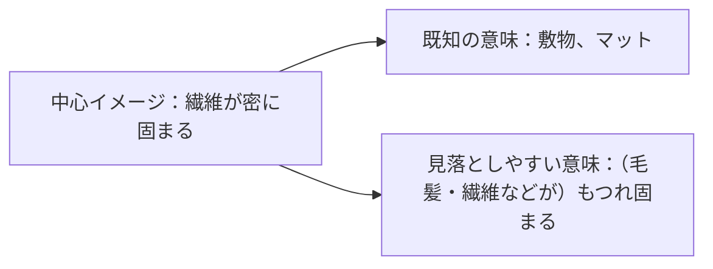

**重要語法：** `matted hair`

<sub>識別情報：index 8513 ／ ev-08513-verb-01</sub>

---

## 4006. modestly

**品詞：** adverb  
**発音：** /mɑdəstli/

<sub>よく知られている意味：控えめに、謙虚に</sub>

### 見落としやすい意味

**わずかに、少しだけ**

**例文**  
Sales increased modestly during the first quarter.

**和訳**  
第1四半期の売上高はわずかに増加した。

**コアイメージ**  
modest には目立ちすぎず控えめという感覚がある。態度なら謙虚さを表し、増減や規模なら程度が小さいことを表す。

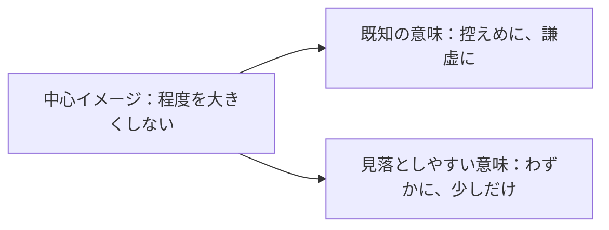

**重要語法：** `increase modestly`

<sub>識別情報：index 8517 ／ ev-08517-adverb-01</sub>

---

## 4007. nobility

**品詞：** noun  
**発音：** /noʊbɪləti/

<sub>よく知られている意味：高潔さ、気高さ</sub>

### 見落としやすい意味

**貴族階級、貴族たち**

**例文**  
The nobility owned much of the land in the region.

**和訳**  
その地域の土地の多くは貴族階級が所有していた。

**コアイメージ**  
nobility は気高い性質にも高い社会的身分にも関わる語である。歴史や社会の文脈では、性質ではなく貴族という集団を指す。

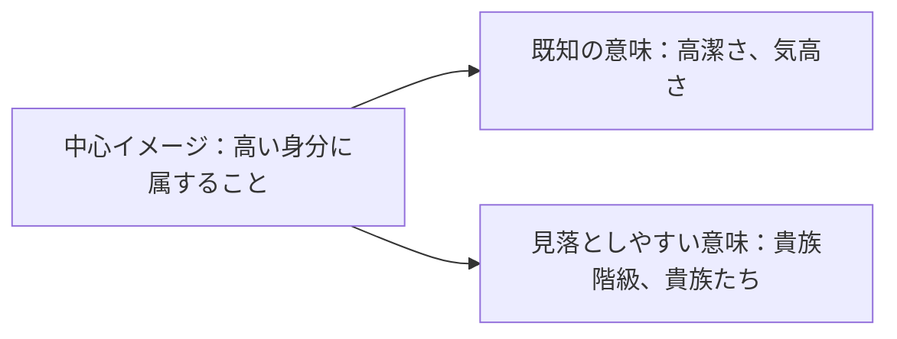

<sub>識別情報：index 8521 ／ ev-08521-noun-01</sub>

---

## 4008. observatory

**品詞：** noun  
**発音：** /əbzɝvətɔɹi/

<sub>よく知られている意味：天文台</sub>

### 見落としやすい意味

**見晴らし台、展望台**

**例文**  
We watched the sunset from an observatory above the harbor.

**和訳**  
私たちは港を見下ろす展望台から夕日を眺めた。

**コアイメージ**  
observatory は周囲を見渡して観察するための場所を表す。星を観測する施設にも、景色を眺める展望台にも使える。

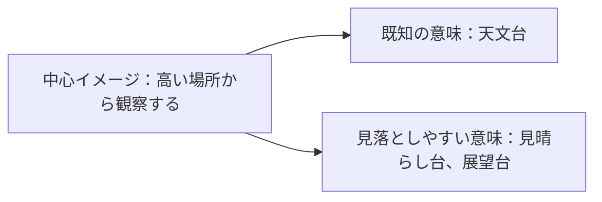

<sub>識別情報：index 8523 ／ ev-08523-noun-01</sub>

---

## 4009. pedestal

**品詞：** phrase  
**発音：** /pɛdəstəl/

<sub>よく知られている意味：台座</sub>

### 見落としやすい意味

**put ～ on a pedestal：～を理想化して過大評価する**

**例文**  
He puts his favorite author on a pedestal and ignores her flaws.

**和訳**  
彼はお気に入りの作家を理想化し、彼女の欠点を見ようとしない。

**コアイメージ**  
pedestal は物を高く掲げる台座を指す。人をその上に置くという比喩から、欠点のない特別な存在として過大評価する意味になる。

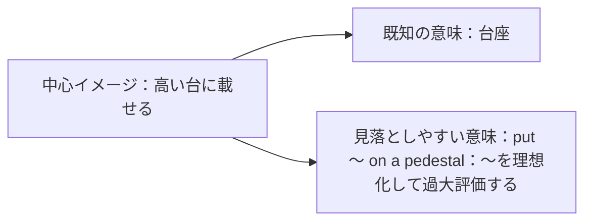

**重要語法：** `put someone on a pedestal`

<sub>識別情報：index 8528 ／ ev-08528-phrase-01</sub>

---

## 4010. peep

**品詞：** noun  
**発音：** /pip/

<sub>よく知られている意味：のぞき見、ちらりと見ること</sub>

### 見落としやすい意味

**（特に否定文で）かすかなひと言、物音**

**例文**  
The room was silent; not a peep came from the children.

**和訳**  
部屋は静まり返り、子どもたちは物音一つ立てなかった。

**コアイメージ**  
peep は短くかすかな声や音にも使われる。否定表現では、その小さな音すらしないことを強調する。

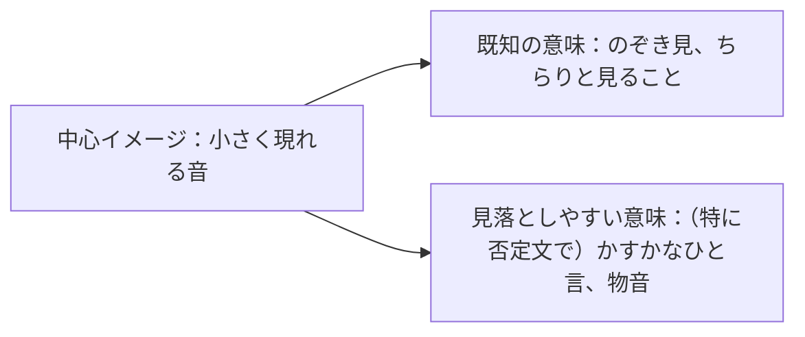

**重要語法：** `not a peep`

<sub>識別情報：index 8529 ／ ev-08529-noun-01</sub>

---

## 4011. piety

**品詞：** noun  
**発音：** /paɪəti/

<sub>よく知られている意味：敬虔さ、信心深さ</sub>

### 見落としやすい意味

**（しばしば複数形で）空疎な道徳的決まり文句**

**例文**  
The speech was full of empty pieties about honesty.

**和訳**  
その演説は誠実さについての空疎な道徳的決まり文句でいっぱいだった。

**コアイメージ**  
piety は本来、宗教的な敬虔さや徳への敬意を指す。その言葉だけが形骸化すると、複数形 pieties で中身のない道徳的な常套句を皮肉って表す。

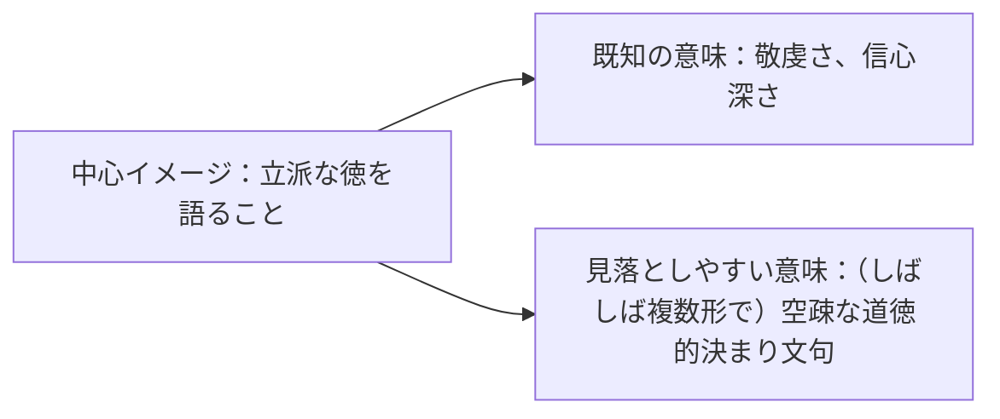

**重要語法：** `empty pieties`

<sub>識別情報：index 8531 ／ ev-08531-noun-01</sub>

---

## 4012. pluck

**品詞：** noun  
**発音：** /plʌk/

<sub>よく知られている意味：引き抜くこと</sub>

### 見落としやすい意味

**勇気、気概、粘り強さ**

**例文**  
It took real pluck to speak against the unfair rule.

**和訳**  
不公平な規則に異議を唱えるには、本当の勇気が必要だった。

**コアイメージ**  
pluck の動詞には勢いよく引き抜く動作がある。名詞では、ためらいを振り切って行動する勇気や気概を表す。

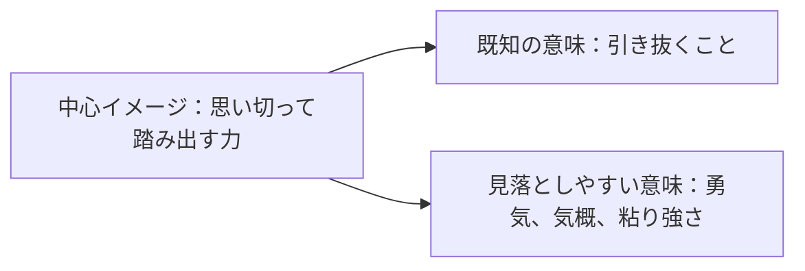

**重要語法：** `show pluck`

<sub>識別情報：index 8532 ／ ev-08532-noun-01</sub>

---

## 4013. punctuate

**品詞：** verb  
**発音：** /pʌŋktʃueɪt/

<sub>よく知られている意味：句読点を打つ</sub>

### 見落としやすい意味

**（出来事や音が）一定の間隔で挟まる、途切れさせる**

**例文**  
Her explanation was punctuated by long pauses.

**和訳**  
彼女の説明には長い沈黙が何度も挟まった。

**コアイメージ**  
punctuate は文章に句読点を入れて区切ることを指す。同じ発想で、出来事や音が続く流れの途中に繰り返し割り込むことも表す。

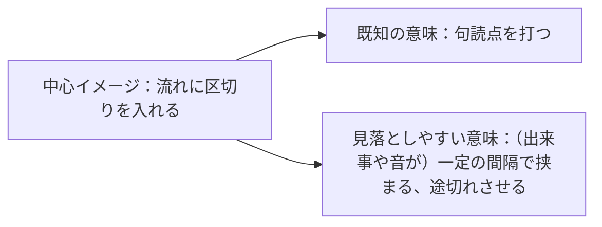

**重要語法：** `be punctuated by`

<sub>識別情報：index 8538 ／ ev-08538-verb-01</sub>

---

## 4014. referee

**品詞：** noun  
**発音：** /ɹɛfɚi/

<sub>よく知られている意味：スポーツの審判</sub>

### 見落としやすい意味

**（学術論文などの）査読者**

**例文**  
Two referees reviewed the paper before publication.

**和訳**  
出版前に二人の査読者がその論文を審査した。

**コアイメージ**  
referee は競技で公平な判定を下す人を指す。学術出版でも第三者の立場から論文を評価する査読者を表す。

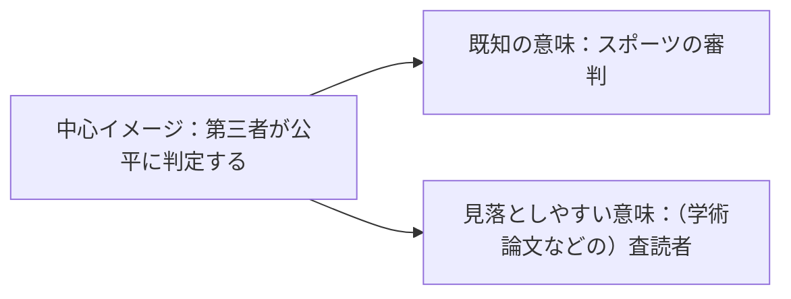

**重要語法：** `academic referee`

<sub>識別情報：index 8543 ／ ev-08543-noun-01</sub>

---

## 4015. referee

**品詞：** noun  
**発音：** /ɹɛfɚi/

<sub>よく知られている意味：スポーツの審判</sub>

### 見落としやすい意味

**（主に英国で）就職・入学の推薦人**

**例文**  
Please include the contact details of two referees in your application.

**和訳**  
応募書類には推薦人二人の連絡先を記載してください。

**コアイメージ**  
referee は当事者から離れて判断を伝える役割を担う人を表す。主に英国の応募書類では、応募者の能力や人柄を証言できる推薦人を指す。

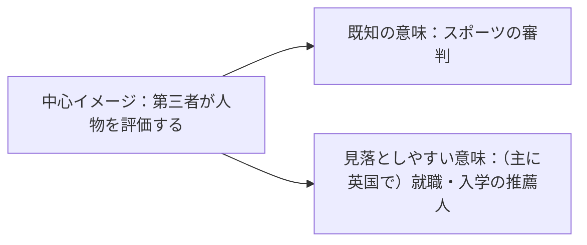

**重要語法：** `provide a referee; reference`

<sub>識別情報：index 8543 ／ ev-08543-noun-02</sub>

---

## 4016. rehash

**品詞：** verb  
**発音：** /ɹihæʃ/

<sub>よく知られている意味：作り直す、再加工する</sub>

### 見落としやすい意味

**古い議論を蒸し返す、少し変えて繰り返す**

**例文**  
The committee merely rehashed last year's arguments.

**和訳**  
委員会は昨年の議論をただ蒸し返しただけだった。

**コアイメージ**  
rehash は一度使った材料をもう一度加工するイメージである。議論やアイデアに使うと、新味なく繰り返したり少し言い換えたりする意味になる。

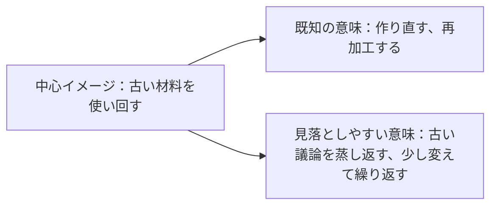

**重要語法：** `rehash an argument`

<sub>識別情報：index 8544 ／ ev-08544-verb-01</sub>

---

## 4017. repay

**品詞：** verb  
**発音：** /ɹipeɪ/

<sub>よく知られている意味：返済する、恩返しする</sub>

### 見落としやすい意味

**（時間・労力をかける）価値がある、見返りを生む**

**例文**  
The rare view repays the effort of climbing the hill.

**和訳**  
その珍しい景色は、丘を登る労力をかけるだけの価値がある。

**コアイメージ**  
repay は何かを受け取った分だけ返すことが基本である。時間や労力に見合う成果が返ってくる場合にも使い、「価値がある」と訳せる。

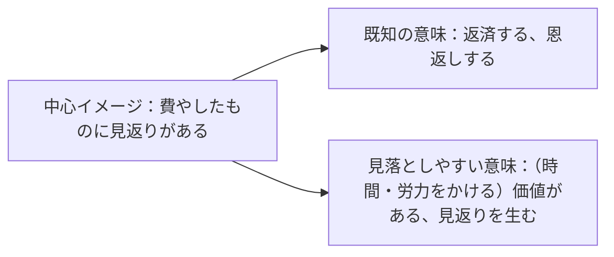

**重要語法：** `repay the effort; repay a visit`

<sub>識別情報：index 8545 ／ ev-08545-verb-01</sub>

---

## 4018. repute

**品詞：** verb  
**発音：** /ɹipjut/

<sub>よく知られている意味：評判、名声</sub>

### 見落としやすい意味

**（人・物を）～だとみなす、評する**

**例文**  
The village is reputed to be over a thousand years old.

**和訳**  
その村は千年以上の歴史があるといわれている。

**コアイメージ**  
repute は人や物について評判が立っていることに関わる。be reputed to ... では、確定した事実よりも一般にそう考えられていることを示す。

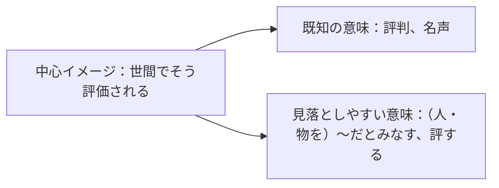

**重要語法：** `be reputed to be ...`

<sub>識別情報：index 8548 ／ ev-08548-verb-01</sub>

---

## 4019. revel

**品詞：** verb  
**発音：** /ɹɛvəl/

<sub>よく知られている意味：大いに楽しむ、大騒ぎする</sub>

### 見落としやすい意味

**revel in ～：～を心から楽しむ、～にふける**

**例文**  
She reveled in the freedom of traveling alone.

**和訳**  
彼女は一人旅の自由を心から満喫した。

**コアイメージ**  
revel は喜びの中で大いに楽しむことを表す。revel in ... では楽しさの対象に深く浸っている感覚が前面に出る。

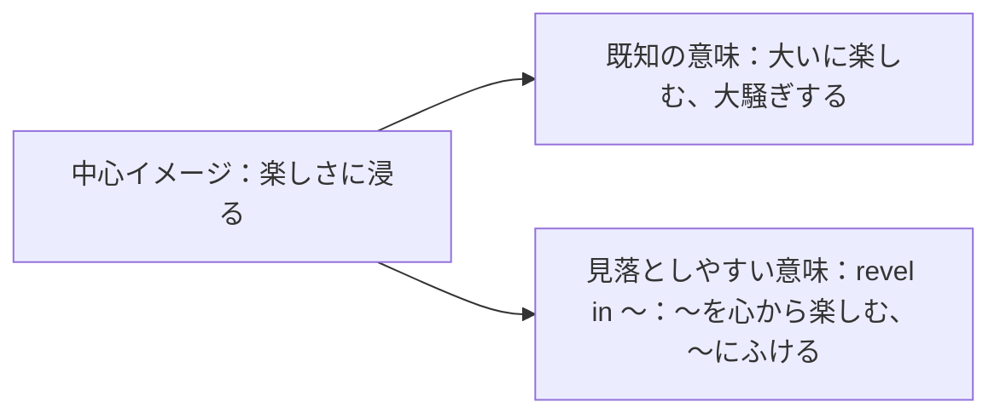

**重要語法：** `revel in ...`

<sub>識別情報：index 8552 ／ ev-8552-verb-01</sub>

---

## 4020. rot

**品詞：** noun  
**発音：** /ɹɑt/

<sub>よく知られている意味：腐敗、腐ること</sub>

### 見落としやすい意味

**たわごと、でたらめ（特に話や主張）**

**例文**  
That's absolute rot; the figures tell a different story.

**和訳**  
それはまったくのでたらめだ。数字は別の事実を示している。

**コアイメージ**  
rot は物が腐って使い物にならなくなることを指す。口語では話や主張の中身がひどく間違っているとして「たわごと」と言う。

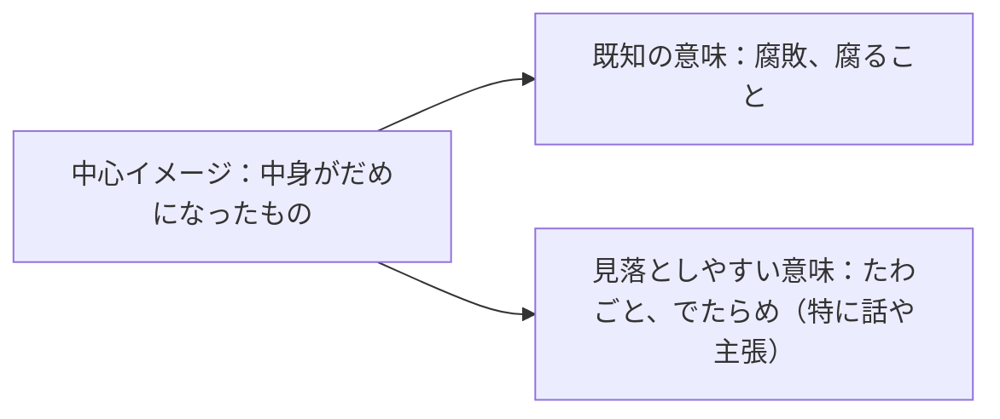

**重要語法：** `talk rot; utter rot`

<sub>識別情報：index 8555 ／ ev-8555-noun-01</sub>

---

## 4021. scrub

**品詞：** verb  
**発音：** /skɹʌb/

<sub>よく知られている意味：こすり洗いする</sub>

### 見落としやすい意味

**（計画・行事などを）中止する、取りやめる**

**例文**  
The organizers scrubbed the outdoor concert because of the storm.

**和訳**  
主催者は嵐のため野外コンサートを中止した。

**コアイメージ**  
scrub はこすって汚れを落とすことを指す。予定表から項目を消すような発想で、計画や行事の中止にも使われる。

```mermaid
flowchart LR
    A["中心イメージ：予定を消し去る"]
    B["既知の意味：こすり洗いする"]
    C["見落としやすい意味：（計画・行事などを）中止する、取りやめる"]
    A --> B
    A --> C
```

**重要語法：** `scrub a plan; scrub a mission`

<sub>識別情報：index 8558 ／ ev-08558-verb-01</sub>

---

## 4022. shabby

**品詞：** adjective  
**発音：** /ʃæbi/

<sub>よく知られている意味：みすぼらしい、古びた</sub>

### 見落としやすい意味

**（扱い・行為などが）卑劣な、ひどい**

**例文**  
The workers complained about their shabby treatment.

**和訳**  
労働者たちは自分たちへのひどい扱いに不満を訴えた。

**コアイメージ**  
shabby は見た目が粗末で見苦しい状態を表す。人への扱いにも使い、道義的にひどい、卑劣だという評価になる。

```mermaid
flowchart LR
    A["中心イメージ：見苦しく、あるべき水準に満たない"]
    B["既知の意味：みすぼらしい、古びた"]
    C["見落としやすい意味：（扱い・行為などが）卑劣な、ひどい"]
    A --> B
    A --> C
```

**重要語法：** `shabby treatment`

<sub>識別情報：index 8559 ／ ev-8559-adjective-01</sub>

---

## 4023. starter

**品詞：** noun  
**発音：** /stɑɹtɚ/

<sub>よく知られている意味：始動装置、出場選手</sub>

### 見落としやすい意味

**前菜、食事の最初の一皿**

**例文**  
We ordered soup as a starter before the main course.

**和訳**  
私たちはメイン料理の前に前菜としてスープを注文した。

**コアイメージ**  
starter は物事を始めるものや人を表す。食事では最初の一皿、つまり前菜を指す。

```mermaid
flowchart LR
    A["中心イメージ：最初に出るもの"]
    B["既知の意味：始動装置、出場選手"]
    C["見落としやすい意味：前菜、食事の最初の一皿"]
    A --> B
    A --> C
```

**重要語法：** `starter and main course`

<sub>識別情報：index 8567 ／ ev-08567-noun-01</sub>

---

## 4024. superpower

**品詞：** noun  
**発音：** /supɚpaʊɚ/

<sub>よく知られている意味：超大国</sub>

### 見落としやすい意味

**超能力、特殊な能力**

**例文**  
In the story, every child has a different superpower.

**和訳**  
その物語では、子どもたちがそれぞれ違う超能力を持っている。

**コアイメージ**  
superpower は並外れた大きな力を指す。国際政治では強大な国家を、物語では人間の通常の能力を超える特別な力を表す。

```mermaid
flowchart LR
    A["中心イメージ：普通を超える力"]
    B["既知の意味：超大国"]
    C["見落としやすい意味：超能力、特殊な能力"]
    A --> B
    A --> C
```

<sub>識別情報：index 8571 ／ ev-08571-noun-01</sub>

---

## 4025. throng

**品詞：** verb  
**発音：** /θɹɔŋ/

<sub>よく知られている意味：群衆、人だかり</sub>

### 見落としやすい意味

**（人々が）大勢押し寄せる、群がる**

**例文**  
Fans thronged the streets after the final match.

**和訳**  
決勝戦の後、ファンが通りに大勢押し寄せた。

**コアイメージ**  
throng は密集した群衆を表す。動詞ではその群衆が場所に押し寄せたり、場所を埋め尽くしたりすることを指す。

```mermaid
flowchart LR
    A["中心イメージ：大勢で一か所に集まる"]
    B["既知の意味：群衆、人だかり"]
    C["見落としやすい意味：（人々が）大勢押し寄せる、群がる"]
    A --> B
    A --> C
```

**重要語法：** `throng the streets`

<sub>識別情報：index 8577 ／ ev-08577-verb-01</sub>

---

## 4026. thunder

**品詞：** verb  
**発音：** /θʌndɚ/

<sub>よく知られている意味：雷が鳴る</sub>

### 見落としやすい意味

**（人が）大声で怒鳴る、声高に言う**

**例文**  
The coach thundered that the team had to work harder.

**和訳**  
コーチはチームはもっと努力しなければならないと大声で怒鳴った。

**コアイメージ**  
thunder は雷のような大きく響く音が中心にある。人の発話に使うと、怒りや強い感情を込めて声高に言う意味になる。

```mermaid
flowchart LR
    A["中心イメージ：雷鳴のような大きな声"]
    B["既知の意味：雷が鳴る"]
    C["見落としやすい意味：（人が）大声で怒鳴る、声高に言う"]
    A --> B
    A --> C
```

<sub>識別情報：index 8578 ／ ev-08578-verb-01</sub>

---

## 4027. turnaround

**品詞：** noun  
**発音：** /tɝnɚaʊnd/

<sub>よく知られている意味：好転、方向転換</sub>

### 見落としやすい意味

**（作業・依頼などの）処理時間、所要時間**

**例文**  
The lab promises a two-day turnaround for test results.

**和訳**  
その検査室は検査結果を二日で返すと約束している。

**コアイメージ**  
turnaround は向きを変えて戻ってくるというイメージを持つ。仕事では依頼されたものが処理され、戻ってくるまでの時間を指す。

```mermaid
flowchart LR
    A["中心イメージ：依頼から返却までの一巡"]
    B["既知の意味：好転、方向転換"]
    C["見落としやすい意味：（作業・依頼などの）処理時間、所要時間"]
    A --> B
    A --> C
```

**重要語法：** `turnaround time`

<sub>識別情報：index 8582 ／ ev-8582-noun-01</sub>

---

## 4028. undertaking

**品詞：** noun  
**発音：** /ʌndɚteɪkɪŋ/

<sub>よく知られている意味：事業、仕事</sub>

### 見落としやすい意味

**約束、確約、保証**

**例文**  
The supplier gave a written undertaking to replace the damaged parts.

**和訳**  
供給業者は破損した部品を交換するという書面の確約をした。

**コアイメージ**  
undertaking は仕事や責任を自ら引き受けることに関わる。契約や公的な文脈では、特定の行動をする責任を引き受ける「確約」を指す。

```mermaid
flowchart LR
    A["中心イメージ：責任を引き受ける"]
    B["既知の意味：事業、仕事"]
    C["見落としやすい意味：約束、確約、保証"]
    A --> B
    A --> C
```

**重要語法：** `give an undertaking to ...`

<sub>識別情報：index 8586 ／ ev-8586-noun-01</sub>

---

## 4029. unqualified

**品詞：** adjective  
**発音：** /ənkwɑlɪfaɪd/

<sub>よく知られている意味：無資格の</sub>

### 見落としやすい意味

**全面的な、無条件の、掛け値なしの**

**例文**  
The project was an unqualified success.

**和訳**  
その計画は文句のつけようのない成功を収めた。

**コアイメージ**  
qualify には資格を与えるほか、発言などに条件や限定を付ける意味がある。unqualified はその限定がないことから、成功などを「全面的な」と強調する。

```mermaid
flowchart LR
    A["中心イメージ：条件や限定が付かない"]
    B["既知の意味：無資格の"]
    C["見落としやすい意味：全面的な、無条件の、掛け値なしの"]
    A --> B
    A --> C
```

**重要語法：** `unqualified success; unqualified support`

<sub>識別情報：index 8588 ／ ev-8588-adjective-01</sub>

---

## 4030. vent

**品詞：** verb  
**発音：** /vɛnt/

<sub>よく知られている意味：通気口</sub>

### 見落としやすい意味

**（怒り・不満などを）発散する、吐き出す**

**例文**  
He vented his frustration after the long meeting.

**和訳**  
彼は長い会議の後、不満を吐き出した。

**コアイメージ**  
vent は空気などを外に逃がす出口を指す。感情に使うと、内側にたまった怒りや不満を言葉などで外へ出す意味になる。

```mermaid
flowchart LR
    A["中心イメージ：内にたまったものを外に出す"]
    B["既知の意味：通気口"]
    C["見落としやすい意味：（怒り・不満などを）発散する、吐き出す"]
    A --> B
    A --> C
```

**重要語法：** `vent one's anger`

<sub>識別情報：index 8593 ／ ev-8593-verb-01</sub>

---

## 4031. vernacular

**品詞：** adjective  
**発音：** /vɚnækjəlɚ/

<sub>よく知られている意味：日常語の、俗語の</sub>

### 見落としやすい意味

**地域固有の、土着の**

**例文**  
The town is known for its vernacular architecture.

**和訳**  
その町は地域固有の建築様式で知られている。

**コアイメージ**  
vernacular は特定の地域や集団で日常的に使われる言葉を指す。その土地に根付いた文化や建築にも広がり、「地域固有の」となる。

```mermaid
flowchart LR
    A["中心イメージ：その土地の人々に根付く"]
    B["既知の意味：日常語の、俗語の"]
    C["見落としやすい意味：地域固有の、土着の"]
    A --> B
    A --> C
```

**重要語法：** `vernacular architecture`

<sub>識別情報：index 8595 ／ ev-08595-adjective-01</sub>

---

## 4032. whitewash

**品詞：** verb  
**発音：** /waɪtwɑʃ/

<sub>よく知られている意味：白く塗る</sub>

### 見落としやすい意味

**（不正・失態などを）隠蔽する、うやむやにする**

**例文**  
The report tried to whitewash the company's failures.

**和訳**  
その報告書は会社の失敗を隠して取り繕おうとした。

**コアイメージ**  
whitewash は表面を白く塗ることから出発する。比喩では不都合な事実を目立たなくして、問題がないように見せることを表す。

```mermaid
flowchart LR
    A["中心イメージ：表面を白く覆い隠す"]
    B["既知の意味：白く塗る"]
    C["見落としやすい意味：（不正・失態などを）隠蔽する、うやむやにする"]
    A --> B
    A --> C
```

**重要語法：** `whitewash a scandal`

<sub>識別情報：index 8602 ／ ev-08602-verb-01</sub>

---

## 4033. analog

**品詞：** noun  
**発音：** /ænəlɔɡ/

<sub>よく知られている意味：アナログ方式</sub>

### 見落としやすい意味

**類似物、対応物**

**例文**  
Scientists found a close analog of the molecule in another species.

**和訳**  
科学者たちは別の種にその分子によく似た対応物を見つけた。

**コアイメージ**  
analog は別の対象と形や働きが対応しているものを指す。デジタルとの対比だけでなく、科学や比較の文脈で「類似物」という名詞になる。

```mermaid
flowchart LR
    A["中心イメージ：対応する似たもの"]
    B["既知の意味：アナログ方式"]
    C["見落としやすい意味：類似物、対応物"]
    A --> B
    A --> C
```

**重要語法：** `an analog of ...`

<sub>識別情報：index 8613 ／ ev-08613-noun-01</sub>

---

## 4034. apostle

**品詞：** noun  
**発音：** /əpɑsəl/

<sub>よく知られている意味：使徒</sub>

### 見落としやすい意味

**熱心な提唱者、支持者**

**例文**  
She became an apostle of environmental education.

**和訳**  
彼女は環境教育の熱心な提唱者になった。

**コアイメージ**  
apostle は教えを伝える使徒を指す。そこから、宗教以外でも特定の思想や運動を熱心に広める人を表す。

```mermaid
flowchart LR
    A["中心イメージ：考えを広める使者"]
    B["既知の意味：使徒"]
    C["見落としやすい意味：熱心な提唱者、支持者"]
    A --> B
    A --> C
```

**重要語法：** `an apostle of ...`

<sub>識別情報：index 8614 ／ ev-08614-noun-01</sub>

---

## 4035. attempted

**品詞：** adjective  
**発音：** /ətɛmptɪd/

<sub>よく知られている意味：試みられた</sub>

### 見落としやすい意味

**未遂の、実行を試みたが未完了の**

**例文**  
Police reported an attempted robbery at the station.

**和訳**  
警察は駅で強盗未遂事件があったと発表した。

**コアイメージ**  
attempt は実現を目指して行動を起こすことを表す。犯罪名を修飾する attempted は、実行を試みたものの犯罪が完遂されなかった「未遂」を示す。

```mermaid
flowchart LR
    A["中心イメージ：実行しようとしたが成立しない"]
    B["既知の意味：試みられた"]
    C["見落としやすい意味：未遂の、実行を試みたが未完了の"]
    A --> B
    A --> C
```

**重要語法：** `attempted robbery`

<sub>識別情報：index 8621 ／ ev-08621-adjective-01</sub>

---

## 4036. belonging

**品詞：** noun  
**発音：** /bɪlɔŋɪŋ/

<sub>よく知られている意味：持ち物（belongings）</sub>

### 見落としやすい意味

**所属しているという感覚、帰属意識**

**例文**  
A sense of belonging can help new students feel at home.

**和訳**  
帰属意識があると、新入生は安心して過ごしやすくなる。

**コアイメージ**  
belong は何かに所属していることを表す。belonging は物の持ち主との関係だけでなく、人が集団に受け入れられていると感じることを指す。

```mermaid
flowchart LR
    A["中心イメージ：ある場所や集団に自分の居場所がある"]
    B["既知の意味：持ち物（belongings）"]
    C["見落としやすい意味：所属しているという感覚、帰属意識"]
    A --> B
    A --> C
```

**重要語法：** `a sense of belonging`

<sub>識別情報：index 8627 ／ ev-08627-noun-01</sub>

---

## 4037. bleed

**品詞：** verb  
**発音：** /blid/

<sub>よく知られている意味：出血する</sub>

### 見落としやすい意味

**（組織などが金銭を）急速に失う、流出させる**

**例文**  
The struggling business is bleeding money every month.

**和訳**  
その経営難の会社は毎月多額の資金を失っている。

**コアイメージ**  
bleed は血が体から流れ出ることを指す。金銭や資源にも使い、損失が継続して流出する様子を強く表す。

```mermaid
flowchart LR
    A["中心イメージ：大事なものが外へ流れ出る"]
    B["既知の意味：出血する"]
    C["見落としやすい意味：（組織などが金銭を）急速に失う、流出させる"]
    A --> B
    A --> C
```

**重要語法：** `bleed money`

<sub>識別情報：index 8630 ／ ev-08630-verb-01</sub>

---

## 4038. bog

**品詞：** phrase  
**発音：** /bɑɡ/

<sub>よく知られている意味：沼地</sub>

### 見落としやすい意味

**bog down：行き詰まらせる、進行を遅らせる**

**例文**  
The debate got bogged down in minor details.

**和訳**  
議論は細かな点にとらわれて行き詰まった。

**コアイメージ**  
bog は足を取られる湿地を表す。bog down はそこにはまって進めないように、活動や議論の進行が滞ることを表す。

```mermaid
flowchart LR
    A["中心イメージ：泥にはまって動けない"]
    B["既知の意味：沼地"]
    C["見落としやすい意味：bog down：行き詰まらせる、進行を遅らせる"]
    A --> B
    A --> C
```

**重要語法：** `get bogged down in ...`

<sub>識別情報：index 8632 ／ ev-08632-phrase-01</sub>

---

## 4039. buckle

**品詞：** verb  
**発音：** /bʌkəl/

<sub>よく知られている意味：ベルトの留め金</sub>

### 見落としやすい意味

**（圧力に耐えられず）屈する、折れる**

**例文**  
The manager finally buckled under public pressure.

**和訳**  
経営者はついに世論の圧力に屈した。

**コアイメージ**  
buckle は物が圧力を受けて曲がったり崩れたりすることも表す。人に使うと強い圧力に耐えきれず、意志を曲げて屈する意味になる。

```mermaid
flowchart LR
    A["中心イメージ：圧力で形が崩れる"]
    B["既知の意味：ベルトの留め金"]
    C["見落としやすい意味：（圧力に耐えられず）屈する、折れる"]
    A --> B
    A --> C
```

**重要語法：** `buckle under pressure`

<sub>識別情報：index 8635 ／ ev-8635-verb-01</sub>

---

## 4040. buoy

**品詞：** verb  
**発音：** /bui/

<sub>よく知られている意味：浮標、ブイ</sub>

### 見落としやすい意味

**（期待・気持ちなどを）支える、元気づける**

**例文**  
The encouraging feedback buoyed her confidence.

**和訳**  
励ましになる反応が彼女の自信を支えた。

**コアイメージ**  
buoy は水面に浮く目印を指し、浮かせて支えるイメージがある。気持ちに使うと、落ち込まないように元気づけたり支えたりする。

```mermaid
flowchart LR
    A["中心イメージ：沈まないよう浮かせる"]
    B["既知の意味：浮標、ブイ"]
    C["見落としやすい意味：（期待・気持ちなどを）支える、元気づける"]
    A --> B
    A --> C
```

**重要語法：** `be buoyed by ...`

<sub>識別情報：index 8636 ／ ev-8636-verb-01</sub>

---

## 4041. clamor

**品詞：** verb  
**発音：** /klæmɚ/

<sub>よく知られている意味：騒ぎ立てる</sub>

### 見落としやすい意味

**（何かを）声高に要求する**

**例文**  
Residents clamored for safer roads near the school.

**和訳**  
住民たちは学校付近の道路をもっと安全にするよう声高に要求した。

**コアイメージ**  
clamor は騒がしい大声を指す。clamor for ... では、ただ騒ぐのではなく何かを求める声を大きく上げることになる。

```mermaid
flowchart LR
    A["中心イメージ：大勢の声が強く響く"]
    B["既知の意味：騒ぎ立てる"]
    C["見落としやすい意味：（何かを）声高に要求する"]
    A --> B
    A --> C
```

**重要語法：** `clamor for ...`

<sub>識別情報：index 8641 ／ ev-08641-verb-01</sub>

---

## 4042. coffers

**品詞：** noun  
**発音：** /kɑfɚz/

<sub>よく知られている意味：金庫、箱</sub>

### 見落としやすい意味

**（政府・団体などの）財源、資金**

**例文**  
The tax increase added money to the city's coffers.

**和訳**  
増税によって市の財源に資金が加わった。

**コアイメージ**  
coffer は金品を収める箱を表す。複数形 coffers では、その箱の中身に注目して政府や団体の資金・財源を指す。

```mermaid
flowchart LR
    A["中心イメージ：資金を保管する箱"]
    B["既知の意味：金庫、箱"]
    C["見落としやすい意味：（政府・団体などの）財源、資金"]
    A --> B
    A --> C
```

**重要語法：** `public coffers`

<sub>識別情報：index 8643 ／ ev-08643-noun-01</sub>

---

## 4043. consort

**品詞：** verb  
**発音：** /kənsɔɹt/

<sub>よく知られている意味：配偶者</sub>

### 見落としやすい意味

**（好ましくない相手などと）付き合う、交際する**

**例文**  
He was criticized for consorting with known fraudsters.

**和訳**  
彼は詐欺師として知られる人々と付き合っていることで批判された。

**コアイメージ**  
consort は人と付き合い行動を共にするという動詞でもある。特に好ましくない相手との交際を述べる文脈で使われやすい。

```mermaid
flowchart LR
    A["中心イメージ：特定の仲間と行動を共にする"]
    B["既知の意味：配偶者"]
    C["見落としやすい意味：（好ましくない相手などと）付き合う、交際する"]
    A --> B
    A --> C
```

**重要語法：** `consort with ...`

<sub>識別情報：index 8647 ／ ev-08647-verb-01</sub>

---

## 4044. cradle

**品詞：** noun  
**発音：** /kɹeɪdəl/

<sub>よく知られている意味：ゆりかご</sub>

### 見落としやすい意味

**発祥地、育まれた場所**

**例文**  
The valley is regarded as the cradle of the ancient civilization.

**和訳**  
その谷は古代文明の発祥地とみなされている。

**コアイメージ**  
cradle は赤ん坊が最初に過ごすゆりかごを指す。文化や文明が生まれ育った場所にも使い、「発祥地」という意味になる。

```mermaid
flowchart LR
    A["中心イメージ：生まれ育つ場所"]
    B["既知の意味：ゆりかご"]
    C["見落としやすい意味：発祥地、育まれた場所"]
    A --> B
    A --> C
```

**重要語法：** `the cradle of ...`

<sub>識別情報：index 8651 ／ ev-08651-noun-01</sub>

---

## 4045. deaf

**品詞：** phrase  
**発音：** /dɛf/

<sub>よく知られている意味：耳が聞こえない</sub>

### 見落としやすい意味

**be deaf to ～：～に耳を貸さない、取り合わない**

**例文**  
The officials remained deaf to the villagers' complaints.

**和訳**  
当局者たちは村人たちの苦情に耳を貸そうとしなかった。

**コアイメージ**  
deaf は音が聞こえない状態を表す。be deaf to ... は比喩で、意見や訴えに応じようとしない態度を示す。

```mermaid
flowchart LR
    A["中心イメージ：声が届いても取り入れない"]
    B["既知の意味：耳が聞こえない"]
    C["見落としやすい意味：be deaf to ～：～に耳を貸さない、取り合わない"]
    A --> B
    A --> C
```

**重要語法：** `be deaf to ...`

<sub>識別情報：index 8654 ／ ev-08654-phrase-01</sub>

---

## 4046. dispose

**品詞：** phrase  
**発音：** /dɪspoʊz/

<sub>よく知られている意味：配置する、心を向ける</sub>

### 見落としやすい意味

**dispose of ～：～を処分する、片付ける**

**例文**  
We need a safe way to dispose of the old batteries.

**和訳**  
私たちは古い電池を安全に処分する方法を必要としている。

**コアイメージ**  
dispose は物事をある位置や状態に置くことに関わる。dispose of ... では不要な物を手元から取り除き、処分することを表す。

```mermaid
flowchart LR
    A["中心イメージ：手元から適切に片付ける"]
    B["既知の意味：配置する、心を向ける"]
    C["見落としやすい意味：dispose of ～：～を処分する、片付ける"]
    A --> B
    A --> C
```

**重要語法：** `dispose of waste`

<sub>識別情報：index 8668 ／ ev-08668-phrase-01</sub>

---

## 4047. dispose

**品詞：** phrase  
**発音：** /dɪspoʊz/

<sub>よく知られている意味：処分する（dispose of）</sub>

### 見落としやすい意味

**be disposed to ～：～する気がある、～する傾向がある**

**例文**  
She seems disposed to accept the proposal.

**和訳**  
彼女はその提案を受け入れる気があるようだ。

**コアイメージ**  
dispose には配置する、ある状態に向けるという発想がある。be disposed to ... は心が特定の行動へ向いている、つまりその気があることを表す。

```mermaid
flowchart LR
    A["中心イメージ：心がある方向に向いている"]
    B["既知の意味：処分する（dispose of）"]
    C["見落としやすい意味：be disposed to ～：～する気がある、～する傾向がある"]
    A --> B
    A --> C
```

**重要語法：** `be disposed to do`

<sub>識別情報：index 8668 ／ ev-08668-phrase-02</sub>

---

## 4048. distill

**品詞：** verb  
**発音：** /dɪstɪl/

<sub>よく知られている意味：蒸留する</sub>

### 見落としやすい意味

**（情報や考えから）要点を抽出する、凝縮する**

**例文**  
The article distills years of research into three practical lessons.

**和訳**  
その記事は長年の研究の要点を三つの実践的な教訓に凝縮している。

**コアイメージ**  
distill は液体から必要な成分を取り出して濃縮することを指す。情報や考えに使うと、多くの材料から核心だけを抽出する意味になる。

```mermaid
flowchart LR
    A["中心イメージ：余分なものを除いて本質を取り出す"]
    B["既知の意味：蒸留する"]
    C["見落としやすい意味：（情報や考えから）要点を抽出する、凝縮する"]
    A --> B
    A --> C
```

**重要語法：** `distill ... into ...`

<sub>識別情報：index 8669 ／ ev-08669-verb-01</sub>

---

## 4049. drone

**品詞：** verb  
**発音：** /dɹoʊn/

<sub>よく知られている意味：低くうなる、無人機</sub>

### 見落としやすい意味

**（人が）単調に話し続ける**

**例文**  
The speaker droned on for an hour without changing his tone.

**和訳**  
話し手は声の調子を変えずに一時間も単調に話し続けた。

**コアイメージ**  
drone は単調で低い音が続くことを表す。人が主語なら、抑揚のない話し方で延々と話し続ける様子を表す。

```mermaid
flowchart LR
    A["中心イメージ：低い音が変わらず続く"]
    B["既知の意味：低くうなる、無人機"]
    C["見落としやすい意味：（人が）単調に話し続ける"]
    A --> B
    A --> C
```

**重要語法：** `drone on`

<sub>識別情報：index 8672 ／ ev-08672-verb-01</sub>

---

## 4050. fend

**品詞：** phrase  
**発音：** /fɛnd/

<sub>よく知られている意味：（攻撃を）防ぐ</sub>

### 見落としやすい意味

**fend for oneself：自力で生活する、独力でやっていく**

**例文**  
After leaving home, he had to fend for himself.

**和訳**  
家を出てから、彼は自分の力で生活しなければならなかった。

**コアイメージ**  
fend は外からの脅威に対処して身を守ることを表す。fend for oneself では保護や支援に頼らず、自力で生活することになる。

```mermaid
flowchart LR
    A["中心イメージ：自分で身を守り支える"]
    B["既知の意味：（攻撃を）防ぐ"]
    C["見落としやすい意味：fend for oneself：自力で生活する、独力でやっていく"]
    A --> B
    A --> C
```

**重要語法：** `fend for oneself`

<sub>識別情報：index 8682 ／ ev-08682-phrase-01</sub>

---

## 4051. frown

**品詞：** phrase  
**発音：** /fɹaʊn/

<sub>よく知られている意味：眉をひそめる</sub>

### 見落としやすい意味

**frown on/upon ～：～を好ましくないと考える**

**例文**  
The school frowns upon students using phones during lessons.

**和訳**  
その学校は授業中に生徒が携帯電話を使うことを好ましくないと考えている。

**コアイメージ**  
frown は不快や不賛成で眉をひそめる動作を表す。frown on/upon ... では、その対象を望ましくないと判断する態度を示す。

```mermaid
flowchart LR
    A["中心イメージ：顔をしかめて否定的に見る"]
    B["既知の意味：眉をひそめる"]
    C["見落としやすい意味：frown on/upon ～：～を好ましくないと考える"]
    A --> B
    A --> C
```

**重要語法：** `frown on; frown upon`

<sub>識別情報：index 8686 ／ ev-08686-phrase-01</sub>

---

## 4052. graveyard

**品詞：** phrase  
**発音：** /ɡɹeɪvjɑɹd/

<sub>よく知られている意味：墓地</sub>

### 見落としやすい意味

**graveyard shift：深夜勤務**

**例文**  
She works the graveyard shift at a hospital.

**和訳**  
彼女は病院で深夜勤務をしている。

**コアイメージ**  
graveyard は墓地を指す。graveyard shift は人通りが少なく静かな深夜の勤務時間帯を表す定型表現である。

```mermaid
flowchart LR
    A["中心イメージ：夜の静まり返った時間帯"]
    B["既知の意味：墓地"]
    C["見落としやすい意味：graveyard shift：深夜勤務"]
    A --> B
    A --> C
```

**重要語法：** `graveyard shift`

<sub>識別情報：index 8692 ／ ev-08692-phrase-01</sub>

---

## 4053. grudge

**品詞：** verb  
**発音：** /ɡɹʌdʒ/

<sub>よく知られている意味：恨み、遺恨</sub>

### 見落としやすい意味

**（人に物を）与えるのを惜しむ、出し渋る**

**例文**  
I don't grudge you your success; you worked hard for it.

**和訳**  
私はあなたの成功をねたんだり惜しんだりしない。あなたは努力したのだから。

**コアイメージ**  
grudge は相手への不満を抱き続ける気持ちに関わる。動詞では、人が得るものや自分が与えるものを快く思わず、惜しむことを表す。

```mermaid
flowchart LR
    A["中心イメージ：他人に渡ることを惜しむ"]
    B["既知の意味：恨み、遺恨"]
    C["見落としやすい意味：（人に物を）与えるのを惜しむ、出し渋る"]
    A --> B
    A --> C
```

**重要語法：** `grudge someone something`

<sub>識別情報：index 8693 ／ ev-08693-verb-01</sub>

---

## 4054. hassle

**品詞：** verb  
**発音：** /hæsəl/

<sub>よく知られている意味：面倒、厄介事</sub>

### 見落としやすい意味

**（人を）しつこく煩わせる、せがむ**

**例文**  
Reporters kept hassling her for an interview.

**和訳**  
記者たちはインタビューを求めて彼女にしつこく迫った。

**コアイメージ**  
hassle は手間や迷惑を感じる状況を指す。動詞になると、相手にしつこく働きかけて困らせることを表す。

```mermaid
flowchart LR
    A["中心イメージ：繰り返し負担をかける"]
    B["既知の意味：面倒、厄介事"]
    C["見落としやすい意味：（人を）しつこく煩わせる、せがむ"]
    A --> B
    A --> C
```

**重要語法：** `hassle someone for ...`

<sub>識別情報：index 8696 ／ ev-08696-verb-01</sub>

---

## 4055. heady

**品詞：** adjective  
**発音：** /hɛdi/

<sub>よく知られている意味：頭に関する</sub>

### 見落としやすい意味

**（成功・感情・体験などが）人を有頂天にさせる、興奮させる**

**例文**  
Those were heady days of sudden fame and excitement.

**和訳**  
それは突然の名声と興奮に満ちた、浮き立つような日々だった。

**コアイメージ**  
heady は感情や経験が強く人を興奮させる様子を表す。成功などで冷静さを失いそうなほど高揚する感じを伴う。

```mermaid
flowchart LR
    A["中心イメージ：頭がくらむほど気分が高まる"]
    B["既知の意味：頭に関する"]
    C["見落としやすい意味：（成功・感情・体験などが）人を有頂天にさせる、興奮させる"]
    A --> B
    A --> C
```

**重要語法：** `heady success; heady days`

<sub>識別情報：index 8698 ／ ev-08698-adjective-01</sub>

---

## 4056. hinge

**品詞：** verb  
**発音：** /hɪndʒ/

<sub>よく知られている意味：蝶番、ちょうつがい</sub>

### 見落としやすい意味

**hinge on/upon ～：～次第である、～にかかっている**

**例文**  
Our decision hinges on the results of tomorrow's test.

**和訳**  
私たちの決定は明日の試験結果次第だ。

**コアイメージ**  
hinge は扉の動きを支える蝶番を指す。hinge on ... では、ある重要な条件が全体の成り行きを左右することを表す。

```mermaid
flowchart LR
    A["中心イメージ：一点を支点に動きが決まる"]
    B["既知の意味：蝶番、ちょうつがい"]
    C["見落としやすい意味：hinge on/upon ～：～次第である、～にかかっている"]
    A --> B
    A --> C
```

**重要語法：** `hinge on; hinge upon`

<sub>識別情報：index 8699 ／ ev-8699-verb-01</sub>

---

## 4057. hunch

**品詞：** noun  
**発音：** /hʌntʃ/

<sub>よく知られている意味：背中を丸めること</sub>

### 見落としやすい意味

**直感、勘**

**例文**  
I have a hunch that the missing key is in the car.

**和訳**  
なくした鍵は車の中にある気がする。

**コアイメージ**  
hunch は証拠を十分に説明できなくても何となくそう感じる直感を表す。推論の結果を断言するのではなく、勘に基づく見通しを示す。

```mermaid
flowchart LR
    A["中心イメージ：はっきり証明できない感覚"]
    B["既知の意味：背中を丸めること"]
    C["見落としやすい意味：直感、勘"]
    A --> B
    A --> C
```

**重要語法：** `have a hunch that ...`

<sub>識別情報：index 8701 ／ ev-08701-noun-01</sub>

---

## 4058. injunction

**品詞：** noun  
**発音：** /ɪndʒʌŋkʃən/

<sub>よく知られている意味：命令、指示</sub>

### 見落としやすい意味

**（裁判所による）差し止め命令**

**例文**  
The court issued an injunction to stop the construction.

**和訳**  
裁判所は工事を止めるための差し止め命令を出した。

**コアイメージ**  
injunction は単なる助言ではなく、従うべき命令を指す。法律の文脈では裁判所が行為を差し止める法的命令となる。

```mermaid
flowchart LR
    A["中心イメージ：法的な力で行為を制止する"]
    B["既知の意味：命令、指示"]
    C["見落としやすい意味：（裁判所による）差し止め命令"]
    A --> B
    A --> C
```

**重要語法：** `issue an injunction`

<sub>識別情報：index 8708 ／ ev-08708-noun-01</sub>

---

## 4059. laundering

**品詞：** noun  
**発音：** /lɔndɚɪŋ/

<sub>よく知られている意味：洗濯</sub>

### 見落としやすい意味

**（不正資金などの）資金洗浄、出所隠し**

**例文**  
The investigation uncovered a money-laundering scheme.

**和訳**  
調査によって資金洗浄の計画が明らかになった。

**コアイメージ**  
laundering は衣服の汚れを洗い落とすことを指す。money laundering は不正な金銭の出所を隠し、正当な資金に見せかけることを表す。

```mermaid
flowchart LR
    A["中心イメージ：汚れた出所をきれいに見せる"]
    B["既知の意味：洗濯"]
    C["見落としやすい意味：（不正資金などの）資金洗浄、出所隠し"]
    A --> B
    A --> C
```

**重要語法：** `money laundering`

<sub>識別情報：index 8714 ／ ev-08714-noun-01</sub>

---

## 4060. neutralize

**品詞：** verb  
**発音：** /nutɹəlaɪz/

<sub>よく知られている意味：中立化する</sub>

### 見落としやすい意味

**（影響・脅威・作用などを）無効化する、打ち消す**

**例文**  
The new filter neutralizes harmful chemicals in the water.

**和訳**  
新しいフィルターは水中の有害な化学物質の作用を無効化する。

**コアイメージ**  
neutralize は対立する力などを打ち消して中立な状態にすることに関わる。化学物質や脅威にも使い、その有害な作用を弱めたり無効にしたりする。

```mermaid
flowchart LR
    A["中心イメージ：働きを相殺して効かなくする"]
    B["既知の意味：中立化する"]
    C["見落としやすい意味：（影響・脅威・作用などを）無効化する、打ち消す"]
    A --> B
    A --> C
```

**重要語法：** `neutralize the effect`

<sub>識別情報：index 8730 ／ ev-08730-verb-01</sub>

---

## 4061. painfully

**品詞：** adverb  
**発音：** /peɪnfəli/

<sub>よく知られている意味：痛々しく</sub>

### 見落としやすい意味

**非常に、ひどく（特に不都合な程度を強調）**

**例文**  
He was painfully shy when he first joined the club.

**和訳**  
彼はそのクラブに入ったばかりの頃、ひどく内気だった。

**コアイメージ**  
painfully は痛みを伴う様子から、比喩的に程度が非常に強いことを表す。特に恥ずかしさや不都合な性質を強調するときによく使う。

```mermaid
flowchart LR
    A["中心イメージ：痛みを感じるほど強い程度"]
    B["既知の意味：痛々しく"]
    C["見落としやすい意味：非常に、ひどく（特に不都合な程度を強調）"]
    A --> B
    A --> C
```

**重要語法：** `painfully shy; painfully obvious`

<sub>識別情報：index 8736 ／ ev-08736-adverb-01</sub>

---

## 4062. pathological

**品詞：** adjective  
**発音：** /pæθəlɑdʒɪkəl/

<sub>よく知られている意味：病理学的な</sub>

### 見落としやすい意味

**病的なほどの、常習的な**

**例文**  
The story follows a pathological liar who deceives everyone.

**和訳**  
その物語は誰もかれもだます、病的なまでにうそをつく人物を追う。

**コアイメージ**  
pathological は本来、病気や病理に関する語である。日常の人物評価では、習慣や行動が異常なほど極端であることを強調する。

```mermaid
flowchart LR
    A["中心イメージ：普通の範囲を超えた異常さ"]
    B["既知の意味：病理学的な"]
    C["見落としやすい意味：病的なほどの、常習的な"]
    A --> B
    A --> C
```

**重要語法：** `pathological liar`

<sub>識別情報：index 8738 ／ ev-08738-adjective-01</sub>

---

## 4063. presumption

**品詞：** noun  
**発音：** /pɹɪzʌmpʃən/

<sub>よく知られている意味：推定、仮定</sub>

### 見落としやすい意味

**厚かましさ、思い上がり**

**例文**  
It was sheer presumption to speak on everyone's behalf without asking.

**和訳**  
誰にも尋ねず全員の代表として発言するのは、まったくの思い上がりだった。

**コアイメージ**  
presumption は十分な根拠なしに何かを当然とみなすことに関わる。自分に権利があると思い込む態度を非難するときは「厚かましさ」になる。

```mermaid
flowchart LR
    A["中心イメージ：根拠なく自分に権限があると思う"]
    B["既知の意味：推定、仮定"]
    C["見落としやすい意味：厚かましさ、思い上がり"]
    A --> B
    A --> C
```

**重要語法：** `sheer presumption`

<sub>識別情報：index 8749 ／ ev-08749-noun-01</sub>

---

## 4064. quid

**品詞：** noun  
**発音：** /kwɪd/

<sub>よく知られている意味：（quid pro quo の）見返り</sub>

### 見落としやすい意味

**（英国の口語で）1ポンド、ポンド貨幣**

**例文**  
The ticket costs only five quid.

**和訳**  
そのチケットはたった5ポンドだ。

**コアイメージ**  
quid は英国でポンドを指すくだけた言い方である。数量が複数でも通常 quid の形を保ち、金額を表す。

```mermaid
flowchart LR
    A["中心イメージ：英国のお金をくだけて呼ぶ"]
    B["既知の意味：（quid pro quo の）見返り"]
    C["見落としやすい意味：（英国の口語で）1ポンド、ポンド貨幣"]
    A --> B
    A --> C
```

**重要語法：** `five quid`

<sub>識別情報：index 8753 ／ ev-08753-noun-01</sub>

---

## 4065. refreshment

**品詞：** noun  
**発音：** /ɹəfɹɛʃmənt/

<sub>よく知られている意味：気分転換、元気回復</sub>

### 見落としやすい意味

**軽食、飲み物**

**例文**  
Light refreshments will be served after the lecture.

**和訳**  
講演の後には軽食と飲み物が出されます。

**コアイメージ**  
refreshment は気分や体力を回復させることに関わる。行事の案内では、元気を取り戻すために出される軽食や飲み物を指す。

```mermaid
flowchart LR
    A["中心イメージ：人を元気づける飲食物"]
    B["既知の意味：気分転換、元気回復"]
    C["見落としやすい意味：軽食、飲み物"]
    A --> B
    A --> C
```

**重要語法：** `light refreshments`

<sub>識別情報：index 8757 ／ ev-08757-noun-01</sub>

---

## 4066. reinforcement

**品詞：** noun  
**発音：** /ɹiɪnfɔɹsmənt/

<sub>よく知られている意味：補強、強化</sub>

### 見落としやすい意味

**援軍、増援部隊**

**例文**  
Reinforcements arrived just before the town was surrounded.

**和訳**  
町が包囲される直前に援軍が到着した。

**コアイメージ**  
reinforcement は力を加えて強くすることを指す。戦闘などの文脈では、そのために新たに送られる兵士や部隊を表す。

```mermaid
flowchart LR
    A["中心イメージ：不足する力を補う"]
    B["既知の意味：補強、強化"]
    C["見落としやすい意味：援軍、増援部隊"]
    A --> B
    A --> C
```

**重要語法：** `send reinforcements`

<sub>識別情報：index 8758 ／ ev-08758-noun-01</sub>

---

## 4067. rife

**品詞：** phrase  
**発音：** /ɹaɪf/

<sub>よく知られている意味：広く行き渡った</sub>

### 見落としやすい意味

**be rife with ～：～がはびこっている**

**例文**  
The neighborhood was rife with rumors about the closure.

**和訳**  
その地区では閉鎖についてのうわさが広く飛び交っていた。

**コアイメージ**  
rife はある現象がいたるところに存在する様子を表す。be rife with ... は、うわさや問題など望ましくないものがはびこることを強調する。

```mermaid
flowchart LR
    A["中心イメージ：好ましくないものが広く満ちる"]
    B["既知の意味：広く行き渡った"]
    C["見落としやすい意味：be rife with ～：～がはびこっている"]
    A --> B
    A --> C
```

**重要語法：** `be rife with ...`

<sub>識別情報：index 8764 ／ ev-08764-phrase-01</sub>

---

## 4068. scout

**品詞：** verb  
**発音：** /skaʊt/

<sub>よく知られている意味：偵察員、ボーイスカウト</sub>

### 見落としやすい意味

**（人材・場所などを）探し出す、目星をつける**

**例文**  
The director scouted several locations for the next film.

**和訳**  
監督は次の映画の撮影場所をいくつか探して回った。

**コアイメージ**  
scout は調査や偵察をする人を指す。動詞では現地や人材を調べ、適した候補を見つけ出そうとすることを表す。

```mermaid
flowchart LR
    A["中心イメージ：先回りして候補を探す"]
    B["既知の意味：偵察員、ボーイスカウト"]
    C["見落としやすい意味：（人材・場所などを）探し出す、目星をつける"]
    A --> B
    A --> C
```

**重要語法：** `scout locations; scout talent`

<sub>識別情報：index 8772 ／ ev-08772-verb-01</sub>

---

## 4069. sensational

**品詞：** adjective  
**発音：** /sɛnseɪʃənəl/

<sub>よく知られている意味：センセーショナルな</sub>

### 見落としやすい意味

**すばらしい、目覚ましい**

**例文**  
Her performance in the final was sensational.

**和訳**  
決勝での彼女の演技は素晴らしかった。

**コアイメージ**  
sensational は人の感覚や感情を強く動かすことを表す。注目をあおるという意味だけでなく、目覚ましい出来事を褒めるときにも使う。

```mermaid
flowchart LR
    A["中心イメージ：強烈な感動を与える"]
    B["既知の意味：センセーショナルな"]
    C["見落としやすい意味：すばらしい、目覚ましい"]
    A --> B
    A --> C
```

**重要語法：** `sensational performance`

<sub>識別情報：index 8773 ／ ev-08773-adjective-01</sub>

---

## 4070. slant

**品詞：** noun  
**発音：** /slænt/

<sub>よく知られている意味：傾斜、傾き</sub>

### 見落としやすい意味

**特定の立場からの見方、偏った切り口**

**例文**  
The article gives a political slant to an otherwise simple story.

**和訳**  
その記事は本来単純な話に政治的な偏りを持たせている。

**コアイメージ**  
slant は物が斜めに傾くことを指す。意見や報道に使うと、特定の方向に傾いた見方や切り口を表す。

```mermaid
flowchart LR
    A["中心イメージ：一方向に傾いた見方"]
    B["既知の意味：傾斜、傾き"]
    C["見落としやすい意味：特定の立場からの見方、偏った切り口"]
    A --> B
    A --> C
```

**重要語法：** `a political slant`

<sub>識別情報：index 8775 ／ ev-08775-noun-01</sub>

---

## 4071. spout

**品詞：** verb  
**発音：** /spaʊt/

<sub>よく知られている意味：噴出口、注ぎ口</sub>

### 見落としやすい意味

**（意見や言葉を）とうとうとまくし立てる**

**例文**  
He kept spouting opinions without listening to anyone else.

**和訳**  
彼は他人の話を聞かず、持論をまくし立て続けた。

**コアイメージ**  
spout は液体が勢いよく噴き出すことに関わる。言葉にも使い、意見などを次々と勢いよく話すことを表す。

```mermaid
flowchart LR
    A["中心イメージ：勢いよく次々と噴き出す"]
    B["既知の意味：噴出口、注ぎ口"]
    C["見落としやすい意味：（意見や言葉を）とうとうとまくし立てる"]
    A --> B
    A --> C
```

**重要語法：** `spout nonsense; spout opinions`

<sub>識別情報：index 8781 ／ ev-08781-verb-01</sub>

---

## 4072. stint

**品詞：** noun  
**発音：** /stɪnt/

<sub>よく知られている意味：節約、切り詰め</sub>

### 見落としやすい意味

**（仕事・活動に従事した）一定の期間**

**例文**  
She spent a short stint working at a local newspaper.

**和訳**  
彼女は地元の新聞社で短い期間働いた。

**コアイメージ**  
stint はある仕事や活動を引き受けて続ける一定の期間を指す。経歴を述べるときに、そこで務めた一時期をひとまとまりとして示す。

```mermaid
flowchart LR
    A["中心イメージ：一定の役目を担ったひと区切り"]
    B["既知の意味：節約、切り詰め"]
    C["見落としやすい意味：（仕事・活動に従事した）一定の期間"]
    A --> B
    A --> C
```

**重要語法：** `a short stint as ...`

<sub>識別情報：index 8784 ／ ev-08784-noun-01</sub>

---

## 4073. subdivision

**品詞：** noun  
**発音：** /sʌbdɪvɪʒən/

<sub>よく知られている意味：細分化、下位区分</sub>

### 見落としやすい意味

**（特に米国で）区画開発された住宅地**

**例文**  
They bought a house in a quiet subdivision outside the city.

**和訳**  
彼らは市の郊外にある静かな住宅開発地区に家を買った。

**コアイメージ**  
subdivision は大きなものを細かく分割することを表す。米国の住宅文脈では、土地を分譲用に区画整理してできた住宅地を指す。

```mermaid
flowchart LR
    A["中心イメージ：大きな土地を区画に分ける"]
    B["既知の意味：細分化、下位区分"]
    C["見落としやすい意味：（特に米国で）区画開発された住宅地"]
    A --> B
    A --> C
```

<sub>識別情報：index 8788 ／ ev-08788-noun-01</sub>

---

## 4074. suspiciously

**品詞：** adverb  
**発音：** /səspɪʃəsli/

<sub>よく知られている意味：疑わしそうに</sub>

### 見落としやすい意味

**妙に、不自然なほど**

**例文**  
The price looked suspiciously low for such a rare painting.

**和訳**  
その値段は、そのような珍しい絵にしては妙に安かった。

**コアイメージ**  
suspiciously は疑いを抱く様子を表す。形容詞を修飾すると、理由を疑いたくなるほど不自然な程度であることを示す。

```mermaid
flowchart LR
    A["中心イメージ：疑いたくなるほど程度が際立つ"]
    B["既知の意味：疑わしそうに"]
    C["見落としやすい意味：妙に、不自然なほど"]
    A --> B
    A --> C
```

**重要語法：** `suspiciously cheap; suspiciously quiet`

<sub>識別情報：index 8790 ／ ev-08790-adverb-01</sub>

---

## 4075. temperate

**品詞：** adjective  
**発音：** /tɛmpɹət/

<sub>よく知られている意味：温暖な、温帯の</sub>

### 見落としやすい意味

**節度がある、穏健な**

**例文**  
She remained temperate even during the heated argument.

**和訳**  
激しい議論の最中でも彼女は節度を保っていた。

**コアイメージ**  
temperate は暑すぎず寒すぎない気候を表す。態度や性格にも使い、感情や行動が極端にならず節度があることを指す。

```mermaid
flowchart LR
    A["中心イメージ：極端に偏らない穏やかさ"]
    B["既知の意味：温暖な、温帯の"]
    C["見落としやすい意味：節度がある、穏健な"]
    A --> B
    A --> C
```

**重要語法：** `temperate in one's views`

<sub>識別情報：index 8791 ／ ev-08791-adjective-01</sub>

---

## 4076. unaffected

**品詞：** adjective  
**発音：** /ʌnəfɛktɪd/

<sub>よく知られている意味：影響を受けない</sub>

### 見落としやすい意味

**気取らない、自然体の**

**例文**  
Despite his fame, he remained friendly and unaffected.

**和訳**  
有名になっても、彼は気さくで気取らないままだった。

**コアイメージ**  
affected には不自然に気取った、わざとらしいという意味がある。unaffected はそのような気取りがなく、自然体であることを表す。

```mermaid
flowchart LR
    A["中心イメージ：余計な飾りを付けない自然さ"]
    B["既知の意味：影響を受けない"]
    C["見落としやすい意味：気取らない、自然体の"]
    A --> B
    A --> C
```

**重要語法：** `unaffected manner`

<sub>識別情報：index 8797 ／ ev-08797-adjective-01</sub>

---

## 4077. underworld

**品詞：** noun  
**発音：** /ʌndɚwɝld/

<sub>よく知られている意味：暗黒街、犯罪社会</sub>

### 見落としやすい意味

**冥界、死者の世界**

**例文**  
In the myth, the hero travels to the underworld to find his friend.

**和訳**  
その神話では、主人公が友人を捜すため冥界へ旅立つ。

**コアイメージ**  
underworld は文字どおり地上の下にある世界というイメージを持つ。犯罪者の社会を表すほか、神話では死者が暮らす冥界を指す。

```mermaid
flowchart LR
    A["中心イメージ：地上の下にある別世界"]
    B["既知の意味：暗黒街、犯罪社会"]
    C["見落としやすい意味：冥界、死者の世界"]
    A --> B
    A --> C
```

**重要語法：** `the underworld in mythology`

<sub>識別情報：index 8804 ／ ev-08804-noun-01</sub>

---

## 4078. whack

**品詞：** phrase  
**発音：** /wæk/

<sub>よく知られている意味：強く打つこと</sub>

### 見落としやすい意味

**out of whack：調子が狂って、正常でなくて**

**例文**  
The printer is out of whack again and keeps skipping pages.

**和訳**  
プリンターはまた調子が狂い、何ページも飛ばして印刷する。

**コアイメージ**  
whack は打つことに関わる語だが、out of whack は慣用表現として使われる。機械や状況の釣り合い・調子が正常ではないことを表す。

```mermaid
flowchart LR
    A["中心イメージ：正常な状態からずれる"]
    B["既知の意味：強く打つこと"]
    C["見落としやすい意味：out of whack：調子が狂って、正常でなくて"]
    A --> B
    A --> C
```

**重要語法：** `out of whack`

<sub>識別情報：index 8818 ／ ev-08818-phrase-01</sub>

---

## 4079. wrinkle

**品詞：** noun  
**発音：** /ɹɪŋkəl/

<sub>よく知られている意味：しわ</sub>

### 見落としやすい意味

**（計画などに生じた）予想外の問題、厄介な事情**

**例文**  
A new wrinkle in the plan may delay the opening.

**和訳**  
計画に新たな厄介な問題が生じ、開業が遅れるかもしれない。

**コアイメージ**  
wrinkle は表面にできるしわや折れ目を指す。計画や事態に使うと、順調な流れを乱す新たな問題や複雑な事情を表す。

```mermaid
flowchart LR
    A["中心イメージ：滑らかな進行にできたひずみ"]
    B["既知の意味：しわ"]
    C["見落としやすい意味：（計画などに生じた）予想外の問題、厄介な事情"]
    A --> B
    A --> C
```

**重要語法：** `a new wrinkle in ...`

<sub>識別情報：index 8822 ／ ev-08822-noun-01</sub>

---

## 4080. doing

**品詞：** noun  
**発音：** /duɪŋ/

<sub>よく知られている意味：すること、行為</sub>

### 見落としやすい意味

**（人の）しわざ、行為の結果**

**例文**  
The broken window was not my doing.

**和訳**  
窓が割れたのは私のしわざではない。

**コアイメージ**  
doing は行為をすることから、誰かが引き起こした結果も表す。someone's doing では、その出来事が誰の行為によるものかを示す。

```mermaid
flowchart LR
    A["中心イメージ：行動を起こした結果"]
    B["既知の意味：すること、行為"]
    C["見落としやすい意味：（人の）しわざ、行為の結果"]
    A --> B
    A --> C
```

**重要語法：** `someone's doing`

<sub>識別情報：index 8823 ／ ev-08823-noun-01</sub>

---

