# EasyVoca 完成教材｜Batch 052

- 担当範囲：global_order 4081〜4160（80件）
- 対象：main の accepted 候補のみ。index 昇順、同順位は candidate_id 昇順。
- 発音記号：主に米国英語の目安。

## 4081. moving

**品詞：** adjective  
**発音：** /ˈmuːvɪŋ/

<small>よく知られている意味：動いている、移動する</small>

### 見落としやすい意味

**感動的な、心を動かす**

**例文**  
Her moving letter brought the whole class to tears.

**和訳**  
彼女の感動的な手紙にクラス全員が涙した。

**コアイメージ**  
move は物を動かすだけでなく、人の気持ちを動かすことも表す。moving は心を揺さぶるほど感動的だという意味になる。

**図**

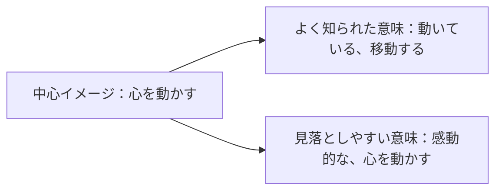

**重要語法・補足**  
a moving story

---

## 4082. attached

**品詞：** adjective  
**発音：** /əˈtætʃt/

<small>よく知られている意味：取り付けられた</small>

### 見落としやすい意味

**愛着を持っている、情が移っている**

**例文**  
He is deeply attached to the old house.

**和訳**  
彼はその古い家に強い愛着を持っている。

**コアイメージ**  
物がくっついた状態から、心が対象に結び付いて離れない状態へ意味が広がる。be attached to は人や場所への愛着を表せる。

**図**

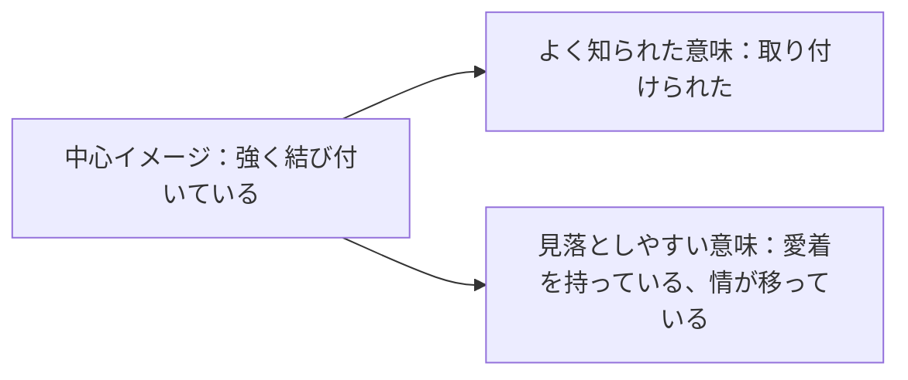

**重要語法・補足**  
be attached to ～

---

## 4083. determined

**品詞：** adjective  
**発音：** /dɪˈtɝːmɪnd/

<small>よく知られている意味：決定された</small>

### 見落としやすい意味

**断固とした、強い決意を持つ**

**例文**  
She made a determined effort to finish the race.

**和訳**  
彼女はレースを完走しようと固い決意で努力した。

**コアイメージ**  
determine は物事をはっきり決めることを表す。人や努力が determined なら、目標に向けて意思が固いということになる。

**図**

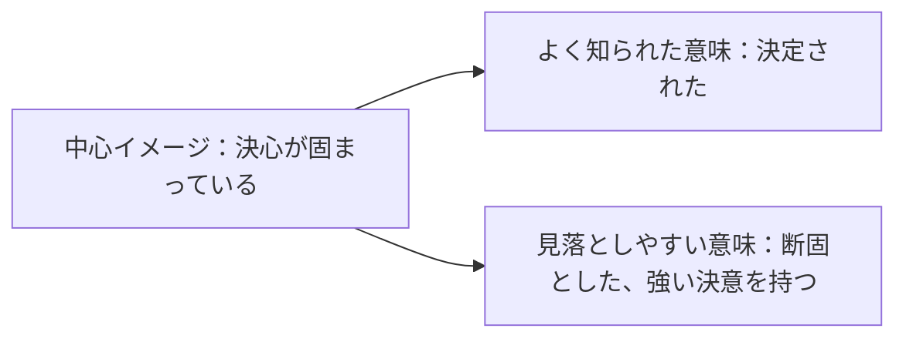

**重要語法・補足**  
a determined effort

---

## 4084. pulse

**品詞：** noun  
**発音：** /pʌls/

<small>よく知られている意味：脈、脈拍</small>

### 見落としやすい意味

**（食料としての）乾燥豆類**

**例文**  
Lentils and other pulses are rich in protein.

**和訳**  
レンズ豆などの乾燥豆類はたんぱく質が豊富だ。

**コアイメージ**  
脈拍の pulse と、豆類を指す pulse は同じ綴りでも意味が別である。食料や農業の話では、主に複数形 pulses が乾燥した食用豆類を指す。

**図**

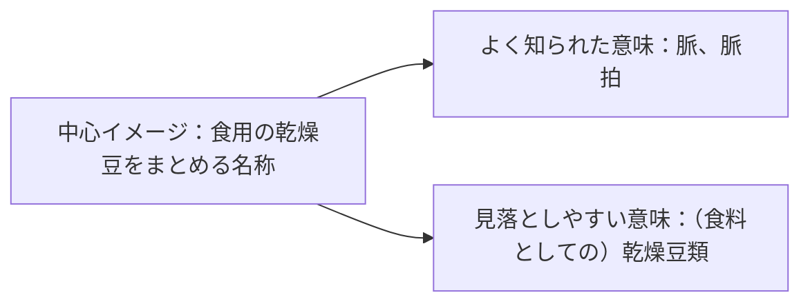

**重要語法・補足**  
pulses

---

## 4085. fox

**品詞：** verb  
**発音：** /fɑːks/

<small>よく知られている意味：キツネ</small>

### 見落としやすい意味

**（問題などが人を）当惑させる、理解不能にする**

**例文**  
This puzzle has foxed even experienced teachers.

**和訳**  
このパズルには経験豊富な先生でさえ頭を悩ませてきた。

**コアイメージ**  
動物名 fox には、相手を出し抜いたり当惑させたりする動詞用法もある。難問が人を fox するなら、その人は答えが分からず困っている。

**図**

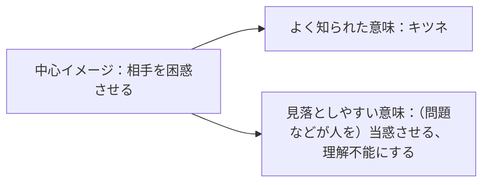

**重要語法・補足**  
主に英国英語。対象は人

---

## 4086. getaway

**品詞：** noun  
**発音：** /ˈɡetəweɪ/

<small>よく知られている意味：逃走、脱出</small>

### 見落としやすい意味

**短い休暇旅行、気分転換の旅行**

**例文**  
We planned a quiet weekend getaway by the sea.

**和訳**  
私たちは海辺で静かな週末旅行を計画した。

**コアイメージ**  
get away は今いる場所や状況から離れることを表す。逃走だけでなく、日常を離れて休む短い旅行も getaway と呼ぶ。

**図**

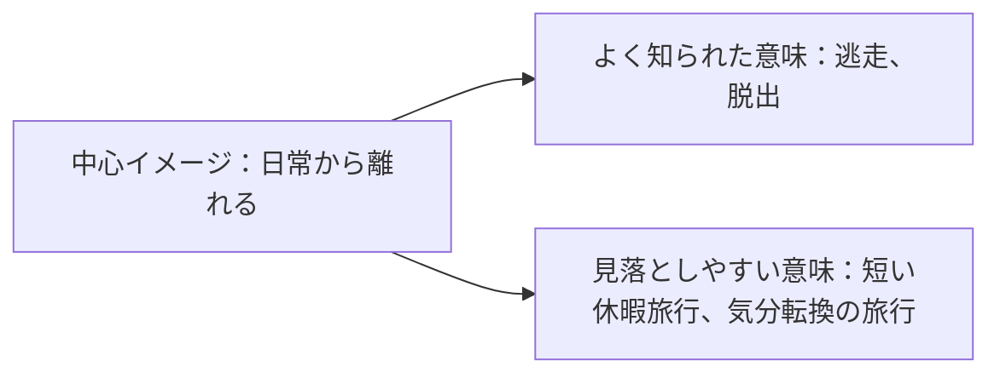

**重要語法・補足**  
a weekend getaway

---

## 4087. revealing

**品詞：** adjective  
**発音：** /rɪˈviːlɪŋ/

<small>よく知られている意味：明らかにする、露出する</small>

### 見落としやすい意味

**（言動・調査結果などが）真相をよく示す、示唆に富む**

**例文**  
The interview included a revealing detail about his childhood.

**和訳**  
そのインタビューには彼の子ども時代をよく物語る一つの詳細があった。

**コアイメージ**  
reveal は見えていなかったことを明らかにする。revealing な細部は、その人や出来事の本質を読み取る手掛かりになる。

**図**

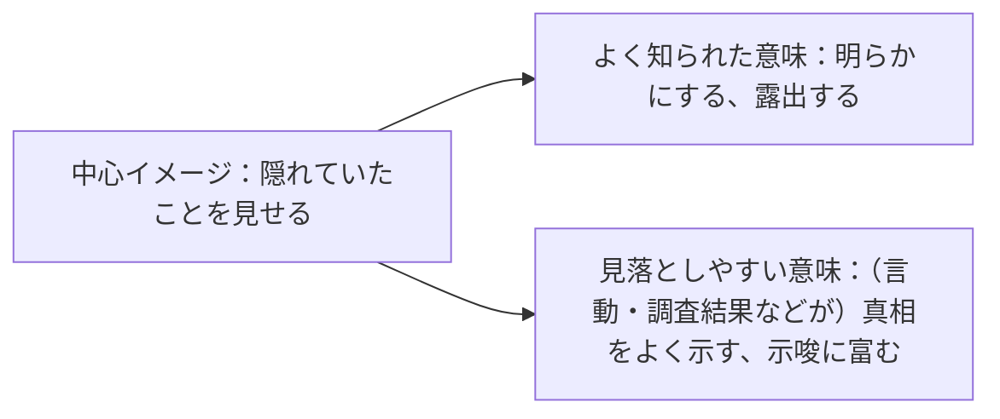

**重要語法・補足**  
a revealing detail

---

## 4088. testament

**品詞：** phrase  
**発音：** /ˈtestəmənt/

<small>よく知られている意味：遺言書、聖典</small>

### 見落としやすい意味

**a testament to ～：～を証明するもの、～のあかし**

**例文**  
Her progress is a testament to her hard work.

**和訳**  
彼女の進歩は、努力を重ねてきたことの証しだ。

**コアイメージ**  
testament には証言や証しという抽象的な意味がある。a testament to の後に来るものが、その結果によって裏付けられる。

**図**

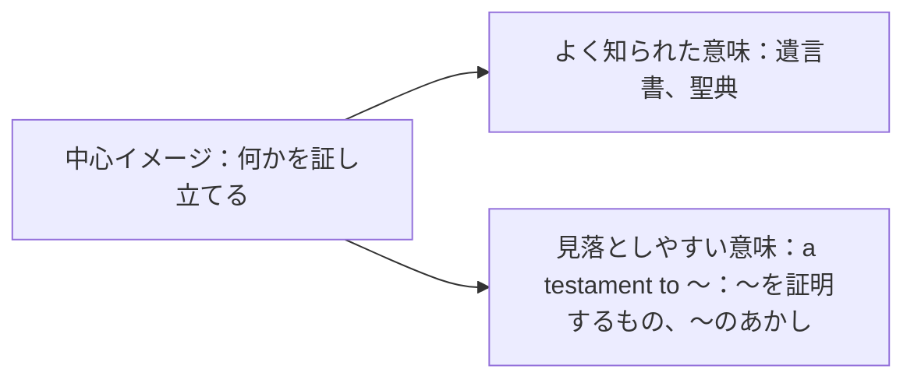

---

## 4089. fixture

**品詞：** noun  
**発音：** /ˈfɪkstʃər/

<small>よく知られている意味：固定器具、備品</small>

### 見落としやすい意味

**（その場所・集団に）いつもいる常連、定番の存在**

**例文**  
The baker has become a fixture at the local market.

**和訳**  
そのパン職人は地元の市場ですっかりおなじみの存在になった。

**コアイメージ**  
fixture は固定されてそこにあるものを指す。比喩的には、いつもその場所や集まりにいる人も fixture と呼べる。

**図**

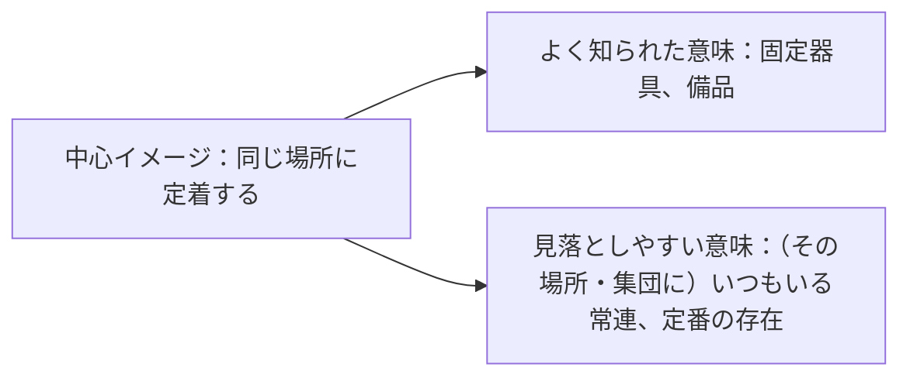

**重要語法・補足**  
文脈により人物・恒例の存在を指す

---

## 4090. fixture

**品詞：** noun  
**発音：** /ˈfɪkstʃər/

<small>よく知られている意味：固定器具、備品</small>

### 見落としやすい意味

**（主に英国英語で）予定されている試合**

**例文**  
The club has three home fixtures next month.

**和訳**  
そのクラブは来月ホームで3試合を予定している。

**コアイメージ**  
fixture は決まって組み込まれたものという感覚を持つ。英国英語のスポーツ文脈では、予定表に載った試合を指す。

**図**

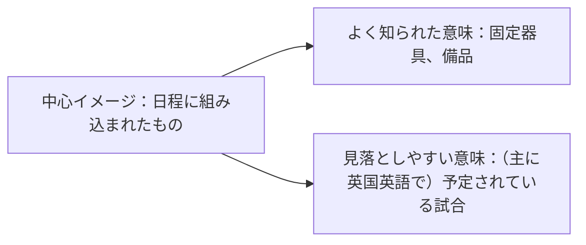

**重要語法・補足**  
主に英国・英連邦のスポーツ文脈

---

## 4091. battered

**品詞：** adjective  
**発音：** /ˈbætərd/

<small>よく知られている意味：打ちのめされた、傷んだ</small>

### 見落としやすい意味

**（魚・野菜などが）衣を付けて揚げた**

**例文**  
We ordered battered fish with lemon.

**和訳**  
私たちは衣を付けて揚げた魚をレモン添えで注文した。

**コアイメージ**  
batter には「打つ」とは別に、揚げ物用の衣という意味がある。料理の battered は、その衣を付けて揚げた状態を指す。

**図**

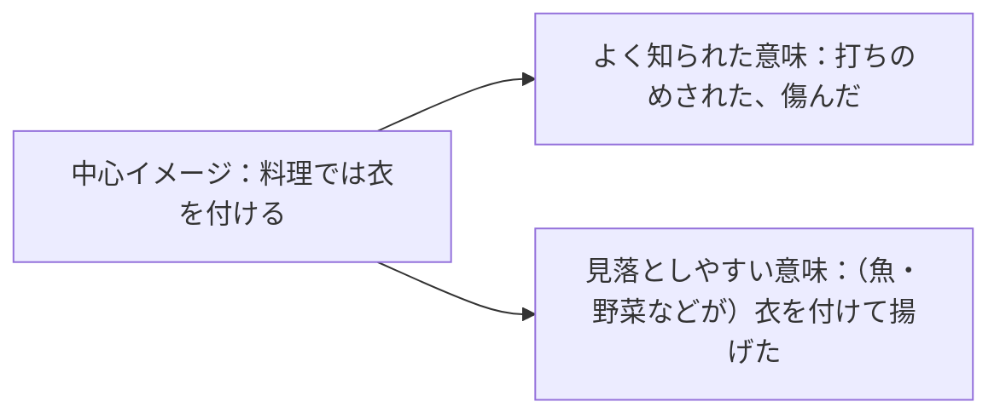

**重要語法・補足**  
battered fish

---

## 4092. agreeable

**品詞：** adjective  
**発音：** /əˈɡriːəbəl/

<small>よく知られている意味：感じのよい、好ましい</small>

### 見落としやすい意味

**（提案などを）快く受け入れる、賛成している**

**例文**  
The manager was agreeable to the change.

**和訳**  
部長はその変更を快く受け入れた。

**コアイメージ**  
agreeable は相手にとって好ましい状態を表す。提案に対して使えば、その内容に同意し受け入れる意思があることになる。

**図**

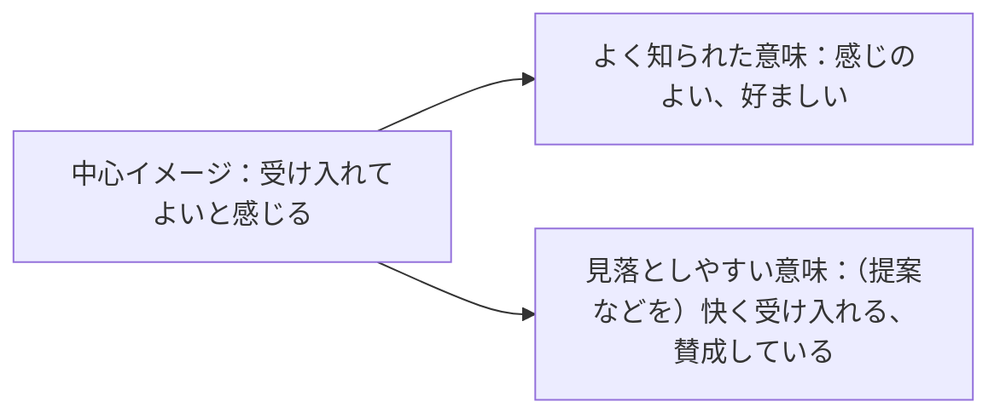

**重要語法・補足**  
be agreeable to ～

---

## 4093. marginally

**品詞：** adverb  
**発音：** /ˈmɑːrdʒɪnəli/

<small>よく知られている意味：周辺的に</small>

### 見落としやすい意味

**わずかに、少しだけ**

**例文**  
The second plan is marginally cheaper.

**和訳**  
二つ目の案の方がほんの少し安い。

**コアイメージ**  
margin は端や余白を表す。比較表現に付く marginally は、差がごくわずかであることを示す。

**図**

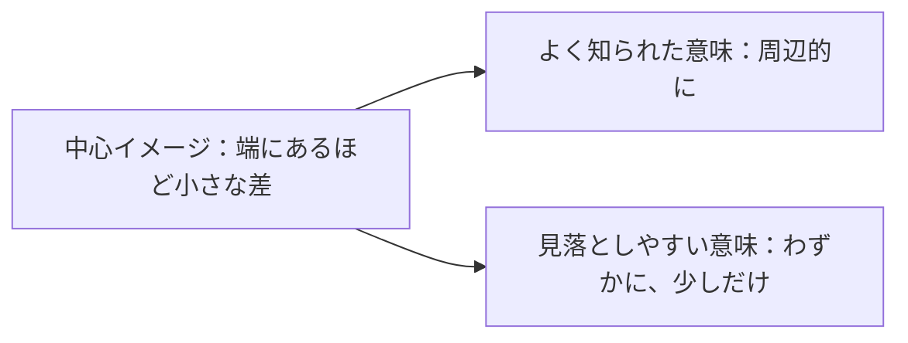

**重要語法・補足**  
marginally better

---

## 4094. accede

**品詞：** phrase  
**発音：** /əkˈsiːd/

<small>よく知られている意味：要求に応じる</small>

### 見落としやすい意味

**accede to the throne：即位する**

**例文**  
The prince acceded to the throne at twenty.

**和訳**  
王子は20歳で即位した。

**コアイメージ**  
accede は正式に同意する・地位に就くという用法を持つ。accede to the throne では、王位を継承してその地位に就く。

**図**

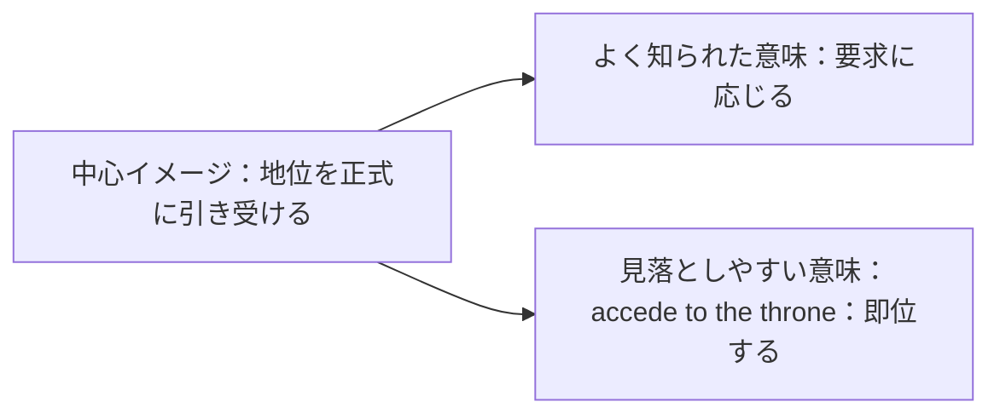

---

## 4095. anecdotal

**品詞：** adjective  
**発音：** /ˌænɪkˈdoʊtəl/

<small>よく知られている意味：逸話に関する</small>

### 見落としやすい意味

**個別の経験談だけに基づく、体系的な裏付けが乏しい**

**例文**  
The claim rests on anecdotal evidence, not a careful study.

**和訳**  
その主張は綿密な研究ではなく、個別の経験談に基づいている。

**コアイメージ**  
anecdote は個別の逸話や経験談である。anecdotal evidence はそうした話に頼るため、体系的な調査による証拠とは区別される。

**図**

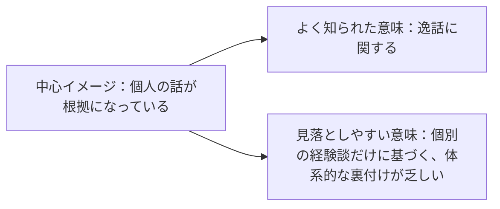

**重要語法・補足**  
anecdotal evidence

---

## 4096. astronomical

**品詞：** adjective  
**発音：** /ˌæstrəˈnɑːmɪkəl/

<small>よく知られている意味：天文学の</small>

### 見落としやすい意味

**途方もなく大きい、莫大な**

**例文**  
The repair costs were astronomical.

**和訳**  
修理費は途方もない額だった。

**コアイメージ**  
天文学が扱う非常に大きな距離や数値を連想すると分かりやすい。金額や数量に使う astronomical は、驚くほど大きいことを強調する。

**図**

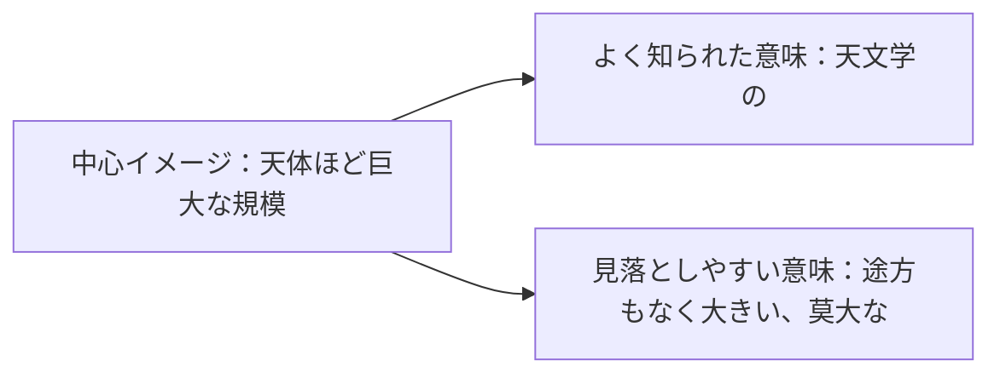

**重要語法・補足**  
astronomical costs

---

## 4097. baggage

**品詞：** noun  
**発音：** /ˈbæɡɪdʒ/

<small>よく知られている意味：旅行の荷物</small>

### 見落としやすい意味

**過去の経験からくる精神的な重荷、わだかまり**

**例文**  
She still carries emotional baggage from that experience.

**和訳**  
彼女はその経験からくる精神的な重荷を今も抱えている。

**コアイメージ**  
baggage は持ち運ぶ荷物である。emotional baggage は過去の経験が心に残した負担を、運び続ける荷物にたとえる。

**図**

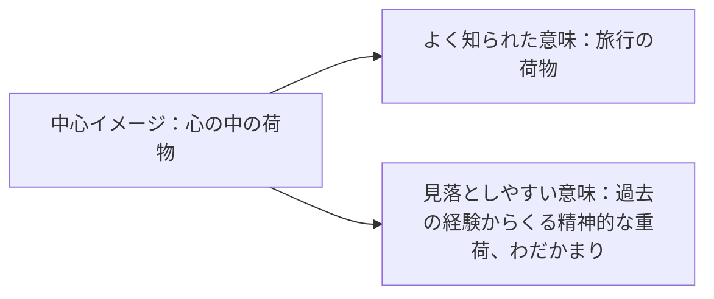

**重要語法・補足**  
emotional baggage

---

## 4098. bash

**品詞：** noun  
**発音：** /bæʃ/

<small>よく知られている意味：強打、激しい批判</small>

### 見落としやすい意味

**にぎやかなパーティー、盛大な催し**

**例文**  
They threw a huge bash for his birthday.

**和訳**  
彼らは彼の誕生日に盛大なパーティーを開いた。

**コアイメージ**  
bash には強く打つ意味とは別に、くだけた言い方でパーティーを指す名詞用法がある。birthday bash なら、誕生日を祝うにぎやかな集まりを表す。

**図**

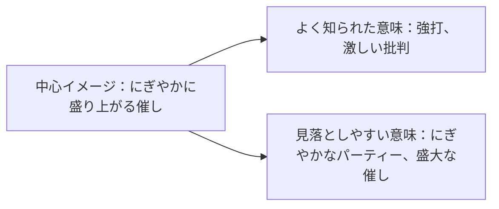

**重要語法・補足**  
a birthday bash

---

## 4099. brew

**品詞：** verb  
**発音：** /bruː/

<small>よく知られている意味：醸造する、茶を入れる</small>

### 見落としやすい意味

**（トラブル・不穏な事態が）生じつつある**

**例文**  
A conflict was brewing between the two teams.

**和訳**  
二つのチームの間で対立が生じつつあった。

**コアイメージ**  
飲み物を醸造するときは、時間をかけて中で変化が進む。対立や問題が brew する場合も、表面化する前に事態が進行している。

**図**

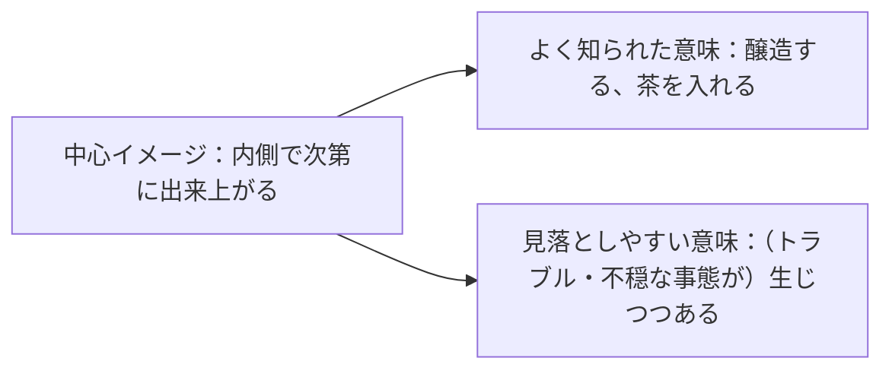

**重要語法・補足**  
trouble is brewing

---

## 4100. buffet

**品詞：** verb  
**発音：** /ˈbʌfɪt/

<small>よく知られている意味：ビュッフェ形式の食事</small>

### 見落としやすい意味

**（風・波・困難などが）～を繰り返し激しく打つ、翻弄する**

**例文**  
Strong winds buffeted the small boat all night.

**和訳**  
強い風が一晩中その小舟を激しく打ち続けた。

**コアイメージ**  
動詞 buffet は風や波などが何度も打ち付けることを表す。食事を表す名詞 buffet とは意味だけでなく発音も異なる。

**図**

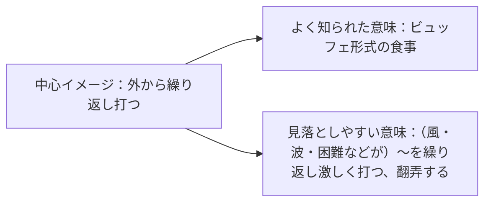

**重要語法・補足**  
動詞英米 /ˈbʌf.ɪt/。食事の名詞は英 /ˈbʊf.eɪ/、米 /bəˈfeɪ/

---

## 4101. cache

**品詞：** noun  
**発音：** /kæʃ/

<small>よく知られている意味：コンピューターの一時記憶</small>

### 見落としやすい意味

**隠して蓄えた物資、隠し場所**

**例文**  
The hikers found a cache of food beneath a rock.

**和訳**  
ハイカーたちは岩の下に隠された食料の備蓄を見つけた。

**コアイメージ**  
cache の中心は物を手元から隠し、後で使えるように置いておくことである。コンピューターのキャッシュも、食料の隠し場所も、蓄えておく点が共通する。

**図**

```mermaid
flowchart LR
    A["中心イメージ：必要な物を隠して蓄える"]
    B["よく知られた意味：コンピューターの一時記憶"]
    C["見落としやすい意味：隠して蓄えた物資、隠し場所"]
    A --> B
    A --> C
```

**重要語法・補足**  
a cache of supplies

---

## 4102. cape

**品詞：** noun  
**発音：** /keɪp/

<small>よく知られている意味：肩に掛けるケープ</small>

### 見落としやすい意味

**岬、海に突き出た陸地**

**例文**  
The lighthouse stands on a rocky cape.

**和訳**  
灯台は岩の多い岬に建っている。

**コアイメージ**  
cape には衣服を指す語義とは別に、海に突き出した岬という地理用語がある。海岸や地図の文脈では、衣服ではなく地形を指す。

**図**

```mermaid
flowchart LR
    A["中心イメージ：海へ突き出す陸地"]
    B["よく知られた意味：肩に掛けるケープ"]
    C["見落としやすい意味：岬、海に突き出た陸地"]
    A --> B
    A --> C
```

---

## 4103. collateral

**品詞：** adjective  
**発音：** /kəˈlætərəl/

<small>よく知られている意味：担保、抵当</small>

### 見落としやすい意味

**付随的な、二次的な**

**例文**  
The policy had collateral effects on small businesses.

**和訳**  
その政策は中小企業にも付随的な影響を及ぼした。

**コアイメージ**  
collateral は主となるものに添う・付随するという意味を持つ。collateral effects は、主目的とは別に起こる二次的な影響を指す。

**図**

```mermaid
flowchart LR
    A["中心イメージ：本筋に伴って生じる"]
    B["よく知られた意味：担保、抵当"]
    C["見落としやすい意味：付随的な、二次的な"]
    A --> B
    A --> C
```

**重要語法・補足**  
collateral damage

---

## 4104. commune

**品詞：** verb  
**発音：** /kəˈmjuːn/

<small>よく知られている意味：共同体、共同生活集団</small>

### 見落としやすい意味

**（自然・精神的存在などと）深く心を通わせる**

**例文**  
He likes to commune with nature during long walks.

**和訳**  
彼は長い散歩の間、自然と深く心を通わせるのを好む。

**コアイメージ**  
共に何かを分かち合うという感覚が背景にある。commune with nature は、自然との精神的なつながりを強く感じることを表す。

**図**

```mermaid
flowchart LR
    A["中心イメージ：深くつながりを感じる"]
    B["よく知られた意味：共同体、共同生活集団"]
    C["見落としやすい意味：（自然・精神的存在などと）深く心を通わせる"]
    A --> B
    A --> C
```

**重要語法・補足**  
commune with nature

---

## 4105. cringe

**品詞：** verb  
**発音：** /krɪndʒ/

<small>よく知られている意味：恐怖で身をすくめる</small>

### 見落としやすい意味

**（他人の言動などを見て）気恥ずかしくなる、いたたまれなくなる**

**例文**  
I cringed when I heard my old speech.

**和訳**  
昔の自分のスピーチを聞いて、私は恥ずかしくなった。

**コアイメージ**  
cringe は不快さに対する反射的な反応を表す。恐怖だけでなく、気まずさや恥ずかしさから身が縮む気持ちにも使う。

**図**

```mermaid
flowchart LR
    A["中心イメージ：思わず身を縮めたくなる"]
    B["よく知られた意味：恐怖で身をすくめる"]
    C["見落としやすい意味：（他人の言動などを見て）気恥ずかしくなる、いたたまれなくなる"]
    A --> B
    A --> C
```

**重要語法・補足**  
cringe at ～

---

## 4106. dart

**品詞：** verb  
**発音：** /dɑːrt/

<small>よく知られている意味：投げ矢、ダーツ</small>

### 見落としやすい意味

**（人や物が）さっと動く、すばやく走る**

**例文**  
A cat darted across the path.

**和訳**  
猫が小道をさっと横切った。

**コアイメージ**  
dart は鋭く飛ぶ小さな矢を連想させる。動詞では、人や物がその矢のように素早く動くことを表す。

**図**

```mermaid
flowchart LR
    A["中心イメージ：矢のように素早く動く"]
    B["よく知られた意味：投げ矢、ダーツ"]
    C["見落としやすい意味：（人や物が）さっと動く、すばやく走る"]
    A --> B
    A --> C
```

**重要語法・補足**  
dart across

---

## 4107. degenerate

**品詞：** verb  
**発音：** /dɪˈdʒenəreɪt/

<small>よく知られている意味：堕落した、退化した</small>

### 見落としやすい意味

**（状態が）悪化する、堕落する**

**例文**  
The debate quickly degenerated into an argument.

**和訳**  
討論はすぐに言い争いへと悪化した。

**コアイメージ**  
degenerate は質や状態が低下する流れを表せる。動詞として使うと、初めの状態から悪い状態へ変化することに重点がある。

**図**

```mermaid
flowchart LR
    A["中心イメージ：より悪い状態に変わる"]
    B["よく知られた意味：堕落した、退化した"]
    C["見落としやすい意味：（状態が）悪化する、堕落する"]
    A --> B
    A --> C
```

**重要語法・補足**  
degenerate into ～

---

## 4108. driven

**品詞：** adjective  
**発音：** /ˈdrɪvən/

<small>よく知られている意味：運転された、駆動された</small>

### 見落としやすい意味

**目標に向かって意欲的に突き進む**

**例文**  
She is a driven student who never gives up.

**和訳**  
彼女は決して諦めない、目標意識の強い生徒だ。

**コアイメージ**  
drive は何かを前へ動かす力を表す。人が driven なら、強い目的意識に突き動かされて行動する様子を表す。

**図**

```mermaid
flowchart LR
    A["中心イメージ：目標に押し動かされる"]
    B["よく知られた意味：運転された、駆動された"]
    C["見落としやすい意味：目標に向かって意欲的に突き進む"]
    A --> B
    A --> C
```

**重要語法・補足**  
a driven person

---

## 4109. embroider

**品詞：** verb  
**発音：** /ɪmˈbrɔɪdər/

<small>よく知られている意味：刺繍する</small>

### 見落としやすい意味

**（話や事実を）脚色する、尾ひれを付ける**

**例文**  
He tends to embroider his stories to make them funnier.

**和訳**  
彼は話をもっと面白くするため、つい脚色してしまう。

**コアイメージ**  
刺繍では布に模様や細部を加えて飾る。同じ発想で、話に余分な細部を付け足して脚色することも embroider と言う。

**図**

```mermaid
flowchart LR
    A["中心イメージ：細部を飾り足す"]
    B["よく知られた意味：刺繍する"]
    C["見落としやすい意味：（話や事実を）脚色する、尾ひれを付ける"]
    A --> B
    A --> C
```

**重要語法・補足**  
embroider the truth

---

## 4110. eyeball

**品詞：** verb  
**発音：** /ˈaɪbɔːl/

<small>よく知られている意味：眼球</small>

### 見落としやすい意味

**目分量で見積もる、ざっと確認する**

**例文**  
Can you eyeball the width of the desk?

**和訳**  
机の幅を目分量で見積もれる？

**コアイメージ**  
eyeball は名詞では眼球だが、口語では目で見る行為を動詞にする。正確に測るのではなく、見た感じで大まかに確かめることを指す。

**図**

```mermaid
flowchart LR
    A["中心イメージ：目でざっと判断する"]
    B["よく知られた意味：眼球"]
    C["見落としやすい意味：目分量で見積もる、ざっと確認する"]
    A --> B
    A --> C
```

**重要語法・補足**  
eyeball a distance

---

## 4111. fabrication

**品詞：** noun  
**発音：** /ˌfæbrɪˈkeɪʃən/

<small>よく知られている意味：製造、組み立て</small>

### 見落としやすい意味

**でっち上げ、捏造**

**例文**  
The story was a complete fabrication.

**和訳**  
その話は完全なでっち上げだった。

**コアイメージ**  
fabrication は何かを作ることを表す。物ではなく話や証拠を作り出した場合、事実を捏造したという否定的な意味になる。

**図**

```mermaid
flowchart LR
    A["中心イメージ：事実でないものを作り出す"]
    B["よく知られた意味：製造、組み立て"]
    C["見落としやすい意味：でっち上げ、捏造"]
    A --> B
    A --> C
```

**重要語法・補足**  
a complete fabrication

---

## 4112. fray

**品詞：** noun  
**発音：** /freɪ/

<small>よく知られている意味：布がほつれる</small>

### 見落としやすい意味

**争い、論争の渦中**

**例文**  
Several writers entered the fray over the new law.

**和訳**  
数人の作家が新しい法律を巡る論争に加わった。

**コアイメージ**  
fray には布がほつれる動詞用法とは別に、争いや激しい論戦という名詞用法がある。enter the fray は、すでに始まっている争いに加わることを表す。

**図**

```mermaid
flowchart LR
    A["中心イメージ：争いのただ中"]
    B["よく知られた意味：布がほつれる"]
    C["見落としやすい意味：争い、論争の渦中"]
    A --> B
    A --> C
```

**重要語法・補足**  
enter the fray

---

## 4113. gulf

**品詞：** noun  
**発音：** /ɡʌlf/

<small>よく知られている意味：湾、入り江</small>

### 見落としやすい意味

**（意見・社会階層などの）大きな隔たり**

**例文**  
A wide gulf remains between their opinions.

**和訳**  
二人の意見には依然として大きな隔たりがある。

**コアイメージ**  
gulf は陸地の間に入り込む広い海を指す。そこから、意見や立場の間に横たわる大きな隔たりも表す。

**図**

```mermaid
flowchart LR
    A["中心イメージ：間に広い空間がある"]
    B["よく知られた意味：湾、入り江"]
    C["見落としやすい意味：（意見・社会階層などの）大きな隔たり"]
    A --> B
    A --> C
```

**重要語法・補足**  
a gulf between ～

---

## 4114. harbour

**品詞：** verb  
**発音：** /ˈhɑːrbər/

<small>よく知られている意味：港</small>

### 見落としやすい意味

**（不信・疑念・希望などの感情や考えを）心に抱く**

**例文**  
She harbours doubts about the proposal.

**和訳**  
彼女はその提案に疑念を抱いている。

**コアイメージ**  
港は船を内部に収めておく場所である。動詞 harbour は考えや感情を心の中に持ち続けることにも使う。

**図**

```mermaid
flowchart LR
    A["中心イメージ：内側に留めておく"]
    B["よく知られた意味：港"]
    C["見落としやすい意味：（不信・疑念・希望などの感情や考えを）心に抱く"]
    A --> B
    A --> C
```

**重要語法・補足**  
米式綴りは harbor

---

## 4115. hopeless

**品詞：** adjective  
**発音：** /ˈhoʊpləs/

<small>よく知られている意味：希望がない</small>

### 見落としやすい意味

**（特定のことが）どうしようもなく下手な**

**例文**  
I'm hopeless at remembering names.

**和訳**  
私は名前を覚えるのがどうしようもなく苦手だ。

**コアイメージ**  
hopeless は望みがないという評価を表す。hopeless at の形で能力に使えば、そのことがまったく得意でないという意味になる。

**図**

```mermaid
flowchart LR
    A["中心イメージ：うまくいく見込みがない"]
    B["よく知られた意味：希望がない"]
    C["見落としやすい意味：（特定のことが）どうしようもなく下手な"]
    A --> B
    A --> C
```

**重要語法・補足**  
hopeless at ～

---

## 4116. hustle

**品詞：** noun  
**発音：** /ˈhʌsəl/

<small>よく知られている意味：急いで動く、せかす</small>

### 見落としやすい意味

**副業、収入を得るための個人的な仕事**

**例文**  
He started a side hustle selling handmade cards.

**和訳**  
彼は手作りカードを売る副業を始めた。

**コアイメージ**  
hustle は忙しく動き回ることを表す。side hustle は本業のほかに労力を注いで収入を得る仕事を指す。

**図**

```mermaid
flowchart LR
    A["中心イメージ：精力的に稼ぐ活動"]
    B["よく知られた意味：急いで動く、せかす"]
    C["見落としやすい意味：副業、収入を得るための個人的な仕事"]
    A --> B
    A --> C
```

**重要語法・補足**  
side hustle

---

## 4117. inter

**品詞：** verb  
**発音：** /ɪnˈtɝː/

<small>よく知られている意味：inter-（接頭辞）＝～の間に</small>

### 見落としやすい意味

**埋葬する**

**例文**  
The poet was interred in the village cemetery.

**和訳**  
その詩人は村の墓地に埋葬された。

**コアイメージ**  
動詞 inter は遺体を埋葬するという意味で、接頭辞 inter- とは別に覚える。be interred は埋葬されることを表す受動形である。

**図**

```mermaid
flowchart LR
    A["中心イメージ：遺体を土中に葬る"]
    B["よく知られた意味：inter-（接頭辞）＝～の間に"]
    C["見落としやすい意味：埋葬する"]
    A --> B
    A --> C
```

**重要語法・補足**  
be interred

---

## 4118. jockey

**品詞：** verb  
**発音：** /ˈdʒɑːki/

<small>よく知られている意味：競馬の騎手</small>

### 見落としやすい意味

**有利な立場を得ようと激しく競う、駆け引きする**

**例文**  
Several firms are jockeying for position in the market.

**和訳**  
複数の企業が市場で有利な立場を得ようと競い合っている。

**コアイメージ**  
騎手はレース中に有利な位置を狙う。その動きから、企業や人が競争で好位置を得ようと駆け引きする動詞の意味になる。

**図**

```mermaid
flowchart LR
    A["中心イメージ：有利な位置を取り合う"]
    B["よく知られた意味：競馬の騎手"]
    C["見落としやすい意味：有利な立場を得ようと激しく競う、駆け引きする"]
    A --> B
    A --> C
```

**重要語法・補足**  
jockey for position

---

## 4119. landslide

**品詞：** noun  
**発音：** /ˈlændslaɪd/

<small>よく知られている意味：地滑り</small>

### 見落としやすい意味

**選挙・勝負などでの圧勝**

**例文**  
The candidate won the election by a landslide.

**和訳**  
その候補者は選挙で圧勝した。

**コアイメージ**  
地滑りは大量の土砂が一気に動く現象である。landslide victory は他を圧倒するほど大きな勝利を表す。

**図**

```mermaid
flowchart LR
    A["中心イメージ：圧倒的な規模で押し流す"]
    B["よく知られた意味：地滑り"]
    C["見落としやすい意味：選挙・勝負などでの圧勝"]
    A --> B
    A --> C
```

**重要語法・補足**  
win by a landslide

---

## 4120. learned

**品詞：** adjective  
**発音：** /ˈlɝːnɪd/

<small>よく知られている意味：学んだ（learn の過去形）</small>

### 見落としやすい意味

**学識のある、博識な**

**例文**  
A learned judge explained the old rule.

**和訳**  
博識な裁判官がその古い規則を説明した。

**コアイメージ**  
learned が形容詞なら、十分な学識を身に付けた人を表す。learn の過去形と異なり、この意味では通常二音節で発音する。

**図**

```mermaid
flowchart LR
    A["中心イメージ：学問を深く身に付けた"]
    B["よく知られた意味：学んだ（learn の過去形）"]
    C["見落としやすい意味：学識のある、博識な"]
    A --> B
    A --> C
```

**重要語法・補足**  
「博識な」の典型的発音は2音節 /ˈlɜːnɪd/（英）; learnの過去形は1音節 /lɜːnd/

---

