# EasyVoca 完成教材｜Batch 052

- 担当範囲：global_order 4081〜4160（80件）
- 対象：main の accepted 候補のみ。index 昇順、同順位は candidate_id 昇順。
- 発音記号：主に米国英語の目安。

## 4081. moving

**品詞：** adjective  
**発音：** /ˈmuːvɪŋ/

<small>よく知られている意味：動いている、移動する</small>

### 見落としやすい意味

**感動的な、心を動かす**

**例文**  
Her moving letter brought the whole class to tears.

**和訳**  
彼女の感動的な手紙にクラス全員が涙した。

**コアイメージ**  
move は物を動かすだけでなく、人の気持ちを動かすことも表す。moving は心を揺さぶるほど感動的だという意味になる。

**図**

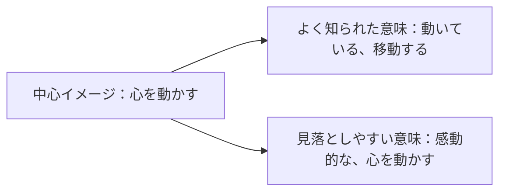

**重要語法・補足**  
a moving story

---

## 4082. attached

**品詞：** adjective  
**発音：** /əˈtætʃt/

<small>よく知られている意味：取り付けられた</small>

### 見落としやすい意味

**愛着を持っている、情が移っている**

**例文**  
He is deeply attached to the old house.

**和訳**  
彼はその古い家に強い愛着を持っている。

**コアイメージ**  
物がくっついた状態から、心が対象に結び付いて離れない状態へ意味が広がる。be attached to は人や場所への愛着を表せる。

**図**

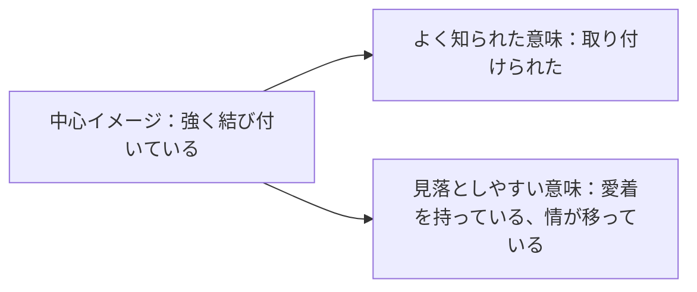

**重要語法・補足**  
be attached to ～

---

## 4083. determined

**品詞：** adjective  
**発音：** /dɪˈtɝːmɪnd/

<small>よく知られている意味：決定された</small>

### 見落としやすい意味

**断固とした、強い決意を持つ**

**例文**  
She made a determined effort to finish the race.

**和訳**  
彼女はレースを完走しようと固い決意で努力した。

**コアイメージ**  
determine は物事をはっきり決めることを表す。人や努力が determined なら、目標に向けて意思が固いということになる。

**図**

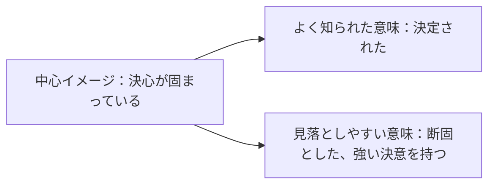

**重要語法・補足**  
a determined effort

---

## 4084. pulse

**品詞：** noun  
**発音：** /pʌls/

<small>よく知られている意味：脈、脈拍</small>

### 見落としやすい意味

**（食料としての）乾燥豆類**

**例文**  
Lentils and other pulses are rich in protein.

**和訳**  
レンズ豆などの乾燥豆類はたんぱく質が豊富だ。

**コアイメージ**  
脈拍の pulse と、豆類を指す pulse は同じ綴りでも意味が別である。食料や農業の話では、主に複数形 pulses が乾燥した食用豆類を指す。

**図**

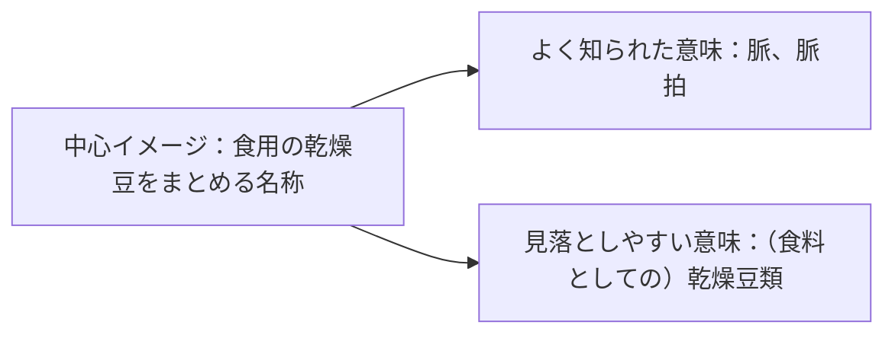

**重要語法・補足**  
pulses

---

## 4085. fox

**品詞：** verb  
**発音：** /fɑːks/

<small>よく知られている意味：キツネ</small>

### 見落としやすい意味

**（問題などが人を）当惑させる、理解不能にする**

**例文**  
This puzzle has foxed even experienced teachers.

**和訳**  
このパズルには経験豊富な先生でさえ頭を悩ませてきた。

**コアイメージ**  
動物名 fox には、相手を出し抜いたり当惑させたりする動詞用法もある。難問が人を fox するなら、その人は答えが分からず困っている。

**図**

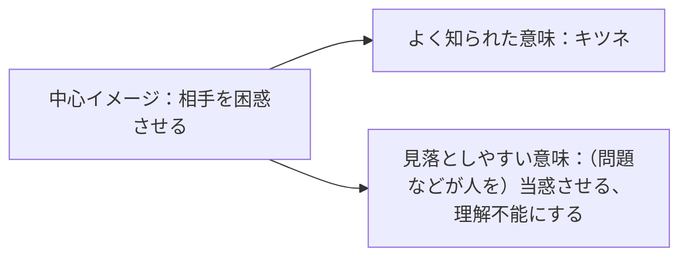

**重要語法・補足**  
主に英国英語。対象は人

---

## 4086. getaway

**品詞：** noun  
**発音：** /ˈɡetəweɪ/

<small>よく知られている意味：逃走、脱出</small>

### 見落としやすい意味

**短い休暇旅行、気分転換の旅行**

**例文**  
We planned a quiet weekend getaway by the sea.

**和訳**  
私たちは海辺で静かな週末旅行を計画した。

**コアイメージ**  
get away は今いる場所や状況から離れることを表す。逃走だけでなく、日常を離れて休む短い旅行も getaway と呼ぶ。

**図**

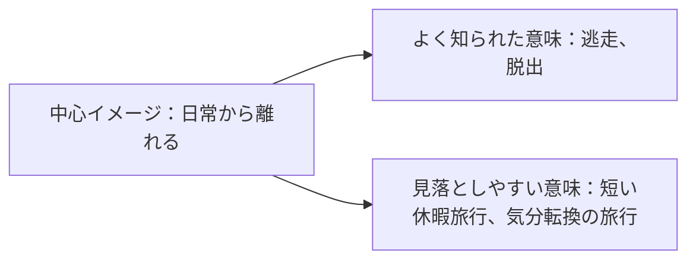

**重要語法・補足**  
a weekend getaway

---

## 4087. revealing

**品詞：** adjective  
**発音：** /rɪˈviːlɪŋ/

<small>よく知られている意味：明らかにする、露出する</small>

### 見落としやすい意味

**（言動・調査結果などが）真相をよく示す、示唆に富む**

**例文**  
The interview included a revealing detail about his childhood.

**和訳**  
そのインタビューには彼の子ども時代をよく物語る一つの詳細があった。

**コアイメージ**  
reveal は見えていなかったことを明らかにする。revealing な細部は、その人や出来事の本質を読み取る手掛かりになる。

**図**

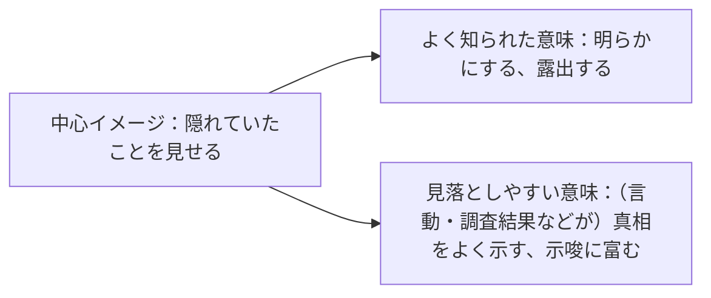

**重要語法・補足**  
a revealing detail

---

## 4088. testament

**品詞：** phrase  
**発音：** /ˈtestəmənt/

<small>よく知られている意味：遺言書、聖典</small>

### 見落としやすい意味

**a testament to ～：～を証明するもの、～のあかし**

**例文**  
Her progress is a testament to her hard work.

**和訳**  
彼女の進歩は、努力を重ねてきたことの証しだ。

**コアイメージ**  
testament には証言や証しという抽象的な意味がある。a testament to の後に来るものが、その結果によって裏付けられる。

**図**

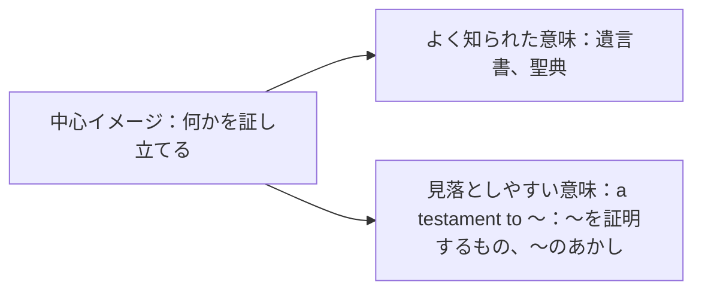

---

## 4089. fixture

**品詞：** noun  
**発音：** /ˈfɪkstʃər/

<small>よく知られている意味：固定器具、備品</small>

### 見落としやすい意味

**（その場所・集団に）いつもいる常連、定番の存在**

**例文**  
The baker has become a fixture at the local market.

**和訳**  
そのパン職人は地元の市場ですっかりおなじみの存在になった。

**コアイメージ**  
fixture は固定されてそこにあるものを指す。比喩的には、いつもその場所や集まりにいる人も fixture と呼べる。

**図**

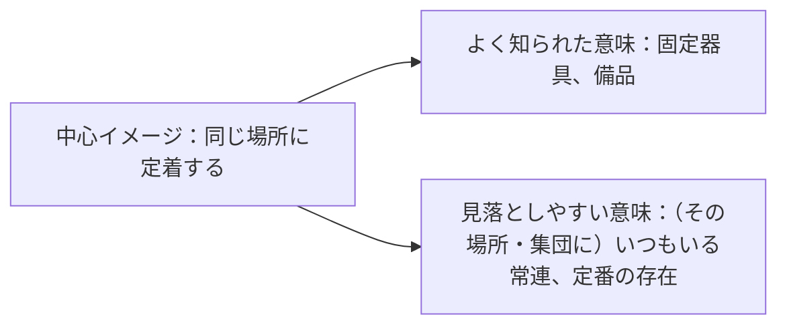

**重要語法・補足**  
文脈により人物・恒例の存在を指す

---

## 4090. fixture

**品詞：** noun  
**発音：** /ˈfɪkstʃər/

<small>よく知られている意味：固定器具、備品</small>

### 見落としやすい意味

**（主に英国英語で）予定されている試合**

**例文**  
The club has three home fixtures next month.

**和訳**  
そのクラブは来月ホームで3試合を予定している。

**コアイメージ**  
fixture は決まって組み込まれたものという感覚を持つ。英国英語のスポーツ文脈では、予定表に載った試合を指す。

**図**

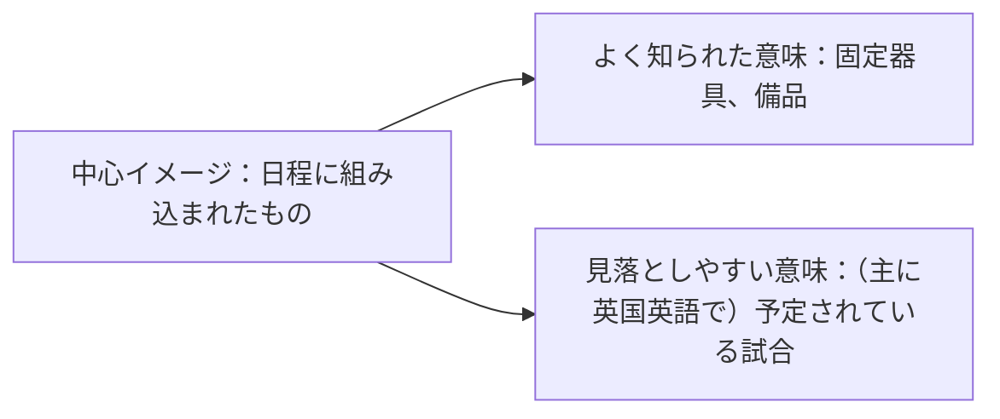

**重要語法・補足**  
主に英国・英連邦のスポーツ文脈

---

## 4091. battered

**品詞：** adjective  
**発音：** /ˈbætərd/

<small>よく知られている意味：打ちのめされた、傷んだ</small>

### 見落としやすい意味

**（魚・野菜などが）衣を付けて揚げた**

**例文**  
We ordered battered fish with lemon.

**和訳**  
私たちは衣を付けて揚げた魚をレモン添えで注文した。

**コアイメージ**  
batter には「打つ」とは別に、揚げ物用の衣という意味がある。料理の battered は、その衣を付けて揚げた状態を指す。

**図**

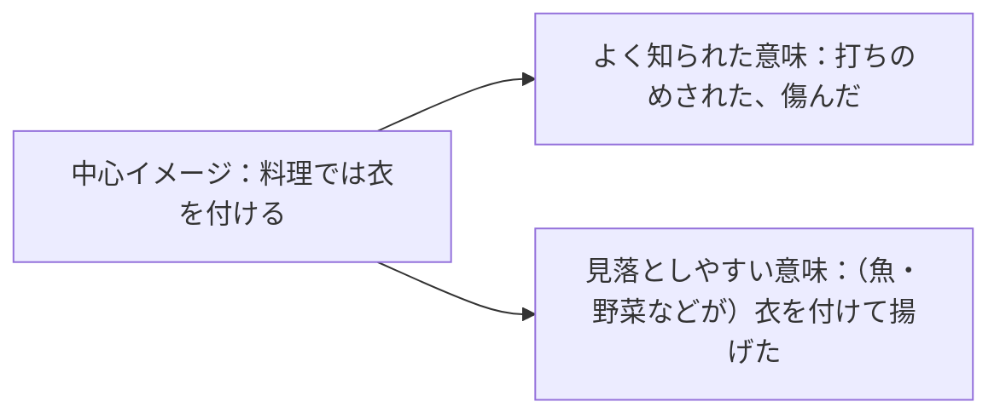

**重要語法・補足**  
battered fish

---

## 4092. agreeable

**品詞：** adjective  
**発音：** /əˈɡriːəbəl/

<small>よく知られている意味：感じのよい、好ましい</small>

### 見落としやすい意味

**（提案などを）快く受け入れる、賛成している**

**例文**  
The manager was agreeable to the change.

**和訳**  
部長はその変更を快く受け入れた。

**コアイメージ**  
agreeable は相手にとって好ましい状態を表す。提案に対して使えば、その内容に同意し受け入れる意思があることになる。

**図**

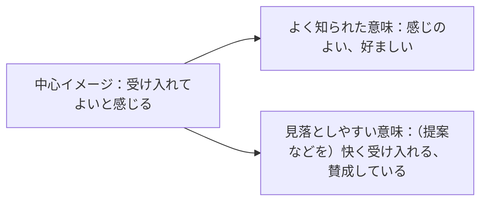

**重要語法・補足**  
be agreeable to ～

---

## 4093. marginally

**品詞：** adverb  
**発音：** /ˈmɑːrdʒɪnəli/

<small>よく知られている意味：周辺的に</small>

### 見落としやすい意味

**わずかに、少しだけ**

**例文**  
The second plan is marginally cheaper.

**和訳**  
二つ目の案の方がほんの少し安い。

**コアイメージ**  
margin は端や余白を表す。比較表現に付く marginally は、差がごくわずかであることを示す。

**図**

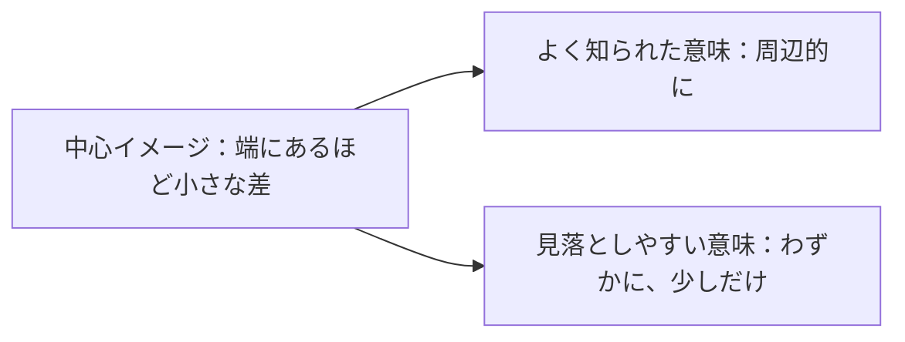

**重要語法・補足**  
marginally better

---

## 4094. accede

**品詞：** phrase  
**発音：** /əkˈsiːd/

<small>よく知られている意味：要求に応じる</small>

### 見落としやすい意味

**accede to the throne：即位する**

**例文**  
The prince acceded to the throne at twenty.

**和訳**  
王子は20歳で即位した。

**コアイメージ**  
accede は正式に同意する・地位に就くという用法を持つ。accede to the throne では、王位を継承してその地位に就く。

**図**

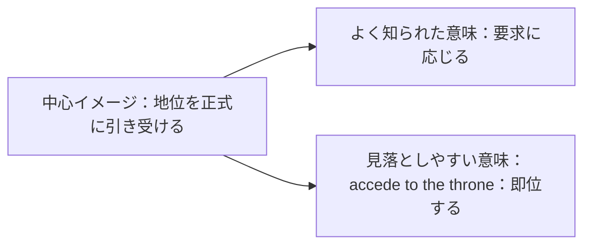

---

## 4095. anecdotal

**品詞：** adjective  
**発音：** /ˌænɪkˈdoʊtəl/

<small>よく知られている意味：逸話に関する</small>

### 見落としやすい意味

**個別の経験談だけに基づく、体系的な裏付けが乏しい**

**例文**  
The claim rests on anecdotal evidence, not a careful study.

**和訳**  
その主張は綿密な研究ではなく、個別の経験談に基づいている。

**コアイメージ**  
anecdote は個別の逸話や経験談である。anecdotal evidence はそうした話に頼るため、体系的な調査による証拠とは区別される。

**図**

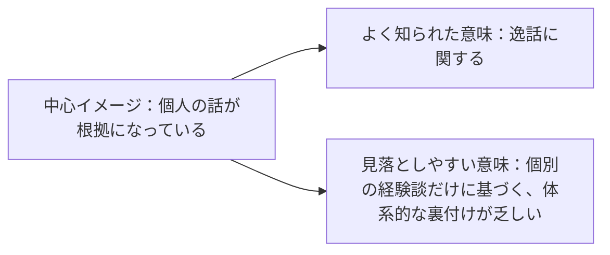

**重要語法・補足**  
anecdotal evidence

---

## 4096. astronomical

**品詞：** adjective  
**発音：** /ˌæstrəˈnɑːmɪkəl/

<small>よく知られている意味：天文学の</small>

### 見落としやすい意味

**途方もなく大きい、莫大な**

**例文**  
The repair costs were astronomical.

**和訳**  
修理費は途方もない額だった。

**コアイメージ**  
天文学が扱う非常に大きな距離や数値を連想すると分かりやすい。金額や数量に使う astronomical は、驚くほど大きいことを強調する。

**図**

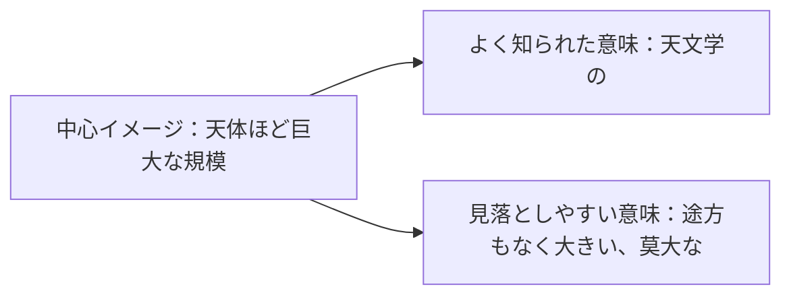

**重要語法・補足**  
astronomical costs

---

## 4097. baggage

**品詞：** noun  
**発音：** /ˈbæɡɪdʒ/

<small>よく知られている意味：旅行の荷物</small>

### 見落としやすい意味

**過去の経験からくる精神的な重荷、わだかまり**

**例文**  
She still carries emotional baggage from that experience.

**和訳**  
彼女はその経験からくる精神的な重荷を今も抱えている。

**コアイメージ**  
baggage は持ち運ぶ荷物である。emotional baggage は過去の経験が心に残した負担を、運び続ける荷物にたとえる。

**図**

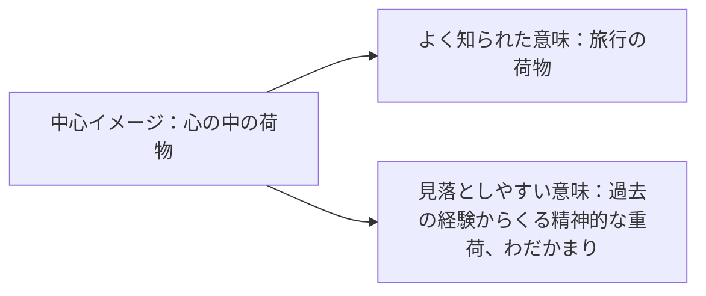

**重要語法・補足**  
emotional baggage

---

## 4098. bash

**品詞：** noun  
**発音：** /bæʃ/

<small>よく知られている意味：強打、激しい批判</small>

### 見落としやすい意味

**にぎやかなパーティー、盛大な催し**

**例文**  
They threw a huge bash for his birthday.

**和訳**  
彼らは彼の誕生日に盛大なパーティーを開いた。

**コアイメージ**  
bash には強く打つ意味とは別に、くだけた言い方でパーティーを指す名詞用法がある。birthday bash なら、誕生日を祝うにぎやかな集まりを表す。

**図**

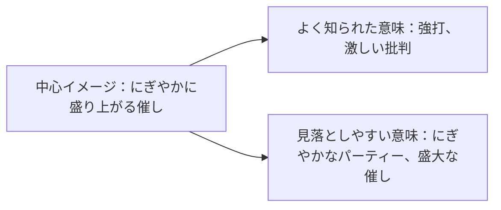

**重要語法・補足**  
a birthday bash

---

## 4099. brew

**品詞：** verb  
**発音：** /bruː/

<small>よく知られている意味：醸造する、茶を入れる</small>

### 見落としやすい意味

**（トラブル・不穏な事態が）生じつつある**

**例文**  
A conflict was brewing between the two teams.

**和訳**  
二つのチームの間で対立が生じつつあった。

**コアイメージ**  
飲み物を醸造するときは、時間をかけて中で変化が進む。対立や問題が brew する場合も、表面化する前に事態が進行している。

**図**

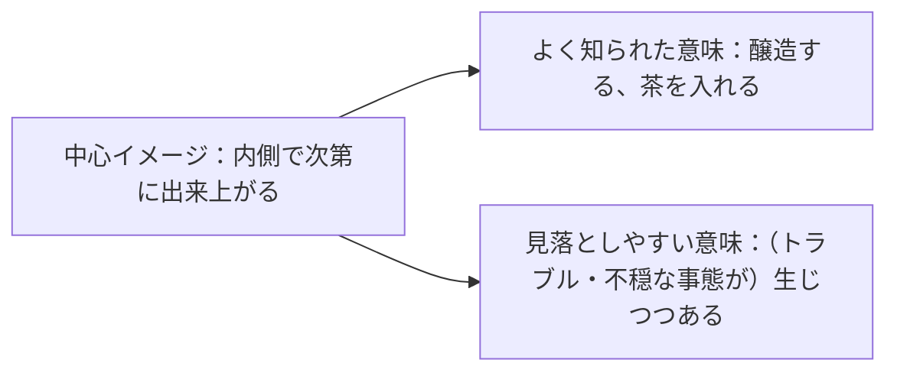

**重要語法・補足**  
trouble is brewing

---

## 4100. buffet

**品詞：** verb  
**発音：** /ˈbʌfɪt/

<small>よく知られている意味：ビュッフェ形式の食事</small>

### 見落としやすい意味

**（風・波・困難などが）～を繰り返し激しく打つ、翻弄する**

**例文**  
Strong winds buffeted the small boat all night.

**和訳**  
強い風が一晩中その小舟を激しく打ち続けた。

**コアイメージ**  
動詞 buffet は風や波などが何度も打ち付けることを表す。食事を表す名詞 buffet とは意味だけでなく発音も異なる。

**図**

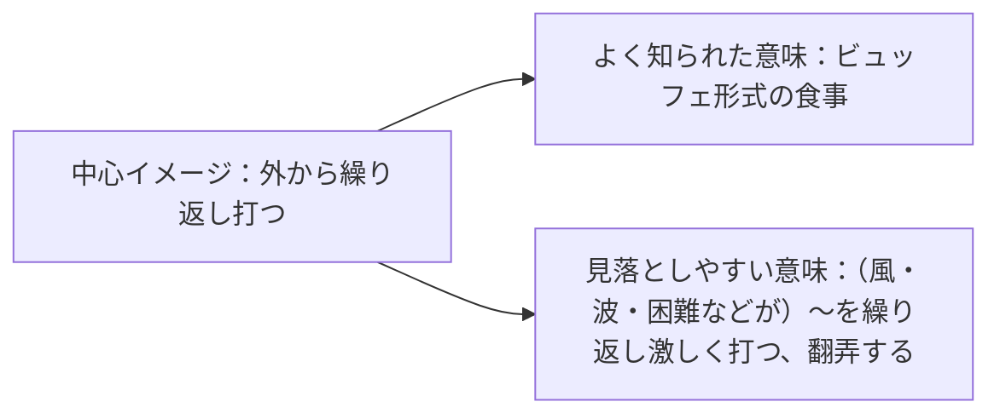

**重要語法・補足**  
動詞英米 /ˈbʌf.ɪt/。食事の名詞は英 /ˈbʊf.eɪ/、米 /bəˈfeɪ/

---

## 4101. cache

**品詞：** noun  
**発音：** /kæʃ/

<small>よく知られている意味：コンピューターの一時記憶</small>

### 見落としやすい意味

**隠して蓄えた物資、隠し場所**

**例文**  
The hikers found a cache of food beneath a rock.

**和訳**  
ハイカーたちは岩の下に隠された食料の備蓄を見つけた。

**コアイメージ**  
cache の中心は物を手元から隠し、後で使えるように置いておくことである。コンピューターのキャッシュも、食料の隠し場所も、蓄えておく点が共通する。

**図**

```mermaid
flowchart LR
    A["中心イメージ：必要な物を隠して蓄える"]
    B["よく知られた意味：コンピューターの一時記憶"]
    C["見落としやすい意味：隠して蓄えた物資、隠し場所"]
    A --> B
    A --> C
```

**重要語法・補足**  
a cache of supplies

---

## 4102. cape

**品詞：** noun  
**発音：** /keɪp/

<small>よく知られている意味：肩に掛けるケープ</small>

### 見落としやすい意味

**岬、海に突き出た陸地**

**例文**  
The lighthouse stands on a rocky cape.

**和訳**  
灯台は岩の多い岬に建っている。

**コアイメージ**  
cape には衣服を指す語義とは別に、海に突き出した岬という地理用語がある。海岸や地図の文脈では、衣服ではなく地形を指す。

**図**

```mermaid
flowchart LR
    A["中心イメージ：海へ突き出す陸地"]
    B["よく知られた意味：肩に掛けるケープ"]
    C["見落としやすい意味：岬、海に突き出た陸地"]
    A --> B
    A --> C
```

---

## 4103. collateral

**品詞：** adjective  
**発音：** /kəˈlætərəl/

<small>よく知られている意味：担保、抵当</small>

### 見落としやすい意味

**付随的な、二次的な**

**例文**  
The policy had collateral effects on small businesses.

**和訳**  
その政策は中小企業にも付随的な影響を及ぼした。

**コアイメージ**  
collateral は主となるものに添う・付随するという意味を持つ。collateral effects は、主目的とは別に起こる二次的な影響を指す。

**図**

```mermaid
flowchart LR
    A["中心イメージ：本筋に伴って生じる"]
    B["よく知られた意味：担保、抵当"]
    C["見落としやすい意味：付随的な、二次的な"]
    A --> B
    A --> C
```

**重要語法・補足**  
collateral damage

---

## 4104. commune

**品詞：** verb  
**発音：** /kəˈmjuːn/

<small>よく知られている意味：共同体、共同生活集団</small>

### 見落としやすい意味

**（自然・精神的存在などと）深く心を通わせる**

**例文**  
He likes to commune with nature during long walks.

**和訳**  
彼は長い散歩の間、自然と深く心を通わせるのを好む。

**コアイメージ**  
共に何かを分かち合うという感覚が背景にある。commune with nature は、自然との精神的なつながりを強く感じることを表す。

**図**

```mermaid
flowchart LR
    A["中心イメージ：深くつながりを感じる"]
    B["よく知られた意味：共同体、共同生活集団"]
    C["見落としやすい意味：（自然・精神的存在などと）深く心を通わせる"]
    A --> B
    A --> C
```

**重要語法・補足**  
commune with nature

---

## 4105. cringe

**品詞：** verb  
**発音：** /krɪndʒ/

<small>よく知られている意味：恐怖で身をすくめる</small>

### 見落としやすい意味

**（他人の言動などを見て）気恥ずかしくなる、いたたまれなくなる**

**例文**  
I cringed when I heard my old speech.

**和訳**  
昔の自分のスピーチを聞いて、私は恥ずかしくなった。

**コアイメージ**  
cringe は不快さに対する反射的な反応を表す。恐怖だけでなく、気まずさや恥ずかしさから身が縮む気持ちにも使う。

**図**

```mermaid
flowchart LR
    A["中心イメージ：思わず身を縮めたくなる"]
    B["よく知られた意味：恐怖で身をすくめる"]
    C["見落としやすい意味：（他人の言動などを見て）気恥ずかしくなる、いたたまれなくなる"]
    A --> B
    A --> C
```

**重要語法・補足**  
cringe at ～

---

## 4106. dart

**品詞：** verb  
**発音：** /dɑːrt/

<small>よく知られている意味：投げ矢、ダーツ</small>

### 見落としやすい意味

**（人や物が）さっと動く、すばやく走る**

**例文**  
A cat darted across the path.

**和訳**  
猫が小道をさっと横切った。

**コアイメージ**  
dart は鋭く飛ぶ小さな矢を連想させる。動詞では、人や物がその矢のように素早く動くことを表す。

**図**

```mermaid
flowchart LR
    A["中心イメージ：矢のように素早く動く"]
    B["よく知られた意味：投げ矢、ダーツ"]
    C["見落としやすい意味：（人や物が）さっと動く、すばやく走る"]
    A --> B
    A --> C
```

**重要語法・補足**  
dart across

---

## 4107. degenerate

**品詞：** verb  
**発音：** /dɪˈdʒenəreɪt/

<small>よく知られている意味：堕落した、退化した</small>

### 見落としやすい意味

**（状態が）悪化する、堕落する**

**例文**  
The debate quickly degenerated into an argument.

**和訳**  
討論はすぐに言い争いへと悪化した。

**コアイメージ**  
degenerate は質や状態が低下する流れを表せる。動詞として使うと、初めの状態から悪い状態へ変化することに重点がある。

**図**

```mermaid
flowchart LR
    A["中心イメージ：より悪い状態に変わる"]
    B["よく知られた意味：堕落した、退化した"]
    C["見落としやすい意味：（状態が）悪化する、堕落する"]
    A --> B
    A --> C
```

**重要語法・補足**  
degenerate into ～

---

## 4108. driven

**品詞：** adjective  
**発音：** /ˈdrɪvən/

<small>よく知られている意味：運転された、駆動された</small>

### 見落としやすい意味

**目標に向かって意欲的に突き進む**

**例文**  
She is a driven student who never gives up.

**和訳**  
彼女は決して諦めない、目標意識の強い生徒だ。

**コアイメージ**  
drive は何かを前へ動かす力を表す。人が driven なら、強い目的意識に突き動かされて行動する様子を表す。

**図**

```mermaid
flowchart LR
    A["中心イメージ：目標に押し動かされる"]
    B["よく知られた意味：運転された、駆動された"]
    C["見落としやすい意味：目標に向かって意欲的に突き進む"]
    A --> B
    A --> C
```

**重要語法・補足**  
a driven person

---

## 4109. embroider

**品詞：** verb  
**発音：** /ɪmˈbrɔɪdər/

<small>よく知られている意味：刺繍する</small>

### 見落としやすい意味

**（話や事実を）脚色する、尾ひれを付ける**

**例文**  
He tends to embroider his stories to make them funnier.

**和訳**  
彼は話をもっと面白くするため、つい脚色してしまう。

**コアイメージ**  
刺繍では布に模様や細部を加えて飾る。同じ発想で、話に余分な細部を付け足して脚色することも embroider と言う。

**図**

```mermaid
flowchart LR
    A["中心イメージ：細部を飾り足す"]
    B["よく知られた意味：刺繍する"]
    C["見落としやすい意味：（話や事実を）脚色する、尾ひれを付ける"]
    A --> B
    A --> C
```

**重要語法・補足**  
embroider the truth

---

## 4110. eyeball

**品詞：** verb  
**発音：** /ˈaɪbɔːl/

<small>よく知られている意味：眼球</small>

### 見落としやすい意味

**目分量で見積もる、ざっと確認する**

**例文**  
Can you eyeball the width of the desk?

**和訳**  
机の幅を目分量で見積もれる？

**コアイメージ**  
eyeball は名詞では眼球だが、口語では目で見る行為を動詞にする。正確に測るのではなく、見た感じで大まかに確かめることを指す。

**図**

```mermaid
flowchart LR
    A["中心イメージ：目でざっと判断する"]
    B["よく知られた意味：眼球"]
    C["見落としやすい意味：目分量で見積もる、ざっと確認する"]
    A --> B
    A --> C
```

**重要語法・補足**  
eyeball a distance

---

## 4111. fabrication

**品詞：** noun  
**発音：** /ˌfæbrɪˈkeɪʃən/

<small>よく知られている意味：製造、組み立て</small>

### 見落としやすい意味

**でっち上げ、捏造**

**例文**  
The story was a complete fabrication.

**和訳**  
その話は完全なでっち上げだった。

**コアイメージ**  
fabrication は何かを作ることを表す。物ではなく話や証拠を作り出した場合、事実を捏造したという否定的な意味になる。

**図**

```mermaid
flowchart LR
    A["中心イメージ：事実でないものを作り出す"]
    B["よく知られた意味：製造、組み立て"]
    C["見落としやすい意味：でっち上げ、捏造"]
    A --> B
    A --> C
```

**重要語法・補足**  
a complete fabrication

---

## 4112. fray

**品詞：** noun  
**発音：** /freɪ/

<small>よく知られている意味：布がほつれる</small>

### 見落としやすい意味

**争い、論争の渦中**

**例文**  
Several writers entered the fray over the new law.

**和訳**  
数人の作家が新しい法律を巡る論争に加わった。

**コアイメージ**  
fray には布がほつれる動詞用法とは別に、争いや激しい論戦という名詞用法がある。enter the fray は、すでに始まっている争いに加わることを表す。

**図**

```mermaid
flowchart LR
    A["中心イメージ：争いのただ中"]
    B["よく知られた意味：布がほつれる"]
    C["見落としやすい意味：争い、論争の渦中"]
    A --> B
    A --> C
```

**重要語法・補足**  
enter the fray

---

## 4113. gulf

**品詞：** noun  
**発音：** /ɡʌlf/

<small>よく知られている意味：湾、入り江</small>

### 見落としやすい意味

**（意見・社会階層などの）大きな隔たり**

**例文**  
A wide gulf remains between their opinions.

**和訳**  
二人の意見には依然として大きな隔たりがある。

**コアイメージ**  
gulf は陸地の間に入り込む広い海を指す。そこから、意見や立場の間に横たわる大きな隔たりも表す。

**図**

```mermaid
flowchart LR
    A["中心イメージ：間に広い空間がある"]
    B["よく知られた意味：湾、入り江"]
    C["見落としやすい意味：（意見・社会階層などの）大きな隔たり"]
    A --> B
    A --> C
```

**重要語法・補足**  
a gulf between ～

---

## 4114. harbour

**品詞：** verb  
**発音：** /ˈhɑːrbər/

<small>よく知られている意味：港</small>

### 見落としやすい意味

**（不信・疑念・希望などの感情や考えを）心に抱く**

**例文**  
She harbours doubts about the proposal.

**和訳**  
彼女はその提案に疑念を抱いている。

**コアイメージ**  
港は船を内部に収めておく場所である。動詞 harbour は考えや感情を心の中に持ち続けることにも使う。

**図**

```mermaid
flowchart LR
    A["中心イメージ：内側に留めておく"]
    B["よく知られた意味：港"]
    C["見落としやすい意味：（不信・疑念・希望などの感情や考えを）心に抱く"]
    A --> B
    A --> C
```

**重要語法・補足**  
米式綴りは harbor

---

## 4115. hopeless

**品詞：** adjective  
**発音：** /ˈhoʊpləs/

<small>よく知られている意味：希望がない</small>

### 見落としやすい意味

**（特定のことが）どうしようもなく下手な**

**例文**  
I'm hopeless at remembering names.

**和訳**  
私は名前を覚えるのがどうしようもなく苦手だ。

**コアイメージ**  
hopeless は望みがないという評価を表す。hopeless at の形で能力に使えば、そのことがまったく得意でないという意味になる。

**図**

```mermaid
flowchart LR
    A["中心イメージ：うまくいく見込みがない"]
    B["よく知られた意味：希望がない"]
    C["見落としやすい意味：（特定のことが）どうしようもなく下手な"]
    A --> B
    A --> C
```

**重要語法・補足**  
hopeless at ～

---

## 4116. hustle

**品詞：** noun  
**発音：** /ˈhʌsəl/

<small>よく知られている意味：急いで動く、せかす</small>

### 見落としやすい意味

**副業、収入を得るための個人的な仕事**

**例文**  
He started a side hustle selling handmade cards.

**和訳**  
彼は手作りカードを売る副業を始めた。

**コアイメージ**  
hustle は忙しく動き回ることを表す。side hustle は本業のほかに労力を注いで収入を得る仕事を指す。

**図**

```mermaid
flowchart LR
    A["中心イメージ：精力的に稼ぐ活動"]
    B["よく知られた意味：急いで動く、せかす"]
    C["見落としやすい意味：副業、収入を得るための個人的な仕事"]
    A --> B
    A --> C
```

**重要語法・補足**  
side hustle

---

## 4117. inter

**品詞：** verb  
**発音：** /ɪnˈtɝː/

<small>よく知られている意味：inter-（接頭辞）＝～の間に</small>

### 見落としやすい意味

**埋葬する**

**例文**  
The poet was interred in the village cemetery.

**和訳**  
その詩人は村の墓地に埋葬された。

**コアイメージ**  
動詞 inter は遺体を埋葬するという意味で、接頭辞 inter- とは別に覚える。be interred は埋葬されることを表す受動形である。

**図**

```mermaid
flowchart LR
    A["中心イメージ：遺体を土中に葬る"]
    B["よく知られた意味：inter-（接頭辞）＝～の間に"]
    C["見落としやすい意味：埋葬する"]
    A --> B
    A --> C
```

**重要語法・補足**  
be interred

---

## 4118. jockey

**品詞：** verb  
**発音：** /ˈdʒɑːki/

<small>よく知られている意味：競馬の騎手</small>

### 見落としやすい意味

**有利な立場を得ようと激しく競う、駆け引きする**

**例文**  
Several firms are jockeying for position in the market.

**和訳**  
複数の企業が市場で有利な立場を得ようと競い合っている。

**コアイメージ**  
騎手はレース中に有利な位置を狙う。その動きから、企業や人が競争で好位置を得ようと駆け引きする動詞の意味になる。

**図**

```mermaid
flowchart LR
    A["中心イメージ：有利な位置を取り合う"]
    B["よく知られた意味：競馬の騎手"]
    C["見落としやすい意味：有利な立場を得ようと激しく競う、駆け引きする"]
    A --> B
    A --> C
```

**重要語法・補足**  
jockey for position

---

## 4119. landslide

**品詞：** noun  
**発音：** /ˈlændslaɪd/

<small>よく知られている意味：地滑り</small>

### 見落としやすい意味

**選挙・勝負などでの圧勝**

**例文**  
The candidate won the election by a landslide.

**和訳**  
その候補者は選挙で圧勝した。

**コアイメージ**  
地滑りは大量の土砂が一気に動く現象である。landslide victory は他を圧倒するほど大きな勝利を表す。

**図**

```mermaid
flowchart LR
    A["中心イメージ：圧倒的な規模で押し流す"]
    B["よく知られた意味：地滑り"]
    C["見落としやすい意味：選挙・勝負などでの圧勝"]
    A --> B
    A --> C
```

**重要語法・補足**  
win by a landslide

---

## 4120. learned

**品詞：** adjective  
**発音：** /ˈlɝːnɪd/

<small>よく知られている意味：学んだ（learn の過去形）</small>

### 見落としやすい意味

**学識のある、博識な**

**例文**  
A learned judge explained the old rule.

**和訳**  
博識な裁判官がその古い規則を説明した。

**コアイメージ**  
learned が形容詞なら、十分な学識を身に付けた人を表す。learn の過去形と異なり、この意味では通常二音節で発音する。

**図**

```mermaid
flowchart LR
    A["中心イメージ：学問を深く身に付けた"]
    B["よく知られた意味：学んだ（learn の過去形）"]
    C["見落としやすい意味：学識のある、博識な"]
    A --> B
    A --> C
```

**重要語法・補足**  
「博識な」の典型的発音は2音節 /ˈlɜːnɪd/（英）; learnの過去形は1音節 /lɜːnd/

---

## 4121. legs

**品詞：** phrase  
**発音：** /leɡz/

<small>よく知られている意味：脚</small>

### 見落としやすい意味

**have legs：（企画・話題などが）長続きする、発展性がある**

**例文**  
This small project has legs if we find enough volunteers.

**和訳**  
十分なボランティアが集まれば、この小さな計画には発展性がある。

**コアイメージ**  
脚は前へ進むための支えとなる。have legs は計画や話題が長続きし、今後も発展できる力を持つという比喩である。

**図**

```mermaid
flowchart LR
    A["中心イメージ：自力で前へ進める"]
    B["よく知られた意味：脚"]
    C["見落としやすい意味：have legs：（企画・話題などが）長続きする、発展性がある"]
    A --> B
    A --> C
```

**重要語法・補足**  
an idea with legs

---

## 4122. maroon

**品詞：** verb  
**発音：** /məˈruːn/

<small>よく知られている意味：えんじ色</small>

### 見落としやすい意味

**（帰れない場所・状況に人を）取り残す、孤立させる**

**例文**  
The storm marooned the tourists on the island.

**和訳**  
嵐で観光客たちは島に取り残された。

**コアイメージ**  
動詞 maroon は、そこから簡単に帰れない場所に人を置き去りにする意味を持つ。色名の maroon と同じ綴りでも、文中では品詞と状況で区別する。

**図**

```mermaid
flowchart LR
    A["中心イメージ：戻れない場所に置き去りにする"]
    B["よく知られた意味：えんじ色"]
    C["見落としやすい意味：（帰れない場所・状況に人を）取り残す、孤立させる"]
    A --> B
    A --> C
```

**重要語法・補足**  
受動形 be marooned も重要

---

## 4123. meander

**品詞：** verb  
**発音：** /miˈændər/

<small>よく知られている意味：川が蛇行する</small>

### 見落としやすい意味

**（話・思考などが）あちこちに脱線する、とりとめなく進む**

**例文**  
The conversation meandered from films to travel.

**和訳**  
会話は映画から旅行へと話題を転々とした。

**コアイメージ**  
蛇行する川はまっすぐな道筋を進まない。会話や思考も同じように、本筋からそれてあちこちへ進むことがある。

**図**

```mermaid
flowchart LR
    A["中心イメージ：曲がりくねって進む"]
    B["よく知られた意味：川が蛇行する"]
    C["見落としやすい意味：（話・思考などが）あちこちに脱線する、とりとめなく進む"]
    A --> B
    A --> C
```

**重要語法・補足**  
meander from topic to topic

---

## 4124. mercenary

**品詞：** adjective  
**発音：** /ˈmɝːsəneri/

<small>よく知られている意味：傭兵</small>

### 見落としやすい意味

**金銭目当ての、利得だけを考える**

**例文**  
His mercenary attitude damaged the team's trust.

**和訳**  
彼の金銭目当ての態度はチームの信頼を損なった。

**コアイメージ**  
傭兵は報酬を受け取って働く兵士である。形容詞 mercenary は、金銭や私的利益ばかり重視する態度を批判的に表す。

**図**

```mermaid
flowchart LR
    A["中心イメージ：利益を最優先にする"]
    B["よく知られた意味：傭兵"]
    C["見落としやすい意味：金銭目当ての、利得だけを考える"]
    A --> B
    A --> C
```

---

## 4125. mesh

**品詞：** verb  
**発音：** /meʃ/

<small>よく知られている意味：網、網目</small>

### 見落としやすい意味

**（考え・計画・物事などが）うまく調和する、かみ合う**

**例文**  
Our plans mesh well with the school schedule.

**和訳**  
私たちの計画は学校の日程とうまくかみ合っている。

**コアイメージ**  
mesh は網の目が互いに組み合う構造を表す。動詞では考えや計画が互いにうまく合うことを表せる。

**図**

```mermaid
flowchart LR
    A["中心イメージ：網目のように組み合う"]
    B["よく知られた意味：網、網目"]
    C["見落としやすい意味：（考え・計画・物事などが）うまく調和する、かみ合う"]
    A --> B
    A --> C
```

**重要語法・補足**  
mesh with ～ の形も使われる

---

## 4126. naturalized

**品詞：** adjective  
**発音：** /ˈnætʃərəlaɪzd/

<small>よく知られている意味：帰化した、国籍を取得した</small>

### 見落としやすい意味

**（移入された動植物が）その土地で定着・野生化した**

**例文**  
Naturalized plants now cover the hillside.

**和訳**  
その土地に定着した外来植物が今では丘の斜面を覆っている。

**コアイメージ**  
naturalize は新たな社会や環境に根付くことを表す。人なら帰化、移入植物なら現地で定着して増えることを表す。

**図**

```mermaid
flowchart LR
    A["中心イメージ：新しい土地の一部になる"]
    B["よく知られた意味：帰化した、国籍を取得した"]
    C["見落としやすい意味：（移入された動植物が）その土地で定着・野生化した"]
    A --> B
    A --> C
```

**重要語法・補足**  
naturalized plants / species

---

## 4127. observance

**品詞：** noun  
**発音：** /əbˈzɝːvəns/

<small>よく知られている意味：宗教行事、儀式</small>

### 見落としやすい意味

**規則・法律・慣習を守ること、遵守**

**例文**  
Strict observance of safety rules is essential.

**和訳**  
安全規則を厳格に守ることが不可欠だ。

**コアイメージ**  
observe には見るだけでなく、規則や慣習を守る意味もある。observance of rules は決められた規則を遵守する行為を指す。

**図**

```mermaid
flowchart LR
    A["中心イメージ：決まりに従って行う"]
    B["よく知られた意味：宗教行事、儀式"]
    C["見落としやすい意味：規則・法律・慣習を守ること、遵守"]
    A --> B
    A --> C
```

**重要語法・補足**  
observance of the law / rules

---

## 4128. overtone

**品詞：** noun  
**発音：** /ˈoʊvərtoʊn/

<small>よく知られている意味：音楽の倍音</small>

### 見落としやすい意味

**言葉や出来事に暗示される含み・ニュアンス**

**例文**  
Her answer carried an overtone of anger.

**和訳**  
彼女の返事には怒りの含みがあった。

**コアイメージ**  
倍音は基になる音に重なって聞こえる成分である。言葉の overtone は、表立った意味の背後に感じられる感情や含みを指す。

**図**

```mermaid
flowchart LR
    A["中心イメージ：表面の音に重なる別の響き"]
    B["よく知られた意味：音楽の倍音"]
    C["見落としやすい意味：言葉や出来事に暗示される含み・ニュアンス"]
    A --> B
    A --> C
```

**重要語法・補足**  
political / racial overtones

---

## 4129. pageant

**品詞：** noun  
**発音：** /ˈpædʒənt/

<small>よく知られている意味：美人コンテスト</small>

### 見落としやすい意味

**華やかな式典・歴史的行列・見せ物**

**例文**  
The town organized a historical pageant.

**和訳**  
町は歴史を再現する華やかな行列を企画した。

**コアイメージ**  
pageant は人々に見せる華やかな行事や演出を指す。美人コンテストに限らず、歴史を再現する行列や式典にも使う。

**図**

```mermaid
flowchart LR
    A["中心イメージ：人に見せる華やかな催し"]
    B["よく知られた意味：美人コンテスト"]
    C["見落としやすい意味：華やかな式典・歴史的行列・見せ物"]
    A --> B
    A --> C
```

**重要語法・補足**  
historical pageant

---

## 4130. pat

**品詞：** adjective  
**発音：** /pæt/

<small>よく知られている意味：軽くたたく</small>

### 見落としやすい意味

**安易で決まり文句のような（答え・説明）**

**例文**  
His pat answer ignored the real problem.

**和訳**  
彼の型どおりの安易な答えは本当の問題を無視していた。

**コアイメージ**  
形容詞 pat は、答えや説明が手軽にまとまりすぎていることを表す。複雑な問題に対して、深く考えず型どおりに答える否定的な響きがある。

**図**

```mermaid
flowchart LR
    A["中心イメージ：すぐ出てくる出来合いの答え"]
    B["よく知られた意味：軽くたたく"]
    C["見落としやすい意味：安易で決まり文句のような（答え・説明）"]
    A --> B
    A --> C
```

**重要語法・補足**  
pat answer

---

## 4131. pious

**品詞：** adjective  
**発音：** /ˈpaɪəs/

<small>よく知られている意味：信心深い</small>

### 見落としやすい意味

**（希望・願いが）現実味に乏しい、願望にすぎない**

**例文**  
They held the pious hope that everything could be fixed in one day.

**和訳**  
彼らは一日ですべて解決できるという、現実味に乏しい希望を抱いていた。

**コアイメージ**  
pious は信仰や善良さに関係する形容詞である。pious hope は聞こえはよくても実現の根拠が乏しい願望を表す慣用表現である。

**図**

```mermaid
flowchart LR
    A["中心イメージ：善意の願いが現実から離れる"]
    B["よく知られた意味：信心深い"]
    C["見落としやすい意味：（希望・願いが）現実味に乏しい、願望にすぎない"]
    A --> B
    A --> C
```

**重要語法・補足**  
a pious hope / wish

---

## 4132. pretense

**品詞：** noun  
**発音：** /prɪˈtens/

<small>よく知られている意味：ふり、見せかけ</small>

### 見落としやすい意味

**口実・見せかけの理由**

**例文**  
He entered the building under the pretense of delivering a package.

**和訳**  
彼は荷物を配達するという口実で建物に入った。

**コアイメージ**  
pretense は実際とは異なる見せかけを作ることである。under the pretense of は別の理由を表向きに掲げることを指す。

**図**

```mermaid
flowchart LR
    A["中心イメージ：本当の目的を覆い隠す"]
    B["よく知られた意味：ふり、見せかけ"]
    C["見落としやすい意味：口実・見せかけの理由"]
    A --> B
    A --> C
```

**重要語法・補足**  
under the pretense of ...

---

## 4133. receivable

**品詞：** adjective  
**発音：** /rɪˈsiːvəbəl/

<small>よく知られている意味：受け取ることができる</small>

### 見落としやすい意味

**（債権・勘定が）受け取り予定である、売掛金に相当する**

**例文**  
The accountant reviewed the firm's accounts receivable.

**和訳**  
経理担当者はその会社の売掛金を確認した。

**コアイメージ**  
receivable は受け取る予定のものを表す。会計の accounts receivable は顧客から今後回収する予定の代金、つまり売掛金である。

**図**

```mermaid
flowchart LR
    A["中心イメージ：まだ受け取っていない代金"]
    B["よく知られた意味：受け取ることができる"]
    C["見落としやすい意味：（債権・勘定が）受け取り予定である、売掛金に相当する"]
    A --> B
    A --> C
```

**重要語法・補足**  
accounts receivable

---

## 4134. redress

**品詞：** noun  
**発音：** /ˈriːdres/

<small>よく知られている意味：是正する（動詞）</small>

### 見落としやすい意味

**不当な扱いや損害に対する救済・補償**

**例文**  
The new policy offers redress to affected customers.

**和訳**  
新しい方針は影響を受けた顧客に救済の手段を提供する。

**コアイメージ**  
redress は不当な扱いを正すという発想を持つ。名詞では、そのための救済や補償そのものを指す。

**図**

```mermaid
flowchart LR
    A["中心イメージ：不当な状態を正す"]
    B["よく知られた意味：是正する（動詞）"]
    C["見落としやすい意味：不当な扱いや損害に対する救済・補償"]
    A --> B
    A --> C
```

**重要語法・補足**  
法律・ビジネスで使われる不可算名詞

---

## 4135. renaissance

**品詞：** noun  
**発音：** /ˈrenəsɑːns/

<small>よく知られている意味：ルネサンス（歴史上の時代）</small>

### 見落としやすい意味

**芸術・学問・産業などの復興、再興**

**例文**  
The city has seen a renaissance in local art.

**和訳**  
その街では地元の芸術が再び盛んになっている。

**コアイメージ**  
renaissance には再生・復興という意味がある。特定の歴史時代だけでなく、芸術や産業が再び活発になることも表す。

**図**

```mermaid
flowchart LR
    A["中心イメージ：一度衰えたものが再び生きる"]
    B["よく知られた意味：ルネサンス（歴史上の時代）"]
    C["見落としやすい意味：芸術・学問・産業などの復興、再興"]
    A --> B
    A --> C
```

**重要語法・補足**  
a renaissance in science

---

## 4136. rouse

**品詞：** verb  
**発音：** /raʊz/

<small>よく知られている意味：眠りから起こす</small>

### 見落としやすい意味

**（人々を）奮起させ、行動に駆り立てる**

**例文**  
Her speech roused the audience to action.

**和訳**  
彼女の演説は聴衆を奮起させ、行動に駆り立てた。

**コアイメージ**  
rouse は人を眠りから起こすことを表す。気持ちや意欲を目覚めさせる場合にも使い、行動へ向かわせる意味になる。

**図**

```mermaid
flowchart LR
    A["中心イメージ：眠っていた力を目覚めさせる"]
    B["よく知られた意味：眠りから起こす"]
    C["見落としやすい意味：（人々を）奮起させ、行動に駆り立てる"]
    A --> B
    A --> C
```

**重要語法・補足**  
rouse a crowd / rouse someone to action

---

## 4137. scourge

**品詞：** verb  
**発音：** /skɝːdʒ/

<small>よく知られている意味：むち、災厄（名詞）</small>

### 見落としやすい意味

**（人々や社会を）広く苦しめる、災厄となる**

**例文**  
The region has been scourged by repeated droughts.

**和訳**  
その地域は繰り返す干ばつに苦しめられてきた。

**コアイメージ**  
scourge にはむちや大きな災厄を指す名詞用法がある。動詞では災害や社会問題などが人々を広く苦しめることを表す。

**図**

```mermaid
flowchart LR
    A["中心イメージ：繰り返し強い苦痛を与える"]
    B["よく知られた意味：むち、災厄（名詞）"]
    C["見落としやすい意味：（人々や社会を）広く苦しめる、災厄となる"]
    A --> B
    A --> C
```

**重要語法・補足**  
be scourged by ...

---

## 4138. slew

**品詞：** noun  
**発音：** /sluː/

<small>よく知られている意味：slay の過去形</small>

### 見落としやすい意味

**大量・多数（a slew of ～）**

**例文**  
A slew of messages arrived overnight.

**和訳**  
一晩のうちに大量のメッセージが届いた。

**コアイメージ**  
a slew of は「大量の」を表すくだけた名詞表現である。同じ綴りの slew が slay の過去形にもなるため、前の冠詞 a で見分ける。

**図**

```mermaid
flowchart LR
    A["中心イメージ：一度にたくさんある"]
    B["よく知られた意味：slay の過去形"]
    C["見落としやすい意味：大量・多数（a slew of ～）"]
    A --> B
    A --> C
```

**重要語法・補足**  
通常 a slew of + 名詞

---

## 4139. strait

**品詞：** noun  
**発音：** /streɪt/

<small>よく知られている意味：海峡</small>

### 見落としやすい意味

**深刻な苦境・窮地**

**例文**  
The company is in dire straits after losing its main client.

**和訳**  
その会社は主要取引先を失って深刻な苦境にある。

**コアイメージ**  
strait は狭い海峡を指す。比喩では行き詰まった難しい状況を表し、特に in dire straits の形で使われる。

**図**

```mermaid
flowchart LR
    A["中心イメージ：狭く逃げ場がない"]
    B["よく知られた意味：海峡"]
    C["見落としやすい意味：深刻な苦境・窮地"]
    A --> B
    A --> C
```

**重要語法・補足**  
in dire straits

---

## 4140. swoon

**品詞：** verb  
**発音：** /swuːn/

<small>よく知られている意味：気絶する</small>

### 見落としやすい意味

**（有名人や魅力的なものなどに）夢中になる、うっとりする**

**例文**  
Fans swooned over the singer's new song.

**和訳**  
ファンはその歌手の新曲にうっとりした。

**コアイメージ**  
swoon は強い感情で意識を失うことを表すことがある。比喩的には、魅力に圧倒されて夢中になる様子を表す。

**図**

```mermaid
flowchart LR
    A["中心イメージ：気持ちが強く揺さぶられる"]
    B["よく知られた意味：気絶する"]
    C["見落としやすい意味：（有名人や魅力的なものなどに）夢中になる、うっとりする"]
    A --> B
    A --> C
```

**重要語法・補足**  
swoon over somebody / something

---

## 4141. terraced

**品詞：** adjective  
**発音：** /ˈterəst/

<small>よく知られている意味：段々になった</small>

### 見落としやすい意味

**（英国の住宅が）隣家と壁を共有して一列につながった**

**例文**  
They live in a small terraced house near the station.

**和訳**  
彼らは駅近くの小さな連棟住宅に住んでいる。

**コアイメージ**  
terraced は段状に並んだ形を表す。英国の住宅では隣家と壁を共有して連続する家を terraced house と呼ぶ。

**図**

```mermaid
flowchart LR
    A["中心イメージ：建物が連続して並ぶ"]
    B["よく知られた意味：段々になった"]
    C["見落としやすい意味：（英国の住宅が）隣家と壁を共有して一列につながった"]
    A --> B
    A --> C
```

**重要語法・補足**  
terraced house

---

## 4142. treacherous

**品詞：** adjective  
**発音：** /ˈtretʃərəs/

<small>よく知られている意味：裏切りをする、不誠実な</small>

### 見落としやすい意味

**（道路・天候・地形などが）危険で油断できない**

**例文**  
The path became treacherous after the rain.

**和訳**  
雨の後、その小道は油断できないほど危険になった。

**コアイメージ**  
treacherous は人についてなら裏切るような信用できなさを表す。道や天候に使えば、安全と思うと裏切られるような危険を表す。

**図**

```mermaid
flowchart LR
    A["中心イメージ：信用できず危険が潜む"]
    B["よく知られた意味：裏切りをする、不誠実な"]
    C["見落としやすい意味：（道路・天候・地形などが）危険で油断できない"]
    A --> B
    A --> C
```

**重要語法・補足**  
treacherous conditions

---

## 4143. trot

**品詞：** verb  
**発音：** /trɑːt/

<small>よく知られている意味：小走りする</small>

### 見落としやすい意味

**（言い訳・古い考えなどを）また持ち出す**

**例文**  
He trotted out the same excuse again.

**和訳**  
彼はまた同じ言い訳を持ち出した。

**コアイメージ**  
trot out は、言い訳や古い考えをまた持ち出す句動詞である。単に走る意味でなく、使い古したものを得意げに出す批判的な響きがある。

**図**

```mermaid
flowchart LR
    A["中心イメージ：お決まりのものを引っ張り出す"]
    B["よく知られた意味：小走りする"]
    C["見落としやすい意味：（言い訳・古い考えなどを）また持ち出す"]
    A --> B
    A --> C
```

**重要語法・補足**  
trot out an excuse

---

## 4144. underline

**品詞：** verb  
**発音：** /ˌʌndərˈlaɪn/

<small>よく知られている意味：下線を引く</small>

### 見落としやすい意味

**（事実・発言が）重要性を強調する、浮き彫りにする**

**例文**  
The results underline the need for more practice.

**和訳**  
その結果はさらに練習が必要なことを浮き彫りにしている。

**コアイメージ**  
下線は文章中の重要な部分を強調するために引く。比喩的には、事実や出来事が何かの重要性をはっきり示すことを表す。

**図**

```mermaid
flowchart LR
    A["中心イメージ：目立たせて強調する"]
    B["よく知られた意味：下線を引く"]
    C["見落としやすい意味：（事実・発言が）重要性を強調する、浮き彫りにする"]
    A --> B
    A --> C
```

**重要語法・補足**  
underline the need / importance

---

## 4145. vengeance

**品詞：** noun  
**発音：** /ˈvendʒəns/

<small>よく知られている意味：復讐</small>

### 見落としやすい意味

**（with a vengeanceで）猛烈に、いっそう激しく**

**例文**  
After a short break, the rain returned with a vengeance.

**和訳**  
少しやんだ後、雨は一段と激しく降り出した。

**コアイメージ**  
with a vengeance は復讐を文字どおり指すとは限らない慣用句である。物事が猛烈な勢いで起きたり、さらに強く戻ったりする様子を表す。

**図**

```mermaid
flowchart LR
    A["中心イメージ：以前より強い勢いで戻る"]
    B["よく知られた意味：復讐"]
    C["見落としやすい意味：（with a vengeanceで）猛烈に、いっそう激しく"]
    A --> B
    A --> C
```

**重要語法・補足**  
return / come back with a vengeance

---

## 4146. wrest

**品詞：** verb  
**発音：** /rest/

<small>よく知られている意味：ねじる、ひねる</small>

### 見落としやすい意味

**（努力して）支配権・権利などを奪い取る**

**例文**  
The smaller team wrested control from its rivals.

**和訳**  
小さなチームがライバルから主導権を奪い取った。

**コアイメージ**  
wrest は強い力でねじるように奪い取ることを表す。権利や支配権のような抽象的なものにも使える。

**図**

```mermaid
flowchart LR
    A["中心イメージ：力を込めて引き離す"]
    B["よく知られた意味：ねじる、ひねる"]
    C["見落としやすい意味：（努力して）支配権・権利などを奪い取る"]
    A --> B
    A --> C
```

**重要語法・補足**  
wrest something from somebody

---

## 4147. jelly

**品詞：** noun  
**発音：** /ˈdʒeli/

<small>よく知られている意味：ゼリー状のデザート</small>

### 見落としやすい意味

**（米国英語で）果物を煮て作ったパンに塗る甘い食品**

**例文**  
I spread peanut butter and jelly on the bread.

**和訳**  
私はパンにピーナッツバターと果物のジャム状の食品を塗った。

**コアイメージ**  
英国英語の jelly はデザートのゼリーを指すことが多い。米国英語ではパンに塗る果物由来の甘い食品を指すこともある。

**図**

```mermaid
flowchart LR
    A["中心イメージ：果汁を固めた甘い食品"]
    B["よく知られた意味：ゼリー状のデザート"]
    C["見落としやすい意味：（米国英語で）果物を煮て作ったパンに塗る甘い食品"]
    A --> B
    A --> C
```

**重要語法・補足**  
peanut butter and jelly

---

## 4148. crisp

**品詞：** noun  
**発音：** /krɪsp/

<small>よく知られている意味：パリッとした（形容詞）</small>

### 見落としやすい意味

**（主に英国英語）ポテトチップス**

**例文**  
She bought a bag of crisps for the train.

**和訳**  
彼女は電車で食べるためにポテトチップスを一袋買った。

**コアイメージ**  
crisp はパリッとした食感を表す。英国英語では名詞 crisps がポテトチップスを指す。

**図**

```mermaid
flowchart LR
    A["中心イメージ：薄くてパリッとした食品"]
    B["よく知られた意味：パリッとした（形容詞）"]
    C["見落としやすい意味：（主に英国英語）ポテトチップス"]
    A --> B
    A --> C
```

**重要語法・補足**  
一般に複数形 crisps

---

## 4149. rolling

**品詞：** adjective  
**発音：** /ˈroʊlɪŋ/

<small>よく知られている意味：転がる、回転する</small>

### 見落としやすい意味

**（募集・審査などが）一定の締切に固定されず随時進む**

**例文**  
The college accepts applications on a rolling basis.

**和訳**  
その大学は願書を随時受け付けている。

**コアイメージ**  
rolling には途切れず進行するという感覚がある。募集や審査が rolling なら、単一の締切に固定せず順次処理することを表す。

**図**

```mermaid
flowchart LR
    A["中心イメージ：区切らず次々と進む"]
    B["よく知られた意味：転がる、回転する"]
    C["見落としやすい意味：（募集・審査などが）一定の締切に固定されず随時進む"]
    A --> B
    A --> C
```

**重要語法・補足**  
rolling admissions / rolling basis

---

## 4150. upright

**品詞：** adjective  
**発音：** /ˈʌpraɪt/

<small>よく知られている意味：直立した</small>

### 見落としやすい意味

**誠実で道徳的に正しい**

**例文**  
Everyone trusted her because she was upright and fair.

**和訳**  
彼女は誠実で公正だったので、皆から信頼された。

**コアイメージ**  
upright は物理的には直立した姿勢を表す。性格については、態度や行いが曲がっていないという比喩で誠実さを表す。

**図**

```mermaid
flowchart LR
    A["中心イメージ：まっすぐで曲がらない"]
    B["よく知られた意味：直立した"]
    C["見落としやすい意味：誠実で道徳的に正しい"]
    A --> B
    A --> C
```

---

## 4151. vacant

**品詞：** adjective  
**発音：** /ˈveɪkənt/

<small>よく知られている意味：空いている、空席の</small>

### 見落としやすい意味

**（顔つき・目が）うつろで反応の乏しい**

**例文**  
He gave me a vacant stare.

**和訳**  
彼は私をうつろな目で見つめた。

**コアイメージ**  
vacant は場所に人や物がいない状態を表す。表情や目つきに使うと、考えや反応が感じられない様子になる。

**図**

```mermaid
flowchart LR
    A["中心イメージ：中身が空で反応がない"]
    B["よく知られた意味：空いている、空席の"]
    C["見落としやすい意味：（顔つき・目が）うつろで反応の乏しい"]
    A --> B
    A --> C
```

**重要語法・補足**  
vacant look / vacant expression

---

## 4152. polar

**品詞：** adjective  
**発音：** /ˈpoʊlər/

<small>よく知られている意味：極地の</small>

### 見落としやすい意味

**（意見・性格などが）正反対で対極にある**

**例文**  
Their views on the issue are polar opposites.

**和訳**  
その問題に対する二人の見解は正反対だ。

**コアイメージ**  
地球の北極と南極は互いに反対側に位置する。polar を意見などに使うと、正反対で隔たりが大きいことを表す。

**図**

```mermaid
flowchart LR
    A["中心イメージ：両極に離れている"]
    B["よく知られた意味：極地の"]
    C["見落としやすい意味：（意見・性格などが）正反対で対極にある"]
    A --> B
    A --> C
```

**重要語法・補足**  
polar opposites

---

## 4153. cuff

**品詞：** noun  
**発音：** /kʌf/

<small>よく知られている意味：袖口、手錠</small>

### 見落としやすい意味

**（off the cuffで）準備せず即興で**

**例文**  
He answered the questions off the cuff.

**和訳**  
彼は質問に即興で答えた。

**コアイメージ**  
off the cuff は準備なしに発言することを表す慣用句である。袖口という個々の単語の意味に引きずられず、表現全体で覚える。

**図**

```mermaid
flowchart LR
    A["中心イメージ：準備した原稿に頼らない"]
    B["よく知られた意味：袖口、手錠"]
    C["見落としやすい意味：（off the cuffで）準備せず即興で"]
    A --> B
    A --> C
```

**重要語法・補足**  
speak off the cuff

---

## 4154. wrench

**品詞：** verb  
**発音：** /rentʃ/

<small>よく知られている意味：レンチ（工具）</small>

### 見落としやすい意味

**強くねじりながら引き離す、もぎ取る**

**例文**  
She wrenched the door open.

**和訳**  
彼女はドアを力任せにこじ開けた。

**コアイメージ**  
レンチはねじったり回したりするための道具である。動詞 wrench は強い力でねじり、ものを引き離したり開けたりすることを表す。

**図**

```mermaid
flowchart LR
    A["中心イメージ：強い力でねじって動かす"]
    B["よく知られた意味：レンチ（工具）"]
    C["見落としやすい意味：強くねじりながら引き離す、もぎ取る"]
    A --> B
    A --> C
```

**重要語法・補足**  
wrench something from/off something

---

## 4155. absorption

**品詞：** noun  
**発音：** /əbˈzɔːrpʃən/

<small>よく知られている意味：液体や光の吸収</small>

### 見落としやすい意味

**一つの活動・考えに深く没頭すること**

**例文**  
His absorption in the book made him miss the announcement.

**和訳**  
彼は本に夢中になっていて、アナウンスを聞き逃した。

**コアイメージ**  
absorption は何かを中へ吸収することを表す。精神については、注意や意識が一つの活動にすっかり取られることを指す。

**図**

```mermaid
flowchart LR
    A["中心イメージ：注意をすっかり取り込む"]
    B["よく知られた意味：液体や光の吸収"]
    C["見落としやすい意味：一つの活動・考えに深く没頭すること"]
    A --> B
    A --> C
```

**重要語法・補足**  
absorption in a book / task

---

## 4156. collaborator

**品詞：** noun  
**発音：** /kəˈlæbəreɪtər/

<small>よく知られている意味：共同研究者、協力者</small>

### 見落としやすい意味

**（敵対勢力・占領勢力への）協力者、内通者**

**例文**  
The records identified him as a wartime collaborator.

**和訳**  
記録は彼が戦時中に敵方へ協力した人物だと示していた。

**コアイメージ**  
collaborator は何かに協力する人を指す。戦争や占領の文脈では、敵対勢力への協力者という否定的な意味になり得る。

**図**

```mermaid
flowchart LR
    A["中心イメージ：誰のために協力するかが重要"]
    B["よく知られた意味：共同研究者、協力者"]
    C["見落としやすい意味：（敵対勢力・占領勢力への）協力者、内通者"]
    A --> B
    A --> C
```

**重要語法・補足**  
wartime collaborator

---

## 4157. autopilot

**品詞：** noun  
**発音：** /ˈɔːtoʊˌpaɪlət/

<small>よく知られている意味：航空機の自動操縦</small>

### 見落としやすい意味

**（on autopilotで）無意識に習慣どおり行動して**

**例文**  
I was so tired that I went through the morning on autopilot.

**和訳**  
とても疲れていたので、午前中は何も考えず習慣どおりに過ごした。

**コアイメージ**  
autopilot は機体を自動で操縦する仕組みである。人が on autopilot なら、意識して判断せず習慣どおりに行動している。

**図**

```mermaid
flowchart LR
    A["中心イメージ：考えなくても自動的に進む"]
    B["よく知られた意味：航空機の自動操縦"]
    C["見落としやすい意味：（on autopilotで）無意識に習慣どおり行動して"]
    A --> B
    A --> C
```

**重要語法・補足**  
go through the day on autopilot

---

## 4158. beacon

**品詞：** noun  
**発音：** /ˈbiːkən/

<small>よく知られている意味：灯台、標識灯</small>

### 見落としやすい意味

**人々に希望や指針を与える存在**

**例文**  
The library became a beacon of hope for local children.

**和訳**  
その図書館は地元の子どもたちにとって希望の光になった。

**コアイメージ**  
beacon は遠くから進路を示す光である。比喩的には人々が希望を見いだしたり指針にしたりする存在を表す。

**図**

```mermaid
flowchart LR
    A["中心イメージ：進む方向を示す光"]
    B["よく知られた意味：灯台、標識灯"]
    C["見落としやすい意味：人々に希望や指針を与える存在"]
    A --> B
    A --> C
```

**重要語法・補足**  
a beacon of hope

---

## 4159. besiege

**品詞：** verb  
**発音：** /bɪˈsiːdʒ/

<small>よく知られている意味：軍事的に包囲する</small>

### 見落としやすい意味

**要求・質問・批判などが殺到して困らせる**

**例文**  
The office was besieged with complaints after the change.

**和訳**  
変更後、その事務所には苦情が殺到した。

**コアイメージ**  
besiege は町などを取り囲むことを表す。質問や苦情が人に殺到する場合も、逃げ場がないほど次々に押し寄せる様子を表せる。

**図**

```mermaid
flowchart LR
    A["中心イメージ：四方から押し寄せる"]
    B["よく知られた意味：軍事的に包囲する"]
    C["見落としやすい意味：要求・質問・批判などが殺到して困らせる"]
    A --> B
    A --> C
```

**重要語法・補足**  
be besieged with requests

---

## 4160. brim

**品詞：** verb  
**発音：** /brɪm/

<small>よく知られている意味：容器の縁</small>

### 見落としやすい意味

**（感情・涙などに）あふれる**

**例文**  
Her eyes brimmed with tears of joy.

**和訳**  
彼女の目にはうれし涙があふれた。

**コアイメージ**  
brim は器の縁を指す。動詞 brim with は、その縁まで満ちるように感情や涙などがあふれる様子を表す。

**図**

```mermaid
flowchart LR
    A["中心イメージ：縁までいっぱいになる"]
    B["よく知られた意味：容器の縁"]
    C["見落としやすい意味：（感情・涙などに）あふれる"]
    A --> B
    A --> C
```

**重要語法・補足**  
brim with something、brimming with confidenceなど

---

