# EasyVoca 完成教材｜Batch 053

採用済み語義の global_order 4161〜4240（全80件）。全80件を収録。既知の意味は補足的に示し、今回の学習対象となる別義を強調する。

## 4161. cachet

**品詞：** 名詞  
**発音：** /kæˈʃeɪ/

<small>よく知られている意味：封印・認証印</small>

### 見落としやすい意味

**（人・作品・ブランドが持つ）名声・格・高い評価**

**例文：** The prize gave the young designer international cachet.

**和訳：** その賞によって、若いデザイナーは国際的な名声を得た。

**コアイメージ：** もとは価値を認証する印を表す語。そこから、社会的に認められた特別な格や評価を示すようになった。

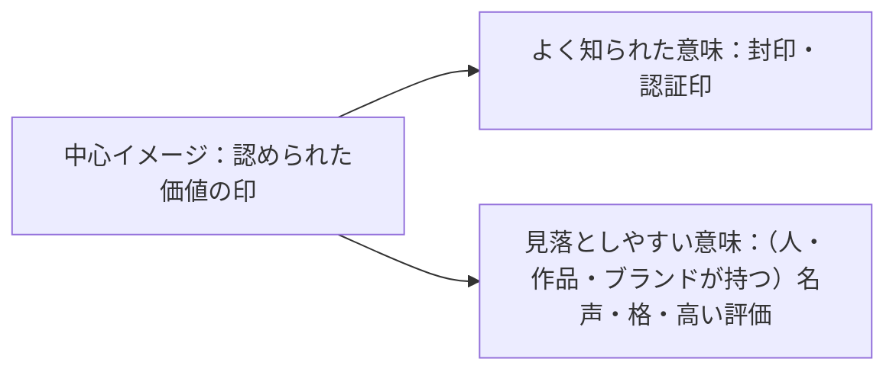

**重要語法：** have cachet（格や威信がある）

---

## 4162. china

**品詞：** 名詞  
**発音：** /ˈtʃaɪnə/

<small>よく知られている意味：China（中国、固有名詞）</small>

### 見落としやすい意味

**磁器、または磁器製の食器類**

**例文：** She placed the delicate china on a high shelf.

**和訳：** 彼女は繊細な磁器の食器を高い棚に置いた。

**コアイメージ：** 中国から伝わった磁器との結び付きが、普通名詞の意味に残っている。小文字のchinaは国名ではなく、素材や食器を指す。

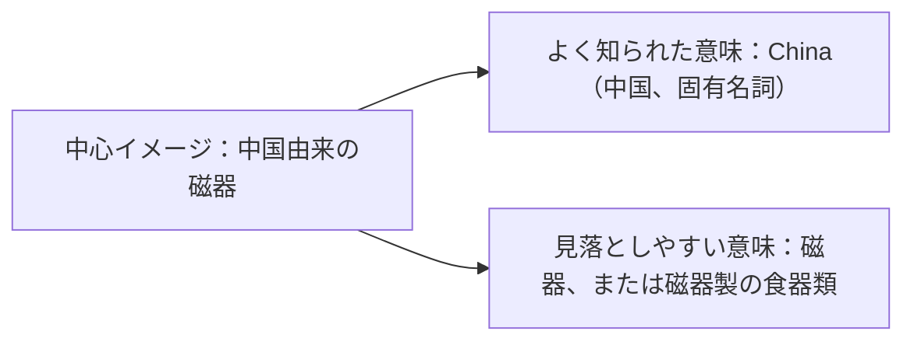

**重要語法：** fine china（高級磁器）

---

## 4163. chord

**品詞：** 名詞  
**発音：** /kɔːrd/

<small>よく知られている意味：和音</small>

### 見落としやすい意味

**円弧の両端を結ぶ線分（弦）**

**例文：** Draw a chord between these two points on the circle.

**和訳：** 円周上のこの二点を結ぶ弦を引きなさい。

**コアイメージ：** 同じ綴りが音楽と幾何で異なる専門的意味を持つ。幾何では円周上の二点を結ぶ線分を指し、和音とは区別する。

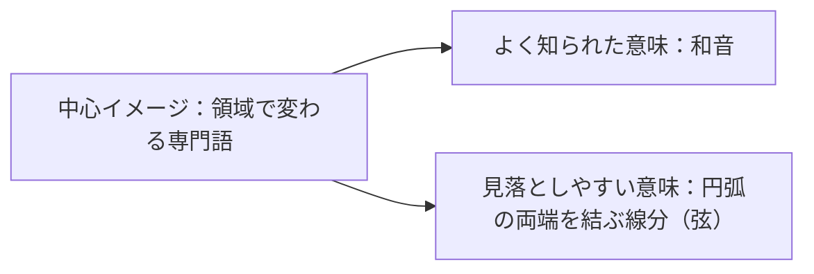

**重要語法：** chord of a circle（円の弦）

---

## 4164. christen

**品詞：** 動詞  
**発音：** /ˈkrɪsən/

<small>よく知られている意味：キリスト教の洗礼を授ける</small>

### 見落としやすい意味

**（洗礼以外でも）人や船などに名前を付ける**

**例文：** They christened the new library after a local scientist.

**和訳：** 彼らは新しい図書館に地元の科学者の名前を付けた。

**コアイメージ：** 洗礼のときに名前を与える習慣から、命名そのものを表すようになった。宗教的な場面に限らず、船や建物にも使える。

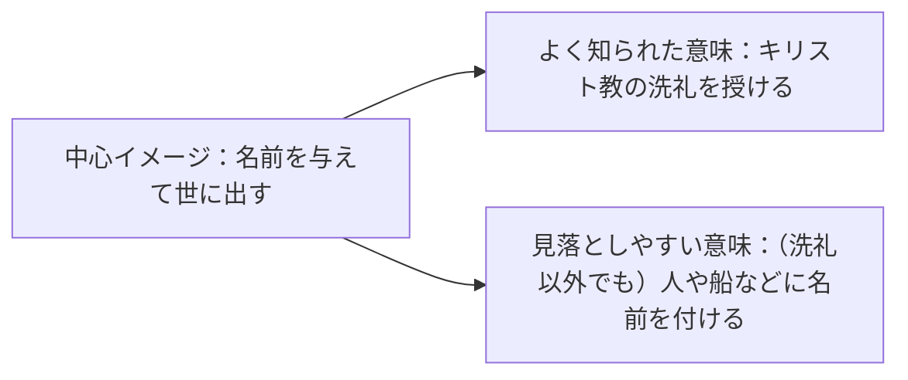

**重要語法：** christen A after B（AをBにちなんで名付ける）

---

## 4165. christen

**品詞：** 動詞  
**発音：** /ˈkrɪsən/

<small>よく知られている意味：洗礼を授ける・名付ける</small>

### 見落としやすい意味

**新しい物を初めて使う**

**例文：** We christened the new oven by baking bread.

**和訳：** 私たちはパンを焼いて、新しいオーブンを初めて使った。

**コアイメージ：** 新しいものを正式に使い始めることを、命名やお披露目になぞらえた用法。特別な初使用を軽いユーモアを交えて表すこともある。

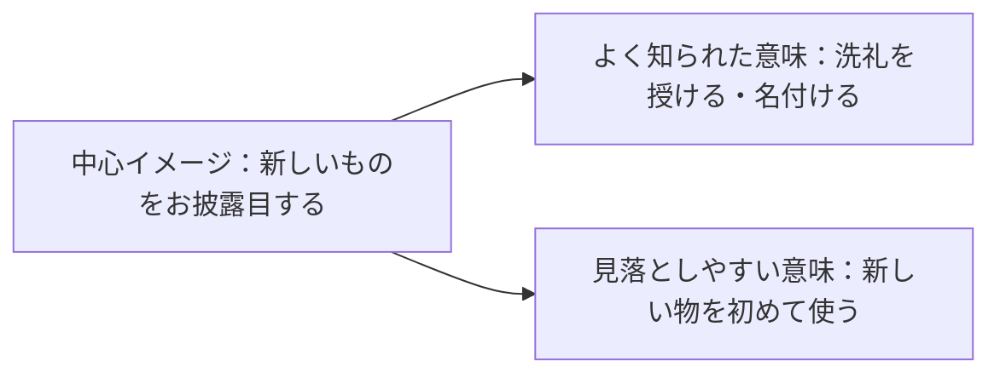

**重要語法：** christen A with B（BでAを初めて使う）

---

## 4166. chronically

**品詞：** 副詞  
**発音：** /ˈkrɑːnɪkli/

<small>よく知られている意味：慢性的な病気の状態で</small>

### 見落としやすい意味

**（問題・不足などが）長期にわたり繰り返し続いて**

**例文：** The town is chronically short of nurses.

**和訳：** その町は長年にわたり看護師が慢性的に不足している。

**コアイメージ：** 一時的な症状でなく、長く続く状態が基本の感覚。病気だけでなく、人手不足や経営問題にも使われる。

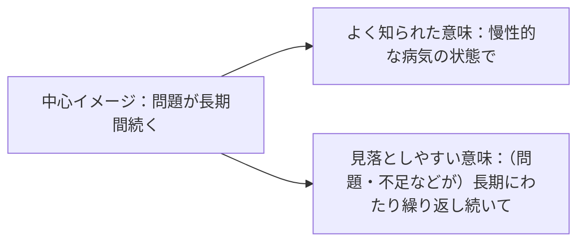

**重要語法：** chronically short of ...（慢性的に…が不足して）

---

## 4167. compass

**品詞：** 名詞  
**発音：** /ˈkʌmpəs/

<small>よく知られている意味：方位磁針・羅針盤</small>

### 見落としやすい意味

**円や弧を描くためのコンパス、製図器**

**例文：** Use a compass to draw a circle with a radius of five centimeters.

**和訳：** 半径5センチの円を製図用コンパスで描きなさい。

**コアイメージ：** 方位を調べる道具と円を描く道具は、同じ英単語で呼ばれる。何を測る・描くのかという動詞や場面から、道具を区別する。

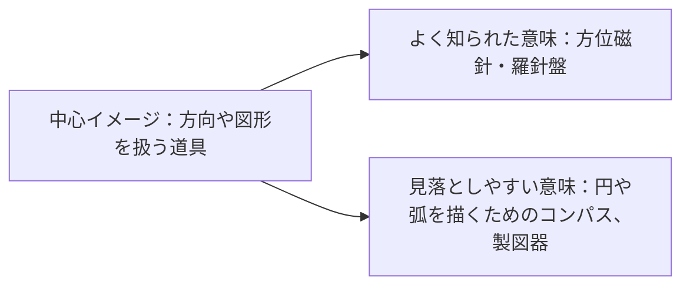

**重要語法：** draw a circle with a compass

---

## 4168. crank

**品詞：** 名詞  
**発音：** /kræŋk/

<small>よく知られている意味：機械を回す取っ手・クランク</small>

### 見落としやすい意味

**奇妙な持論を抱く人、気難しい人**

**例文：** He was dismissed as a crank until his theory was tested.

**和訳：** 彼の理論が検証されるまで、彼は変わり者として相手にされなかった。

**コアイメージ：** 機械の部品を指す名詞とは別に、人の頑固さや奇妙な主張を指す口語義がある。人について使われたら「取っ手」と訳さず人物評価として読む。

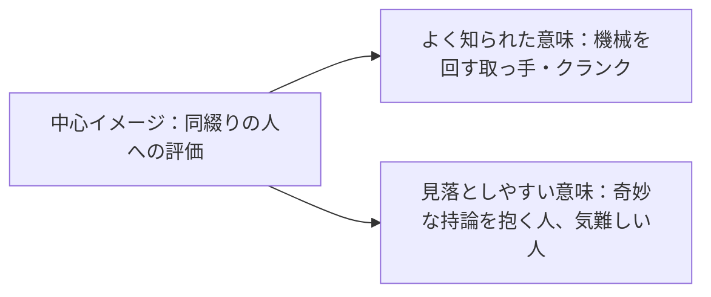

**重要語法：** a crank about ...（…に妙にこだわる人）

---

## 4169. culprit

**品詞：** 名詞  
**発音：** /ˈkʌlprɪt/

<small>よく知られている意味：犯罪の犯人</small>

### 見落としやすい意味

**（問題・失敗などの）原因、元凶となる物事**

**例文：** Poor ventilation was the main culprit behind the odor.

**和訳：** 換気の悪さが、その臭いの主な原因だった。

**コアイメージ：** 事件の犯人とは、悪い結果を引き起こした存在のこと。その発想を人以外にも広げ、問題の原因や元凶を指す。

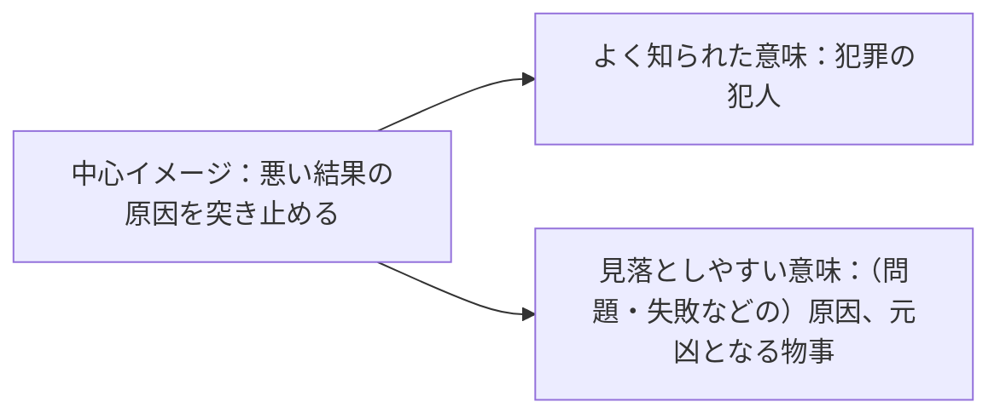

**重要語法：** the culprit behind ...（…の原因）

---

## 4170. custodial

**品詞：** 形容詞  
**発音：** /kʌˈstoʊdiəl/

<small>よく知られている意味：施設の管理・清掃に関する</small>

### 見落としやすい意味

**（法的な）監護・身柄の拘束に関する**

**例文：** The judge imposed a custodial sentence.

**和訳：** 裁判官は拘禁刑を言い渡した。

**コアイメージ：** custodyには世話や管理だけでなく、身柄を拘束しておく意味がある。法律の文脈では身体の自由や監護に関係する。

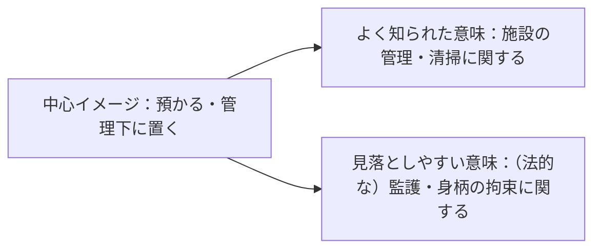

**重要語法：** custodial sentence（自由を奪う刑）

---

## 4171. directory

**品詞：** 名詞  
**発音：** /dəˈrɛktəri/

<small>よく知られている意味：住所録・名簿</small>

### 見落としやすい意味

**（コンピューター内の）ファイルをまとめるフォルダー**

**例文：** Move the photos into a separate directory.

**和訳：** その写真を別のディレクトリに移動しなさい。

**コアイメージ：** directoryは情報を探しやすく整理した一覧や場所を表す。コンピューターではファイルのまとまりを示すフォルダーに当たる。

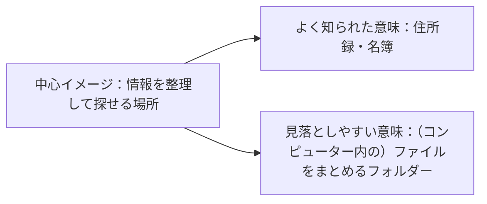

**重要語法：** directory structure（ディレクトリ構造）

---

## 4172. fallout

**品詞：** 名詞  
**発音：** /ˈfɔːlaʊt/

<small>よく知られている意味：放射性降下物</small>

### 見落としやすい意味

**出来事がもたらす悪影響・余波**

**例文：** Local shops still face the fallout from the factory closure.

**和訳：** 地元の店は今も工場閉鎖の悪影響を受けている。

**コアイメージ：** 何かが起こった後に周囲へ降りかかるものが基本の比喩。社会的事件や決定の後に残る、望ましくない影響を指す。

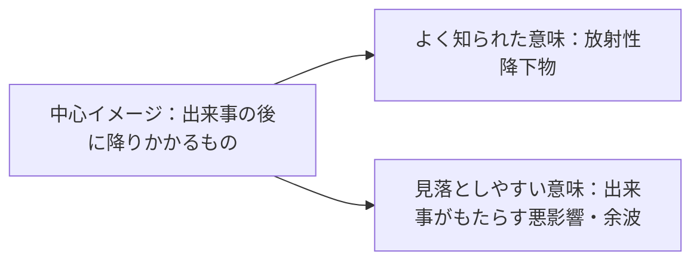

**重要語法：** fallout from ...（…の余波）

---

## 4173. fellowship

**品詞：** 名詞  
**発音：** /ˈfɛloʊʃɪp/

<small>よく知られている意味：仲間意識・友情</small>

### 見落としやすい意味

**研究費や生活費を伴う研究員資格・給付金**

**例文：** She received a two-year research fellowship.

**和訳：** 彼女は2年間の研究フェローシップを得た。

**コアイメージ：** 仲間として集まる関係から、研究機関での所属や支援制度の名にもなる。研究費・生活費などの支援内容は制度ごとに異なる。

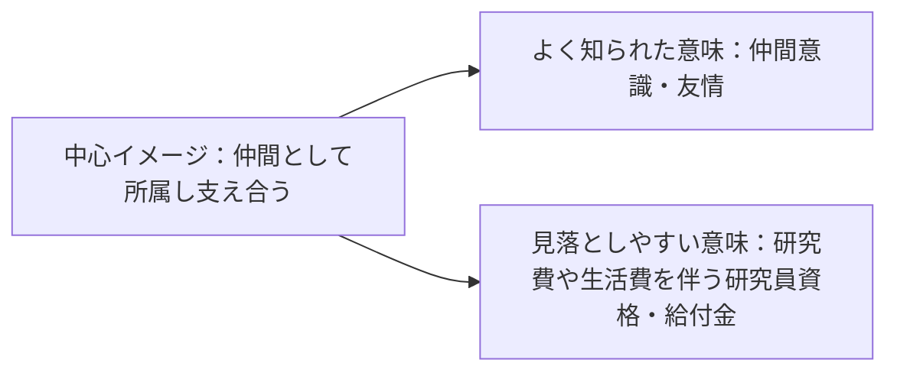

**重要語法：** research fellowship（研究員の資格・助成）

---

## 4174. felt

**品詞：** 名詞  
**発音：** /fɛlt/

<small>よく知られている意味：feelの過去形・過去分詞</small>

### 見落としやすい意味

**フェルト、不織布の厚手の布地**

**例文：** The artist cut small stars from thick felt.

**和訳：** その芸術家は厚手のフェルトから小さな星を切り抜いた。

**コアイメージ：** 動詞feelの変化形と、布の名称feltは文中で役割が異なる。同じ形でも名詞なら素材を指すことがあるため、品詞から見分ける。

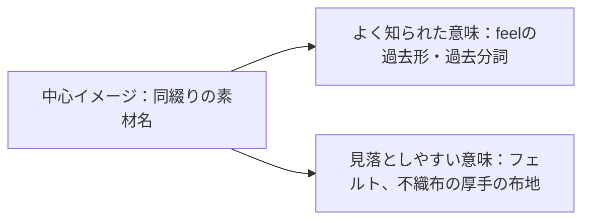

**重要語法：** felt hat（フェルト帽）

---

## 4175. finished

**品詞：** 形容詞  
**発音：** /ˈfɪnɪʃt/

<small>よく知られている意味：終わった・完成した</small>

### 見落としやすい意味

**（人や事業が）もうおしまいで、立ち直れない**

**例文：** If the funding disappears, the project is finished.

**和訳：** 資金援助がなくなれば、その事業はもうおしまいだ。

**コアイメージ：** 物事が終わっているという状態を、将来の見込みが尽きた状態にも広げる。文脈次第で単なる完了でなく、再起が難しいことを表す。

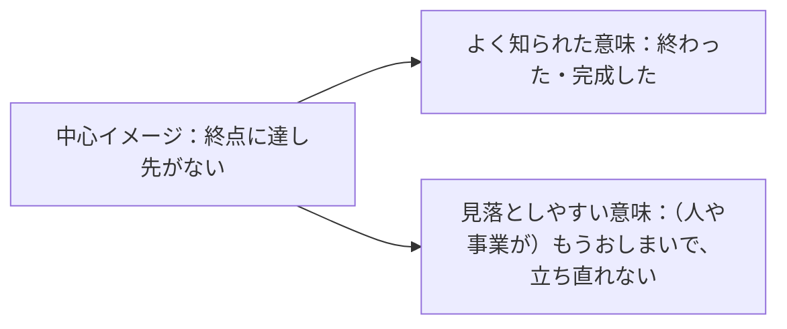

**重要語法：** be finished（終わりだ・もうだめだ）

---

## 4176. flake

**品詞：** 動詞  
**発音：** /fleɪk/

<small>よく知られている意味：薄片がはがれる</small>

### 見落としやすい意味

**約束・予定をすっぽかす**

**例文：** He flaked on our study session again.

**和訳：** 彼はまた私たちとの勉強会の約束をすっぽかした。

**コアイメージ：** これは口語的な別の動詞義で、予定を直前に取り消したり現れなかったりすること。小片がはがれるという字義から無理に推測せず、約束の文脈で覚える。

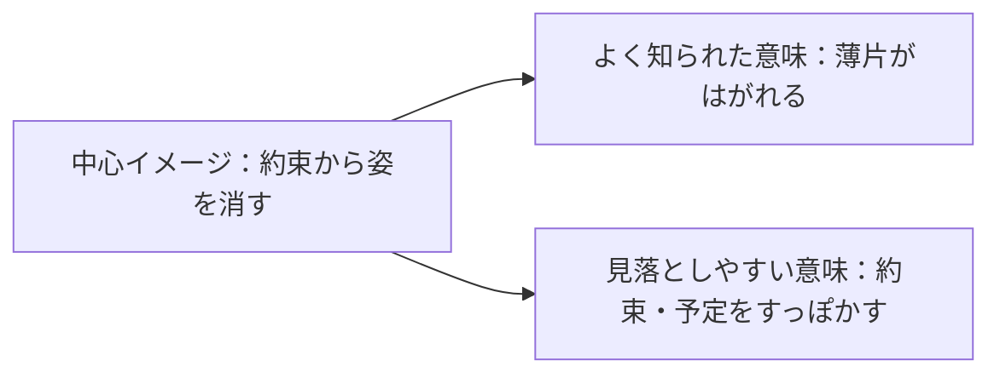

**重要語法：** flake on someone（人との約束をすっぽかす）

---

## 4177. germ

**品詞：** 名詞  
**発音：** /dʒɝːm/

<small>よく知られている意味：病原菌</small>

### 見落としやすい意味

**アイデアや物事が発展する最初の芽**

**例文：** The germ of the idea came to her on a train.

**和訳：** そのアイデアの芽は、列車に乗っているときに彼女に生まれた。

**コアイメージ：** germには何かが育ち始める小さな出発点という感覚もある。そこから、発展前の考えや計画の萌芽を表す。

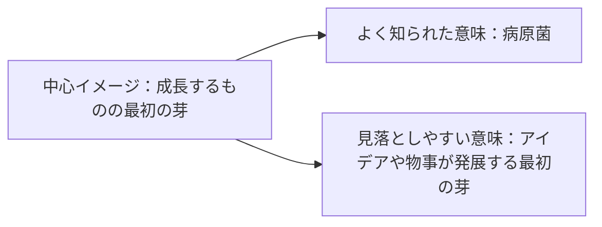

**重要語法：** the germ of an idea（アイデアの芽）

---

## 4178. glaze

**品詞：** 動詞  
**発音：** /ɡleɪz/

<small>よく知られている意味：つやを出す・釉薬をかける</small>

### 見落としやすい意味

**（目や視線が）退屈・疲労でぼんやりする**

**例文：** His eyes began to glaze over during the long lecture.

**和訳：** 長い講義の間に、彼の目はぼんやりしてきた。

**コアイメージ：** 表面をガラス状に覆う様子が、目の表情にも重ねられる。退屈や疲労で焦点が合わない視線を表す。

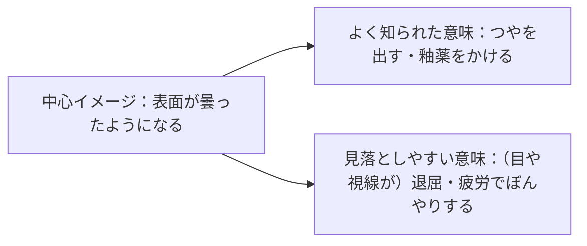

**重要語法：** eyes glaze over（目がうつろになる）

---

## 4179. gravitate

**品詞：** 動詞  
**発音：** /ˈɡrævɪteɪt/

<small>よく知られている意味：重力によって引き寄せられる</small>

### 見落としやすい意味

**（人が物事・場所・人物へ）自然と引き寄せられる**

**例文：** New students tend to gravitate toward the common room.

**和訳：** 新入生たちは自然と談話室に集まる傾向がある。

**コアイメージ：** 重力で物が引かれる動きが、人の興味や好みの方向にも広がる。誰かに命じられず自然に近づく感覚が大切。

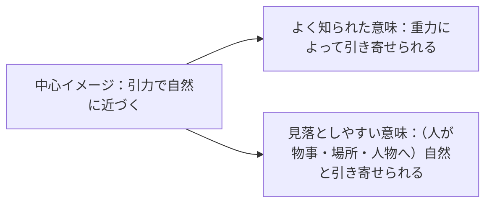

**重要語法：** gravitate toward ...（…に自然と引かれる）

---

## 4180. hacker

**品詞：** 名詞  
**発音：** /ˈhækər/

<small>よく知られている意味：不正侵入する人物</small>

### 見落としやすい意味

**高度なコンピューター技術に詳しい人（不正行為を意味しないことがある）**

**例文：** The company hired a skilled hacker to improve its security.

**和訳：** その会社は安全性を高めるため、高度な技術を持つハッカーを雇った。

**コアイメージ：** 技術を工夫してシステムを扱う人を広く表す場合がある。不正アクセスをする人かどうかは、行動や文脈を確認して判断する。

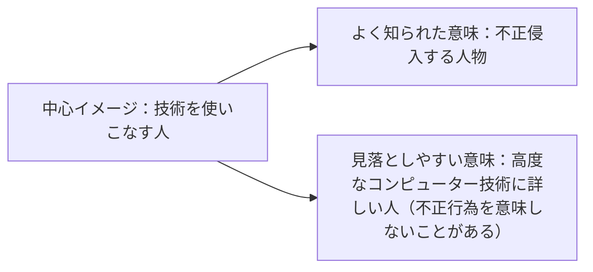

**重要語法：** ethical hacker（倫理的ハッカー）

---

## 4181. housekeeping

**品詞：** 名詞  
**発音：** /ˈhaʊskiːpɪŋ/

<small>よく知られている意味：家事・掃除</small>

### 見落としやすい意味

**会議・運営上の細々とした事務的な連絡事項**

**例文：** Before we begin, I have two housekeeping items about the schedule.

**和訳：** 始める前に、日程について事務連絡が二つあります。

**コアイメージ：** 家を整えて円滑に保つ作業が、組織や会議の雑務にたとえられる。本題の前に済ませる実務的な連絡を指すことが多い。

```mermaid
flowchart LR
    A["中心イメージ：活動を円滑にする細かな整備"]
    B["よく知られた意味：家事・掃除"]
    C["見落としやすい意味：会議・運営上の細々とした事務的な連絡事項"]
    A --> B
    A --> C
```

**重要語法：** housekeeping items（事務連絡事項）

---

## 4182. impervious

**品詞：** 形容詞  
**発音：** /ɪmˈpɝːviəs/

<small>よく知られている意味：水などを通さない</small>

### 見落としやすい意味

**（批判・議論などに）動じない、影響されない**

**例文：** She remained impervious to the harsh criticism.

**和訳：** 彼女は厳しい批判にも動じなかった。

**コアイメージ：** 水を通さない壁のように、外からの刺激が内面まで届かない感覚。意見や非難に影響されない態度にも用いる。

```mermaid
flowchart LR
    A["中心イメージ：外からの影響を通さない"]
    B["よく知られた意味：水などを通さない"]
    C["見落としやすい意味：（批判・議論などに）動じない、影響されない"]
    A --> B
    A --> C
```

**重要語法：** impervious to ...（…に動じない）

---

## 4183. insecurity

**品詞：** 名詞  
**発音：** /ˌɪnsɪˈkjʊrəti/

<small>よく知られている意味：自信のなさ・不安</small>

### 見落としやすい意味

**（food insecurityなどで）生活上の必需品へのアクセスが安定しないこと**

**例文：** The report examines food insecurity in rural areas.

**和訳：** その報告書は地方で食料を安定して得られない問題を調べている。

**コアイメージ：** securityは安心だけでなく、必要なものを確実に得られる状態も表す。insecurityはその安定が失われた状況で、食料や住居にも使われる。

```mermaid
flowchart LR
    A["中心イメージ：生活の安全・安定が欠ける"]
    B["よく知られた意味：自信のなさ・不安"]
    C["見落としやすい意味：（food insecurityなどで）生活上の必需品へのアクセスが安定しないこと"]
    A --> B
    A --> C
```

**重要語法：** food insecurity（食料不安）

---

## 4184. limp

**品詞：** 形容詞  
**発音：** /lɪmp/

<small>よく知られている意味：足を引きずって歩く</small>

### 見落としやすい意味

**柔らかく力がなく、だらりと垂れた**

**例文：** The flag hung limp in the still air.

**和訳：** 風のない空気の中で旗は力なく垂れ下がっていた。

**コアイメージ：** 力が入らず、しっかり支えられていない状態が共通する。人の歩き方だけでなく、布や手足がだらりとした様子にも使える。

```mermaid
flowchart LR
    A["中心イメージ：張りや力がない"]
    B["よく知られた意味：足を引きずって歩く"]
    C["見落としやすい意味：柔らかく力がなく、だらりと垂れた"]
    A --> B
    A --> C
```

**重要語法：** hang limp（力なく垂れる）

---

## 4185. lingua

**品詞：** 名詞  
**発音：** /ˈlɪŋɡwə/

<small>よく知られている意味：舌（ラテン語に由来する語）</small>

### 見落としやすい意味

**（lingua francaで）異なる母語の人が使う共通語**

**例文：** English served as a lingua franca at the conference.

**和訳：** その会議では英語が共通語として使われた。

**コアイメージ：** linguaはもともと舌や言語に関わる語。定型句lingua francaでは、母語の異なる人をつなぐ共通の言語を表す。

```mermaid
flowchart LR
    A["中心イメージ：言葉で人々をつなぐ"]
    B["よく知られた意味：舌（ラテン語に由来する語）"]
    C["見落としやすい意味：（lingua francaで）異なる母語の人が使う共通語"]
    A --> B
    A --> C
```

**重要語法：** lingua franca（共通語）

---

## 4186. mantle

**品詞：** 名詞  
**発音：** /ˈmæntəl/

<small>よく知られている意味：マント・覆い</small>

### 見落としやすい意味

**前任者から受け継ぐ重要な役職・責任**

**例文：** She took up the mantle of leadership after her mentor retired.

**和訳：** 恩師の引退後、彼女は指導者としての責任を引き継いだ。

**コアイメージ：** 人が身にまとうマントから、役目を身に引き受ける比喩が生まれる。前任者の立場や責任を受け継ぐ場面で使う。

```mermaid
flowchart LR
    A["中心イメージ：身にまとう役割"]
    B["よく知られた意味：マント・覆い"]
    C["見落としやすい意味：前任者から受け継ぐ重要な役職・責任"]
    A --> B
    A --> C
```

**重要語法：** take up the mantle of ...（…の役割を引き継ぐ）

---

## 4187. mantra

**品詞：** 名詞  
**発音：** /ˈmɑːntrə/

<small>よく知られている意味：宗教的に繰り返し唱える言葉</small>

### 見落としやすい意味

**繰り返し唱えられる標語・行動指針**

**例文：** Their mantra was simple: check every detail.

**和訳：** 彼らの行動指針は単純だった。「細部まで確認する」だ。

**コアイメージ：** 繰り返し唱える短い言葉から、何度も強調される信条や標語へ広がる。宗教と無関係な仕事や生活でも使われる。

```mermaid
flowchart LR
    A["中心イメージ：繰り返して心に刻む言葉"]
    B["よく知られた意味：宗教的に繰り返し唱える言葉"]
    C["見落としやすい意味：繰り返し唱えられる標語・行動指針"]
    A --> B
    A --> C
```

**重要語法：** a company mantra（企業の行動指針）

---

## 4188. mercifully

**品詞：** 副詞  
**発音：** /ˈmɝːsɪfəli/

<small>よく知られている意味：慈悲深く</small>

### 見落としやすい意味

**幸いなことに、ありがたいことに**

**例文：** Mercifully, the rain stopped before the outdoor concert.

**和訳：** 幸いなことに、屋外コンサートの前に雨がやんだ。

**コアイメージ：** 慈悲によって苦痛が和らぐ感覚から、ありがたい結果を述べる副詞になる。この用法では人の振る舞いでなく、状況全体を評価する。

```mermaid
flowchart LR
    A["中心イメージ：救いになる結果"]
    B["よく知られた意味：慈悲深く"]
    C["見落としやすい意味：幸いなことに、ありがたいことに"]
    A --> B
    A --> C
```

**重要語法：** Mercifully, ...（幸いなことに…）

---

## 4189. mockery

**品詞：** 名詞  
**発音：** /ˈmɑːkəri/

<small>よく知られている意味：あざけり・物まね</small>

### 見落としやすい意味

**（make a mockery ofで）規則・制度を形骸化させる、台無しにする**

**例文：** Ignoring the rules would make a mockery of the competition.

**和訳：** 規則を無視すれば、その競技会は形だけのものになってしまう。

**コアイメージ：** 嘲笑の対象になるほど本来の意味を失わせる、という強い比喩。制度や努力の価値を台無しにすることを表せる。

```mermaid
flowchart LR
    A["中心イメージ：まじめな価値を笑いものにする"]
    B["よく知られた意味：あざけり・物まね"]
    C["見落としやすい意味：（make a mockery ofで）規則・制度を形骸化させる、台無しにする"]
    A --> B
    A --> C
```

**重要語法：** make a mockery of ...（…を形骸化する）

---

## 4190. moot

**品詞：** 形容詞  
**発音：** /muːt/

<small>よく知られている意味：議論の対象となる（形容詞の一義）</small>

### 見落としやすい意味

**議論の余地があり、結論が確定していない**

**例文：** Whether the policy will work remains a moot point.

**和訳：** その政策がうまくいくかどうかは、なお議論の余地がある。

**コアイメージ：** mootには、まだ議論・決着の対象であるという意味がある。ただし特に米語では「実際上は意味がない」の用法も多く、文脈による区別が必要。

```mermaid
flowchart LR
    A["中心イメージ：議論の位置づけを示す"]
    B["よく知られた意味：議論の対象となる（形容詞の一義）"]
    C["見落としやすい意味：議論の余地があり、結論が確定していない"]
    A --> B
    A --> C
```

**重要語法：** a moot point（議論の余地がある点。文脈で別義にも注意）

---

## 4191. moot

**品詞：** 形容詞  
**発音：** /muːt/

<small>よく知られている意味：議論の余地がある</small>

### 見落としやすい意味

**実際上の意味がない、検討の必要がなくなった**

**例文：** Once the permit was granted, the objection became moot.

**和訳：** 許可が下りた時点で、その異議は実質的に意味を失った。

**コアイメージ：** 議論する価値のある争点だったとしても、状況が変われば結論が実務に影響しなくなる。特に米語でこの意味がよく使われる。

```mermaid
flowchart LR
    A["中心イメージ：議論しても結果が変わらない"]
    B["よく知られた意味：議論の余地がある"]
    C["見落としやすい意味：実際上の意味がない、検討の必要がなくなった"]
    A --> B
    A --> C
```

**重要語法：** become moot（実際上の争点でなくなる）

---

## 4192. moot

**品詞：** 動詞  
**発音：** /muːt/

<small>よく知られている意味：議論の余地がある（形容詞）</small>

### 見落としやすい意味

**討議のために議題として提案する**

**例文：** The committee mooted a plan to extend library hours.

**和訳：** 委員会は図書館の開館時間を延ばす案を議題に上げた。

**コアイメージ：** 動詞mootは、議論を始めるために案を持ち出すことを表す。結論を出すのではなく、検討対象として提示する段階に重点がある。

```mermaid
flowchart LR
    A["中心イメージ：議論の場に持ち出す"]
    B["よく知られた意味：議論の余地がある（形容詞）"]
    C["見落としやすい意味：討議のために議題として提案する"]
    A --> B
    A --> C
```

**重要語法：** moot a proposal（提案を議題にする。主に英語圏の一部で用いる）

---

## 4193. mug

**品詞：** 名詞  
**発音：** /mʌɡ/

<small>よく知られている意味：マグカップ</small>

### 見落としやすい意味

**（くだけた英語で）人の顔**

**例文：** His smiling mug appeared on the front page.

**和訳：** 彼のにこやかな顔が一面に載った。

**コアイメージ：** mugにはカップの意味とは別に、顔を表すくだけた用法がある。親しい・からかうような人物描写で出るため、前後の語で判断する。

```mermaid
flowchart LR
    A["中心イメージ：日常語の別の口語義"]
    B["よく知られた意味：マグカップ"]
    C["見落としやすい意味：（くだけた英語で）人の顔"]
    A --> B
    A --> C
```

**重要語法：** a mug shot（顔写真。特に警察の撮影写真）

---

## 4194. mug

**品詞：** 動詞  
**発音：** /mʌɡ/

<small>よく知られている意味：マグカップ・顔（名詞）</small>

### 見落としやすい意味

**人から金品を奪う目的で襲う**

**例文：** Police reported that a visitor had been mugged near the station.

**和訳：** 警察は駅の近くで訪問者が強盗被害に遭ったと発表した。

**コアイメージ：** 動詞mugは、路上などで人を襲って金品を奪うことを表す。カップを意味する名詞から無理に意味を推測せず、他動詞として見分ける。

```mermaid
flowchart LR
    A["中心イメージ：人を襲い金品を奪う"]
    B["よく知られた意味：マグカップ・顔（名詞）"]
    C["見落としやすい意味：人から金品を奪う目的で襲う"]
    A --> B
    A --> C
```

**重要語法：** be mugged（強盗被害に遭う）

---

## 4195. noted

**品詞：** 形容詞  
**発音：** /ˈnoʊtɪd/

<small>よく知られている意味：書き留められた</small>

### 見落としやすい意味

**名高い、ある分野で有名な**

**例文：** A noted historian spoke at the event.

**和訳：** その催しでは著名な歴史家が講演した。

**コアイメージ：** noteには注意を向け、記録するという感覚がある。多くの人に注目されている人物や仕事を、notedで表す。

```mermaid
flowchart LR
    A["中心イメージ：多くの人に注目される"]
    B["よく知られた意味：書き留められた"]
    C["見落としやすい意味：名高い、ある分野で有名な"]
    A --> B
    A --> C
```

**重要語法：** a noted expert（著名な専門家）

---

## 4196. onslaught

**品詞：** 名詞  
**発音：** /ˈɑːnslɔːt/

<small>よく知られている意味：激しい攻撃</small>

### 見落としやすい意味

**批判・質問・問題などが激しく押し寄せること**

**例文：** The speaker faced an onslaught of questions after the talk.

**和訳：** 講演後、話し手には質問が次々と押し寄せた。

**コアイメージ：** 一度に攻め込むような強い勢いが核にある。実際の攻撃だけでなく、質問や批判が大量に迫る様子にも使う。

```mermaid
flowchart LR
    A["中心イメージ：次々と激しく押し寄せる"]
    B["よく知られた意味：激しい攻撃"]
    C["見落としやすい意味：批判・質問・問題などが激しく押し寄せること"]
    A --> B
    A --> C
```

**重要語法：** an onslaught of criticism（激しい批判の集中）

---

## 4197. outgoing

**品詞：** 形容詞  
**発音：** /ˈaʊtˌɡoʊɪŋ/

<small>よく知られている意味：社交的・外向的な</small>

### 見落としやすい意味

**（大統領・役員などが）退任する、去りゆく**

**例文：** The outgoing director thanked the staff on her final day.

**和訳：** 退任する部長は最後の日に職員へ感謝を述べた。

**コアイメージ：** 外に向かって出ていくという方向性を表す。人事の文脈では、役職から去っていく人を修飾する。

```mermaid
flowchart LR
    A["中心イメージ：外へ出て去る"]
    B["よく知られた意味：社交的・外向的な"]
    C["見落としやすい意味：（大統領・役員などが）退任する、去りゆく"]
    A --> B
    A --> C
```

**重要語法：** the outgoing president（退任する会長・大統領）

---

## 4198. palate

**品詞：** 名詞  
**発音：** /ˈpælət/

<small>よく知られている意味：口蓋（口の天井部分）</small>

### 見落としやすい意味

**飲食物を味わい、良し悪しを判断する味覚**

**例文：** The chef has a refined palate for subtle flavors.

**和訳：** その料理人には繊細な味を見分ける優れた味覚がある。

**コアイメージ：** 口の中の部位を指す語が、味を感じ取る能力へ意味を広げた。食や飲み物の評価では、味覚の鋭さや好みを指す。

```mermaid
flowchart LR
    A["中心イメージ：味を受け取り判断する口"]
    B["よく知られた意味：口蓋（口の天井部分）"]
    C["見落としやすい意味：飲食物を味わい、良し悪しを判断する味覚"]
    A --> B
    A --> C
```

**重要語法：** a refined palate（洗練された味覚）

---

## 4199. patronage

**品詞：** 名詞  
**発音：** /ˈpeɪtrənɪdʒ/

<small>よく知られている意味：保護・後援</small>

### 見落としやすい意味

**商店・飲食店などに対する顧客からのひいき・取引**

**例文：** The café depends on the patronage of local residents.

**和訳：** そのカフェは地元住民のひいきに支えられている。

**コアイメージ：** patronは支える人・常連客のこと。商店の文脈では、支援が寄付ではなく継続的な利用や取引として現れる。

```mermaid
flowchart LR
    A["中心イメージ：支えとなる関係"]
    B["よく知られた意味：保護・後援"]
    C["見落としやすい意味：商店・飲食店などに対する顧客からのひいき・取引"]
    A --> B
    A --> C
```

**重要語法：** thank you for your patronage（ご愛顧ありがとうございます）

---

## 4200. patronage

**品詞：** 名詞  
**発音：** /ˈpeɪtrənɪdʒ/

<small>よく知られている意味：後援・ひいき・顧客の利用</small>

### 見落としやすい意味

**支持への見返りとして地位や便宜を与える政治的恩顧**

**例文：** The new mayor promised to end political patronage in hiring.

**和訳：** 新市長は採用における政治的な縁故優遇をなくすと約束した。

**コアイメージ：** 有力者が人を支援する関係が、権限を使って地位や利益を与える仕組みにもなる。政治では、支持の見返りとして便宜を図る意味が重要。

```mermaid
flowchart LR
    A["中心イメージ：権力によるひいき"]
    B["よく知られた意味：後援・ひいき・顧客の利用"]
    C["見落としやすい意味：支持への見返りとして地位や便宜を与える政治的恩顧"]
    A --> B
    A --> C
```

**重要語法：** political patronage（政治的な恩顧・縁故）

---

## 4201. paycheck

**品詞：** 名詞  
**発音：** /ˈpeɪtʃɛk/

<small>よく知られている意味：給料・給与小切手</small>

### 見落としやすい意味

**（live paycheck to paycheckで）給料が入るたび生活費に消え貯蓄の余裕がない**

**例文：** Even with two jobs, they were living paycheck to paycheck.

**和訳：** 二つの仕事をしていても、彼らは給料日から次の給料日までぎりぎりの生活をしていた。

**コアイメージ：** paycheckは定期的に入る給料を表す。paycheck to paycheckでは、その都度の収入が生活費に消え、貯蓄に回す余裕がない様子をいう。

```mermaid
flowchart LR
    A["中心イメージ：次の給料で次の生活費をまかなう"]
    B["よく知られた意味：給料・給与小切手"]
    C["見落としやすい意味：（live paycheck to paycheckで）給料が入るたび生活費に消え貯蓄の余裕がない"]
    A --> B
    A --> C
```

**重要語法：** live paycheck to paycheck（給料ぎりぎりで暮らす）

---

## 4202. perk

**品詞：** 名詞  
**発音：** /pɝːk/

<small>よく知られている意味：元気を出させる（動詞）</small>

### 見落としやすい意味

**（賃金以外の）仕事に伴う特典・福利厚生**

**例文：** Free train passes are one of the perks of the job.

**和訳：** 無料の鉄道パスは、その仕事に付く特典の一つだ。

**コアイメージ：** 名詞perkは仕事に付随して得られる特別な利点を表す。給与とは別の恩恵として、福利厚生や割引などが含まれる。

```mermaid
flowchart LR
    A["中心イメージ：仕事に伴うおまけの利点"]
    B["よく知られた意味：元気を出させる（動詞）"]
    C["見落としやすい意味：（賃金以外の）仕事に伴う特典・福利厚生"]
    A --> B
    A --> C
```

**重要語法：** employee perks（従業員向け特典）

---

## 4203. personify

**品詞：** 動詞  
**発音：** /pərˈsɑːnɪfaɪ/

<small>よく知られている意味：物事を擬人化する</small>

### 見落としやすい意味

**（人がある性質を）体現する、典型的に示す**

**例文：** Her patience personifies the spirit of the organization.

**和訳：** 彼女の忍耐強さは、その組織の精神を体現している。

**コアイメージ：** 抽象的な性質を人の姿で表すのが擬人化。実在の人物がその性質の典型例となる場合にも使える。

```mermaid
flowchart LR
    A["中心イメージ：抽象的な性質を人に表す"]
    B["よく知られた意味：物事を擬人化する"]
    C["見落としやすい意味：（人がある性質を）体現する、典型的に示す"]
    A --> B
    A --> C
```

**重要語法：** personify an ideal（理想を体現する）

---

## 4204. picket

**品詞：** 名詞  
**発音：** /ˈpɪkɪt/

<small>よく知られている意味：柵の杭</small>

### 見落としやすい意味

**（職場・施設の外での）抗議活動やその参加者**

**例文：** A picket formed outside the factory during the dispute.

**和訳：** 紛争の間、工場の外で抗議のためのピケ隊が組まれた。

**コアイメージ：** picketには、場所の外に立って抗議や監視をする人・活動を表す別義がある。労働争議の文脈では柵の材料とは区別する。

```mermaid
flowchart LR
    A["中心イメージ：施設の外に立つ抗議の隊列"]
    B["よく知られた意味：柵の杭"]
    C["見落としやすい意味：（職場・施設の外での）抗議活動やその参加者"]
    A --> B
    A --> C
```

**重要語法：** picket line（ピケの列）

---

## 4205. prescribed

**品詞：** 形容詞  
**発音：** /prɪˈskraɪbd/

<small>よく知られている意味：医師に処方された</small>

### 見落としやすい意味

**規則・法律・指示によって定められた**

**例文：** All applicants must use the prescribed form.

**和訳：** 応募者は全員、指定された書式を使わなければならない。

**コアイメージ：** prescribeは権限をもって行うべき方法を指示すること。医師の処方から広げて、規則や法律で定めた形式にも使う。

```mermaid
flowchart LR
    A["中心イメージ：権限により方法を定める"]
    B["よく知られた意味：医師に処方された"]
    C["見落としやすい意味：規則・法律・指示によって定められた"]
    A --> B
    A --> C
```

**重要語法：** prescribed procedure（所定の手続き）

---

## 4206. rehabilitation

**品詞：** 名詞  
**発音：** /ˌriːhəˌbɪlɪˈteɪʃən/

<small>よく知られている意味：身体機能の回復・リハビリ</small>

### 見落としやすい意味

**失った評判・社会的地位を回復すること**

**例文：** The article marked the rehabilitation of his public reputation.

**和訳：** その記事は、彼の社会的な評判が回復する節目となった。

**コアイメージ：** 一度損なわれた機能や立場を元に戻すことが中心にある。身体だけでなく、名誉や社会的な信用の回復にも広がる。

```mermaid
flowchart LR
    A["中心イメージ：失ったものを回復する"]
    B["よく知られた意味：身体機能の回復・リハビリ"]
    C["見落としやすい意味：失った評判・社会的地位を回復すること"]
    A --> B
    A --> C
```

**重要語法：** rehabilitation of a reputation（名誉の回復）

---

## 4207. rendition

**品詞：** 名詞  
**発音：** /rɛnˈdɪʃən/

<small>よく知られている意味：引き渡し（法律など）</small>

### 見落としやすい意味

**曲・詩などの特定の演奏や表現の仕方**

**例文：** Her rendition of the folk song moved the audience.

**和訳：** 彼女によるその民謡の歌い方は、聴衆の心を動かした。

**コアイメージ：** 作品をどう表現し、演奏として形にするかに注目する語義。曲や詩については、特定の人による解釈・上演を表す。

```mermaid
flowchart LR
    A["中心イメージ：作品をある形で表現する"]
    B["よく知られた意味：引き渡し（法律など）"]
    C["見落としやすい意味：曲・詩などの特定の演奏や表現の仕方"]
    A --> B
    A --> C
```

**重要語法：** a rendition of a song（曲の演奏・歌唱）

---

## 4208. saturate

**品詞：** 動詞  
**発音：** /ˈsætʃəreɪt/

<small>よく知られている意味：水分を十分に染み込ませる</small>

### 見落としやすい意味

**（市場・媒体などを）商品や情報で飽和状態にする**

**例文：** Cheap imports have saturated the local market.

**和訳：** 安価な輸入品が地元市場にあふれ、市場は飽和状態になっている。

**コアイメージ：** 水がしみ込む余地がなくなるまで満たすのが基本像。市場や情報空間が多くの物で埋め尽くされる場合にも使う。

```mermaid
flowchart LR
    A["中心イメージ：入り込む余地がないほど満たす"]
    B["よく知られた意味：水分を十分に染み込ませる"]
    C["見落としやすい意味：（市場・媒体などを）商品や情報で飽和状態にする"]
    A --> B
    A --> C
```

**重要語法：** saturate the market（市場を飽和させる）

---

## 4209. skinny

**品詞：** 名詞  
**発音：** /ˈskɪni/

<small>よく知られている意味：やせた（形容詞）</small>

### 見落としやすい意味

**（the skinny onで）内情・最新の詳しい情報**

**例文：** Can you give me the skinny on the new timetable?

**和訳：** 新しい時刻表について詳しい内情を教えてくれる？

**コアイメージ：** 形容詞の体形の意味とは異なる、くだけた名詞用法。the skinny on ...で、その件についての詳しい情報を求める表現になる。

```mermaid
flowchart LR
    A["中心イメージ：くだけた言葉で内情を指す"]
    B["よく知られた意味：やせた（形容詞）"]
    C["見落としやすい意味：（the skinny onで）内情・最新の詳しい情報"]
    A --> B
    A --> C
```

**重要語法：** the skinny on ...（…についての内情）

---

## 4210. slur

**品詞：** 動詞  
**発音：** /slɝː/

<small>よく知られている意味：侮辱する・中傷する</small>

### 見落としやすい意味

**（言葉を）不明瞭に発音する、ろれつが不明瞭になる**

**例文：** He was so sleepy that he slurred his words.

**和訳：** 彼は眠すぎて、言葉を不明瞭に発音した。

**コアイメージ：** 音と音の境目が曖昧になって聞き取りにくくなることを表す。侮辱の意味とは違い、発話のしかたを述べている。

```mermaid
flowchart LR
    A["中心イメージ：音の輪郭がぼやける"]
    B["よく知られた意味：侮辱する・中傷する"]
    C["見落としやすい意味：（言葉を）不明瞭に発音する、ろれつが不明瞭になる"]
    A --> B
    A --> C
```

**重要語法：** slur one's words（ろれつが回らず話す）

---

## 4211. snub

**品詞：** 動詞  
**発音：** /snʌb/

<small>よく知られている意味：短く上向きの（形容詞）</small>

### 見落としやすい意味

**意図的に無視するなどして相手を冷遇する**

**例文：** The organizer snubbed the young artist at the ceremony.

**和訳：** 主催者は式典でその若い芸術家を意図的に冷遇した。

**コアイメージ：** 人を認めず、ぞんざいに扱う振る舞いを表す動詞の用法。歓迎や招待が期待される場面で冷たく無視するときに使う。

```mermaid
flowchart LR
    A["中心イメージ：相手を冷たくあしらう"]
    B["よく知られた意味：短く上向きの（形容詞）"]
    C["見落としやすい意味：意図的に無視するなどして相手を冷遇する"]
    A --> B
    A --> C
```

**重要語法：** snub an invitation（招待を冷たく断る）

---

## 4212. splinter

**品詞：** 名詞  
**発音：** /ˈsplɪntər/

<small>よく知られている意味：木材などの細い破片</small>

### 見落としやすい意味

**（splinter groupなどで）母体から分離した小派閥**

**例文：** A splinter group broke away from the association.

**和訳：** その協会から小さな分派が離脱した。

**コアイメージ：** 大きな木材から細い破片が割れて離れる様子が核。組織から小さな集団が分離する場面に比喩的に使う。

```mermaid
flowchart LR
    A["中心イメージ：母体から小さく割れて離れる"]
    B["よく知られた意味：木材などの細い破片"]
    C["見落としやすい意味：（splinter groupなどで）母体から分離した小派閥"]
    A --> B
    A --> C
```

**重要語法：** splinter group（分派）

---

## 4213. squat

**品詞：** 名詞  
**発音：** /skwɑːt/

<small>よく知られている意味：しゃがむ（動詞）</small>

### 見落としやすい意味

**（not know squatなどで）何も、少しも（否定文で）**

**例文：** I don't know squat about the rules of this game.

**和訳：** 私はこのゲームのルールをまるで知らない。

**コアイメージ：** これは意味を直接たどりにくい、口語的な否定表現。not know squatのsquatは「何も」を強める名詞的な言い方として覚える。

```mermaid
flowchart LR
    A["中心イメージ：否定を強める口語表現"]
    B["よく知られた意味：しゃがむ（動詞）"]
    C["見落としやすい意味：（not know squatなどで）何も、少しも（否定文で）"]
    A --> B
    A --> C
```

**重要語法：** not know squat（何も知らない。くだけた表現）

---

## 4214. sterile

**品詞：** 形容詞  
**発音：** /ˈstɛrəl/

<small>よく知られている意味：無菌の・不妊の</small>

### 見落としやすい意味

**独創性・発想・活気に欠ける、不毛な**

**例文：** The discussion became sterile and produced no new ideas.

**和訳：** その議論は不毛になり、新しい考えが何も生まれなかった。

**コアイメージ：** 生命や生産につながらない状態という感覚から、発想が生み出されない状態を表す。議論や環境が創造性に欠けることを批判できる。

```mermaid
flowchart LR
    A["中心イメージ：新しいものを生み出せない"]
    B["よく知られた意味：無菌の・不妊の"]
    C["見落としやすい意味：独創性・発想・活気に欠ける、不毛な"]
    A --> B
    A --> C
```

**重要語法：** sterile debate（不毛な議論）

---

## 4215. subside

**品詞：** 動詞  
**発音：** /səbˈsaɪd/

<small>よく知られている意味：騒ぎ・痛みなどが鎮まる</small>

### 見落としやすい意味

**（地盤・建物などが）沈下する**

**例文：** Parts of the road began to subside after heavy rain.

**和訳：** 大雨の後、道路の一部が沈下し始めた。

**コアイメージ：** 高まっていたものが下がっていく動きが基本にある。感情や音が弱まるだけでなく、地面が物理的に沈み込むことも表す。

```mermaid
flowchart LR
    A["中心イメージ：高い位置から下がる"]
    B["よく知られた意味：騒ぎ・痛みなどが鎮まる"]
    C["見落としやすい意味：（地盤・建物などが）沈下する"]
    A --> B
    A --> C
```

**重要語法：** land subsidence（地盤沈下）

---

## 4216. transcribe

**品詞：** 動詞  
**発音：** /trænˈskraɪb/

<small>よく知られている意味：音声を書き起こす</small>

### 見落としやすい意味

**（遺伝情報が）DNAからRNAに写し取られる**

**例文：** In the cell, the gene is transcribed into RNA.

**和訳：** 細胞内で、その遺伝子の情報はRNAに転写される。

**コアイメージ：** ある媒体にある情報を別の媒体へ写し取るという感覚が共通する。生物学ではDNAの情報をRNAとして写す過程をいう。

```mermaid
flowchart LR
    A["中心イメージ：情報を別の形に写し取る"]
    B["よく知られた意味：音声を書き起こす"]
    C["見落としやすい意味：（遺伝情報が）DNAからRNAに写し取られる"]
    A --> B
    A --> C
```

**重要語法：** transcribe DNA into RNA（DNAをRNAに転写する）

---

## 4217. undo

**品詞：** 動詞  
**発音：** /ʌnˈduː/

<small>よく知られている意味：元に戻す・取り消す</small>

### 見落としやすい意味

**（努力・人などを）破滅させる、台無しにする**

**例文：** One careless decision could undo years of work.

**和訳：** たった一つの軽率な決断が、何年もの努力を台無しにしかねない。

**コアイメージ：** undoには出来上がった状態を元に戻してしまう力がある。努力の成果が消える場合には、単なる操作の取り消しより強い意味になる。

```mermaid
flowchart LR
    A["中心イメージ：積み上げた成果を元に戻す"]
    B["よく知られた意味：元に戻す・取り消す"]
    C["見落としやすい意味：（努力・人などを）破滅させる、台無しにする"]
    A --> B
    A --> C
```

**重要語法：** undo years of progress（長年の進歩を台無しにする）

---

## 4218. vindicate

**品詞：** 動詞  
**発音：** /ˈvɪndɪkeɪt/

<small>よく知られている意味：人の無実を証明する</small>

### 見落としやすい意味

**（決断・行動などが）正しかったと証明する**

**例文：** The results vindicated her decision to wait.

**和訳：** その結果は、待つという彼女の決断が正しかったことを証明した。

**コアイメージ：** 疑われていた人や判断が、結果によって正しかったと示されるのが基本。対象は人だけでなく決断や方針にも広がる。

```mermaid
flowchart LR
    A["中心イメージ：疑いを晴らし正しさを示す"]
    B["よく知られた意味：人の無実を証明する"]
    C["見落としやすい意味：（決断・行動などが）正しかったと証明する"]
    A --> B
    A --> C
```

**重要語法：** vindicate a decision（決断の正しさを証明する）

---

## 4219. whence

**品詞：** 副詞  
**発音：** /wɛns/

<small>よく知られている意味：どこから（文語的な疑問表現）</small>

### 見落としやすい意味

**（形式的・文語的に）どこから、どの源から**

**例文：** She returned to the town whence she had come.

**和訳：** 彼女はもともと来た町に戻った。

**コアイメージ：** whence自体に「そこから・どこから」という出所の意味がある。関係副詞として使えば、前に出た場所を起点として示す。

```mermaid
flowchart LR
    A["中心イメージ：出発点・由来を示す"]
    B["よく知られた意味：どこから（文語的な疑問表現）"]
    C["見落としやすい意味：（形式的・文語的に）どこから、どの源から"]
    A --> B
    A --> C
```

**重要語法：** from whenceはfromが重複し得るため、whenceだけで表せる

---

## 4220. yarn

**品詞：** 名詞  
**発音：** /jɑːrn/

<small>よく知られている意味：糸・毛糸</small>

### 見落としやすい意味

**興味を引く長い物語、ときにほら話**

**例文：** Grandpa loved to spin a yarn about his travels.

**和訳：** 祖父は旅の話を長々と面白く語るのが好きだった。

**コアイメージ：** 糸を紡ぐように話を次々とつなげていく比喩がある。特に長くて面白い話や、少し大げさなほら話を指す。

```mermaid
flowchart LR
    A["中心イメージ：糸を紡ぐように物語を語る"]
    B["よく知られた意味：糸・毛糸"]
    C["見落としやすい意味：興味を引く長い物語、ときにほら話"]
    A --> B
    A --> C
```

**重要語法：** spin a yarn（長い話を面白くする）

---

## 4221. ex

**品詞：** 名詞  
**発音：** /ɛks/

<small>よく知られている意味：以前の、元の（接頭辞）</small>

### 見落としやすい意味

**以前の交際相手・配偶者**

**例文：** He met his ex at the station by chance.

**和訳：** 彼は駅で以前の交際相手に偶然会った。

**コアイメージ：** ex-はかつてその立場にいたことを示す。単独の名詞exでは、文脈上以前の恋人や配偶者を指す。

```mermaid
flowchart LR
    A["中心イメージ：以前の関係にあった人"]
    B["よく知られた意味：以前の、元の（接頭辞）"]
    C["見落としやすい意味：以前の交際相手・配偶者"]
    A --> B
    A --> C
```

**重要語法：** my ex（以前の恋人・配偶者）

---

## 4222. carrot

**品詞：** 名詞  
**発音：** /ˈkærət/

<small>よく知られている意味：ニンジン</small>

### 見落としやすい意味

**（carrot and stickで）褒賞による誘因**

**例文：** The firm offered a bonus as a carrot for early completion.

**和訳：** その会社は早期完了を促す報奨として賞与を提示した。

**コアイメージ：** 動物を進ませるためにニンジンを見せる発想から、行動を促す報酬の意味になる。stickという制裁の比喩と対になることが多い。

```mermaid
flowchart LR
    A["中心イメージ：ご褒美で前へ進ませる"]
    B["よく知られた意味：ニンジン"]
    C["見落としやすい意味：（carrot and stickで）褒賞による誘因"]
    A --> B
    A --> C
```

**重要語法：** carrot and stick（あめとむち）

---

## 4223. least

**品詞：** 副詞  
**発音：** /liːst/

<small>よく知られている意味：最も少なく・最小限に</small>

### 見落としやすい意味

**（not leastで）とりわけ、特に重要な点として**

**例文：** The plan benefits everyone, not least the youngest students.

**和訳：** その計画は皆の役に立つ。とりわけ年少の生徒たちにとってそうだ。

**コアイメージ：** not leastは「最も重要でないわけではない」と否定を使って強調する表現。目立たないどころか重要な例を引き立てる。

```mermaid
flowchart LR
    A["中心イメージ：最小とは言えない重要さ"]
    B["よく知られた意味：最も少なく・最小限に"]
    C["見落としやすい意味：（not leastで）とりわけ、特に重要な点として"]
    A --> B
    A --> C
```

**重要語法：** not least ...（とりわけ…）

---

## 4224. least

**品詞：** 副詞  
**発音：** /liːst/

<small>よく知られている意味：最も少なく・最小限に</small>

### 見落としやすい意味

**（to say the leastで）控えめに言っても**

**例文：** The timetable is ambitious, to say the least.

**和訳：** その日程は、控えめに言っても相当意欲的だ。

**コアイメージ：** 最小限の言い方に抑えても、その評価が成り立つという発想。実際はもっと強い意味を含ませる控えめな強調になる。

```mermaid
flowchart LR
    A["中心イメージ：控えめに述べてもなお当てはまる"]
    B["よく知られた意味：最も少なく・最小限に"]
    C["見落としやすい意味：（to say the leastで）控えめに言っても"]
    A --> B
    A --> C
```

**重要語法：** to say the least（控えめに言っても）

---

## 4225. filling

**品詞：** 名詞  
**発音：** /ˈfɪlɪŋ/

<small>よく知られている意味：中身・食品の具</small>

### 見落としやすい意味

**虫歯の治療で歯に詰める詰め物**

**例文：** The dentist replaced an old filling.

**和訳：** 歯科医は古い歯の詰め物を取り替えた。

**コアイメージ：** 空いた部分に物を入れて埋めるという働きが共通する。歯科では虫歯を治療した部分に詰める材料や詰め物を指す。

```mermaid
flowchart LR
    A["中心イメージ：穴や空間を埋めるもの"]
    B["よく知られた意味：中身・食品の具"]
    C["見落としやすい意味：虫歯の治療で歯に詰める詰め物"]
    A --> B
    A --> C
```

**重要語法：** dental filling（歯の詰め物）

---

## 4226. reed

**品詞：** 名詞  
**発音：** /riːd/

<small>よく知られている意味：水辺に生えるアシ</small>

### 見落としやすい意味

**木管楽器の発音に使う薄い振動片、リード**

**例文：** The clarinetist changed the reed before rehearsal.

**和訳：** クラリネット奏者は練習前にリードを交換した。

**コアイメージ：** 植物のアシのような素材を薄く加工した振動片が、楽器の音を生む部品になる。楽器の文脈では植物全体ではなく発音用の部品を指す。

```mermaid
flowchart LR
    A["中心イメージ：薄い素材が振動して音を作る"]
    B["よく知られた意味：水辺に生えるアシ"]
    C["見落としやすい意味：木管楽器の発音に使う薄い振動片、リード"]
    A --> B
    A --> C
```

**重要語法：** clarinet reed（クラリネットのリード）

---

## 4227. rag

**品詞：** 名詞  
**発音：** /ræɡ/

<small>よく知られている意味：ぼろ布</small>

### 見落としやすい意味

**（from rags to richesで）貧困から富裕へ**

**例文：** Her story was a journey from rags to riches.

**和訳：** 彼女の人生は貧しさから富を得るまでの歩みだった。

**コアイメージ：** ぼろ布を身にまとうほど貧しい状態をragsで象徴する。richesとの対比で、貧困から成功や富を得る変化を表す。

```mermaid
flowchart LR
    A["中心イメージ：ぼろ着から豊かさへの変化"]
    B["よく知られた意味：ぼろ布"]
    C["見落としやすい意味：（from rags to richesで）貧困から富裕へ"]
    A --> B
    A --> C
```

**重要語法：** from rags to riches（貧乏から大金持ちへ）

---

## 4228. peacock

**品詞：** 動詞  
**発音：** /ˈpiːkɑːk/

<small>よく知られている意味：クジャク（鳥）</small>

### 見落としやすい意味

**（人が）見せびらかす、得意げに振る舞う**

**例文：** He peacocked around the stage in his new jacket.

**和訳：** 彼は新しい上着を着て、舞台の上を得意げに歩き回った。

**コアイメージ：** クジャクが華やかな羽を見せる姿が、目立とうとする人の振る舞いの比喩になる。動詞としては見せびらかす様子を表す。

```mermaid
flowchart LR
    A["中心イメージ：羽を広げて自分を誇示する"]
    B["よく知られた意味：クジャク（鳥）"]
    C["見落としやすい意味：（人が）見せびらかす、得意げに振る舞う"]
    A --> B
    A --> C
```

**重要語法：** peacock around（得意げに見せびらかす。くだけた用法）

---

## 4229. elevation

**品詞：** 名詞  
**発音：** /ˌɛləˈveɪʃən/

<small>よく知られている意味：高さ・標高</small>

### 見落としやすい意味

**（人の）地位・役職への昇格、登用**

**例文：** Her elevation to team leader surprised nobody.

**和訳：** 彼女のチームリーダーへの昇格は誰も驚かせなかった。

**コアイメージ：** 物理的に高い位置へ上げる動きが、組織内の地位にも広がる。役職や身分が上がることを表す名詞になる。

```mermaid
flowchart LR
    A["中心イメージ：位置や地位が上がる"]
    B["よく知られた意味：高さ・標高"]
    C["見落としやすい意味：（人の）地位・役職への昇格、登用"]
    A --> B
    A --> C
```

**重要語法：** elevation to ...（…への昇格）

---

## 4230. formality

**品詞：** 名詞  
**発音：** /fɔːrˈmæləti/

<small>よく知られている意味：形式ばった礼儀・儀礼</small>

### 見落としやすい意味

**（実質的な決定が済んだ後の）形式上の手続き**

**例文：** With all the votes counted, approval was a mere formality.

**和訳：** すべての票が数え終わったので、承認はもはや形式的な手続きにすぎなかった。

**コアイメージ：** 定められた形式を踏む行為が中心にある。実質的な結論が既に決まっていれば、残る手順だけを指して使う。

```mermaid
flowchart LR
    A["中心イメージ：形だけ整える手続き"]
    B["よく知られた意味：形式ばった礼儀・儀礼"]
    C["見落としやすい意味：（実質的な決定が済んだ後の）形式上の手続き"]
    A --> B
    A --> C
```

**重要語法：** a mere formality（単なる形式的手続き）

---

## 4231. intangible

**品詞：** 形容詞  
**発音：** /ɪnˈtændʒəbəl/

<small>よく知られている意味：触れることのできない</small>

### 見落としやすい意味

**（資産が）特許・商標・ノウハウなど物理的形を持たない**

**例文：** The company values intangible assets such as trademarks.

**和訳：** その会社は商標などの無形資産を重視している。

**コアイメージ：** 物として手に取れないものが基本の意味。経営や会計では、その中でも権利や知識のように価値を持つ資産を指す。

```mermaid
flowchart LR
    A["中心イメージ：形はなくても価値がある"]
    B["よく知られた意味：触れることのできない"]
    C["見落としやすい意味：（資産が）特許・商標・ノウハウなど物理的形を持たない"]
    A --> B
    A --> C
```

**重要語法：** intangible assets（無形資産）

---

## 4232. acutely

**品詞：** 副詞  
**発音：** /əˈkjuːtli/

<small>よく知られている意味：急性の状態で</small>

### 見落としやすい意味

**（感情・認識などが）非常に強く、鋭敏に**

**例文：** She was acutely aware of the risks.

**和訳：** 彼女はその危険を非常に鋭く認識していた。

**コアイメージ：** acuteの「鋭い」という感覚は症状以外にも広がる。感覚や意識が非常にはっきり強く働く様子を示す。

```mermaid
flowchart LR
    A["中心イメージ：鋭く強く感じ取る"]
    B["よく知られた意味：急性の状態で"]
    C["見落としやすい意味：（感情・認識などが）非常に強く、鋭敏に"]
    A --> B
    A --> C
```

**重要語法：** acutely aware of ...（…を痛切に認識して）

---

## 4233. abrupt

**品詞：** 形容詞  
**発音：** /əˈbrʌpt/

<small>よく知られている意味：突然の・急な</small>

### 見落としやすい意味

**（人の態度・口調が）ぶっきらぼうで無愛想な**

**例文：** His abrupt reply made the guests uncomfortable.

**和訳：** 彼のぶっきらぼうな返事は、客たちを居心地悪くさせた。

**コアイメージ：** 急に断ち切るようで、緩やかなつながりがないのが共通する。人の話し方では前置きや配慮が乏しい印象になる。

```mermaid
flowchart LR
    A["中心イメージ：なめらかさなく急に切れる"]
    B["よく知られた意味：突然の・急な"]
    C["見落としやすい意味：（人の態度・口調が）ぶっきらぼうで無愛想な"]
    A --> B
    A --> C
```

**重要語法：** an abrupt manner（ぶっきらぼうな態度）

---

## 4234. aggravate

**品詞：** 動詞  
**発音：** /ˈæɡrəveɪt/

<small>よく知られている意味：病状・問題を悪化させる</small>

### 見落としやすい意味

**（人を）いら立たせる、怒らせる**

**例文：** The constant noise aggravated the neighbors.

**和訳：** 絶え間ない騒音が近隣住民をいら立たせた。

**コアイメージ：** 悪い状態をさらに強めるという感覚がある。目的語が人なら、その人の怒りや不快感を強くすることを表す。

```mermaid
flowchart LR
    A["中心イメージ：不快な状態を強める"]
    B["よく知られた意味：病状・問題を悪化させる"]
    C["見落としやすい意味：（人を）いら立たせる、怒らせる"]
    A --> B
    A --> C
```

**重要語法：** aggravate someone（人をいら立たせる）

---

## 4235. agitate

**品詞：** 動詞  
**発音：** /ˈædʒɪteɪt/

<small>よく知られている意味：揺り動かす・動揺させる</small>

### 見落としやすい意味

**（改革などを求め）公に活発な運動や働きかけを行う**

**例文：** Students agitated for longer library hours.

**和訳：** 学生たちは図書館の開館時間延長を求めて運動した。

**コアイメージ：** 静かなものを揺さぶって動かすのが基本像。社会や制度を動かすため、意見を訴え積極的に活動する意味になる。

```mermaid
flowchart LR
    A["中心イメージ：現状を揺り動かす"]
    B["よく知られた意味：揺り動かす・動揺させる"]
    C["見落としやすい意味：（改革などを求め）公に活発な運動や働きかけを行う"]
    A --> B
    A --> C
```

**重要語法：** agitate for reform（改革を求めて運動する）

---

## 4236. analogue

**品詞：** 名詞  
**発音：** /ˈænəlɔːɡ/

<small>よく知られている意味：アナログ方式（関連語義）</small>

### 見落としやすい意味

**他の分野・状況における対応物、類似物**

**例文：** The device has no direct analogue in modern technology.

**和訳：** その装置に直接対応するものは現代技術にはない。

**コアイメージ：** 似た働きや位置づけを持つもの同士を比べる発想がある。名詞analogueは、別の場面で対応する類似物を指す。

```mermaid
flowchart LR
    A["中心イメージ：別の領域で対応するもの"]
    B["よく知られた意味：アナログ方式（関連語義）"]
    C["見落としやすい意味：他の分野・状況における対応物、類似物"]
    A --> B
    A --> C
```

**重要語法：** an analogue of ...（…に相当するもの）

---

## 4237. apprehend

**品詞：** 動詞  
**発音：** /ˌæprɪˈhɛnd/

<small>よく知られている意味：容疑者を捕らえる</small>

### 見落としやすい意味

**（情報・意味などを）理解する、把握する**

**例文：** At first, I could not apprehend the meaning of his remarks.

**和訳：** 最初は、彼の発言の意味を理解できなかった。

**コアイメージ：** 手でつかまえるように、頭で意味をつかむという比喩がある。人を拘束する用法とは違い、考えや意味を把握する。

```mermaid
flowchart LR
    A["中心イメージ：つかんで自分のものにする"]
    B["よく知られた意味：容疑者を捕らえる"]
    C["見落としやすい意味：（情報・意味などを）理解する、把握する"]
    A --> B
    A --> C
```

**重要語法：** apprehend the meaning（意味を理解する。やや格式ばった用法）

---

## 4238. assail

**品詞：** 動詞  
**発音：** /əˈseɪl/

<small>よく知られている意味：攻撃する・襲う</small>

### 見落としやすい意味

**（疑念・恐怖・質問などが人に）次々と押し寄せる**

**例文：** She was assailed by doubts before the presentation.

**和訳：** 発表前、彼女には次々と疑念が押し寄せた。

**コアイメージ：** 攻撃が相手に迫る勢いが、心に押し寄せる不安や質問にも使われる。抽象的な主語が人を圧倒する文でよく現れる。

```mermaid
flowchart LR
    A["中心イメージ：強いものが次々に襲いかかる"]
    B["よく知られた意味：攻撃する・襲う"]
    C["見落としやすい意味：（疑念・恐怖・質問などが人に）次々と押し寄せる"]
    A --> B
    A --> C
```

**重要語法：** be assailed by doubts（疑念に襲われる）

---

## 4239. awfully

**品詞：** 副詞  
**発音：** /ˈɔːfəli/

<small>よく知られている意味：ひどく・恐ろしく</small>

### 見落としやすい意味

**とても、非常に（肯定的な形容詞にも用いる）**

**例文：** Your explanation was awfully helpful.

**和訳：** あなたの説明はとても役に立った。

**コアイメージ：** もとは悪いことの程度を強める語感があるが、日常英語では単に程度の強さを表せる。よい評価にも使えることが重要。

```mermaid
flowchart LR
    A["中心イメージ：程度を大きく強調する"]
    B["よく知られた意味：ひどく・恐ろしく"]
    C["見落としやすい意味：とても、非常に（肯定的な形容詞にも用いる）"]
    A --> B
    A --> C
```

**重要語法：** awfully nice（とても親切な）

---

## 4240. backing

**品詞：** 名詞  
**発音：** /ˈbækɪŋ/

<small>よく知られている意味：資金面・政治面の支援</small>

### 見落としやすい意味

**歌や演奏を支える伴奏・バック演奏**

**例文：** The singer performed with piano backing.

**和訳：** その歌手はピアノの伴奏で歌った。

**コアイメージ：** 後ろから支えて主役の活動を成り立たせることが中心。音楽では主旋律や歌の背後で支える演奏を指す。

```mermaid
flowchart LR
    A["中心イメージ：主役の後ろから支える"]
    B["よく知られた意味：資金面・政治面の支援"]
    C["見落としやすい意味：歌や演奏を支える伴奏・バック演奏"]
    A --> B
    A --> C
```

**重要語法：** backing vocals（バックコーラス）

---
