# EasyVoca 完成教材｜Batch 053

採用済み語義の global_order 4161〜4240（全80件）。このファイルでは先頭40件を記載し、残りは続けて追加する。

## 4161. cachet

**品詞：** 名詞  
**発音：** /kæˈʃeɪ/

<small>よく知られている意味：封印・認証印</small>

### 見落としやすい意味

**（人・作品・ブランドが持つ）名声・格・高い評価**

**例文：** The prize gave the young designer international cachet.

**和訳：** その賞によって、若いデザイナーは国際的な名声を得た。

**コアイメージ：** もとは価値を認証する印を表す語。そこから、社会的に認められた特別な格や評価を示すようになった。

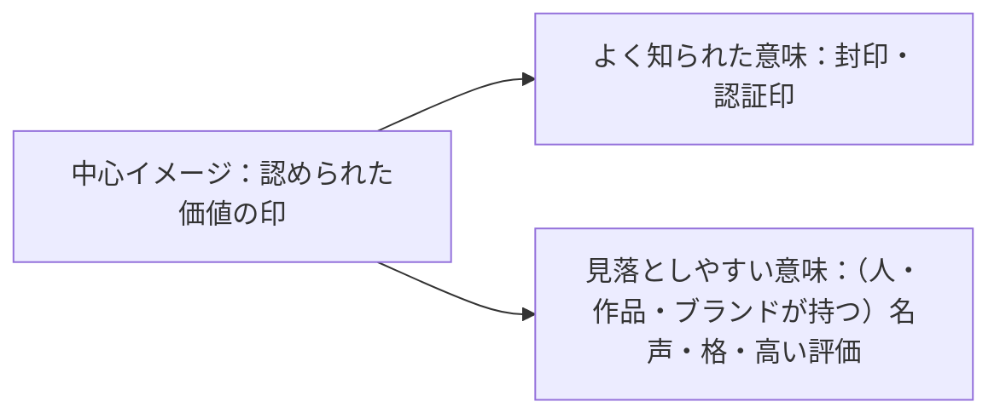

**重要語法：** have cachet（格や威信がある）

---

## 4162. china

**品詞：** 名詞  
**発音：** /ˈtʃaɪnə/

<small>よく知られている意味：China（中国、固有名詞）</small>

### 見落としやすい意味

**磁器、または磁器製の食器類**

**例文：** She placed the delicate china on a high shelf.

**和訳：** 彼女は繊細な磁器の食器を高い棚に置いた。

**コアイメージ：** 中国から伝わった磁器との結び付きが、普通名詞の意味に残っている。小文字のchinaは国名ではなく、素材や食器を指す。

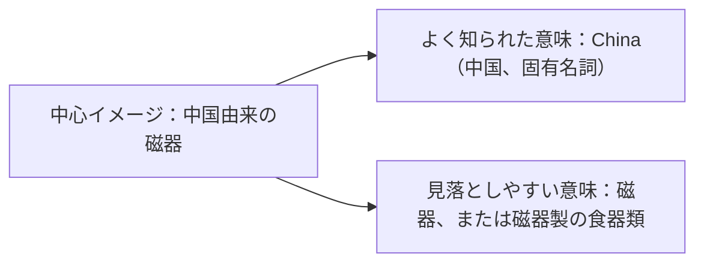

**重要語法：** fine china（高級磁器）

---

## 4163. chord

**品詞：** 名詞  
**発音：** /kɔːrd/

<small>よく知られている意味：和音</small>

### 見落としやすい意味

**円弧の両端を結ぶ線分（弦）**

**例文：** Draw a chord between these two points on the circle.

**和訳：** 円周上のこの二点を結ぶ弦を引きなさい。

**コアイメージ：** 同じ綴りが音楽と幾何で異なる専門的意味を持つ。幾何では円周上の二点を結ぶ線分を指し、和音とは区別する。

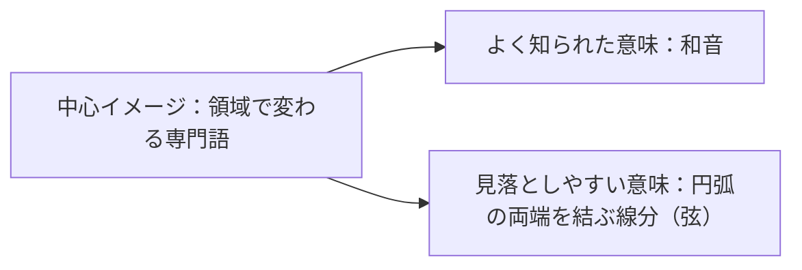

**重要語法：** chord of a circle（円の弦）

---

## 4164. christen

**品詞：** 動詞  
**発音：** /ˈkrɪsən/

<small>よく知られている意味：キリスト教の洗礼を授ける</small>

### 見落としやすい意味

**（洗礼以外でも）人や船などに名前を付ける**

**例文：** They christened the new library after a local scientist.

**和訳：** 彼らは新しい図書館に地元の科学者の名前を付けた。

**コアイメージ：** 洗礼のときに名前を与える習慣から、命名そのものを表すようになった。宗教的な場面に限らず、船や建物にも使える。

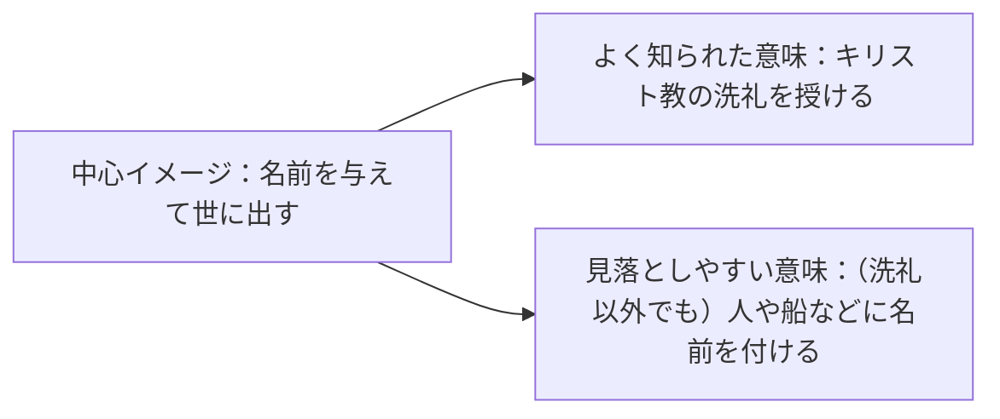

**重要語法：** christen A after B（AをBにちなんで名付ける）

---

## 4165. christen

**品詞：** 動詞  
**発音：** /ˈkrɪsən/

<small>よく知られている意味：洗礼を授ける・名付ける</small>

### 見落としやすい意味

**新しい物を初めて使う**

**例文：** We christened the new oven by baking bread.

**和訳：** 私たちはパンを焼いて、新しいオーブンを初めて使った。

**コアイメージ：** 新しいものを正式に使い始めることを、命名やお披露目になぞらえた用法。特別な初使用を軽いユーモアを交えて表すこともある。

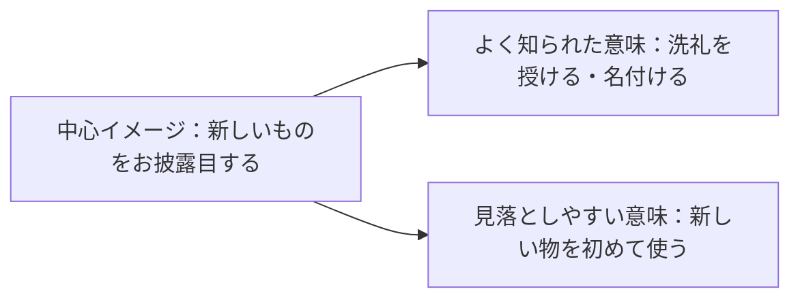

**重要語法：** christen A with B（BでAを初めて使う）

---

## 4166. chronically

**品詞：** 副詞  
**発音：** /ˈkrɑːnɪkli/

<small>よく知られている意味：慢性的な病気の状態で</small>

### 見落としやすい意味

**（問題・不足などが）長期にわたり繰り返し続いて**

**例文：** The town is chronically short of nurses.

**和訳：** その町は長年にわたり看護師が慢性的に不足している。

**コアイメージ：** 一時的な症状でなく、長く続く状態が基本の感覚。病気だけでなく、人手不足や経営問題にも使われる。

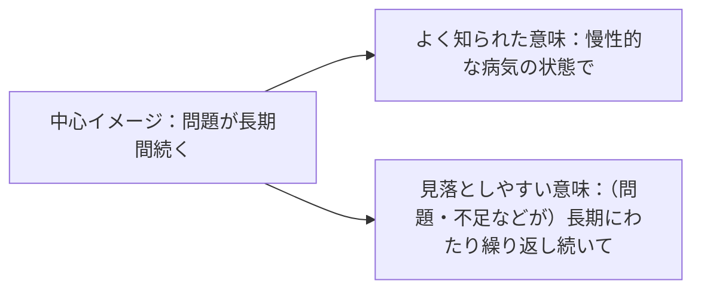

**重要語法：** chronically short of ...（慢性的に…が不足して）

---

## 4167. compass

**品詞：** 名詞  
**発音：** /ˈkʌmpəs/

<small>よく知られている意味：方位磁針・羅針盤</small>

### 見落としやすい意味

**円や弧を描くためのコンパス、製図器**

**例文：** Use a compass to draw a circle with a radius of five centimeters.

**和訳：** 半径5センチの円を製図用コンパスで描きなさい。

**コアイメージ：** 方位を調べる道具と円を描く道具は、同じ英単語で呼ばれる。何を測る・描くのかという動詞や場面から、道具を区別する。

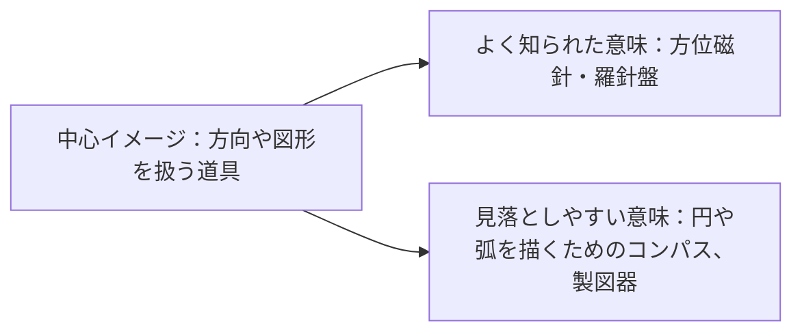

**重要語法：** draw a circle with a compass

---

## 4168. crank

**品詞：** 名詞  
**発音：** /kræŋk/

<small>よく知られている意味：機械を回す取っ手・クランク</small>

### 見落としやすい意味

**奇妙な持論を抱く人、気難しい人**

**例文：** He was dismissed as a crank until his theory was tested.

**和訳：** 彼の理論が検証されるまで、彼は変わり者として相手にされなかった。

**コアイメージ：** 機械の部品を指す名詞とは別に、人の頑固さや奇妙な主張を指す口語義がある。人について使われたら「取っ手」と訳さず人物評価として読む。

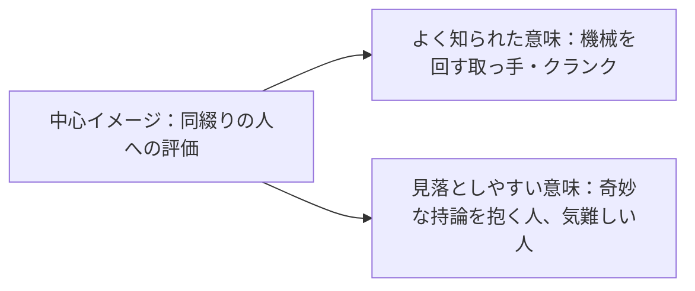

**重要語法：** a crank about ...（…に妙にこだわる人）

---

## 4169. culprit

**品詞：** 名詞  
**発音：** /ˈkʌlprɪt/

<small>よく知られている意味：犯罪の犯人</small>

### 見落としやすい意味

**（問題・失敗などの）原因、元凶となる物事**

**例文：** Poor ventilation was the main culprit behind the odor.

**和訳：** 換気の悪さが、その臭いの主な原因だった。

**コアイメージ：** 事件の犯人とは、悪い結果を引き起こした存在のこと。その発想を人以外にも広げ、問題の原因や元凶を指す。

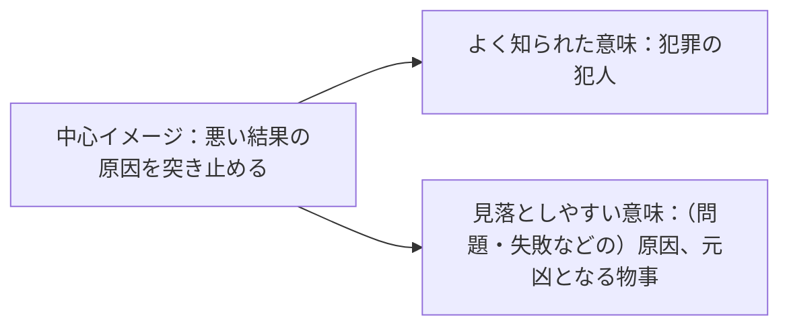

**重要語法：** the culprit behind ...（…の原因）

---

## 4170. custodial

**品詞：** 形容詞  
**発音：** /kʌˈstoʊdiəl/

<small>よく知られている意味：施設の管理・清掃に関する</small>

### 見落としやすい意味

**（法的な）監護・身柄の拘束に関する**

**例文：** The judge imposed a custodial sentence.

**和訳：** 裁判官は拘禁刑を言い渡した。

**コアイメージ：** custodyには世話や管理だけでなく、身柄を拘束しておく意味がある。法律の文脈では身体の自由や監護に関係する。

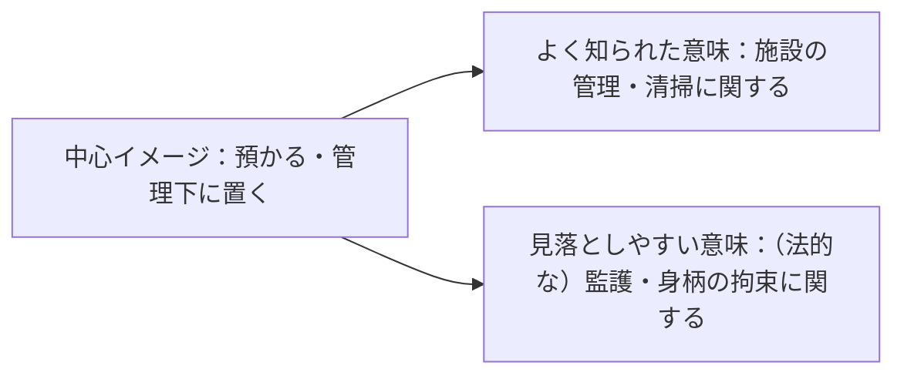

**重要語法：** custodial sentence（自由を奪う刑）

---

## 4171. directory

**品詞：** 名詞  
**発音：** /dəˈrɛktəri/

<small>よく知られている意味：住所録・名簿</small>

### 見落としやすい意味

**（コンピューター内の）ファイルをまとめるフォルダー**

**例文：** Move the photos into a separate directory.

**和訳：** その写真を別のディレクトリに移動しなさい。

**コアイメージ：** directoryは情報を探しやすく整理した一覧や場所を表す。コンピューターではファイルのまとまりを示すフォルダーに当たる。

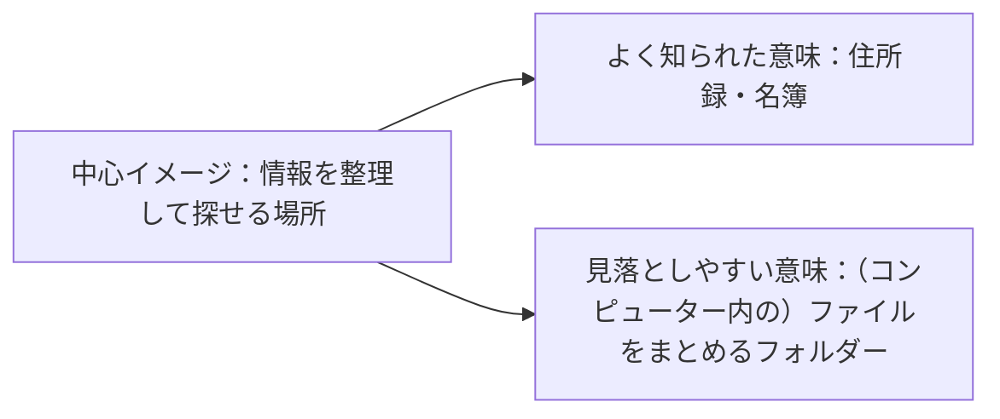

**重要語法：** directory structure（ディレクトリ構造）

---

## 4172. fallout

**品詞：** 名詞  
**発音：** /ˈfɔːlaʊt/

<small>よく知られている意味：放射性降下物</small>

### 見落としやすい意味

**出来事がもたらす悪影響・余波**

**例文：** Local shops still face the fallout from the factory closure.

**和訳：** 地元の店は今も工場閉鎖の悪影響を受けている。

**コアイメージ：** 何かが起こった後に周囲へ降りかかるものが基本の比喩。社会的事件や決定の後に残る、望ましくない影響を指す。

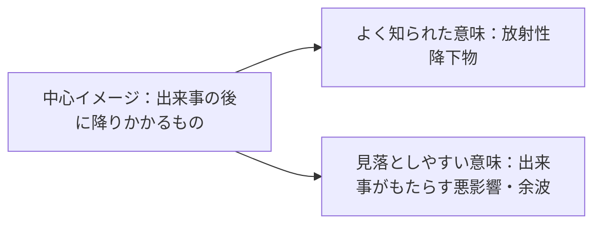

**重要語法：** fallout from ...（…の余波）

---

## 4173. fellowship

**品詞：** 名詞  
**発音：** /ˈfɛloʊʃɪp/

<small>よく知られている意味：仲間意識・友情</small>

### 見落としやすい意味

**研究費や生活費を伴う研究員資格・給付金**

**例文：** She received a two-year research fellowship.

**和訳：** 彼女は2年間の研究フェローシップを得た。

**コアイメージ：** 仲間として集まる関係から、研究機関での所属や支援制度の名にもなる。研究費・生活費などの支援内容は制度ごとに異なる。

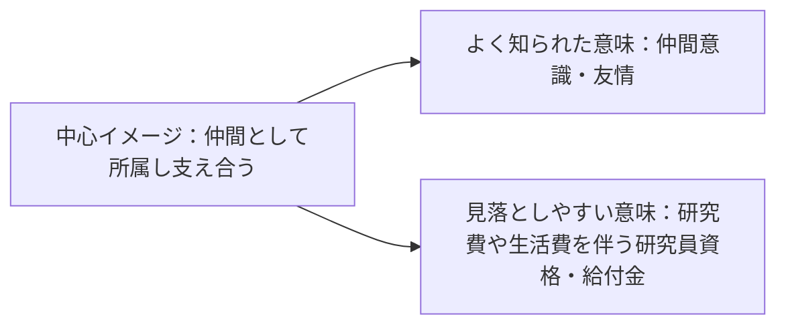

**重要語法：** research fellowship（研究員の資格・助成）

---

## 4174. felt

**品詞：** 名詞  
**発音：** /fɛlt/

<small>よく知られている意味：feelの過去形・過去分詞</small>

### 見落としやすい意味

**フェルト、不織布の厚手の布地**

**例文：** The artist cut small stars from thick felt.

**和訳：** その芸術家は厚手のフェルトから小さな星を切り抜いた。

**コアイメージ：** 動詞feelの変化形と、布の名称feltは文中で役割が異なる。同じ形でも名詞なら素材を指すことがあるため、品詞から見分ける。

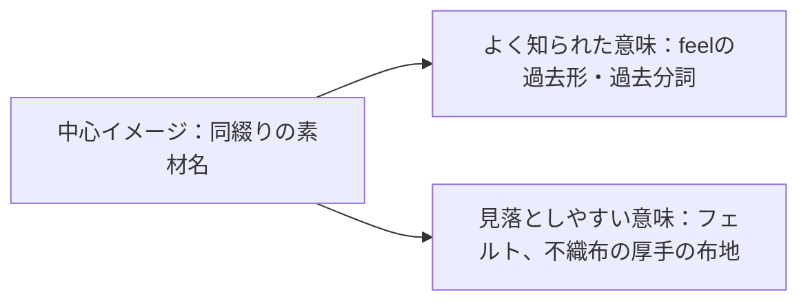

**重要語法：** felt hat（フェルト帽）

---

## 4175. finished

**品詞：** 形容詞  
**発音：** /ˈfɪnɪʃt/

<small>よく知られている意味：終わった・完成した</small>

### 見落としやすい意味

**（人や事業が）もうおしまいで、立ち直れない**

**例文：** If the funding disappears, the project is finished.

**和訳：** 資金援助がなくなれば、その事業はもうおしまいだ。

**コアイメージ：** 物事が終わっているという状態を、将来の見込みが尽きた状態にも広げる。文脈次第で単なる完了でなく、再起が難しいことを表す。

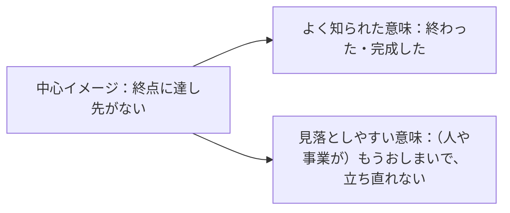

**重要語法：** be finished（終わりだ・もうだめだ）

---

## 4176. flake

**品詞：** 動詞  
**発音：** /fleɪk/

<small>よく知られている意味：薄片がはがれる</small>

### 見落としやすい意味

**約束・予定をすっぽかす**

**例文：** He flaked on our study session again.

**和訳：** 彼はまた私たちとの勉強会の約束をすっぽかした。

**コアイメージ：** これは口語的な別の動詞義で、予定を直前に取り消したり現れなかったりすること。小片がはがれるという字義から無理に推測せず、約束の文脈で覚える。

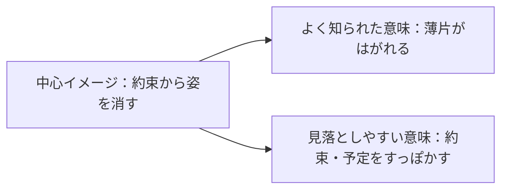

**重要語法：** flake on someone（人との約束をすっぽかす）

---

## 4177. germ

**品詞：** 名詞  
**発音：** /dʒɝːm/

<small>よく知られている意味：病原菌</small>

### 見落としやすい意味

**アイデアや物事が発展する最初の芽**

**例文：** The germ of the idea came to her on a train.

**和訳：** そのアイデアの芽は、列車に乗っているときに彼女に生まれた。

**コアイメージ：** germには何かが育ち始める小さな出発点という感覚もある。そこから、発展前の考えや計画の萌芽を表す。

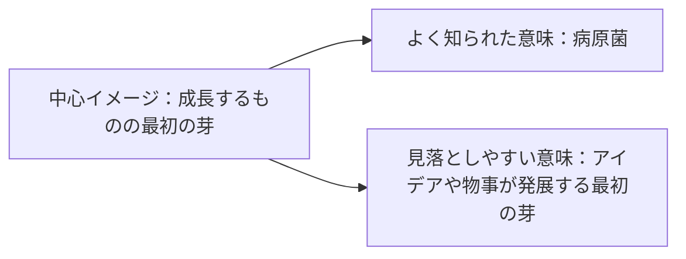

**重要語法：** the germ of an idea（アイデアの芽）

---

## 4178. glaze

**品詞：** 動詞  
**発音：** /ɡleɪz/

<small>よく知られている意味：つやを出す・釉薬をかける</small>

### 見落としやすい意味

**（目や視線が）退屈・疲労でぼんやりする**

**例文：** His eyes began to glaze over during the long lecture.

**和訳：** 長い講義の間に、彼の目はぼんやりしてきた。

**コアイメージ：** 表面をガラス状に覆う様子が、目の表情にも重ねられる。退屈や疲労で焦点が合わない視線を表す。

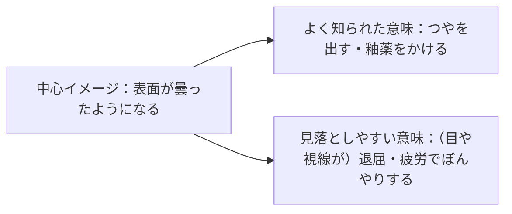

**重要語法：** eyes glaze over（目がうつろになる）

---

## 4179. gravitate

**品詞：** 動詞  
**発音：** /ˈɡrævɪteɪt/

<small>よく知られている意味：重力によって引き寄せられる</small>

### 見落としやすい意味

**（人が物事・場所・人物へ）自然と引き寄せられる**

**例文：** New students tend to gravitate toward the common room.

**和訳：** 新入生たちは自然と談話室に集まる傾向がある。

**コアイメージ：** 重力で物が引かれる動きが、人の興味や好みの方向にも広がる。誰かに命じられず自然に近づく感覚が大切。

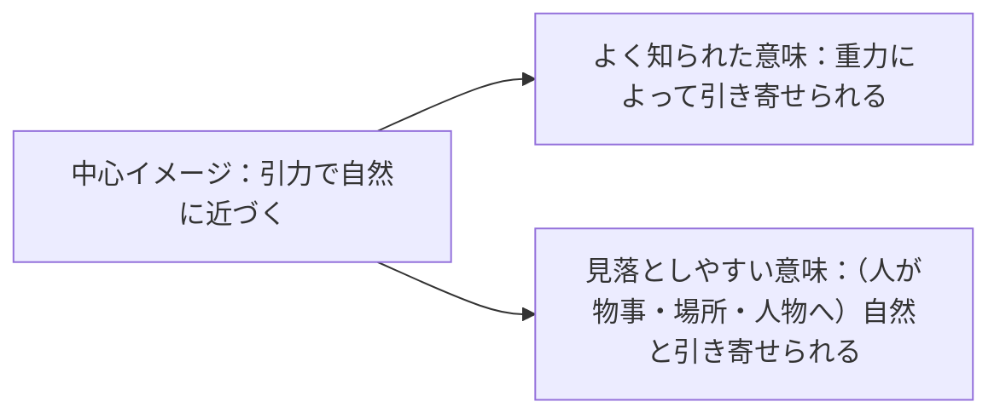

**重要語法：** gravitate toward ...（…に自然と引かれる）

---

## 4180. hacker

**品詞：** 名詞  
**発音：** /ˈhækər/

<small>よく知られている意味：不正侵入する人物</small>

### 見落としやすい意味

**高度なコンピューター技術に詳しい人（不正行為を意味しないことがある）**

**例文：** The company hired a skilled hacker to improve its security.

**和訳：** その会社は安全性を高めるため、高度な技術を持つハッカーを雇った。

**コアイメージ：** 技術を工夫してシステムを扱う人を広く表す場合がある。不正アクセスをする人かどうかは、行動や文脈を確認して判断する。

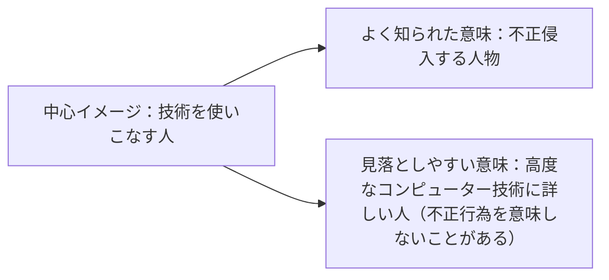

**重要語法：** ethical hacker（倫理的ハッカー）

---

## 4181. housekeeping

**品詞：** 名詞  
**発音：** /ˈhaʊskiːpɪŋ/

<small>よく知られている意味：家事・掃除</small>

### 見落としやすい意味

**会議・運営上の細々とした事務的な連絡事項**

**例文：** Before we begin, I have two housekeeping items about the schedule.

**和訳：** 始める前に、日程について事務連絡が二つあります。

**コアイメージ：** 家を整えて円滑に保つ作業が、組織や会議の雑務にたとえられる。本題の前に済ませる実務的な連絡を指すことが多い。

```mermaid
flowchart LR
    A["中心イメージ：活動を円滑にする細かな整備"]
    B["よく知られた意味：家事・掃除"]
    C["見落としやすい意味：会議・運営上の細々とした事務的な連絡事項"]
    A --> B
    A --> C
```

**重要語法：** housekeeping items（事務連絡事項）

---

## 4182. impervious

**品詞：** 形容詞  
**発音：** /ɪmˈpɝːviəs/

<small>よく知られている意味：水などを通さない</small>

### 見落としやすい意味

**（批判・議論などに）動じない、影響されない**

**例文：** She remained impervious to the harsh criticism.

**和訳：** 彼女は厳しい批判にも動じなかった。

**コアイメージ：** 水を通さない壁のように、外からの刺激が内面まで届かない感覚。意見や非難に影響されない態度にも用いる。

```mermaid
flowchart LR
    A["中心イメージ：外からの影響を通さない"]
    B["よく知られた意味：水などを通さない"]
    C["見落としやすい意味：（批判・議論などに）動じない、影響されない"]
    A --> B
    A --> C
```

**重要語法：** impervious to ...（…に動じない）

---

## 4183. insecurity

**品詞：** 名詞  
**発音：** /ˌɪnsɪˈkjʊrəti/

<small>よく知られている意味：自信のなさ・不安</small>

### 見落としやすい意味

**（food insecurityなどで）生活上の必需品へのアクセスが安定しないこと**

**例文：** The report examines food insecurity in rural areas.

**和訳：** その報告書は地方で食料を安定して得られない問題を調べている。

**コアイメージ：** securityは安心だけでなく、必要なものを確実に得られる状態も表す。insecurityはその安定が失われた状況で、食料や住居にも使われる。

```mermaid
flowchart LR
    A["中心イメージ：生活の安全・安定が欠ける"]
    B["よく知られた意味：自信のなさ・不安"]
    C["見落としやすい意味：（food insecurityなどで）生活上の必需品へのアクセスが安定しないこと"]
    A --> B
    A --> C
```

**重要語法：** food insecurity（食料不安）

---

## 4184. limp

**品詞：** 形容詞  
**発音：** /lɪmp/

<small>よく知られている意味：足を引きずって歩く</small>

### 見落としやすい意味

**柔らかく力がなく、だらりと垂れた**

**例文：** The flag hung limp in the still air.

**和訳：** 風のない空気の中で旗は力なく垂れ下がっていた。

**コアイメージ：** 力が入らず、しっかり支えられていない状態が共通する。人の歩き方だけでなく、布や手足がだらりとした様子にも使える。

```mermaid
flowchart LR
    A["中心イメージ：張りや力がない"]
    B["よく知られた意味：足を引きずって歩く"]
    C["見落としやすい意味：柔らかく力がなく、だらりと垂れた"]
    A --> B
    A --> C
```

**重要語法：** hang limp（力なく垂れる）

---

## 4185. lingua

**品詞：** 名詞  
**発音：** /ˈlɪŋɡwə/

<small>よく知られている意味：舌（ラテン語に由来する語）</small>

### 見落としやすい意味

**（lingua francaで）異なる母語の人が使う共通語**

**例文：** English served as a lingua franca at the conference.

**和訳：** その会議では英語が共通語として使われた。

**コアイメージ：** linguaはもともと舌や言語に関わる語。定型句lingua francaでは、母語の異なる人をつなぐ共通の言語を表す。

```mermaid
flowchart LR
    A["中心イメージ：言葉で人々をつなぐ"]
    B["よく知られた意味：舌（ラテン語に由来する語）"]
    C["見落としやすい意味：（lingua francaで）異なる母語の人が使う共通語"]
    A --> B
    A --> C
```

**重要語法：** lingua franca（共通語）

---

## 4186. mantle

**品詞：** 名詞  
**発音：** /ˈmæntəl/

<small>よく知られている意味：マント・覆い</small>

### 見落としやすい意味

**前任者から受け継ぐ重要な役職・責任**

**例文：** She took up the mantle of leadership after her mentor retired.

**和訳：** 恩師の引退後、彼女は指導者としての責任を引き継いだ。

**コアイメージ：** 人が身にまとうマントから、役目を身に引き受ける比喩が生まれる。前任者の立場や責任を受け継ぐ場面で使う。

```mermaid
flowchart LR
    A["中心イメージ：身にまとう役割"]
    B["よく知られた意味：マント・覆い"]
    C["見落としやすい意味：前任者から受け継ぐ重要な役職・責任"]
    A --> B
    A --> C
```

**重要語法：** take up the mantle of ...（…の役割を引き継ぐ）

---

## 4187. mantra

**品詞：** 名詞  
**発音：** /ˈmɑːntrə/

<small>よく知られている意味：宗教的に繰り返し唱える言葉</small>

### 見落としやすい意味

**繰り返し唱えられる標語・行動指針**

**例文：** Their mantra was simple: check every detail.

**和訳：** 彼らの行動指針は単純だった。「細部まで確認する」だ。

**コアイメージ：** 繰り返し唱える短い言葉から、何度も強調される信条や標語へ広がる。宗教と無関係な仕事や生活でも使われる。

```mermaid
flowchart LR
    A["中心イメージ：繰り返して心に刻む言葉"]
    B["よく知られた意味：宗教的に繰り返し唱える言葉"]
    C["見落としやすい意味：繰り返し唱えられる標語・行動指針"]
    A --> B
    A --> C
```

**重要語法：** a company mantra（企業の行動指針）

---

## 4188. mercifully

**品詞：** 副詞  
**発音：** /ˈmɝːsɪfəli/

<small>よく知られている意味：慈悲深く</small>

### 見落としやすい意味

**幸いなことに、ありがたいことに**

**例文：** Mercifully, the rain stopped before the outdoor concert.

**和訳：** 幸いなことに、屋外コンサートの前に雨がやんだ。

**コアイメージ：** 慈悲によって苦痛が和らぐ感覚から、ありがたい結果を述べる副詞になる。この用法では人の振る舞いでなく、状況全体を評価する。

```mermaid
flowchart LR
    A["中心イメージ：救いになる結果"]
    B["よく知られた意味：慈悲深く"]
    C["見落としやすい意味：幸いなことに、ありがたいことに"]
    A --> B
    A --> C
```

**重要語法：** Mercifully, ...（幸いなことに…）

---

## 4189. mockery

**品詞：** 名詞  
**発音：** /ˈmɑːkəri/

<small>よく知られている意味：あざけり・物まね</small>

### 見落としやすい意味

**（make a mockery ofで）規則・制度を形骸化させる、台無しにする**

**例文：** Ignoring the rules would make a mockery of the competition.

**和訳：** 規則を無視すれば、その競技会は形だけのものになってしまう。

**コアイメージ：** 嘲笑の対象になるほど本来の意味を失わせる、という強い比喩。制度や努力の価値を台無しにすることを表せる。

```mermaid
flowchart LR
    A["中心イメージ：まじめな価値を笑いものにする"]
    B["よく知られた意味：あざけり・物まね"]
    C["見落としやすい意味：（make a mockery ofで）規則・制度を形骸化させる、台無しにする"]
    A --> B
    A --> C
```

**重要語法：** make a mockery of ...（…を形骸化する）

---

## 4190. moot

**品詞：** 形容詞  
**発音：** /muːt/

<small>よく知られている意味：議論の対象となる（形容詞の一義）</small>

### 見落としやすい意味

**議論の余地があり、結論が確定していない**

**例文：** Whether the policy will work remains a moot point.

**和訳：** その政策がうまくいくかどうかは、なお議論の余地がある。

**コアイメージ：** mootには、まだ議論・決着の対象であるという意味がある。ただし特に米語では「実際上は意味がない」の用法も多く、文脈による区別が必要。

```mermaid
flowchart LR
    A["中心イメージ：議論の位置づけを示す"]
    B["よく知られた意味：議論の対象となる（形容詞の一義）"]
    C["見落としやすい意味：議論の余地があり、結論が確定していない"]
    A --> B
    A --> C
```

**重要語法：** a moot point（議論の余地がある点。文脈で別義にも注意）

---

## 4191. moot

**品詞：** 形容詞  
**発音：** /muːt/

<small>よく知られている意味：議論の余地がある</small>

### 見落としやすい意味

**実際上の意味がない、検討の必要がなくなった**

**例文：** Once the permit was granted, the objection became moot.

**和訳：** 許可が下りた時点で、その異議は実質的に意味を失った。

**コアイメージ：** 議論する価値のある争点だったとしても、状況が変われば結論が実務に影響しなくなる。特に米語でこの意味がよく使われる。

```mermaid
flowchart LR
    A["中心イメージ：議論しても結果が変わらない"]
    B["よく知られた意味：議論の余地がある"]
    C["見落としやすい意味：実際上の意味がない、検討の必要がなくなった"]
    A --> B
    A --> C
```

**重要語法：** become moot（実際上の争点でなくなる）

---

## 4192. moot

**品詞：** 動詞  
**発音：** /muːt/

<small>よく知られている意味：議論の余地がある（形容詞）</small>

### 見落としやすい意味

**討議のために議題として提案する**

**例文：** The committee mooted a plan to extend library hours.

**和訳：** 委員会は図書館の開館時間を延ばす案を議題に上げた。

**コアイメージ：** 動詞mootは、議論を始めるために案を持ち出すことを表す。結論を出すのではなく、検討対象として提示する段階に重点がある。

```mermaid
flowchart LR
    A["中心イメージ：議論の場に持ち出す"]
    B["よく知られた意味：議論の余地がある（形容詞）"]
    C["見落としやすい意味：討議のために議題として提案する"]
    A --> B
    A --> C
```

**重要語法：** moot a proposal（提案を議題にする。主に英語圏の一部で用いる）

---

## 4193. mug

**品詞：** 名詞  
**発音：** /mʌɡ/

<small>よく知られている意味：マグカップ</small>

### 見落としやすい意味

**（くだけた英語で）人の顔**

**例文：** His smiling mug appeared on the front page.

**和訳：** 彼のにこやかな顔が一面に載った。

**コアイメージ：** mugにはカップの意味とは別に、顔を表すくだけた用法がある。親しい・からかうような人物描写で出るため、前後の語で判断する。

```mermaid
flowchart LR
    A["中心イメージ：日常語の別の口語義"]
    B["よく知られた意味：マグカップ"]
    C["見落としやすい意味：（くだけた英語で）人の顔"]
    A --> B
    A --> C
```

**重要語法：** a mug shot（顔写真。特に警察の撮影写真）

---

## 4194. mug

**品詞：** 動詞  
**発音：** /mʌɡ/

<small>よく知られている意味：マグカップ・顔（名詞）</small>

### 見落としやすい意味

**人から金品を奪う目的で襲う**

**例文：** Police reported that a visitor had been mugged near the station.

**和訳：** 警察は駅の近くで訪問者が強盗被害に遭ったと発表した。

**コアイメージ：** 動詞mugは、路上などで人を襲って金品を奪うことを表す。カップを意味する名詞から無理に意味を推測せず、他動詞として見分ける。

```mermaid
flowchart LR
    A["中心イメージ：人を襲い金品を奪う"]
    B["よく知られた意味：マグカップ・顔（名詞）"]
    C["見落としやすい意味：人から金品を奪う目的で襲う"]
    A --> B
    A --> C
```

**重要語法：** be mugged（強盗被害に遭う）

---

## 4195. noted

**品詞：** 形容詞  
**発音：** /ˈnoʊtɪd/

<small>よく知られている意味：書き留められた</small>

### 見落としやすい意味

**名高い、ある分野で有名な**

**例文：** A noted historian spoke at the event.

**和訳：** その催しでは著名な歴史家が講演した。

**コアイメージ：** noteには注意を向け、記録するという感覚がある。多くの人に注目されている人物や仕事を、notedで表す。

```mermaid
flowchart LR
    A["中心イメージ：多くの人に注目される"]
    B["よく知られた意味：書き留められた"]
    C["見落としやすい意味：名高い、ある分野で有名な"]
    A --> B
    A --> C
```

**重要語法：** a noted expert（著名な専門家）

---

## 4196. onslaught

**品詞：** 名詞  
**発音：** /ˈɑːnslɔːt/

<small>よく知られている意味：激しい攻撃</small>

### 見落としやすい意味

**批判・質問・問題などが激しく押し寄せること**

**例文：** The speaker faced an onslaught of questions after the talk.

**和訳：** 講演後、話し手には質問が次々と押し寄せた。

**コアイメージ：** 一度に攻め込むような強い勢いが核にある。実際の攻撃だけでなく、質問や批判が大量に迫る様子にも使う。

```mermaid
flowchart LR
    A["中心イメージ：次々と激しく押し寄せる"]
    B["よく知られた意味：激しい攻撃"]
    C["見落としやすい意味：批判・質問・問題などが激しく押し寄せること"]
    A --> B
    A --> C
```

**重要語法：** an onslaught of criticism（激しい批判の集中）

---

## 4197. outgoing

**品詞：** 形容詞  
**発音：** /ˈaʊtˌɡoʊɪŋ/

<small>よく知られている意味：社交的・外向的な</small>

### 見落としやすい意味

**（大統領・役員などが）退任する、去りゆく**

**例文：** The outgoing director thanked the staff on her final day.

**和訳：** 退任する部長は最後の日に職員へ感謝を述べた。

**コアイメージ：** 外に向かって出ていくという方向性を表す。人事の文脈では、役職から去っていく人を修飾する。

```mermaid
flowchart LR
    A["中心イメージ：外へ出て去る"]
    B["よく知られた意味：社交的・外向的な"]
    C["見落としやすい意味：（大統領・役員などが）退任する、去りゆく"]
    A --> B
    A --> C
```

**重要語法：** the outgoing president（退任する会長・大統領）

---

## 4198. palate

**品詞：** 名詞  
**発音：** /ˈpælət/

<small>よく知られている意味：口蓋（口の天井部分）</small>

### 見落としやすい意味

**飲食物を味わい、良し悪しを判断する味覚**

**例文：** The chef has a refined palate for subtle flavors.

**和訳：** その料理人には繊細な味を見分ける優れた味覚がある。

**コアイメージ：** 口の中の部位を指す語が、味を感じ取る能力へ意味を広げた。食や飲み物の評価では、味覚の鋭さや好みを指す。

```mermaid
flowchart LR
    A["中心イメージ：味を受け取り判断する口"]
    B["よく知られた意味：口蓋（口の天井部分）"]
    C["見落としやすい意味：飲食物を味わい、良し悪しを判断する味覚"]
    A --> B
    A --> C
```

**重要語法：** a refined palate（洗練された味覚）

---

## 4199. patronage

**品詞：** 名詞  
**発音：** /ˈpeɪtrənɪdʒ/

<small>よく知られている意味：保護・後援</small>

### 見落としやすい意味

**商店・飲食店などに対する顧客からのひいき・取引**

**例文：** The café depends on the patronage of local residents.

**和訳：** そのカフェは地元住民のひいきに支えられている。

**コアイメージ：** patronは支える人・常連客のこと。商店の文脈では、支援が寄付ではなく継続的な利用や取引として現れる。

```mermaid
flowchart LR
    A["中心イメージ：支えとなる関係"]
    B["よく知られた意味：保護・後援"]
    C["見落としやすい意味：商店・飲食店などに対する顧客からのひいき・取引"]
    A --> B
    A --> C
```

**重要語法：** thank you for your patronage（ご愛顧ありがとうございます）

---

## 4200. patronage

**品詞：** 名詞  
**発音：** /ˈpeɪtrənɪdʒ/

<small>よく知られている意味：後援・ひいき・顧客の利用</small>

### 見落としやすい意味

**支持への見返りとして地位や便宜を与える政治的恩顧**

**例文：** The new mayor promised to end political patronage in hiring.

**和訳：** 新市長は採用における政治的な縁故優遇をなくすと約束した。

**コアイメージ：** 有力者が人を支援する関係が、権限を使って地位や利益を与える仕組みにもなる。政治では、支持の見返りとして便宜を図る意味が重要。

```mermaid
flowchart LR
    A["中心イメージ：権力によるひいき"]
    B["よく知られた意味：後援・ひいき・顧客の利用"]
    C["見落としやすい意味：支持への見返りとして地位や便宜を与える政治的恩顧"]
    A --> B
    A --> C
```

**重要語法：** political patronage（政治的な恩顧・縁故）

---
