# EasyVoca 完成教材｜Batch 054

採用済み語義のみを対象とした学習カードです。global_order: **4241〜4320**（全80件）。

## 4241. ballpark

- **単語**：ballpark
- **品詞**：adjective
- **発音（目安）**：/ˈbɔːlpɑːrk/

<small>よく知られている意味：野球場</small>

### 見落としやすい意味

**おおよその、概算の**

**例文**：We need only a ballpark estimate of the repair cost.

**和訳**：修理費はおおよその見積もりで十分だ。

**コアイメージ**：ballpark は球場を指す名詞だが、金額について使うと正確さより大まかな範囲を重視する。ballpark estimate は概算の見積もりを意味する。

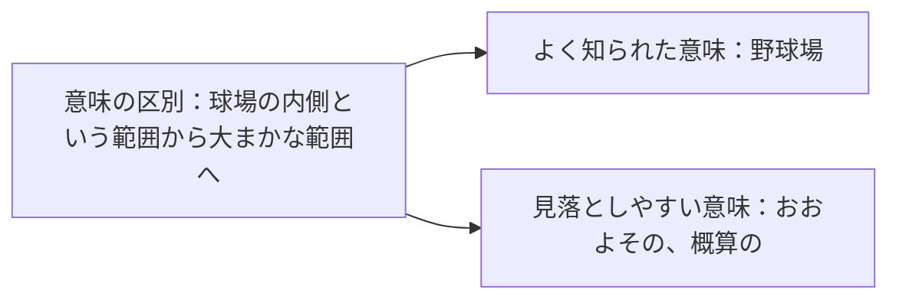

**重要語法**：`ballpark figure / ballpark estimate`

<small>index: 9472 / candidate_id: ev-09472-adjective-01</small>

---

## 4242. ballpark

- **単語**：ballpark
- **品詞**：verb
- **発音（目安）**：/ˈbɔːlpɑːrk/

<small>よく知られている意味：野球場</small>

### 見落としやすい意味

**大まかな数値を見積もる**

**例文**：Can you ballpark the cost before we make a decision?

**和訳**：決める前に費用をざっと見積もってくれる？

**コアイメージ**：ballpark は口語では動詞にもなり、数値を大づかみにする行為を表す。精密に計算するのではなく、まず概算する場面に合う。

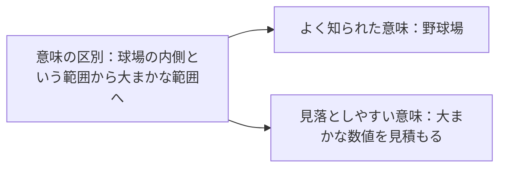

**重要語法**：`informal、ballpark the costなど`

<small>index: 9472 / candidate_id: ev-09472-verb-01</small>

---

## 4243. beckon

- **単語**：beckon
- **品詞**：verb
- **発音（目安）**：/ˈbɛkən/

<small>よく知られている意味：手招きする</small>

### 見落としやすい意味

**（機会・冒険・未来などが）人を誘う、魅力的に待ち受ける**

**例文**：A chance to work abroad suddenly beckoned.

**和訳**：海外で働く機会が突然目の前に開けた。

**コアイメージ**：手で人を招く動作から、機会や将来が人を引きつける描写へ広がる。人が実際に手招きしているわけではない。

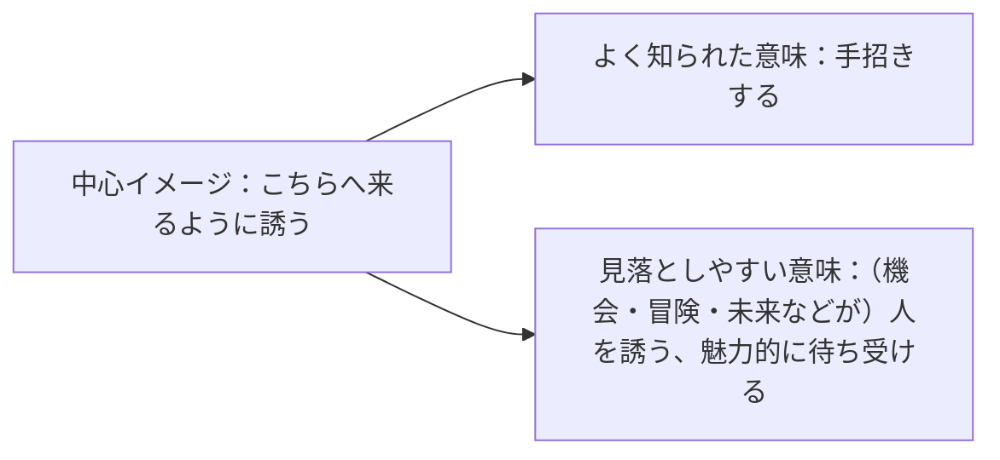

**重要語法**：`a new life beckons`

<small>index: 9474 / candidate_id: ev-09474-verb-01</small>

---

## 4244. behest

- **単語**：behest
- **品詞**：noun
- **発音（目安）**：/bɪˈhɛst/

<small>よく知られている意味：要求・命令</small>

### 見落としやすい意味

**（at someone's behestで）人からの要求・指示によって**

**例文**：The meeting was arranged at the behest of the parents.

**和訳**：その会議は保護者の要請で設定された。

**コアイメージ**：behest は誰かの強い要請や指示を表す。at the behest of の形なら、その人の要請を受けて行われたことが分かる。

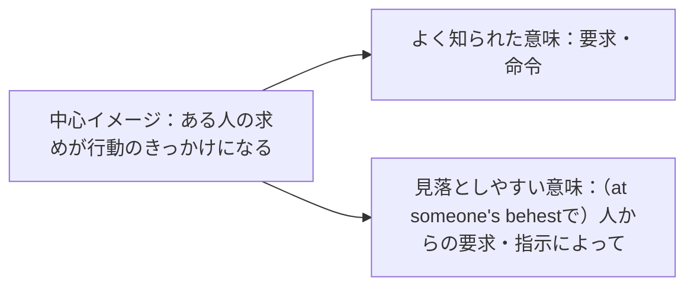

**重要語法**：`at the behest of ...`

<small>index: 9475 / candidate_id: ev-09475-noun-01</small>

---

## 4245. breaker

- **単語**：breaker
- **品詞**：noun
- **発音（目安）**：/ˈbreɪkər/

<small>よく知られている意味：砕ける大波</small>

### 見落としやすい意味

**過電流時に回路を遮断する安全装置**

**例文**：The electrician replaced the faulty circuit breaker.

**和訳**：電気技師は故障した回路遮断器を交換した。

**コアイメージ**：breaker は砕ける波にも使われるが、電気では電流を遮る装置を指す。circuit breaker というまとまりで覚えると読み違えない。

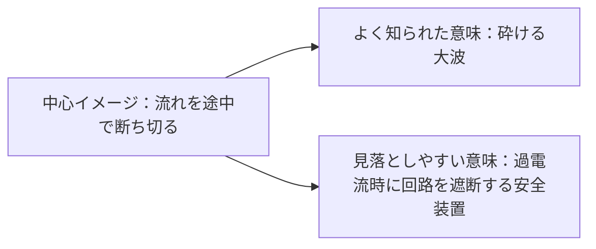

**重要語法**：`circuit breaker`

<small>index: 9477 / candidate_id: ev-09477-noun-01</small>

---

## 4246. breezy

- **単語**：breezy
- **品詞**：adjective
- **発音（目安）**：/ˈbriːzi/

<small>よく知られている意味：風が心地よく吹く</small>

### 見落としやすい意味

**明るく気楽で、深刻さをあまり見せない**

**例文**：She gave a breezy reply despite the serious question.

**和訳**：彼女は深刻な質問にも軽やかに答えた。

**コアイメージ**：心地よい風のような軽さが、人物の態度にも移される。breezy は明るく気楽な様子を表すが、ときに軽率さも含む。

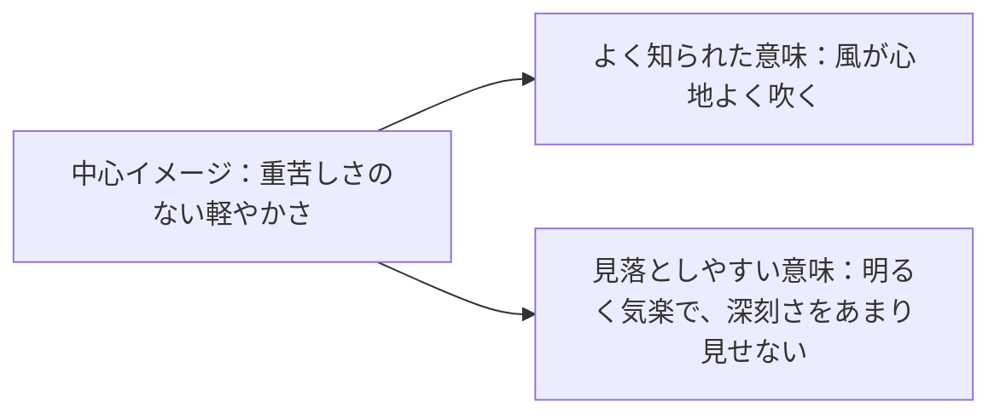

**重要語法**：`a breezy manner`

<small>index: 9478 / candidate_id: ev-09478-adjective-01</small>

---

## 4247. brow

- **単語**：brow
- **品詞**：noun
- **発音（目安）**：/braʊ/

<small>よく知られている意味：眉・額</small>

### 見落としやすい意味

**丘や斜面の上端・頂上付近**

**例文**：A small house stood on the brow of the hill.

**和訳**：丘の頂上付近に小さな家が建っていた。

**コアイメージ**：brow は顔の上部にある眉や額を指す。地形では、丘や斜面の上端を同じようにとらえて表す。

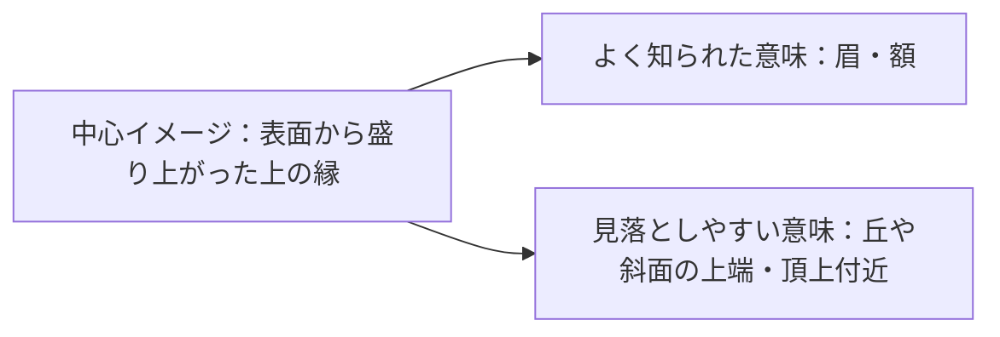

**重要語法**：`the brow of a hill`

<small>index: 9479 / candidate_id: ev-09479-noun-01</small>

---

## 4248. buggy

- **単語**：buggy
- **品詞**：adjective
- **発音（目安）**：/ˈbʌɡi/

<small>よく知られている意味：小型の馬車・乳母車</small>

### 見落としやすい意味

**（ソフトウェアが）不具合・バグの多い**

**例文**：The new app is still too buggy to release.

**和訳**：新しいアプリはまだ不具合が多すぎて公開できない。

**コアイメージ**：乗り物を指す名詞 buggy と、bug に由来する形容詞 buggy を区別する。ソフトウェアの文脈では「バグだらけの」という意味になる。

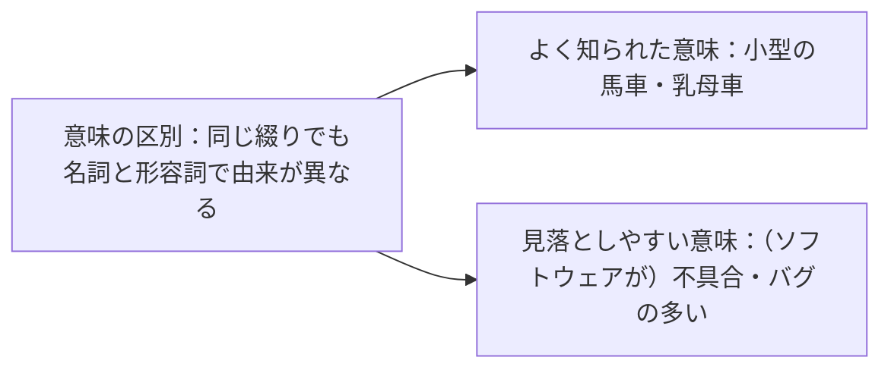

**重要語法**：`informal、buggy software`

<small>index: 9481 / candidate_id: ev-09481-adjective-01</small>

---

## 4249. calculated

- **単語**：calculated
- **品詞**：adjective
- **発音（目安）**：/ˈkælkjəleɪtɪd/

<small>よく知られている意味：計算された</small>

### 見落としやすい意味

**特定の結果を狙って計画された、計算ずくの**

**例文**：His silence was a calculated attempt to gain attention.

**和訳**：彼の沈黙は注目を集めるための計算ずくの行動だった。

**コアイメージ**：数字を計算する行為と同じく、先の結果を予測して行動を組み立てる。ここでは計算の正確さより意図的な策略を表す。

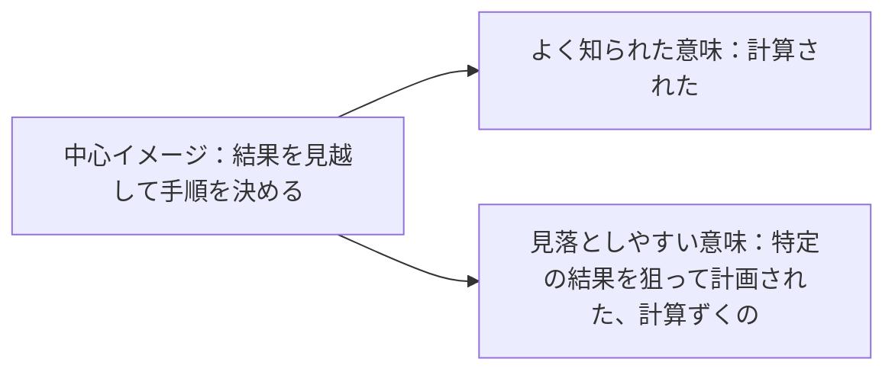

**重要語法**：`be calculated to do ～を狙って設計される`

<small>index: 9482 / candidate_id: ev-09482-adjective-01</small>

---

## 4250. chap

- **単語**：chap
- **品詞**：verb
- **発音（目安）**：/tʃæp/

<small>よく知られている意味：男・やつ（英口語）</small>

### 見落としやすい意味

**（寒さ・乾燥などで唇や皮膚が）荒れてひび割れる**

**例文**：Cold weather can chap your lips.

**和訳**：寒い天気は唇を荒れさせることがある。

**コアイメージ**：男性を指す名詞 chap と、皮膚をひび割れさせる動詞 chap は別の意味として覚える。chapped lips は唇が荒れた状態を表す。

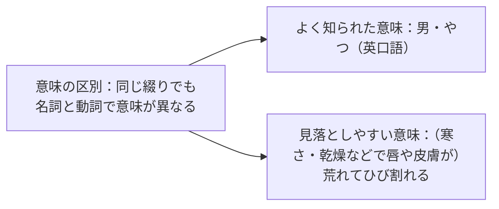

**重要語法**：`chapped lips`

<small>index: 9484 / candidate_id: ev-09484-verb-01</small>

---

## 4251. circumstantial

- **単語**：circumstantial
- **品詞**：adjective
- **発音（目安）**：/ˌsɜːrkəmˈstænʃəl/

<small>よく知られている意味：状況に関する</small>

### 見落としやすい意味

**（証拠が）直接ではなく状況から推測させる**

**例文**：The case relied mainly on circumstantial evidence.

**和訳**：その事件は主に状況証拠に頼っていた。

**コアイメージ**：circumstantial は出来事の周辺事情に関係することを表す。証拠について使うと、事実を直接示すのではなく事情から推測させる意味になる。

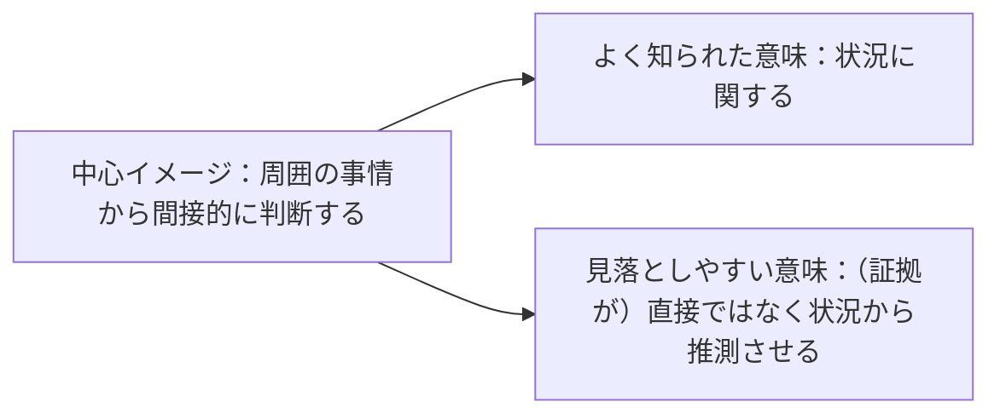

**重要語法**：`circumstantial evidence`

<small>index: 9487 / candidate_id: ev-09487-adjective-01</small>

---

## 4252. cleave

- **単語**：cleave
- **品詞**：verb
- **発音（目安）**：/kliːv/

<small>よく知られている意味：切り裂く</small>

### 見落としやすい意味

**（信念・伝統などに）固く従う、ぴったり付着する**

**例文**：Some people still cleave to old traditions.

**和訳**：今でも古い伝統を固く守る人がいる。

**コアイメージ**：cleave には「割る」と「くっつく」という対照的な意味がある。別系統の動詞が同じ形になったためで、cleave to は「固く守る」と文脈で見分ける。

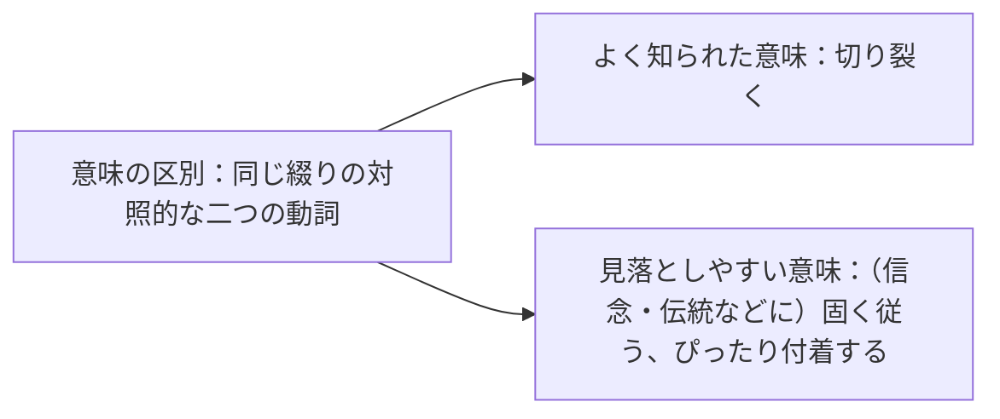

**重要語法**：`文学的なcleave to something`

<small>index: 9490 / candidate_id: ev-09490-verb-01</small>

---

## 4253. clerical

- **単語**：clerical
- **品詞**：adjective
- **発音（目安）**：/ˈklɛrɪkəl/

<small>よく知られている意味：聖職者に関する</small>

### 見落としやすい意味

**書類処理などの事務作業に関する**

**例文**：A clerical error delayed the payment.

**和訳**：事務上のミスで支払いが遅れた。

**コアイメージ**：clerical は宗教上の職務に関係する場合もある。職場では書類処理を担う clerk の仕事に関する意味で使われる。

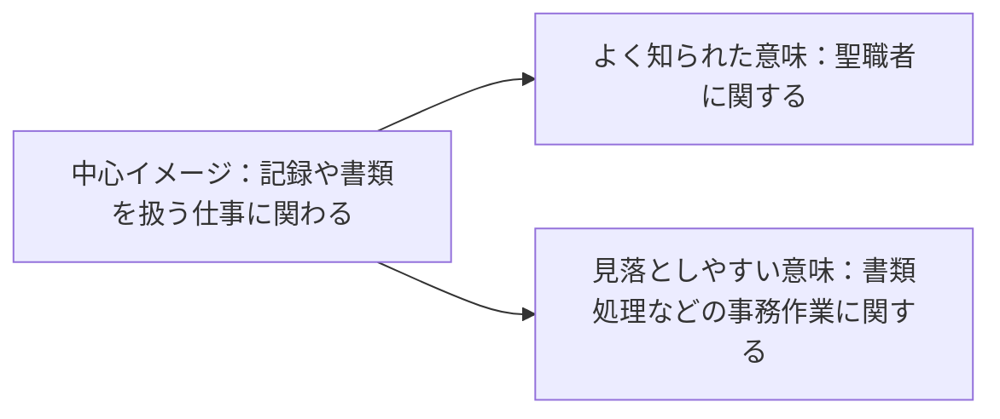

**重要語法**：`clerical work / clerical error`

<small>index: 9491 / candidate_id: ev-09491-adjective-01</small>

---

## 4254. compiler

- **単語**：compiler
- **品詞**：noun
- **発音（目安）**：/kəmˈpaɪlər/

<small>よく知られている意味：プログラムのコンパイラ</small>

### 見落としやすい意味

**資料・作品などを集めて編集する人**

**例文**：The compiler of the collection added detailed notes.

**和訳**：その作品集の編者は詳しい注を付けた。

**コアイメージ**：compiler は材料を集めて構成する人を表す。コンピュータではコードを処理するプログラムを指すが、出版の文脈では編者を指す。

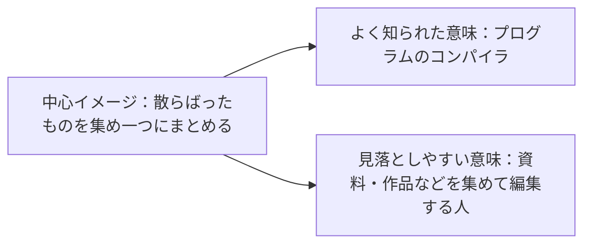

**重要語法**：`compiler of an anthology`

<small>index: 9496 / candidate_id: ev-09496-noun-01</small>

---

## 4255. conditioning

- **単語**：conditioning
- **品詞**：noun
- **発音（目安）**：/kənˈdɪʃənɪŋ/

<small>よく知られている意味：体調・状態の調整</small>

### 見落としやすい意味

**経験を通じてある刺激と反応を結び付ける学習過程**

**例文**：The dog learned the response through conditioning.

**和訳**：その犬は条件づけによってその反応を身につけた。

**コアイメージ**：conditioning はある状態へ整える過程を広く表す。心理学では刺激と反応の結び付きを経験によって学ぶことをいう。

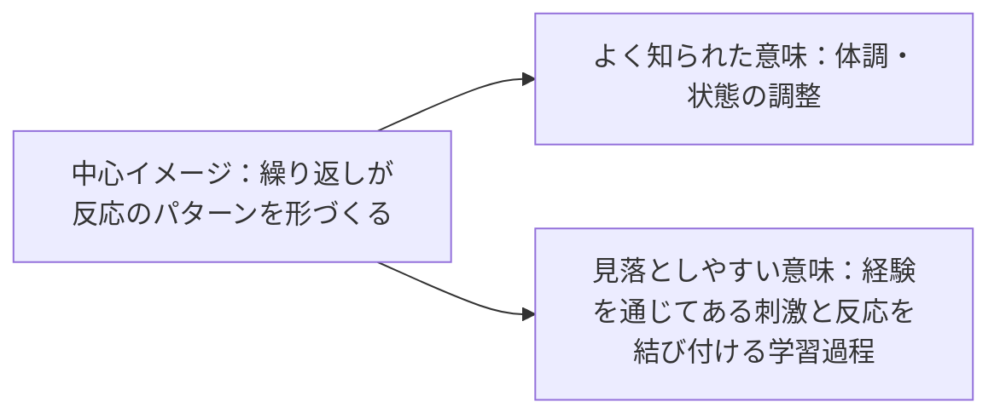

**重要語法**：`classical conditioning`

<small>index: 9500 / candidate_id: ev-09500-noun-01</small>

---

## 4256. defuse

- **単語**：defuse
- **品詞**：verb
- **発音（目安）**：/diːˈfjuːz/

<small>よく知られている意味：爆弾の信管を外す</small>

### 見落としやすい意味

**対立や緊張を和らげる**

**例文**：The mediator helped defuse the tension in the room.

**和訳**：仲介役はその場の緊張を和らげる助けになった。

**コアイメージ**：信管を外して爆発を防ぐという具体的な動作が出発点になる。対立にも使い、悪化しかけた緊張を鎮める意味になる。

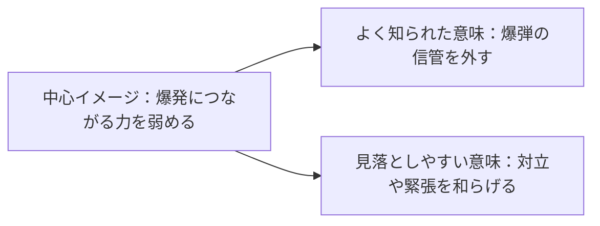

**重要語法**：`defuse tensions`

<small>index: 9508 / candidate_id: ev-9508-verb-01</small>

---

## 4257. dent

- **単語**：dent
- **品詞**：verb
- **発音（目安）**：/dɛnt/

<small>よく知られている意味：へこませる</small>

### 見落としやすい意味

**自信や誇りを傷つける**

**例文**：One harsh comment dented his confidence.

**和訳**：たった一つの厳しい言葉が彼の自信を傷つけた。

**コアイメージ**：物を押してへこみを作る様子を、自信や評判への損傷に重ねる。完全に壊すのではなく、勢いや強さを弱める意味になる。

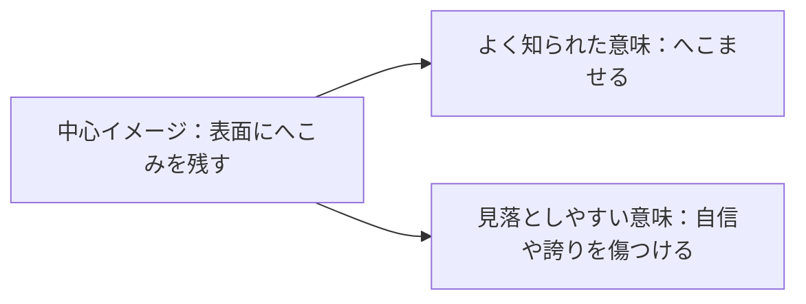

<small>index: 9509 / candidate_id: ev-9509-verb-01</small>

---

## 4258. derail

- **単語**：derail
- **品詞**：verb
- **発音（目安）**：/diːˈreɪl/

<small>よく知られている意味：列車を脱線させる</small>

### 見落としやすい意味

**計画や交渉を挫折させる**

**例文**：An unexpected lawsuit derailed the project.

**和訳**：予想外の訴訟でその計画は頓挫した。

**コアイメージ**：列車が線路から外れるのが基本のイメージである。計画や交渉が予定した進路を失うことにも使う。

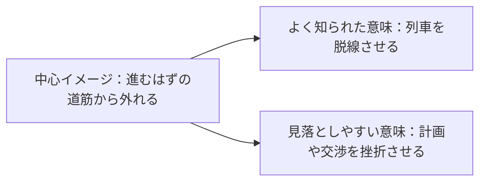

<small>index: 9510 / candidate_id: ev-9510-verb-01</small>

---

## 4259. detach

- **単語**：detach
- **品詞**：verb
- **発音（目安）**：/dɪˈtætʃ/

<small>よく知られている意味：取り外す・切り離す</small>

### 見落としやすい意味

**感情的に距離を置いて客観視する**

**例文**：Try to detach yourself from the argument before judging it.

**和訳**：判断する前に、その議論から感情的に距離を置いてみて。

**コアイメージ**：物をつなぎ目から外す行為を心理的な関係にも広げる。自分の感情をいったん離して客観的に見ることを表す。

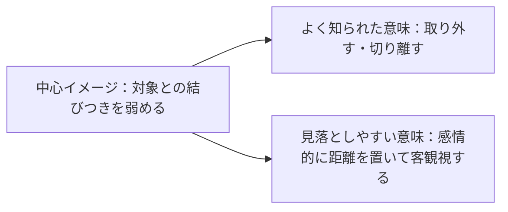

**重要語法**：`detach oneself from`

<small>index: 9511 / candidate_id: ev-9511-verb-01</small>

---

## 4260. diffuse

- **単語**：diffuse
- **品詞**：adjective
- **発音（目安）**：/dɪˈfjuːs/

<small>よく知られている意味：広める・拡散させる（動詞）</small>

### 見落としやすい意味

**文章や考えが散漫で不明瞭な**

**例文**：The article was too diffuse to follow easily.

**和訳**：その文章は散漫すぎて内容を追いにくかった。

**コアイメージ**：diffuse は動詞では広く拡散させることを表す。形容詞では考えが広がりすぎ、焦点が定まらない状態を表す。

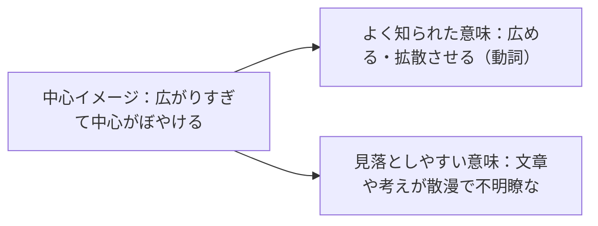

**重要語法**：`動詞は語末 /z/、形容詞は /s/`

<small>index: 9513 / candidate_id: ev-9513-adjective-01</small>

---

## 4261. dignify

- **単語**：dignify
- **品詞**：verb
- **発音（目安）**：/ˈdɪɡnɪfaɪ/

<small>よく知られている意味：威厳を与える</small>

### 見落としやすい意味

**答えや反応を与えて重要であるかのように扱う**

**例文**：I won't dignify that rumor with an answer.

**和訳**：そのうわさに答えて、まともに扱うつもりはない。

**コアイメージ**：dignify は対象に威厳や重要性を認めることを表す。反論や回答を与えるだけでも、取るに足らない発言を重要そうに見せる場合がある。

```mermaid
flowchart LR
    A["中心イメージ：価値や重みを与える"]
    B["よく知られた意味：威厳を与える"]
    C["見落としやすい意味：答えや反応を与えて重要であるかのように扱う"]
    A --> B
    A --> C
```

**重要語法**：`dignify something with an answer`

<small>index: 9514 / candidate_id: ev-9514-verb-01</small>

---

## 4262. dine

- **単語**：dine
- **品詞**：verb
- **発音（目安）**：/daɪn/

<small>よく知られている意味：食事をする</small>

### 見落としやすい意味

**～を食事として食べる**

**例文**：We dined on fresh fish after the hike.

**和訳**：私たちはハイキングの後、新鮮な魚を食事にした。

**コアイメージ**：dine は単に食事をすることを表す。dine on の形になると、何を食事として食べたのかを示す。

```mermaid
flowchart LR
    A["中心イメージ：食卓で何かを食事にする"]
    B["よく知られた意味：食事をする"]
    C["見落としやすい意味：～を食事として食べる"]
    A --> B
    A --> C
```

**重要語法**：`dine on`

<small>index: 9515 / candidate_id: ev-9515-verb-01</small>

---

## 4263. disconnect

- **単語**：disconnect
- **品詞**：noun
- **発音（目安）**：/ˌdɪskəˈnɛkt/

<small>よく知られている意味：接続の切断</small>

### 見落としやすい意味

**認識・立場・実態の食い違い**

**例文**：There is a disconnect between the promise and the reality.

**和訳**：約束と現実の間には食い違いがある。

**コアイメージ**：機械的な接続が切れた状態を、考えや立場の不一致にも重ねる。between を伴うと、何と何がずれているかを示す。

```mermaid
flowchart LR
    A["中心イメージ：二つのものがつながっていない"]
    B["よく知られた意味：接続の切断"]
    C["見落としやすい意味：認識・立場・実態の食い違い"]
    A --> B
    A --> C
```

**重要語法**：`a disconnect between`

<small>index: 9517 / candidate_id: ev-9517-noun-01</small>

---

## 4264. divinity

- **単語**：divinity
- **品詞**：noun
- **発音（目安）**：/dɪˈvɪnəti/

<small>よく知られている意味：神性・神々しさ</small>

### 見落としやすい意味

**神学という学問**

**例文**：She decided to study divinity at university.

**和訳**：彼女は大学で神学を学ぶことにした。

**コアイメージ**：divinity は神聖さや神の性質を指す。学問の文脈では、神や宗教について体系的に研究する神学を意味する。

```mermaid
flowchart LR
    A["中心イメージ：神に関わる事柄を扱う"]
    B["よく知られた意味：神性・神々しさ"]
    C["見落としやすい意味：神学という学問"]
    A --> B
    A --> C
```

**重要語法**：`study divinity`

<small>index: 9519 / candidate_id: ev-9519-noun-01</small>

---

## 4265. doubtful

- **単語**：doubtful
- **品詞**：adjective
- **発音（目安）**：/ˈdaʊtfəl/

<small>よく知られている意味：疑いを抱いている</small>

### 見落としやすい意味

**～とは思えない・実現が疑わしい**

**例文**：It is doubtful that the train will arrive on time.

**和訳**：その列車が時間どおりに着くとは考えにくい。

**コアイメージ**：doubtful は疑う気持ちを示すだけではない。It is doubtful that の形では、後に続く出来事が起こりそうにないという判断になる。

```mermaid
flowchart LR
    A["中心イメージ：確信を持てないため実現可能性が低く見える"]
    B["よく知られた意味：疑いを抱いている"]
    C["見落としやすい意味：～とは思えない・実現が疑わしい"]
    A --> B
    A --> C
```

**重要語法**：`It is doubtful that`

<small>index: 9521 / candidate_id: ev-9521-adjective-01</small>

---

## 4266. dough

- **単語**：dough
- **品詞**：noun
- **発音（目安）**：/doʊ/

<small>よく知られている意味：パンなどの生地</small>

### 見落としやすい意味

**お金・現金**

**例文**：He made a lot of dough from the business.

**和訳**：彼はその事業で大金を稼いだ。

**コアイメージ**：dough の基本義は小麦粉を練った生地である。口語では money を表し、金額を扱う文脈から判断する。

```mermaid
flowchart LR
    A["意味の区別：同じ単語に具体義と口語の別義がある"]
    B["よく知られた意味：パンなどの生地"]
    C["見落としやすい意味：お金・現金"]
    A --> B
    A --> C
```

**重要語法**：`slang for money`

<small>index: 9522 / candidate_id: ev-9522-noun-01</small>

---

## 4267. downstream

- **単語**：downstream
- **品詞**：adjective
- **発音（目安）**：/ˌdaʊnˈstriːm/

<small>よく知られている意味：川下の</small>

### 見落としやすい意味

**生産や流通の後工程に位置する**

**例文**：The company expanded into downstream manufacturing.

**和訳**：その会社は製造工程の後半にあたる事業へ進出した。

**コアイメージ**：川の流れに沿って下る位置がもとのイメージである。産業では原料から製品・販売へ向かう一連の工程の後半を示す。

```mermaid
flowchart LR
    A["中心イメージ：流れの進行方向の後ろ側にある"]
    B["よく知られた意味：川下の"]
    C["見落としやすい意味：生産や流通の後工程に位置する"]
    A --> B
    A --> C
```

**重要語法**：`downstream industries`

<small>index: 9523 / candidate_id: ev-9523-adjective-01</small>

---

## 4268. emanate

- **単語**：emanate
- **品詞**：verb
- **発音（目安）**：/ˈɛməneɪt/

<small>よく知られている意味：発する・生じる</small>

### 見落としやすい意味

**感情を態度や表情に表す**

**例文**：Confidence emanated from her calm voice.

**和訳**：彼女の落ち着いた声から自信がにじみ出ていた。

**コアイメージ**：emanate は光や音などが発生源から出ることを表す。感情も声や表情から外へ伝わるものとして描かれる。

```mermaid
flowchart LR
    A["中心イメージ：内側にあるものが外へ伝わる"]
    B["よく知られた意味：発する・生じる"]
    C["見落としやすい意味：感情を態度や表情に表す"]
    A --> B
    A --> C
```

<small>index: 9528 / candidate_id: ev-9528-verb-01</small>

---

## 4269. eminently

- **単語**：eminently
- **品詞**：adverb
- **発音（目安）**：/ˈɛmɪnəntli/

<small>よく知られている意味：著名な（eminent）</small>

### 見落としやすい意味

**非常に・際立って**

**例文**：This method is eminently suitable for beginners.

**和訳**：この方法は初心者に非常に適している。

**コアイメージ**：eminent は際立っていることを表す形容詞である。副詞 eminently は名声だけでなく、適切さなどの程度を強く表す。

```mermaid
flowchart LR
    A["中心イメージ：程度が際立って高い"]
    B["よく知られた意味：著名な（eminent）"]
    C["見落としやすい意味：非常に・際立って"]
    A --> B
    A --> C
```

**重要語法**：`eminently suitable`

<small>index: 9529 / candidate_id: ev-9529-adverb-01</small>

---

## 4270. entrench

- **単語**：entrench
- **品詞**：verb
- **発音（目安）**：/ɪnˈtrɛntʃ/

<small>よく知られている意味：塹壕に守らせる</small>

### 見落としやすい意味

**考えや問題を変えにくいほど根づかせる**

**例文**：The reform may entrench existing inequalities.

**和訳**：その改革は既存の不平等を一層固定化するかもしれない。

**コアイメージ**：塹壕を掘って守りを固めるイメージがもとにある。制度や考えが変わりにくいほど根づくことにも使う。

```mermaid
flowchart LR
    A["中心イメージ：動かしにくい場所に深く据える"]
    B["よく知られた意味：塹壕に守らせる"]
    C["見落としやすい意味：考えや問題を変えにくいほど根づかせる"]
    A --> B
    A --> C
```

<small>index: 9532 / candidate_id: ev-9532-verb-01</small>

---

## 4271. exposition

- **単語**：exposition
- **品詞**：noun
- **発音（目安）**：/ˌɛkspəˈzɪʃən/

<small>よく知られている意味：展示・博覧会</small>

### 見落としやすい意味

**物語の背景や設定を説明する導入部分**

**例文**：The novel begins with a long exposition of the family's history.

**和訳**：その小説は一家の歴史についての長い背景説明から始まる。

**コアイメージ**：exposition には物事を提示するという共通点がある。物語では登場人物や背景設定を読者に伝える部分を指す。

```mermaid
flowchart LR
    A["中心イメージ：内容を見える形に示し説明する"]
    B["よく知られた意味：展示・博覧会"]
    C["見落としやすい意味：物語の背景や設定を説明する導入部分"]
    A --> B
    A --> C
```

**重要語法**：`narrative exposition`

<small>index: 9537 / candidate_id: ev-9537-noun-01</small>

---

## 4272. extraction

- **単語**：extraction
- **品詞**：noun
- **発音（目安）**：/ɪkˈstrækʃən/

<small>よく知られている意味：抽出・取り出し</small>

### 見落としやすい意味

**出自・血統**

**例文**：The writer was of Italian extraction.

**和訳**：その作家はイタリア系の出自だった。

**コアイメージ**：extraction は何かを取り出す行為を表す。人については家系や祖先の由来をたどる意味で使われる。

```mermaid
flowchart LR
    A["中心イメージ：どこから来たものかをたどる"]
    B["よく知られた意味：抽出・取り出し"]
    C["見落としやすい意味：出自・血統"]
    A --> B
    A --> C
```

**重要語法**：`of foreign extraction`

<small>index: 9538 / candidate_id: ev-9538-noun-01</small>

---

## 4273. falter

- **単語**：falter
- **品詞**：verb
- **発音（目安）**：/ˈfɔːltər/

<small>よく知られている意味：よろめく</small>

### 見落としやすい意味

**ためらう・自信を失う・声が震える**

**例文**：His voice faltered when he mentioned the accident.

**和訳**：その事故に触れると彼の声は震えた。

**コアイメージ**：足取りが不安定になる様子が、話す声や気持ちにも移される。自信が揺らいだり、言葉につまったりする場面で使う。

```mermaid
flowchart LR
    A["中心イメージ：安定していた動きが一瞬揺らぐ"]
    B["よく知られた意味：よろめく"]
    C["見落としやすい意味：ためらう・自信を失う・声が震える"]
    A --> B
    A --> C
```

**重要語法**：`voice faltered`

<small>index: 9541 / candidate_id: ev-9541-verb-01</small>

---

## 4274. fidelity

- **単語**：fidelity
- **品詞**：noun
- **発音（目安）**：/fɪˈdɛləti/

<small>よく知られている意味：忠実さ・誠実さ</small>

### 見落としやすい意味

**音や画像などの忠実な再現度**

**例文**：These speakers reproduce music with high fidelity.

**和訳**：このスピーカーは音楽を高い忠実度で再現する。

**コアイメージ**：人への忠誠心にも、原音への忠実さにも共通するのは「元から離れない」こと。音響では再現の正確さを示す。

```mermaid
flowchart LR
    A["中心イメージ：元のものからずれずに保つ"]
    B["よく知られた意味：忠実さ・誠実さ"]
    C["見落としやすい意味：音や画像などの忠実な再現度"]
    A --> B
    A --> C
```

**重要語法**：`high fidelity`

<small>index: 9542 / candidate_id: ev-9542-noun-01</small>

---

## 4275. filibuster

- **単語**：filibuster
- **品詞**：verb
- **発音（目安）**：/ˈfɪlɪbʌstər/

<small>よく知られている意味：議事妨害（名詞）</small>

### 見落としやすい意味

**長時間の発言で議事進行を妨害する**

**例文**：The senator threatened to filibuster the bill.

**和訳**：その上院議員は長時間の発言で法案の審議を妨げると示唆した。

**コアイメージ**：filibuster は議会での議事妨害を指す名詞である。同じ語が動詞にもなり、長い発言などによって審議を遅らせる行為を表す。

```mermaid
flowchart LR
    A["中心イメージ：発言を長引かせて採決を遅らせる"]
    B["よく知られた意味：議事妨害（名詞）"]
    C["見落としやすい意味：長時間の発言で議事進行を妨害する"]
    A --> B
    A --> C
```

**重要語法**：`filibuster a bill`

<small>index: 9543 / candidate_id: ev-9543-verb-01</small>

---

## 4276. flimsy

- **単語**：flimsy
- **品詞**：adjective
- **発音（目安）**：/ˈflɪmzi/

<small>よく知られている意味：薄くて壊れやすい</small>

### 見落としやすい意味

**根拠や説明が薄弱で説得力がない**

**例文**：That is a flimsy excuse for missing the deadline.

**和訳**：それは締め切りに遅れたことへの説得力のない言い訳だ。

**コアイメージ**：薄い素材が壊れやすい様子から、理由の弱さにも意味が広がる。flimsy excuse は信じるに足りない言い訳である。

```mermaid
flowchart LR
    A["中心イメージ：支える力が弱く簡単に崩れる"]
    B["よく知られた意味：薄くて壊れやすい"]
    C["見落としやすい意味：根拠や説明が薄弱で説得力がない"]
    A --> B
    A --> C
```

**重要語法**：`flimsy excuse`

<small>index: 9546 / candidate_id: ev-9546-adjective-01</small>

---

## 4277. fodder

- **単語**：fodder
- **品詞**：noun
- **発音（目安）**：/ˈfɑːdər/

<small>よく知られている意味：家畜の飼料</small>

### 見落としやすい意味

**話題・批評などの材料**

**例文**：The scandal provided fodder for countless articles.

**和訳**：その不祥事は数え切れない記事の材料になった。

**コアイメージ**：家畜に与える飼料が元の意味である。報道や議論を続けるために使える話題や情報を比喩的に指す。

```mermaid
flowchart LR
    A["中心イメージ：何かを動かし続けるための材料"]
    B["よく知られた意味：家畜の飼料"]
    C["見落としやすい意味：話題・批評などの材料"]
    A --> B
    A --> C
```

**重要語法**：`fodder for`

<small>index: 9547 / candidate_id: ev-9547-noun-01</small>

---

## 4278. footprint

- **単語**：footprint
- **品詞**：noun
- **発音（目安）**：/ˈfʊtprɪnt/

<small>よく知られている意味：足跡</small>

### 見落としやすい意味

**活動や事業の影響の規模**

**例文**：The factory is trying to reduce its environmental footprint.

**和訳**：その工場は環境への影響を減らそうとしている。

**コアイメージ**：足が残す跡から、事業や生活が周囲に残す影響へ意味が広がる。環境では二酸化炭素排出などの負荷を測る文脈で使う。

```mermaid
flowchart LR
    A["中心イメージ：活動が後に残す影響の広がり"]
    B["よく知られた意味：足跡"]
    C["見落としやすい意味：活動や事業の影響の規模"]
    A --> B
    A --> C
```

**重要語法**：`carbon footprint`

<small>index: 9548 / candidate_id: ev-9548-noun-01</small>

---

## 4279. foregoing

- **単語**：foregoing
- **品詞**：noun
- **発音（目安）**：/ˈfɔːrɡoʊɪŋ/

<small>よく知られている意味：前述の（形容詞）</small>

### 見落としやすい意味

**前述した事柄**

**例文**：The foregoing shows why the policy needs to change.

**和訳**：以上のことから、その政策を変える必要があると分かる。

**コアイメージ**：foregoing はそれまでに述べた内容を指す。the foregoing と名詞的に使えば、前に述べた事柄全体をまとめて受けられる。

```mermaid
flowchart LR
    A["中心イメージ：すでに前に述べた部分"]
    B["よく知られた意味：前述の（形容詞）"]
    C["見落としやすい意味：前述した事柄"]
    A --> B
    A --> C
```

**重要語法**：`the foregoing`

<small>index: 9550 / candidate_id: ev-9550-noun-01</small>

---

## 4280. frantic

- **単語**：frantic
- **品詞**：adjective
- **発音（目安）**：/ˈfræntɪk/

<small>よく知られている意味：取り乱した</small>

### 見落としやすい意味

**必死で切迫した**

**例文**：Police launched a frantic search for the missing documents.

**和訳**：警察は紛失した書類を必死に捜索し始めた。

**コアイメージ**：frantic は気持ちが落ち着かないことを表す。人だけでなく、切迫して急ぐ捜索や努力にも使われる。

```mermaid
flowchart LR
    A["中心イメージ：焦りから行動が激しくなる"]
    B["よく知られた意味：取り乱した"]
    C["見落としやすい意味：必死で切迫した"]
    A --> B
    A --> C
```

**重要語法**：`frantic search`

<small>index: 9553 / candidate_id: ev-9553-adjective-01</small>

---

## 4281. fraught

- **単語**：fraught
- **品詞**：adjective
- **発音（目安）**：/frɔːt/

<small>よく知られている意味：心配や緊張でいっぱいの</small>

### 見落としやすい意味

**問題や危険に満ちた**

**例文**：The negotiations were fraught with difficulties.

**和訳**：交渉は困難に満ちていた。

**コアイメージ**：fraught は何かを多く含んで重くなった状態を表す。fraught with の後には問題や危険などが続くことが多い。

```mermaid
flowchart LR
    A["中心イメージ：問題を大量に抱えている"]
    B["よく知られた意味：心配や緊張でいっぱいの"]
    C["見落としやすい意味：問題や危険に満ちた"]
    A --> B
    A --> C
```

**重要語法**：`fraught with`

<small>index: 9554 / candidate_id: ev-9554-adjective-01</small>

---

## 4282. fudge

- **単語**：fudge
- **品詞**：verb
- **発音（目安）**：/fʌdʒ/

<small>よく知られている意味：柔らかい菓子（名詞）</small>

### 見落としやすい意味

**数字や事実をごまかす**

**例文**：The accountant was accused of fudging the figures.

**和訳**：その会計担当者は数字をごまかしたと非難された。

**コアイメージ**：菓子を指す名詞 fudge と区別して動詞の意味を読む。数字や事実を意図的に調整し、実態を隠す場面で使う。

```mermaid
flowchart LR
    A["意味の区別：同じ綴りでも菓子と口語動詞は別の意味"]
    B["よく知られた意味：柔らかい菓子（名詞）"]
    C["見落としやすい意味：数字や事実をごまかす"]
    A --> B
    A --> C
```

<small>index: 9555 / candidate_id: ev-9555-verb-01</small>

---

## 4283. fudge

- **単語**：fudge
- **品詞**：verb
- **発音（目安）**：/fʌdʒ/

<small>よく知られている意味：柔らかい菓子（名詞）</small>

### 見落としやすい意味

**明確な判断を避けて論点をぼかす**

**例文**：The committee tried to fudge the issue instead of deciding.

**和訳**：委員会は決定を下さずに論点を曖昧にしようとした。

**コアイメージ**：動詞 fudge は数字を操作するだけでなく、議論でも明確さを避ける。fudge the issue は核心への判断を先送りして曖昧にすること。

```mermaid
flowchart LR
    A["意味の区別：同じ綴りでも菓子と口語動詞は別の意味"]
    B["よく知られた意味：柔らかい菓子（名詞）"]
    C["見落としやすい意味：明確な判断を避けて論点をぼかす"]
    A --> B
    A --> C
```

**重要語法**：`fudge the issue`

<small>index: 9555 / candidate_id: ev-9555-verb-02</small>

---

## 4284. funky

- **単語**：funky
- **品詞**：adjective
- **発音（目安）**：/ˈfʌŋki/

<small>よく知られている意味：ファンキーな・独特で格好いい</small>

### 見落としやすい意味

**嫌なにおいのする・かび臭い**

**例文**：A funky smell came from the old refrigerator.

**和訳**：古い冷蔵庫から嫌なにおいがした。

**コアイメージ**：funky には音楽のノリや独特の雰囲気を表す用法がある。一方、においについては不快な異臭を指す口語表現になる。

```mermaid
flowchart LR
    A["中心イメージ：人に強く感じられる独特さ"]
    B["よく知られた意味：ファンキーな・独特で格好いい"]
    C["見落としやすい意味：嫌なにおいのする・かび臭い"]
    A --> B
    A --> C
```

**重要語法**：`funky smell`

<small>index: 9556 / candidate_id: ev-9556-adjective-01</small>

---

## 4285. giddy

- **単語**：giddy
- **品詞**：adjective
- **発音（目安）**：/ˈɡɪdi/

<small>よく知られている意味：めまいがする</small>

### 見落としやすい意味

**うれしさや興奮で浮かれている**

**例文**：She felt giddy with excitement before the trip.

**和訳**：旅行の前、彼女はうれしくて浮かれていた。

**コアイメージ**：giddy は身体がふらつく様子を指す。強い喜びや興奮で落ち着かない心の状態にも使われる。

```mermaid
flowchart LR
    A["中心イメージ：気分がぐらぐらするほど高ぶる"]
    B["よく知られた意味：めまいがする"]
    C["見落としやすい意味：うれしさや興奮で浮かれている"]
    A --> B
    A --> C
```

**重要語法**：`giddy with excitement`

<small>index: 9559 / candidate_id: ev-9559-adjective-01</small>

---

## 4286. glut

- **単語**：glut
- **品詞**：verb
- **発音（目安）**：/ɡlʌt/

<small>よく知られている意味：供給過剰（名詞）</small>

### 見落としやすい意味

**市場などに過剰に供給してあふれさせる**

**例文**：Cheap imports have glutted the market.

**和訳**：安価な輸入品が市場に過剰に出回っている。

**コアイメージ**：glut は需要を上回る余剰を指す名詞である。動詞では市場に物を供給しすぎ、あふれさせることを表す。

```mermaid
flowchart LR
    A["中心イメージ：受け入れられる量を超えて満たす"]
    B["よく知られた意味：供給過剰（名詞）"]
    C["見落としやすい意味：市場などに過剰に供給してあふれさせる"]
    A --> B
    A --> C
```

**重要語法**：`be glutted with`

<small>index: 9562 / candidate_id: ev-9562-verb-01</small>

---

## 4287. gothic

- **単語**：gothic
- **品詞**：adjective
- **発音（目安）**：/ˈɡɑːθɪk/

<small>よく知られている意味：ゴシック建築の</small>

### 見落としやすい意味

**怪奇的で陰鬱な文学の**

**例文**：She is writing a Gothic novel set in an old castle.

**和訳**：彼女は古城を舞台にした怪奇小説を書いている。

**コアイメージ**：Gothic は建築様式の名前として知られる。文学では古城、謎、恐怖などを扱う暗い雰囲気の作品に用いられる。

```mermaid
flowchart LR
    A["中心イメージ：重厚で暗い雰囲気をつくる"]
    B["よく知られた意味：ゴシック建築の"]
    C["見落としやすい意味：怪奇的で陰鬱な文学の"]
    A --> B
    A --> C
```

**重要語法**：`Gothic novel`

<small>index: 9564 / candidate_id: ev-9564-adjective-01</small>

---

## 4288. groove

- **単語**：groove
- **品詞**：noun
- **発音（目安）**：/ɡruːv/

<small>よく知られている意味：溝・レコードの溝</small>

### 見落としやすい意味

**慣れた調子・仕事のリズム**

**例文**：It took me a week to get back into my groove.

**和訳**：いつもの調子を取り戻すのに一週間かかった。

**コアイメージ**：溝に沿って動くように、慣れた作業では一定のリズムが生まれる。get into a groove は調子に乗って滑らかに進められる状態を表す。

```mermaid
flowchart LR
    A["中心イメージ：繰り返しがつくる安定した道筋"]
    B["よく知られた意味：溝・レコードの溝"]
    C["見落としやすい意味：慣れた調子・仕事のリズム"]
    A --> B
    A --> C
```

**重要語法**：`get into a groove`

<small>index: 9567 / candidate_id: ev-9567-noun-01</small>

---

## 4289. grope

- **単語**：grope
- **品詞**：verb
- **発音（目安）**：/ɡroʊp/

<small>よく知られている意味：手で探り当てる</small>

### 見落としやすい意味

**考えや言葉を手探りで探す**

**例文**：He groped for the right words to apologize.

**和訳**：彼は謝るための適切な言葉を手探りで探した。

**コアイメージ**：暗い中で手を伸ばして探るのが具体的な意味である。考えや言葉がすぐに見つからないときにも比喩的に使う。

```mermaid
flowchart LR
    A["中心イメージ：よく見えない中で少しずつ探す"]
    B["よく知られた意味：手で探り当てる"]
    C["見落としやすい意味：考えや言葉を手探りで探す"]
    A --> B
    A --> C
```

**重要語法**：`grope for words`

<small>index: 9568 / candidate_id: ev-9568-verb-01</small>

---

## 4290. gutter

- **単語**：gutter
- **品詞**：noun
- **発音（目安）**：/ˈɡʌtər/

<small>よく知られている意味：雨どい・側溝</small>

### 見落としやすい意味

**下品で低俗な報道**

**例文**：The story was covered by the gutter press.

**和訳**：その話は低俗な報道機関に取り上げられた。

**コアイメージ**：gutter は排水のための溝を指す。gutter press では品位の低い、扇情的な報道という比喩的な意味になる。

```mermaid
flowchart LR
    A["中心イメージ：下の方へ流れ落ちる場所"]
    B["よく知られた意味：雨どい・側溝"]
    C["見落としやすい意味：下品で低俗な報道"]
    A --> B
    A --> C
```

**重要語法**：`gutter press`

<small>index: 9569 / candidate_id: ev-9569-noun-01</small>

---

## 4291. hash

- **単語**：hash
- **品詞**：phrasal verb
- **発音（目安）**：/hæʃ/

<small>よく知られている意味：細切れ肉料理・ハッシュ</small>

### 見落としやすい意味

**話し合って問題や詳細を詰める**

**例文**：We spent the afternoon hashing out the details.

**和訳**：私たちは午後いっぱい話し合って細部を詰めた。

**コアイメージ**：hash out は話し合いを重ねて問題の細部まで詰める句動詞である。単語 hash の名詞義をそのまま当てはめず、句全体で意味を取る。

```mermaid
flowchart LR
    A["中心イメージ：問題を細部に分けて整理する"]
    B["よく知られた意味：細切れ肉料理・ハッシュ"]
    C["見落としやすい意味：話し合って問題や詳細を詰める"]
    A --> B
    A --> C
```

**重要語法**：`hash something out、主に米口語`

<small>index: 9571 / candidate_id: ev-9571-phrasal-verb-01</small>

---

## 4292. hem

- **単語**：hem
- **品詞**：phrasal verb
- **発音（目安）**：/hɛm/

<small>よく知られている意味：衣服の裾</small>

### 見落としやすい意味

**周囲を取り囲んで動きや自由を制限する**

**例文**：High walls hemmed the garden in.

**和訳**：高い壁が庭を取り囲んでいた。

**コアイメージ**：hem は布の端を折り込んだ裾を指す。hem in は周りから囲い込み、移動や行動の自由を制限することを表す。

```mermaid
flowchart LR
    A["中心イメージ：周囲に縁をつくって囲む"]
    B["よく知られた意味：衣服の裾"]
    C["見落としやすい意味：周囲を取り囲んで動きや自由を制限する"]
    A --> B
    A --> C
```

**重要語法**：`hem someone in`

<small>index: 9575 / candidate_id: ev-9575-phrasal-verb-01</small>

---

## 4293. hiss

- **単語**：hiss
- **品詞**：verb
- **発音（目安）**：/hɪs/

<small>よく知られている意味：シューッという音を立てる</small>

### 見落としやすい意味

**非難や不満をシューッという声で示す**

**例文**：Some people in the audience hissed at the speaker.

**和訳**：聴衆の何人かは話し手に不満の声を上げた。

**コアイメージ**：蛇などが出すシューッという音が基本になる。人が意図的にこの音を出せば非難や抗議を示せる。

```mermaid
flowchart LR
    A["中心イメージ：息を鋭く吐くような音で反応する"]
    B["よく知られた意味：シューッという音を立てる"]
    C["見落としやすい意味：非難や不満をシューッという声で示す"]
    A --> B
    A --> C
```

**重要語法**：`hiss at a speaker`

<small>index: 9576 / candidate_id: ev-9576-verb-01</small>

---

## 4294. impenetrable

- **単語**：impenetrable
- **品詞**：adjective
- **発音（目安）**：/ɪmˈpɛnɪtrəbəl/

<small>よく知られている意味：貫通できない</small>

### 見落としやすい意味

**難解で理解しにくい**

**例文**：The report was full of impenetrable technical language.

**和訳**：その報告書は難解な専門用語でいっぱいだった。

**コアイメージ**：硬い壁を通り抜けられない様子が基本の意味である。文章や議論については、意味の中へ入って理解できないことを表す。

```mermaid
flowchart LR
    A["中心イメージ：外から中へ入り込めない"]
    B["よく知られた意味：貫通できない"]
    C["見落としやすい意味：難解で理解しにくい"]
    A --> B
    A --> C
```

**重要語法**：`impenetrable prose`

<small>index: 9580 / candidate_id: ev-9580-adjective-01</small>

---

## 4295. incendiary

- **単語**：incendiary
- **品詞**：adjective
- **発音（目安）**：/ɪnˈsɛndiɛri/

<small>よく知られている意味：放火用の・発火性の</small>

### 見落としやすい意味

**発言が強い反発や怒りを引き起こす**

**例文**：The politician's incendiary remarks angered the crowd.

**和訳**：その政治家の挑発的な発言は群衆の怒りを買った。

**コアイメージ**：incendiary は火を起こすものを表す。言葉に使うと、人々の怒りや対立に火を付けるほど刺激的であることを示す。

```mermaid
flowchart LR
    A["中心イメージ：火を付けるように反応を引き起こす"]
    B["よく知られた意味：放火用の・発火性の"]
    C["見落としやすい意味：発言が強い反発や怒りを引き起こす"]
    A --> B
    A --> C
```

**重要語法**：`incendiary remarks`

<small>index: 9583 / candidate_id: ev-9583-adjective-01</small>

---

## 4296. jealous

- **単語**：jealous
- **品詞**：adjective
- **発音（目安）**：/ˈdʒɛləs/

<small>よく知られている意味：嫉妬している</small>

### 見落としやすい意味

**権利や自由を熱心に守ろうとする**

**例文**：The community is jealous of its independence.

**和訳**：その地域社会は自分たちの独立性を強く守ろうとしている。

**コアイメージ**：jealous は人への嫉妬だけではない。自由や権利などを奪われないよう、注意深く守る態度を表すことがある。

```mermaid
flowchart LR
    A["中心イメージ：失いたくないものを強く意識する"]
    B["よく知られた意味：嫉妬している"]
    C["見落としやすい意味：権利や自由を熱心に守ろうとする"]
    A --> B
    A --> C
```

**重要語法**：`jealous of independence`

<small>index: 9589 / candidate_id: ev-9589-adjective-01</small>

---

## 4297. juncture

- **単語**：juncture
- **品詞**：noun
- **発音（目安）**：/ˈdʒʌŋktʃər/

<small>よく知られている意味：接合点</small>

### 見落としやすい意味

**重大な局面・転機**

**例文**：At this juncture, we must make a careful choice.

**和訳**：この重要な局面では、慎重に選択しなければならない。

**コアイメージ**：物のつなぎ目を指す意味から、物事の流れが切り替わる時点へ広がる。at this juncture は「この局面で」という定型表現である。

```mermaid
flowchart LR
    A["中心イメージ：複数の道筋が出会うところ"]
    B["よく知られた意味：接合点"]
    C["見落としやすい意味：重大な局面・転機"]
    A --> B
    A --> C
```

**重要語法**：`at this juncture`

<small>index: 9591 / candidate_id: ev-9591-noun-01</small>

---

## 4298. labeling

- **単語**：labeling
- **品詞**：noun
- **発音（目安）**：/ˈleɪbəlɪŋ/

<small>よく知られている意味：ラベルを貼ること</small>

### 見落としやすい意味

**人に固定的な評価を押しつけること**

**例文**：Negative labeling can damage a student's confidence.

**和訳**：否定的な決めつけは生徒の自信を損なうことがある。

**コアイメージ**：商品にラベルを付ける行為が基本の意味である。人について使うと、特定の評価を貼り付けて決めつける行為を表す。

```mermaid
flowchart LR
    A["中心イメージ：一つの名前で対象を分類し固定する"]
    B["よく知られた意味：ラベルを貼ること"]
    C["見落としやすい意味：人に固定的な評価を押しつけること"]
    A --> B
    A --> C
```

**重要語法**：`negative labeling`

<small>index: 9593 / candidate_id: ev-9593-noun-01</small>

---

## 4299. latitude

- **単語**：latitude
- **品詞**：noun
- **発音（目安）**：/ˈlætɪtuːd/

<small>よく知られている意味：緯度</small>

### 見落としやすい意味

**行動や判断の自由・裁量**

**例文**：The teacher gave students latitude in choosing their topics.

**和訳**：教師は生徒たちに題材を選ぶ裁量を与えた。

**コアイメージ**：緯度は位置を示す尺度である。抽象的には人が制約なしに判断・行動できる余地の広さを表す。

```mermaid
flowchart LR
    A["中心イメージ：動ける範囲の広さ"]
    B["よく知られた意味：緯度"]
    C["見落としやすい意味：行動や判断の自由・裁量"]
    A --> B
    A --> C
```

**重要語法**：`不可算名詞`

<small>index: 9595 / candidate_id: ev-9595-noun-01</small>

---

## 4300. lineage

- **単語**：lineage
- **品詞**：noun
- **発音（目安）**：/ˈlɪniɪdʒ/

<small>よく知られている意味：血筋・家系</small>

### 見落としやすい意味

**思想・作品・研究の系譜**

**例文**：The theory belongs to a long intellectual lineage.

**和訳**：その理論は長い思想的系譜に連なっている。

**コアイメージ**：lineage は先祖から子孫への血統を表す。研究や思想でも、考え方が受け継がれてきた流れを指す。

```mermaid
flowchart LR
    A["中心イメージ：前の世代から受け継がれるつながり"]
    B["よく知られた意味：血筋・家系"]
    C["見落としやすい意味：思想・作品・研究の系譜"]
    A --> B
    A --> C
```

**重要語法**：`intellectual lineage`

<small>index: 9598 / candidate_id: ev-9598-noun-01</small>

---

## 4301. lying

- **単語**：lying
- **品詞**：verb form
- **発音（目安）**：/ˈlaɪɪŋ/

<small>よく知られている意味：嘘をついている（lieの-ing形）</small>

### 見落としやすい意味

**横たわっている・置かれている**

**例文**：The keys are lying on the kitchen table.

**和訳**：鍵は台所のテーブルの上に置いてある。

**コアイメージ**：lying は「嘘をつく lie」と「横たわる lie」の両方の -ing 形である。この文では物の位置・状態を表しており、嘘をつく意味ではない。

```mermaid
flowchart LR
    A["意味の区別：同じ ing 形になる二つの異なる動詞"]
    B["よく知られた意味：嘘をついている（lieの-ing形）"]
    C["見落としやすい意味：横たわっている・置かれている"]
    A --> B
    A --> C
```

**重要語法**：`lying on the floor`

<small>index: 9602 / candidate_id: ev-9602-verbform-01</small>

---

## 4302. magnify

- **単語**：magnify
- **品詞**：verb
- **発音（目安）**：/ˈmæɡnɪfaɪ/

<small>よく知られている意味：拡大して見せる</small>

### 見落としやすい意味

**影響や問題を誇張・増幅する**

**例文**：Stress can magnify even a small problem.

**和訳**：ストレスは小さな問題でさえ大きくしてしまうことがある。

**コアイメージ**：magnify は拡大して見せることから、問題や感情を大きく感じさせる意味へ広がる。物理的なサイズが変わらなくても使える。

```mermaid
flowchart LR
    A["中心イメージ：もとの大きさや影響を増す"]
    B["よく知られた意味：拡大して見せる"]
    C["見落としやすい意味：影響や問題を誇張・増幅する"]
    A --> B
    A --> C
```

**重要語法**：`magnify a problem`

<small>index: 9603 / candidate_id: ev-9603-verb-01</small>

---

## 4303. manic

- **単語**：manic
- **品詞**：adjective
- **発音（目安）**：/ˈmænɪk/

<small>よく知られている意味：躁状態の（医学的）</small>

### 見落としやすい意味

**異常なほど精力的でせわしない**

**例文**：There was a manic rush to finish the work.

**和訳**：仕事を終わらせようと、異常なほど慌ただしい動きがあった。

**コアイメージ**：manic は医学的な文脈では躁状態を指す形容詞である。日常的には、動きや活動の激しさを誇張して表す場合がある。

```mermaid
flowchart LR
    A["中心イメージ：勢いが過度に高まっている"]
    B["よく知られた意味：躁状態の（医学的）"]
    C["見落としやすい意味：異常なほど精力的でせわしない"]
    A --> B
    A --> C
```

**重要語法**：`manic activity`

<small>index: 9606 / candidate_id: ev-9606-adjective-01</small>

---

## 4304. notch

- **単語**：notch
- **品詞**：noun
- **発音（目安）**：/nɑːtʃ/

<small>よく知られている意味：切り込み・刻み目</small>

### 見落としやすい意味

**評価や程度の一段階**

**例文**：This year's design is a notch better than the last one.

**和訳**：今年のデザインは昨年より一段上だ。

**コアイメージ**：棒に刻み目を付けて段階を数えるイメージがある。a notch above はある基準より一段上であることを示す。

```mermaid
flowchart LR
    A["中心イメージ：刻みで区切られた一つの段階"]
    B["よく知られた意味：切り込み・刻み目"]
    C["見落としやすい意味：評価や程度の一段階"]
    A --> B
    A --> C
```

**重要語法**：`a notch above/below`

<small>index: 9620 / candidate_id: ev-9620-noun-01</small>

---

## 4305. obliterate

- **単語**：obliterate
- **品詞**：verb
- **発音（目安）**：/əˈblɪtəreɪt/

<small>よく知られている意味：完全に破壊する</small>

### 見落としやすい意味

**記憶や証拠などを完全に消し去る**

**例文**：The flood obliterated all traces of the old road.

**和訳**：洪水は古い道の痕跡を完全に消し去った。

**コアイメージ**：obliterate は物を徹底的に破壊することを表す。記録や痕跡にも使い、存在した証拠が残らない状態を示す。

```mermaid
flowchart LR
    A["中心イメージ：跡形もなくする"]
    B["よく知られた意味：完全に破壊する"]
    C["見落としやすい意味：記憶や証拠などを完全に消し去る"]
    A --> B
    A --> C
```

**重要語法**：`obliterate memories`

<small>index: 9622 / candidate_id: ev-9622-verb-01</small>

---

## 4306. opaque

- **単語**：opaque
- **品詞**：adjective
- **発音（目安）**：/oʊˈpeɪk/

<small>よく知られている意味：光を通さない</small>

### 見落としやすい意味

**説明や意思決定の過程が不透明で理解しにくい**

**例文**：The hiring process remains opaque to applicants.

**和訳**：採用の過程は応募者には依然として不透明だ。

**コアイメージ**：opaque は光が通らず向こう側が見えないことを指す。判断の理由や仕組みが分からない場合にも同じ比喩で使う。

```mermaid
flowchart LR
    A["中心イメージ：内側が見通せない"]
    B["よく知られた意味：光を通さない"]
    C["見落としやすい意味：説明や意思決定の過程が不透明で理解しにくい"]
    A --> B
    A --> C
```

**重要語法**：`opaque decisions`

<small>index: 9624 / candidate_id: ev-9624-adjective-01</small>

---

## 4307. overhang

- **単語**：overhang
- **品詞**：noun
- **発音（目安）**：/ˈoʊvərhæŋ/

<small>よく知られている意味：張り出した部分</small>

### 見落としやすい意味

**市場などに重くのしかかる余剰・悪影響**

**例文**：A large debt overhang discouraged new investment.

**和訳**：巨額の債務の重荷が新規投資を妨げた。

**コアイメージ**：overhang は上から張り出す部分を表す。金融では過去の債務などが将来の活動を圧迫し続ける状態を指す。

```mermaid
flowchart LR
    A["中心イメージ：頭上からのしかかり続ける"]
    B["よく知られた意味：張り出した部分"]
    C["見落としやすい意味：市場などに重くのしかかる余剰・悪影響"]
    A --> B
    A --> C
```

**重要語法**：`debt overhang`

<small>index: 9625 / candidate_id: ev-9625-noun-01</small>

---

## 4308. papyrus

- **単語**：papyrus
- **品詞**：noun
- **発音（目安）**：/pəˈpaɪrəs/

<small>よく知られている意味：パピルスという植物</small>

### 見落としやすい意味

**パピルスで作られた古代文書や用紙**

**例文**：The museum displayed an ancient papyrus.

**和訳**：博物館は古代のパピルス文書を展示した。

**コアイメージ**：papyrus は植物の名前だが、その茎から作った書写用の紙も指す。さらに、その材料に書かれた古代文書そのものを意味する。

```mermaid
flowchart LR
    A["中心イメージ：植物から作られた書写材料"]
    B["よく知られた意味：パピルスという植物"]
    C["見落としやすい意味：パピルスで作られた古代文書や用紙"]
    A --> B
    A --> C
```

**重要語法**：`papyrus manuscripts`

<small>index: 9628 / candidate_id: ev-9628-noun-01</small>

---

## 4309. permeate

- **単語**：permeate
- **品詞**：verb
- **発音（目安）**：/ˈpɜːrmiˌeɪt/

<small>よく知られている意味：液体などが浸透する</small>

### 見落としやすい意味

**考えや雰囲気が全体に行き渡る**

**例文**：A sense of unease permeated the room.

**和訳**：不安な雰囲気が部屋全体に広がった。

**コアイメージ**：液体や気体が内部へ浸透するイメージが基本である。感情や雰囲気がある場所全体に行き渡ることにも使う。

```mermaid
flowchart LR
    A["中心イメージ：すき間なく全体へ染み渡る"]
    B["よく知られた意味：液体などが浸透する"]
    C["見落としやすい意味：考えや雰囲気が全体に行き渡る"]
    A --> B
    A --> C
```

**重要語法**：`fear permeated the room`

<small>index: 9633 / candidate_id: ev-9633-verb-01</small>

---

## 4310. plush

- **単語**：plush
- **品詞**：adjective
- **発音（目安）**：/plʌʃ/

<small>よく知られている意味：柔らかい厚手の布地</small>

### 見落としやすい意味

**高級で快適な・ぜいたくな**

**例文**：They stayed in a plush hotel by the sea.

**和訳**：彼らは海辺の豪華で快適なホテルに泊まった。

**コアイメージ**：plush は手触りのよい厚手の布を指す。そこから、設備がぜいたくで快適な場所を形容する意味になる。

```mermaid
flowchart LR
    A["中心イメージ：柔らかく豊かな感触"]
    B["よく知られた意味：柔らかい厚手の布地"]
    C["見落としやすい意味：高級で快適な・ぜいたくな"]
    A --> B
    A --> C
```

**重要語法**：`informal`

<small>index: 9635 / candidate_id: ev-9635-adjective-01</small>

---

## 4311. postulate

- **単語**：postulate
- **品詞**：noun
- **発音（目安）**：/ˈpɑːstʃələt/

<small>よく知られている意味：仮定する（動詞）</small>

### 見落としやすい意味

**仮定・前提として置く命題**

**例文**：The argument rests on a basic postulate.

**和訳**：その議論は基本的な前提に基づいている。

**コアイメージ**：postulate は動詞で、説明の出発点となる仮定を置くことを表す。名詞では、そのように置かれた前提や命題を指す。

```mermaid
flowchart LR
    A["中心イメージ：証明の前に出発点として置く"]
    B["よく知られた意味：仮定する（動詞）"]
    C["見落としやすい意味：仮定・前提として置く命題"]
    A --> B
    A --> C
```

**重要語法**：`a basic postulate`

<small>index: 9637 / candidate_id: ev-9637-noun-01</small>

---

## 4312. preface

- **単語**：preface
- **品詞**：verb
- **発音（目安）**：/ˈprɛfɪs/

<small>よく知られている意味：序文（名詞）</small>

### 見落としやすい意味

**前置きして述べる**

**例文**：He prefaced his criticism with a few words of praise.

**和訳**：彼は少し褒めてから批判を述べた。

**コアイメージ**：preface は文章の前に置く序文を指す名詞である。動詞では本題に入る前に言葉や説明を添えることを表す。

```mermaid
flowchart LR
    A["中心イメージ：本題の前に言葉を置く"]
    B["よく知られた意味：序文（名詞）"]
    C["見落としやすい意味：前置きして述べる"]
    A --> B
    A --> C
```

**重要語法**：`preface a remark with`

<small>index: 9640 / candidate_id: ev-9640-verb-01</small>

---

## 4313. pressing

- **単語**：pressing
- **品詞**：adjective
- **発音（目安）**：/ˈprɛsɪŋ/

<small>よく知られている意味：押している（pressの-ing形）</small>

### 見落としやすい意味

**差し迫った・緊急の**

**例文**：We must address this pressing issue now.

**和訳**：私たちはこの差し迫った問題に今対処しなければならない。

**コアイメージ**：press は押す・圧力をかけることを表す。pressing は問題や必要性が強く迫ってきて、放置できない状態を表す。

```mermaid
flowchart LR
    A["中心イメージ：すぐに対応を迫る圧力"]
    B["よく知られた意味：押している（pressの-ing形）"]
    C["見落としやすい意味：差し迫った・緊急の"]
    A --> B
    A --> C
```

**重要語法**：`pressing issue`

<small>index: 9642 / candidate_id: ev-9642-adjective-01</small>

---

## 4314. questioning

- **単語**：questioning
- **品詞**：adjective
- **発音（目安）**：/ˈkwɛstʃənɪŋ/

<small>よく知られている意味：質問している</small>

### 見落としやすい意味

**懐疑的な・疑問を抱いた**

**例文**：She gave me a questioning look.

**和訳**：彼女は私に疑問を抱いたような視線を向けた。

**コアイメージ**：questioning は質問する動作を表すだけではない。表情や態度については、疑問や懐疑を示す意味になる。

```mermaid
flowchart LR
    A["中心イメージ：当たり前と思わず確かめようとする"]
    B["よく知られた意味：質問している"]
    C["見落としやすい意味：懐疑的な・疑問を抱いた"]
    A --> B
    A --> C
```

**重要語法**：`a questioning look`

<small>index: 9648 / candidate_id: ev-9648-adjective-01</small>

---

## 4315. refined

- **単語**：refined
- **品詞**：adjective
- **発音（目安）**：/rɪˈfaɪnd/

<small>よく知られている意味：洗練された</small>

### 見落としやすい意味

**精製された・不純物を除いた**

**例文**：Refined sugar is used in many processed foods.

**和訳**：精製された砂糖は多くの加工食品に使われる。

**コアイメージ**：refine は物質から不純物を取り除くことを表す。refined が砂糖や油などを修飾すると、精製済みという意味になる。

```mermaid
flowchart LR
    A["中心イメージ：余分なものを取り除き整える"]
    B["よく知られた意味：洗練された"]
    C["見落としやすい意味：精製された・不純物を除いた"]
    A --> B
    A --> C
```

**重要語法**：`refined sugar`

<small>index: 9653 / candidate_id: ev-9653-adjective-01</small>

---

## 4316. refined

- **単語**：refined
- **品詞**：adjective
- **発音（目安）**：/rɪˈfaɪnd/

<small>よく知られている意味：精製された</small>

### 見落としやすい意味

**上品で洗練された**

**例文**：Her refined manners impressed the guests.

**和訳**：彼女の上品な振る舞いは客たちに好印象を与えた。

**コアイメージ**：refined は物質については不純物を取り除いた状態を指す。人や振る舞いなら、粗野さがなく上品に整っていることを表す。

```mermaid
flowchart LR
    A["中心イメージ：粗さを取り除いて整える"]
    B["よく知られた意味：精製された"]
    C["見落としやすい意味：上品で洗練された"]
    A --> B
    A --> C
```

**重要語法**：`refined manners`

<small>index: 9653 / candidate_id: ev-9653-adjective-02</small>

---

## 4317. revolving

- **単語**：revolving
- **品詞**：adjective
- **発音（目安）**：/rɪˈvɑːlvɪŋ/

<small>よく知られている意味：回転する</small>

### 見落としやすい意味

**人員が次々に入れ替わる**

**例文**：The department has become a revolving door for managers.

**和訳**：その部署では管理職が次々と入れ替わっている。

**コアイメージ**：revolving は回転運動を表す形容詞である。revolving door を人事に使うと、同じ役職に人が短期間で入れ替わる様子を示す。

```mermaid
flowchart LR
    A["中心イメージ：同じ場所を人が出入りし続ける"]
    B["よく知られた意味：回転する"]
    C["見落としやすい意味：人員が次々に入れ替わる"]
    A --> B
    A --> C
```

**重要語法**：`revolving door`

<small>index: 9660 / candidate_id: ev-9660-adjective-01</small>

---

## 4318. rocker

- **単語**：rocker
- **品詞**：noun
- **発音（目安）**：/ˈrɑːkər/

<small>よく知られている意味：ロック音楽の演奏者</small>

### 見落としやすい意味

**揺り椅子**

**例文**：The old wooden rocker creaked as she sat down.

**和訳**：彼女が座ると古い木製の揺り椅子がきしんだ。

**コアイメージ**：rocker はロック音楽の演奏者を指す場合もある。一方、rock に「揺れる」の意味があり、家具では揺り椅子を表す。

```mermaid
flowchart LR
    A["意味の区別：同じ綴りでも音楽家と揺れる家具を指す"]
    B["よく知られた意味：ロック音楽の演奏者"]
    C["見落としやすい意味：揺り椅子"]
    A --> B
    A --> C
```

**重要語法**：`a wooden rocker`

<small>index: 9662 / candidate_id: ev-9662-noun-01</small>

---

## 4319. shaft

- **単語**：shaft
- **品詞**：verb
- **発音（目安）**：/ʃæft/

<small>よく知られている意味：軸・縦穴（名詞）</small>

### 見落としやすい意味

**人をだまし不当に扱う**

**例文**：The workers felt they had been shafted by the company.

**和訳**：従業員たちは会社に不当な扱いを受けたと感じた。

**コアイメージ**：shaft の軸や坑道という名詞義を、口語動詞にそのまま当てはめない。be shafted は誰かに不当に扱われたり、だまされたりすることを意味する。

```mermaid
flowchart LR
    A["意味の区別：同じ綴りの名詞と口語動詞を区別する"]
    B["よく知られた意味：軸・縦穴（名詞）"]
    C["見落としやすい意味：人をだまし不当に扱う"]
    A --> B
    A --> C
```

**重要語法**：`informal`

<small>index: 9667 / candidate_id: ev-9667-verb-01</small>

---

## 4320. shred

- **単語**：shred
- **品詞**：noun
- **発音（目安）**：/ʃrɛd/

<small>よく知られている意味：細長く裂いた一片</small>

### 見落としやすい意味

**ほんのわずかの量・かけら**

**例文**：There isn't a shred of evidence to support the claim.

**和訳**：その主張を裏付ける証拠はほんの少しもない。

**コアイメージ**：shred は細く裂いた小片を指す。否定文の not a shred of では、証拠などがごくわずかさえないことを強調する。

```mermaid
flowchart LR
    A["中心イメージ：ちぎれたごく小さな断片"]
    B["よく知られた意味：細長く裂いた一片"]
    C["見落としやすい意味：ほんのわずかの量・かけら"]
    A --> B
    A --> C
```

**重要語法**：`not a shred of`

<small>index: 9670 / candidate_id: ev-9670-noun-01</small>

---
