# EasyVoca｜完成教材カード｜Batch 055

採用済み語義の教材化。global_order 4321〜4400（80件）。元データ：`main:data/candidates/batch_09501_10000.jsonl`。語義の新規追加・再選定は行っていない。

---

## 1. sift

**品詞：** verb　**発音：** /sɪft/  
**識別情報：** global_order 4321 / index 9672 / `ev-9672-verb-01`

<small>よく知られている意味：粉などをふるいにかける</small>

### 見落としやすい意味：資料や証拠を詳しく調べ取捨選択する

**例文：** The researchers sifted through hundreds of reports to find reliable evidence.

**和訳：** 研究者たちは信頼できる証拠を見つけるため、何百もの報告書を詳しく調べた。

**コアイメージ：** ふるいにかけるとは、必要なものを残し、不要なものを取り除くことです。資料にも同じ発想を当てはめると、内容を慎重に調べて選び出す意味になります。

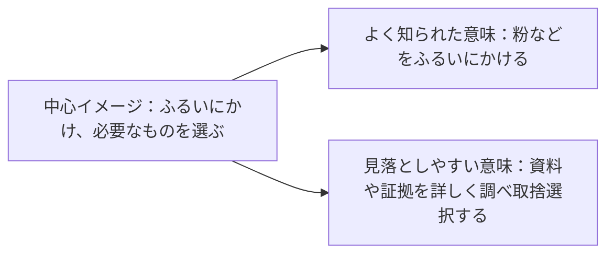

**重要語法：** `sift through`

---

## 2. slum

**品詞：** idiom　**発音：** /slʌm/  
**識別情報：** global_order 4322 / index 9675 / `ev-9675-idiom-01`

<small>よく知られている意味：貧困地区・スラム街</small>

### 見落としやすい意味：普段より質素で不便な環境で我慢して暮らす

**例文：** We had planned a luxury trip, but we ended up slumming it in a basic hostel.

**和訳：** 豪華な旅行を計画していたが、結局は設備の簡素なホステルで我慢して過ごした。

**コアイメージ：** slum は生活環境が厳しい地区を表します。slum it は、普段の快適さを諦め、質素な環境で過ごすことをくだけて言う表現です。

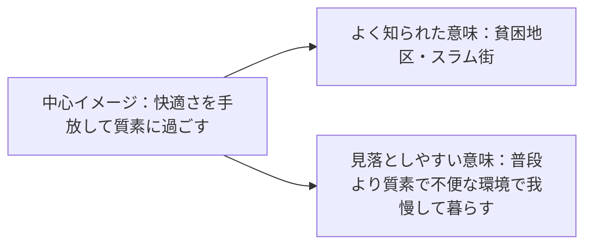

**重要語法：** `slum it`

---

## 3. sophisticate

**品詞：** noun　**発音：** /səˈfɪstɪkət/  
**識別情報：** global_order 4323 / index 9677 / `ev-9677-noun-01`

<small>よく知られている意味：洗練させる（動詞）</small>

### 見落としやすい意味：都会的で洗練された人

**例文：** Even among experienced diplomats, he was regarded as a sophisticate.

**和訳：** 経験豊かな外交官たちの間でさえ、彼は洗練された人物とみなされていた。

**コアイメージ：** 物事や振る舞いを洗練させるという発想が、人の知識や身のこなしにも及びます。名詞では、世慣れていて洗練された人を指します。

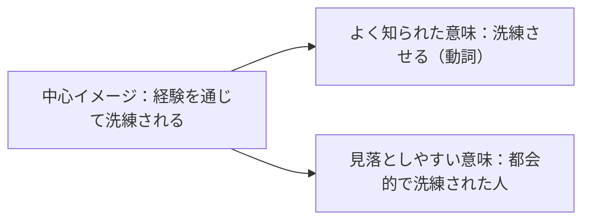

**重要語法：** `a sophisticate`

---

## 4. spine

**品詞：** noun　**発音：** /spaɪn/  
**識別情報：** global_order 4324 / index 9679 / `ev-9679-noun-01`

<small>よく知られている意味：背骨</small>

### 見落としやすい意味：勇気・気骨

**例文：** The young reporter showed real spine by asking the difficult question.

**和訳：** その若い記者は難しい質問をすることで、本当の気骨を示した。

**コアイメージ：** 背骨は体をまっすぐ支えます。その姿から、圧力に屈せず態度を貫く心の強さを spine と表します。

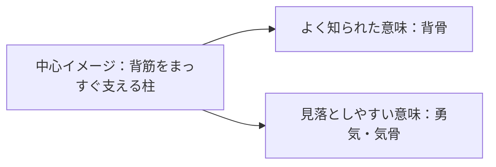

**重要語法：** `show some spine`

---

## 5. squarely

**品詞：** adverb　**発音：** /ˈskwerli/  
**識別情報：** global_order 4325 / index 9680 / `ev-9680-adverb-01`

<small>よく知られている意味：四角く・まっすぐに</small>

### 見落としやすい意味：直接に・真正面から

**例文：** We need to face the problem squarely rather than avoid it.

**和訳：** 私たちは問題を避けず、真正面から向き合う必要がある。

**コアイメージ：** square には傾かず、きちんと正面を向く感覚があります。その向きが問題への態度に移ると、回避せず直接取り組む意味になります。

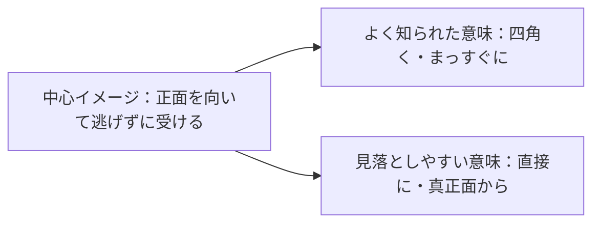

**重要語法：** `face squarely`

---

## 6. strenuous

**品詞：** adjective　**発音：** /ˈstrenjuəs/  
**識別情報：** global_order 4326 / index 9682 / `ev-9682-adjective-01`

<small>よく知られている意味：骨の折れる・激しい</small>

### 見落としやすい意味：強い反対や抗議を示す

**例文：** The proposal met with strenuous objections from local residents.

**和訳：** その提案には地元住民から強い反対が寄せられた。

**コアイメージ：** strenuous は大きな力や努力が注がれる様子を表します。運動だけでなく、反対や抗議の強さにも用います。

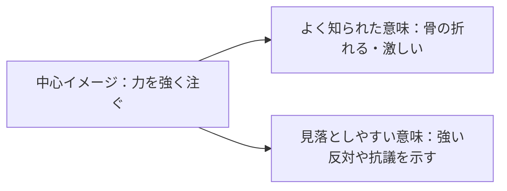

**重要語法：** `strenuous objections`

---

## 7. stricture

**品詞：** noun　**発音：** /ˈstrɪktʃər/  
**識別情報：** global_order 4327 / index 9683 / `ev-9683-noun-01`

<small>よく知られている意味：厳しい制限</small>

### 見落としやすい意味：厳しい非難・批判

**例文：** The critic's strictures on the novel were harsh but thoughtful.

**和訳：** その批評家による小説への厳しい批判は、手厳しいがよく考えられたものだった。

**コアイメージ：** stricture には厳しく締めつけ、許容範囲を狭める感覚があります。その厳しさが言葉による評価に向かうと、痛烈な非難になります。

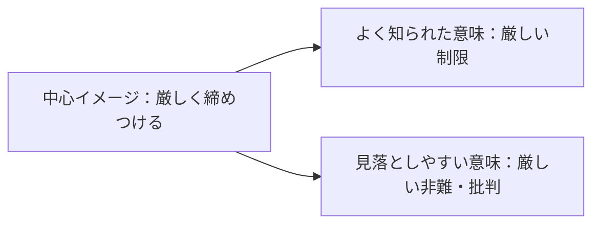

**重要語法：** `strictures on`

---

## 8. termination

**品詞：** noun　**発音：** /ˌtɜːrmɪˈneɪʃən/  
**識別情報：** global_order 4328 / index 9690 / `ev-9690-noun-01`

<small>よく知られている意味：終了・終結</small>

### 見落としやすい意味：雇用契約の終了・解雇

**例文：** The letter confirmed the termination of his employment.

**和訳：** その手紙には彼の雇用契約の終了が確認されていた。

**コアイメージ：** termination は何かを終わらせることです。雇用の文脈では契約や勤務の終了を指し、状況によっては解雇を意味します。

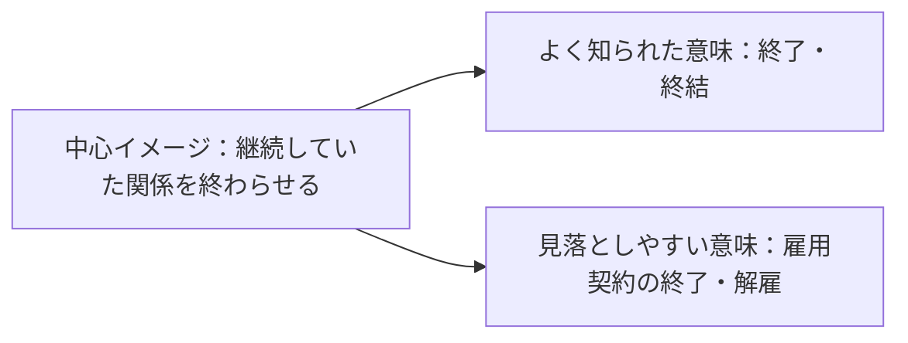

**重要語法：** `termination of employment`

---

## 9. toil

**品詞：** verb　**発音：** /tɔɪl/  
**識別情報：** global_order 4329 / index 9693 / `ev-9693-verb-01`

<small>よく知られている意味：苦労して働く</small>

### 見落としやすい意味：苦労しながらゆっくり進む

**例文：** We toiled up the steep path in the afternoon heat.

**和訳：** 私たちは午後の暑さの中、急な小道を苦労して登った。

**コアイメージ：** toil の中心には大きな労力を払う感覚があります。仕事だけでなく、坂道を進むような、苦しく遅い移動にも使います。

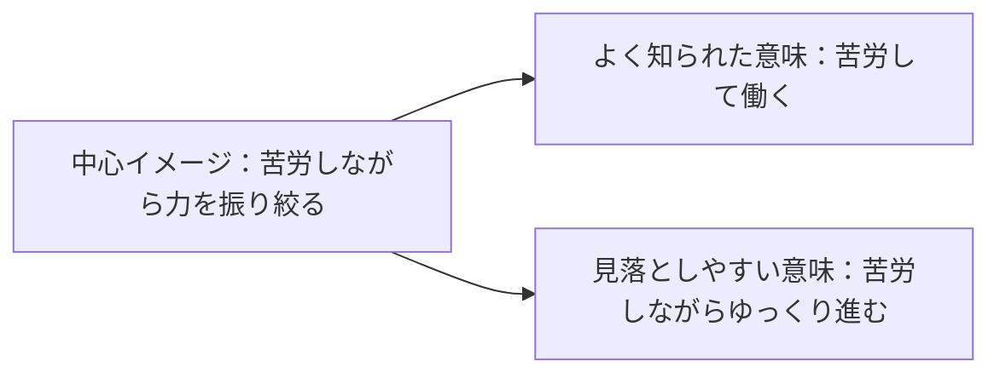

**重要語法：** `toil up a hill`

---

## 10. torrent

**品詞：** noun　**発音：** /ˈtɔːrənt/  
**識別情報：** global_order 4330 / index 9694 / `ev-9694-noun-01`

<small>よく知られている意味：急流・激流</small>

### 見落としやすい意味：激しい言葉や非難の集中

**例文：** The decision unleashed a torrent of criticism online.

**和訳：** その決定によって、ネット上では激しい批判が一気に噴き出した。

**コアイメージ：** torrent は勢いよく押し寄せる大量の水です。言葉や批判が止めどなく押し寄せる様子にも、同じ比喩が使われます。

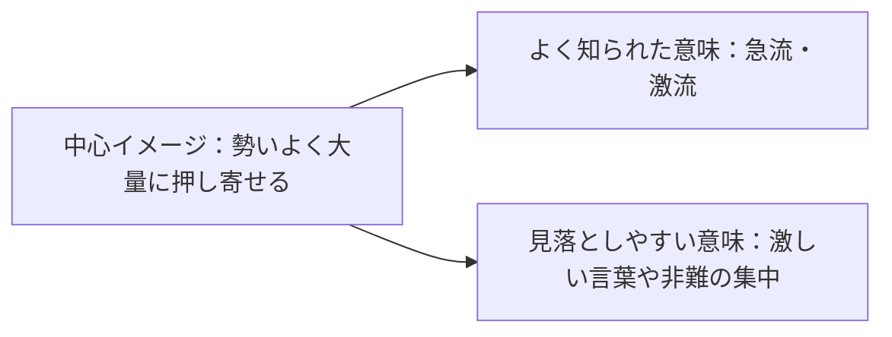

**重要語法：** `torrent of criticism`

---

## 11. uncanny

**品詞：** adjective　**発音：** /ʌnˈkæni/  
**識別情報：** global_order 4331 / index 9698 / `ev-9698-adjective-01`

<small>よく知られている意味：不気味な・奇妙な</small>

### 見落としやすい意味：不気味なほど正確・似ている

**例文：** The painting bears an uncanny resemblance to the original photograph.

**和訳：** その絵は元の写真に、不気味なほどよく似ている。

**コアイメージ：** uncanny は普通の予想を超えて不思議に感じられることです。似方や正確さが驚くほど高いときにも、その不思議さを表せます。

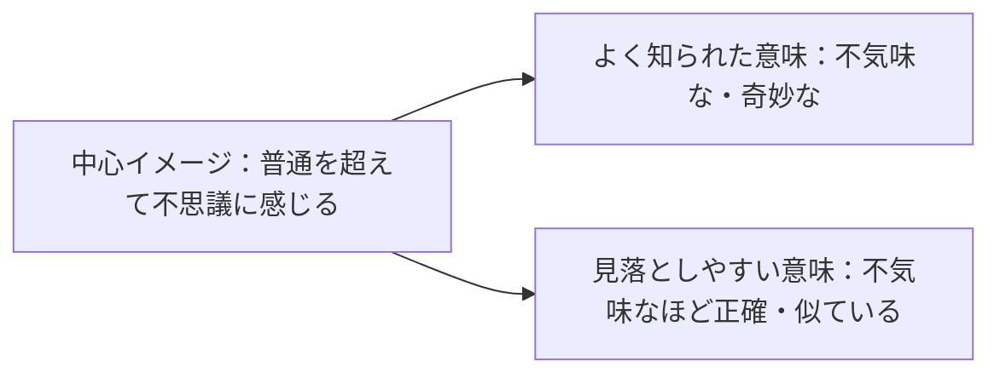

**重要語法：** `uncanny resemblance`

---

## 12. underwrite

**品詞：** verb　**発音：** /ˌʌndərˈraɪt/  
**識別情報：** global_order 4332 / index 9700 / `ev-9700-verb-01`

<small>よく知られている意味：保険などを引き受ける</small>

### 見落としやすい意味：資金を保証・支援し費用を引き受ける

**例文：** A local foundation agreed to underwrite the cost of the festival.

**和訳：** 地元の財団がその祭りの費用を負担することに同意した。

**コアイメージ：** underwrite は本来、金融上の引受や保証に関わる語です。費用を支える側に立つことから、事業の資金を保証したり負担したりする意味になります。

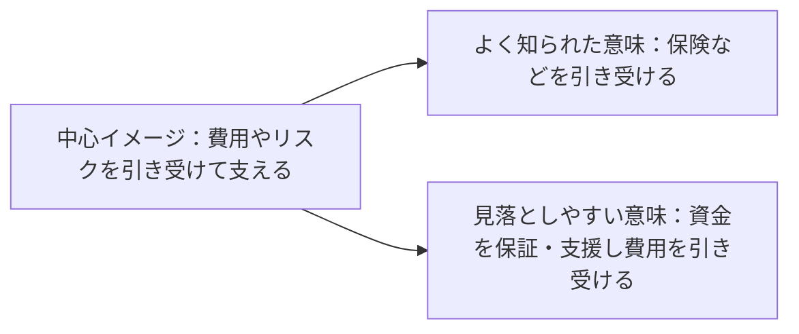

**重要語法：** `underwrote/underwritten`

---

## 13. unspeakable

**品詞：** adjective　**発音：** /ʌnˈspiːkəbl/  
**識別情報：** global_order 4333 / index 9708 / `ev-9708-adjective-01`

<small>よく知られている意味：言葉にできない</small>

### 見落としやすい意味：言葉で表せないほどひどい

**例文：** The survivors described the conditions as unspeakable.

**和訳：** その体験をした人々は、状況が言葉にできないほどひどかったと語った。

**コアイメージ：** unspeakable は言葉にしがたいという意味です。単に説明できないのではなく、ひどさが言葉では表しきれないという強調に使われます。

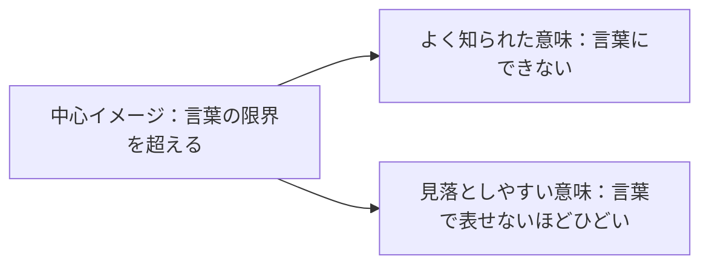

**重要語法：** `unspeakable suffering`

---

## 14. unwritten

**品詞：** adjective　**発音：** /ʌnˈrɪtn/  
**識別情報：** global_order 4334 / index 9710 / `ev-9710-adjective-01`

<small>よく知られている意味：文字に書かれていない</small>

### 見落としやすい意味：明文化されていない暗黙の

**例文：** There is an unwritten rule that everyone helps clean up after the event.

**和訳：** 行事の後は全員で片づけを手伝うという暗黙の決まりがある。

**コアイメージ：** unwritten は文書に記されていないということです。規則や慣習に使うと、書かれていなくても人々の間で共有されていることを表します。

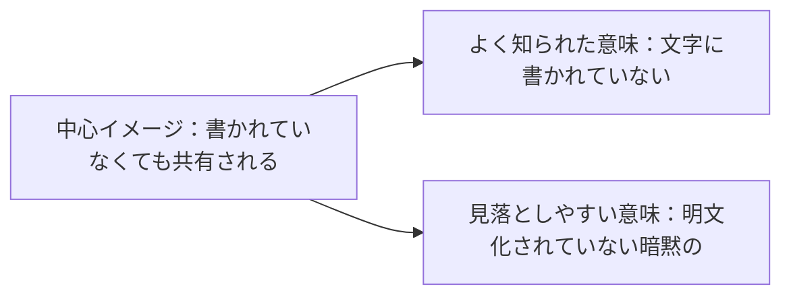

**重要語法：** `unwritten rules`

---

## 15. waive

**品詞：** verb　**発音：** /weɪv/  
**識別情報：** global_order 4335 / index 9713 / `ev-9713-verb-01`

<small>よく知られている意味：（権利などを）放棄する</small>

### 見落としやすい意味：権利・料金・規則の適用を放棄・免除する

**例文：** The school agreed to waive the fee for students in need.

**和訳：** 学校は支援を必要とする生徒の料金を免除することに同意した。

**コアイメージ：** waive は本来適用できる権利や請求をあえて行使しないことです。料金や条件に使えば、それを課さない・免除する意味になります。

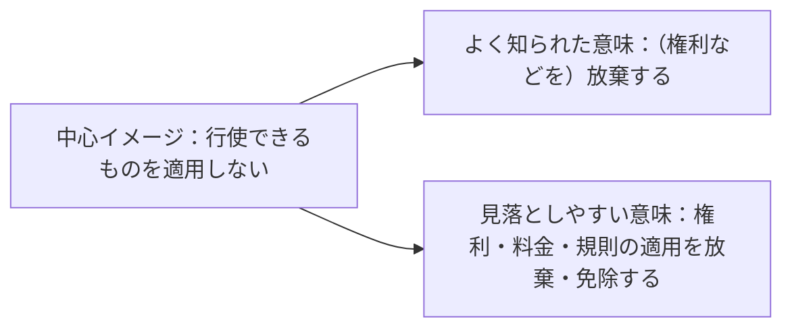

**重要語法：** `waive a fee/rights`

---

## 16. warp

**品詞：** verb　**発音：** /wɔːrp/  
**識別情報：** global_order 4336 / index 9714 / `ev-9714-verb-01`

<small>よく知られている意味：木材などを反らせる</small>

### 見落としやすい意味：判断や価値観をゆがめる

**例文：** Fear can warp our judgment when we make important decisions.

**和訳：** 重要な決定をするとき、恐怖は私たちの判断をゆがめることがある。

**コアイメージ：** warp は本来、形がまっすぐでなくなることです。そこから判断や考え方が偏り、正しく捉えられなくなる意味へ広がります。

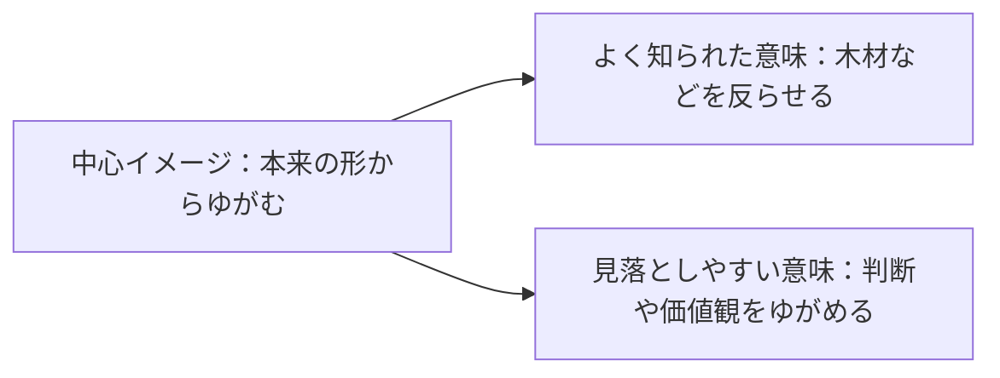

---

## 17. willful

**品詞：** adjective　**発音：** /ˈwɪlfəl/  
**識別情報：** global_order 4337 / index 9717 / `ev-9717-adjective-01`

<small>よく知られている意味：故意の・意図的な</small>

### 見落としやすい意味：頑固でわがままな

**例文：** The willful child refused to listen to anyone's advice.

**和訳：** その頑固な子どもは誰の助言にも耳を貸そうとしなかった。

**コアイメージ：** willful には自分の意志を押し通す感覚があります。行為なら「故意の」、性格なら他人の意見を受け入れない「頑固な」となります。

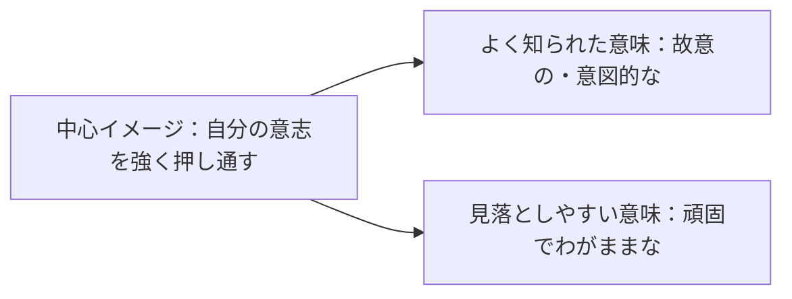

**重要語法：** `a willful child`

---

## 18. windfall

**品詞：** noun　**発音：** /ˈwɪndfɔːl/  
**識別情報：** global_order 4338 / index 9719 / `ev-9719-noun-01`

<small>よく知られている意味：風で落ちた果実</small>

### 見落としやすい意味：思いがけない金銭的利益

**例文：** The unexpected inheritance was a welcome windfall for the family.

**和訳：** 思いがけない遺産は、その家族にとってありがたい臨時収入だった。

**コアイメージ：** windfall は元来、風で自然に落ちた果実を指します。努力して取りに行かなくても手に入ったものから、予想外の利益を表すようになりました。

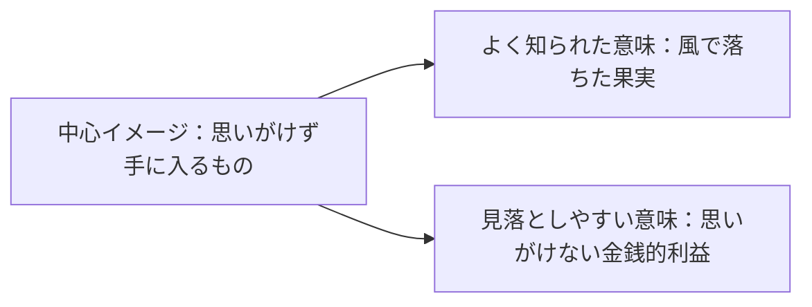

---

## 19. august

**品詞：** adjective　**発音：** /ɔːˈɡʌst/  
**識別情報：** global_order 4339 / index 9723 / `ev-9723-adjective-01`

<small>よく知られている意味：August（8月）は別語</small>

### 見落としやすい意味：威厳ある・高貴な

**例文：** The guests listened respectfully to the august scholar.

**和訳：** 招待客たちはその威厳ある学者の話を敬意をもって聞いた。

**コアイメージ：** 形容詞 august は人や場に備わる重みと威厳を表します。月名 August とは意味も強勢位置も異なり、形容詞では後ろの音節に強勢があります。

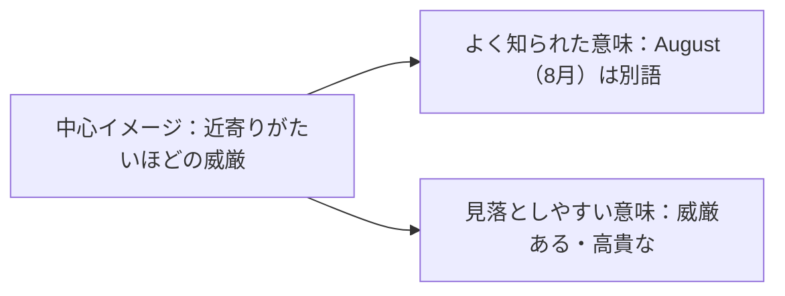

**重要語法：** `月名は第一音節・形容詞は第二音節に強勢`

---

## 20. wardrobe

**品詞：** noun　**発音：** /ˈwɔːrdroʊb/  
**識別情報：** global_order 4340 / index 9726 / `ev-9726-noun-01`

<small>よく知られている意味：洋服だんす</small>

### 見落としやすい意味：所有している衣服の一式

**例文：** She packed her entire summer wardrobe into two suitcases.

**和訳：** 彼女は夏服一式をスーツケース二つに詰めた。

**コアイメージ：** wardrobe は衣服をしまう場所を表します。そこに収められる服全体へ意味が広がり、ある人の持つ衣服一式も指します。

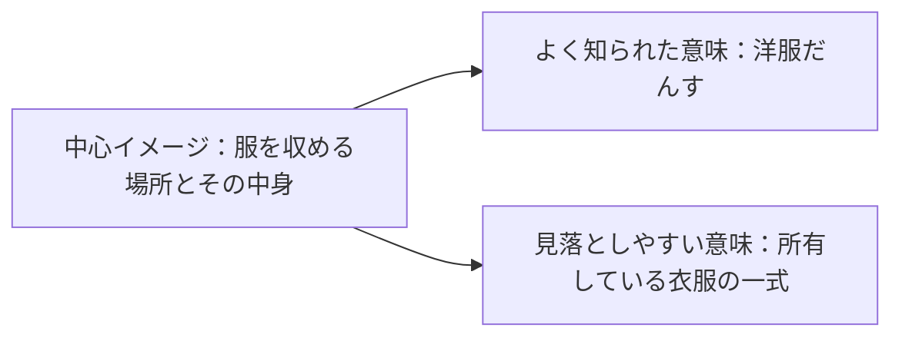

**重要語法：** `a new wardrobe`

---

## 21. irregular

**品詞：** noun　**発音：** /ɪˈreɡjələr/  
**識別情報：** global_order 4341 / index 9727 / `ev-9727-noun-01`

<small>よく知られている意味：不規則な（形容詞）</small>

### 見落としやすい意味：非正規兵・正規軍に属さない戦闘員

**例文：** The book describes the role of irregulars in the historical conflict.

**和訳：** その本は歴史上の争いにおける非正規兵の役割を説明している。

**コアイメージ：** irregular は決まった規則や標準形に従わないことです。軍事の文脈では正規の編制に属さない人を名詞で表します。

```mermaid
flowchart LR
    A["中心イメージ：通常の規則や編制から外れる"]
    B["よく知られた意味：不規則な（形容詞）"]
    C["見落としやすい意味：非正規兵・正規軍に属さない戦闘員"]
    A --> B
    A --> C
```

**重要語法：** `irregulars`

---

## 22. keeper

**品詞：** noun　**発音：** /ˈkiːpər/  
**識別情報：** global_order 4342 / index 9730 / `ev-9730-noun-01`

<small>よく知られている意味：管理人・保管者</small>

### 見落としやすい意味：手放したくない価値のあるもの・人

**例文：** This old photograph is definitely a keeper.

**和訳：** この古い写真は絶対に取っておきたい一枚だ。

**コアイメージ：** keeper は何かを保つ人やものに関係する語です。It's a keeper では、手放さず持っておく価値がある対象を指します。

```mermaid
flowchart LR
    A["中心イメージ：大切に保っておきたいもの"]
    B["よく知られた意味：管理人・保管者"]
    C["見落としやすい意味：手放したくない価値のあるもの・人"]
    A --> B
    A --> C
```

**重要語法：** `It's a keeper`

---

## 23. idle

**品詞：** adjective　**発音：** /ˈaɪdl/  
**識別情報：** global_order 4343 / index 9731 / `ev-9731-adjective-01`

<small>よく知られている意味：何もしていない・遊休の</small>

### 見落としやすい意味：根拠のない・無意味な

**例文：** His warning was no idle threat; he was serious.

**和訳：** 彼の警告は単なる口先の脅しではなく、本気だった。

**コアイメージ：** idle は活動や実質が伴わない様子です。threat や speculation に付くと、実行の裏づけや確かな根拠がないことを表します。

```mermaid
flowchart LR
    A["中心イメージ：実質的な働きが伴わない"]
    B["よく知られた意味：何もしていない・遊休の"]
    C["見落としやすい意味：根拠のない・無意味な"]
    A --> B
    A --> C
```

**重要語法：** `idle threat/speculation`

---

## 24. idle

**品詞：** verb　**発音：** /ˈaɪdl/  
**識別情報：** global_order 4344 / index 9731 / `ev-9731-verb-01`

<small>よく知られている意味：何もせずに過ごす（動詞）</small>

### 見落としやすい意味：エンジンなどが空転する

**例文：** The bus engine was idling outside the station.

**和訳：** 駅の外でバスのエンジンがアイドリングしていた。

**コアイメージ：** idle は活動が本来の目的に向かって進まない状態です。エンジンでは、停止せず回転していても車を動かしていない状態を指します。

```mermaid
flowchart LR
    A["中心イメージ：動いていても仕事を進めていない"]
    B["よく知られた意味：何もせずに過ごす（動詞）"]
    C["見落としやすい意味：エンジンなどが空転する"]
    A --> B
    A --> C
```

---

## 25. matrix

**品詞：** noun　**発音：** /ˈmeɪtrɪks/  
**識別情報：** global_order 4345 / index 9732 / `ev-9732-noun-01`

<small>よく知られている意味：数学の行列</small>

### 見落としやすい意味：発展の基盤となる環境や関係の枠組み

**例文：** Trust forms the matrix within which healthy teamwork develops.

**和訳：** 信頼は、健全なチームワークが育つ基盤となる枠組みを形づくる。

**コアイメージ：** matrix には物事を支え、内部で育てる基盤という発想があります。数学の行列に限らず、関係や発展を支える環境全体を指せます。

```mermaid
flowchart LR
    A["中心イメージ：内側で物事を支え形づくる枠組み"]
    B["よく知られた意味：数学の行列"]
    C["見落としやすい意味：発展の基盤となる環境や関係の枠組み"]
    A --> B
    A --> C
```

---

## 26. superintendent

**品詞：** noun　**発音：** /ˌsuːpərɪnˈtendənt/  
**識別情報：** global_order 4346 / index 9734 / `ev-9734-noun-01`

<small>よく知られている意味：監督者・管理責任者</small>

### 見落としやすい意味：米国の学区の教育行政の責任者

**例文：** The school superintendent announced a new district-wide policy.

**和訳：** その学区の教育行政責任者は、学区全体に適用される新方針を発表した。

**コアイメージ：** superintendent は組織全体を監督する立場の人です。米国の学校制度では、学区の運営を統括する教育行政の責任者を指すことがあります。

```mermaid
flowchart LR
    A["中心イメージ：組織全体を見渡し統括する"]
    B["よく知られた意味：監督者・管理責任者"]
    C["見落としやすい意味：米国の学区の教育行政の責任者"]
    A --> B
    A --> C
```

**重要語法：** `school superintendent`

---

## 27. initiation

**品詞：** noun　**発音：** /ɪˌnɪʃiˈeɪʃən/  
**識別情報：** global_order 4347 / index 9736 / `ev-9736-noun-01`

<small>よく知られている意味：開始・着手</small>

### 見落としやすい意味：組織への加入儀礼・入会式

**例文：** New members took part in an initiation ceremony.

**和訳：** 新しい会員たちは入会の儀式に参加した。

**コアイメージ：** initiation は新しい段階へ入ることです。集団への加入で使うと、正式な一員になるための儀礼や式を表します。

```mermaid
flowchart LR
    A["中心イメージ：新しい段階や集団へ入る"]
    B["よく知られた意味：開始・着手"]
    C["見落としやすい意味：組織への加入儀礼・入会式"]
    A --> B
    A --> C
```

**重要語法：** `initiation rites`

---

## 28. progression

**品詞：** noun　**発音：** /prəˈɡreʃən/  
**識別情報：** global_order 4348 / index 9738 / `ev-9738-noun-01`

<small>よく知られている意味：前進・進展</small>

### 見落としやすい意味：病状の進行・悪化

**例文：** Early treatment can slow the progression of the disease.

**和訳：** 早期の治療は病気の進行を遅らせることがある。

**コアイメージ：** progression はある状態が段階を追って進むことです。必ずしも良い方向とは限らず、病気が進む場合にも使われます。

```mermaid
flowchart LR
    A["中心イメージ：段階を追って状態が変化する"]
    B["よく知られた意味：前進・進展"]
    C["見落としやすい意味：病状の進行・悪化"]
    A --> B
    A --> C
```

**重要語法：** `disease progression`

---

## 29. peripheral

**品詞：** noun　**発音：** /pəˈrɪfərəl/  
**識別情報：** global_order 4349 / index 9740 / `ev-9740-noun-01`

<small>よく知られている意味：周辺の・重要でない（形容詞）</small>

### 見落としやすい意味：コンピュータに接続する周辺機器

**例文：** The keyboard is a peripheral connected to the main computer.

**和訳：** キーボードはコンピュータ本体に接続する周辺機器だ。

**コアイメージ：** peripheral は中心ではなく、その周囲にあることです。名詞になると、コンピュータ本体の周囲につながる装置を指します。

```mermaid
flowchart LR
    A["中心イメージ：中心に付随する周辺のもの"]
    B["よく知られた意味：周辺の・重要でない（形容詞）"]
    C["見落としやすい意味：コンピュータに接続する周辺機器"]
    A --> B
    A --> C
```

**重要語法：** `可算名詞`

---

## 30. flicker

**品詞：** verb　**発音：** /ˈflɪkər/  
**識別情報：** global_order 4350 / index 9742 / `ev-9742-verb-01`

<small>よく知られている意味：光や炎がちらつく</small>

### 見落としやすい意味：希望や感情が一瞬現れて消える

**例文：** A flicker of hope appeared when we heard the good news.

**和訳：** 良い知らせを聞いたとき、かすかな希望が一瞬芽生えた。

**コアイメージ：** flicker は光が短く不安定に現れる動きです。希望や感情にも使うと、ほんの一瞬かすかに現れる様子を表せます。

```mermaid
flowchart LR
    A["中心イメージ：かすかに現れて揺れる"]
    B["よく知られた意味：光や炎がちらつく"]
    C["見落としやすい意味：希望や感情が一瞬現れて消える"]
    A --> B
    A --> C
```

**重要語法：** `hope flickered`

---

## 31. sap

**品詞：** verb　**発音：** /sæp/  
**識別情報：** global_order 4351 / index 9745 / `ev-9745-verb-01`

<small>よく知られている意味：樹液（名詞）</small>

### 見落としやすい意味：体力・気力を徐々に奪う

**例文：** Months of uncertainty slowly sapped her confidence.

**和訳：** 何か月も先行きが分からない状態が続き、彼女の自信は徐々に失われた。

**コアイメージ：** sap は動詞では力を少しずつ弱め、奪うことを表します。一度に壊すのではなく、体力や気力がじわじわ減る場面に合います。

```mermaid
flowchart LR
    A["中心イメージ：内側の力を少しずつ抜く"]
    B["よく知られた意味：樹液（名詞）"]
    C["見落としやすい意味：体力・気力を徐々に奪う"]
    A --> B
    A --> C
```

**重要語法：** `sap one's strength`

---

## 32. tinker

**品詞：** verb　**発音：** /ˈtɪŋkər/  
**識別情報：** global_order 4352 / index 9747 / `ev-9747-verb-01`

<small>よく知られている意味：修理工・鋳掛け屋（名詞）</small>

### 見落としやすい意味：小さな変更を加え調整する

**例文：** He likes to tinker with old radios on weekends.

**和訳：** 彼は週末に古いラジオを少しいじって調整するのが好きだ。

**コアイメージ：** tinker は道具をあれこれいじって手直しする感覚です。大改造ではなく、小さな変更を繰り返して調整する意味になります。

```mermaid
flowchart LR
    A["中心イメージ：手を加えながら試行錯誤する"]
    B["よく知られた意味：修理工・鋳掛け屋（名詞）"]
    C["見落としやすい意味：小さな変更を加え調整する"]
    A --> B
    A --> C
```

**重要語法：** `tinker with`

---

## 33. stoke

**品詞：** verb　**発音：** /stoʊk/  
**識別情報：** global_order 4353 / index 9755 / `ev-9755-verb-01`

<small>よく知られている意味：火に燃料をくべる</small>

### 見落としやすい意味：不安や怒りなどをあおる

**例文：** The misleading headline stoked fear among readers.

**和訳：** その誤解を招く見出しは読者の不安をあおった。

**コアイメージ：** stoke は火を強めるため燃料を加えることです。不安や怒りを火に見立てると、その感情をさらに強める意味になります。

```mermaid
flowchart LR
    A["中心イメージ：火に燃料を足し勢いを強める"]
    B["よく知られた意味：火に燃料をくべる"]
    C["見落としやすい意味：不安や怒りなどをあおる"]
    A --> B
    A --> C
```

**重要語法：** `stoke fears/anger`

---

## 34. ante

**品詞：** idiom　**発音：** /ˈænti/  
**識別情報：** global_order 4354 / index 9767 / `ev-9767-idiom-01`

<small>よく知られている意味：元来は賭け金を表す語</small>

### 見落としやすい意味：要求水準や緊張の度合いをさらに上げる

**例文：** The company upped the ante by demanding a working prototype.

**和訳：** その会社は動く試作品を求めて、要求水準をさらに引き上げた。

**コアイメージ：** up the ante は、元の水準よりさらに多くを求めるという比喩です。仕事や交渉では、期待や要求、緊張の度合いを高めることを表します。

```mermaid
flowchart LR
    A["中心イメージ：求める水準を一段引き上げる"]
    B["よく知られた意味：元来は賭け金を表す語"]
    C["見落としやすい意味：要求水準や緊張の度合いをさらに上げる"]
    A --> B
    A --> C
```

**重要語法：** `up the ante`

---

## 35. attentive

**品詞：** adjective　**発音：** /əˈtentɪv/  
**識別情報：** global_order 4355 / index 9773 / `ev-9773-adjective-01`

<small>よく知られている意味：注意深い</small>

### 見落としやすい意味：細やかに気を配る・親切な

**例文：** The staff were attentive to each guest's needs.

**和訳：** スタッフは客一人一人の要望に細やかに気を配っていた。

**コアイメージ：** attentive は相手や物事に注意を向け続けることです。その注意が人の必要に向けられると、思いやりのある丁寧な対応になります。

```mermaid
flowchart LR
    A["中心イメージ：相手へ注意を向け続ける"]
    B["よく知られた意味：注意深い"]
    C["見落としやすい意味：細やかに気を配る・親切な"]
    A --> B
    A --> C
```

**重要語法：** `attentive service`

---

## 36. beset

**品詞：** adjective　**発音：** /bɪˈset/  
**識別情報：** global_order 4356 / index 9777 / `ev-9777-adjective-01`

<small>よく知られている意味：取り囲む・悩ませる（動詞）</small>

### 見落としやすい意味：多くの困難に悩まされている

**例文：** The project was beset by unexpected delays.

**和訳：** その計画は予想外の遅延に相次いで悩まされた。

**コアイメージ：** beset は問題などが周囲から押し寄せ、動きを妨げる感覚です。be beset by/with で多くの困難に取り囲まれている状態を表します。

```mermaid
flowchart LR
    A["中心イメージ：問題が周囲から押し寄せる"]
    B["よく知られた意味：取り囲む・悩ませる（動詞）"]
    C["見落としやすい意味：多くの困難に悩まされている"]
    A --> B
    A --> C
```

**重要語法：** `be beset with/by`

---

## 37. bombardment

**品詞：** noun　**発音：** /bɑːmˈbɑːrdmənt/  
**識別情報：** global_order 4357 / index 9780 / `ev-9780-noun-01`

<small>よく知られている意味：砲撃</small>

### 見落としやすい意味：広告・質問などが大量に押し寄せること

**例文：** After the announcement, the office faced a bombardment of questions.

**和訳：** 発表後、その事務所には質問が殺到した。

**コアイメージ：** bombardment は本来、次々と攻撃を浴びせることです。質問や広告が大量に届く場合にも、圧倒されるほどの集中を比喩的に表します。

```mermaid
flowchart LR
    A["中心イメージ：次々と大量に浴びせる"]
    B["よく知られた意味：砲撃"]
    C["見落としやすい意味：広告・質問などが大量に押し寄せること"]
    A --> B
    A --> C
```

**重要語法：** `bombardment of questions`

---

## 38. bud

**品詞：** noun　**発音：** /bʌd/  
**識別情報：** global_order 4358 / index 9783 / `ev-9783-noun-01`

<small>よく知られている意味：植物のつぼみ</small>

### 見落としやすい意味：物事が始まったばかりの段階

**例文：** The teacher tried to nip the rumor in the bud.

**和訳：** 先生はそのうわさが広がる前に芽を摘もうとした。

**コアイメージ：** bud は花が咲く前の小さなつぼみです。物事の始まりを芽に見立て、まだ大きくならないうちに対処する表現になります。

```mermaid
flowchart LR
    A["中心イメージ：育って大きくなる前の芽"]
    B["よく知られた意味：植物のつぼみ"]
    C["見落としやすい意味：物事が始まったばかりの段階"]
    A --> B
    A --> C
```

**重要語法：** `nip something in the bud`

---

## 39. busing

**品詞：** noun　**発音：** /ˈbʌsɪŋ/  
**識別情報：** global_order 4359 / index 9784 / `ev-9784-noun-01`

<small>よく知られている意味：バスによる輸送・通学</small>

### 見落としやすい意味：学校の人種隔離是正を目的としたバス通学制度

**例文：** The district used school busing as part of its desegregation policy.

**和訳：** その学区は人種隔離を解消する政策の一環として、児童生徒のバス通学制度を利用した。

**コアイメージ：** busing はバスで人を運ぶことですが、米国の教育史では特定の政策も指します。学校の人種隔離を是正するため、生徒の通学先を調整する制度の文脈で用いられます。

```mermaid
flowchart LR
    A["中心イメージ：通学先を調整する移動手段"]
    B["よく知られた意味：バスによる輸送・通学"]
    C["見落としやすい意味：学校の人種隔離是正を目的としたバス通学制度"]
    A --> B
    A --> C
```

**重要語法：** `school busing`

---

## 40. caustic

**品詞：** adjective　**発音：** /ˈkɔːstɪk/  
**識別情報：** global_order 4360 / index 9787 / `ev-9787-adjective-01`

<small>よく知られている意味：腐食性の・焼けつくような</small>

### 見落としやすい意味：発言が辛辣で痛烈な

**例文：** Her caustic remarks made the meeting uncomfortable.

**和訳：** 彼女の辛辣な発言で会議は気まずい雰囲気になった。

**コアイメージ：** caustic は物質が触れたものを傷めるような性質です。言葉に使うと、人を刺すように厳しく批判する意味になります。

```mermaid
flowchart LR
    A["中心イメージ：触れたものを傷つける鋭さ"]
    B["よく知られた意味：腐食性の・焼けつくような"]
    C["見落としやすい意味：発言が辛辣で痛烈な"]
    A --> B
    A --> C
```

---

## 41. checking

**品詞：** noun　**発音：** /ˈtʃekɪŋ/  
**識別情報：** global_order 4361 / index 9793 / `ev-9793-noun-01`

<small>よく知られている意味：確認すること</small>

### 見落としやすい意味：当座預金という銀行口座の種類

**例文：** My paycheck goes directly into my checking account.

**和訳：** 私の給料は当座預金口座に直接振り込まれる。

**コアイメージ：** checking は日常的な支払いに使う口座名の一部としても現れます。checking account は、主に米国で用いられる当座預金口座を表す定型表現です。

```mermaid
flowchart LR
    A["中心イメージ：日常の支払いに使う口座"]
    B["よく知られた意味：確認すること"]
    C["見落としやすい意味：当座預金という銀行口座の種類"]
    A --> B
    A --> C
```

**重要語法：** `checking account`

---

## 42. chemist

**品詞：** noun　**発音：** /ˈkemɪst/  
**識別情報：** global_order 4362 / index 9794 / `ev-9794-noun-01`

<small>よく知られている意味：化学者</small>

### 見落としやすい意味：薬剤師

**例文：** You can ask the chemist which medicine is suitable.

**和訳：** どの薬が適切か、薬剤師に尋ねることができる。

**コアイメージ：** chemist は化学を扱う人を表します。英国英語では薬を扱う専門職の人も指し、文脈によって「薬剤師」になります。

```mermaid
flowchart LR
    A["中心イメージ：化学や薬を扱う専門家"]
    B["よく知られた意味：化学者"]
    C["見落としやすい意味：薬剤師"]
    A --> B
    A --> C
```

**重要語法：** `主に英国英語`

---

## 43. chemist

**品詞：** noun　**発音：** /ˈkemɪst/  
**識別情報：** global_order 4363 / index 9794 / `ev-9794-noun-02`

<small>よく知られている意味：化学者・薬剤師（人）</small>

### 見落としやすい意味：薬局

**例文：** I bought a bandage at the chemist's near the station.

**和訳：** 私は駅の近くの薬局で包帯を買った。

**コアイメージ：** 人を表す chemist から、その人が働く店を指す言い方が生まれます。英国英語の the chemist's は薬局という店舗を表します。

```mermaid
flowchart LR
    A["中心イメージ：薬を扱う人からその店へ"]
    B["よく知られた意味：化学者・薬剤師（人）"]
    C["見落としやすい意味：薬局"]
    A --> B
    A --> C
```

**重要語法：** `英語では chemist's とも`

---

## 44. conjecture

**品詞：** verb　**発音：** /kənˈdʒektʃər/  
**識別情報：** global_order 4364 / index 9799 / `ev-9799-verb-01`

<small>よく知られている意味：推測・憶測（名詞）</small>

### 見落としやすい意味：確証がないまま推測する

**例文：** Scientists conjecture that the object came from a distant planet.

**和訳：** 科学者たちはその物体が遠くの惑星から来たのではないかと推測している。

**コアイメージ：** conjecture は十分な証拠がない段階で考えを立てることです。名詞の「推測」だけでなく、動詞で「推測する」とも使えます。

```mermaid
flowchart LR
    A["中心イメージ：確証がないまま考えを立てる"]
    B["よく知られた意味：推測・憶測（名詞）"]
    C["見落としやすい意味：確証がないまま推測する"]
    A --> B
    A --> C
```

**重要語法：** `conjecture that`

---

## 45. constrained

**品詞：** adjective　**発音：** /kənˈstreɪnd/  
**識別情報：** global_order 4365 / index 9800 / `ev-9800-adjective-01`

<small>よく知られている意味：制約された・抑えられた</small>

### 見落としやすい意味：不自然に堅苦しい・ぎこちない

**例文：** He gave a constrained smile despite his disappointment.

**和訳：** 彼はがっかりしていたが、ぎこちない笑みを浮かべた。

**コアイメージ：** constrained は自由に動いたり表現したりできない状態です。表情や態度に使うと、自然に出せず、堅苦しく見える様子になります。

```mermaid
flowchart LR
    A["中心イメージ：自然な動きが抑えられる"]
    B["よく知られた意味：制約された・抑えられた"]
    C["見落としやすい意味：不自然に堅苦しい・ぎこちない"]
    A --> B
    A --> C
```

**重要語法：** `constrained smile`

---

## 46. contraction

**品詞：** noun　**発音：** /kənˈtrækʃən/  
**識別情報：** global_order 4366 / index 9802 / `ev-9802-noun-01`

<small>よく知られている意味：収縮</small>

### 見落としやすい意味：景気・経済活動の縮小

**例文：** The government announced measures in response to the economic contraction.

**和訳：** 政府は経済活動の縮小に対応する対策を発表した。

**コアイメージ：** contraction は規模が小さくなることです。筋肉だけでなく生産や消費などの経済活動が縮むことにも使います。

```mermaid
flowchart LR
    A["中心イメージ：広がっていたものが縮む"]
    B["よく知られた意味：収縮"]
    C["見落としやすい意味：景気・経済活動の縮小"]
    A --> B
    A --> C
```

**重要語法：** `economic contraction`

---

## 47. contraction

**品詞：** noun　**発音：** /kənˈtrækʃən/  
**識別情報：** global_order 4367 / index 9802 / `ev-9802-noun-02`

<small>よく知られている意味：収縮・短縮</small>

### 見落としやすい意味：分娩時の子宮の収縮・陣痛

**例文：** Her contractions became more frequent as labor progressed.

**和訳：** 出産が進むにつれて、彼女の陣痛の間隔は短くなった。

**コアイメージ：** contraction は筋肉などが縮む動きです。出産の文脈では子宮が周期的に収縮することで、陣痛を指す語になります。

```mermaid
flowchart LR
    A["中心イメージ：筋肉が周期的に縮む"]
    B["よく知られた意味：収縮・短縮"]
    C["見落としやすい意味：分娩時の子宮の収縮・陣痛"]
    A --> B
    A --> C
```

**重要語法：** `contractions`

---

## 48. corollary

**品詞：** noun　**発音：** /ˈkɔːrəleri/  
**識別情報：** global_order 4368 / index 9805 / `ev-9805-noun-01`

<small>よく知られている意味：付随する結果</small>

### 見落としやすい意味：前の議論から当然導かれる帰結

**例文：** A corollary of this decision is that we need more staff.

**和訳：** この決定から当然導かれる帰結として、人員をさらに増やす必要がある。

**コアイメージ：** corollary は一つの事実や結論に伴って自然に導かれる事柄です。単なるおまけではなく、論理的につながる帰結を表します。

```mermaid
flowchart LR
    A["中心イメージ：前提から自然に導かれる"]
    B["よく知られた意味：付随する結果"]
    C["見落としやすい意味：前の議論から当然導かれる帰結"]
    A --> B
    A --> C
```

**重要語法：** `a corollary of`

---

## 49. cricket

**品詞：** noun　**発音：** /ˈkrɪkɪt/  
**識別情報：** global_order 4369 / index 9809 / `ev-9809-noun-01`

<small>よく知られている意味：スポーツのクリケット</small>

### 見落としやすい意味：コオロギ

**例文：** A cricket was chirping outside my window.

**和訳：** 窓の外でコオロギが鳴いていた。

**コアイメージ：** cricket は競技名として知られていますが、同じ綴りで昆虫も表します。chirp など鳴き声を表す語と一緒なら、コオロギだと判断できます。

```mermaid
flowchart LR
    A["中心イメージ：文脈で区別する同綴りの別義"]
    B["よく知られた意味：スポーツのクリケット"]
    C["見落としやすい意味：コオロギ"]
    A --> B
    A --> C
```

**重要語法：** `crickets chirping`

---

## 50. dating

**品詞：** noun　**発音：** /ˈdeɪtɪŋ/  
**識別情報：** global_order 4370 / index 9812 / `ev-9812-noun-01`

<small>よく知られている意味：交際・デート</small>

### 見落としやすい意味：遺跡・化石などの年代を測定すること

**例文：** Radiocarbon dating showed that the object was more than a thousand years old.

**和訳：** 放射性炭素年代測定によって、その物体は千年以上前のものだと分かった。

**コアイメージ：** dating はある時点や年代を定めることにも使われます。科学の文脈では遺跡や資料がいつのものかを測定する意味です。

```mermaid
flowchart LR
    A["中心イメージ：いつのものか年代を定める"]
    B["よく知られた意味：交際・デート"]
    C["見落としやすい意味：遺跡・化石などの年代を測定すること"]
    A --> B
    A --> C
```

**重要語法：** `radiocarbon dating`

---

## 51. delineate

**品詞：** verb　**発音：** /dɪˈlɪnieɪt/  
**識別情報：** global_order 4371 / index 9815 / `ev-9815-verb-01`

<small>よく知られている意味：輪郭を描く</small>

### 見落としやすい意味：考えや責任範囲を明確に示す

**例文：** The agreement clearly delineates the responsibilities of each team.

**和訳：** その協定は各チームの責任範囲を明確に定めている。

**コアイメージ：** delineate は線で境界や輪郭を描き出すことです。責任や考えなど目に見えない範囲にも使い、境目を明確に示します。

```mermaid
flowchart LR
    A["中心イメージ：境界線を引き明確にする"]
    B["よく知られた意味：輪郭を描く"]
    C["見落としやすい意味：考えや責任範囲を明確に示す"]
    A --> B
    A --> C
```

**重要語法：** `delineate responsibilities`

---

## 52. deluge

**品詞：** verb　**発音：** /ˈdeljuːdʒ/  
**識別情報：** global_order 4372 / index 9816 / `ev-9816-verb-01`

<small>よく知られている意味：大洪水（名詞）</small>

### 見落としやすい意味：苦情や依頼などを大量に送りつける

**例文：** The company was deluged with complaints after the update.

**和訳：** 更新後、その会社には苦情が殺到した。

**コアイメージ：** deluge は大量の水が一気に押し寄せることです。苦情や依頼が処理しきれないほど集まる場合にも、洪水のようだと表現します。

```mermaid
flowchart LR
    A["中心イメージ：処理しきれない量が押し寄せる"]
    B["よく知られた意味：大洪水（名詞）"]
    C["見落としやすい意味：苦情や依頼などを大量に送りつける"]
    A --> B
    A --> C
```

**重要語法：** `be deluged with`

---

## 53. den

**品詞：** noun　**発音：** /den/  
**識別情報：** global_order 4373 / index 9817 / `ev-9817-noun-01`

<small>よく知られている意味：動物の巣穴</small>

### 見落としやすい意味：家庭のくつろぎ用の小部屋

**例文：** My father reads in the den after dinner.

**和訳：** 父は夕食後、家のくつろぎ用の小部屋で読書をする。

**コアイメージ：** den は本来、動物がこもる巣穴です。人が家の中でくつろいだり趣味を楽しんだりする私的な小部屋にも使われます。

```mermaid
flowchart LR
    A["中心イメージ：落ち着いてこもれる空間"]
    B["よく知られた意味：動物の巣穴"]
    C["見落としやすい意味：家庭のくつろぎ用の小部屋"]
    A --> B
    A --> C
```

**重要語法：** `主に米国英語`

---

## 54. depreciation

**品詞：** noun　**発音：** /dɪˌpriːʃiˈeɪʃən/  
**識別情報：** global_order 4374 / index 9819 / `ev-9819-noun-01`

<small>よく知られている意味：資産価値の減少・減価償却</small>

### 見落としやすい意味：通貨の価値下落

**例文：** The currency's depreciation made imported goods more expensive.

**和訳：** 通貨の価値下落によって、輸入品は値上がりした。

**コアイメージ：** depreciation は価値が下がることです。会計で資産価値を扱うだけでなく、通貨の価値が他の通貨に対して下がる場合にも使います。

```mermaid
flowchart LR
    A["中心イメージ：価値が以前より下がる"]
    B["よく知られた意味：資産価値の減少・減価償却"]
    C["見落としやすい意味：通貨の価値下落"]
    A --> B
    A --> C
```

**重要語法：** `currency depreciation`

---

## 55. devolve

**品詞：** verb　**発音：** /dɪˈvɑːlv/  
**識別情報：** global_order 4375 / index 9822 / `ev-9822-verb-01`

<small>よく知られている意味：（事柄が人に）移る・帰する</small>

### 見落としやすい意味：権限や責任を下位組織へ移す

**例文：** The government plans to devolve more powers to local councils.

**和訳：** 政府はさらに多くの権限を地方議会に移譲する計画だ。

**コアイメージ：** devolve は権限や責任が別の主体に移ることです。政治や行政では、中央が持つ権限を下位の組織へ渡すことを指します。

```mermaid
flowchart LR
    A["中心イメージ：責任や権限が別の主体へ移る"]
    B["よく知られた意味：（事柄が人に）移る・帰する"]
    C["見落としやすい意味：権限や責任を下位組織へ移す"]
    A --> B
    A --> C
```

**重要語法：** `devolve powers`

---

## 56. devolve

**品詞：** verb　**発音：** /dɪˈvɑːlv/  
**識別情報：** global_order 4376 / index 9822 / `ev-9822-verb-02`

<small>よく知られている意味：権限・責任が移る</small>

### 見落としやすい意味：事態が悪化して～の状態になる

**例文：** The friendly discussion quickly devolved into an argument.

**和訳：** 和やかな話し合いはたちまち口論へと悪化した。

**コアイメージ：** devolve into では、一つの状態から別の状態へ変わっていくことを表します。特に、より悪い状態へ変化するという否定的な意味で使われます。

```mermaid
flowchart LR
    A["中心イメージ：別の状態へ移り変わる"]
    B["よく知られた意味：権限・責任が移る"]
    C["見落としやすい意味：事態が悪化して～の状態になる"]
    A --> B
    A --> C
```

**重要語法：** `devolve into chaos`

---

## 57. devour

**品詞：** verb　**発音：** /dɪˈvaʊər/  
**識別情報：** global_order 4377 / index 9823 / `ev-9823-verb-01`

<small>よく知られている意味：むさぼり食う</small>

### 見落としやすい意味：本を夢中で次々に読む

**例文：** She devoured the novel in a single afternoon.

**和訳：** 彼女はその小説を午後のうちに夢中で読み終えた。

**コアイメージ：** devour は勢いよく食べ尽くすことです。本などを読むときにも使い、内容を夢中になって次々と吸収する様子を表します。

```mermaid
flowchart LR
    A["中心イメージ：勢いよく取り込み尽くす"]
    B["よく知られた意味：むさぼり食う"]
    C["見落としやすい意味：本を夢中で次々に読む"]
    A --> B
    A --> C
```

---

## 58. discreet

**品詞：** adjective　**発音：** /dɪˈskriːt/  
**識別情報：** global_order 4378 / index 9825 / `ev-9825-adjective-01`

<small>よく知られている意味：慎重な・思慮深い</small>

### 見落としやすい意味：目立たないように配慮した・秘密を守る

**例文：** The journalist made discreet inquiries to protect the source.

**和訳：** その記者は情報提供者を守るため、目立たないよう慎重に聞き込みをした。

**コアイメージ：** discreet は周囲への影響を考え、慎重に振る舞うことです。目立たないように行動したり秘密を守ったりする配慮にもつながります。

```mermaid
flowchart LR
    A["中心イメージ：周囲に配慮して控えめに動く"]
    B["よく知られた意味：慎重な・思慮深い"]
    C["見落としやすい意味：目立たないように配慮した・秘密を守る"]
    A --> B
    A --> C
```

**重要語法：** `discreet inquiries`

---

## 59. dissipate

**品詞：** verb　**発音：** /ˈdɪsɪpeɪt/  
**識別情報：** global_order 4379 / index 9827 / `ev-9827-verb-01`

<small>よく知られている意味：散らす・消散させる</small>

### 見落としやすい意味：不安や緊張などが消えてなくなる

**例文：** The tension began to dissipate once everyone understood the plan.

**和訳：** 全員が計画を理解すると、緊張は次第に消え始めた。

**コアイメージ：** dissipate はまとまっていたものが散り、薄れていくことです。不安や緊張なども、霧が晴れるように弱まって消えていきます。

```mermaid
flowchart LR
    A["中心イメージ：まとまったものが散って薄れる"]
    B["よく知られた意味：散らす・消散させる"]
    C["見落としやすい意味：不安や緊張などが消えてなくなる"]
    A --> B
    A --> C
```

**重要語法：** `fears dissipated`

---

## 60. earthy

**品詞：** adjective　**発音：** /ˈɜːrθi/  
**識別情報：** global_order 4380 / index 9833 / `ev-9833-adjective-01`

<small>よく知られている意味：土の・土っぽい</small>

### 見落としやすい意味：気取らず率直な・飾り気のない

**例文：** Her earthy humor made the speech feel warm and genuine.

**和訳：** 彼女の飾り気のないユーモアのおかげで、そのスピーチは温かく自然に感じられた。

**コアイメージ：** earthy は土や大地に近い感覚を持つ語です。人柄やユーモアでは、気取らず生活感があり、率直であることを表します。

```mermaid
flowchart LR
    A["中心イメージ：大地に足がついた飾らなさ"]
    B["よく知られた意味：土の・土っぽい"]
    C["見落としやすい意味：気取らず率直な・飾り気のない"]
    A --> B
    A --> C
```

**重要語法：** `earthy humor`

---

## 61. endear

**品詞：** verb　**発音：** /ɪnˈdɪr/  
**識別情報：** global_order 4381 / index 9836 / `ev-9836-verb-01`

<small>よく知られている意味：（dear から）親しみ・愛着</small>

### 見落としやすい意味：人に好意や愛着を抱かせる

**例文：** Her kindness endeared her to everyone in the class.

**和訳：** 彼女の優しさはクラスの全員に好感を抱かせた。

**コアイメージ：** endear は誰かを人にとって大切で親しい存在にすることです。endear A to B で、A に対して B が愛着を抱くようになると表します。

```mermaid
flowchart LR
    A["中心イメージ：人の心の中で親しい存在にする"]
    B["よく知られた意味：（dear から）親しみ・愛着"]
    C["見落としやすい意味：人に好意や愛着を抱かせる"]
    A --> B
    A --> C
```

**重要語法：** `endear oneself to`

---

## 62. endemic

**品詞：** adjective　**発音：** /enˈdemɪk/  
**識別情報：** global_order 4382 / index 9837 / `ev-9837-adjective-01`

<small>よく知られている意味：地域固有の・風土病の</small>

### 見落としやすい意味：問題や悪習が組織・社会に根深く広がった

**例文：** Corruption had become endemic in the organization.

**和訳：** 汚職はその組織に根深く広がっていた。

**コアイメージ：** endemic は特定の地域や集団の内部に恒常的に存在することです。病気だけでなく、悪習や問題が根づいている場合にも使います。

```mermaid
flowchart LR
    A["中心イメージ：ある集団の内部に根づく"]
    B["よく知られた意味：地域固有の・風土病の"]
    C["見落としやすい意味：問題や悪習が組織・社会に根深く広がった"]
    A --> B
    A --> C
```

**重要語法：** `endemic corruption`

---

## 63. engraving

**品詞：** noun　**発音：** /ɪnˈɡreɪvɪŋ/  
**識別情報：** global_order 4383 / index 9838 / `ev-9838-noun-01`

<small>よく知られている意味：彫ること・彫刻技法</small>

### 見落としやすい意味：版画・彫版による絵

**例文：** The museum displayed a detailed engraving of the old city.

**和訳：** 博物館には古い街を細かく描いた版画が展示されていた。

**コアイメージ：** engraving は表面に線を彫ることです。その技法で作られた絵や印刷作品そのものも指すようになります。

```mermaid
flowchart LR
    A["中心イメージ：彫られた線が作品になる"]
    B["よく知られた意味：彫ること・彫刻技法"]
    C["見落としやすい意味：版画・彫版による絵"]
    A --> B
    A --> C
```

**重要語法：** `an engraving`

---

## 64. exude

**品詞：** verb　**発音：** /ɪɡˈzuːd/  
**識別情報：** global_order 4384 / index 9842 / `ev-9842-verb-01`

<small>よく知られている意味：液体などがにじみ出る</small>

### 見落としやすい意味：自信などを全身からにじませる

**例文：** Despite the pressure, the captain exuded confidence.

**和訳：** 重圧の中でも、主将は自信に満ちた様子を漂わせていた。

**コアイメージ：** exude は内側のものが外へにじみ出ることです。液体だけでなく、自信や魅力が自然に外へ伝わる場合にも使います。

```mermaid
flowchart LR
    A["中心イメージ：内側のものが外へにじみ出る"]
    B["よく知られた意味：液体などがにじみ出る"]
    C["見落としやすい意味：自信などを全身からにじませる"]
    A --> B
    A --> C
```

**重要語法：** `exude confidence`

---

## 65. fatally

**品詞：** adverb　**発音：** /ˈfeɪtəli/  
**識別情報：** global_order 4385 / index 9845 / `ev-9845-adverb-01`

<small>よく知られている意味：命に関わるほど・致命的に</small>

### 見落としやすい意味：結果を決定的に損なうほど

**例文：** The argument was fatally flawed because it ignored key evidence.

**和訳：** その議論は重要な証拠を無視していたため、致命的な欠陥を抱えていた。

**コアイメージ：** fatally は結果を決定的に損なう程度を表します。人の死に限らず、計画や議論が成立しなくなるほど重大な欠点に使います。

```mermaid
flowchart LR
    A["中心イメージ：取り返しがつかないほど重大"]
    B["よく知られた意味：命に関わるほど・致命的に"]
    C["見落としやすい意味：結果を決定的に損なうほど"]
    A --> B
    A --> C
```

**重要語法：** `fatally flawed`

---

## 66. fitter

**品詞：** noun　**発音：** /ˈfɪtər/  
**識別情報：** global_order 4386 / index 9848 / `ev-9848-noun-01`

<small>よく知られている意味：より適した（fit の比較級）</small>

### 見落としやすい意味：機械・部品を取り付け調整する作業員

**例文：** A skilled fitter adjusted the machinery before it was used.

**和訳：** 熟練の取り付け作業員が、使用前に機械を調整した。

**コアイメージ：** fit は合う・適合するという語です。fitter には比較級だけでなく、部品や設備をきちんと合うように取り付ける職人という名詞があります。

```mermaid
flowchart LR
    A["中心イメージ：部品をぴったり合うようにする"]
    B["よく知られた意味：より適した（fit の比較級）"]
    C["見落としやすい意味：機械・部品を取り付け調整する作業員"]
    A --> B
    A --> C
```

**重要語法：** `a mechanical fitter`

---

## 67. foothold

**品詞：** noun　**発音：** /ˈfʊthoʊld/  
**識別情報：** global_order 4387 / index 9851 / `ev-9851-noun-01`

<small>よく知られている意味：足場・足がかりになる場所</small>

### 見落としやすい意味：今後の進展の基盤となる足がかり

**例文：** The small company gained a foothold in the overseas market.

**和訳：** その小さな会社は海外市場で足がかりを築いた。

**コアイメージ：** foothold は足を置いて体を支える場所です。未知の分野や市場で活動を広げるための最初の基盤も指します。

```mermaid
flowchart LR
    A["中心イメージ：次の一歩を支える足場"]
    B["よく知られた意味：足場・足がかりになる場所"]
    C["見落としやすい意味：今後の進展の基盤となる足がかり"]
    A --> B
    A --> C
```

**重要語法：** `gain a foothold in`

---

## 68. forceful

**品詞：** adjective　**発音：** /ˈfɔːrsfəl/  
**識別情報：** global_order 4388 / index 9852 / `ev-9852-adjective-01`

<small>よく知られている意味：力強い・勢いのある</small>

### 見落としやすい意味：発言・議論に説得力と迫力がある

**例文：** She made a forceful argument for protecting the park.

**和訳：** 彼女はその公園を守るべきだと説得力のある主張をした。

**コアイメージ：** forceful は強い力が感じられることです。発言や議論では、物理的な力ではなく、相手に強く訴える説得力を表します。

```mermaid
flowchart LR
    A["中心イメージ：人を動かす力がある"]
    B["よく知られた意味：力強い・勢いのある"]
    C["見落としやすい意味：発言・議論に説得力と迫力がある"]
    A --> B
    A --> C
```

**重要語法：** `forceful argument`

---

## 69. gatekeeper

**品詞：** noun　**発音：** /ˈɡeɪtkiːpər/  
**識別情報：** global_order 4389 / index 9855 / `ev-9855-noun-01`

<small>よく知られている意味：門番</small>

### 見落としやすい意味：情報や機会へのアクセスを管理する人・機関

**例文：** Editors act as gatekeepers of the information readers receive.

**和訳：** 編集者は読者に届く情報を選別する役割を担う。

**コアイメージ：** gatekeeper は門を通る人を管理する役目です。情報や機会への入口を管理する人や組織にも同じ比喩を使います。

```mermaid
flowchart LR
    A["中心イメージ：入口を管理し通過を選ぶ"]
    B["よく知られた意味：門番"]
    C["見落としやすい意味：情報や機会へのアクセスを管理する人・機関"]
    A --> B
    A --> C
```

**重要語法：** `media gatekeepers`

---

## 70. glossy

**品詞：** adjective　**発音：** /ˈɡlɑːsi/  
**識別情報：** global_order 4390 / index 9859 / `ev-9859-adjective-01`

<small>よく知られている意味：光沢のある</small>

### 見落としやすい意味：外見だけが立派で中身が乏しい

**例文：** The glossy advertisement looked impressive but gave few real details.

**和訳：** その見栄えのよい広告は立派に見えたが、実質的な説明はほとんどなかった。

**コアイメージ：** glossy は表面がつややかに整っていることです。宣伝や出版物に使うと、見かけばかり立派で中身が乏しいという含みを持つ場合があります。

```mermaid
flowchart LR
    A["中心イメージ：表面だけを美しく磨く"]
    B["よく知られた意味：光沢のある"]
    C["見落としやすい意味：外見だけが立派で中身が乏しい"]
    A --> B
    A --> C
```

**重要語法：** `glossy brochure`

---

## 71. goad

**品詞：** verb　**発音：** /ɡoʊd/  
**識別情報：** global_order 4391 / index 9861 / `ev-9861-verb-01`

<small>よく知られている意味：（家畜を動かす）突き棒</small>

### 見落としやすい意味：人を刺激してある行動に駆り立てる

**例文：** His friends goaded him into entering the contest.

**和訳：** 友人たちは彼をあおって、その大会に出場させた。

**コアイメージ：** goad は相手を動かすために刺激を与えることです。人にも使い、言葉などでしつこくあおって行動に駆り立てる意味になります。

```mermaid
flowchart LR
    A["中心イメージ：刺激して相手を動かす"]
    B["よく知られた意味：（家畜を動かす）突き棒"]
    C["見落としやすい意味：人を刺激してある行動に駆り立てる"]
    A --> B
    A --> C
```

**重要語法：** `goad someone into doing`

---

## 72. ilk

**品詞：** noun　**発音：** /ɪlk/  
**識別情報：** global_order 4392 / index 9872 / `ev-9872-noun-01`

<small>よく知られている意味：種類・たぐい</small>

### 見落としやすい意味：同類・同種の人や物

**例文：** The exhibition features paintings, sculptures, and works of that ilk.

**和訳：** その展覧会には絵画や彫刻、それに類する作品が展示されている。

**コアイメージ：** ilk は性質や種類が同じであることを表します。of that ilk は「その種の・同類の」というまとまった表現です。

```mermaid
flowchart LR
    A["中心イメージ：同じ性質でひとくくりになる"]
    B["よく知られた意味：種類・たぐい"]
    C["見落としやすい意味：同類・同種の人や物"]
    A --> B
    A --> C
```

**重要語法：** `of that ilk`

---

## 73. improvise

**品詞：** verb　**発音：** /ˈɪmprəvaɪz/  
**識別情報：** global_order 4393 / index 9875 / `ev-9875-verb-01`

<small>よく知られている意味：即興で演奏・演技する</small>

### 見落としやすい意味：その場にある材料で工夫して作る

**例文：** We improvised a table using two boxes and a wooden board.

**和訳：** 私たちは箱二つと木の板を使い、即席のテーブルを作った。

**コアイメージ：** improvise は事前に十分な準備をせず、その場で工夫することです。演奏だけでなく、手近な材料で必要なものを作る場合にも使います。

```mermaid
flowchart LR
    A["中心イメージ：今あるものを使ってその場で工夫する"]
    B["よく知られた意味：即興で演奏・演技する"]
    C["見落としやすい意味：その場にある材料で工夫して作る"]
    A --> B
    A --> C
```

**重要語法：** `improvise a shelter`

---

## 74. inflated

**品詞：** adjective　**発音：** /ɪnˈfleɪtɪd/  
**識別情報：** global_order 4394 / index 9877 / `ev-9877-adjective-01`

<small>よく知られている意味：空気などで膨らんだ</small>

### 見落としやすい意味：数値・価格・評価が水増しされた

**例文：** The report relied on inflated sales figures.

**和訳：** その報告書は水増しされた売上高の数字に基づいていた。

**コアイメージ：** inflated は実際より大きく膨らんだ状態です。価格や数字、評価が実態以上に大きく見せられている場合にも使います。

```mermaid
flowchart LR
    A["中心イメージ：実態より大きく膨らませる"]
    B["よく知られた意味：空気などで膨らんだ"]
    C["見落としやすい意味：数値・価格・評価が水増しされた"]
    A --> B
    A --> C
```

**重要語法：** `inflated figures`

---

## 75. infuse

**品詞：** verb　**発音：** /ɪnˈfjuːz/  
**識別情報：** global_order 4395 / index 9878 / `ev-9878-verb-01`

<small>よく知られている意味：液体に成分を浸み込ませる</small>

### 見落としやすい意味：人や物事に考えや活力を吹き込む

**例文：** The coach infused the team with fresh confidence.

**和訳：** コーチはチームに新たな自信を吹き込んだ。

**コアイメージ：** infuse は何かの内部に別のものを行き渡らせることです。液体に成分を浸すように、人や組織に自信や活力を行き渡らせる意味になります。

```mermaid
flowchart LR
    A["中心イメージ：内側まで新しいものを行き渡らせる"]
    B["よく知られた意味：液体に成分を浸み込ませる"]
    C["見落としやすい意味：人や物事に考えや活力を吹き込む"]
    A --> B
    A --> C
```

**重要語法：** `infuse A with B`

---

## 76. intolerance

**品詞：** noun　**発音：** /ɪnˈtɑːlərəns/  
**識別情報：** global_order 4396 / index 9882 / `ev-9882-noun-01`

<small>よく知られている意味：他者への不寛容</small>

### 見落としやすい意味：食物などを体が受けつけないこと・不耐症

**例文：** Lactose intolerance prevents some people from digesting milk sugar comfortably.

**和訳：** 乳糖不耐症の人の中には、牛乳に含まれる糖をうまく消化できない人がいる。

**コアイメージ：** intolerance は何かを受け入れられないことです。社会的な態度だけでなく、体が特定の食物成分をうまく処理できない状態にも使います。

```mermaid
flowchart LR
    A["中心イメージ：あるものを受け入れられない"]
    B["よく知られた意味：他者への不寛容"]
    C["見落としやすい意味：食物などを体が受けつけないこと・不耐症"]
    A --> B
    A --> C
```

**重要語法：** `lactose intolerance`

---

## 77. laurel

**品詞：** noun　**発音：** /ˈlɔːrəl/  
**識別情報：** global_order 4397 / index 9885 / `ev-9885-noun-01`

<small>よく知られている意味：月桂樹</small>

### 見落としやすい意味：名声・栄誉

**例文：** The athlete refused to rest on her laurels after winning the championship.

**和訳：** その選手は優勝した後も過去の栄誉に安住しようとしなかった。

**コアイメージ：** 月桂樹の葉は昔から勝利や栄誉の象徴でした。laurels はそこから名声や功績を表し、rest on one's laurels は過去の成功に甘んじることを言います。

```mermaid
flowchart LR
    A["中心イメージ：勝利をたたえる月桂冠"]
    B["よく知られた意味：月桂樹"]
    C["見落としやすい意味：名声・栄誉"]
    A --> B
    A --> C
```

**重要語法：** `rest on one's laurels`

---

## 78. lime

**品詞：** noun　**発音：** /laɪm/  
**識別情報：** global_order 4398 / index 9887 / `ev-9887-noun-01`

<small>よく知られている意味：緑色の柑橘類・ライム</small>

### 見落としやすい意味：石灰

**例文：** Farmers added lime to the soil to reduce its acidity.

**和訳：** 農家の人々は土壌の酸性度を下げるため、石灰を加えた。

**コアイメージ：** lime には果実とは別に石灰を指す用法があります。土壌や建築材料の文脈では、柑橘類ではなく無機物質と判断します。

```mermaid
flowchart LR
    A["中心イメージ：同じ綴りでも異なる物質"]
    B["よく知られた意味：緑色の柑橘類・ライム"]
    C["見落としやすい意味：石灰"]
    A --> B
    A --> C
```

**重要語法：** `quicklime`

---

## 79. liner

**品詞：** noun　**発音：** /ˈlaɪnər/  
**識別情報：** global_order 4399 / index 9888 / `ev-9888-noun-01`

<small>よく知られている意味：裏地・内張り</small>

### 見落としやすい意味：定期旅客船・定期航空機

**例文：** An ocean liner arrived at the port early in the morning.

**和訳：** 大型の定期旅客船が朝早く港に到着した。

**コアイメージ：** liner は決まった線や経路に沿って動くものにも用いられます。ocean liner は特定の航路で運航する定期旅客船です。

```mermaid
flowchart LR
    A["中心イメージ：決まった経路に沿うもの"]
    B["よく知られた意味：裏地・内張り"]
    C["見落としやすい意味：定期旅客船・定期航空機"]
    A --> B
    A --> C
```

**重要語法：** `ocean liner`

---

## 80. liner

**品詞：** noun　**発音：** /ˈlaɪnər/  
**識別情報：** global_order 4400 / index 9888 / `ev-9888-noun-02`

<small>よく知られている意味：定期旅客船・定期航空機</small>

### 見落としやすい意味：衣服や容器の裏地・内張り

**例文：** The coat liner can be removed when the weather gets warmer.

**和訳：** そのコートの裏地は暖かくなったら取り外せる。

**コアイメージ：** liner は内部の面に沿って付けるものを指します。衣服や容器では、内側を覆って保護したり使いやすくしたりする裏地・内張りです。

```mermaid
flowchart LR
    A["中心イメージ：内側の面に沿って付けるもの"]
    B["よく知られた意味：定期旅客船・定期航空機"]
    C["見落としやすい意味：衣服や容器の裏地・内張り"]
    A --> B
    A --> C
```

**重要語法：** `a coat liner`

