# EasyVoca 完成教材 — Batch 056

対象: global_order 4401〜4480、採用済み語義80件。`main` の accepted 候補を index・candidate_id 順に並べたもの。

### 4401. loaded

**品詞** adjective  
**発音** 表記省略（語義を優先）  
<small>よく知られている意味：積み込まれた</small>

#### 見落としやすい意味：質問が答えを誘導するように偏った

**例文** The survey included a loaded question about the new policy.

**和訳** その調査には新政策について回答を誘導する質問が含まれていた。

**コアイメージの説明** 荷物が積み込まれた状態から、質問の中に前提が詰め込まれると考える。中立に見えても答えを一定方向に誘導する。

**図**

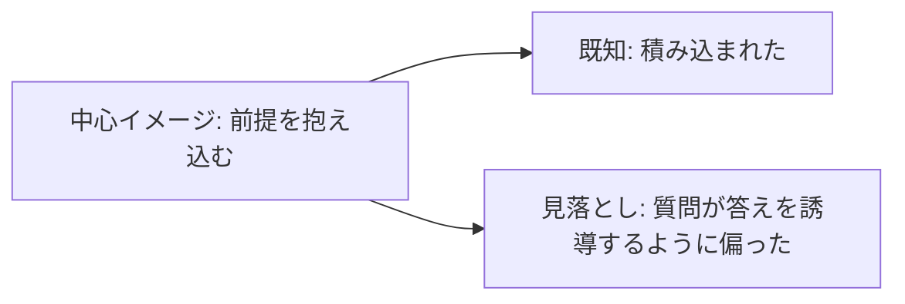

**重要語法** loaded question

<small>index: 9889 / candidate_id: ev-9889-adjective-01</small>

---

### 4402. materialize

**品詞** verb  
**発音** 表記省略（語義を優先）  
<small>よく知られている意味：物質化する・姿を現す</small>

#### 見落としやすい意味：期待・計画が実現する

**例文** The promised financial support never materialized.

**和訳** 約束されていた資金援助は結局実現しなかった。

**コアイメージの説明** 形のない期待が現実の形を取るイメージ。計画や約束が実際に起こる場合に使う。

**図**

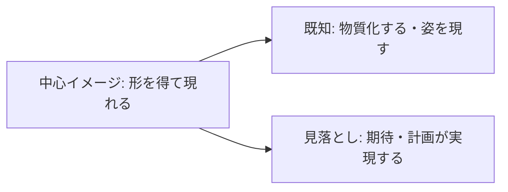

**重要語法** plans materialize

<small>index: 9897 / candidate_id: ev-9897-verb-01</small>

---

### 4403. midterm

**品詞** noun  
**発音** 表記省略（語義を優先）  
<small>よく知られている意味：中間試験</small>

#### 見落としやすい意味：米国大統領任期の途中に行われる中間選挙

**例文** The party lost several seats in the midterms.

**和訳** その政党は中間選挙で議席をいくつか失った。

**コアイメージの説明** mid は途中、term は一定の期間を表す。学校の学期の途中なら試験、政治の任期の途中なら選挙を指す。

**図**

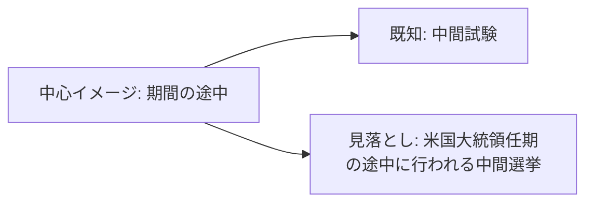

**重要語法** midterm elections

<small>index: 9902 / candidate_id: ev-9902-noun-01</small>

---

### 4404. misplaced

**品詞** adjective  
**発音** 表記省略（語義を優先）  
<small>よく知られている意味：置き忘れた</small>

#### 見落としやすい意味：信頼や忠誠の向け先が間違っている

**例文** Her trust in the unreliable report was misplaced.

**和訳** 信頼できない報告書に対する彼女の信頼は見当違いだった。

**コアイメージの説明** 本来の場所ではない所に置くというイメージ。信頼や期待の向け先が不適切な場合にも使う。

**図**

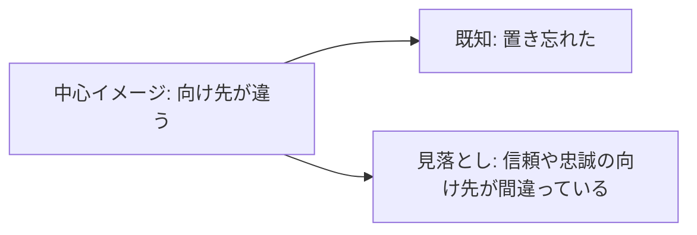

**重要語法** misplaced trust

<small>index: 9905 / candidate_id: ev-9905-adjective-01</small>

---

### 4405. mole

**品詞** noun  
**発音** 表記省略（語義を優先）  
<small>よく知られている意味：モグラ・ほくろ</small>

#### 見落としやすい意味：組織内部の秘密を流す内通者

**例文** Investigators discovered a mole inside the organization.

**和訳** 調査員たちはその組織の内部に内通者がいると突き止めた。

**コアイメージの説明** 地中に潜むモグラのように、姿を隠して内部で動く人物を思い浮かべる。情報を秘密裏に外へ流す内通者の意味になる。

**図**

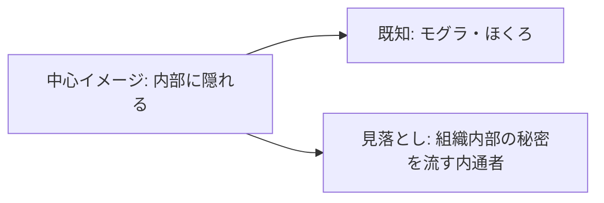

**重要語法** a mole inside an organization

<small>index: 9907 / candidate_id: ev-9907-noun-01</small>

---

### 4406. nutty

**品詞** adjective  
**発音** 表記省略（語義を優先）  
<small>よく知られている意味：ナッツ風味の</small>

#### 見落としやすい意味：考えが突飛でばかげた

**例文** His plan to finish the project overnight sounded nutty.

**和訳** その事業を一晩で終えるという彼の案は突飛に聞こえた。

**コアイメージの説明** ナッツの味という具体的な性質とは異なる口語表現。常識から外れた発想を軽く批判するときに使う。

**図**

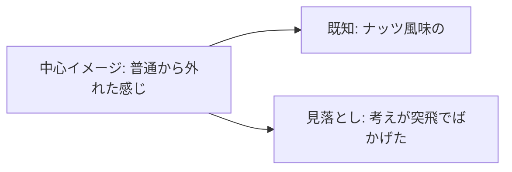

**重要語法** a nutty idea

<small>index: 9916 / candidate_id: ev-9916-adjective-01</small>

---

### 4407. offline

**品詞** idiom  
**発音** 表記省略（語義を優先）  
<small>よく知られている意味：ネット未接続の</small>

#### 見落としやすい意味：別の機会に非公式に話し合う

**例文** We can discuss the remaining details offline after the meeting.

**和訳** 残りの詳細は会議後に別途話し合えます。

**コアイメージの説明** 全員の参加する場から離れて話すことをイメージする。仕事では通信状態ではなく、会議外で個別に協議することを指す。

**図**

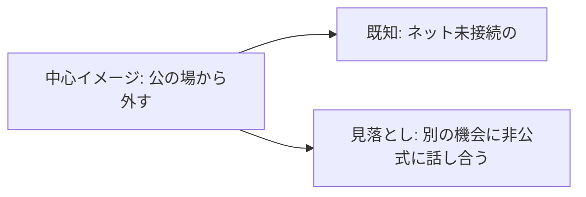

**重要語法** take the discussion offline

<small>index: 9918 / candidate_id: ev-9918-idiom-01</small>

---

### 4408. parachute

**品詞** verb  
**発音** 表記省略（語義を優先）  
<small>よく知られている意味：落下傘で降りる</small>

#### 見落としやすい意味：組織や地域へ外部から突然送り込む

**例文** The company parachuted an experienced manager into the branch.

**和訳** 会社は経験豊かな管理職をその支店へ外部から送り込んだ。

**コアイメージの説明** 空から突然降りてくる様子が元のイメージ。組織の外から人材を急に配置することにたとえる。

**図**

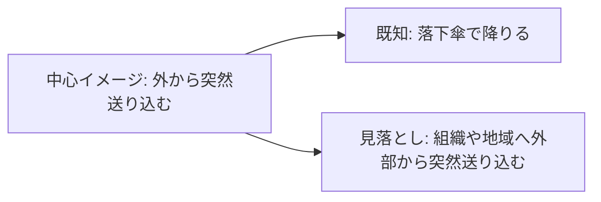

**重要語法** parachute someone into a role

<small>index: 9920 / candidate_id: ev-9920-verb-01</small>

---

### 4409. pinch

**品詞** verb  
**発音** 表記省略（語義を優先）  
<small>よく知られている意味：つまむ</small>

#### 見落としやすい意味：盗む・くすねる

**例文** Someone pinched my umbrella from the entrance.

**和訳** 誰かが入口から私の傘をくすねた。

**コアイメージの説明** 指でつまみ取る動作から、物をこっそり持ち去る意味へ広がる。特に英国英語のくだけた表現で使われる。

**図**

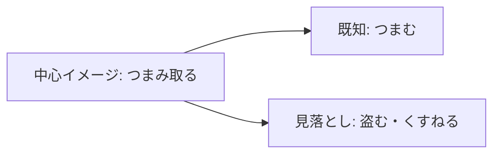

**重要語法** pinch something（英・口語）

<small>index: 9923 / candidate_id: ev-9923-verb-01</small>

---

### 4410. placebo

**品詞** noun  
**発音** 表記省略（語義を優先）  
<small>よく知られている意味：偽薬</small>

#### 見落としやすい意味：根本的な効果はないが安心させるだけの施策

**例文** The committee called the reform a placebo rather than a solution.

**和訳** 委員会はその改革を解決策ではなく気休めだと評した。

**コアイメージの説明** 偽薬は実際の治療とは別に安心感をもたらすもの。政策についても、根本問題を解決しない気休めの施策を表す。

**図**

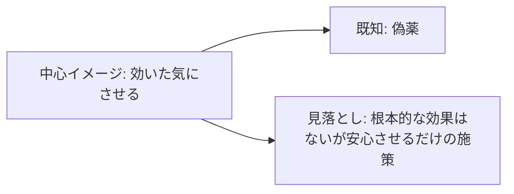

**重要語法** a political placebo

<small>index: 9925 / candidate_id: ev-9925-noun-01</small>

---

### 4411. polished

**品詞** adjective  
**発音** 表記省略（語義を優先）  
<small>よく知られている意味：磨かれた・つやのある</small>

#### 見落としやすい意味：話し方や文章が洗練され完成度が高い

**例文** Her polished presentation impressed the audience.

**和訳** 彼女の洗練された発表は聴衆に好印象を与えた。

**コアイメージの説明** 表面を磨いて粗さを取り除く動きが元になる。文章や話し方の欠点が減り、完成度が高い状態を表す。

**図**

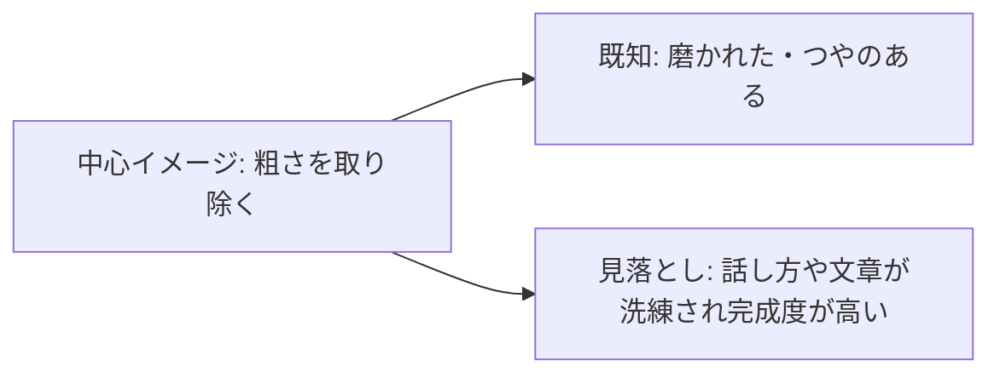

**重要語法** polished prose

<small>index: 9926 / candidate_id: ev-9926-adjective-01</small>

---

### 4412. posturing

**品詞** noun  
**発音** 表記省略（語義を優先）  
<small>よく知られている意味：姿勢をとること</small>

#### 見落としやすい意味：実質を伴わない態度や主張の誇示

**例文** The speech was mere political posturing, not a real plan.

**和訳** その演説は実際の計画ではなく単なる政治的なポーズだった。

**コアイメージの説明** 人前で姿勢を作って見せることから、主張を誇示する意味へ広がる。中身より外見を重んじる振る舞いへの批判を含む。

**図**

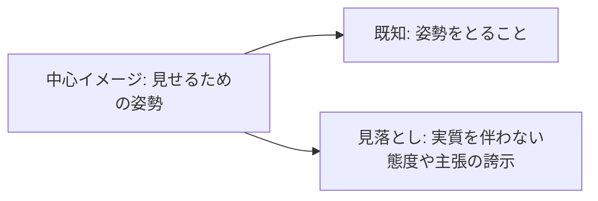

**重要語法** political posturing

<small>index: 9928 / candidate_id: ev-9928-noun-01</small>

---

### 4413. precipitate

**品詞** adjective  
**発音** /prɪˈsɪpɪtət/  
<small>よく知られている意味：（動詞）突然引き起こす</small>

#### 見落としやすい意味：性急な・軽率な

**例文** The board regretted its precipitate decision to cancel the event.

**和訳** 理事会は行事中止を性急に決めたことを後悔した。

**コアイメージの説明** 十分に段階を踏まないうちに事態が先へ進むイメージ。形容詞では決断が急ぎすぎていることを表す。

**図**

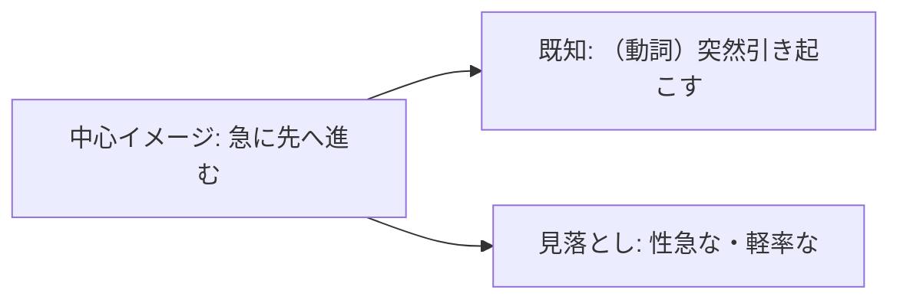

**重要語法** precipitate decision

<small>index: 9930 / candidate_id: ev-9930-adjective-01</small>

---

### 4414. precipitate

**品詞** noun  
**発音** /prɪˈsɪpɪtət/  
<small>よく知られている意味：（動詞）突然引き起こす</small>

#### 見落としやすい意味：化学反応でできる沈殿物

**例文** A white precipitate appeared at the bottom of the container.

**和訳** 容器の底に白い沈殿物が現れた。

**コアイメージの説明** 液体から固体が分かれて下に集まる現象を思い浮かべる。化学ではその固体自体をこの名詞で呼ぶ。

**図**

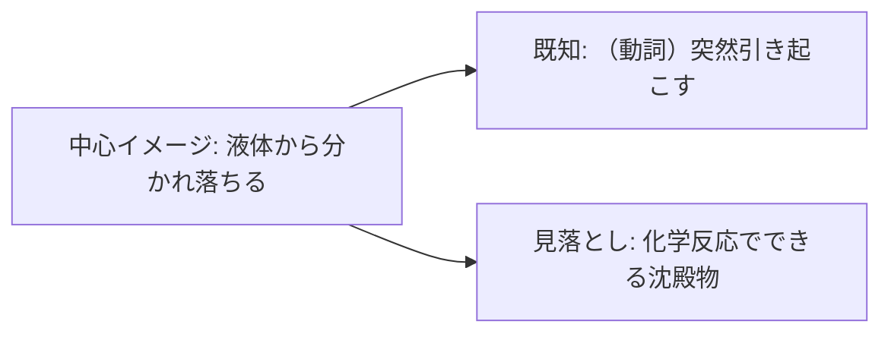

**重要語法** form a precipitate

<small>index: 9930 / candidate_id: ev-9930-noun-01</small>

---

### 4415. precipitate

**品詞** verb  
**発音** /prɪˈsɪpɪteɪt/  
<small>よく知られている意味：沈殿させる</small>

#### 見落としやすい意味：危機や変化などを突然引き起こす

**例文** The unexpected resignation precipitated a leadership crisis.

**和訳** 予想外の辞任が指導部の危機を突然引き起こした。

**コアイメージの説明** 物事を急激に動かし、一気に起こす感覚が中心にある。危機など抽象的な事態の発生原因にも使う。

**図**

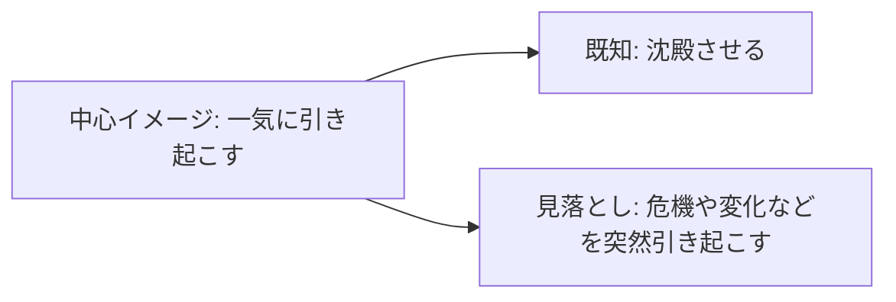

**重要語法** precipitate a crisis

<small>index: 9930 / candidate_id: ev-9930-verb-01</small>

---

### 4416. profanity

**品詞** noun  
**発音** 表記省略（語義を優先）  
<small>よく知られている意味：宗教的な冒涜</small>

#### 見落としやすい意味：罵り言葉・不適切な言葉

**例文** The station apologized for the profanity heard during the interview.

**和訳** 放送局はインタビュー中の罵り言葉について謝罪した。

**コアイメージの説明** 神聖なものを軽んじるという非難から、乱暴な言葉への非難にも使われる。日常的には不適切な言葉や罵り語を指す。

**図**

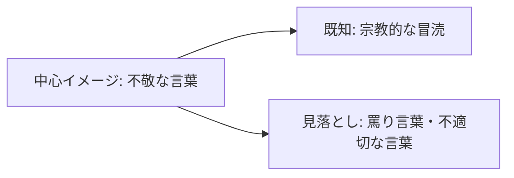

**重要語法** use profanity

<small>index: 9937 / candidate_id: ev-9937-noun-01</small>

---

### 4417. promiscuous

**品詞** adjective  
**発音** 表記省略（語義を優先）  
<small>よく知られている意味：無節操な</small>

#### 見落としやすい意味：無差別な・見境のない

**例文** The report criticized promiscuous sharing of personal information.

**和訳** 報告書は個人情報を無差別に共有する行為を批判した。

**コアイメージの説明** 対象や相手を選ばないことが中心。人間関係だけでなく、情報の共有や方法の選択が無差別である場合にも用いる。

**図**

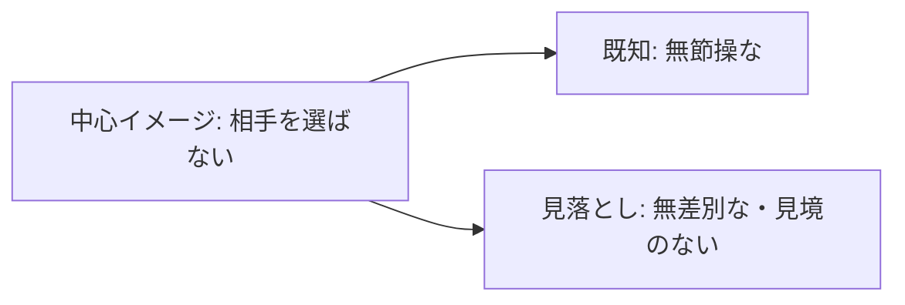

**重要語法** promiscuous use

<small>index: 9938 / candidate_id: ev-9938-adjective-01</small>

---

### 4418. recourse

**品詞** noun  
**発音** 表記省略（語義を優先）  
<small>よく知られている意味：頼ること</small>

#### 見落としやすい意味：困難時に頼れる手段・救済手段

**例文** When the appeal failed, the residents had little recourse.

**和訳** 不服申し立てが認められず、住民には頼れる手段がほぼなかった。

**コアイメージの説明** 困ったときに別の方法へ頼ることを表す。選択肢が少ない場面で利用可能な救済策という意味になる。

**図**

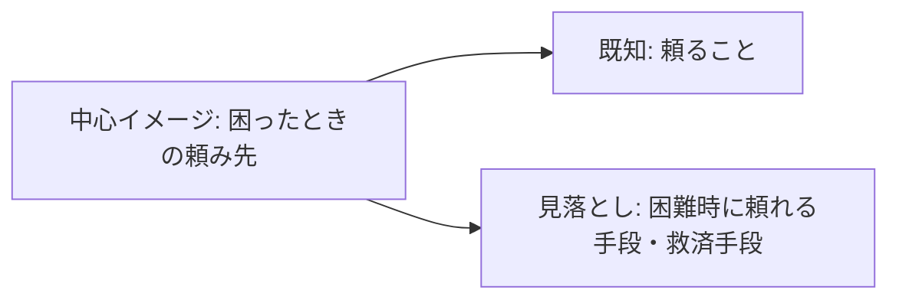

**重要語法** have recourse to

<small>index: 9947 / candidate_id: ev-9947-noun-01</small>

---

### 4419. rehabilitate

**品詞** verb  
**発音** 表記省略（語義を優先）  
<small>よく知られている意味：機能を回復させる</small>

#### 見落としやすい意味：傷ついた名誉や社会的信用を回復する

**例文** The investigation helped rehabilitate the scientist's reputation.

**和訳** その調査は科学者の名誉を回復する助けになった。

**コアイメージの説明** 損なわれた状態から再び健全な状態へ戻すことが中心。身体の機能だけでなく名誉や信用にも用いる。

**図**

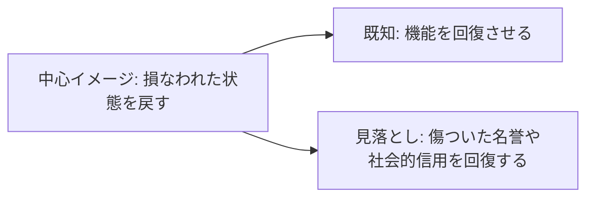

**重要語法** rehabilitate a reputation

<small>index: 9948 / candidate_id: ev-9948-verb-01</small>

---

### 4420. remodel

**品詞** verb  
**発音** 表記省略（語義を優先）  
<small>よく知られている意味：建物を改装する</small>

#### 見落としやすい意味：制度や組織などを作り直す

**例文** The committee plans to remodel the outdated decision-making system.

**和訳** 委員会は時代遅れの意思決定制度を作り直す予定だ。

**コアイメージの説明** 既存の形を改めて作り替えることを表す。建物だけでなく組織や制度も対象になる。

**図**

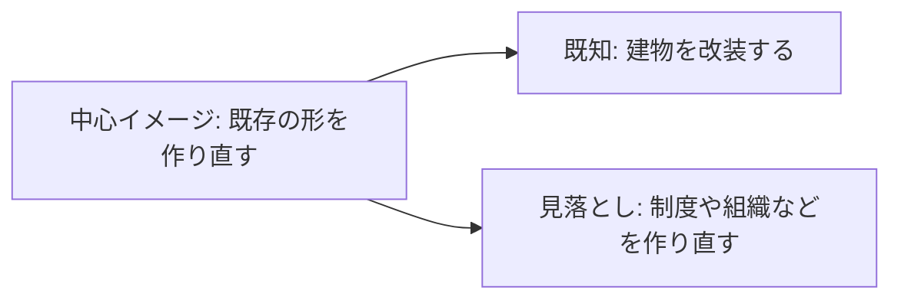

**重要語法** remodel an organization

<small>index: 9950 / candidate_id: ev-9950-verb-01</small>

---

### 4421. repulsive

**品詞** adjective  
**発音** 表記省略（語義を優先）  
<small>よく知られている意味：不快な・嫌悪を催させる</small>

#### 見落としやすい意味：物理的に押し返す力を持つ

**例文** The magnets exerted a repulsive force on each other.

**和訳** その磁石は互いに反発する力を及ぼした。

**コアイメージの説明** 相手を押し返して遠ざけるのが中心。心理的な嫌悪だけでなく物理的な反発力にも用いる。

**図**

```mermaid
flowchart LR
    A["中心イメージ: 押し返して遠ざける"]
    B["既知: 不快な・嫌悪を催させる"]
    C["見落とし: 物理的に押し返す力を持つ"]
    A --> B
    A --> C
```

**重要語法** repulsive force

<small>index: 9954 / candidate_id: ev-9954-adjective-01</small>

---

### 4422. ridiculously

**品詞** adverb  
**発音** 表記省略（語義を優先）  
<small>よく知られている意味：ばかばかしく</small>

#### 見落としやすい意味：異常なほど・極端に

**例文** The instructions were ridiculously complicated.

**和訳** その説明書は異常なほど複雑だった。

**コアイメージの説明** 常識から外れてばかばかしく感じるほどの程度を示す。評価の色合いが弱まり、非常にという強調にもなる。

**図**

```mermaid
flowchart LR
    A["中心イメージ: 常識外れの程度"]
    B["既知: ばかばかしく"]
    C["見落とし: 異常なほど・極端に"]
    A --> B
    A --> C
```

**重要語法** ridiculously expensive

<small>index: 9957 / candidate_id: ev-9957-adverb-01</small>

---

### 4423. scapegoat

**品詞** verb  
**発音** 表記省略（語義を優先）  
<small>よく知られている意味：スケープゴート・身代わり</small>

#### 見落としやすい意味：他人を身代わりにして責任を押しつける

**例文** The managers scapegoated the newest employee for the delay.

**和訳** 管理職たちは遅延の責任を新入り社員に押しつけた。

**コアイメージの説明** 他人の責任を負わせる身代わりという名詞から来る。動詞では誰かをその身代わりに仕立てる行為を表す。

**図**

```mermaid
flowchart LR
    A["中心イメージ: 責任を身代わりに負わせる"]
    B["既知: スケープゴート・身代わり"]
    C["見落とし: 他人を身代わりにして責任を押しつける"]
    A --> B
    A --> C
```

**重要語法** scapegoat someone for something

<small>index: 9961 / candidate_id: ev-9961-verb-01</small>

---

### 4424. scattered

**品詞** adjective  
**発音** 表記省略（語義を優先）  
<small>よく知られている意味：散らばった</small>

#### 見落としやすい意味：注意力や考えが散漫で集中できない

**例文** After the interruption, her thoughts felt scattered.

**和訳** 中断された後、彼女は考えがまとまらなくなった。

**コアイメージの説明** 物が一か所に集まらず散らばる状態が出発点。注意や思考がまとまらず集中できない場合にも使う。

**図**

```mermaid
flowchart LR
    A["中心イメージ: 一つにまとまらない"]
    B["既知: 散らばった"]
    C["見落とし: 注意力や考えが散漫で集中できない"]
    A --> B
    A --> C
```

**重要語法** scattered thoughts

<small>index: 9962 / candidate_id: ev-9962-adjective-01</small>

---

### 4425. seasoned

**品詞** adjective  
**発音** 表記省略（語義を優先）  
<small>よく知られている意味：味付けした</small>

#### 見落としやすい意味：経験豊富で熟練した

**例文** A seasoned negotiator handled the difficult discussion.

**和訳** 経験豊富な交渉担当者が難しい話し合いに対応した。

**コアイメージの説明** 味が整った料理の意味とは別に、経験を重ねて鍛えられた人を形容する。場数を踏んでいることがポイント。

**図**

```mermaid
flowchart LR
    A["中心イメージ: 経験を積んで整う"]
    B["既知: 味付けした"]
    C["見落とし: 経験豊富で熟練した"]
    A --> B
    A --> C
```

**重要語法** seasoned professional

<small>index: 9967 / candidate_id: ev-9967-adjective-01</small>

---

### 4426. servicemen

**品詞** noun  
**発音** 表記省略（語義を優先）  
<small>よく知られている意味：軍人たち</small>

#### 見落としやすい意味：修理や保守のサービス担当者

**例文** Two servicemen came to repair the building's heating system.

**和訳** 修理担当者が二人、建物の暖房設備を直しに来た。

**コアイメージの説明** service は軍務だけでなく保守や修理のサービスも表す。どの職業かは文脈によって決まる。

**図**

```mermaid
flowchart LR
    A["中心イメージ: サービスに従事する"]
    B["既知: 軍人たち"]
    C["見落とし: 修理や保守のサービス担当者"]
    A --> B
    A --> C
```

**重要語法** 修理文脈では service technicians ともいう

<small>index: 9970 / candidate_id: ev-9970-noun-01</small>

---

### 4427. shadowy

**品詞** adjective  
**発音** 表記省略（語義を優先）  
<small>よく知られている意味：影の多い・薄暗い</small>

#### 見落としやすい意味：正体や事情が不明瞭で怪しい

**例文** A shadowy organization financed the campaign.

**和訳** 正体がはっきりしない組織がその運動に資金を提供した。

**コアイメージの説明** 影に隠れると輪郭が見えにくくなる。人物や組織に使うと実態が不透明で怪しいことを表す。

**図**

```mermaid
flowchart LR
    A["中心イメージ: 影に隠れて見えない"]
    B["既知: 影の多い・薄暗い"]
    C["見落とし: 正体や事情が不明瞭で怪しい"]
    A --> B
    A --> C
```

**重要語法** shadowy group

<small>index: 9971 / candidate_id: ev-9971-adjective-01</small>

---

### 4428. snarl

**品詞** noun  
**発音** 表記省略（語義を優先）  
<small>よく知られている意味：うなり声</small>

#### 見落としやすい意味：交通渋滞や組織運営の混乱

**例文** A minor accident caused a traffic snarl downtown.

**和訳** 小さな事故で中心街の交通が混乱した。

**コアイメージの説明** 糸などが絡んで簡単にはほどけない状態を考える。車や仕事の流れがもつれて進まないことを表す。

**図**

```mermaid
flowchart LR
    A["中心イメージ: 絡まって動かない"]
    B["既知: うなり声"]
    C["見落とし: 交通渋滞や組織運営の混乱"]
    A --> B
    A --> C
```

**重要語法** traffic snarl

<small>index: 9978 / candidate_id: ev-9978-noun-01</small>

---

### 4429. sparse

**品詞** adjective  
**発音** 表記省略（語義を優先）  
<small>よく知られている意味：まばらな</small>

#### 見落としやすい意味：情報や説明や資料が乏しい

**例文** The article offered sparse evidence for its conclusion.

**和訳** その記事は結論を裏づける証拠をほとんど示していなかった。

**コアイメージの説明** 広い所に物が少ししかない状態が基本。情報や資料の量が乏しい場合にも使える。

**図**

```mermaid
flowchart LR
    A["中心イメージ: 十分に存在しない"]
    B["既知: まばらな"]
    C["見落とし: 情報や説明や資料が乏しい"]
    A --> B
    A --> C
```

**重要語法** sparse evidence

<small>index: 9980 / candidate_id: ev-9980-adjective-01</small>

---

### 4430. spat

**品詞** noun  
**発音** 表記省略（語義を優先）  
<small>よく知られている意味：（動詞 spit の過去形）吐いた</small>

#### 見落としやすい意味：ささいな口論

**例文** The two colleagues had a brief spat over the schedule.

**和訳** 同僚二人は日程をめぐってちょっとした口論になった。

**コアイメージの説明** 短く鋭い言葉が飛び交う小競り合いを表す。spit の過去形とは品詞を見て区別する。

**図**

```mermaid
flowchart LR
    A["中心イメージ: 小さな衝突"]
    B["既知: （動詞 spit の過去形）吐いた"]
    C["見落とし: ささいな口論"]
    A --> B
    A --> C
```

**重要語法** a spat over something

<small>index: 9981 / candidate_id: ev-9981-noun-01</small>

---

### 4431. speciality

**品詞** noun  
**発音** 表記省略（語義を優先）  
<small>よく知られている意味：専門分野・得意なこと</small>

#### 見落としやすい意味：その土地や店の名物・特産品

**例文** Fresh seafood is a speciality of this coastal town.

**和訳** 新鮮な魚介料理はこの海辺の町の名物だ。

**コアイメージの説明** 他と違う特別なものを表す。人の得意分野だけでなく地域の特産品にも使う。

**図**

```mermaid
flowchart LR
    A["中心イメージ: その土地に特有"]
    B["既知: 専門分野・得意なこと"]
    C["見落とし: その土地や店の名物・特産品"]
    A --> B
    A --> C
```

**重要語法** local speciality；米綴り specialty

<small>index: 9982 / candidate_id: ev-9982-noun-01</small>

---

### 4432. spurious

**品詞** adjective  
**発音** 表記省略（語義を優先）  
<small>よく知られている意味：偽の・根拠のない</small>

#### 見落としやすい意味：見かけ上は関係があるが実際は根拠のない

**例文** The study found a spurious correlation between the two figures.

**和訳** その研究は二つの数値の間に見かけだけの相関を見つけた。

**コアイメージの説明** 本物らしく見えても正しい根拠がないことを表す。数字が連動しても意味のある関係がないことをいう。

**図**

```mermaid
flowchart LR
    A["中心イメージ: 見かけだけのつながり"]
    B["既知: 偽の・根拠のない"]
    C["見落とし: 見かけ上は関係があるが実際は根拠のない"]
    A --> B
    A --> C
```

**重要語法** spurious correlation

<small>index: 9983 / candidate_id: ev-9983-adjective-01</small>

---

### 4433. spying

**品詞** verb  
**発音** 表記省略（語義を優先）  
<small>よく知られている意味：スパイ活動をしている</small>

#### 見落としやすい意味：ふと見つける・目にとめる

**例文** Spying a familiar face in the audience, she relaxed.

**和訳** 聴衆の中に見覚えのある顔を見つけ、彼女は安心した。

**コアイメージの説明** 目を凝らして注意深く見る感覚がある。秘密を探るだけでなく視界の中の何かに気づく意味にもなる。

**図**

```mermaid
flowchart LR
    A["中心イメージ: 目を凝らして見つける"]
    B["既知: スパイ活動をしている"]
    C["見落とし: ふと見つける・目にとめる"]
    A --> B
    A --> C
```

**重要語法** spy something（やや文語的）

<small>index: 9984 / candidate_id: ev-9984-verb-01</small>

---

### 4434. staging

**品詞** noun  
**発音** 表記省略（語義を優先）  
<small>よく知られている意味：舞台演出</small>

#### 見落としやすい意味：計画や事業の段階的な実施・準備

**例文** The staging of the project let each team test its work separately.

**和訳** 事業を段階的に進めたことで各チームは個別に作業を検証できた。

**コアイメージの説明** 舞台の準備のように順序や段取りを組むことが中心。一度に全部ではなく段階に分けて進めることも指す。

**図**

```mermaid
flowchart LR
    A["中心イメージ: 段取りを組む"]
    B["既知: 舞台演出"]
    C["見落とし: 計画や事業の段階的な実施・準備"]
    A --> B
    A --> C
```

**重要語法** staging of a project

<small>index: 9985 / candidate_id: ev-9985-noun-01</small>

---

### 4435. stained

**品詞** adjective  
**発音** 表記省略（語義を優先）  
<small>よく知られている意味：しみの付いた</small>

#### 見落としやすい意味：名誉や経歴が汚された

**例文** The scandal left his reputation stained.

**和訳** その不祥事は彼の評判に傷を残した。

**コアイメージの説明** 表面のしみが簡単に消えない状態を考える。名誉や経歴にも悪い出来事の汚点が残ることをいう。

**図**

```mermaid
flowchart LR
    A["中心イメージ: 消えない汚れが残る"]
    B["既知: しみの付いた"]
    C["見落とし: 名誉や経歴が汚された"]
    A --> B
    A --> C
```

**重要語法** stained reputation

<small>index: 9986 / candidate_id: ev-9986-adjective-01</small>

---

### 4436. suffocate

**品詞** verb  
**発音** 表記省略（語義を優先）  
<small>よく知られている意味：窒息させる</small>

#### 見落としやすい意味：発展や自由や創造性などを抑え込む

**例文** Rigid rules can suffocate new ideas.

**和訳** 厳格すぎる規則は新しい発想を抑え込んでしまう。

**コアイメージの説明** 空気を奪い動けなくする状態が基本。成長や創造性に必要な自由を奪うことへ広がる。

**図**

```mermaid
flowchart LR
    A["中心イメージ: 動く余地を奪う"]
    B["既知: 窒息させる"]
    C["見落とし: 発展や自由や創造性などを抑え込む"]
    A --> B
    A --> C
```

**重要語法** suffocate creativity

<small>index: 9991 / candidate_id: ev-9991-verb-01</small>

---

### 4437. supposed

**品詞** adjective  
**発音** 表記省略（語義を優先）  
<small>よく知られている意味：想定された・仮定の</small>

#### 見落としやすい意味：世間でそう言われているが疑わしい

**例文** The supposed expert struggled with a basic question.

**和訳** その自称専門家は基本的な質問への回答に苦労した。

**コアイメージの説明** そうだと言われるだけで事実とは確認されていないという距離感がある。話し手が疑っている場合にも使う。

**図**

```mermaid
flowchart LR
    A["中心イメージ: そう言われるだけ"]
    B["既知: 想定された・仮定の"]
    C["見落とし: 世間でそう言われているが疑わしい"]
    A --> B
    A --> C
```

**重要語法** supposed expert

<small>index: 9996 / candidate_id: ev-9996-adjective-01</small>

---

### 4438. supposed

**品詞** construction  
**発音** 表記省略（語義を優先）  
<small>よく知られている意味：想定された・仮定の</small>

#### 見落としやすい意味：～することになっている・～すべきである

**例文** All visitors are supposed to sign in at the front desk.

**和訳** 訪問者は全員受付で記名することになっている。

**コアイメージの説明** 周囲からそうすることが予定・期待されているという感覚。be supposed to は推測ではなく規則や義務を表す。

**図**

```mermaid
flowchart LR
    A["中心イメージ: そうすることを期待される"]
    B["既知: 想定された・仮定の"]
    C["見落とし: ～することになっている・～すべきである"]
    A --> B
    A --> C
```

**重要語法** be supposed to do

<small>index: 9996 / candidate_id: ev-9996-construction-01</small>

---

### 4439. tortuous

**品詞** adjective  
**発音** 表記省略（語義を優先）  
<small>よく知られている意味：曲がりくねった</small>

#### 見落としやすい意味：道筋や議論が曲がりくねり、非常に複雑な

**例文** The researchers followed a tortuous route to their conclusion.

**和訳** 研究者たちは複雑な道筋を経て結論にたどり着いた。

**コアイメージの説明** 道が何度も曲がってまっすぐ進めないイメージ。議論や手順も理解しにくく複雑なときに使う。

**図**

```mermaid
flowchart LR
    A["中心イメージ: 何度も曲がって進む"]
    B["既知: 曲がりくねった"]
    C["見落とし: 道筋や議論が曲がりくねり、非常に複雑な"]
    A --> B
    A --> C
```

**重要語法** tortuous argument；torturous と区別

<small>index: 10004 / candidate_id: ev-10004-ai-01</small>

---

### 4440. tortured

**品詞** adjective  
**発音** 表記省略（語義を優先）  
<small>よく知られている意味：苦痛を受けた</small>

#### 見落としやすい意味：文章・論理・説明などが不自然にひねり出された、無理のある

**例文** The report offered a tortured explanation of the error.

**和訳** その報告書は誤りについて無理のある説明を示した。

**コアイメージの説明** 無理にねじ曲げて形にしたような不自然さを表す。論理や文章では苦しいこじつけになる。

**図**

```mermaid
flowchart LR
    A["中心イメージ: 無理にねじ曲げる"]
    B["既知: 苦痛を受けた"]
    C["見落とし: 文章・論理・説明などが不自然にひねり出された、無理のある"]
    A --> B
    A --> C
```

**重要語法** tortured logic

<small>index: 10005 / candidate_id: ev-10005-ai-01</small>

---

### 4441. township

**品詞** noun  
**発音** 表記省略（語義を優先）  
<small>よく知られている意味：町・集落</small>

#### 見落としやすい意味：米国などで用いられる町・郡内の行政区画（郡区）

**例文** The clinic provides care to several townships within the county.

**和訳** 診療所は郡内の複数の郡区に医療を提供している。

**コアイメージの説明** 町に関係する地域を区分した単位を表す。国や州の制度によっては正式な行政区画を指す。

**図**

```mermaid
flowchart LR
    A["中心イメージ: 地域を区分した単位"]
    B["既知: 町・集落"]
    C["見落とし: 米国などで用いられる町・郡内の行政区画（郡区）"]
    A --> B
    A --> C
```

**重要語法** 米国などの行政制度で用法が異なる

<small>index: 10006 / candidate_id: ev-10006-ai-01</small>

---

### 4442. toys

**品詞** verb phrase  
**発音** 表記省略（語義を優先）  
<small>よく知られている意味：おもちゃ（複数形）</small>

#### 見落としやすい意味：toys with ～で、考え・可能性を軽く検討する／相手をもてあそぶ

**例文** The company toys with the idea of opening a smaller store.

**和訳** その会社は小型店を開く案を軽く検討している。

**コアイメージの説明** おもちゃを軽くいじるように、考えを本決まりにせず試す。相手をもてあそぶ意味もある。

**図**

```mermaid
flowchart LR
    A["中心イメージ: 軽くいじる"]
    B["既知: おもちゃ（複数形）"]
    C["見落とし: toys with ～で、考え・可能性を軽く検討する／相手をもてあそぶ"]
    A --> B
    A --> C
```

**重要語法** toy with an idea；toys は動詞三単現

<small>index: 10007 / candidate_id: ev-10007-ai-01</small>

---

### 4443. verbatim

**品詞** adverb  
**発音** 表記省略（語義を優先）  
<small>よく知られている意味：逐語的な（形容詞）</small>

#### 見落としやすい意味：発言などを一語一句そのまま、逐語的に

**例文** The witness repeated the conversation verbatim.

**和訳** 証人は会話を一語一句そのまま繰り返した。

**コアイメージの説明** 言葉を変えずに再現するという意味が中心。動作を修飾する副詞としても使われる。

**図**

```mermaid
flowchart LR
    A["中心イメージ: 言葉をそのまま再現"]
    B["既知: 逐語的な（形容詞）"]
    C["見落とし: 発言などを一語一句そのまま、逐語的に"]
    A --> B
    A --> C
```

**重要語法** repeat verbatim

<small>index: 10019 / candidate_id: ev-10019-ai-01</small>

---

### 4444. visceral

**品詞** adjective  
**発音** 表記省略（語義を優先）  
<small>よく知られている意味：内臓の</small>

#### 見落としやすい意味：理屈より本能・感情に訴える、直感的な

**例文** The audience had a visceral reaction to the injustice.

**和訳** 聴衆はその不公平に理屈抜きの強い反応を示した。

**コアイメージの説明** 体の奥から反応が起こるイメージ。理屈より先に本能や感情が強く働くことを表す。

**図**

```mermaid
flowchart LR
    A["中心イメージ: 体の奥から反応する"]
    B["既知: 内臓の"]
    C["見落とし: 理屈より本能・感情に訴える、直感的な"]
    A --> B
    A --> C
```

**重要語法** visceral reaction

<small>index: 10021 / candidate_id: ev-10021-ai-01</small>

---

### 4445. wager

**品詞** verb  
**発音** 表記省略（語義を優先）  
<small>よく知られている意味：金銭を賭ける</small>

#### 見落としやすい意味：I wager ～で、～だろうと見込む・きっとそうだと思う

**例文** I wager the new library will be crowded on opening day.

**和訳** 新しい図書館は開館初日に混むだろうね。

**コアイメージの説明** 賭けはまだ分からない結果に自分の予想を託すこと。金銭がなくても確信を込めた推量に使える。

**図**

```mermaid
flowchart LR
    A["中心イメージ: 予想に賭ける"]
    B["既知: 金銭を賭ける"]
    C["見落とし: I wager ～で、～だろうと見込む・きっとそうだと思う"]
    A --> B
    A --> C
```

**重要語法** I wager that ...（口語）

<small>index: 10022 / candidate_id: ev-10022-ai-01</small>

---

### 4446. weasel

**品詞** verb phrase  
**発音** 表記省略（語義を優先）  
<small>よく知られている意味：イタチ</small>

#### 見落としやすい意味：weasel out ofで、責任や約束をずるく回避する

**例文** He tried to weasel out of his promise to help.

**和訳** 彼は手伝う約束からずるく逃れようとした。

**コアイメージの説明** 身をくねらせて狭い場所をすり抜けるイメージ。約束や責任を巧みにかわして逃れる意味になる。

**図**

```mermaid
flowchart LR
    A["中心イメージ: すり抜けて逃れる"]
    B["既知: イタチ"]
    C["見落とし: weasel out ofで、責任や約束をずるく回避する"]
    A --> B
    A --> C
```

**重要語法** weasel out of a promise

<small>index: 10025 / candidate_id: ev-10025-verb-phrase-01</small>

---

### 4447. wrangle

**品詞** verb  
**発音** 表記省略（語義を優先）  
<small>よく知られている意味：口論する</small>

#### 見落としやすい意味：難しい交渉などの末に取り決める・どうにか確保する

**例文** The organizers wrangled a deal with the venue.

**和訳** 主催者は交渉を重ねてどうにか会場側と契約をまとめた。

**コアイメージの説明** もめたり交渉したりしながら物事を調整する感覚。苦労の末に合意や必要なものを確保する意味にも使う。

**図**

```mermaid
flowchart LR
    A["中心イメージ: もめながらまとめる"]
    B["既知: 口論する"]
    C["見落とし: 難しい交渉などの末に取り決める・どうにか確保する"]
    A --> B
    A --> C
```

**重要語法** wrangle a deal

<small>index: 10029 / candidate_id: ev-10029-ai-01</small>

---

### 4448. abdicate

**品詞** verb  
**発音** 表記省略（語義を優先）  
<small>よく知られている意味：王位を退く</small>

#### 見落としやすい意味：責任・権限を放棄する（abdicate responsibilityなど）

**例文** Officials must not abdicate responsibility for public safety.

**和訳** 役人は公共の安全への責任を放棄してはならない。

**コアイメージの説明** 持っている地位や権限を自ら手放すことが中心。王位のほか責任を果たす立場から降りることも表す。

**図**

```mermaid
flowchart LR
    A["中心イメージ: 負うべき役割を手放す"]
    B["既知: 王位を退く"]
    C["見落とし: 責任・権限を放棄する（abdicate responsibilityなど）"]
    A --> B
    A --> C
```

**重要語法** abdicate responsibility

<small>index: 10032 / candidate_id: ev-10032-ai-01</small>

---

### 4449. absentee

**品詞** noun phrase  
**発音** 表記省略（語義を優先）  
<small>よく知られている意味：欠席者</small>

#### 見落としやすい意味：absentee ballotで、不在者投票用の投票用紙

**例文** She requested an absentee ballot before her trip.

**和訳** 彼女は旅行前に不在者投票用の投票用紙を請求した。

**コアイメージの説明** その場にいない人を absentee と呼ぶ。選挙では投票所に行けない人の投票方式を表す定型表現に使う。

**図**

```mermaid
flowchart LR
    A["中心イメージ: その場にいない人"]
    B["既知: 欠席者"]
    C["見落とし: absentee ballotで、不在者投票用の投票用紙"]
    A --> B
    A --> C
```

**重要語法** absentee ballot

<small>index: 10034 / candidate_id: ev-10034-ai-01</small>

---

### 4450. ache

**品詞** verb  
**発音** 表記省略（語義を優先）  
<small>よく知られている意味：痛む</small>

#### 見落としやすい意味：ache forで、切望する・恋しく思う

**例文** She ached for a chance to see her hometown again.

**和訳** 彼女は故郷をもう一度見る機会を切望していた。

**コアイメージの説明** 体に続く鈍い痛みが出発点。胸が痛むほど強く望む気持ちを表す。

**図**

```mermaid
flowchart LR
    A["中心イメージ: 痛むほど望む"]
    B["既知: 痛む"]
    C["見落とし: ache forで、切望する・恋しく思う"]
    A --> B
    A --> C
```

**重要語法** ache for

<small>index: 10035 / candidate_id: ev-10035-verb-01</small>

---

### 4451. adherent

**品詞** noun  
**発音** 表記省略（語義を優先）  
<small>よく知られている意味：密着した（形容詞）</small>

#### 見落としやすい意味：思想・団体・宗教の支持者、信奉者

**例文** The movement gained new adherents across the city.

**和訳** その運動は市内で新しい支持者を獲得した。

**コアイメージの説明** 何かにしっかりくっつくというイメージ。思想や主義に結びついて支持する人を指す。

**図**

```mermaid
flowchart LR
    A["中心イメージ: 考えにくっつく"]
    B["既知: 密着した（形容詞）"]
    C["見落とし: 思想・団体・宗教の支持者、信奉者"]
    A --> B
    A --> C
```

**重要語法** adherent of a movement

<small>index: 10037 / candidate_id: ev-10037-ai-01</small>

---

### 4452. adjunct

**品詞** noun phrase  
**発音** 表記省略（語義を優先）  
<small>よく知られている意味：付属物・補助的なもの</small>

#### 見落としやすい意味：adjunct professorで、大学の非常勤教員

**例文** She teaches history as an adjunct professor.

**和訳** 彼女は大学の非常勤教員として歴史を教えている。

**コアイメージの説明** 本体に付け加わるという意味が中心。米国の大学では非常勤の教員を表す職名となる。

**図**

```mermaid
flowchart LR
    A["中心イメージ: 本体に付け加わる"]
    B["既知: 付属物・補助的なもの"]
    C["見落とし: adjunct professorで、大学の非常勤教員"]
    A --> B
    A --> C
```

**重要語法** adjunct professor

<small>index: 10038 / candidate_id: ev-10038-ai-01</small>

---

### 4453. aerial

**品詞** noun  
**発音** 表記省略（語義を優先）  
<small>よく知られている意味：空中の・航空の</small>

#### 見落としやすい意味：（主に英）無線・テレビのアンテナ

**例文** They installed a new television aerial on the roof.

**和訳** 彼らは屋根に新しいテレビアンテナを設置した。

**コアイメージの説明** 空中を通る電波に関係する装置というつながり。主に英国英語では受信用アンテナを名詞 aerial で呼ぶ。

**図**

```mermaid
flowchart LR
    A["中心イメージ: 空中の電波を受ける"]
    B["既知: 空中の・航空の"]
    C["見落とし: （主に英）無線・テレビのアンテナ"]
    A --> B
    A --> C
```

**重要語法** television aerial（主に英）

<small>index: 10041 / candidate_id: ev-10041-noun-01</small>

---

### 4454. agonize

**品詞** verb phrase  
**発音** 表記省略（語義を優先）  
<small>よく知られている意味：苦痛を感じる</small>

#### 見落としやすい意味：agonize over ～で、決断に迷ってひどく悩む

**例文** He agonized over which university to choose.

**和訳** 彼はどの大学を選ぶかひどく悩んだ。

**コアイメージの説明** 強い苦しみを感じることから決断をめぐる精神的苦悩へ広がる。単に考えるより悩みの深さを表す。

**図**

```mermaid
flowchart LR
    A["中心イメージ: 苦しくなるほど考える"]
    B["既知: 苦痛を感じる"]
    C["見落とし: agonize over ～で、決断に迷ってひどく悩む"]
    A --> B
    A --> C
```

**重要語法** agonize over

<small>index: 10042 / candidate_id: ev-10042-ai-01</small>

---

### 4455. amplify

**品詞** verb  
**発音** 表記省略（語義を優先）  
<small>よく知られている意味：音・信号を増幅する</small>

#### 見落としやすい意味：説明や発言を詳しく補足・展開する

**例文** Could you amplify that point with a concrete example?

**和訳** その点を具体例でもう少し詳しく説明してもらえますか。

**コアイメージの説明** 小さなものを大きく広げることが基本。説明を補い内容を詳しくする意味にも使う。

**図**

```mermaid
flowchart LR
    A["中心イメージ: 内容を広げる"]
    B["既知: 音・信号を増幅する"]
    C["見落とし: 説明や発言を詳しく補足・展開する"]
    A --> B
    A --> C
```

**重要語法** amplify a point

<small>index: 10044 / candidate_id: ev-10044-ai-01</small>

---

### 4456. apprehension

**品詞** noun  
**発音** 表記省略（語義を優先）  
<small>よく知られている意味：不安・懸念</small>

#### 見落としやすい意味：容疑者を逮捕・拘束すること

**例文** Police confirmed the apprehension of the suspect.

**和訳** 警察は容疑者を逮捕したと確認した。

**コアイメージの説明** つかまえることに由来する名詞で、法執行では身柄の確保を指す。不安という心理的な意味とは文脈で区別する。

**図**

```mermaid
flowchart LR
    A["中心イメージ: つかまえる"]
    B["既知: 不安・懸念"]
    C["見落とし: 容疑者を逮捕・拘束すること"]
    A --> B
    A --> C
```

**重要語法** apprehension of a suspect

<small>index: 10046 / candidate_id: ev-10046-ai-01</small>

---

### 4457. arbiter

**品詞** noun  
**発音** 表記省略（語義を優先）  
<small>よく知られている意味：仲裁人</small>

#### 見落としやすい意味：芸術・流行・趣味などの価値判断を左右する権威者

**例文** The magazine became an arbiter of fashion.

**和訳** その雑誌は流行の評価を左右する権威となった。

**コアイメージの説明** 判断を下す仲裁人という意味が中心。流行や芸術の価値基準を決める影響力のある人や組織を表す。

**図**

```mermaid
flowchart LR
    A["中心イメージ: 判断の基準を示す"]
    B["既知: 仲裁人"]
    C["見落とし: 芸術・流行・趣味などの価値判断を左右する権威者"]
    A --> B
    A --> C
```

**重要語法** arbiter of taste

<small>index: 10049 / candidate_id: ev-10049-ai-01</small>

---

### 4458. artful

**品詞** adjective  
**発音** 表記省略（語義を優先）  
<small>よく知られている意味：芸術的な</small>

#### 見落としやすい意味：巧妙で、ずる賢い

**例文** The spokesman gave an artful reply that avoided the question.

**和訳** 広報担当者は質問を巧みにかわす返答をした。

**コアイメージの説明** 技術を使い巧みに仕上げることが基本。文脈次第で人をうまくだますようなずる賢さも表す。

**図**

```mermaid
flowchart LR
    A["中心イメージ: 巧みに仕上げる"]
    B["既知: 芸術的な"]
    C["見落とし: 巧妙で、ずる賢い"]
    A --> B
    A --> C
```

**重要語法** artful excuse

<small>index: 10050 / candidate_id: ev-10050-adjective-01</small>

---

### 4459. bandwagon

**品詞** noun  
**発音** 表記省略（語義を優先）  
<small>よく知られている意味：楽隊を載せる車</small>

#### 見落としやすい意味：人気が急速に集まる流行や動き

**例文** Several businesses jumped on the recycling bandwagon.

**和訳** いくつかの企業はリサイクルの流行に便乗した。

**コアイメージの説明** 楽隊の車に人が集まり後をついていく様子が出発点。人気の流れに加わることを表す。

**図**

```mermaid
flowchart LR
    A["中心イメージ: 人気の流れに乗る"]
    B["既知: 楽隊を載せる車"]
    C["見落とし: 人気が急速に集まる流行や動き"]
    A --> B
    A --> C
```

**重要語法** jump on the bandwagon

<small>index: 10052 / candidate_id: ev-10052-noun-01</small>

---

### 4460. banter

**品詞** verb  
**発音** 表記省略（語義を優先）  
<small>よく知られている意味：冗談のやり取り（名詞）</small>

#### 見落としやすい意味：親しい者同士で冗談・軽口を言い合う

**例文** The players bantered while waiting for practice to begin.

**和訳** 選手たちは練習開始を待ちながら軽口を言い合った。

**コアイメージの説明** 親しい者同士の軽いやり取りが中心。名詞だけでなく動詞で冗談を交わす行為を表せる。

**図**

```mermaid
flowchart LR
    A["中心イメージ: 軽い言葉を交わす"]
    B["既知: 冗談のやり取り（名詞）"]
    C["見落とし: 親しい者同士で冗談・軽口を言い合う"]
    A --> B
    A --> C
```

**重要語法** banter with someone

<small>index: 10053 / candidate_id: ev-10053-ai-01</small>

---

### 4461. barbed

**品詞** adjective  
**発音** 表記省略（語義を優先）  
<small>よく知られている意味：とげのある</small>

#### 見落としやすい意味：言葉や批判が辛辣な、棘のある

**例文** He made a barbed remark about the proposal.

**和訳** 彼はその提案について辛辣な一言を放った。

**コアイメージの説明** 物のとげは触れた相手を傷つける。言葉では相手を刺すような辛辣さになる。

**図**

```mermaid
flowchart LR
    A["中心イメージ: 言葉のとげ"]
    B["既知: とげのある"]
    C["見落とし: 言葉や批判が辛辣な、棘のある"]
    A --> B
    A --> C
```

**重要語法** barbed remark

<small>index: 10055 / candidate_id: ev-10055-ai-01</small>

---

### 4462. barrage

**品詞** verb  
**発音** 表記省略（語義を優先）  
<small>よく知られている意味：集中砲火（名詞）</small>

#### 見落としやすい意味：質問や言葉を立て続けに浴びせる

**例文** Reporters barraged the minister with questions.

**和訳** 記者たちは大臣に質問を次々と浴びせた。

**コアイメージの説明** 砲弾が連続して降り注ぐイメージ。質問や批判が相手へ途切れず押し寄せる場合にも動詞で使う。

**図**

```mermaid
flowchart LR
    A["中心イメージ: 立て続けに浴びせる"]
    B["既知: 集中砲火（名詞）"]
    C["見落とし: 質問や言葉を立て続けに浴びせる"]
    A --> B
    A --> C
```

**重要語法** barrage someone with questions

<small>index: 10057 / candidate_id: ev-10057-verb-01</small>

---

### 4463. beta

**品詞** noun  
**発音** 表記省略（語義を優先）  
<small>よく知られている意味：ギリシャ文字の第2字</small>

#### 見落としやすい意味：ソフトウェアなどの一般公開前の試験版（ベータ版）

**例文** The new version of the program is still in beta.

**和訳** そのプログラムの新版はまだ試験公開段階にある。

**コアイメージの説明** 正式版より前の段階の記号として beta が使われる。ソフトウェアでは試験公開して改良する段階を指す。

**図**

```mermaid
flowchart LR
    A["中心イメージ: 正式版の一歩手前"]
    B["既知: ギリシャ文字の第2字"]
    C["見落とし: ソフトウェアなどの一般公開前の試験版（ベータ版）"]
    A --> B
    A --> C
```

**重要語法** in beta

<small>index: 10060 / candidate_id: ev-10060-ai-01</small>

---

### 4464. bloat

**品詞** verb  
**発音** 表記省略（語義を優先）  
<small>よく知られている意味：腹などが膨れる</small>

#### 見落としやすい意味：文章・組織・ソフトウェアなどを無駄に肥大化させる

**例文** Adding unnecessary features can bloat the software.

**和訳** 不要な機能を増やすとソフトウェアが無駄に肥大化する。

**コアイメージの説明** 必要以上に膨らんで重くなることが中心。文章や組織やプログラムにも使う。

**図**

```mermaid
flowchart LR
    A["中心イメージ: 無駄に膨らむ"]
    B["既知: 腹などが膨れる"]
    C["見落とし: 文章・組織・ソフトウェアなどを無駄に肥大化させる"]
    A --> B
    A --> C
```

**重要語法** bloated software

<small>index: 10063 / candidate_id: ev-10063-ai-01</small>

---

### 4465. booking

**品詞** noun  
**発音** 表記省略（語義を優先）  
<small>よく知られている意味：予約</small>

#### 見落としやすい意味：出演者の契約・出演予定

**例文** The actor's agent confirmed a booking at the summer festival.

**和訳** 俳優の代理人は夏の祭典への出演契約を確認した。

**コアイメージの説明** 予定表の枠を確保する意味が中心。席だけでなく出演者の仕事を押さえることにも使う。

**図**

```mermaid
flowchart LR
    A["中心イメージ: 予定枠を確保する"]
    B["既知: 予約"]
    C["見落とし: 出演者の契約・出演予定"]
    A --> B
    A --> C
```

**重要語法** a booking for a performer

<small>index: 10067 / candidate_id: ev-10067-noun-01</small>

---

### 4466. brisk

**品詞** adjective  
**発音** 表記省略（語義を優先）  
<small>よく知られている意味：足早な・きびきびした</small>

#### 見落としやすい意味：売れ行き・商取引などが活発な、好調な

**例文** Sales were brisk throughout the holiday season.

**和訳** 休暇シーズンを通して売れ行きは好調だった。

**コアイメージの説明** 動きに勢いがあり停滞しない状態を表す。人の歩き方だけでなく取引の活発さにも用いる。

**図**

```mermaid
flowchart LR
    A["中心イメージ: 勢いよく動く"]
    B["既知: 足早な・きびきびした"]
    C["見落とし: 売れ行き・商取引などが活発な、好調な"]
    A --> B
    A --> C
```

**重要語法** brisk sales

<small>index: 10072 / candidate_id: ev-10072-ai-01</small>

---

### 4467. carrying

**品詞** noun phrase  
**発音** 表記省略（語義を優先）  
<small>よく知られている意味：運搬すること</small>

#### 見落としやすい意味：carrying capacityで、環境が持続的に支えられる個体数・収容力

**例文** The lake's carrying capacity depends on its food supply.

**和訳** 湖が維持できる生物の個体数は餌の供給量に左右される。

**コアイメージの説明** 何かを支えられる限界という発想。生態学では環境が持続的に支えられる個体数を指す。

**図**

```mermaid
flowchart LR
    A["中心イメージ: 支えられる上限"]
    B["既知: 運搬すること"]
    C["見落とし: carrying capacityで、環境が持続的に支えられる個体数・収容力"]
    A --> B
    A --> C
```

**重要語法** carrying capacity

<small>index: 10080 / candidate_id: ev-10080-ai-01</small>

---

### 4468. cavalier

**品詞** adjective  
**発音** 表記省略（語義を優先）  
<small>よく知られている意味：騎士・騎兵</small>

#### 見落としやすい意味：人の気持ちや重大事を軽んじる、無頓着な

**例文** The director seemed cavalier about the staff's concerns.

**和訳** 責任者は職員の懸念を軽く見ているようだった。

**コアイメージの説明** 堂々と構えて細事を気にしない態度が元になる。重大なことに無頓着な振る舞いを批判する意味で使う。

**図**

```mermaid
flowchart LR
    A["中心イメージ: 気にせず構える"]
    B["既知: 騎士・騎兵"]
    C["見落とし: 人の気持ちや重大事を軽んじる、無頓着な"]
    A --> B
    A --> C
```

**重要語法** cavalier about safety

<small>index: 10081 / candidate_id: ev-10081-adjective-01</small>

---

### 4469. clearing

**品詞** noun  
**発音** 表記省略（語義を優先）  
<small>よく知られている意味：片付け・除去</small>

#### 見落としやすい意味：森林の中にある木のない空き地

**例文** We ate lunch in a small clearing in the forest.

**和訳** 私たちは森の中の小さな空き地で昼食を取った。

**コアイメージの説明** 木などを除いて場所を空けることが出発点。森林で木のない開けた一角を表す。

**図**

```mermaid
flowchart LR
    A["中心イメージ: 取り除いて空ける"]
    B["既知: 片付け・除去"]
    C["見落とし: 森林の中にある木のない空き地"]
    A --> B
    A --> C
```

**重要語法** forest clearing

<small>index: 10087 / candidate_id: ev-10087-noun-01</small>

---

### 4470. clout

**品詞** noun  
**発音** 表記省略（語義を優先）  
<small>よく知られている意味：一撃・殴打</small>

#### 見落としやすい意味：実際に物事を動かす影響力

**例文** The local organization has considerable political clout.

**和訳** その地域団体にはかなりの政治的影響力がある。

**コアイメージの説明** 強い一撃を与えられる力から物事を動かす影響力を表す。単なる知名度ではなく実効的な力を含む。

**図**

```mermaid
flowchart LR
    A["中心イメージ: 動かす力"]
    B["既知: 一撃・殴打"]
    C["見落とし: 実際に物事を動かす影響力"]
    A --> B
    A --> C
```

**重要語法** political clout

<small>index: 10089 / candidate_id: ev-10089-noun-01</small>

---

### 4471. clout

**品詞** verb  
**発音** 表記省略（語義を優先）  
<small>よく知られている意味：影響力（名詞）</small>

#### 見落としやすい意味：強く殴る

**例文** The ball clouted the wooden fence.

**和訳** ボールが木の柵に強くぶつかった。

**コアイメージの説明** 強く打って衝撃を与える動きが基本。影響力という名詞とは異なり動詞には物理的な打撃の意味が残る。

**図**

```mermaid
flowchart LR
    A["中心イメージ: 強く打つ"]
    B["既知: 影響力（名詞）"]
    C["見落とし: 強く殴る"]
    A --> B
    A --> C
```

**重要語法** clout something

<small>index: 10089 / candidate_id: ev-10089-verb-01</small>

---

### 4472. colonel

**品詞** noun / pronunciation  
**発音** /ˈkɝːnəl/  
<small>よく知られている意味：軍の階級「大佐」</small>

#### 見落としやすい意味：「大佐」を表し、発音が綴りから予想しにくい（米英ともおおむね「カーネル」に近い）

**例文** The colonel addressed the soldiers before the exercise.

**和訳** 大佐は訓練前に兵士たちに話をした。

**コアイメージの説明** 語義は軍の階級の大佐であり新しい別義ではない。綴りと発音が大きく異なることが学習の要点となる。

**図**

```mermaid
flowchart LR
    A["中心イメージ: 綴りと音がずれる"]
    B["既知: 軍の階級「大佐」"]
    C["見落とし: 「大佐」を表し、発音が綴りから予想しにくい（米英ともおおむね「カーネル」に近い）"]
    A --> B
    A --> C
```

**重要語法** 米音 /ˈkɝːnəl/；kernel とほぼ同音

<small>index: 10092 / candidate_id: ev-10092-ai-01</small>

---

### 4473. commanding

**品詞** adjective  
**発音** 表記省略（語義を優先）  
<small>よく知られている意味：指揮する・命令する</small>

#### 見落としやすい意味：（場所・眺めが）周囲を見渡せる

**例文** The hill offers a commanding view of the harbor.

**和訳** その丘から港を一望できる。

**コアイメージの説明** 高い位置から広い範囲を把握するイメージ。場所が周囲を見渡せる場合に用いる。

**図**

```mermaid
flowchart LR
    A["中心イメージ: 高所から見渡す"]
    B["既知: 指揮する・命令する"]
    C["見落とし: （場所・眺めが）周囲を見渡せる"]
    A --> B
    A --> C
```

**重要語法** commanding view

<small>index: 10093 / candidate_id: ev-10093-adjective-01</small>

---

### 4474. conceit

**品詞** noun  
**発音** 表記省略（語義を優先）  
<small>よく知られている意味：うぬぼれ</small>

#### 見落としやすい意味：文学で用いる凝った比喩、奇抜な発想

**例文** The poem is built around a striking conceit.

**和訳** その詩は印象的な凝った比喩を中心に構成されている。

**コアイメージの説明** 頭で考え出した工夫というつながりがある。文学では思いがけないもの同士を結びつける技巧的な比喩をいう。

**図**

```mermaid
flowchart LR
    A["中心イメージ: 頭の中の工夫"]
    B["既知: うぬぼれ"]
    C["見落とし: 文学で用いる凝った比喩、奇抜な発想"]
    A --> B
    A --> C
```

**重要語法** extended conceit

<small>index: 10095 / candidate_id: ev-10095-noun-01</small>

---

### 4475. concoction

**品詞** noun  
**発音** 表記省略（語義を優先）  
<small>よく知られている意味：材料を混ぜたもの</small>

#### 見落としやすい意味：都合よく作り上げた話・作り話

**例文** The report was a concoction of rumors and guesses.

**和訳** 報告書はうわさと憶測を寄せ集めた作り話だった。

**コアイメージの説明** 材料を混ぜ合わせて作ることが基本。話を都合よく組み立てて作り上げる場合にも使う。

**図**

```mermaid
flowchart LR
    A["中心イメージ: 混ぜ合わせて作る"]
    B["既知: 材料を混ぜたもの"]
    C["見落とし: 都合よく作り上げた話・作り話"]
    A --> B
    A --> C
```

**重要語法** concoction of lies

<small>index: 10097 / candidate_id: ev-10097-noun-01</small>

---

### 4476. consign

**品詞** verb  
**発音** 表記省略（語義を優先）  
<small>よく知られている意味：委託する・発送する</small>

#### 見落としやすい意味：consign ... to ...で、ある運命・状態へ追いやる

**例文** The scandal consigned the once-famous project to oblivion.

**和訳** その不祥事によってかつて有名だった事業は忘れ去られた。

**コアイメージの説明** 物をある場所へ引き渡す感覚から、特定の状態へ送り込む意味へ広がる。好ましくない運命に追いやる場合が多い。

**図**

```mermaid
flowchart LR
    A["中心イメージ: ある行き先に送り込む"]
    B["既知: 委託する・発送する"]
    C["見落とし: consign ... to ...で、ある運命・状態へ追いやる"]
    A --> B
    A --> C
```

**重要語法** consign something to oblivion

<small>index: 10102 / candidate_id: ev-10102-verb-01</small>

---

### 4477. cultivation

**品詞** noun  
**発音** 表記省略（語義を優先）  
<small>よく知られている意味：耕作・栽培</small>

#### 見落としやすい意味：教養・趣味・能力などを磨いて育むこと、洗練

**例文** The school encourages the cultivation of independent thinking.

**和訳** その学校は自分で考える力を育むことを奨励している。

**コアイメージの説明** 耕して作物を時間をかけて育てることが基本。教養や能力を少しずつ育むことにも用いる。

**図**

```mermaid
flowchart LR
    A["中心イメージ: 時間をかけて育てる"]
    B["既知: 耕作・栽培"]
    C["見落とし: 教養・趣味・能力などを磨いて育むこと、洗練"]
    A --> B
    A --> C
```

**重要語法** cultivation of skills

<small>index: 10107 / candidate_id: ev-10107-ai-01</small>

---

### 4478. curricula

**品詞** noun (plural)  
**発音** 表記省略（語義を優先）  
<small>よく知られている意味：教育課程（単数 curriculum）</small>

#### 見落としやすい意味：curriculum（教育課程・履修課程）の不規則な複数形

**例文** The two schools offer different curricula.

**和訳** その二つの学校は異なる教育課程を設けている。

**コアイメージの説明** curriculum が一つの教育課程を指す。curricula はそのラテン語由来の複数形であり語形を見抜くことが大切。

**図**

```mermaid
flowchart LR
    A["中心イメージ: 一つから複数へ"]
    B["既知: 教育課程（単数 curriculum）"]
    C["見落とし: curriculum（教育課程・履修課程）の不規則な複数形"]
    A --> B
    A --> C
```

**重要語法** curriculum → curricula

<small>index: 10110 / candidate_id: ev-10110-ai-01</small>

---

### 4479. danish

**品詞** noun  
**発音** 表記省略（語義を優先）  
<small>よく知られている意味：デンマークの</small>

#### 見落としやすい意味：デニッシュと呼ばれる層状の菓子パン

**例文** She bought an apple danish at the bakery.

**和訳** 彼女はパン屋でリンゴ入りのデニッシュを買った。

**コアイメージの説明** 国名に由来する形容詞から、その土地に結びつく菓子パンの名称になる。食品の文脈では名詞として読む。

**図**

```mermaid
flowchart LR
    A["中心イメージ: 土地に結び付く品物"]
    B["既知: デンマークの"]
    C["見落とし: デニッシュと呼ばれる層状の菓子パン"]
    A --> B
    A --> C
```

**重要語法** a danish；国・国民には Danish

<small>index: 10112 / candidate_id: ev-10112-ai-01</small>

---

### 4480. deflate

**品詞** verb  
**発音** 表記省略（語義を優先）  
<small>よく知られている意味：空気を抜く</small>

#### 見落としやすい意味：自信や重要性をしぼませる、くじく

**例文** The unexpected criticism deflated his confidence.

**和訳** 思いがけない批判で彼は自信をくじかれた。

**コアイメージの説明** 膨らんだ物から空気が抜けてしぼむのが基本。自信や期待が急に小さくなる場合にも使う。

**図**

```mermaid
flowchart LR
    A["中心イメージ: ふくらみをしぼませる"]
    B["既知: 空気を抜く"]
    C["見落とし: 自信や重要性をしぼませる、くじく"]
    A --> B
    A --> C
```

**重要語法** deflate confidence

<small>index: 10114 / candidate_id: ev-10114-verb-01</small>
