# EasyVoca｜完成教材 Batch 057

> global_order **4481–4560** / 全 **80件**。対象は main の `decision == "accepted"` の採用語義のみ。
>
> 構成：単語・品詞・発音 → 既知の意味（小さく） → 見落としやすい意味 → 例文と和訳 → コアイメージ → Mermaid 図 → 重要語法。

---

## 01. destroyer

**品詞：** noun　|　**発音：** /dɪˈstrɔɪər/

<small>よく知られている意味：破壊者・破壊するもの</small>

### 見落としやすい意味

**軍艦の一種である駆逐艦**

**例文**

> The navy sent a destroyer to escort the cargo ship.

**和訳**

海軍は貨物船の護衛に駆逐艦を派遣した。

**コアイメージ**

destroyer は一般には「破壊するもの」を表すが、海軍の話では特定の艦種を指す名称になる。船が登場する文脈では人や物の性質ではなく「駆逐艦」と訳す。

**図**

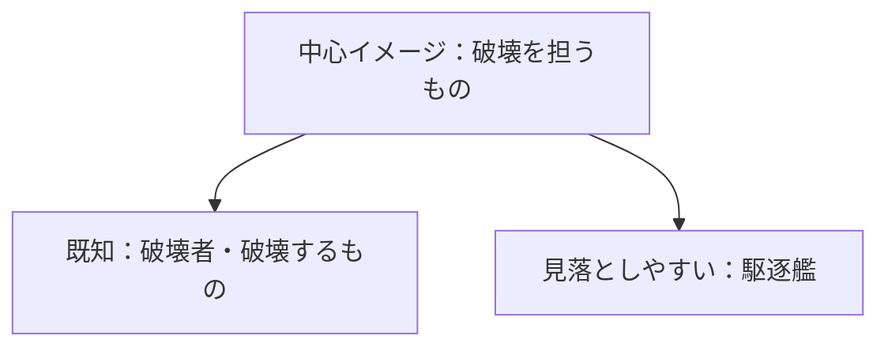

**重要語法：** `a naval destroyer`

<small>元データ：index 10118 / candidate_id `ev-10118-ai-01` / global_order 4481</small>

---

## 02. dichotomy

**品詞：** noun phrase　|　**発音：** /daɪˈkɑːtəmi/

<small>よく知られている意味：二分法</small>

### 見落としやすい意味

**false dichotomyで、本来二択ではないのに二択と決めつける誤った二分法**

**例文**

> Calling the issue a choice between freedom and safety is a false dichotomy.

**和訳**

その問題を自由か安全かの二択だとするのは、誤った二分法だ。

**コアイメージ**

dichotomy は物事を二つに分ける考え方を表す。false が付くと、実際にはほかの可能性があるのに二択に限定する議論の欠陥を指す。

**図**

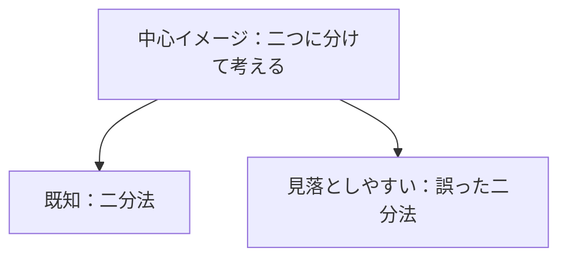

**重要語法：** `false dichotomy`

<small>元データ：index 10121 / candidate_id `ev-10121-ai-01` / global_order 4482</small>

---

## 03. diction

**品詞：** noun　|　**発音：** /ˈdɪkʃən/

<small>よく知られている意味：言葉遣い・語の選び方</small>

### 見落としやすい意味

**話し言葉の発音の明瞭さ、発声・滑舌**

**例文**

> The actor practiced his diction so every word could be heard clearly.

**和訳**

その俳優は一語一語が明瞭に聞こえるよう、発声と滑舌を練習した。

**コアイメージ**

diction は「言葉をどう表現するか」に関わる。書き言葉なら語の選び方、話し言葉なら音の明瞭さを指すので、何を評価しているかを見る。

**図**

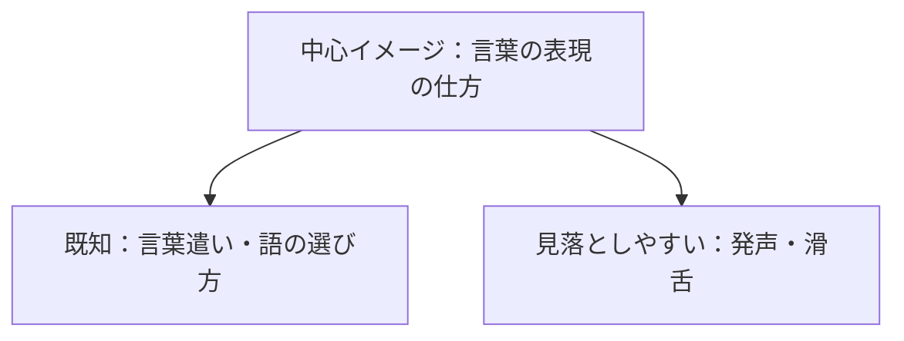

**重要語法：** `clear diction`

<small>元データ：index 10122 / candidate_id `ev-10122-ai-01` / global_order 4483</small>

---

## 04. digit

**品詞：** noun　|　**発音：** /ˈdɪdʒɪt/

<small>よく知られている意味：数字・桁</small>

### 見落としやすい意味

**手や足の指**

**例文**

> The animal has five digits on each front foot.

**和訳**

その動物の前足には、それぞれ五本の指がある。

**コアイメージ**

digit には数字や一桁という意味がある。手足の指を数える発想とも結びつき、解剖や生物の説明では「指」を意味する。

**図**

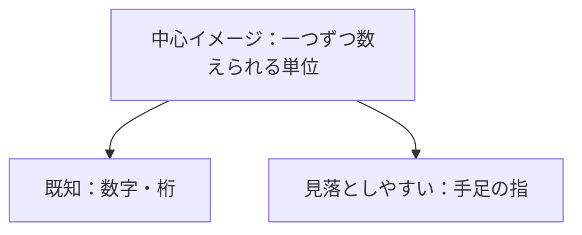

**重要語法：** `five digits`

<small>元データ：index 10123 / candidate_id `ev-10123-noun-01` / global_order 4484</small>

---

## 05. edgy

**品詞：** adjective　|　**発音：** /ˈedʒi/

<small>よく知られている意味：刺激的な・とがった</small>

### 見落としやすい意味

**神経が張り詰めていらいらした**

**例文**

> Everyone felt edgy before the results were announced.

**和訳**

結果が発表される前、全員が神経をとがらせていた。

**コアイメージ**

edge は刃や縁を表す。心理状態に使うと、気持ちが鋭く張り詰めて落ち着かない様子を表す。

**図**

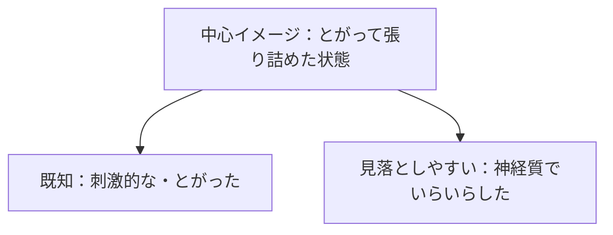

**重要語法：** `feel edgy`

<small>元データ：index 10128 / candidate_id `ev-10128-adjective-01` / global_order 4485</small>

---

## 06. epicenter

**品詞：** noun　|　**発音：** /ˈepɪˌsentər/

<small>よく知られている意味：震央</small>

### 見落としやすい意味

**騒動・流行・活動などが最も集中する中心地**

**例文**

> The city became the epicenter of the new music movement.

**和訳**

その都市は新しい音楽運動の中心地となった。

**コアイメージ**

epicenter は地震で揺れが広がる地点として知られる。比喩的には流行や活動、騒動などが特に集中している場所を示す。

**図**

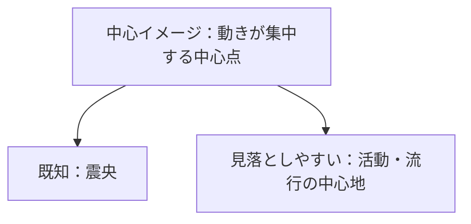

**重要語法：** `the epicenter of a trend`

<small>元データ：index 10132 / candidate_id `ev-10132-ai-01` / global_order 4486</small>

---

## 07. etch

**品詞：** verb　|　**発音：** /etʃ/

<small>よく知られている意味：彫り刻む</small>

### 見落としやすい意味

**輪郭などを際立たせ、くっきり浮かび上がらせる**

**例文**

> The evening sun etched the mountain ridge against the sky.

**和訳**

夕日が山の稜線を空にくっきり浮かび上がらせた。

**コアイメージ**

etch の基本は表面に線を刻み込むこと。描写では、光や影が輪郭を刻むように際立たせるという比喩に広がる。

**図**

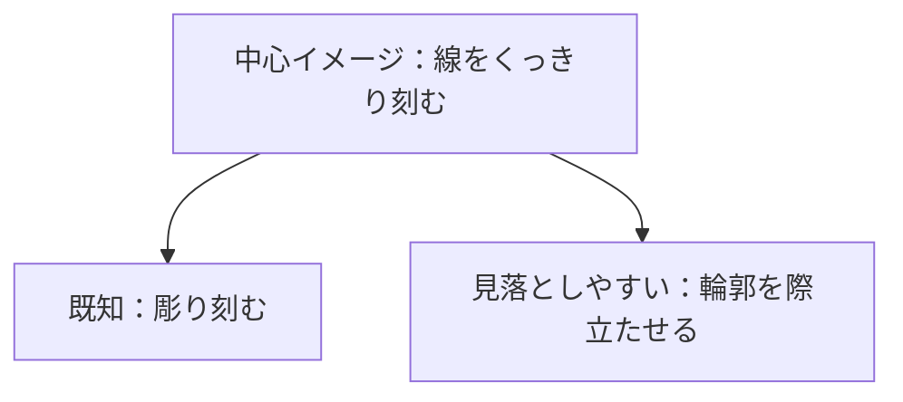

**重要語法：** `etch a silhouette`

<small>元データ：index 10134 / candidate_id `ev-10134-verb-01` / global_order 4487</small>

---

## 08. evasive

**品詞：** adjective　|　**発音：** /ɪˈveɪsɪv/

<small>よく知られている意味：回避する・逃げる</small>

### 見落としやすい意味

**質問への答えが曖昧で、はぐらかすような**

**例文**

> The official gave an evasive answer to the reporter's question.

**和訳**

その当局者は記者の質問に、はぐらかすような答えをした。

**コアイメージ**

evasive は正面から向き合うことを避ける性質を表す。質問や説明に使えば、明確な回答を意図的に避ける態度になる。

**図**

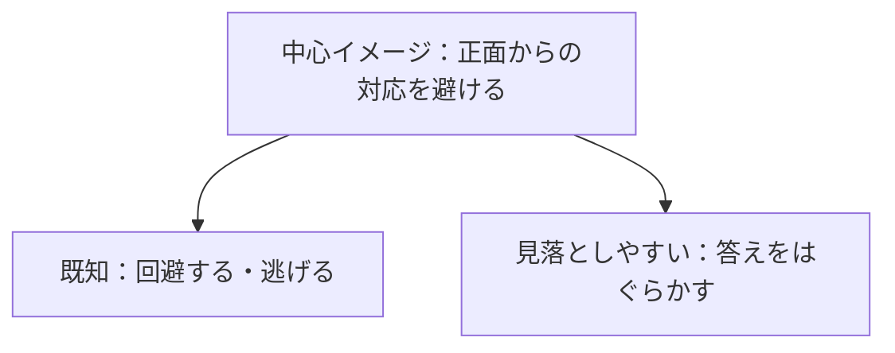

**重要語法：** `an evasive answer`

<small>元データ：index 10136 / candidate_id `ev-10136-ai-01` / global_order 4488</small>

---

## 09. excise

**品詞：** noun　|　**発音：** /ˈeksaɪz/

<small>よく知られている意味：切除・取り除くこと</small>

### 見落としやすい意味

**物品税・消費品にかかる税**

**例文**

> The government raised the excise on fuel.

**和訳**

政府は燃料にかかる物品税を引き上げた。

**コアイメージ**

名詞 excise の「物品税」は、切除という意味から機械的に導けない。つづりが同じでも由来が異なる語として、税・財政の文脈で見分ける。

**図**

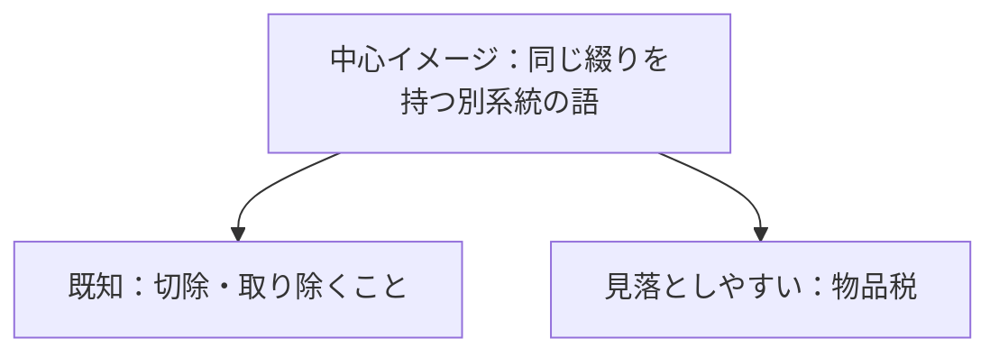

**重要語法：** `excise tax`

<small>元データ：index 10137 / candidate_id `ev-10137-noun-01` / global_order 4489</small>

---

## 10. excise

**品詞：** verb　|　**発音：** /ɪkˈsaɪz/

<small>よく知られている意味：物品税</small>

### 見落としやすい意味

**文章の一部を削除する／不要部分を切り取る**

**例文**

> The editor excised two repetitive paragraphs from the article.

**和訳**

編集者は記事から重複する二つの段落を削除した。

**コアイメージ**

動詞 excise は何かの一部分を切り取って除く動作を表す。文章の編集でも用いられ、税を指す名詞 excise とは区別する。

**図**

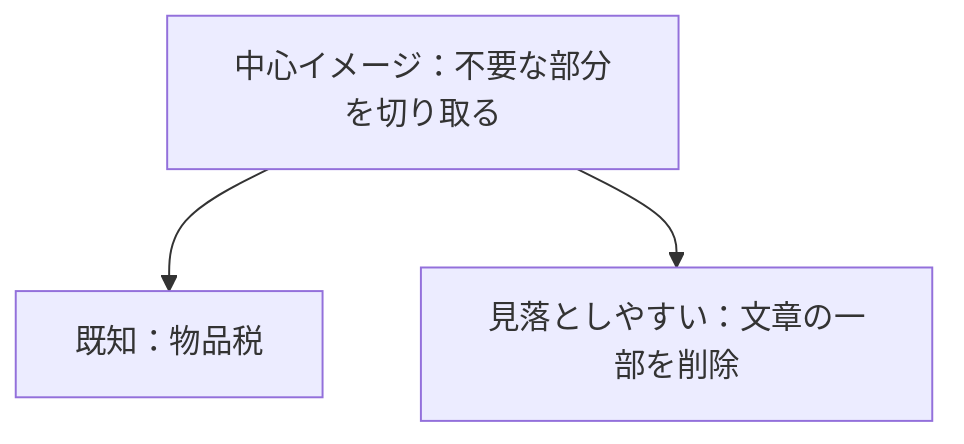

**重要語法：** `excise a passage`

<small>元データ：index 10137 / candidate_id `ev-10137-verb-01` / global_order 4490</small>

---

## 11. fabled

**品詞：** adjective　|　**発音：** /ˈfeɪbəld/

<small>よく知られている意味：伝説上の・物語に出てくる</small>

### 見落としやすい意味

**非常に有名な、名高い**

**例文**

> We finally visited the town's fabled bakery.

**和訳**

私たちはついに、その町で名高いパン屋を訪れた。

**コアイメージ**

fabled は多くの物語で語られることに関わる。実在しない伝説上のものだけでなく、評判が語り継がれる有名な人や場所にも使う。

**図**

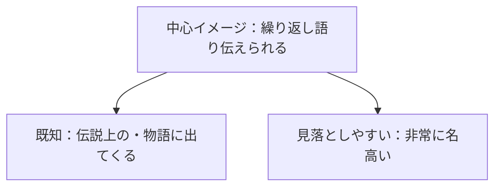

**重要語法：** `a fabled restaurant`

<small>元データ：index 10140 / candidate_id `ev-10140-ai-01` / global_order 4491</small>

---

## 12. facile

**品詞：** adjective　|　**発音：** /ˈfæsəl/

<small>よく知られている意味：たやすい・流暢な</small>

### 見落としやすい意味

**一見もっともらしいが浅薄な、安易な**

**例文**

> The article offers a facile answer to a complex problem.

**和訳**

その記事は複雑な問題に安易で浅薄な答えを示している。

**コアイメージ**

facile は「容易にできる」という響きを持つ。難しい問題を深く考えず簡単に片付ける場合、否定的な「安易な・浅薄な」になる。

**図**

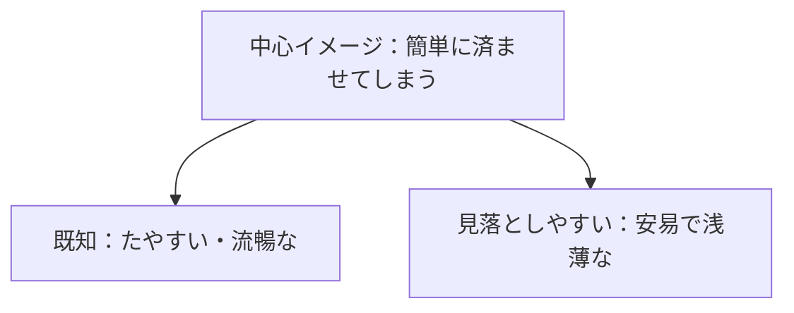

**重要語法：** `a facile explanation`

<small>元データ：index 10141 / candidate_id `ev-10141-adjective-01` / global_order 4492</small>

---

## 13. flounder

**品詞：** verb　|　**発音：** /ˈflaʊndər/

<small>よく知られている意味：カレイなどの魚</small>

### 見落としやすい意味

**どうしてよいか分からず苦戦する**

**例文**

> Without clear instructions, the team began to flounder.

**和訳**

明確な指示がなく、チームはどうしてよいか分からず苦戦し始めた。

**コアイメージ**

動詞 flounder はうまく進めず、もがいたり混乱したりすること。魚を指す名詞と同じ綴りだが、読解では主語と動詞の働きで見分ける。

**図**

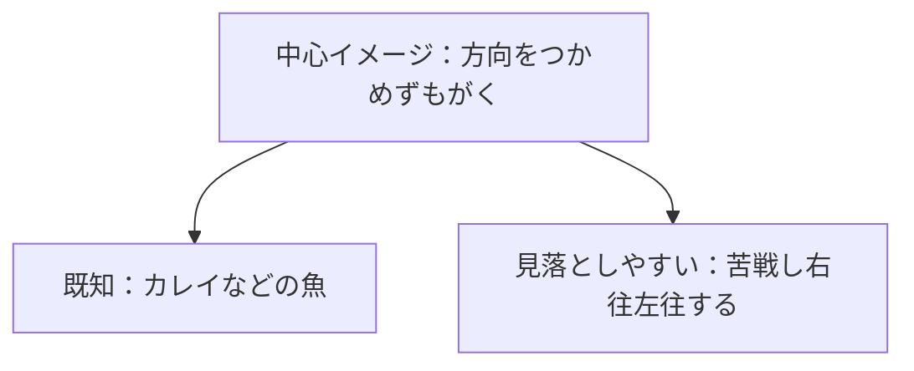

**重要語法：** `flounder without guidance`

<small>元データ：index 10148 / candidate_id `ev-10148-verb-01` / global_order 4493</small>

---

## 14. flurry

**品詞：** noun　|　**発音：** /ˈflɝːi/

<small>よく知られている意味：にわか雪・一時的な降雪</small>

### 見落としやすい意味

**短期間に起こる慌ただしい活動**

**例文**

> There was a flurry of messages after the announcement.

**和訳**

発表の後、メッセージが短時間に次々と届いた。

**コアイメージ**

flurry は一時的にぱっと起こる動きを表す。雪が急に舞うように、連絡や活動が短時間に集中する様子に広がる。

**図**

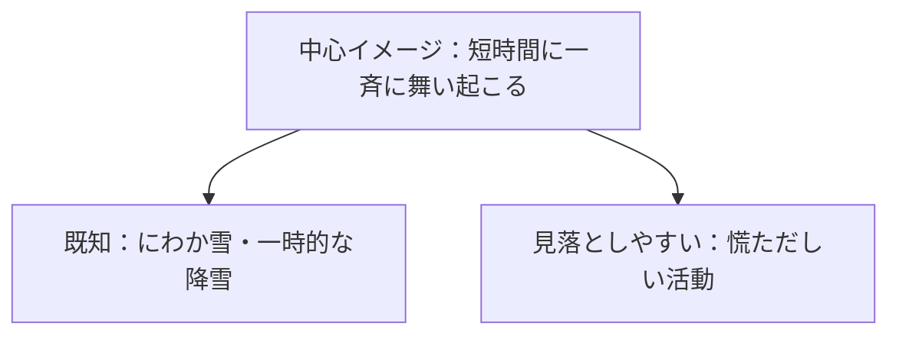

**重要語法：** `a flurry of activity`

<small>元データ：index 10149 / candidate_id `ev-10149-noun-01` / global_order 4494</small>

---

## 15. footsteps

**品詞：** noun phrase　|　**発音：** /ˈfʊtsteps/

<small>よく知られている意味：足音・足跡</small>

### 見落としやすい意味

**follow in someone's footstepsで、先人と同じ道を歩み後を継ぐ**

**例文**

> She followed in her mother's footsteps and became a scientist.

**和訳**

彼女は母親と同じ道を歩み、科学者になった。

**コアイメージ**

足跡は誰かが通った道筋を残す。follow in someone's footsteps は、その道筋を比喩的にたどり、進路や仕事などを受け継ぐ表現になる。

**図**

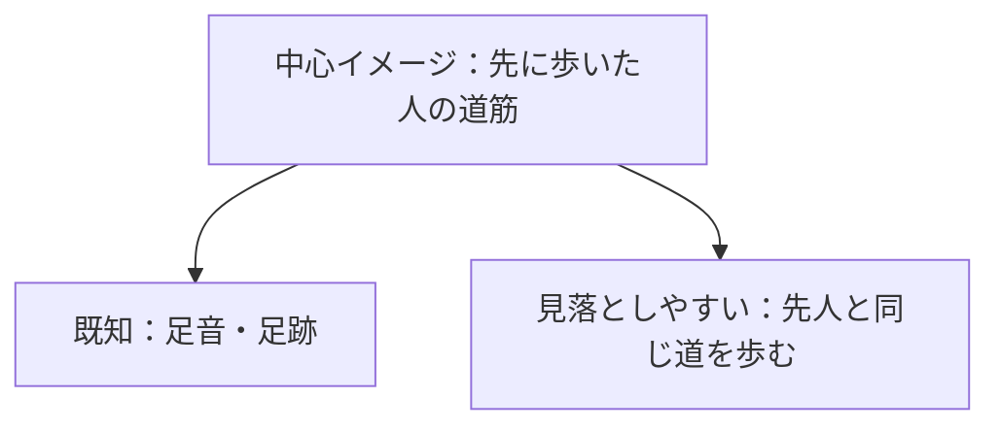

**重要語法：** `follow in someone's footsteps`

<small>元データ：index 10151 / candidate_id `ev-10151-ai-01` / global_order 4495</small>

---

## 16. foreground

**品詞：** verb　|　**発音：** /ˈfɔːrɡraʊnd/

<small>よく知られている意味：前景・手前の景色</small>

### 見落としやすい意味

**（話題・問題などを）前面に出して目立たせる**

**例文**

> The documentary foregrounds the experiences of local families.

**和訳**

そのドキュメンタリーは地元の家族の経験を前面に押し出している。

**コアイメージ**

foreground は風景の中で目に近い部分を指す。動詞では、話題や事実を視野の手前に置くように目立たせることをいう。

**図**

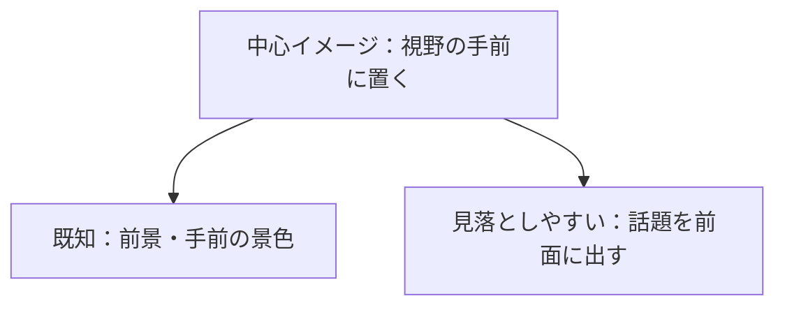

**重要語法：** `foreground an issue`

<small>元データ：index 10153 / candidate_id `ev-10153-verb-01` / global_order 4496</small>

---

## 17. furiously

**品詞：** adverb　|　**発音：** /ˈfjʊriəsli/

<small>よく知られている意味：激怒して</small>

### 見落としやすい意味

**非常に激しく、猛スピードで**

**例文**

> The wind blew furiously all night.

**和訳**

風は一晩中猛烈に吹き続けた。

**コアイメージ**

furiously は怒りの勢いを連想させる副詞。人の感情だけでなく、風や機械の動きが激しい場合にも使い、怒っているとは限らない。

**図**

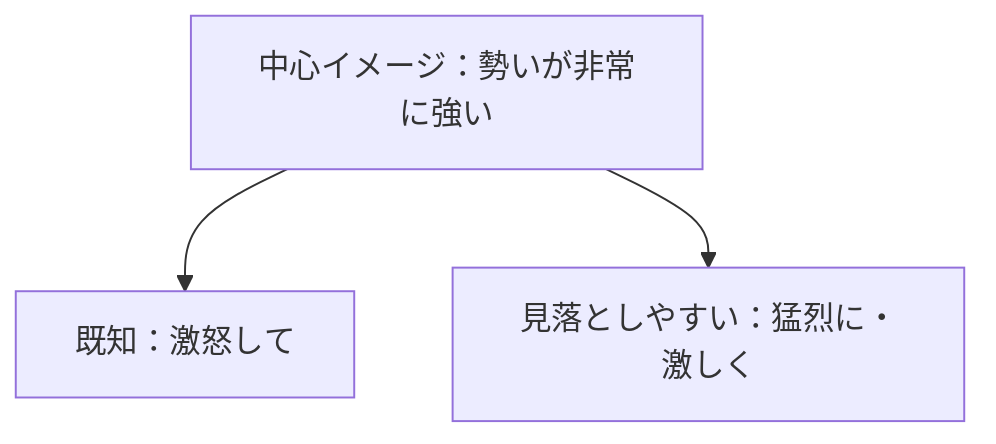

**重要語法：** `blow furiously`

<small>元データ：index 10160 / candidate_id `ev-10160-ai-01` / global_order 4497</small>

---

## 18. grandstand

**品詞：** verb　|　**発音：** /ˈɡrændstænd/

<small>よく知られている意味：観客席・スタンド</small>

### 見落としやすい意味

**喝采を得ようと大げさに振る舞う**

**例文**

> The speaker was grandstanding instead of answering the question.

**和訳**

その演説者は質問に答える代わりに、喝采狙いの大げさな振る舞いをしていた。

**コアイメージ**

grandstand は観客から見える大きなスタンドを表す。動詞では、人に見せつけて注目や拍手を集めようとする態度を指す。

**図**

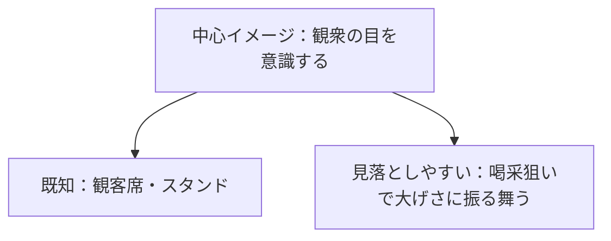

**重要語法：** `political grandstanding`

<small>元データ：index 10165 / candidate_id `ev-10165-verb-01` / global_order 4498</small>

---

## 19. graphically

**品詞：** adverb　|　**発音：** /ˈɡræfɪkli/

<small>よく知られている意味：図やグラフを使って</small>

### 見落としやすい意味

**はっきりと、強く印象に残るように**

**例文**

> The witness described the accident graphically.

**和訳**

目撃者はその事故の様子を生々しく描写した。

**コアイメージ**

graphically は本来、目に見える形で表すことに関わる。図示だけでなく、聞き手に光景が浮かぶほど鮮明に言葉で描写することも指す。

**図**

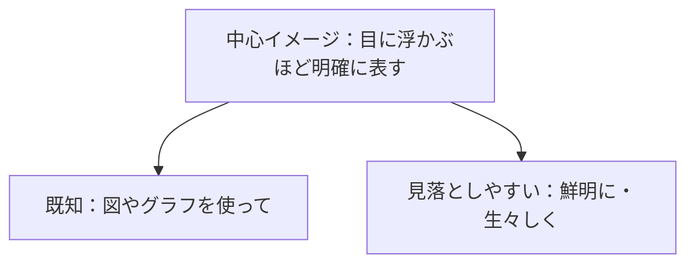

**重要語法：** `describe graphically`

<small>元データ：index 10166 / candidate_id `ev-10166-adverb-01` / global_order 4499</small>

---

## 20. gripe

**品詞：** verb　|　**発音：** /ɡraɪp/

<small>よく知られている意味：不平・苦情</small>

### 見落としやすい意味

**不平・文句を言う**

**例文**

> He kept griping about the slow internet connection.

**和訳**

彼はインターネット回線の遅さに文句を言い続けた。

**コアイメージ**

gripe は不満そのものを指す名詞としても使う。同じ形で動詞になれば、不満を口に出してぶつぶつ言う行為を表す。

**図**

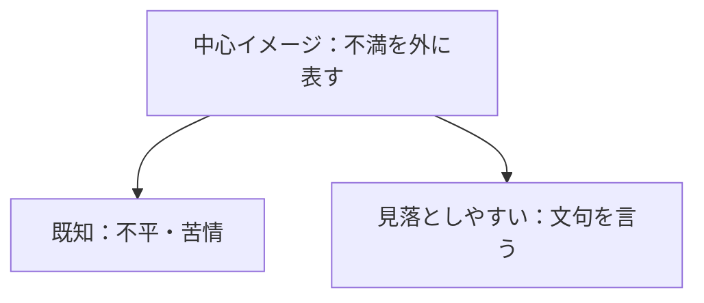

**重要語法：** `gripe about something`

<small>元データ：index 10167 / candidate_id `ev-10167-verb-01` / global_order 4500</small>

---

## 21. hardwood

**品詞：** noun　|　**発音：** /ˈhɑːrdwʊd/

<small>よく知られている意味：硬材・木材の一種</small>

### 見落としやすい意味

**主に広葉樹から得られる木材（必ずしも硬いとは限らない）**

**例文**

> The carpenter used hardwood from a local oak tree.

**和訳**

その大工は地元のオークの木から取れた広葉樹材を使った。

**コアイメージ**

hardwood は木材の分類で、主に広葉樹から得られる材を指す。実際の硬さに幅があるため、hard を「必ず硬い」と解釈しない。

**図**

```mermaid
flowchart TD
    A["中心イメージ：樹種で木材を分ける"]
    B["既知：硬材・木材の一種"]
    C["見落としやすい：広葉樹材"]
    A --> B
    A --> C
```

**重要語法：** `hardwood flooring`

<small>元データ：index 10172 / candidate_id `ev-10172-ai-01` / global_order 4501</small>

---

## 22. hasten

**品詞：** verb phrase　|　**発音：** /ˈheɪsən/

<small>よく知られている意味：急ぐ・早める</small>

### 見落としやすい意味

**hasten to add／point out で、誤解を避けようとして急いで補足・明言する**

**例文**

> I hasten to add that this is only a preliminary result.

**和訳**

急いで付け加えておくが、これはまだ暫定的な結果にすぎない。

**コアイメージ**

hasten は急いで動くことを表す。hasten to add や hasten to point out では、誤解されないうちに補足するという話し手の姿勢になる。

**図**

```mermaid
flowchart TD
    A["中心イメージ：伝える順番を急ぐ"]
    B["既知：急ぐ・早める"]
    C["見落としやすい：急いで補足・明言する"]
    A --> B
    A --> C
```

**重要語法：** `hasten to add; hasten to point out`

<small>元データ：index 10173 / candidate_id `ev-10173-verb-phrase-01` / global_order 4502</small>

---

## 23. hearty

**品詞：** adjective　|　**発音：** /ˈhɑːrti/

<small>よく知られている意味：心からの・熱心な</small>

### 見落としやすい意味

**（食事が）十分に量が多く腹持ちのよい**

**例文**

> We enjoyed a hearty breakfast before the long walk.

**和訳**

私たちは長い散歩の前に、たっぷりとした朝食を取った。

**コアイメージ**

hearty には心から力を込めた感じがある。食事では量が十分で満足感があることを表し、気持ちの温かさだけを指すわけではない。

**図**

```mermaid
flowchart TD
    A["中心イメージ：十分な量と勢いがある"]
    B["既知：心からの・熱心な"]
    C["見落としやすい：量が多く満足感のある食事"]
    A --> B
    A --> C
```

**重要語法：** `a hearty meal`

<small>元データ：index 10174 / candidate_id `ev-10174-adjective-01` / global_order 4503</small>

---

## 24. herbs

**品詞：** noun / pronunciation　|　**発音：** 米 /ɝːbz/・英 /hɜːbz/

<small>よく知られている意味：ハーブ・香草</small>

### 見落としやすい意味

**herbsは米語でhを発音しないことが多く、英国ではhを発音するのが一般的**

**例文**

> Fresh herbs give this soup a pleasant smell.

**和訳**

新鮮なハーブがこのスープによい香りを添える。

**コアイメージ**

herbs は植物の香草・薬草を表す語で、意味そのものは米英で変わらない。一方、発音では米語で語頭の h を発音しないことが多く、英国英語では h を発音するのが一般的。

**図**

```mermaid
flowchart TD
    A["中心イメージ：同じ綴りに地域差のある音"]
    B["既知：ハーブ・香草"]
    C["見落としやすい：米語はhなし・英語はhあり"]
    A --> B
    A --> C
```

**重要語法：** `米 /ɝːbz/、英 /hɜːbz/`

<small>元データ：index 10175 / candidate_id `ev-10175-ai-01` / global_order 4504</small>

---

## 25. heresy

**品詞：** noun　|　**発音：** /ˈherəsi/

<small>よく知られている意味：宗教上の異端</small>

### 見落としやすい意味

**広く受け入れられている考えに真っ向から反する意見・行為**

**例文**

> At the time, questioning that theory was considered heresy.

**和訳**

当時、その理論を疑うことは常識に真っ向から反する意見だと考えられた。

**コアイメージ**

heresy は宗教で正統な教えから外れる考えを指す。一般の議論でも、広く認められた常識や定説を大胆に否定することを表せる。

**図**

```mermaid
flowchart TD
    A["中心イメージ：正統とされる考えから外れる"]
    B["既知：宗教上の異端"]
    C["見落としやすい：常識に反する意見"]
    A --> B
    A --> C
```

**重要語法：** `be considered heresy`

<small>元データ：index 10176 / candidate_id `ev-10176-noun-01` / global_order 4505</small>

---

## 26. hustler

**品詞：** noun　|　**発音：** /ˈhʌslər/

<small>よく知られている意味：詐欺師・抜け目のない人</small>

### 見落としやすい意味

**機転や行動力で稼ぐやり手、抜け目のない人物**

**例文**

> She is a skilled hustler who finds new business opportunities.

**和訳**

彼女は新しい事業機会を見つける、行動力のあるやり手だ。

**コアイメージ**

hustler は積極的に動いて利益や機会を得る人を表す。ずる賢い人物への批判にも使えるが、文脈によっては有能で機敏な人への評価にもなる。

**図**

```mermaid
flowchart TD
    A["中心イメージ：機敏に動いて機会をつかむ"]
    B["既知：詐欺師・抜け目のない人"]
    C["見落としやすい：行動力のあるやり手"]
    A --> B
    A --> C
```

**重要語法：** `a talented hustler`

<small>元データ：index 10180 / candidate_id `ev-10180-ai-01` / global_order 4506</small>

---

## 27. incoming

**品詞：** adjective　|　**発音：** /ˈɪnkʌmɪŋ/

<small>よく知られている意味：入ってくる・到着する</small>

### 見落としやすい意味

**これから就任する、新任の、次期の**

**例文**

> The incoming president will announce her plans next week.

**和訳**

次期会長は来週、方針を発表する予定だ。

**コアイメージ**

incoming は外から中へ入ってくる動きを表す。役職に使うと、その地位にこれから就く人を表し、「新任の・次期の」になる。

**図**

```mermaid
flowchart TD
    A["中心イメージ：新しく役割の中に入る"]
    B["既知：入ってくる・到着する"]
    C["見落としやすい：次期の・新任の"]
    A --> B
    A --> C
```

**重要語法：** `incoming president`

<small>元データ：index 10187 / candidate_id `ev-10187-ai-01` / global_order 4507</small>

---

## 28. infantile

**品詞：** adjective　|　**発音：** /ˈɪnfəntaɪl/

<small>よく知られている意味：乳児の・乳児に関する</small>

### 見落としやすい意味

**大人にふさわしくない、幼稚な**

**例文**

> The reviewer criticized the film's infantile humor.

**和訳**

批評家はその映画の幼稚なユーモアを批判した。

**コアイメージ**

infantile は本来乳児に関わる性質を表す。大人の行動や考えに当てると、年齢にふさわしくない未熟さを批判する表現になる。

**図**

```mermaid
flowchart TD
    A["中心イメージ：乳児のような未熟さ"]
    B["既知：乳児の・乳児に関する"]
    C["見落としやすい：大人らしくない・幼稚な"]
    A --> B
    A --> C
```

**重要語法：** `infantile behavior`

<small>元データ：index 10191 / candidate_id `ev-10191-adjective-01` / global_order 4508</small>

---

## 29. inflection

**品詞：** noun　|　**発音：** /ɪnˈflekʃən/

<small>よく知られている意味：語形変化</small>

### 見落としやすい意味

**声の調子や抑揚の変化**

**例文**

> Her voice had a gentle upward inflection at the end.

**和訳**

彼女の声は語尾でやさしく上がる抑揚があった。

**コアイメージ**

inflection は形や方向の変化を表す。言語学の語形変化だけでなく、話し声の高さや調子が変わることにも使われる。

**図**

```mermaid
flowchart TD
    A["中心イメージ：形や調子が変化する"]
    B["既知：語形変化"]
    C["見落としやすい：声の抑揚の変化"]
    A --> B
    A --> C
```

**重要語法：** `an upward inflection`

<small>元データ：index 10192 / candidate_id `ev-10192-noun-01` / global_order 4509</small>

---

## 30. ingratiate

**品詞：** verb　|　**発音：** /ɪnˈɡreɪʃieɪt/

<small>よく知られている意味：好意を得る</small>

### 見落としやすい意味

**ingratiate oneself withで、相手に取り入る**

**例文**

> He tried to ingratiate himself with the manager by offering constant praise.

**和訳**

彼は絶えず褒めることで上司に取り入ろうとした。

**コアイメージ**

ingratiate は相手に自分を好ましく思わせる動き。ingratiate oneself with 人 の形で、自分への好意を狙って相手に取り入る様子を表す。

**図**

```mermaid
flowchart TD
    A["中心イメージ：自分への好意を作り出す"]
    B["既知：好意を得る"]
    C["見落としやすい：相手に取り入る"]
    A --> B
    A --> C
```

**重要語法：** `ingratiate oneself with someone`

<small>元データ：index 10195 / candidate_id `ev-10195-verb-01` / global_order 4510</small>

---

## 31. inundate

**品詞：** verb　|　**発音：** /ˈɪnʌndeɪt/

<small>よく知られている意味：水浸しにする・氾濫させる</small>

### 見落としやすい意味

**大量のメール・依頼・情報などを一度に浴びせる**

**例文**

> The office was inundated with requests after the announcement.

**和訳**

発表後、事務所には依頼が殺到した。

**コアイメージ**

inundate は水が大量に押し寄せ、あふれる状態を表す。メールや情報、依頼が処理しきれないほど来る場合にも比喩的に使われる。

**図**

```mermaid
flowchart TD
    A["中心イメージ：大量に押し寄せてあふれる"]
    B["既知：水浸しにする・氾濫させる"]
    C["見落としやすい：依頼や情報を大量に浴びせる"]
    A --> B
    A --> C
```

**重要語法：** `be inundated with emails`

<small>元データ：index 10199 / candidate_id `ev-10199-ai-01` / global_order 4511</small>

---

## 32. irritation

**品詞：** noun　|　**発音：** /ˌɪrɪˈteɪʃən/

<small>よく知られている意味：いら立ち・不快感</small>

### 見落としやすい意味

**皮膚や目などへの刺激・炎症**

**例文**

> The new soap caused irritation around his eyes.

**和訳**

その新しい石けんは彼の目の周りに刺激を与えた。

**コアイメージ**

irritation は何かに刺激されて反応する状態を表す。感情ならいら立ち、身体なら皮膚や目に起こる刺激・炎症を指す。

**図**

```mermaid
flowchart TD
    A["中心イメージ：刺激を受けて反応する"]
    B["既知：いら立ち・不快感"]
    C["見落としやすい：皮膚・目の刺激や炎症"]
    A --> B
    A --> C
```

**重要語法：** `skin irritation`

<small>元データ：index 10201 / candidate_id `ev-10201-ai-01` / global_order 4512</small>

---

## 33. jumper

**品詞：** noun　|　**発音：** /ˈdʒʌmpər/

<small>よく知られている意味：跳ぶ人</small>

### 見落としやすい意味

**（英）セーター・プルオーバー**

**例文**

> It was cold, so he put on a wool jumper.

**和訳**

寒かったので、彼はウールのセーターを着た。

**コアイメージ**

jumper は跳ぶ人という意味も持つが、服の名前でもある。英国英語ではセーターを指すのが一般的で、米語の衣服用法とは異なる。

**図**

```mermaid
flowchart TD
    A["中心イメージ：同じ単語に地域別の服の意味"]
    B["既知：跳ぶ人"]
    C["見落としやすい：英国でセーター"]
    A --> B
    A --> C
```

**重要語法：** `British English: a wool jumper`

<small>元データ：index 10203 / candidate_id `ev-10203-noun-01` / global_order 4513</small>

---

## 34. jumper

**品詞：** noun　|　**発音：** /ˈdʒʌmpər/

<small>よく知られている意味：跳ぶ人</small>

### 見落としやすい意味

**（米）ブラウス等の上に着る袖なしのワンピース**

**例文**

> She wore a blue jumper over a white blouse.

**和訳**

彼女は白いブラウスの上に青い袖なしワンピースを着ていた。

**コアイメージ**

米国英語の jumper は、上着の上に重ねる袖なしのワンピース型の服を指すことがある。英国英語のセーターという意味と混同しない。

**図**

```mermaid
flowchart TD
    A["中心イメージ：服の呼び名は地域で変わる"]
    B["既知：跳ぶ人"]
    C["見落としやすい：米国で袖なしワンピース"]
    A --> B
    A --> C
```

**重要語法：** `American English: a jumper over a blouse`

<small>元データ：index 10203 / candidate_id `ev-10203-noun-02` / global_order 4514</small>

---

## 35. kettle

**品詞：** noun phrase　|　**発音：** /ˈketəl/

<small>よく知られている意味：やかん</small>

### 見落としやすい意味

**a different kettle of fishで、まったく別の話・事柄**

**例文**

> Choosing a school is a different kettle of fish from choosing a weekend activity.

**和訳**

学校を選ぶのは、週末の過ごし方を決めるのとはまったく別の話だ。

**コアイメージ**

kettle 単独ならやかんだが、a different kettle of fish はまとまりで「まったく別の事柄」を表す慣用句。語を一つずつ直訳せず、話題を切り分ける表現として読む。

**図**

```mermaid
flowchart TD
    A["中心イメージ：話題を別の事柄として切り分ける"]
    B["既知：やかん"]
    C["見落としやすい：まったく別の話"]
    A --> B
    A --> C
```

**重要語法：** `a different kettle of fish`

<small>元データ：index 10204 / candidate_id `ev-10204-ai-01` / global_order 4515</small>

---

## 36. layoff

**品詞：** noun　|　**発音：** /ˈleɪɔːf/

<small>よく知られている意味：解雇・人員削減</small>

### 見落としやすい意味

**仕事やスポーツから離れている期間**

**例文**

> After a six-month layoff, the athlete returned to competition.

**和訳**

半年間のブランクの後、その選手は競技に復帰した。

**コアイメージ**

layoff は仕事から人を離す解雇を指すことが多い。競技や仕事を一時的に中断していた期間にも使い、その場合は解雇ではない。

**図**

```mermaid
flowchart TD
    A["中心イメージ：活動から離れている状態"]
    B["既知：解雇・人員削減"]
    C["見落としやすい：仕事・スポーツから離れる期間"]
    A --> B
    A --> C
```

**重要語法：** `after a long layoff`

<small>元データ：index 10208 / candidate_id `ev-10208-noun-01` / global_order 4516</small>

---

## 37. legitimize

**品詞：** verb　|　**発音：** /ləˈdʒɪtəmaɪz/

<small>よく知られている意味：合法化する</small>

### 見落としやすい意味

**考えや行動を正当なものとして受け入れられるようにする**

**例文**

> The public campaign helped legitimize the new approach.

**和訳**

その市民運動は新しい方法が正当なものとして認められる助けになった。

**コアイメージ**

legitimize は何かが正当だと認められる状態にすること。法律で認められる場合だけでなく、社会的な信頼や承認を得る場合にも使う。

**図**

```mermaid
flowchart TD
    A["中心イメージ：正当なものとして認めさせる"]
    B["既知：合法化する"]
    C["見落としやすい：考えや行動に正当性を与える"]
    A --> B
    A --> C
```

**重要語法：** `legitimize a practice`

<small>元データ：index 10211 / candidate_id `ev-10211-ai-01` / global_order 4517</small>

---

## 38. likeness

**品詞：** noun　|　**発音：** /ˈlaɪknəs/

<small>よく知られている意味：類似・似ていること</small>

### 見落としやすい意味

**人・物の肖像画、画像**

**例文**

> The museum displayed a likeness of the writer.

**和訳**

博物館にはその作家の肖像画が展示されていた。

**コアイメージ**

likeness は何かに似ていることを表す。本人に似せて作られた絵や像も likeness と呼ばれ、特に人物の肖像を指す。

**図**

```mermaid
flowchart TD
    A["中心イメージ：似た姿を形にする"]
    B["既知：類似・似ていること"]
    C["見落としやすい：肖像画・肖像"]
    A --> B
    A --> C
```

**重要語法：** `a likeness of someone`

<small>元データ：index 10214 / candidate_id `ev-10214-noun-01` / global_order 4518</small>

---

## 39. litmus

**品詞：** noun phrase　|　**発音：** /ˈlɪtməs/

<small>よく知られている意味：リトマス・リトマス紙</small>

### 見落としやすい意味

**litmus testで、見解や適性などを見極める試金石**

**例文**

> How a candidate responds to criticism can be a litmus test of leadership.

**和訳**

批判にどう対応するかは、その候補者の指導力を見極める試金石になる。

**コアイメージ**

リトマス紙は液体の性質を確かめるための目印になる。litmus test は比喩的に、人物の考えや能力を見極める重要な判定材料を表す。

**図**

```mermaid
flowchart TD
    A["中心イメージ：見えにくい性質を判別する試験"]
    B["既知：リトマス・リトマス紙"]
    C["見落としやすい：適性を見極める試金石"]
    A --> B
    A --> C
```

**重要語法：** `a litmus test for leadership`

<small>元データ：index 10217 / candidate_id `ev-10217-noun-phrase-01` / global_order 4519</small>

---

## 40. markup

**品詞：** noun　|　**発音：** /ˈmɑːrkʌp/

<small>よく知られている意味：文書への注記・マーク付け</small>

### 見落としやすい意味

**原価に上乗せする金額・上乗せ率**

**例文**

> The store applies a small markup to each item.

**和訳**

その店は各商品に少額の上乗せ価格を設定している。

**コアイメージ**

mark up はもとのものに印や額を加えること。商業では仕入れ原価に額を上乗せする意味になり、売価そのものではなく上乗せ分を表す。

**図**

```mermaid
flowchart TD
    A["中心イメージ：元の値に何かを加える"]
    B["既知：文書への注記・マーク付け"]
    C["見落としやすい：原価への上乗せ額・率"]
    A --> B
    A --> C
```

**重要語法：** `a 20 percent markup`

<small>元データ：index 10220 / candidate_id `ev-10220-noun-01` / global_order 4520</small>

---

## 41. markup

**品詞：** noun　|　**発音：** /ˈmɑːrkʌp/

<small>よく知られている意味：原価への上乗せ額・率</small>

### 見落としやすい意味

**印刷物の組版指示や文書のマークアップ**

**例文**

> The publisher asked us to review the markup on the manuscript.

**和訳**

出版社は私たちに原稿の組版指示を確認するよう求めた。

**コアイメージ**

markup は何かに印や指示を加えることを表す。価格に上乗せする用法だけでなく、文書や印刷原稿に付けられた処理・表示の指示も指す。

**図**

```mermaid
flowchart TD
    A["中心イメージ：もとの内容に印や指示を付ける"]
    B["既知：原価への上乗せ額・率"]
    C["見落としやすい：文書のマークアップ"]
    A --> B
    A --> C
```

**重要語法：** `document markup; markup language`

<small>元データ：index 10220 / candidate_id `ev-10220-noun-02` / global_order 4521</small>

---

## 42. materialism

**品詞：** noun　|　**発音：** /məˈtɪriəlɪzəm/

<small>よく知られている意味：物質的な豊かさを重視する姿勢</small>

### 見落としやすい意味

**唯物論（物質のみが実在するという哲学説）**

**例文**

> The lecture compared materialism with several other philosophical theories.

**和訳**

その講義では唯物論をほかのいくつかの哲学理論と比較した。

**コアイメージ**

materialism には物質的なものを重んじる生活態度という意味がある。哲学では、実在の根本を物質に求める「唯物論」という別の専門的な意味になる。

**図**

```mermaid
flowchart TD
    A["中心イメージ：物質を中心に考える"]
    B["既知：物質的な豊かさを重視する姿勢"]
    C["見落としやすい：哲学の唯物論"]
    A --> B
    A --> C
```

**重要語法：** `philosophical materialism`

<small>元データ：index 10222 / candidate_id `ev-10222-noun-01` / global_order 4522</small>

---

## 43. mellow

**品詞：** verb　|　**発音：** /ˈmeloʊ/

<small>よく知られている意味：円熟した・柔らかな</small>

### 見落としやすい意味

**年を経て穏やかになる、角が取れる**

**例文**

> He has mellowed a lot since his early days as a manager.

**和訳**

彼は管理職になったばかりのころに比べ、ずいぶん穏やかになった。

**コアイメージ**

mellow は角が取れた落ち着いた状態を表す。動詞では時間の経過によって性格や態度が穏やかになる変化を示す。

**図**

```mermaid
flowchart TD
    A["中心イメージ：時間とともに角が取れる"]
    B["既知：円熟した・柔らかな"]
    C["見落としやすい：年を経て穏やかになる"]
    A --> B
    A --> C
```

**重要語法：** `mellow with age`

<small>元データ：index 10224 / candidate_id `ev-10224-verb-01` / global_order 4523</small>

---

## 44. mindless

**品詞：** adjective　|　**発音：** /ˈmaɪndləs/

<small>よく知られている意味：思慮のない・考えなしの</small>

### 見落としやすい意味

**（娯楽・作業が）頭をほとんど使わずにできる**

**例文**

> After a long day, she relaxed by watching a mindless comedy.

**和訳**

長い一日の後、彼女は頭を使わずに見られるコメディーでくつろいだ。

**コアイメージ**

mindless は考える力が働いていない状態を表す。人への批判なら思慮のなさだが、娯楽なら深く考えなくても楽しめるという中立的な意味になる。

**図**

```mermaid
flowchart TD
    A["中心イメージ：考える負担が少ない"]
    B["既知：思慮のない・考えなしの"]
    C["見落としやすい：頭を使わずにできる"]
    A --> B
    A --> C
```

**重要語法：** `mindless entertainment`

<small>元データ：index 10226 / candidate_id `ev-10226-ai-01` / global_order 4524</small>

---

## 45. mistrust

**品詞：** verb　|　**発音：** /mɪsˈtrʌst/

<small>よく知られている意味：不信感・疑い（名詞）</small>

### 見落としやすい意味

**人や情報を信用せず、疑う**

**例文**

> She mistrusted the figures because they lacked a clear source.

**和訳**

彼女はその数値の出典が明らかでないため、信用しなかった。

**コアイメージ**

mistrust は不信という名詞でもある。動詞として使うと、情報や相手を信頼せず疑ってかかる行為を表す。

**図**

```mermaid
flowchart TD
    A["中心イメージ：信頼を置かない"]
    B["既知：不信感・疑い（名詞）"]
    C["見落としやすい：人や情報を信用しない"]
    A --> B
    A --> C
```

**重要語法：** `mistrust a claim`

<small>元データ：index 10229 / candidate_id `ev-10229-ai-01` / global_order 4525</small>

---

## 46. naming

**品詞：** noun phrase　|　**発音：** /ˈneɪmɪŋ/

<small>よく知られている意味：名付け・命名</small>

### 見落としやすい意味

**naming and shamingで、個人・組織を名指しして公に非難すること**

**例文**

> The article examined whether naming and shaming companies actually changes their behavior.

**和訳**

その記事は、企業を名指しで公に非難することが本当に行動を変えるのか検討した。

**コアイメージ**

naming は名前を挙げることを表す。naming and shaming は名指しに非難を組み合わせ、社会的な圧力をかける行為を指す定型表現。

**図**

```mermaid
flowchart TD
    A["中心イメージ：名前を公に示して評価する"]
    B["既知：名付け・命名"]
    C["見落としやすい：名指しで公然と非難する"]
    A --> B
    A --> C
```

**重要語法：** `naming and shaming`

<small>元データ：index 10235 / candidate_id `ev-10235-ai-01` / global_order 4526</small>

---

## 47. negotiating

**品詞：** verb (present participle)　|　**発音：** /nɪˈɡoʊʃieɪtɪŋ/

<small>よく知られている意味：交渉する・話し合う</small>

### 見落としやすい意味

**難路・障害物・曲がり角などをうまく通り抜ける**

**例文**

> The driver slowed down while negotiating the narrow bend.

**和訳**

運転手は狭いカーブをうまく曲がるために速度を落とした。

**コアイメージ**

negotiate は交渉を通じて難しい局面を乗り切る語。道路や障害物を目的語にすると、進み方を調整しながら通り抜ける意味になる。

**図**

```mermaid
flowchart TD
    A["中心イメージ：難しい状況を調整して切り抜ける"]
    B["既知：交渉する・話し合う"]
    C["見落としやすい：難路をうまく通る"]
    A --> B
    A --> C
```

**重要語法：** `negotiate a bend`

<small>元データ：index 10239 / candidate_id `ev-10239-ai-01` / global_order 4527</small>

---

## 48. nourish

**品詞：** verb　|　**発音：** /ˈnɝːɪʃ/

<small>よく知られている意味：栄養を与える・養う</small>

### 見落としやすい意味

**希望・感情・考えなどをはぐくみ続ける**

**例文**

> She continued to nourish the hope that the project would succeed.

**和訳**

彼女はその計画が成功するという希望を持ち続け、大切に育んだ。

**コアイメージ**

nourish は栄養を与え成長を助けること。目に見えない希望や感情にも使われ、心の中で大切に育て続ける意味になる。

**図**

```mermaid
flowchart TD
    A["中心イメージ：成長のために養い続ける"]
    B["既知：栄養を与える・養う"]
    C["見落としやすい：希望・感情を育む"]
    A --> B
    A --> C
```

**重要語法：** `nourish a hope`

<small>元データ：index 10244 / candidate_id `ev-10244-ai-01` / global_order 4528</small>

---

## 49. outpace

**品詞：** verb　|　**発音：** /ˌaʊtˈpeɪs/

<small>よく知られている意味：（走って）追い越す</small>

### 見落としやすい意味

**成長率・売上・物価などが他を上回る**

**例文**

> The demand for electricity has outpaced supply this year.

**和訳**

今年は電力の需要が供給を上回っている。

**コアイメージ**

outpace は相手より速いペースで進むこと。走る速さに限らず、需要・価格・売上などの増加が別の数量を上回ることを表す。

**図**

```mermaid
flowchart TD
    A["中心イメージ：増えるペースで先を行く"]
    B["既知：（走って）追い越す"]
    C["見落としやすい：数量・成長率が上回る"]
    A --> B
    A --> C
```

**重要語法：** `outpace growth; outpace supply`

<small>元データ：index 10253 / candidate_id `ev-10253-ai-01` / global_order 4529</small>

---

## 50. oyster

**品詞：** noun phrase　|　**発音：** /ˈɔɪstər/

<small>よく知られている意味：カキ（貝）</small>

### 見落としやすい意味

**the world is your oysterで、世界には多くの好機・可能性が開かれている**

**例文**

> With your language skills, the world is your oyster.

**和訳**

その語学力があれば、世界にはさまざまな可能性が開けている。

**コアイメージ**

oyster 単独はカキという貝を表す。一方、the world is your oyster は世界中に好機があるという慣用句で、貝の字義を直訳しても意味は出ない。

**図**

```mermaid
flowchart TD
    A["中心イメージ：可能性が自分の前に開ける"]
    B["既知：カキ（貝）"]
    C["見落としやすい：世界には好機があふれている"]
    A --> B
    A --> C
```

**重要語法：** `the world is your oyster`

<small>元データ：index 10256 / candidate_id `ev-10256-ai-01` / global_order 4530</small>

---

## 51. parched

**品詞：** adjective　|　**発音：** /pɑːrtʃt/

<small>よく知られている意味：乾ききった・ひからびた</small>

### 見落としやすい意味

**のどがからからに渇いた**

**例文**

> After the hike, we were parched and drank plenty of water.

**和訳**

ハイキングの後、私たちはのどがからからに渇き、水をたくさん飲んだ。

**コアイメージ**

parched は水分が失われてひどく乾いた状態を表す。土地や植物だけでなく、人が強くのどの渇きを感じる場合にも使う。

**図**

```mermaid
flowchart TD
    A["中心イメージ：水分がすっかり失われた"]
    B["既知：乾ききった・ひからびた"]
    C["見落としやすい：のどがからからに渇いた"]
    A --> B
    A --> C
```

**重要語法：** `feel parched`

<small>元データ：index 10258 / candidate_id `ev-10258-ai-01` / global_order 4531</small>

---

## 52. pawn

**品詞：** noun　|　**発音：** /pɔːn/

<small>よく知られている意味：チェスの歩兵の駒</small>

### 見落としやすい意味

**他人の目的のために操られる人**

**例文**

> The two groups refused to be pawns in someone else's political game.

**和訳**

二つの団体は、他人の政治的な駆け引きに利用される駒になることを拒んだ。

**コアイメージ**

pawn はチェスでほかの駒より自由度が低い駒を指す。比喩では自分の意思より他人の計画によって動かされる人物を表す。

**図**

```mermaid
flowchart TD
    A["中心イメージ：他者に動かされる駒"]
    B["既知：チェスの歩兵の駒"]
    C["見落としやすい：他人に利用される人"]
    A --> B
    A --> C
```

**重要語法：** `a pawn in a game`

<small>元データ：index 10260 / candidate_id `ev-10260-noun-01` / global_order 4532</small>

---

## 53. pawn

**品詞：** verb　|　**発音：** /pɔːn/

<small>よく知られている意味：チェスの歩兵の駒</small>

### 見落としやすい意味

**品物を担保として質に入れる**

**例文**

> He pawned his watch to pay an urgent bill.

**和訳**

彼は急ぎの請求書の支払いのために時計を質に入れた。

**コアイメージ**

動詞 pawn は品物を担保として預け、お金を借りる行為を表す。チェスの駒を意味する名詞とは別に、金融・生活場面での動詞として覚える。

**図**

```mermaid
flowchart TD
    A["中心イメージ：品物を担保にして預ける"]
    B["既知：チェスの歩兵の駒"]
    C["見落としやすい：質に入れる"]
    A --> B
    A --> C
```

**重要語法：** `pawn a watch`

<small>元データ：index 10260 / candidate_id `ev-10260-verb-01` / global_order 4533</small>

---

## 54. pedigree

**品詞：** noun　|　**発音：** /ˈpedɪɡriː/

<small>よく知られている意味：動物の血統・血統書</small>

### 見落としやすい意味

**家柄・出自・経歴、正統な来歴**

**例文**

> The new director has an impressive pedigree in scientific research.

**和訳**

新しい責任者には科学研究での立派な経歴がある。

**コアイメージ**

pedigree はもともと血統や系譜を表す。人物や組織では出自、これまでの実績や信頼できる来歴を表す。

**図**

```mermaid
flowchart TD
    A["中心イメージ：受け継がれてきた来歴"]
    B["既知：動物の血統・血統書"]
    C["見落としやすい：家柄・経歴・正統な来歴"]
    A --> B
    A --> C
```

**重要語法：** `an impressive pedigree`

<small>元データ：index 10261 / candidate_id `ev-10261-ai-01` / global_order 4534</small>

---

## 55. ponderous

**品詞：** adjective　|　**発音：** /ˈpɑːndərəs/

<small>よく知られている意味：重くて動きの鈍い</small>

### 見落としやすい意味

**文章や話しぶりが冗長で重苦しく、退屈な**

**例文**

> The report was so ponderous that few readers finished it.

**和訳**

その報告書はあまりにも冗長で重苦しく、最後まで読んだ人はほとんどいなかった。

**コアイメージ**

ponderous は重くて進みが鈍い印象を表す。文章や話に使えば、重々しすぎて進展が遅く退屈という批評になる。

**図**

```mermaid
flowchart TD
    A["中心イメージ：重く鈍く進む"]
    B["既知：重くて動きの鈍い"]
    C["見落としやすい：冗長で退屈な文章"]
    A --> B
    A --> C
```

**重要語法：** `ponderous prose`

<small>元データ：index 10268 / candidate_id `ev-10268-adjective-01` / global_order 4535</small>

---

## 56. pounce

**品詞：** verb phrase　|　**発音：** /paʊns/

<small>よく知られている意味：（獲物に）飛びかかる</small>

### 見落としやすい意味

**pounce on ～で、他人の失言・弱点などをすかさず攻撃する**

**例文**

> The critics pounced on the speaker's careless remark.

**和訳**

批評家たちは演説者の不用意な発言をすかさず攻撃した。

**コアイメージ**

pounce は機会をとらえて一気に飛びかかる動き。議論では相手の失言や弱点を見つけ、即座に強く追及する意味になる。

**図**

```mermaid
flowchart TD
    A["中心イメージ：機会をとらえて飛びかかる"]
    B["既知：（獲物に）飛びかかる"]
    C["見落としやすい：失言・弱点をすかさず攻撃"]
    A --> B
    A --> C
```

**重要語法：** `pounce on a mistake`

<small>元データ：index 10269 / candidate_id `ev-10269-ai-01` / global_order 4536</small>

---

## 57. prefix

**品詞：** verb　|　**発音：** /priːˈfɪks/

<small>よく知られている意味：接頭辞（名詞）</small>

### 見落としやすい意味

**単語・数字・名称の前に文字などを付ける**

**例文**

> Please prefix each file name with the date.

**和訳**

各ファイル名の先頭に日付を付けてください。

**コアイメージ**

prefix は単語の前に付く接頭辞を意味する名詞。同じ形で動詞になると、語や番号などの先頭に文字や記号を付ける操作を表す。

**図**

```mermaid
flowchart TD
    A["中心イメージ：先頭に何かを付ける"]
    B["既知：接頭辞（名詞）"]
    C["見落としやすい：名前の前に文字を付ける"]
    A --> B
    A --> C
```

**重要語法：** `prefix A with B`

<small>元データ：index 10270 / candidate_id `ev-10270-ai-01` / global_order 4537</small>

---

## 58. purported

**品詞：** adjective　|　**発音：** /pərˈpɔːrtɪd/

<small>よく知られている意味：〜と称される・伝えられる</small>

### 見落としやすい意味

**真偽が確定していない『〜と称される』**

**例文**

> The newspaper investigated the purported benefits of the new policy.

**和訳**

新聞はその新政策にあるとされる利点を調査した。

**コアイメージ**

purported は誰かがそう主張しているという情報を示す。事実として確認済みとは限らず、書き手が真偽の判断を保留する場合に使う。

**図**

```mermaid
flowchart TD
    A["中心イメージ：主張と事実を区別する"]
    B["既知：〜と称される・伝えられる"]
    C["見落としやすい：真偽未確認の「〜とされる」"]
    A --> B
    A --> C
```

**重要語法：** `purported benefits`

<small>元データ：index 10279 / candidate_id `ev-10279-adjective-01` / global_order 4538</small>

---

## 59. quash

**品詞：** verb　|　**発音：** /kwɑːʃ/

<small>よく知られている意味：鎮圧する・抑え込む</small>

### 見落としやすい意味

**（裁判所などが）決定・命令を無効とする**

**例文**

> The court quashed the previous ruling on procedural grounds.

**和訳**

裁判所は手続き上の理由から以前の判決を無効にした。

**コアイメージ**

quash はある動きを力強く止めることを表す。法律では命令や判断の効力を取り消して無効にするという専門的な使い方になる。

**図**

```mermaid
flowchart TD
    A["中心イメージ：効力や動きを止める"]
    B["既知：鎮圧する・抑え込む"]
    C["見落としやすい：決定・命令を無効にする"]
    A --> B
    A --> C
```

**重要語法：** `quash a conviction`

<small>元データ：index 10280 / candidate_id `ev-10280-verb-01` / global_order 4539</small>

---

## 60. recap

**品詞：** verb　|　**発音：** /riːˈkæp/

<small>よく知られている意味：要約（名詞）</small>

### 見落としやすい意味

**話の要点を手短にまとめ直す**

**例文**

> Before we finish, let me recap the main points.

**和訳**

終わる前に、要点を手短に振り返らせてください。

**コアイメージ**

recap はそれまでの内容を短くまとめ直すこと。名詞としての要約だけでなく、動詞では人にもう一度要点を示す行為を表す。

**図**

```mermaid
flowchart TD
    A["中心イメージ：要点を短くまとめ直す"]
    B["既知：要約（名詞）"]
    C["見落としやすい：話の要点を振り返る"]
    A --> B
    A --> C
```

**重要語法：** `recap the main points`

<small>元データ：index 10285 / candidate_id `ev-10285-ai-01` / global_order 4540</small>

---

## 61. recast

**品詞：** verb　|　**発音：** /riːˈkæst/

<small>よく知られている意味：作り直す・改めて形にする</small>

### 見落としやすい意味

**役者を別の役・人に配役し直す**

**例文**

> The director decided to recast the lead role before filming began.

**和訳**

監督は撮影開始前に主役の配役を変更することにした。

**コアイメージ**

recast は一度決めた形や構成を作り直すこと。映画や舞台の文脈では、出演する役者や配役を改めることを指す。

**図**

```mermaid
flowchart TD
    A["中心イメージ：いったん決めた形を作り直す"]
    B["既知：作り直す・改めて形にする"]
    C["見落としやすい：役者を配役し直す"]
    A --> B
    A --> C
```

**重要語法：** `recast the lead role`

<small>元データ：index 10286 / candidate_id `ev-10286-verb-01` / global_order 4541</small>

---

## 62. rejoin

**品詞：** verb　|　**発音：** /rɪˈdʒɔɪn/

<small>よく知られている意味：再び加わる・合流する</small>

### 見落としやすい意味

**相手の発言に言い返す、答え返す**

**例文**

> “That is not the point,” she rejoined calmly.

**和訳**

「問題はそこではありません」と彼女は落ち着いて言い返した。

**コアイメージ**

rejoin は集団へ再び加わる意味で知られる。会話では相手の発言を受けて返答・反論する動詞としても使われ、引用文の後によく置かれる。

**図**

```mermaid
flowchart TD
    A["中心イメージ：相手の発言に応じて言葉を返す"]
    B["既知：再び加わる・合流する"]
    C["見落としやすい：言い返す・答え返す"]
    A --> B
    A --> C
```

**重要語法：** `“...,” she rejoined.`

<small>元データ：index 10293 / candidate_id `ev-10293-verb-01` / global_order 4542</small>

---

## 63. sane

**品詞：** adjective　|　**発音：** /seɪn/

<small>よく知られている意味：精神が健全な</small>

### 見落としやすい意味

**判断や考え方が理性的で分別のある**

**例文**

> We need a sane plan that fits our budget.

**和訳**

私たちには予算に見合った理性的で現実的な計画が必要だ。

**コアイメージ**

sane は精神が健全であることを表す。判断・方法・提案に使えば、落ち着いた分別があり理にかなっているという評価になる。

**図**

```mermaid
flowchart TD
    A["中心イメージ：無理のない健全な判断"]
    B["既知：精神が健全な"]
    C["見落としやすい：理性的で分別のある"]
    A --> B
    A --> C
```

**重要語法：** `a sane decision`

<small>元データ：index 10301 / candidate_id `ev-10301-adjective-01` / global_order 4543</small>

---

## 64. shudder

**品詞：** verb phrase　|　**発音：** /ˈʃʌdər/

<small>よく知られている意味：身震いする</small>

### 見落としやすい意味

**shudder to think ～で、～を考えるだけでぞっとする**

**例文**

> I shudder to think how much time we would have lost without that warning.

**和訳**

あの注意がなかったらどれだけ時間を失ったかと思うと、ぞっとする。

**コアイメージ**

shudder は恐怖などで体が震えること。shudder to think は想像するだけで嫌な気持ちになるという定型表現で、実際に震えたかどうかは問題ではない。

**図**

```mermaid
flowchart TD
    A["中心イメージ：考えただけで震えるような気持ち"]
    B["既知：身震いする"]
    C["見落としやすい：考えるだけでぞっとする"]
    A --> B
    A --> C
```

**重要語法：** `shudder to think`

<small>元データ：index 10311 / candidate_id `ev-10311-ai-01` / global_order 4544</small>

---

## 65. shuffle

**品詞：** noun　|　**発音：** /ˈʃʌfəl/

<small>よく知られている意味：カードを切ること</small>

### 見落としやすい意味

**組織内の人事や役割の配置換え**

**例文**

> The company announced a management shuffle after the merger.

**和訳**

その会社は合併後に経営陣の配置換えを発表した。

**コアイメージ**

shuffle は順番や配置を混ぜ直すことを表す。組織の文脈では人の担当や役職を入れ替える「人事の配置換え」になる。

**図**

```mermaid
flowchart TD
    A["中心イメージ：配置や順序を入れ替える"]
    B["既知：カードを切ること"]
    C["見落としやすい：人事・役割の配置換え"]
    A --> B
    A --> C
```

**重要語法：** `a cabinet shuffle`

<small>元データ：index 10312 / candidate_id `ev-10312-noun-01` / global_order 4545</small>

---

## 66. shuffle

**品詞：** verb　|　**発音：** /ˈʃʌfəl/

<small>よく知られている意味：カードを混ぜる</small>

### 見落としやすい意味

**足を持ち上げず、引きずるように歩く**

**例文**

> He shuffled across the kitchen in his slippers.

**和訳**

彼はスリッパを履き、足を引きずるように台所を歩いた。

**コアイメージ**

shuffle はものを小さく動かしながら入れ替える様子を表す。歩き方では足を大きく持ち上げず、擦るように進む動きを指す。

**図**

```mermaid
flowchart TD
    A["中心イメージ：小さく擦るように動かす"]
    B["既知：カードを混ぜる"]
    C["見落としやすい：足を引きずって歩く"]
    A --> B
    A --> C
```

**重要語法：** `shuffle along`

<small>元データ：index 10312 / candidate_id `ev-10312-verb-01` / global_order 4546</small>

---

## 67. siding

**品詞：** noun　|　**発音：** /ˈsaɪdɪŋ/

<small>よく知られている意味：一方に味方すること</small>

### 見落としやすい意味

**鉄道車両の退避や待機に使う側線**

**例文**

> The empty train was moved onto a siding to let the express pass.

**和訳**

空の列車は急行を通すため側線へ移された。

**コアイメージ**

siding は味方につく行為にも使われるが、鉄道では本線の脇に延びる線路を指す。列車の待機や追い越しに使われる場所として文脈から判断する。

**図**

```mermaid
flowchart TD
    A["中心イメージ：本線の横に分かれる線路"]
    B["既知：一方に味方すること"]
    C["見落としやすい：鉄道の側線"]
    A --> B
    A --> C
```

**重要語法：** `railway siding`

<small>元データ：index 10313 / candidate_id `ev-10313-noun-01` / global_order 4547</small>

---

## 68. siding

**品詞：** noun　|　**発音：** /ˈsaɪdɪŋ/

<small>よく知られている意味：鉄道の側線</small>

### 見落としやすい意味

**建物の外壁を覆う仕上げ材**

**例文**

> The house has wooden siding painted white.

**和訳**

その家の外壁には白く塗られた木製の仕上げ材が使われている。

**コアイメージ**

siding は建物の側面を覆う材料にも使う。鉄道の側線とは別に、建築の話では外壁を保護・仕上げる板材などを指す。

**図**

```mermaid
flowchart TD
    A["中心イメージ：側面に沿って付けるもの"]
    B["既知：鉄道の側線"]
    C["見落としやすい：外壁の仕上げ材"]
    A --> B
    A --> C
```

**重要語法：** `vinyl siding; wooden siding`

<small>元データ：index 10313 / candidate_id `ev-10313-noun-02` / global_order 4548</small>

---

## 69. sitter

**品詞：** noun　|　**発音：** /ˈsɪtər/

<small>よく知られている意味：子守をする人</small>

### 見落としやすい意味

**肖像画の制作で、画家の前でポーズを取る人物**

**例文**

> The painter asked the sitter to turn toward the window.

**和訳**

画家はモデルに窓のほうを向くよう頼んだ。

**コアイメージ**

sitter は座っている人や子守役を指すことがある。絵画の制作では、画家の前で姿勢を保つ肖像のモデルを意味する。

**図**

```mermaid
flowchart TD
    A["中心イメージ：一定の姿勢で座る人"]
    B["既知：子守をする人"]
    C["見落としやすい：肖像画のモデル"]
    A --> B
    A --> C
```

**重要語法：** `portrait sitter`

<small>元データ：index 10314 / candidate_id `ev-10314-noun-01` / global_order 4549</small>

---

## 70. slit

**品詞：** verb　|　**発音：** /slɪt/

<small>よく知られている意味：細い切れ目（名詞）</small>

### 見落としやすい意味

**細長い切れ目を入れる、細く切り裂く**

**例文**

> She slit the envelope along the top to open it neatly.

**和訳**

彼女は封筒をきれいに開けるため、上端に細長い切れ目を入れた。

**コアイメージ**

slit は細く長い切れ目を指す。同じ形で動詞になると、物の表面にそのような切れ込みを入れる行為を表す。

**図**

```mermaid
flowchart TD
    A["中心イメージ：細長い切れ目を作る"]
    B["既知：細い切れ目（名詞）"]
    C["見落としやすい：細く切り開く"]
    A --> B
    A --> C
```

**重要語法：** `slit an envelope`

<small>元データ：index 10315 / candidate_id `ev-10315-ai-01` / global_order 4550</small>

---

## 71. smother

**品詞：** verb　|　**発音：** /ˈsmʌðər/

<small>よく知られている意味：息苦しくさせる・覆う</small>

### 見落としやすい意味

**感情・事実を押し殺して隠す**

**例文**

> She tried to smother her disappointment during the meeting.

**和訳**

彼女は会議中、落胆を押し殺そうとした。

**コアイメージ**

smother は何かを覆って表に出なくさせることを表す。感情や事実に使えば、それを押し込めたり隠したりする比喩になる。

**図**

```mermaid
flowchart TD
    A["中心イメージ：外に出るのを覆って防ぐ"]
    B["既知：息苦しくさせる・覆う"]
    C["見落としやすい：感情や事実を押し殺す"]
    A --> B
    A --> C
```

**重要語法：** `smother a feeling`

<small>元データ：index 10317 / candidate_id `ev-10317-verb-01` / global_order 4551</small>

---

## 72. snapshot

**品詞：** noun　|　**発音：** /ˈsnæpʃɑːt/

<small>よく知られている意味：スナップ写真</small>

### 見落としやすい意味

**ある時点の状況が分かる簡潔な記述・概観**

**例文**

> The survey offers a snapshot of student attitudes toward online learning.

**和訳**

その調査はオンライン学習に対する生徒の意識を、ある時点で簡潔に示している。

**コアイメージ**

snapshot は一瞬を写した写真を指す。調査や報告では、ある時点での状況を切り取った簡潔な概観を意味する。

**図**

```mermaid
flowchart TD
    A["中心イメージ：ある瞬間を切り取る"]
    B["既知：スナップ写真"]
    C["見落としやすい：ある時点の状況の概観"]
    A --> B
    A --> C
```

**重要語法：** `a snapshot of the economy`

<small>元データ：index 10318 / candidate_id `ev-10318-noun-01` / global_order 4552</small>

---

## 73. spearhead

**品詞：** verb　|　**発音：** /ˈspɪrhed/

<small>よく知られている意味：やりの穂先（名詞）</small>

### 見落としやすい意味

**企画・改革などの先頭に立って推進する**

**例文**

> A group of teachers spearheaded the school's recycling project.

**和訳**

教師の一団が学校のリサイクル計画を率先して推進した。

**コアイメージ**

spearhead はやりの先端を表す。動詞では集団の先頭に立ち、企画や改革を導いて進めることを指す。

**図**

```mermaid
flowchart TD
    A["中心イメージ：先頭で道を切り開く"]
    B["既知：やりの穂先（名詞）"]
    C["見落としやすい：改革・企画を率先して推進"]
    A --> B
    A --> C
```

**重要語法：** `spearhead a reform`

<small>元データ：index 10320 / candidate_id `ev-10320-verb-01` / global_order 4553</small>

---

## 74. sprinkling

**品詞：** noun　|　**発音：** /ˈsprɪŋklɪŋ/

<small>よく知られている意味：水などを振りかけること</small>

### 見落としやすい意味

**少数・少量がまばらに存在すること**

**例文**

> A sprinkling of small cafés can be found along the road.

**和訳**

その道沿いには小さなカフェが少数、点在している。

**コアイメージ**

sprinkling は少しずつ散らしてまく様子を表す。人や物に使うと、まとまった大量ではなく、少数があちこちにまばらにある状態になる。

**図**

```mermaid
flowchart TD
    A["中心イメージ：少量をまばらに散らす"]
    B["既知：水などを振りかけること"]
    C["見落としやすい：少数・少量が点在する"]
    A --> B
    A --> C
```

**重要語法：** `a sprinkling of tourists`

<small>元データ：index 10322 / candidate_id `ev-10322-ai-01` / global_order 4554</small>

---

## 75. starvation

**品詞：** noun　|　**発音：** /stɑːrˈveɪʃən/

<small>よく知られている意味：飢餓・飢え</small>

### 見落としやすい意味

**資金・資源・情報などの深刻な欠乏**

**例文**

> The region's hospitals faced serious resource starvation.

**和訳**

その地域の病院は深刻な資源不足に直面した。

**コアイメージ**

starvation は生命に必要な食べ物が足りない状態を指す。比喩では事業や組織に必要な資金、設備、情報などが慢性的に不足する状態を表す。

**図**

```mermaid
flowchart TD
    A["中心イメージ：維持に必要なものが欠ける"]
    B["既知：飢餓・飢え"]
    C["見落としやすい：資源・資金の深刻な不足"]
    A --> B
    A --> C
```

**重要語法：** `resource starvation`

<small>元データ：index 10324 / candidate_id `ev-10324-ai-01` / global_order 4555</small>

---

## 76. stellar

**品詞：** adjective　|　**発音：** /ˈstelər/

<small>よく知られている意味：星の・恒星の</small>

### 見落としやすい意味

**非常に優秀な、抜群の**

**例文**

> The student gave a stellar presentation on climate science.

**和訳**

その生徒は気候科学について抜群に優れた発表をした。

**コアイメージ**

stellar は星に関する性質を表す。星のように際立っているという比喩から、人物の能力や成果が非常に優れていることを示す。

**図**

```mermaid
flowchart TD
    A["中心イメージ：星のように際立つ"]
    B["既知：星の・恒星の"]
    C["見落としやすい：非常に優れた"]
    A --> B
    A --> C
```

**重要語法：** `stellar performance`

<small>元データ：index 10325 / candidate_id `ev-10325-adjective-01` / global_order 4556</small>

---

## 77. sting

**品詞：** noun　|　**発音：** /stɪŋ/

<small>よく知られている意味：刺し傷・刺すこと</small>

### 見落としやすい意味

**不正を摘発するための、おとり捜査**

**例文**

> The investigators uncovered the scheme through a carefully planned sting.

**和訳**

捜査員たちは計画的なおとり捜査でその不正の仕組みを明らかにした。

**コアイメージ**

sting は本来刺す動きやその痛みを表す。捜査では不正行為を明るみに出すために仕掛けるおとり捜査を指す別の使い方がある。

**図**

```mermaid
flowchart TD
    A["中心イメージ：相手の行動を誘い出して摘発する"]
    B["既知：刺し傷・刺すこと"]
    C["見落としやすい：おとり捜査"]
    A --> B
    A --> C
```

**重要語法：** `a police sting operation`

<small>元データ：index 10326 / candidate_id `ev-10326-noun-01` / global_order 4557</small>

---

## 78. stole

**品詞：** noun　|　**発音：** /stoʊl/

<small>よく知られている意味：steal の過去形</small>

### 見落としやすい意味

**肩に掛ける幅広いストール**

**例文**

> She wore a light silk stole over her shoulders.

**和訳**

彼女は肩に軽い絹のストールを掛けていた。

**コアイメージ**

stole は steal の過去形として見かけるが、名詞では肩に掛ける細長い布を指す。同じ綴りでも前後の冠詞や形容詞があれば衣類の名詞と判断できる。

**図**

```mermaid
flowchart TD
    A["中心イメージ：肩に細長く掛ける布"]
    B["既知：steal の過去形"]
    C["見落としやすい：肩掛けのストール"]
    A --> B
    A --> C
```

**重要語法：** `a silk stole`

<small>元データ：index 10327 / candidate_id `ev-10327-noun-01` / global_order 4558</small>

---

## 79. strangle

**品詞：** verb　|　**発音：** /ˈstræŋɡəl/

<small>よく知られている意味：首を絞める・圧迫する</small>

### 見落としやすい意味

**成長・経済活動・自由な発想などを強く抑え込む**

**例文**

> Excessive rules can strangle creativity in the classroom.

**和訳**

過度な規則は教室での創造性を強く抑え込むことがある。

**コアイメージ**

strangle は何かの働きを圧迫して止めることを表す。経済活動や創造性などに使うと、発展や自由な働きを妨げる比喩になる。

**図**

```mermaid
flowchart TD
    A["中心イメージ：働きや成長を強く妨げる"]
    B["既知：首を絞める・圧迫する"]
    C["見落としやすい：創造性・成長を抑え込む"]
    A --> B
    A --> C
```

**重要語法：** `strangle innovation`

<small>元データ：index 10328 / candidate_id `ev-10328-ai-01` / global_order 4559</small>

---

## 80. sweetheart

**品詞：** noun phrase　|　**発音：** /ˈswiːthɑːrt/

<small>よく知られている意味：恋人・愛しい人</small>

### 見落としやすい意味

**sweetheart dealで、身内などに不当に有利な特別扱いの契約**

**例文**

> The report criticized a sweetheart deal that benefited the executive's friends.

**和訳**

報告書は役員の友人たちに不当に有利な特別契約を批判した。

**コアイメージ**

sweetheart は親しい相手を指す日常語。sweetheart deal では関係者に特別な便宜を与える契約を指し、公平さへの疑念を含むことが多い。

**図**

```mermaid
flowchart TD
    A["中心イメージ：身近な相手への特別扱い"]
    B["既知：恋人・愛しい人"]
    C["見落としやすい：身内に有利な不当な契約"]
    A --> B
    A --> C
```

**重要語法：** `a sweetheart deal`

<small>元データ：index 10334 / candidate_id `ev-10334-ai-01` / global_order 4560</small>

