# EasyVoca｜完成教材カード バッチ058

- 対象：採用済み語義（decision = accepted）
- 担当：58 / 64
- 対象範囲：global_order **4561〜4640**（80件）
- 採用候補の整列：index 昇順、同一 index 内は candidate_id 昇順
- 出典データ：main の data/candidates/batch_10001_10500.jsonl および batch_10501_11000.jsonl

> 既存の採用済み意味を基準にした学習用オリジナル教材です。コアイメージの説明は理解を助けるためのもので、必ずしも語源の説明ではありません。

## 01. tally

**品詞**：verb  
**発音**：/ˈtæli/  
<small>よく知られている意味：集計する</small>

### 見落としやすい意味

**tally withで、数字・内容などが一致する**

**例文**

> The sales figures tally with our records.

**和訳**：売上高の数字は私たちの記録と一致している。

**コアイメージの説明**：tallyには数を数えて確かめるイメージがある。二つの記録を照合して食い違いがなければ、「一致する」という意味になる。

**図**

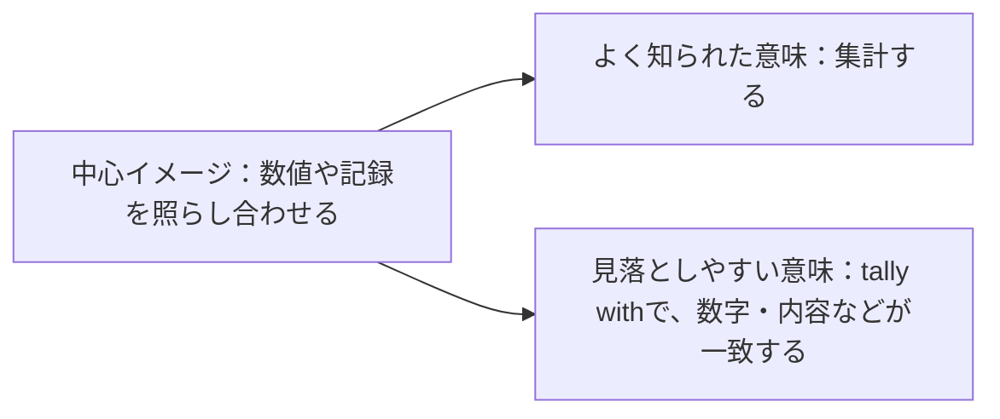

**重要語法**：`tally with + 名詞`

<small>global_order: 4561 / index: 10336 / candidate_id: `ev-10336-verb-01`</small>

---

## 02. thankfully

**品詞**：adverb  
**発音**：/ˈθæŋkfəli/  
<small>よく知られている意味：感謝して、ありがたく</small>

### 見落としやすい意味

**幸いにも、ありがたいことに**

**例文**

> Thankfully, everyone reached home before the storm.

**和訳**：幸い、嵐が来る前に全員が帰宅できた。

**コアイメージの説明**：感謝の気持ちを表す語が、出来事全体への評価にも広がる。文頭のthankfullyは「ありがたいことに」「幸いにも」と話し手の安堵を示す。

**図**

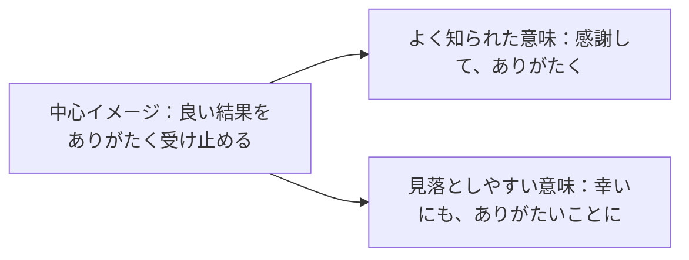

**重要語法**：`Thankfully, ...（文全体を修飾）`

<small>global_order: 4562 / index: 10337 / candidate_id: `ev-10337-ai-01`</small>

---

## 03. tortilla

**品詞**：noun  
**発音**：/tɔːrˈtiːə/  
<small>よく知られている意味：メキシコの薄いパン</small>

### 見落としやすい意味

**スペインでは主にジャガイモ入りの厚焼きオムレツを指す**

**例文**

> In Spain, we shared a tortilla made with potatoes and eggs.

**和訳**：スペインでは、ジャガイモと卵で作ったトルティージャを分け合って食べた。

**コアイメージの説明**：同じtortillaという語でも、地域によって指す料理が異なる。メキシコでは薄いパン状の食べ物、スペインでは主に卵とジャガイモの厚焼き料理を指す。

**図**

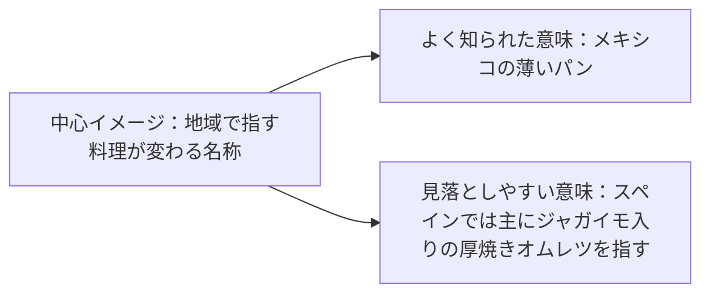

**重要語法**：`Spanish tortilla / tortilla española`

<small>global_order: 4563 / index: 10338 / candidate_id: `ev-10338-ai-01`</small>

---

## 04. towering

**品詞**：adjective  
**発音**：/ˈtaʊərɪŋ/  
<small>よく知られている意味：高くそびえる</small>

### 見落としやすい意味

**業績・人物がひときわ優れた、傑出した**

**例文**

> She became a towering figure in modern science.

**和訳**：彼女は現代科学における傑出した人物になった。

**コアイメージの説明**：toweringのもとになるのは、周囲より高くそびえる姿である。その高さを業績や影響力に移すと、「傑出した」という評価になる。

**図**

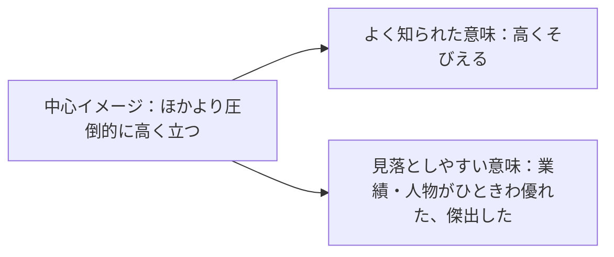

**重要語法**：`a towering figure`

<small>global_order: 4564 / index: 10339 / candidate_id: `ev-10339-ai-01`</small>

---

## 05. turbulence

**品詞**：noun  
**発音**：/ˈtɜːrbjələns/  
<small>よく知られている意味：気流の乱れ</small>

### 見落としやすい意味

**政治・経済・社会情勢の激しい動揺、混乱**

**例文**

> The region went through a period of political turbulence.

**和訳**：その地域は政治的な激動の時期を経験した。

**コアイメージの説明**：空気が乱れて揺れる状態がturbulenceの中心にある。社会や政治の流れが安定せず激しく変わることにも使われる。

**図**

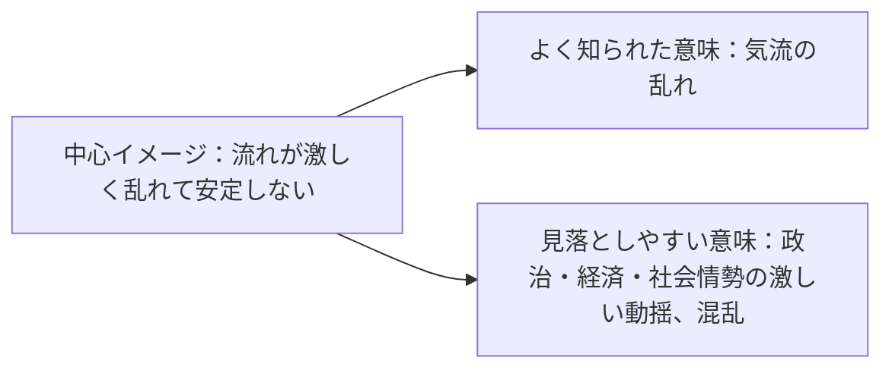

**重要語法**：`political turbulence`

<small>global_order: 4565 / index: 10348 / candidate_id: `ev-10348-ai-01`</small>

---

## 06. uneducated

**品詞**：adjective phrase  
**発音**：/ʌnˈedʒʊkeɪtɪd/  
<small>よく知られている意味：教育を受けていない</small>

### 見落としやすい意味

**an uneducated guessで、十分な情報なしでする当て推量**

**例文**

> This is only an uneducated guess, but the repair may take two days.

**和訳**：これは当て推量にすぎないが、修理には2日かかるかもしれない。

**コアイメージの説明**：uneducatedは文字どおりには教育や知識が十分でないことを表す。guessと結びつくと、人の学歴ではなく「根拠となる情報を欠いた推測」を示す。

**図**

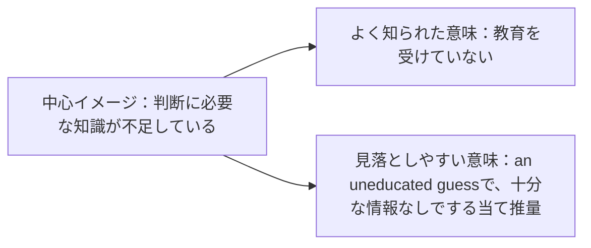

**重要語法**：`an uneducated guess`

<small>global_order: 4566 / index: 10355 / candidate_id: `ev-10355-ai-01`</small>

---

## 07. unload

**品詞**：verb  
**発音**：/ˌʌnˈloʊd/  
<small>よく知られている意味：荷物を降ろす</small>

### 見落としやすい意味

**悩み・不満・感情を相手に打ち明ける、吐き出す**

**例文**

> After the exam, he unloaded his worries on his sister.

**和訳**：試験の後、彼は姉に心配事を一気に打ち明けた。

**コアイメージの説明**：unloadは積んでいた荷物を下ろす動きを表す。心に抱えていた不満や悩みを言葉にして外へ出すことにも広がる。

**図**

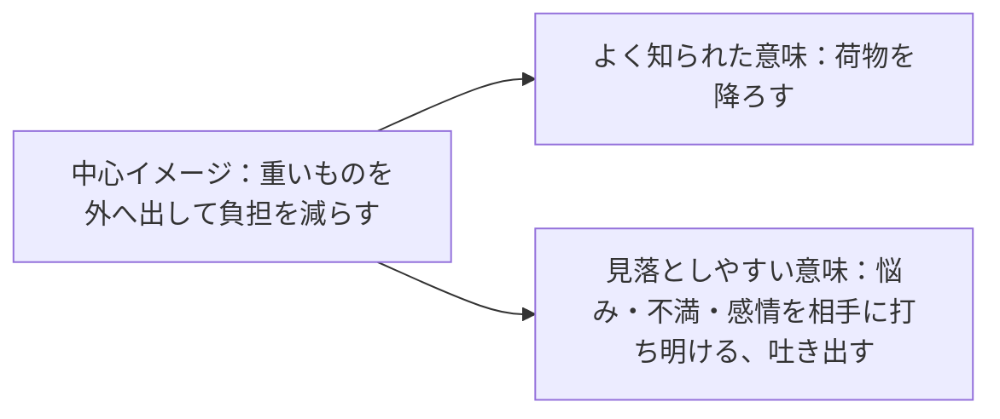

**重要語法**：`unload worries on someone`

<small>global_order: 4567 / index: 10357 / candidate_id: `ev-10357-verb-01`</small>

---

## 08. unrestrained

**品詞**：adjective  
**発音**：/ˌʌnrɪˈstreɪnd/  
<small>よく知られている意味：抑えられていない</small>

### 見落としやすい意味

**称賛・喜びなどを惜しみなく表した、遠慮のない**

**例文**

> The announcement was met with unrestrained joy.

**和訳**：その発表は抑えきれない喜びで迎えられた。

**コアイメージの説明**：restrainは感情や行動を抑えることを表す。そこにun-が付くと、喜びや称賛を遠慮せず表す様子になる。

**図**

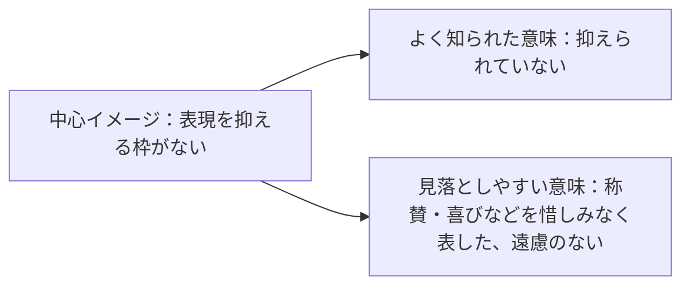

**重要語法**：`unrestrained joy / praise`

<small>global_order: 4568 / index: 10359 / candidate_id: `ev-10359-ai-01`</small>

---

## 09. visiting

**品詞**：adjective  
**発音**：/ˈvɪzɪtɪŋ/  
<small>よく知られている意味：訪問している</small>

### 見落としやすい意味

**visiting professorなどで、大学に一定期間招聘された客員の**

**例文**

> She is a visiting professor here for one semester.

**和訳**：彼女は1学期間、ここで客員教授を務めている。

**コアイメージの説明**：visitingはどこかを訪れるという動きから生まれた形容詞である。大学では、常勤の所属者ではなく一定期間招かれて活動する立場を表す。

**図**

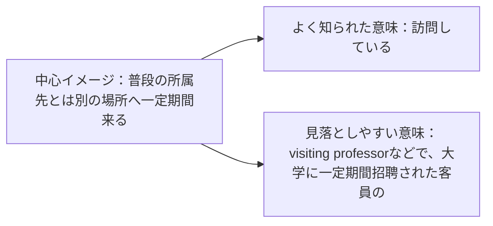

**重要語法**：`visiting professor / scholar`

<small>global_order: 4569 / index: 10362 / candidate_id: `ev-10362-adjective-01`</small>

---

## 10. visiting

**品詞**：adjective  
**発音**：/ˈvɪzɪtɪŋ/  
<small>よく知られている意味：訪問している</small>

### 見落としやすい意味

**visiting teamで、対戦相手の本拠地で試合する側の**

**例文**

> The visiting team scored the winning goal at the end.

**和訳**：アウェーのチームが終了間際に決勝点を決めた。

**コアイメージの説明**：visitingは自分たちの本拠地ではない場所へ行くことを表す。スポーツでは対戦相手のホームで試合をするチームを指す。

**図**

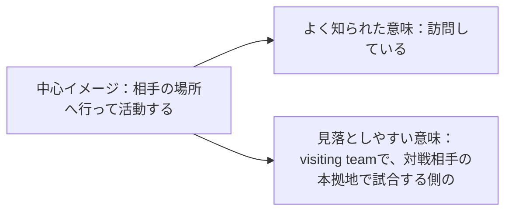

**重要語法**：`the visiting team（アウェーチーム）`

<small>global_order: 4570 / index: 10362 / candidate_id: `ev-10362-adjective-02`</small>

---

## 11. wee

**品詞**：noun / verb  
**発音**：/wiː/  
<small>よく知られている意味：ごく小さい</small>

### 見落としやすい意味

**（主に英口語で）おしっこ／排尿する**

**例文**

> The child said he needed a wee before leaving.

**和訳**：その子は出かける前におしっこがしたいと言った。

**コアイメージの説明**：weeは「とても小さい」を表す一方、主に英国のくだけた会話では排尿を指す幼児語にもなる。文脈が身体の用事なら、形容詞の「小さい」とは読まない。

**図**

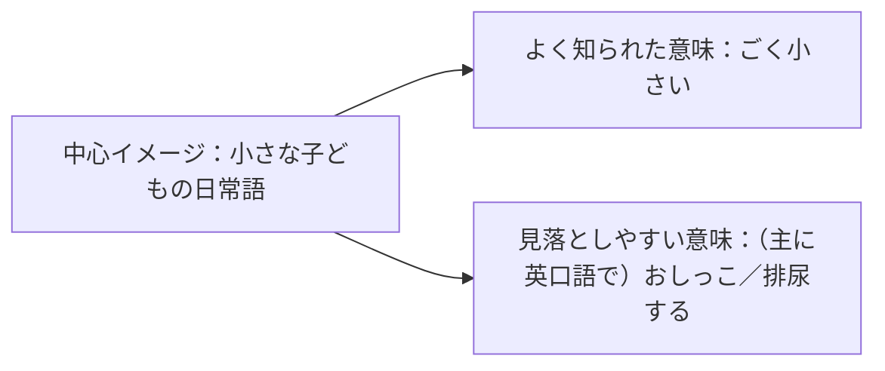

**重要語法**：`have a wee（主に英国の口語）`

<small>global_order: 4571 / index: 10367 / candidate_id: `ev-10367-ai-01`</small>

---

## 12. wholesome

**品詞**：adjective  
**発音**：/ˈhoʊlsəm/  
<small>よく知られている意味：健康によい</small>

### 見落としやすい意味

**道徳的・情緒的に健全で、好ましい**

**例文**

> The movie tells a wholesome story about friendship.

**和訳**：その映画は友情を描いた心温まる健全な物語だ。

**コアイメージの説明**：wholesomeは心身にとって好ましい状態を連想させる。食べ物の健康面だけでなく、物語や行動の道徳的・情緒的な健全さも表す。

**図**

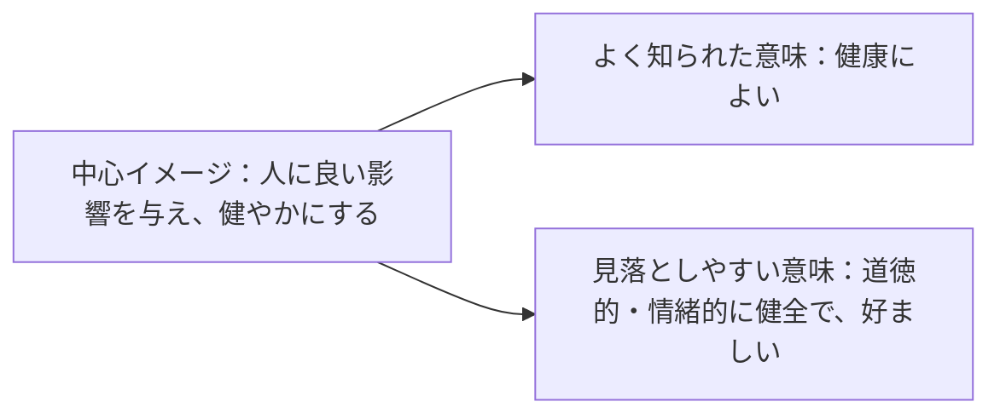

**重要語法**：`wholesome entertainment`

<small>global_order: 4572 / index: 10368 / candidate_id: `ev-10368-adjective-01`</small>

---

## 13. wink

**品詞**：verb phrase  
**発音**：/wɪŋk/  
<small>よく知られている意味：片目をつむって合図する</small>

### 見落としやすい意味

**wink atで、問題・違反などを見て見ぬふりをする**

**例文**

> The officials winked at repeated violations of the rules.

**和訳**：当局者たちは繰り返される規則違反を見て見ぬふりした。

**コアイメージの説明**：winkは片目を閉じる動作を表す。問題を目にしてもあえて見なかったことにする比喩として、wink atが使われる。

**図**

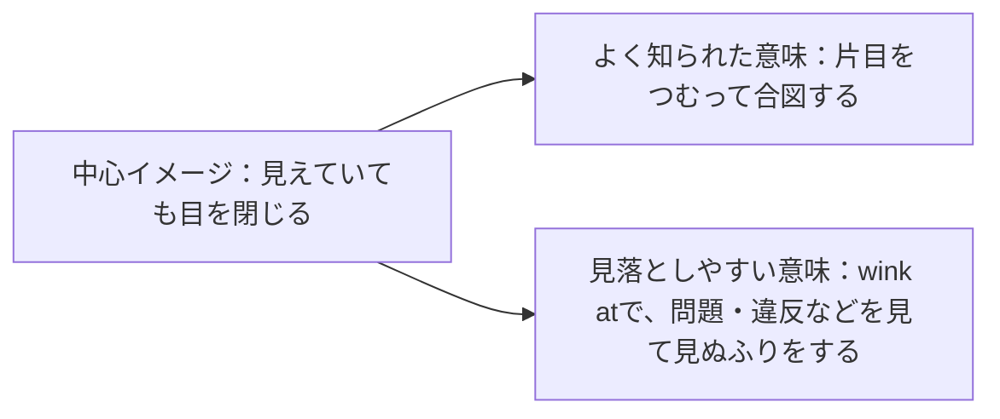

**重要語法**：`wink at a violation`

<small>global_order: 4573 / index: 10372 / candidate_id: `ev-10372-verb-phrase-01`</small>

---

## 14. packing

**品詞**：verb phrase  
**発音**：/ˈpækɪŋ/  
<small>よく知られている意味：荷造りすること</small>

### 見落としやすい意味

**send someone packingで、人を追い払う・立ち去らせる**

**例文**

> After several warnings, the coach sent him packing.

**和訳**：何度も警告した末、コーチは彼を追い出した。

**コアイメージの説明**：packingには出発のために荷物をまとめるイメージがある。send someone packingは、その人を帰らせたり追い払ったりする慣用句になる。

**図**

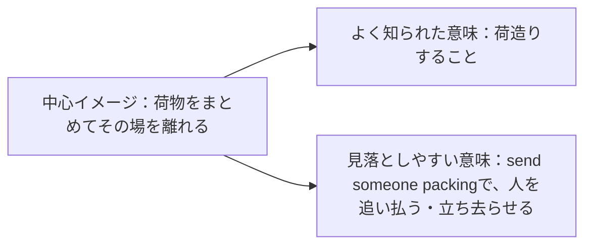

**重要語法**：`send someone packing`

<small>global_order: 4574 / index: 10379 / candidate_id: `ev-10379-ai-01`</small>

---

## 15. crossroads

**品詞**：noun  
**発音**：/ˈkrɔːsroʊdz/  
<small>よく知られている意味：道路の交差点</small>

### 見落としやすい意味

**人生・事業・社会が大きな進路選択を迫られる転機**

**例文**

> The company is at a crossroads after losing its main customer.

**和訳**：最大の顧客を失い、その会社は重大な岐路に立っている。

**コアイメージの説明**：crossroadsは実際の道が交わる場所を指す。人生や組織で重要な選択を迫られる場面を、進む道を選ぶ交差点になぞらえている。

**図**

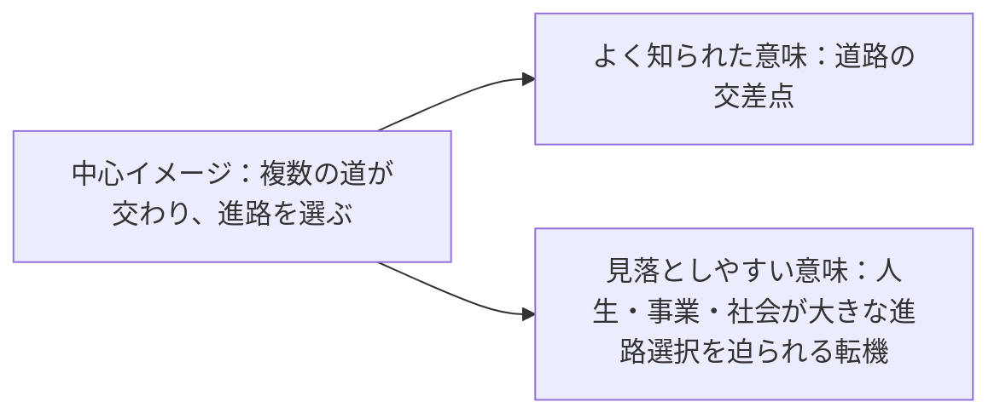

**重要語法**：`at a crossroads`

<small>global_order: 4575 / index: 10380 / candidate_id: `ev-10380-ai-01`</small>

---

## 16. messenger

**品詞**：noun phrase  
**発音**：/ˈmesɪndʒər/  
<small>よく知られている意味：伝言を運ぶ人</small>

### 見落としやすい意味

**shoot the messengerで、悪い知らせを伝えた人を責める**

**例文**

> Don't shoot the messenger; I'm just passing on the news.

**和訳**：知らせを伝えた私を責めないで。私はただ伝えているだけだ。

**コアイメージの説明**：messengerは情報を運ぶ役割の人であり、知らせを作った本人とは限らない。悪い報告を聞いて報告者に怒りを向ける理不尽さを、shoot the messengerという比喩で表す。

**図**

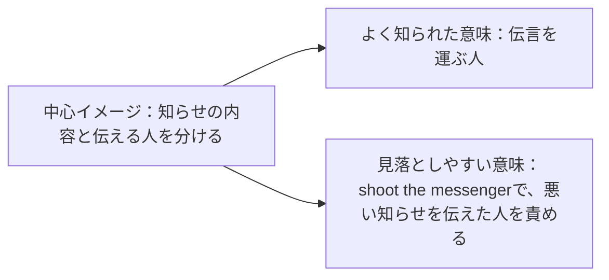

**重要語法**：`Don't shoot the messenger.`

<small>global_order: 4576 / index: 10381 / candidate_id: `ev-10381-ai-01`</small>

---

## 17. moody

**品詞**：adjective  
**発音**：/ˈmuːdi/  
<small>よく知られている意味：気分が変わりやすい</small>

### 見落としやすい意味

**映画・音楽・風景などが陰鬱で感情的な雰囲気を持つ**

**例文**

> The film uses moody lighting to create a sense of loneliness.

**和訳**：その映画は陰鬱な照明で孤独感を生み出している。

**コアイメージの説明**：moodyは人の気分の変化を形容する語として知られる。照明や音楽などに使うと、特定の感情を強く感じさせる雰囲気を表す。

**図**

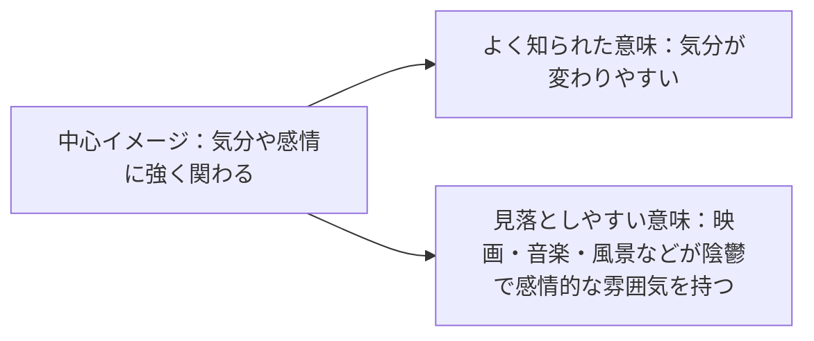

**重要語法**：`moody lighting / music`

<small>global_order: 4577 / index: 10382 / candidate_id: `ev-10382-ai-01`</small>

---

## 18. haunting

**品詞**：adjective  
**発音**：/ˈhɔːntɪŋ/  
<small>よく知られている意味：幽霊が出るような</small>

### 見落としやすい意味

**曲・風景・記憶などが忘れがたい、胸に残る**

**例文**

> A haunting melody stayed in my mind for days.

**和訳**：忘れがたい旋律が何日も頭から離れなかった。

**コアイメージの説明**：hauntは幽霊などが付きまとうという動詞である。美しい曲や印象的な場面が心から離れないときにも、この「付きまとう」イメージが使われる。

**図**

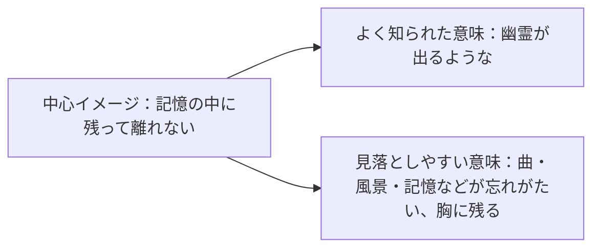

**重要語法**：`a haunting melody`

<small>global_order: 4578 / index: 10383 / candidate_id: `ev-10383-ai-01`</small>

---

## 19. cardboard

**品詞**：adjective  
**発音**：/ˈkɑːrdbɔːrd/  
<small>よく知られている意味：厚紙製の</small>

### 見落としやすい意味

**登場人物などが薄っぺらで現実味のない**

**例文**

> The villain felt like a cardboard character with no depth.

**和訳**：その悪役は深みのない、薄っぺらな人物に感じられた。

**コアイメージの説明**：cardboardは薄く平たい材料を表す。人物描写に用いると、実在の人らしい複雑さや深みがないことを批判する意味になる。

**図**

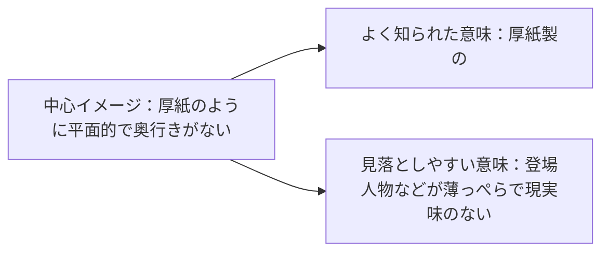

**重要語法**：`a cardboard character`

<small>global_order: 4579 / index: 10384 / candidate_id: `ev-10384-adjective-01`</small>

---

## 20. paw

**品詞**：verb  
**発音**：/pɔː/  
<small>よく知られている意味：動物の足</small>

### 見落としやすい意味

**（動物などが）前足・手でしきりに触れたり引っかいたりする**

**例文**

> The dog pawed at the door until someone opened it.

**和訳**：誰かが開けるまで、犬は前足でドアをしきりに引っかいた。

**コアイメージの説明**：pawは動物の前足を指す名詞である。動詞になると、その足で物に触れたり、繰り返し引っかいたりする動作を表す。

**図**

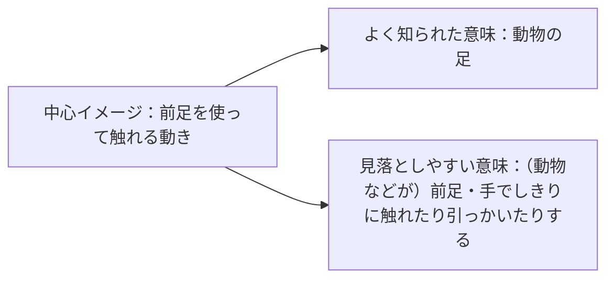

**重要語法**：`paw at the door`

<small>global_order: 4580 / index: 10385 / candidate_id: `ev-10385-ai-01`</small>

---

## 21. gig

**品詞**：noun  
**発音**：/ɡɪɡ/  
<small>よく知られている意味：短期の仕事</small>

### 見落としやすい意味

**ミュージシャンの単発の出演・公演**

**例文**

> Our band has a gig at a local café on Friday.

**和訳**：私たちのバンドは金曜日に地元のカフェでライブをする。

**コアイメージの説明**：gigは期間の限られた仕事を指す口語として使われる。音楽の文脈では、演奏者がその場で行う一回の出演や公演を意味する。

**図**

```mermaid
flowchart LR
    A["中心イメージ：一回ごとの仕事や出演"]
    B["よく知られた意味：短期の仕事"]
    C["見落としやすい意味：ミュージシャンの単発の出演・公演"]
    A --> B
    A --> C
```

**重要語法**：`play a gig / have a gig`

<small>global_order: 4581 / index: 10386 / candidate_id: `ev-10386-noun-01`</small>

---

## 22. rendering

**品詞**：noun  
**発音**：/ˈrendərɪŋ/  
<small>よく知られている意味：表現・描写</small>

### 見落としやすい意味

**他言語に移した訳文**

**例文**

> Her English rendering of the poem was easy to understand.

**和訳**：彼女によるその詩の英訳は分かりやすかった。

**コアイメージの説明**：renderingには、ある内容を別の形にして示すという発想がある。言語を変えて表したものなら、訳文や翻訳という意味になる。

**図**

```mermaid
flowchart LR
    A["中心イメージ：元の内容を別の形で表す"]
    B["よく知られた意味：表現・描写"]
    C["見落としやすい意味：他言語に移した訳文"]
    A --> B
    A --> C
```

**重要語法**：`an English rendering of a poem`

<small>global_order: 4582 / index: 10388 / candidate_id: `ev-10388-noun-01`</small>

---

## 23. rendering

**品詞**：noun  
**発音**：/ˈrendərɪŋ/  
<small>よく知られている意味：表現・描写</small>

### 見落としやすい意味

**建築設計の完成予想図**

**例文**

> The architect showed us a rendering of the planned library.

**和訳**：建築家は計画中の図書館の完成予想図を見せてくれた。

**コアイメージの説明**：renderingは物事を具体的な形で表現した結果を指す。建築の文脈では、完成前の建物を視覚的に示した予想図になる。

**図**

```mermaid
flowchart LR
    A["中心イメージ：まだないものを目に見える形で示す"]
    B["よく知られた意味：表現・描写"]
    C["見落としやすい意味：建築設計の完成予想図"]
    A --> B
    A --> C
```

**重要語法**：`an architectural rendering`

<small>global_order: 4583 / index: 10388 / candidate_id: `ev-10388-noun-02`</small>

---

## 24. regression

**品詞**：noun phrase  
**発音**：/rɪˈɡreʃən/  
<small>よく知られている意味：後戻り、退行</small>

### 見落としやすい意味

**regression analysisで、統計的な回帰分析**

**例文**

> They used regression analysis to examine the data.

**和訳**：彼らはデータを調べるために回帰分析を使った。

**コアイメージの説明**：regressionには日常語の「退行」と統計学の専門語がある。統計では複数の数値の関係を調べる方法の名称として用いられ、単なる後退を意味しない。

**図**

```mermaid
flowchart LR
    A["中心イメージ：変数の関係を数式で捉える"]
    B["よく知られた意味：後戻り、退行"]
    C["見落としやすい意味：regression analysisで、統計的な回帰分析"]
    A --> B
    A --> C
```

**重要語法**：`regression analysis`

<small>global_order: 4584 / index: 10390 / candidate_id: `ev-10390-noun-phrase-01`</small>

---

## 25. malfunction

**品詞**：verb  
**発音**：/ˌmælˈfʌŋkʃən/  
<small>よく知られている意味：故障、不具合</small>

### 見落としやすい意味

**機械・装置・システムなどが誤作動する**

**例文**

> The alarm malfunctioned during the safety test.

**和訳**：安全試験中に警報装置が誤作動した。

**コアイメージの説明**：malfunctionは装置が正しく機能しない状態を表す。名詞の「故障」だけでなく、装置を主語とする動詞としても使える。

**図**

```mermaid
flowchart LR
    A["中心イメージ：本来の機能どおりに働かない"]
    B["よく知られた意味：故障、不具合"]
    C["見落としやすい意味：機械・装置・システムなどが誤作動する"]
    A --> B
    A --> C
```

**重要語法**：`The device malfunctioned.`

<small>global_order: 4585 / index: 10391 / candidate_id: `ev-10391-ai-01`</small>

---

## 26. graft

**品詞**：noun  
**発音**：/ɡræft/  
<small>よく知られている意味：接ぎ木、移植</small>

### 見落としやすい意味

**不正な利益を得る汚職・賄賂行為**

**例文**

> The investigation revealed graft within the city government.

**和訳**：調査によって市政府内部の汚職が明らかになった。

**コアイメージの説明**：graftは接ぎ木や移植を表す語としても知られる。政治・行政の文脈では、不正な方法で利益を得る汚職という独立した意味があるので、文脈で判別する。

**図**

```mermaid
flowchart LR
    A["中心イメージ：正規の仕組みに不正な利益が入り込む"]
    B["よく知られた意味：接ぎ木、移植"]
    C["見落としやすい意味：不正な利益を得る汚職・賄賂行為"]
    A --> B
    A --> C
```

**重要語法**：`political graft`

<small>global_order: 4586 / index: 10392 / candidate_id: `ev-10392-noun-01`</small>

---

## 27. rarity

**品詞**：noun  
**発音**：/ˈrerəti/  
<small>よく知られている意味：珍しさ、希少性</small>

### 見落としやすい意味

**珍しい品物・めったに見られない人や事物**

**例文**

> A signed copy of this early edition is a rarity.

**和訳**：この初版本の署名入りの一冊は珍しい品だ。

**コアイメージの説明**：rarityは物事が珍しいという性質を表す。その性質を備えた物そのものを指すと、a rarityという数えられる名詞になる。

**図**

```mermaid
flowchart LR
    A["中心イメージ：めったに存在しないこと"]
    B["よく知られた意味：珍しさ、希少性"]
    C["見落としやすい意味：珍しい品物・めったに見られない人や事物"]
    A --> B
    A --> C
```

**重要語法**：`a rarity / rarities`

<small>global_order: 4587 / index: 10393 / candidate_id: `ev-10393-ai-01`</small>

---

## 28. forfeit

**品詞**：verb  
**発音**：/ˈfɔːrfɪt/  
<small>よく知られている意味：没収、喪失</small>

### 見落としやすい意味

**違反などの結果として、権利・資格・財産を失う**

**例文**

> Players who break the rule may forfeit their right to compete.

**和訳**：規則に違反した選手は出場資格を失うことがある。

**コアイメージの説明**：forfeitは違反などの代償として何かを失うことを表す。金銭だけでなく、権利や資格などの抽象的なものも目的語に取る。

**図**

```mermaid
flowchart LR
    A["中心イメージ：規則に反した結果、持っていたものを失う"]
    B["よく知られた意味：没収、喪失"]
    C["見落としやすい意味：違反などの結果として、権利・資格・財産を失う"]
    A --> B
    A --> C
```

**重要語法**：`forfeit one's rights`

<small>global_order: 4588 / index: 10396 / candidate_id: `ev-10396-verb-01`</small>

---

## 29. forfeit

**品詞**：verb  
**発音**：/ˈfɔːrfɪt/  
<small>よく知られている意味：没収、喪失</small>

### 見落としやすい意味

**（試合などを）棄権して相手に勝ちを譲る**

**例文**

> The team had to forfeit the match because too few players arrived.

**和訳**：選手が十分に集まらず、そのチームは試合を棄権せざるを得なかった。

**コアイメージの説明**：forfeitは持っていた権利や利益を失うことを表す。試合では、競技を続ける権利を手放し、相手の勝ちになることを指す。

**図**

```mermaid
flowchart LR
    A["中心イメージ：規則上の結果として勝負を手放す"]
    B["よく知られた意味：没収、喪失"]
    C["見落としやすい意味：（試合などを）棄権して相手に勝ちを譲る"]
    A --> B
    A --> C
```

**重要語法**：`forfeit a match / game`

<small>global_order: 4589 / index: 10396 / candidate_id: `ev-10396-verb-02`</small>

---

## 30. divergent

**品詞**：adjective phrase  
**発音**：/daɪˈvɜːrdʒənt/  
<small>よく知られている意味：異なる方向に分かれる</small>

### 見落としやすい意味

**divergent thinkingで、発想を一つに絞らず多様な案を生み出す思考**

**例文**

> The class used divergent thinking to generate many possible solutions.

**和訳**：授業では、多様な解決案を出すために拡散的思考を用いた。

**コアイメージの説明**：divergentは複数の方向へ広がるという意味を持つ。thinkingに付くと、一つの正解に絞る前に様々な発想を生む思考法を表す。

**図**

```mermaid
flowchart LR
    A["中心イメージ：発想が一方向に集まらず枝分かれする"]
    B["よく知られた意味：異なる方向に分かれる"]
    C["見落としやすい意味：divergent thinkingで、発想を一つに絞らず多様な案を生み出す思考"]
    A --> B
    A --> C
```

**重要語法**：`divergent thinking`

<small>global_order: 4590 / index: 10401 / candidate_id: `ev-10401-ai-01`</small>

---

## 31. impersonal

**品詞**：adjective  
**発音**：/ɪmˈpɜːrsənəl/  
<small>よく知られている意味：特定の個人に関係しない</small>

### 見落としやすい意味

**冷淡で人間味がない、よそよそしい**

**例文**

> The automated message sounded cold and impersonal.

**和訳**：その自動メッセージは冷たく、よそよそしく聞こえた。

**コアイメージの説明**：impersonalは特定個人を意識しない状態を表す。対応や話し方に使うと、相手への温かさや人間味がなく感じられることを示す。

**図**

```mermaid
flowchart LR
    A["中心イメージ：個人とのつながりが感じられない"]
    B["よく知られた意味：特定の個人に関係しない"]
    C["見落としやすい意味：冷淡で人間味がない、よそよそしい"]
    A --> B
    A --> C
```

**重要語法**：`an impersonal reply`

<small>global_order: 4591 / index: 10402 / candidate_id: `ev-10402-adjective-01`</small>

---

## 32. abort

**品詞**：verb  
**発音**：/əˈbɔːrt/  
<small>よく知られている意味：妊娠を中絶する</small>

### 見落としやすい意味

**処理・計画・試みなどを途中で打ち切る、中止する**

**例文**

> The computer aborted the update after detecting an error.

**和訳**：コンピューターはエラーを検出して更新処理を中止した。

**コアイメージの説明**：abortの中心には、始まった過程を完了前に終わらせるという意味がある。医療以外にも、コンピューターの処理や計画などを打ち切る場面で使う。

**図**

```mermaid
flowchart LR
    A["中心イメージ：進行中のものを途中で止める"]
    B["よく知られた意味：妊娠を中絶する"]
    C["見落としやすい意味：処理・計画・試みなどを途中で打ち切る、中止する"]
    A --> B
    A --> C
```

**重要語法**：`abort a process / mission`

<small>global_order: 4592 / index: 10404 / candidate_id: `ev-10404-ai-01`</small>

---

## 33. acquaint

**品詞**：verb phrase  
**発音**：/əˈkweɪnt/  
<small>よく知られている意味：知り合いにする</small>

### 見落としやすい意味

**acquaint A with Bで、AにBを知らせ理解させる**

**例文**

> The guide acquainted us with the town's history.

**和訳**：ガイドは私たちに町の歴史を教えてくれた。

**コアイメージの説明**：acquaintは人や事柄を知る状態へ導くことを表す。acquaint A with Bでは、AにBについて知らせ、理解や知識を持たせる。

**図**

```mermaid
flowchart LR
    A["中心イメージ：知らなかった事柄に親しませる"]
    B["よく知られた意味：知り合いにする"]
    C["見落としやすい意味：acquaint A with Bで、AにBを知らせ理解させる"]
    A --> B
    A --> C
```

**重要語法**：`acquaint A with B`

<small>global_order: 4593 / index: 10408 / candidate_id: `ev-10408-ai-01`</small>

---

## 34. actionable

**品詞**：adjective  
**発音**：/ˈækʃənəbəl/  
<small>よく知られている意味：実行可能な</small>

### 見落としやすい意味

**法的措置・提訴の根拠になる**

**例文**

> The lawyer said the false accusation might be actionable.

**和訳**：弁護士は、その虚偽の告発は訴訟の対象になり得ると述べた。

**コアイメージの説明**：actionableは行動に移せるという日常的な意味がある。法律では、その行為に対して訴えなどの法的措置を取れることを示す。

**図**

```mermaid
flowchart LR
    A["中心イメージ：行動を起こす根拠がある"]
    B["よく知られた意味：実行可能な"]
    C["見落としやすい意味：法的措置・提訴の根拠になる"]
    A --> B
    A --> C
```

**重要語法**：`an actionable claim`

<small>global_order: 4594 / index: 10409 / candidate_id: `ev-10409-adjective-01`</small>

---

## 35. afar

**品詞**：adverb phrase  
**発音**：/əˈfɑːr/  
<small>よく知られている意味：遠く離れて</small>

### 見落としやすい意味

**from afarで、遠く離れたところから**

**例文**

> We could see the mountain peak from afar.

**和訳**：私たちは遠くからその山頂を見ることができた。

**コアイメージの説明**：afarは遠い位置を表す副詞である。fromと結びつくと、あるものを離れたところから見る・知るという関係が明確になる。

**図**

```mermaid
flowchart LR
    A["中心イメージ：距離を隔てた位置から眺める"]
    B["よく知られた意味：遠く離れて"]
    C["見落としやすい意味：from afarで、遠く離れたところから"]
    A --> B
    A --> C
```

**重要語法**：`from afar`

<small>global_order: 4595 / index: 10412 / candidate_id: `ev-10412-ai-01`</small>

---

## 36. affront

**品詞**：verb  
**発音**：/əˈfrʌnt/  
<small>よく知られている意味：侮辱（名詞）</small>

### 見落としやすい意味

**面と向かって侮辱する、無礼な態度で傷つける**

**例文**

> His rude remark affronted the guests.

**和訳**：彼の失礼な発言は客たちを侮辱した。

**コアイメージの説明**：affrontは無礼や侮辱を指す名詞として使われる。同じ語が動詞になると、相手を侮辱したり、その誇りを傷つけたりする行為を表す。

**図**

```mermaid
flowchart LR
    A["中心イメージ：相手の面前で尊厳を傷つける"]
    B["よく知られた意味：侮辱（名詞）"]
    C["見落としやすい意味：面と向かって侮辱する、無礼な態度で傷つける"]
    A --> B
    A --> C
```

**重要語法**：`be affronted by ...`

<small>global_order: 4596 / index: 10413 / candidate_id: `ev-10413-ai-01`</small>

---

## 37. ailing

**品詞**：adjective  
**発音**：/ˈeɪlɪŋ/  
<small>よく知られている意味：病気の、具合の悪い</small>

### 見落としやすい意味

**会社・経済・制度などが不調に陥っている**

**例文**

> The government announced support for the ailing industry.

**和訳**：政府は不振に陥った産業への支援を発表した。

**コアイメージの説明**：ailingは人が病気で弱っている状態を表す。それを経済や会社に当てはめると、成長力や経営状態が悪化していることを示す。

**図**

```mermaid
flowchart LR
    A["中心イメージ：本来の活力が弱まっている"]
    B["よく知られた意味：病気の、具合の悪い"]
    C["見落としやすい意味：会社・経済・制度などが不調に陥っている"]
    A --> B
    A --> C
```

**重要語法**：`an ailing economy / business`

<small>global_order: 4597 / index: 10414 / candidate_id: `ev-10414-ai-01`</small>

---

## 38. alarmist

**品詞**：adjective  
**発音**：/əˈlɑːrmɪst/  
<small>よく知られている意味：危険をあおる人（名詞）</small>

### 見落としやすい意味

**危険を過度に強調して人々を不安にさせる**

**例文**

> The article made alarmist claims about a minor issue.

**和訳**：その記事は小さな問題について過度に不安をあおる主張をした。

**コアイメージの説明**：alarmは危険を知らせる警報や不安を表す。alarmistは危険を誇張して不安を広げる人や、そのような主張を形容する語として使われる。

**図**

```mermaid
flowchart LR
    A["中心イメージ：危険を必要以上に大きく伝える"]
    B["よく知られた意味：危険をあおる人（名詞）"]
    C["見落としやすい意味：危険を過度に強調して人々を不安にさせる"]
    A --> B
    A --> C
```

**重要語法**：`alarmist claims / language`

<small>global_order: 4598 / index: 10417 / candidate_id: `ev-10417-adjective-01`</small>

---

## 39. alarmist

**品詞**：noun  
**発音**：/əˈlɑːrmɪst/  
<small>よく知られている意味：過度に不安をあおる（形容詞）</small>

### 見落としやすい意味

**必要以上に危険を言い立て、人々を不安にさせる人**

**例文**

> Some critics called the speaker an alarmist.

**和訳**：一部の批評家は、その話し手をいたずらに不安をあおる人だと呼んだ。

**コアイメージの説明**：alarmistは危険を実際以上に大きく言い立てるという評価を表す。名詞として使えば、そのような発言をする人を指す。

**図**

```mermaid
flowchart LR
    A["中心イメージ：警告を誇張して不安を広げる"]
    B["よく知られた意味：過度に不安をあおる（形容詞）"]
    C["見落としやすい意味：必要以上に危険を言い立て、人々を不安にさせる人"]
    A --> B
    A --> C
```

**重要語法**：`an alarmist / alarmist warnings`

<small>global_order: 4599 / index: 10417 / candidate_id: `ev-10417-noun-01`</small>

---

## 40. alias

**品詞**：adverb / preposition  
**発音**：/ˈeɪliəs/  
<small>よく知られている意味：偽名、別名（名詞）</small>

### 見落としやすい意味

**別名は、またの名を（aliasの後に別名を置く）**

**例文**

> The writer, alias Bluebird, published three novels.

**和訳**：その作家は別名ブルーバードとして3冊の小説を出版した。

**コアイメージの説明**：aliasには同じ人や物の別名を示す働きがある。名詞の「別名」だけでなく、名前の後に置いて「またの名を」と付け加える用法もある。

**図**

```mermaid
flowchart LR
    A["中心イメージ：一人の人物に別の名前を添える"]
    B["よく知られた意味：偽名、別名（名詞）"]
    C["見落としやすい意味：別名は、またの名を（aliasの後に別名を置く）"]
    A --> B
    A --> C
```

**重要語法**：`A, alias B`

<small>global_order: 4600 / index: 10418 / candidate_id: `ev-10418-ai-01`</small>

---

## 41. appreciative

**品詞**：adjective  
**発音**：/əˈpriːʃətɪv/  
<small>よく知られている意味：感謝している</small>

### 見落としやすい意味

**芸術・技術などの良さをよく理解し評価できる**

**例文**

> She has an appreciative eye for details in paintings.

**和訳**：彼女は絵画の細部の良さを見抜く鑑賞眼を持っている。

**コアイメージの説明**：appreciativeは誰かへの感謝だけでなく、物事の良さを理解する態度を表す。芸術や技術を見て価値を認める力についても使う。

**図**

```mermaid
flowchart LR
    A["中心イメージ：価値をきちんと受け止めて評価する"]
    B["よく知られた意味：感謝している"]
    C["見落としやすい意味：芸術・技術などの良さをよく理解し評価できる"]
    A --> B
    A --> C
```

**重要語法**：`an appreciative eye / audience`

<small>global_order: 4601 / index: 10423 / candidate_id: `ev-10423-ai-01`</small>

---

## 42. arid

**品詞**：adjective  
**発音**：/ˈærɪd/  
<small>よく知られている意味：乾燥した</small>

### 見落としやすい意味

**無味乾燥で退屈な、想像力に乏しい**

**例文**

> His arid lecture put half the class to sleep.

**和訳**：彼の無味乾燥な講義でクラスの半分が眠くなった。

**コアイメージの説明**：aridは水分が乏しく乾いた状態を表す。文章や講義に使えば、発想や面白みの潤いがなく退屈だという比喩になる。

**図**

```mermaid
flowchart LR
    A["中心イメージ：潤いや生気が欠けている"]
    B["よく知られた意味：乾燥した"]
    C["見落としやすい意味：無味乾燥で退屈な、想像力に乏しい"]
    A --> B
    A --> C
```

**重要語法**：`an arid discussion`

<small>global_order: 4602 / index: 10425 / candidate_id: `ev-10425-adjective-01`</small>

---

## 43. awry

**品詞**：adverb  
**発音**：/əˈraɪ/  
<small>よく知られている意味：斜めに、曲がって</small>

### 見落としやすい意味

**go awryなどで、予定どおりにいかず**

**例文**

> Our plans went awry when the train was canceled.

**和訳**：列車が運休になり、私たちの計画は狂ってしまった。

**コアイメージの説明**：awryは位置や向きがずれている状態を表す。計画や状況に使うと、期待した筋道から外れてうまくいかないことになる。

**図**

```mermaid
flowchart LR
    A["中心イメージ：まっすぐの方向から外れる"]
    B["よく知られた意味：斜めに、曲がって"]
    C["見落としやすい意味：go awryなどで、予定どおりにいかず"]
    A --> B
    A --> C
```

**重要語法**：`go awry`

<small>global_order: 4603 / index: 10429 / candidate_id: `ev-10429-adverb-01`</small>

---

## 44. bedrock

**品詞**：noun  
**発音**：/ˈbedrɑːk/  
<small>よく知られている意味：岩盤</small>

### 見落としやすい意味

**物事の基本原理・揺るがない土台**

**例文**

> Trust is the bedrock of a strong friendship.

**和訳**：信頼は強い友情の揺るぎない土台だ。

**コアイメージの説明**：bedrockは地面の下にある固い岩盤を表す。そこから、考え方や制度を支える根本原則を意味する。

**図**

```mermaid
flowchart LR
    A["中心イメージ：下にあって全体を支える固い基盤"]
    B["よく知られた意味：岩盤"]
    C["見落としやすい意味：物事の基本原理・揺るがない土台"]
    A --> B
    A --> C
```

**重要語法**：`the bedrock of ...`

<small>global_order: 4604 / index: 10432 / candidate_id: `ev-10432-noun-01`</small>

---

## 45. beleaguered

**品詞**：adjective  
**発音**：/bɪˈliːɡərd/  
<small>よく知られている意味：包囲された</small>

### 見落としやすい意味

**問題が山積して追い詰められた**

**例文**

> The beleaguered company faced another wave of complaints.

**和訳**：問題に追われるその会社は、さらに苦情の波に直面した。

**コアイメージの説明**：beleagueredは周囲から包囲されるような状態を表す。現代では問題や批判が次々と押し寄せ、追い詰められている人や組織にも使われる。

**図**

```mermaid
flowchart LR
    A["中心イメージ：四方から圧力を受けて動けない"]
    B["よく知られた意味：包囲された"]
    C["見落としやすい意味：問題が山積して追い詰められた"]
    A --> B
    A --> C
```

**重要語法**：`a beleaguered company`

<small>global_order: 4605 / index: 10434 / candidate_id: `ev-10434-adjective-01`</small>

---

## 46. blacklist

**品詞**：verb  
**発音**：/ˈblæklɪst/  
<small>よく知られている意味：ブラックリスト（名詞）</small>

### 見落としやすい意味

**個人や組織を取引・活動から排除する対象として登録する**

**例文**

> The agency blacklisted firms that repeatedly broke the rules.

**和訳**：その機関は規則違反を繰り返した企業を取引排除の対象にした。

**コアイメージの説明**：blacklistは取引などで避ける対象の一覧を指す。動詞になると、個人や組織をそのような排除対象に指定する行為を表す。

**図**

```mermaid
flowchart LR
    A["中心イメージ：避けるべき対象を一覧に載せる"]
    B["よく知られた意味：ブラックリスト（名詞）"]
    C["見落としやすい意味：個人や組織を取引・活動から排除する対象として登録する"]
    A --> B
    A --> C
```

**重要語法**：`blacklist a company / person`

<small>global_order: 4606 / index: 10437 / candidate_id: `ev-10437-ai-01`</small>

---

## 47. blah

**品詞**：interjection / noun phrase  
**発音**：/blɑː/  
<small>よく知られている意味：退屈な、つまらない</small>

### 見落としやすい意味

**blah blah blahで、「などなど」「どうでもいい話が続く」**

**例文**

> He listed more rules, more forms, blah blah blah.

**和訳**：彼はさらに規則だの書類だの、どうでもいい話を延々と並べた。

**コアイメージの説明**：blahは退屈さや内容のなさを示すくだけた語である。blah blah blahと繰り返すと、話の続きを省略したり、聞く価値が低いと示したりする。

**図**

```mermaid
flowchart LR
    A["中心イメージ：意味の薄い話をまとめて流す"]
    B["よく知られた意味：退屈な、つまらない"]
    C["見落としやすい意味：blah blah blahで、「などなど」「どうでもいい話が続く」"]
    A --> B
    A --> C
```

**重要語法**：`blah blah blah（くだけた表現）`

<small>global_order: 4607 / index: 10438 / candidate_id: `ev-10438-ai-01`</small>

---

## 48. bleeding

**品詞**：adjective phrase  
**発音**：/ˈbliːdɪŋ/  
<small>よく知られている意味：出血している</small>

### 見落としやすい意味

**bleeding edgeで、実用化・安定化の途上にある最先端の技術**

**例文**

> The team tried bleeding-edge software despite its frequent crashes.

**和訳**：チームは頻繁に異常終了するにもかかわらず、実用化途上の最先端ソフトを試した。

**コアイメージの説明**：bleeding edgeはcutting edgeをさらに強めた表現である。新しさを追うあまり、未成熟さや不安定さといったリスクを伴う最先端を示す。

**図**

```mermaid
flowchart LR
    A["中心イメージ：最前線のさらに先へ踏み出す"]
    B["よく知られた意味：出血している"]
    C["見落としやすい意味：bleeding edgeで、実用化・安定化の途上にある最先端の技術"]
    A --> B
    A --> C
```

**重要語法**：`bleeding-edge technology`

<small>global_order: 4608 / index: 10439 / candidate_id: `ev-10439-adjective-phrase-01`</small>

---

## 49. blight

**品詞**：verb  
**発音**：/blaɪt/  
<small>よく知られている意味：植物の病害、枯死</small>

### 見落としやすい意味

**暮らしや将来を損ねる・暗い影を落とす**

**例文**

> Years of neglect blighted the town's future.

**和訳**：長年の放置がその町の将来に暗い影を落とした。

**コアイメージの説明**：blightは植物を弱らせる病害を指す。人々の暮らしや将来などを悪化させることにも、動詞として使われる。

**図**

```mermaid
flowchart LR
    A["中心イメージ：成長や健全さを損なう"]
    B["よく知られた意味：植物の病害、枯死"]
    C["見落としやすい意味：暮らしや将来を損ねる・暗い影を落とす"]
    A --> B
    A --> C
```

**重要語法**：`blight someone's prospects`

<small>global_order: 4609 / index: 10440 / candidate_id: `ev-10440-verb-01`</small>

---

## 50. blithely

**品詞**：adverb  
**発音**：/ˈblaɪðli/  
<small>よく知られている意味：陽気に、気楽に</small>

### 見落としやすい意味

**結果を気にかけず無頓着に**

**例文**

> He blithely ignored the warnings and continued the experiment.

**和訳**：彼は警告を気にも留めず実験を続けた。

**コアイメージの説明**：blithelyは気楽さや陽気さを表す副詞である。重要な警告や結果を気にしない態度に使うと、無頓着さへの批判を帯びる。

**図**

```mermaid
flowchart LR
    A["中心イメージ：深刻なことにも軽い気持ちで向き合う"]
    B["よく知られた意味：陽気に、気楽に"]
    C["見落としやすい意味：結果を気にかけず無頓着に"]
    A --> B
    A --> C
```

**重要語法**：`blithely ignore ...`

<small>global_order: 4610 / index: 10441 / candidate_id: `ev-10441-adverb-01`</small>

---

## 51. braid

**品詞**：verb  
**発音**：/breɪd/  
<small>よく知られている意味：編みひも、三つ編み（名詞）</small>

### 見落としやすい意味

**髪・ひもなどを編み込む、三つ編みにする**

**例文**

> She braided the three strands into a strong cord.

**和訳**：彼女は3本のひもを編み込んで丈夫なよりひもを作った。

**コアイメージの説明**：braidは編み込んだ髪やひもを指す名詞である。動詞では、何本かの束を交互に重ねて編む動作を表す。

**図**

```mermaid
flowchart LR
    A["中心イメージ：複数の細いものを交互に組み合わせる"]
    B["よく知られた意味：編みひも、三つ編み（名詞）"]
    C["見落としやすい意味：髪・ひもなどを編み込む、三つ編みにする"]
    A --> B
    A --> C
```

**重要語法**：`braid hair / strands`

<small>global_order: 4611 / index: 10444 / candidate_id: `ev-10444-ai-01`</small>

---

## 52. brute

**品詞**：adjective phrase  
**発音**：/bruːt/  
<small>よく知られている意味：野蛮な人</small>

### 見落としやすい意味

**brute forceで、力任せの方法・総当たりの手法**

**例文**

> The program solved the puzzle by brute force, testing every possibility.

**和訳**：そのプログラムはあらゆる可能性を試す力任せの方法でパズルを解いた。

**コアイメージの説明**：bruteは粗野で力任せなものを連想させる。brute forceは賢い近道よりも力や計算量を投入する方法を指し、技術分野では総当たりの意味にもなる。

**図**

```mermaid
flowchart LR
    A["中心イメージ：細工せず力や量で押し切る"]
    B["よく知られた意味：野蛮な人"]
    C["見落としやすい意味：brute forceで、力任せの方法・総当たりの手法"]
    A --> B
    A --> C
```

**重要語法**：`brute force / brute-force search`

<small>global_order: 4612 / index: 10447 / candidate_id: `ev-10447-ai-01`</small>

---

## 53. budgeting

**品詞**：verb (gerund)  
**発音**：/ˈbʌdʒɪtɪŋ/  
<small>よく知られている意味：予算を立てること</small>

### 見落としやすい意味

**お金だけでなく時間や労力を計画的に割り振ること**

**例文**

> Budgeting our time carefully helped us meet the deadline.

**和訳**：時間を計画的に配分したおかげで、私たちは期限を守れた。

**コアイメージの説明**：budgetは使える金額の枠を決めて配分することを表す。その考え方は時間や労力にも広がり、budgetingは計画的に使い方を決めることになる。

**図**

```mermaid
flowchart LR
    A["中心イメージ：限られた資源をあらかじめ割り振る"]
    B["よく知られた意味：予算を立てること"]
    C["見落としやすい意味：お金だけでなく時間や労力を計画的に割り振ること"]
    A --> B
    A --> C
```

**重要語法**：`budget one's time / energy`

<small>global_order: 4613 / index: 10448 / candidate_id: `ev-10448-ai-01`</small>

---

## 54. buildup

**品詞**：noun  
**発音**：/ˈbɪldʌp/  
<small>よく知られている意味：蓄積、増強</small>

### 見落としやすい意味

**行事・発表などに向けて期待や緊張が高まる過程、前振り**

**例文**

> The buildup to the final match filled the city with excitement.

**和訳**：決勝戦までの盛り上がりで、町は期待に包まれた。

**コアイメージの説明**：buildupは物が徐々に増えていく過程を表す。大きな出来事が近づくにつれて期待や緊張が高まることにも使われる。

**図**

```mermaid
flowchart LR
    A["中心イメージ：少しずつ積み重なって大きくなる"]
    B["よく知られた意味：蓄積、増強"]
    C["見落としやすい意味：行事・発表などに向けて期待や緊張が高まる過程、前振り"]
    A --> B
    A --> C
```

**重要語法**：`the buildup to an event`

<small>global_order: 4614 / index: 10449 / candidate_id: `ev-10449-ai-01`</small>

---

## 55. canard

**品詞**：noun  
**発音**：/kəˈnɑːrd/  
<small>よく知られている意味：カモ（フランス語）</small>

### 見落としやすい意味

**人を誤解させるために作ったデマ**

**例文**

> The article repeated a canard about the mayor without checking the facts.

**和訳**：その記事は事実確認をせず、市長に関するデマを繰り返した。

**コアイメージの説明**：canardは英語では、人を誤解させる虚偽の話を意味する。フランス語の「カモ」という語形を知っていても、英語の政治記事などでは「デマ」と読む。

**図**

```mermaid
flowchart LR
    A["中心イメージ：もっともらしく流される作り話"]
    B["よく知られた意味：カモ（フランス語）"]
    C["見落としやすい意味：人を誤解させるために作ったデマ"]
    A --> B
    A --> C
```

**重要語法**：`a baseless canard`

<small>global_order: 4615 / index: 10451 / candidate_id: `ev-10451-noun-01`</small>

---

## 56. chime

**品詞**：verb phrase  
**発音**：/tʃaɪm/  
<small>よく知られている意味：鐘を鳴らす、鐘の音</small>

### 見落としやすい意味

**chime inで、会話に割って入る・発言を添える**

**例文**

> Rina chimed in with an idea during the discussion.

**和訳**：議論の途中で、リナが一つの案を口に挟んだ。

**コアイメージの説明**：chimeには鐘などが響くイメージがある。chime inでは、続いている会話に自分の声を加えて発言することになる。

**図**

```mermaid
flowchart LR
    A["中心イメージ：ほかの音や声に加わる"]
    B["よく知られた意味：鐘を鳴らす、鐘の音"]
    C["見落としやすい意味：chime inで、会話に割って入る・発言を添える"]
    A --> B
    A --> C
```

**重要語法**：`chime in with a suggestion`

<small>global_order: 4616 / index: 10460 / candidate_id: `ev-10460-verb-phrase-01`</small>

---

## 57. cleanup

**品詞**：noun  
**発音**：/ˈkliːnʌp/  
<small>よく知られている意味：片づけ、清掃</small>

### 見落としやすい意味

**汚職・不正・問題を一掃する取り組み**

**例文**

> The new director promised a cleanup of the department's corrupt practices.

**和訳**：新しい責任者は部署の不正慣行を一掃すると約束した。

**コアイメージの説明**：cleanupは目に見えるごみや汚れを片づけることを表す。組織内の不正や制度上の問題を取り除く改革にも使える。

**図**

```mermaid
flowchart LR
    A["中心イメージ：汚れや問題の原因を取り除く"]
    B["よく知られた意味：片づけ、清掃"]
    C["見落としやすい意味：汚職・不正・問題を一掃する取り組み"]
    A --> B
    A --> C
```

**重要語法**：`a cleanup of corruption`

<small>global_order: 4617 / index: 10463 / candidate_id: `ev-10463-ai-01`</small>

---

## 58. commute

**品詞**：verb  
**発音**：/kəˈmjuːt/  
<small>よく知られている意味：通勤する</small>

### 見落としやすい意味

**（刑罰を）軽くする・減刑する**

**例文**

> The governor commuted his sentence from ten years to five.

**和訳**：知事は彼の刑期を10年から5年に減刑した。

**コアイメージの説明**：commuteは通勤するという意味とは別に、刑罰を別の軽いものへ変更する法律上の意味がある。特にcommute a sentenceは刑を減らすことを表す。

**図**

```mermaid
flowchart LR
    A["中心イメージ：重いものを別の軽い形に変える"]
    B["よく知られた意味：通勤する"]
    C["見落としやすい意味：（刑罰を）軽くする・減刑する"]
    A --> B
    A --> C
```

**重要語法**：`commute a sentence`

<small>global_order: 4618 / index: 10469 / candidate_id: `ev-10469-verb-01`</small>

---

## 59. compensatory

**品詞**：adjective phrase  
**発音**：/kəmˈpensətɔːri/  
<small>よく知られている意味：補償の、埋め合わせの</small>

### 見落としやすい意味

**compensatory damagesで、実際に被った損害を補填する賠償金**

**例文**

> The court awarded compensatory damages for the actual losses.

**和訳**：裁判所は実際の損失を補うための損害賠償を認めた。

**コアイメージの説明**：compensatoryは損失を埋め合わせる性質を表す。法律のcompensatory damagesは、損害を受けた人の実損を補填する賠償を指す。

**図**

```mermaid
flowchart LR
    A["中心イメージ：実際に失った分を埋め合わせる"]
    B["よく知られた意味：補償の、埋め合わせの"]
    C["見落としやすい意味：compensatory damagesで、実際に被った損害を補填する賠償金"]
    A --> B
    A --> C
```

**重要語法**：`compensatory damages`

<small>global_order: 4619 / index: 10470 / candidate_id: `ev-10470-ai-01`</small>

---

## 60. compulsive

**品詞**：adjective  
**発音**：/kəmˈpʌlsɪv/  
<small>よく知られている意味：強迫的な、抑えられない</small>

### 見落としやすい意味

**（本・映像などが）やめられないほど面白い**

**例文**

> This mystery novel is compulsive reading; I couldn't put it down.

**和訳**：このミステリー小説は読むのをやめられないほど面白く、手放せなかった。

**コアイメージの説明**：compulsiveは衝動を抑えにくい状態を表す。本や番組に使うと、夢中になって読む・見るのをやめられない面白さを示す。

**図**

```mermaid
flowchart LR
    A["中心イメージ：強く引きつけられて止められない"]
    B["よく知られた意味：強迫的な、抑えられない"]
    C["見落としやすい意味：（本・映像などが）やめられないほど面白い"]
    A --> B
    A --> C
```

**重要語法**：`compulsive reading / viewing`

<small>global_order: 4620 / index: 10471 / candidate_id: `ev-10471-adjective-01`</small>

---

## 61. confessional

**品詞**：noun  
**発音**：/kənˈfeʃənəl/  
<small>よく知られている意味：告白の、告解に関する</small>

### 見落としやすい意味

**（教会で）告解を行うための小部屋、告解室**

**例文**

> The old church still has a wooden confessional.

**和訳**：その古い教会には今も木製の告解室がある。

**コアイメージの説明**：confessionalは告白や告解に関係する形容詞である。名詞では、教会で信者が司祭に告解するための小部屋を指す。

**図**

```mermaid
flowchart LR
    A["中心イメージ：罪を告白する場と行為"]
    B["よく知られた意味：告白の、告解に関する"]
    C["見落としやすい意味：（教会で）告解を行うための小部屋、告解室"]
    A --> B
    A --> C
```

**重要語法**：`enter a confessional`

<small>global_order: 4621 / index: 10472 / candidate_id: `ev-10472-ai-01`</small>

---

## 62. contemplation

**品詞**：noun  
**発音**：/ˌkɑːntəmˈpleɪʃən/  
<small>よく知られている意味：熟考</small>

### 見落としやすい意味

**静かに精神を集中させる瞑想・観想**

**例文**

> She sat by the lake in silent contemplation.

**和訳**：彼女は湖畔で静かに瞑想していた。

**コアイメージの説明**：contemplationは対象に心を集中させることを表す。問題をじっくり考える意味に加え、静かに内面へ意識を向ける瞑想や観想にも使われる。

**図**

```mermaid
flowchart LR
    A["中心イメージ：心を向けて静かに見つめる"]
    B["よく知られた意味：熟考"]
    C["見落としやすい意味：静かに精神を集中させる瞑想・観想"]
    A --> B
    A --> C
```

**重要語法**：`in silent contemplation`

<small>global_order: 4622 / index: 10473 / candidate_id: `ev-10473-ai-01`</small>

---

## 63. conversational

**品詞**：adjective  
**発音**：/ˌkɑːnvərˈseɪʃənəl/  
<small>よく知られている意味：会話のような</small>

### 見落としやすい意味

**（言語について）日常会話ができる程度の**

**例文**

> He speaks conversational French but finds academic texts difficult.

**和訳**：彼は日常会話程度のフランス語は話せるが、学術的な文章は難しいと感じている。

**コアイメージの説明**：conversationalは話し言葉らしい様子を表す。語学力に使うと、専門的な議論ではなく普段の会話をこなせる程度を指す。

**図**

```mermaid
flowchart LR
    A["中心イメージ：日常の会話で使える水準"]
    B["よく知られた意味：会話のような"]
    C["見落としやすい意味：（言語について）日常会話ができる程度の"]
    A --> B
    A --> C
```

**重要語法**：`conversational English / French`

<small>global_order: 4623 / index: 10474 / candidate_id: `ev-10474-ai-01`</small>

---

## 64. cooling

**品詞**：noun phrase  
**発音**：/ˈkuːlɪŋ/  
<small>よく知られている意味：温度を下げること</small>

### 見落としやすい意味

**cooling-off periodで、決断を見直すための猶予・冷却期間**

**例文**

> The contract includes a three-day cooling-off period.

**和訳**：その契約には3日間のクーリングオフ期間がある。

**コアイメージの説明**：coolingには熱を下げて落ち着かせるイメージがある。cooling-off periodでは感情や判断を落ち着け、決断を見直すための時間を表す。

**図**

```mermaid
flowchart LR
    A["中心イメージ：熱が引くまで判断を保留する"]
    B["よく知られた意味：温度を下げること"]
    C["見落としやすい意味：cooling-off periodで、決断を見直すための猶予・冷却期間"]
    A --> B
    A --> C
```

**重要語法**：`cooling-off period`

<small>global_order: 4624 / index: 10476 / candidate_id: `ev-10476-ai-01`</small>

---

## 65. cosmos

**品詞**：noun  
**発音**：/ˈkɑːzmoʊs/  
<small>よく知られている意味：宇宙、秩序</small>

### 見落としやすい意味

**キク科の花であるコスモス**

**例文**

> Pink cosmos flowers lined the path in autumn.

**和訳**：秋には道沿いにピンク色のコスモスの花が並んで咲いた。

**コアイメージの説明**：cosmosには「宇宙」という意味がある。一方、植物の文脈ではキク科のコスモスという花を指し、宇宙を意味する用法とは区別する。

**図**

```mermaid
flowchart LR
    A["中心イメージ：同じ語形で異なる対象を指す"]
    B["よく知られた意味：宇宙、秩序"]
    C["見落としやすい意味：キク科の花であるコスモス"]
    A --> B
    A --> C
```

**重要語法**：`cosmos flowers`

<small>global_order: 4625 / index: 10477 / candidate_id: `ev-10477-ai-01`</small>

---

## 66. cranky

**品詞**：adjective  
**発音**：/ˈkræŋki/  
<small>よく知られている意味：不機嫌な</small>

### 見落としやすい意味

**機械・装置などが調子が悪く不安定な**

**例文**

> Our old printer gets cranky whenever the air is humid.

**和訳**：私たちの古いプリンターは湿度が高いといつも調子が悪くなる。

**コアイメージの説明**：crankyは人が不機嫌で扱いにくい状態を表す。機械に使うと、まるで機嫌が悪いように不安定に動く様子を示す。

**図**

```mermaid
flowchart LR
    A["中心イメージ：機嫌が悪いように思いどおりに動かない"]
    B["よく知られた意味：不機嫌な"]
    C["見落としやすい意味：機械・装置などが調子が悪く不安定な"]
    A --> B
    A --> C
```

**重要語法**：`a cranky old machine`

<small>global_order: 4626 / index: 10479 / candidate_id: `ev-10479-ai-01`</small>

---

## 67. crucified

**品詞**：verb (past participle)  
**発音**：/ˈkruːsɪfaɪd/  
<small>よく知られている意味：十字架につけられた</small>

### 見落としやすい意味

**（非難・批判で）容赦なく攻撃された、厳しく非難された**

**例文**

> The actor was crucified by critics for his performance.

**和訳**：その俳優は演技について批評家たちから容赦ない酷評を受けた。

**コアイメージの説明**：crucifyはもともと十字架につけることを表す。比喩では、人を徹底的に責め立てる強い批判を意味する。

**図**

```mermaid
flowchart LR
    A["中心イメージ：非常に厳しい攻撃を受ける"]
    B["よく知られた意味：十字架につけられた"]
    C["見落としやすい意味：（非難・批判で）容赦なく攻撃された、厳しく非難された"]
    A --> B
    A --> C
```

**重要語法**：`be crucified by critics`

<small>global_order: 4627 / index: 10481 / candidate_id: `ev-10481-ai-01`</small>

---

## 68. deadpan

**品詞**：adjective / adverb  
**発音**：/ˈdedpæn/  
<small>よく知られている意味：無表情の</small>

### 見落としやすい意味

**冗談を無表情で言う、真顔で**

**例文**

> She delivered the joke deadpan, so nobody realized it was a joke.

**和訳**：彼女が真顔で冗談を言ったので、誰も冗談だと気づかなかった。

**コアイメージの説明**：deadpanは表情を変えない様子を示す。冗談を言うときの話し方にも使われ、表情を変えず淡々と述べることを表す。

**図**

```mermaid
flowchart LR
    A["中心イメージ：顔に感情を表さない"]
    B["よく知られた意味：無表情の"]
    C["見落としやすい意味：冗談を無表情で言う、真顔で"]
    A --> B
    A --> C
```

**重要語法**：`deliver a joke deadpan`

<small>global_order: 4628 / index: 10486 / candidate_id: `ev-10486-ai-01`</small>

---

## 69. detachment

**品詞**：noun  
**発音**：/dɪˈtætʃmənt/  
<small>よく知られている意味：分離、切り離し</small>

### 見落としやすい意味

**感情に巻き込まれず冷静でいる態度**

**例文**

> A little emotional detachment helped her judge the issue fairly.

**和訳**：感情に流されず少し距離を置いたことで、彼女はその問題を公平に判断できた。

**コアイメージの説明**：detachmentは物理的に切り離された状態を表す。感情について使うと、個人的な気持ちに巻き込まれず冷静に考える態度になる。

**図**

```mermaid
flowchart LR
    A["中心イメージ：対象から距離を取って関わりすぎない"]
    B["よく知られた意味：分離、切り離し"]
    C["見落としやすい意味：感情に巻き込まれず冷静でいる態度"]
    A --> B
    A --> C
```

**重要語法**：`emotional detachment`

<small>global_order: 4629 / index: 10493 / candidate_id: `ev-10493-noun-01`</small>

---

## 70. didactic

**品詞**：adjective  
**発音**：/daɪˈdæktɪk/  
<small>よく知られている意味：教育的な、教訓を伝える</small>

### 見落としやすい意味

**説教くさい、教訓を押しつけるような**

**例文**

> The story felt too didactic, as if every page were a lecture.

**和訳**：その物語はどのページも講義のようで、説教くさすぎた。

**コアイメージの説明**：didacticは人に教える目的を持つことを表す。その意図が強すぎて読み手に押しつけがましく感じられると、「説教くさい」という否定的な意味になる。

**図**

```mermaid
flowchart LR
    A["中心イメージ：教えようとする意図が前に出る"]
    B["よく知られた意味：教育的な、教訓を伝える"]
    C["見落としやすい意味：説教くさい、教訓を押しつけるような"]
    A --> B
    A --> C
```

**重要語法**：`an overly didactic tone`

<small>global_order: 4630 / index: 10494 / candidate_id: `ev-10494-adjective-01`</small>

---

## 71. disarray

**品詞**：verb  
**発音**：/ˌdɪsəˈreɪ/  
<small>よく知られている意味：混乱、乱雑（名詞）</small>

### 見落としやすい意味

**物事の秩序を乱し、ばらばらにする**

**例文**

> The sudden changes disarrayed the committee's careful plans.

**和訳**：急な変更によって、委員会の綿密な計画は混乱した。

**コアイメージの説明**：disarrayは物事が整理されず混乱している状態を表す。まれな動詞用法では、整っていた計画や配置などを乱すことを意味する。

**図**

```mermaid
flowchart LR
    A["中心イメージ：整っていたものの秩序が崩れる"]
    B["よく知られた意味：混乱、乱雑（名詞）"]
    C["見落としやすい意味：物事の秩序を乱し、ばらばらにする"]
    A --> B
    A --> C
```

**重要語法**：`動詞用法は比較的まれ。名詞be in disarrayの方が一般的。`

<small>global_order: 4631 / index: 10496 / candidate_id: `ev-10496-verb-01`</small>

---

## 72. distributed

**品詞**：adjective phrase  
**発音**：/dɪˈstrɪbjətɪd/  
<small>よく知られている意味：配布された、分配された</small>

### 見落としやすい意味

**distributed computing / systemで、処理を複数の機器に分ける分散型の**

**例文**

> The service runs on a distributed system across several computers.

**和訳**：そのサービスは複数のコンピューターにまたがる分散システム上で動いている。

**コアイメージの説明**：distributedは物や役割を複数の場所へ配ることを表す。コンピューターでは処理やデータを複数の機器に分けて担わせる構成を指す。

**図**

```mermaid
flowchart LR
    A["中心イメージ：一か所に集中させず複数に分ける"]
    B["よく知られた意味：配布された、分配された"]
    C["見落としやすい意味：distributed computing / systemで、処理を複数の機器に分ける分散型の"]
    A --> B
    A --> C
```

**重要語法**：`distributed computing / systems`

<small>global_order: 4632 / index: 10500 / candidate_id: `ev-10500-ai-01`</small>

---

## 73. dope

**品詞**：adjective  
**発音**：/doʊp/  
<small>よく知られている意味：薬物（名詞）</small>

### 見落としやすい意味

**すごい、かっこいい**

**例文**

> That new song is dope!

**和訳**：あの新曲、めちゃくちゃかっこいい！

**コアイメージの説明**：dopeには薬物などを指す名詞用法がある。一方、くだけた現代英語の形容詞では「すごい」「かっこいい」という褒め言葉になる。

**図**

```mermaid
flowchart LR
    A["中心イメージ：くだけた言葉で強い称賛を表す"]
    B["よく知られた意味：薬物（名詞）"]
    C["見落としやすい意味：すごい、かっこいい"]
    A --> B
    A --> C
```

**重要語法**：`dope（強い口語表現）`

<small>global_order: 4633 / index: 10502 / candidate_id: `ev-10502-adjective-01`</small>

---

## 74. dupe

**品詞**：noun  
**発音**：/duːp/  
<small>よく知られている意味：だます（動詞）</small>

### 見落としやすい意味

**だまされて利用される人**

**例文**

> He was an unwitting dupe in their dishonest scheme.

**和訳**：彼はその不正な計画で、知らぬ間に利用されただまされ役だった。

**コアイメージの説明**：dupeは人をだますという動詞として使われる。名詞では、だまされて他人に利用される人を指す。

**図**

```mermaid
flowchart LR
    A["中心イメージ：だまされて他人の思惑どおりに動く"]
    B["よく知られた意味：だます（動詞）"]
    C["見落としやすい意味：だまされて利用される人"]
    A --> B
    A --> C
```

**重要語法**：`an unwitting dupe`

<small>global_order: 4634 / index: 10505 / candidate_id: `ev-10505-noun-01`</small>

---

## 75. dying

**品詞**：verb  
**発音**：/ˈdaɪɪŋ/  
<small>よく知られている意味：死にかけている</small>

### 見落としやすい意味

**〜したくてたまらない**

**例文**

> I'm dying to find out what happens in the next chapter.

**和訳**：次の章で何が起こるのか知りたくてたまらない。

**コアイメージの説明**：dyingは文字どおりには死に近い状態を表す。be dying to doでは気持ちの強さを誇張して、何かをしたくてたまらないと表現する。

**図**

```mermaid
flowchart LR
    A["中心イメージ：我慢できないほど気持ちが強い"]
    B["よく知られた意味：死にかけている"]
    C["見落としやすい意味：〜したくてたまらない"]
    A --> B
    A --> C
```

**重要語法**：`be dying to do`

<small>global_order: 4635 / index: 10507 / candidate_id: `ev-10507-verb-01`</small>

---

## 76. elective

**品詞**：adjective  
**発音**：/ɪˈlektɪv/  
<small>よく知られている意味：選挙による、選挙の</small>

### 見落としやすい意味

**（手術などが）緊急ではなく、計画して行う**

**例文**

> She chose to have an elective operation during the school break.

**和訳**：彼女は学校の休み中に予定して行う手術を受けることにした。

**コアイメージの説明**：electiveには選ぶことに関わるという意味がある。医療では緊急に行うのではなく、時期を決めて計画的に行う手術などを指す。

**図**

```mermaid
flowchart LR
    A["中心イメージ：選択によって時期や実施を決める"]
    B["よく知られた意味：選挙による、選挙の"]
    C["見落としやすい意味：（手術などが）緊急ではなく、計画して行う"]
    A --> B
    A --> C
```

**重要語法**：`elective surgery`

<small>global_order: 4636 / index: 10510 / candidate_id: `ev-10510-adjective-01`</small>

---

## 77. elective

**品詞**：noun  
**発音**：/ɪˈlektɪv/  
<small>よく知られている意味：選挙による、選択の（形容詞）</small>

### 見落としやすい意味

**選択科目**

**例文**

> Photography is one of the electives offered this term.

**和訳**：写真は今学期開講される選択科目の一つだ。

**コアイメージの説明**：electiveは選択できるという意味に関係する。名詞として学校の授業に使うと、必修ではなく自分で選んで履修する科目を指す。

**図**

```mermaid
flowchart LR
    A["中心イメージ：選べる複数の選択肢の一つ"]
    B["よく知られた意味：選挙による、選択の（形容詞）"]
    C["見落としやすい意味：選択科目"]
    A --> B
    A --> C
```

**重要語法**：`take an elective`

<small>global_order: 4637 / index: 10510 / candidate_id: `ev-10510-noun-01`</small>

---

## 78. expediency

**品詞**：noun  
**発音**：/ɪkˈspiːdiənsi/  
<small>よく知られている意味：便宜、実利</small>

### 見落としやすい意味

**道義より目先の便宜や実利を優先すること**

**例文**

> They chose political expediency over the principles they had promised to uphold.

**和訳**：彼らは守ると約束した原則より、目先の政治的都合を優先した。

**コアイメージの説明**：expediencyは目的を達するうえで都合がよいことを表す。特に政治などでは、道義や原則を譲って目先の実利を選ぶという含みを持つことがある。

**図**

```mermaid
flowchart LR
    A["中心イメージ：その場で都合よく利益になること"]
    B["よく知られた意味：便宜、実利"]
    C["見落としやすい意味：道義より目先の便宜や実利を優先すること"]
    A --> B
    A --> C
```

**重要語法**：`political expediency`

<small>global_order: 4638 / index: 10515 / candidate_id: `ev-10515-noun-01`</small>

---

## 79. extraterrestrial

**品詞**：noun  
**発音**：/ˌekstrətəˈrestriəl/  
<small>よく知られている意味：地球外の（形容詞）</small>

### 見落としやすい意味

**地球外生命体、宇宙人**

**例文**

> The film features a friendly extraterrestrial who visits Earth.

**和訳**：その映画には地球を訪れる友好的な宇宙人が登場する。

**コアイメージの説明**：extra-は「外の」、terrestrialは「地球の」という意味に関係する。形容詞では地球外の性質を表し、名詞では地球外生命体そのものを指す。

**図**

```mermaid
flowchart LR
    A["中心イメージ：地球の外に存在するもの"]
    B["よく知られた意味：地球外の（形容詞）"]
    C["見落としやすい意味：地球外生命体、宇宙人"]
    A --> B
    A --> C
```

**重要語法**：`an extraterrestrial / extraterrestrial life`

<small>global_order: 4639 / index: 10518 / candidate_id: `ev-10518-noun-01`</small>

---

## 80. faithfully

**品詞**：adverb  
**発音**：/ˈfeɪθfəli/  
<small>よく知られている意味：忠実に、誠実に</small>

### 見落としやすい意味

**敬具（英国式の手紙の結語）**

**例文**

> She ended the formal letter with 'Yours faithfully.'

**和訳**：彼女はその正式な手紙を「敬具」に当たる結びの言葉で締めくくった。

**コアイメージの説明**：faithfullyは誠実さや忠実さを表す副詞である。英国式の正式な手紙では、Yours faithfullyという形で結語として用いられ、日本語の「敬具」に相当する。

**図**

```mermaid
flowchart LR
    A["中心イメージ：信頼や礼を尽くして締めくくる"]
    B["よく知られた意味：忠実に、誠実に"]
    C["見落としやすい意味：敬具（英国式の手紙の結語）"]
    A --> B
    A --> C
```

**重要語法**：`Yours faithfully（英国式。宛名がDear Sir or Madamなどの場合）`

<small>global_order: 4640 / index: 10520 / candidate_id: `ev-10520-adverb-01`</small>

---

