# EasyVoca 完成教材｜Batch 059

- 対象：採用済み語義 global_order 4641〜4720
- 元データ：`data/candidates/batch_10501_11000.jsonl`（main）
- 判定：accepted のみ。候補の再選定は行わない。

## 4641. fanatical

**品詞**：adjective　**発音**：/fəˈnætɪkəl/

<small>よく知られている意味：狂信的な</small>

**見落としやすい意味：（宗教・政治上の極端な思想だけでなく）趣味などに熱狂的な**

**例文**：She is fanatical about collecting old maps.

**和訳**：彼女は古地図の収集に熱中している。

**コアイメージ**：根底には、ある対象への熱中が非常に強いという感覚がある。対象が宗教や政治でなければ、趣味への熱烈な関心も表せる。

**図**

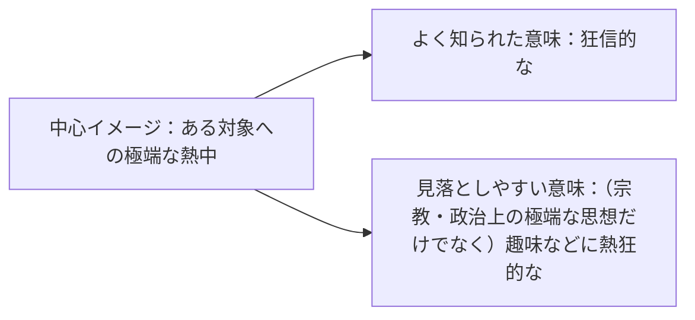

**重要語法**：`informal; fanatical about something`


## 4642. faraway

**品詞**：adjective　**発音**：/ˌfɑːrəˈweɪ/

<small>よく知られている意味：遠く離れた</small>

**見落としやすい意味：うわの空の、ぼんやり遠くを見つめるような**

**例文**：He had a faraway look during the meeting.

**和訳**：会議中、彼はどこかうわの空の表情をしていた。

**コアイメージ**：空間的な遠さが、注意や意識の隔たりに広がる。目の前を見ていても、心が別の場所にあるような表情を表す。

**図**

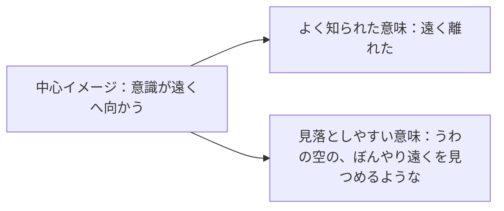

**重要語法**：`a faraway look`


## 4643. filthy

**品詞**：adjective　**発音**：/ˈfɪlθi/

<small>よく知られている意味：ひどく汚い</small>

**見落としやすい意味：（英口語で）非常に機嫌が悪い、怒っている**

**例文**：She was in a filthy mood after the delay.

**和訳**：遅延のあと、彼女はひどく機嫌が悪かった。

**コアイメージ**：基本義では汚れのひどさを強調する。その不快さを気分に当てはめると、非常に機嫌が悪い状態を表せる。

**図**

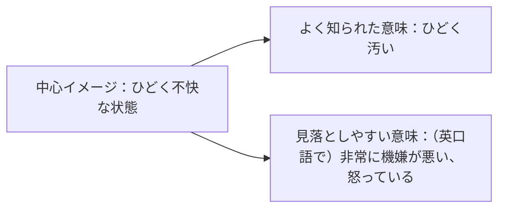

**重要語法**：`UK informal; in a filthy mood`


## 4644. filthy

**品詞**：idiom　**発音**：/ˈfɪlθi/

<small>よく知られている意味：汚い</small>

**見落としやすい意味：桁外れに裕福な**

**例文**：He became filthy rich after selling the company.

**和訳**：会社を売却したあと、彼は桁外れの大金持ちになった。

**コアイメージ**：filthy は口語で程度を強く誇張することがある。filthy rich は文字どおりの汚さではなく、非常に裕福な状態を表す決まった言い方である。

**図**

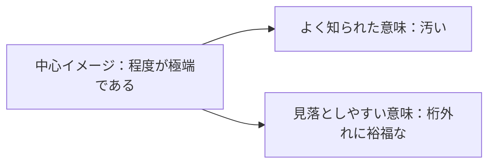

**重要語法**：`filthy rich; informal`


## 4645. finesse

**品詞**：verb　**発音**：/fɪˈnes/

<small>よく知られている意味：巧みさ、手際</small>

**見落としやすい意味：状況を巧みに、時にはずる賢く切り抜ける**

**例文**：She finessed her way through the awkward questions.

**和訳**：彼女は答えづらい質問を巧みにかわした。

**コアイメージ**：finesse の中心には、力ずくではなく細かな技量を使う発想がある。動詞では、難しい状況を巧みに処理することを表し、ときにずる賢さもにじむ。

**図**

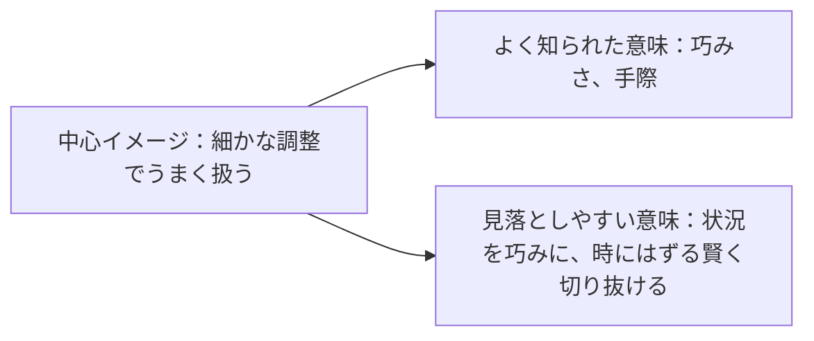


## 4646. flare

**品詞**：verb　**発音**：/fler/

<small>よく知られている意味：炎が燃え上がる</small>

**見落としやすい意味：争い・怒り・痛みなどが突然激しくなる**

**例文**：Tensions flared up after the announcement.

**和訳**：発表後、緊張が突然高まった。

**コアイメージ**：炎がぱっと大きくなる動きが出発点になる。その急激な高まりを怒りや緊張、痛みなどにも重ねて使う。

**図**

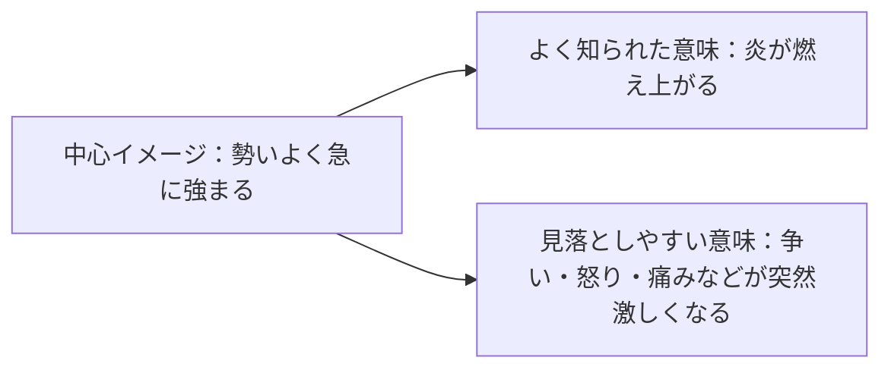

**重要語法**：`flare (up)`


## 4647. flare

**品詞**：verb　**発音**：/fler/

<small>よく知られている意味：燃え上がる</small>

**見落としやすい意味：（衣服・鼻孔などが）外側へ広がる**

**例文**：His nostrils flared when he heard the accusation.

**和訳**：非難を聞くと、彼の鼻孔は大きく広がった。

**コアイメージ**：炎や光が外側へ広がるような形の変化を表せる。鼻孔や裾が外へ開く場面では、実際の火は関係しない。

**図**

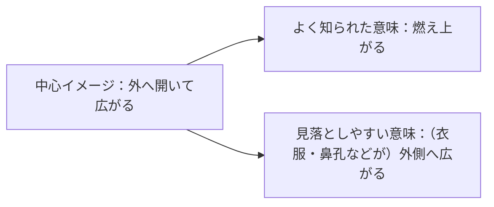


## 4648. fore

**品詞**：interjection　**発音**：/fɔːr/

<small>よく知られている意味：前方</small>

**見落としやすい意味：ゴルフで打った球に注意するよう周囲へ警告する掛け声**

**例文**：“Fore!” she shouted when her golf ball headed toward the spectators.

**和訳**：ゴルフボールが観客の方へ飛んだとき、彼女は「危ない！」と叫んだ。

**コアイメージ**：ゴルフで fore は前方の人々へ危険を知らせるための決まった警告である。方向を表す通常の語ではなく、独立した掛け声として理解する。

**図**

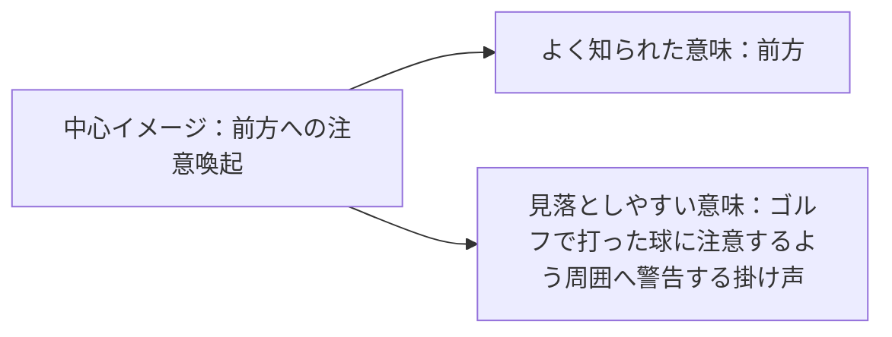

**重要語法**：`golf cry: Fore!`


## 4649. fore

**品詞**：noun　**発音**：/fɔːr/

<small>よく知られている意味：前の方</small>

**見落としやすい意味：人目につく立場・注目の的**

**例文**：Young researchers came to the fore during the debate.

**和訳**：討論では若い研究者たちが注目を集めるようになった。

**コアイメージ**：空間的に前へ出る位置関係が、注目を集める状況にも使われる。come to the fore は人や問題が目立つ立場に現れることを表す。

**図**

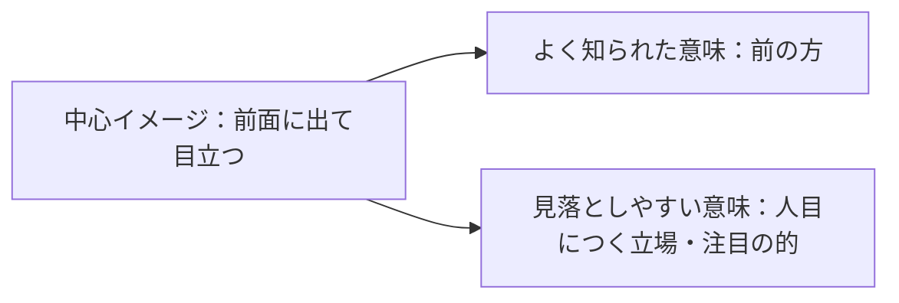

**重要語法**：`come to the fore`


## 4650. fume

**品詞**：verb　**発音**：/fjuːm/

<small>よく知られている意味：煙、蒸気</small>

**見落としやすい意味：激しく腹を立てる**

**例文**：He was still fuming about the unfair decision.

**和訳**：彼はその不公平な決定にまだひどく腹を立てていた。

**コアイメージ**：煙が立ち上るように、怒りが内側から噴き出すイメージである。実際に煙が出るのではなく、激しく憤慨する様子を表す。

**図**

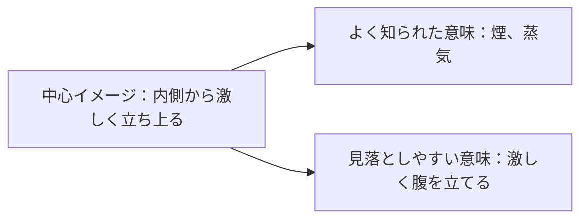


## 4651. galvanize

**品詞**：verb　**発音**：/ˈɡælvənaɪz/

<small>よく知られている意味：亜鉛めっきする</small>

**見落としやすい意味：衝撃などで人を奮起させ行動に移させる**

**例文**：The speech galvanized volunteers into action.

**和訳**：その演説はボランティアを奮い立たせ、行動へと駆り立てた。

**コアイメージ**：技術的には金属の表面処理を表す語だが、人への刺激の意味でも使われる。強いきっかけによって人が受け身の状態から行動に移ることを強調する。

**図**

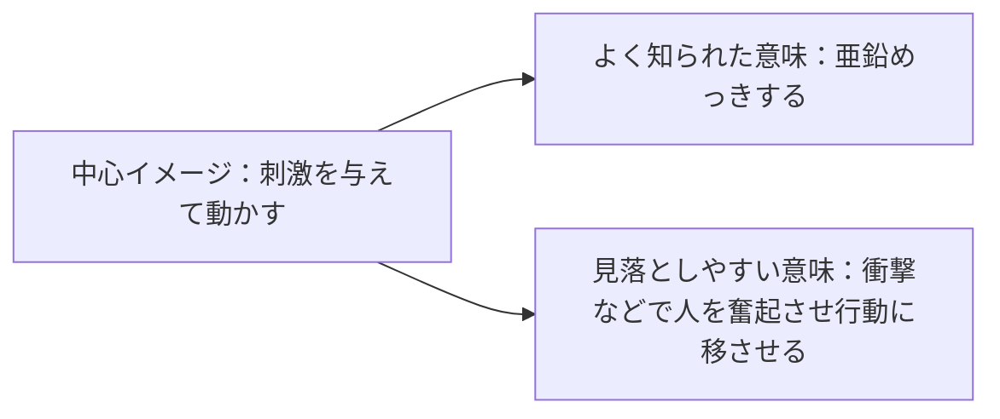

**重要語法**：`galvanize someone into action`


## 4652. glorify

**品詞**：verb　**発音**：/ˈɡlɔːrɪfaɪ/

<small>よく知られている意味：称賛する</small>

**見落としやすい意味：（問題のある行為などを）美化する**

**例文**：The documentary refuses to glorify the war.

**和訳**：そのドキュメンタリーは戦争を美化することを拒んでいる。

**コアイメージ**：glorify は対象を立派で輝かしいものとして描くことを表す。好ましくない行為が対象なら、問題点を隠して美化するという批判的な意味になる。

**図**

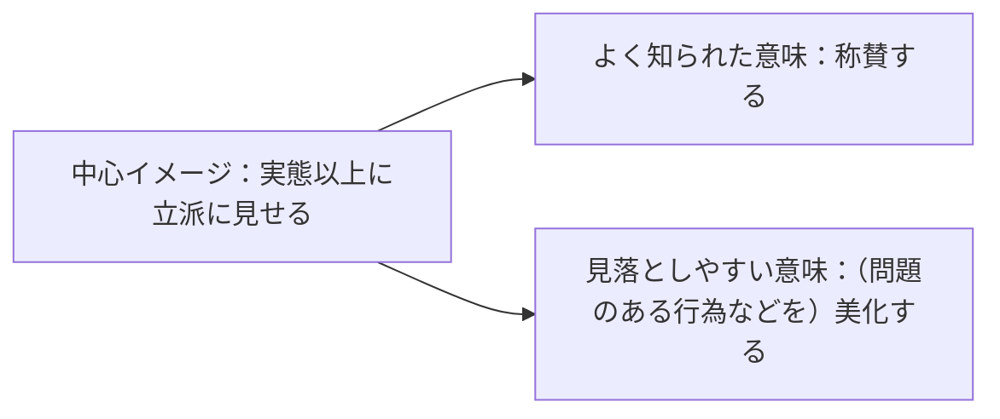

**重要語法**：`glorify violence`


## 4653. gone

**品詞**：adjective　**発音**：/ɡɔːn/

<small>よく知られている意味：go の過去分詞、行ってしまった</small>

**見落としやすい意味：（時代などが）過ぎ去った、もはや存在しない**

**例文**：Gone are the days when we had to print every page.

**和訳**：すべてのページを印刷しなければならなかった時代は、もう過ぎ去った。

**コアイメージ**：gone は人が去っただけでなく、時代や状態が失われたことにも使う。Gone are the days when ... は、かつての日々がすでに終わったことを強調する倒置構文である。

**図**

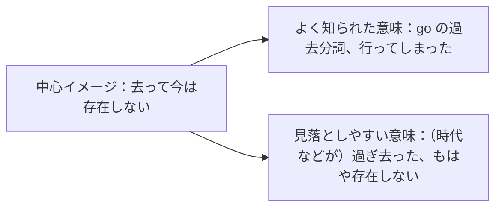

**重要語法**：`Gone are the days when ...`


## 4654. handout

**品詞**：noun　**発音**：/ˈhændaʊt/

<small>よく知られている意味：配布資料</small>

**見落としやすい意味：（生活困窮者などへの）無料の支援物資・給付金**

**例文**：Some families rely on government handouts.

**和訳**：政府からの給付金を頼りに生活している家庭もある。

**コアイメージ**：handout は相手に手渡して配るものを指す。配布物が資料ではなく金銭や生活物資なら、無償の支援を意味する。

**図**

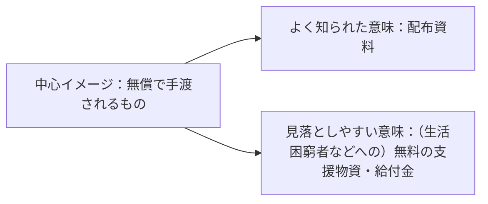

**重要語法**：`government handouts`


## 4655. harp

**品詞**：verb　**発音**：/hɑːrp/

<small>よく知られている意味：ハープ（楽器）</small>

**見落としやすい意味：同じことを何度もくどくど言う**

**例文**：He kept harping on about one small mistake.

**和訳**：彼は一つの小さなミスについて何度もくどくど言い続けた。

**コアイメージ**：harp on は同じ話題を何度も繰り返して持ち出す言い方である。楽器そのものを指さず、しつこさへの否定的な評価を伴うことが多い。

**図**

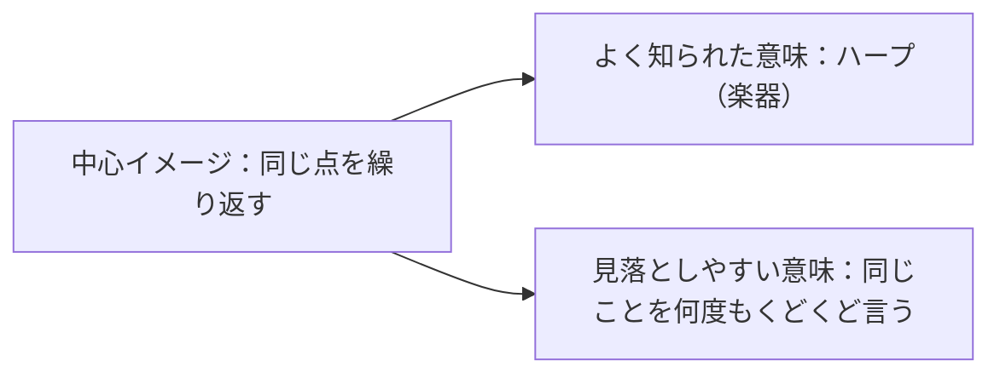

**重要語法**：`harp on (about something)`


## 4656. hobble

**品詞**：verb　**発音**：/ˈhɑːbəl/

<small>よく知られている意味：足を引きずって歩く</small>

**見落としやすい意味：計画・活動・自由を妨げる**

**例文**：A shortage of staff hobbled the research project.

**和訳**：人手不足がその研究計画の進行を妨げた。

**コアイメージ**：足の不自由さによって歩行が妨げられることが出発点である。そこから、計画や活動の進みを妨げることにも使う。

**図**

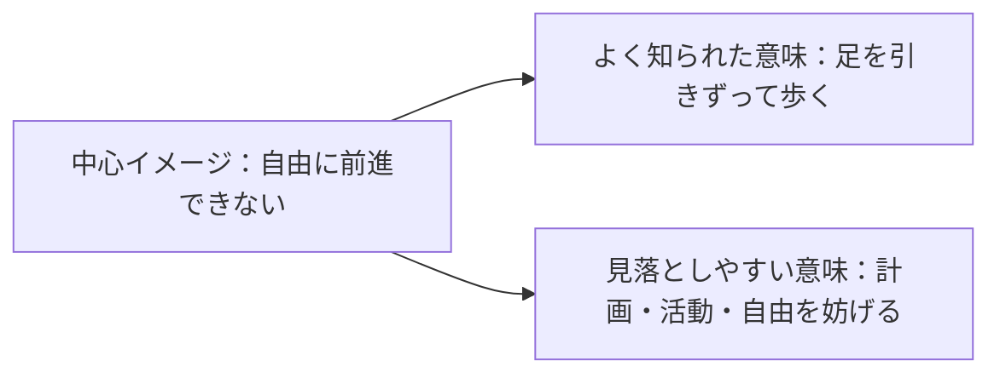


## 4657. hoopla

**品詞**：noun　**発音**：/ˈhuːplɑː/

<small>よく知られている意味：お祭り騒ぎ</small>

**見落としやすい意味：大げさな騒ぎ、宣伝による盛り上がり**

**例文**：There was a lot of hoopla over the new phone.

**和訳**：新型スマートフォンをめぐって大げさな騒ぎが起きた。

**コアイメージ**：単なる喜びや楽しさよりも、周囲が大げさに騒ぎ立てる様子が中心である。宣伝や評判の盛り上がりを、距離を置いて表現することも多い。

**図**

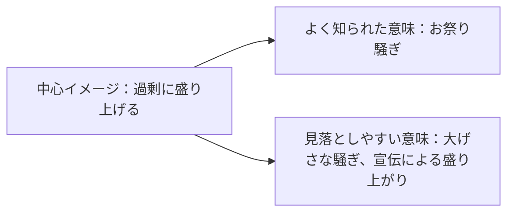

**重要語法**：`all the hoopla`


## 4658. hospitable

**品詞**：adjective　**発音**：/hɑˈspɪtəbəl/

<small>よく知られている意味：客を温かく迎える</small>

**見落としやすい意味：生物が暮らしたり植物が生育したりするのに適した**

**例文**：The wetland is hospitable to many kinds of birds.

**和訳**：その湿地は多くの種類の鳥が暮らすのに適している。

**コアイメージ**：人にとって居心地よく迎えられるという意味が中心にある。これを生物と環境の関係に広げ、そこに生きるのに適した条件を表す。

**図**

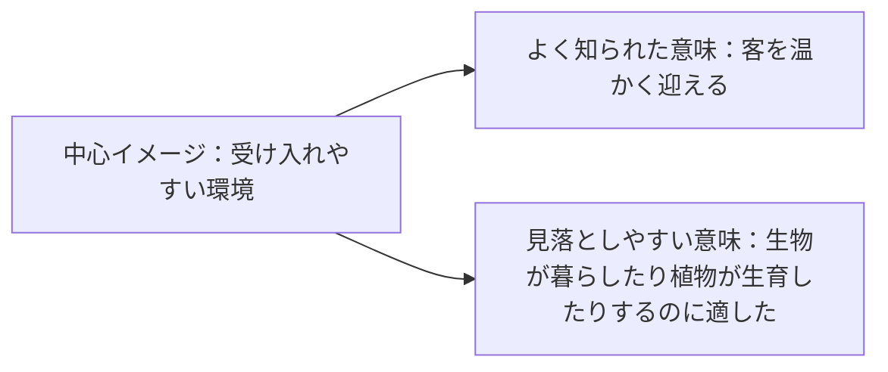

**重要語法**：`a hospitable environment for life`


## 4659. idiomatic

**品詞**：adjective　**発音**：/ˌɪdiəˈmætɪk/

<small>よく知られている意味：慣用句に関する</small>

**見落としやすい意味：（表現・外国語などが）自然でこなれている**

**例文**：Her Japanese is fluent and idiomatic.

**和訳**：彼女の日本語は流暢で、表現も自然だ。

**コアイメージ**：idiom はその言語固有の表現の仕方を指す。idiomatic は慣用句を含むことだけでなく、言い回しがその言語らしく自然であることを評価する。

**図**

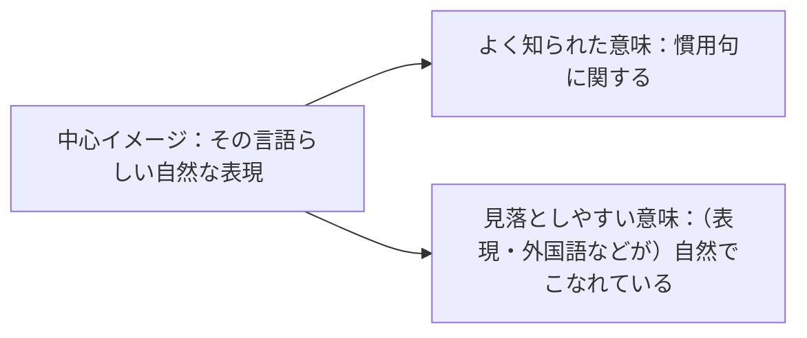

**重要語法**：`fluent and idiomatic`


## 4660. impossibly

**品詞**：adverb　**発音**：/ɪmˈpɑːsəbli/

<small>よく知られている意味：不可能なほど</small>

**見落としやすい意味：異常なほど、極端に**

**例文**：The building had impossibly narrow corridors.

**和訳**：その建物の廊下は信じられないほど狭かった。

**コアイメージ**：文字どおり実現不可能という意味に限らない。程度が普通の感覚では考えられないほど大きいという誇張にも使う。

**図**

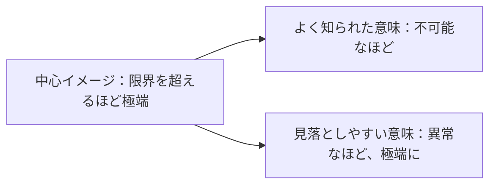

**重要語法**：`impossibly long hours`

## 4661. inauguration

**品詞**：noun　**発音**：/ɪˌnɔːɡjəˈreɪʃən/

<small>よく知られている意味：大統領などの就任式</small>

**見落としやすい意味：（新制度・事業などの）正式な開始、発足**

**例文**：The inauguration of the new research center took place in April.

**和訳**：新しい研究センターの正式な開設は4月に行われた。

**コアイメージ**：inauguration は役職への就任を正式に始める行事に使われる。同じ発想から、事業や制度の発足・開始も表す。

**図**

```mermaid
flowchart LR
    A["中心イメージ：新しい段階を正式に始める"]
    B["よく知られた意味：大統領などの就任式"]
    C["見落としやすい意味：（新制度・事業などの）正式な開始、発足"]
    A --> B
    A --> C
```

**重要語法**：`inauguration of a program`


## 4662. indelible

**品詞**：adjective　**発音**：/ɪnˈdeləbəl/

<small>よく知られている意味：消えない、洗っても落ちない</small>

**見落としやすい意味：記憶から消えない、長く影響を残す**

**例文**：Her kindness left an indelible impression on me.

**和訳**：彼女の親切は私の心に消えない印象を残した。

**コアイメージ**：物の表面から消せない印が中心イメージである。経験や記憶に使うと、心に深く刻まれて長く残ることを表す。

**図**

```mermaid
flowchart LR
    A["中心イメージ：跡が消えずに残る"]
    B["よく知られた意味：消えない、洗っても落ちない"]
    C["見落としやすい意味：記憶から消えない、長く影響を残す"]
    A --> B
    A --> C
```

**重要語法**：`an indelible impression`


## 4663. inherited

**品詞**：adjective　**発音**：/ɪnˈherɪtɪd/

<small>よく知られている意味：相続した</small>

**見落としやすい意味：遺伝によって受け継がれた**

**例文**：Some features of our appearance are inherited.

**和訳**：私たちの外見の特徴の中には遺伝によって受け継がれるものがある。

**コアイメージ**：inherit は先の世代から何かを受け取ることを表す。対象が財産ではなく特徴や性質なら、遺伝による継承を表す。

**図**

```mermaid
flowchart LR
    A["中心イメージ：前の世代から受け取る"]
    B["よく知られた意味：相続した"]
    C["見落としやすい意味：遺伝によって受け継がれた"]
    A --> B
    A --> C
```

**重要語法**：`an inherited trait`


## 4664. intoxicated

**品詞**：adjective　**発音**：/ɪnˈtɑːksɪkeɪtɪd/

<small>よく知られている意味：酔った</small>

**見落としやすい意味：（成功・興奮などに）有頂天になった**

**例文**：The team was intoxicated by its unexpected success.

**和訳**：チームは予想外の成功に有頂天になっていた。

**コアイメージ**：酒などの影響で判断が揺らぐ状態が基本となる。成功や喜びが人を圧倒する場合にも、舞い上がるほどの興奮を表せる。

**図**

```mermaid
flowchart LR
    A["中心イメージ：理性を忘れるほど高揚する"]
    B["よく知られた意味：酔った"]
    C["見落としやすい意味：（成功・興奮などに）有頂天になった"]
    A --> B
    A --> C
```

**重要語法**：`intoxicated by success`


## 4665. intrude

**品詞**：verb　**発音**：/ɪnˈtruːd/

<small>よく知られている意味：侵入する</small>

**見落としやすい意味：（時間・私生活などに）不当に立ち入る、邪魔をする**

**例文**：We should not intrude on other people's private lives.

**和訳**：私たちは他人の私生活に不当に踏み込むべきではない。

**コアイメージ**：物理的な境界を無断で越えることが出発点である。私生活や時間など見えない領域を侵すことにも使う。

**図**

```mermaid
flowchart LR
    A["中心イメージ：境界を越えて入り込む"]
    B["よく知られた意味：侵入する"]
    C["見落としやすい意味：（時間・私生活などに）不当に立ち入る、邪魔をする"]
    A --> B
    A --> C
```

**重要語法**：`intrude on someone's privacy`


## 4666. invented

**品詞**：verb　**発音**：/ɪnˈventɪd/

<small>よく知られている意味：発明した</small>

**見落としやすい意味：（言い訳や話を）でっち上げた、作り話をした**

**例文**：She invented an excuse for missing the meeting.

**和訳**：彼女は会議を欠席した言い訳をでっち上げた。

**コアイメージ**：invent は存在しなかったものを作り出すことを表す。対象が機械でなく話や言い訳なら、事実ではない内容を作る意味になる。

**図**

```mermaid
flowchart LR
    A["中心イメージ：もともとないものを作り出す"]
    B["よく知られた意味：発明した"]
    C["見落としやすい意味：（言い訳や話を）でっち上げた、作り話をした"]
    A --> B
    A --> C
```

**重要語法**：`invent an excuse`


## 4667. invested

**品詞**：adjective　**発音**：/ɪnˈvestɪd/

<small>よく知られている意味：投資した</small>

**見落としやすい意味：（自分に関係する事柄に）強い関心や思い入れを持つ**

**例文**：Parents are deeply invested in their children's education.

**和訳**：親たちは子どもの教育に強い関心と思い入れを持っている。

**コアイメージ**：投資は資金をある対象へ注ぐ行為である。感情や時間を注いでいる対象には、強い思い入れや利害関係を持つという意味になる。

**図**

```mermaid
flowchart LR
    A["中心イメージ：大切なものを注ぎ込む"]
    B["よく知られた意味：投資した"]
    C["見落としやすい意味：（自分に関係する事柄に）強い関心や思い入れを持つ"]
    A --> B
    A --> C
```

**重要語法**：`be invested in; usually predicative`


## 4668. inviting

**品詞**：adjective　**発音**：/ɪnˈvaɪtɪŋ/

<small>よく知られている意味：魅力的な、招き入れるような</small>

**見落としやすい意味：（損害など悪い結果を招く対象が）格好の標的となる**

**例文**：The exposed equipment was an inviting target for theft.

**和訳**：むき出しの機材は盗難の格好の標的だった。

**コアイメージ**：inviting は人を誘い寄せるような魅力を表す。危険や被害の文脈では、よくない行為を容易に引き寄せる対象にも使える。

**図**

```mermaid
flowchart LR
    A["中心イメージ：相手を引き寄せる性質"]
    B["よく知られた意味：魅力的な、招き入れるような"]
    C["見落としやすい意味：（損害など悪い結果を招く対象が）格好の標的となる"]
    A --> B
    A --> C
```

**重要語法**：`an inviting target`


## 4669. jack

**品詞**：noun　**発音**：/dʒæk/

<small>よく知られている意味：持ち上げる器具、ジャッキ</small>

**見落としやすい意味：電子機器の接続用差込口**

**例文**：Plug the headphones into the jack on the side.

**和訳**：ヘッドホンを側面の差込口につないでください。

**コアイメージ**：jack には器具や人名など複数の独立した意味がある。機器の接続では、プラグを差し込むソケットを指し、持ち上げる器具と混同しない。

**図**

```mermaid
flowchart LR
    A["中心イメージ：同じ語形の別用法"]
    B["よく知られた意味：持ち上げる器具、ジャッキ"]
    C["見落としやすい意味：電子機器の接続用差込口"]
    A --> B
    A --> C
```

**重要語法**：`a microphone jack`


## 4670. jack

**品詞**：phrasal verb　**発音**：/dʒæk/

<small>よく知られている意味：ジャッキ、持ち上げる器具</small>

**見落としやすい意味：価格・料金などを一気に大幅に引き上げる**

**例文**：The company jacked up its fees without warning.

**和訳**：その会社は予告なく料金を大幅に引き上げた。

**コアイメージ**：ジャッキで物を上げる動作が、価格や料金の引き上げに重なる。jack up は大幅・急激な値上げを表し、批判的な含みを持つこともある。

**図**

```mermaid
flowchart LR
    A["中心イメージ：急激に高く持ち上げる"]
    B["よく知られた意味：ジャッキ、持ち上げる器具"]
    C["見落としやすい意味：価格・料金などを一気に大幅に引き上げる"]
    A --> B
    A --> C
```

**重要語法**：`jack up prices; informal disapproving`


## 4671. knack

**品詞**：noun　**発音**：/næk/

<small>よく知られている意味：才能、器用さ</small>

**見落としやすい意味：（特定の作業をうまく行うための）ちょっとしたコツ**

**例文**：There is a knack to opening this old lock.

**和訳**：この古い錠前を開けるにはちょっとしたコツがある。

**コアイメージ**：knack はある行為がうまくできる能力や要領を指す。there is a knack to ... では、生まれつきの才能より実際のやり方のコツが前面に出る。

**図**

```mermaid
flowchart LR
    A["中心イメージ：うまくできる要領"]
    B["よく知られた意味：才能、器用さ"]
    C["見落としやすい意味：（特定の作業をうまく行うための）ちょっとしたコツ"]
    A --> B
    A --> C
```

**重要語法**：`there is a knack to doing ...`


## 4672. laden

**品詞**：adjective　**発音**：/ˈleɪdən/

<small>よく知られている意味：荷物を積んだ</small>

**見落としやすい意味：（責任・借金・感情などを）重く抱えた**

**例文**：The small town was laden with debt.

**和訳**：その小さな町は多額の借金を抱えていた。

**コアイメージ**：物を大量に積んで重くなった状態が出発点である。責任や借金など、目に見えない重荷にも広がる。

**図**

```mermaid
flowchart LR
    A["中心イメージ：重荷を背負っている"]
    B["よく知られた意味：荷物を積んだ"]
    C["見落としやすい意味：（責任・借金・感情などを）重く抱えた"]
    A --> B
    A --> C
```

**重要語法**：`laden with debt`


## 4673. leftover

**品詞**：noun　**発音**：/ˈleftoʊvər/

<small>よく知られている意味：残った（形容詞）</small>

**見落としやすい意味：食べ残し、残った料理**

**例文**：We ate the leftovers for lunch.

**和訳**：私たちは昼食に残り物の料理を食べた。

**コアイメージ**：leftover は使い切らずに残ったものを表す。名詞の複数形 leftovers は、とくに前の食事で残った料理を指す。

**図**

```mermaid
flowchart LR
    A["中心イメージ：使われず残る"]
    B["よく知られた意味：残った（形容詞）"]
    C["見落としやすい意味：食べ残し、残った料理"]
    A --> B
    A --> C
```

**重要語法**：`leftovers`


## 4674. lifting

**品詞**：noun　**発音**：/ˈlɪftɪŋ/

<small>よく知られている意味：持ち上げること</small>

**見落としやすい意味：（規制・禁止などの）解除**

**例文**：The lifting of travel restrictions helped local businesses.

**和訳**：渡航制限の解除は地元の企業を助けた。

**コアイメージ**：何かを持ち上げてその場からなくす動きが基本にある。規制や禁止が対象なら、それを取り除くこと、つまり解除を表す。

**図**

```mermaid
flowchart LR
    A["中心イメージ：上に持ち上げて取り除く"]
    B["よく知られた意味：持ち上げること"]
    C["見落としやすい意味：（規制・禁止などの）解除"]
    A --> B
    A --> C
```

**重要語法**：`lifting of restrictions`


## 4675. linen

**品詞**：noun　**発音**：/ˈlɪnɪn/

<small>よく知られている意味：亜麻布、リネン素材</small>

**見落としやすい意味：シーツ・テーブルクロスなどの布製品**

**例文**：Please put clean bed linen on the guest bed.

**和訳**：客用ベッドに清潔な寝具類を用意してください。

**コアイメージ**：linen はもともと亜麻由来の布を指す。素材名が寝具やテーブル用品などの布製品全体を表すこともある。

**図**

```mermaid
flowchart LR
    A["中心イメージ：素材から製品全体へ"]
    B["よく知られた意味：亜麻布、リネン素材"]
    C["見落としやすい意味：シーツ・テーブルクロスなどの布製品"]
    A --> B
    A --> C
```

**重要語法**：`bed linen; linens`


## 4676. locomotive

**品詞**：adjective　**発音**：/ˌloʊkəˈmoʊtɪv/

<small>よく知られている意味：機関車</small>

**見落としやすい意味：移動・運動の能力に関する**

**例文**：The study compared the locomotive abilities of different animals.

**和訳**：その研究は異なる動物の移動能力を比較した。

**コアイメージ**：locomotion は場所を移動することを意味する。形容詞 locomotive は、機関車そのものではなく、移動に関わる能力や働きを表せる。

**図**

```mermaid
flowchart LR
    A["中心イメージ：自ら場所を移る働き"]
    B["よく知られた意味：機関車"]
    C["見落としやすい意味：移動・運動の能力に関する"]
    A --> B
    A --> C
```

**重要語法**：`locomotive ability`


## 4677. looming

**品詞**：adjective　**発音**：/ˈluːmɪŋ/

<small>よく知られている意味：大きくぼんやり現れる</small>

**見落としやすい意味：望ましくない出来事が差し迫っている**

**例文**：The government faced a looming financial crisis.

**和訳**：政府は差し迫った財政危機に直面していた。

**コアイメージ**：loom は大きなものが近づいて見えてくるような感覚を含む。looming は、危機などの好ましくない出来事が迫る様子を表す。

**図**

```mermaid
flowchart LR
    A["中心イメージ：大きなものが迫ってくる"]
    B["よく知られた意味：大きくぼんやり現れる"]
    C["見落としやすい意味：望ましくない出来事が差し迫っている"]
    A --> B
    A --> C
```

**重要語法**：`a looming crisis`


## 4678. lull

**品詞**：noun　**発音**：/lʌl/

<small>よく知られている意味：静める、寝かしつける（動詞）</small>

**見落としやすい意味：活動が一時的に静まる期間**

**例文**：There was a brief lull in the conversation.

**和訳**：会話が一時的に途切れ、静かになった。

**コアイメージ**：動きや音の強さがいったん弱まる状態を表す。名詞では、会話や争いなどが一時的に静まる短い期間を指す。

**図**

```mermaid
flowchart LR
    A["中心イメージ：活動の勢いが静まる"]
    B["よく知られた意味：静める、寝かしつける（動詞）"]
    C["見落としやすい意味：活動が一時的に静まる期間"]
    A --> B
    A --> C
```

**重要語法**：`a lull in ...`


## 4679. lull

**品詞**：verb　**発音**：/lʌl/

<small>よく知られている意味：静める、眠りへ誘う</small>

**見落としやすい意味：人を安心させて警戒心をなくさせる**

**例文**：The calm forecast lulled them into a false sense of security.

**和訳**：穏やかな天気予報のせいで、彼らは根拠なく安心してしまった。

**コアイメージ**：lull は興奮や不安を和らげて静かな状態へ導く動きを表す。その結果として必要な警戒まで失わせてしまう場合にも使う。

**図**

```mermaid
flowchart LR
    A["中心イメージ：警戒を静める"]
    B["よく知られた意味：静める、眠りへ誘う"]
    C["見落としやすい意味：人を安心させて警戒心をなくさせる"]
    A --> B
    A --> C
```

**重要語法**：`lull someone into a false sense of security / lull someone into thinking ...`


## 4680. lumber

**品詞**：verb　**発音**：/ˈlʌmbər/

<small>よく知られている意味：材木（名詞）</small>

**見落としやすい意味：重たそうにゆっくり不器用に動く**

**例文**：A large bear lumbered across the road.

**和訳**：大きなクマが道路を重たそうにゆっくり歩いて渡った。

**コアイメージ**：名詞 lumber は材木を表す。一方、動詞 lumber は大きく重い体を不器用に動かす様子で、材木そのものの意味から無理に導かない。

**図**

```mermaid
flowchart LR
    A["中心イメージ：同じ語形の別用法"]
    B["よく知られた意味：材木（名詞）"]
    C["見落としやすい意味：重たそうにゆっくり不器用に動く"]
    A --> B
    A --> C
```


