# EasyVoca 完成教材｜Batch 059

- 対象：採用済み語義 global_order 4641〜4720
- 元データ：`data/candidates/batch_10501_11000.jsonl`（main）
- 判定：accepted のみ。候補の再選定は行わない。

## 4641. fanatical

**品詞**：adjective　**発音**：/fəˈnætɪkəl/

<small>よく知られている意味：狂信的な</small>

**見落としやすい意味：（宗教・政治上の極端な思想だけでなく）趣味などに熱狂的な**

**例文**：She is fanatical about collecting old maps.

**和訳**：彼女は古地図の収集に熱中している。

**コアイメージ**：根底には、ある対象への熱中が非常に強いという感覚がある。対象が宗教や政治でなければ、趣味への熱烈な関心も表せる。

**図**

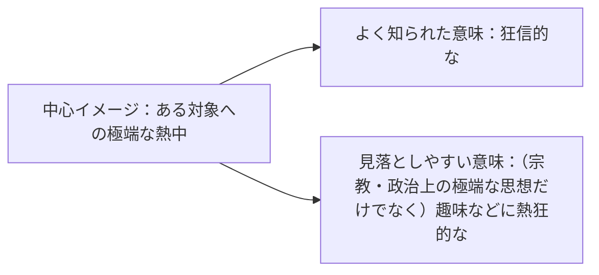

**重要語法**：`informal; fanatical about something`

## 4642. faraway

**品詞**：adjective　**発音**：/ˌfɑːrəˈweɪ/

<small>よく知られている意味：遠く離れた</small>

**見落としやすい意味：うわの空の、ぼんやり遠くを見つめるような**

**例文**：He had a faraway look during the meeting.

**和訳**：会議中、彼はどこかうわの空の表情をしていた。

**コアイメージ**：空間的な遠さが、注意や意識の隔たりに広がる。目の前を見ていても、心が別の場所にあるような表情を表す。

**図**

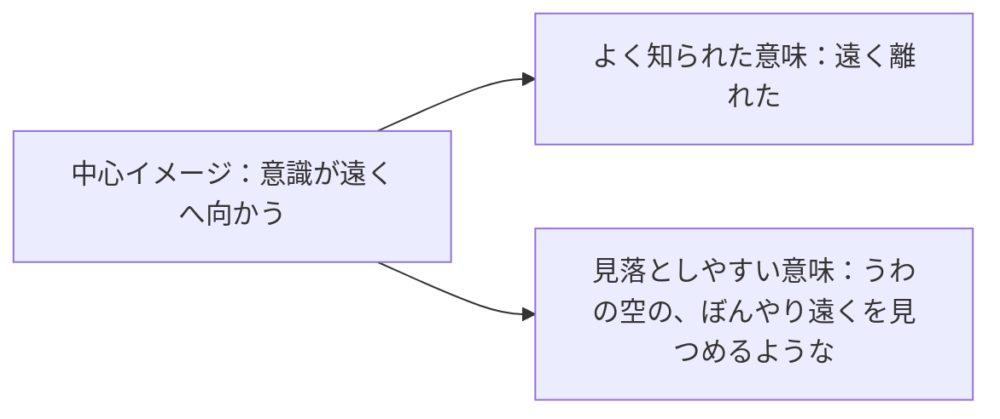

**重要語法**：`a faraway look`

## 4643. filthy

**品詞**：adjective　**発音**：/ˈfɪlθi/

<small>よく知られている意味：ひどく汚い</small>

**見落としやすい意味：（英口語で）非常に機嫌が悪い、怒っている**

**例文**：She was in a filthy mood after the delay.

**和訳**：遅延のあと、彼女はひどく機嫌が悪かった。

**コアイメージ**：基本義では汚れのひどさを強調する。その不快さを気分に当てはめると、非常に機嫌が悪い状態を表せる。

**図**

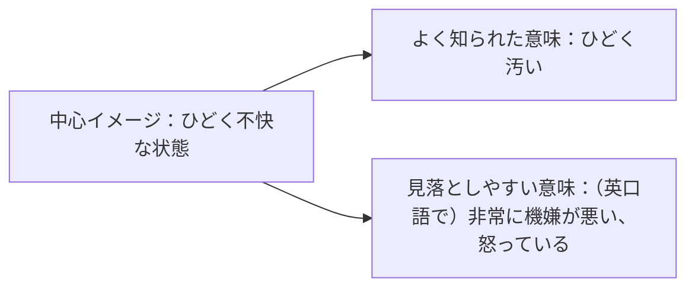

**重要語法**：`UK informal; in a filthy mood`

## 4644. filthy

**品詞**：idiom　**発音**：/ˈfɪlθi/

<small>よく知られている意味：汚い</small>

**見落としやすい意味：桁外れに裕福な**

**例文**：He became filthy rich after selling the company.

**和訳**：会社を売却したあと、彼は桁外れの大金持ちになった。

**コアイメージ**：filthy は口語で程度を強く誇張することがある。filthy rich は文字どおりの汚さではなく、非常に裕福な状態を表す決まった言い方である。

**図**

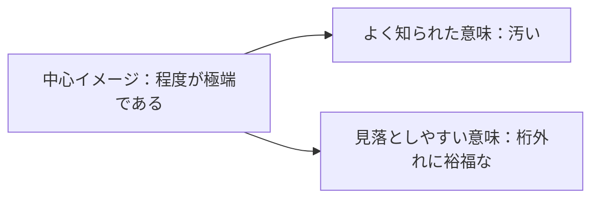

**重要語法**：`filthy rich; informal`

## 4645. finesse

**品詞**：verb　**発音**：/fɪˈnes/

<small>よく知られている意味：巧みさ、手際</small>

**見落としやすい意味：状況を巧みに、時にはずる賢く切り抜ける**

**例文**：She finessed her way through the awkward questions.

**和訳**：彼女は答えづらい質問を巧みにかわした。

**コアイメージ**：finesse の中心には、力ずくではなく細かな技量を使う発想がある。動詞では、難しい状況を巧みに処理することを表し、ときにずる賢さもにじむ。

**図**

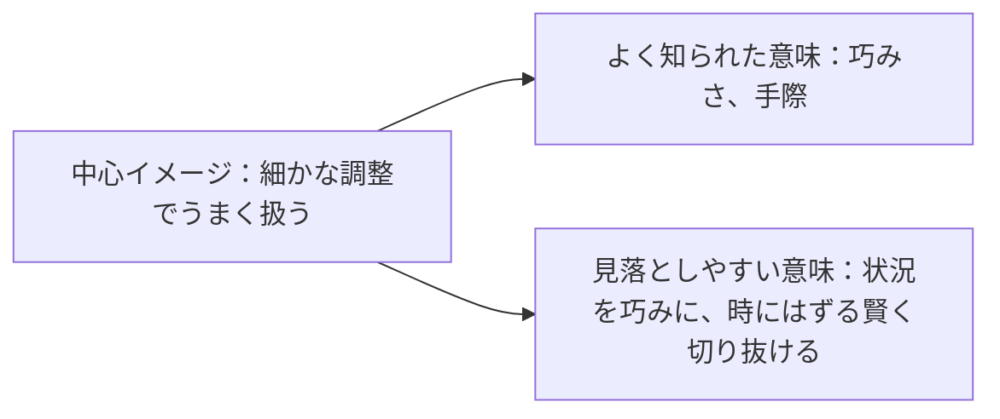

## 4646. flare

**品詞**：verb　**発音**：/fler/

<small>よく知られている意味：炎が燃え上がる</small>

**見落としやすい意味：争い・怒り・痛みなどが突然激しくなる**

**例文**：Tensions flared up after the announcement.

**和訳**：発表後、緊張が突然高まった。

**コアイメージ**：炎がぱっと大きくなる動きが出発点になる。その急激な高まりを怒りや緊張、痛みなどにも重ねて使う。

**図**

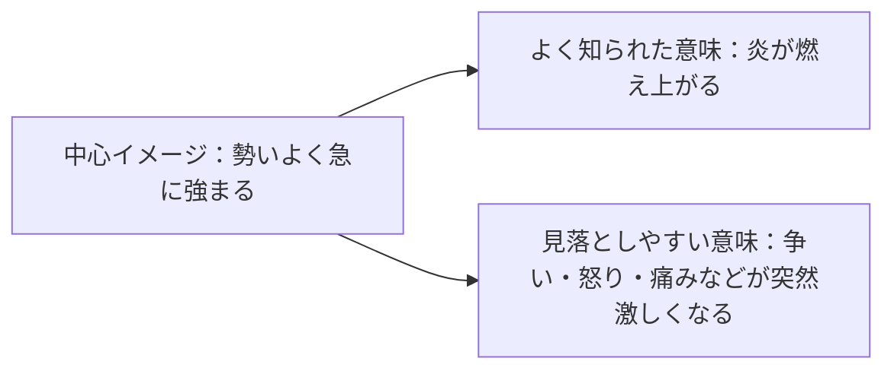

**重要語法**：`flare (up)`

## 4647. flare

**品詞**：verb　**発音**：/fler/

<small>よく知られている意味：燃え上がる</small>

**見落としやすい意味：（衣服・鼻孔などが）外側へ広がる**

**例文**：His nostrils flared when he heard the accusation.

**和訳**：非難を聞くと、彼の鼻孔は大きく広がった。

**コアイメージ**：炎や光が外側へ広がるような形の変化を表せる。鼻孔や裾が外へ開く場面では、実際の火は関係しない。

**図**

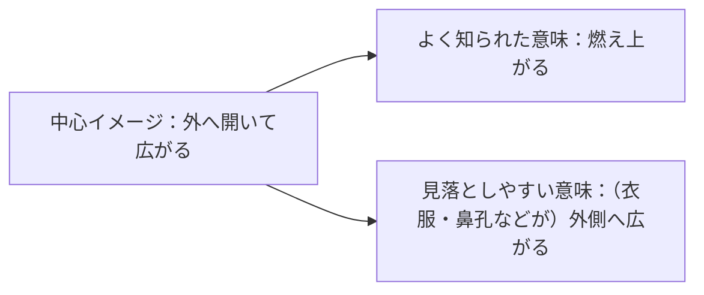

## 4648. fore

**品詞**：interjection　**発音**：/fɔːr/

<small>よく知られている意味：前方</small>

**見落としやすい意味：ゴルフで打った球に注意するよう周囲へ警告する掛け声**

**例文**：“Fore!” she shouted when her golf ball headed toward the spectators.

**和訳**：ゴルフボールが観客の方へ飛んだとき、彼女は「危ない！」と叫んだ。

**コアイメージ**：ゴルフで fore は前方の人々へ危険を知らせるための決まった警告である。方向を表す通常の語ではなく、独立した掛け声として理解する。

**図**

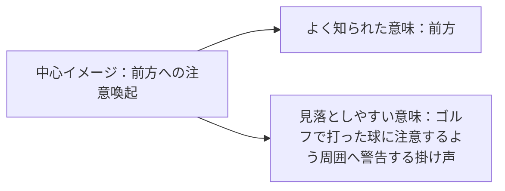

**重要語法**：`golf cry: Fore!`

## 4649. fore

**品詞**：noun　**発音**：/fɔːr/

<small>よく知られている意味：前の方</small>

**見落としやすい意味：人目につく立場・注目の的**

**例文**：Young researchers came to the fore during the debate.

**和訳**：討論では若い研究者たちが注目を集めるようになった。

**コアイメージ**：空間的に前へ出る位置関係が、注目を集める状況にも使われる。come to the fore は人や問題が目立つ立場に現れることを表す。

**図**

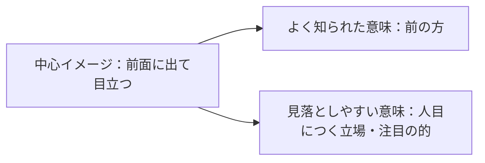

**重要語法**：`come to the fore`

## 4650. fume

**品詞**：verb　**発音**：/fjuːm/

<small>よく知られている意味：煙、蒸気</small>

**見落としやすい意味：激しく腹を立てる**

**例文**：He was still fuming about the unfair decision.

**和訳**：彼はその不公平な決定にまだひどく腹を立てていた。

**コアイメージ**：煙が立ち上るように、怒りが内側から噴き出すイメージである。実際に煙が出るのではなく、激しく憤慨する様子を表す。

**図**

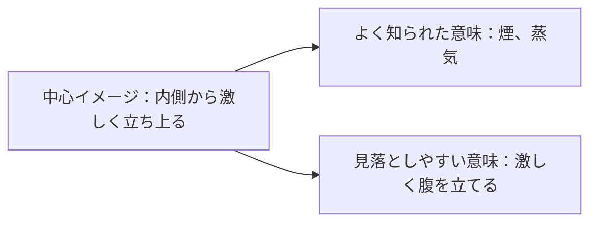

## 4651. galvanize

**品詞**：verb　**発音**：/ˈɡælvənaɪz/

<small>よく知られている意味：亜鉛めっきする</small>

**見落としやすい意味：衝撃などで人を奮起させ行動に移させる**

**例文**：The speech galvanized volunteers into action.

**和訳**：その演説はボランティアを奮い立たせ、行動へと駆り立てた。

**コアイメージ**：技術的には金属の表面処理を表す語だが、人への刺激の意味でも使われる。強いきっかけによって人が受け身の状態から行動に移ることを強調する。

**図**

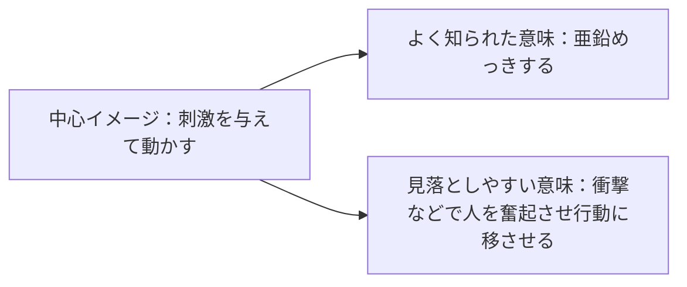

**重要語法**：`galvanize someone into action`

## 4652. glorify

**品詞**：verb　**発音**：/ˈɡlɔːrɪfaɪ/

<small>よく知られている意味：称賛する</small>

**見落としやすい意味：（問題のある行為などを）美化する**

**例文**：The documentary refuses to glorify the war.

**和訳**：そのドキュメンタリーは戦争を美化することを拒んでいる。

**コアイメージ**：glorify は対象を立派で輝かしいものとして描くことを表す。好ましくない行為が対象なら、問題点を隠して美化するという批判的な意味になる。

**図**

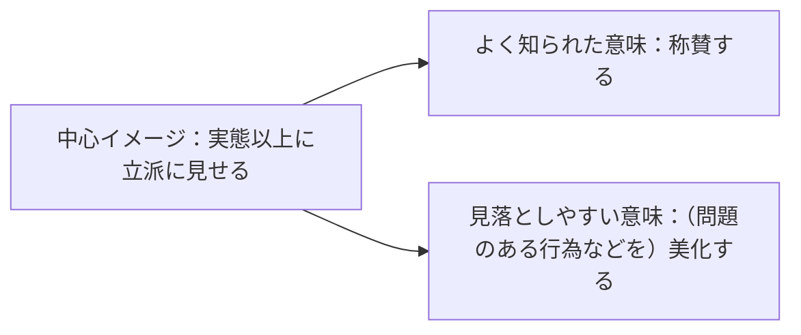

**重要語法**：`glorify violence`

## 4653. gone

**品詞**：adjective　**発音**：/ɡɔːn/

<small>よく知られている意味：go の過去分詞、行ってしまった</small>

**見落としやすい意味：（時代などが）過ぎ去った、もはや存在しない**

**例文**：Gone are the days when we had to print every page.

**和訳**：すべてのページを印刷しなければならなかった時代は、もう過ぎ去った。

**コアイメージ**：gone は人が去っただけでなく、時代や状態が失われたことにも使う。Gone are the days when ... は、かつての日々がすでに終わったことを強調する倒置構文である。

**図**

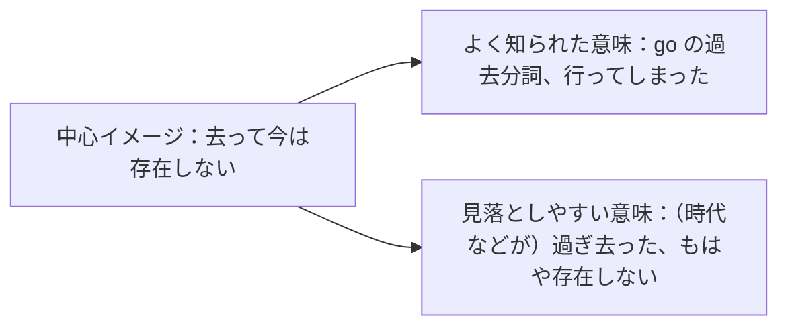

**重要語法**：`Gone are the days when ...`

## 4654. handout

**品詞**：noun　**発音**：/ˈhændaʊt/

<small>よく知られている意味：配布資料</small>

**見落としやすい意味：（生活困窮者などへの）無料の支援物資・給付金**

**例文**：Some families rely on government handouts.

**和訳**：政府からの給付金を頼りに生活している家庭もある。

**コアイメージ**：handout は相手に手渡して配るものを指す。配布物が資料ではなく金銭や生活物資なら、無償の支援を意味する。

**図**

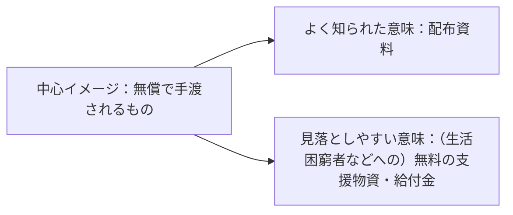

**重要語法**：`government handouts`

## 4655. harp

**品詞**：verb　**発音**：/hɑːrp/

<small>よく知られている意味：ハープ（楽器）</small>

**見落としやすい意味：同じことを何度もくどくど言う**

**例文**：He kept harping on about one small mistake.

**和訳**：彼は一つの小さなミスについて何度もくどくど言い続けた。

**コアイメージ**：harp on は同じ話題を何度も繰り返して持ち出す言い方である。楽器そのものを指さず、しつこさへの否定的な評価を伴うことが多い。

**図**

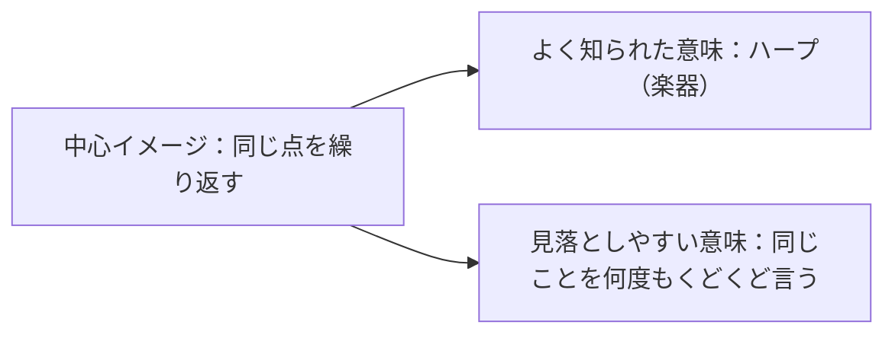

**重要語法**：`harp on (about something)`

## 4656. hobble

**品詞**：verb　**発音**：/ˈhɑːbəl/

<small>よく知られている意味：足を引きずって歩く</small>

**見落としやすい意味：計画・活動・自由を妨げる**

**例文**：A shortage of staff hobbled the research project.

**和訳**：人手不足がその研究計画の進行を妨げた。

**コアイメージ**：足の不自由さによって歩行が妨げられることが出発点である。そこから、計画や活動の進みを妨げることにも使う。

**図**

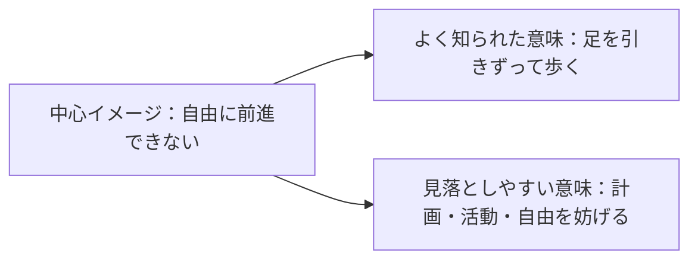

## 4657. hoopla

**品詞**：noun　**発音**：/ˈhuːplɑː/

<small>よく知られている意味：お祭り騒ぎ</small>

**見落としやすい意味：大げさな騒ぎ、宣伝による盛り上がり**

**例文**：There was a lot of hoopla over the new phone.

**和訳**：新型スマートフォンをめぐって大げさな騒ぎが起きた。

**コアイメージ**：単なる喜びや楽しさよりも、周囲が大げさに騒ぎ立てる様子が中心である。宣伝や評判の盛り上がりを、距離を置いて表現することも多い。

**図**

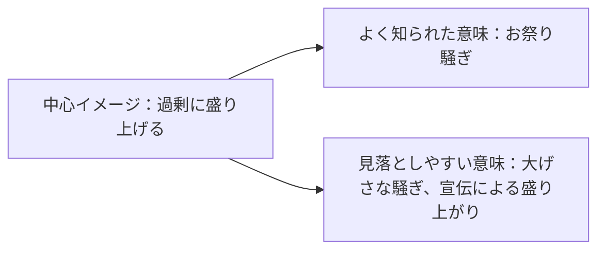

**重要語法**：`all the hoopla`

## 4658. hospitable

**品詞**：adjective　**発音**：/hɑˈspɪtəbəl/

<small>よく知られている意味：客を温かく迎える</small>

**見落としやすい意味：生物が暮らしたり植物が生育したりするのに適した**

**例文**：The wetland is hospitable to many kinds of birds.

**和訳**：その湿地は多くの種類の鳥が暮らすのに適している。

**コアイメージ**：人にとって居心地よく迎えられるという意味が中心にある。これを生物と環境の関係に広げ、そこに生きるのに適した条件を表す。

**図**

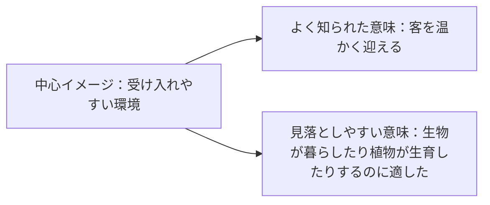

**重要語法**：`a hospitable environment for life`

## 4659. idiomatic

**品詞**：adjective　**発音**：/ˌɪdiəˈmætɪk/

<small>よく知られている意味：慣用句に関する</small>

**見落としやすい意味：（表現・外国語などが）自然でこなれている**

**例文**：Her Japanese is fluent and idiomatic.

**和訳**：彼女の日本語は流暢で、表現も自然だ。

**コアイメージ**：idiom はその言語固有の表現の仕方を指す。idiomatic は慣用句を含むことだけでなく、言い回しがその言語らしく自然であることを評価する。

**図**

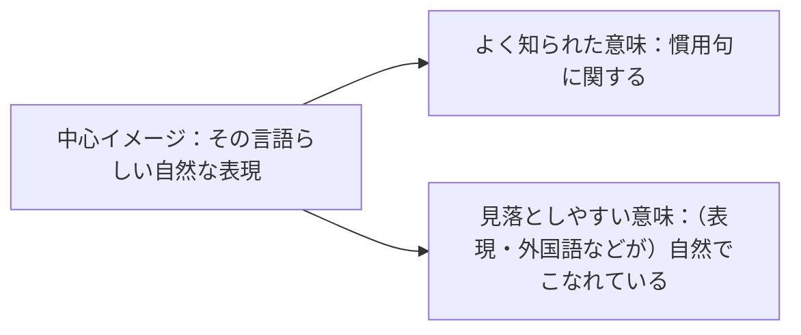

**重要語法**：`fluent and idiomatic`

## 4660. impossibly

**品詞**：adverb　**発音**：/ɪmˈpɑːsəbli/

<small>よく知られている意味：不可能なほど</small>

**見落としやすい意味：異常なほど、極端に**

**例文**：The building had impossibly narrow corridors.

**和訳**：その建物の廊下は信じられないほど狭かった。

**コアイメージ**：文字どおり実現不可能という意味に限らない。程度が普通の感覚では考えられないほど大きいという誇張にも使う。

**図**

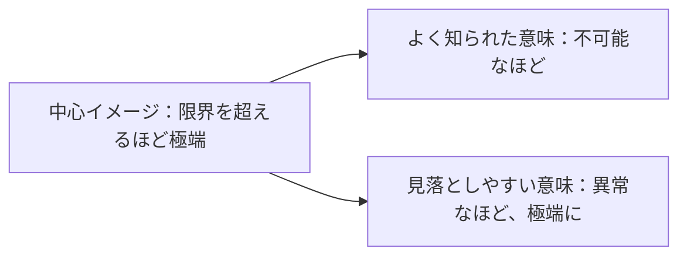

**重要語法**：`impossibly long hours`

