# EasyVoca 完成教材｜バッチ060

> 対象：採用済み語義の global_order **4721〜4800**（80件）。元データは `main` の `decision == "accepted"` に限定し、`index` → `candidate_id` 順に整理。発音は学習用のIPA目安です。

## 01. roil

**品詞：** 動詞　 **発音：** /rɔɪl/

<small>よく知られている意味：かき乱す・濁らせる</small>

### 見落としやすい意味

**市場や社会などを動揺させ混乱させる**

**例文：** The sudden announcement roiled financial markets.

**和訳：** 突然の発表が金融市場を混乱させた。

**コアイメージ：** 水面をかき乱して濁らせる動きが出発点。市場や世論が落ち着きを失う場合にも使う。

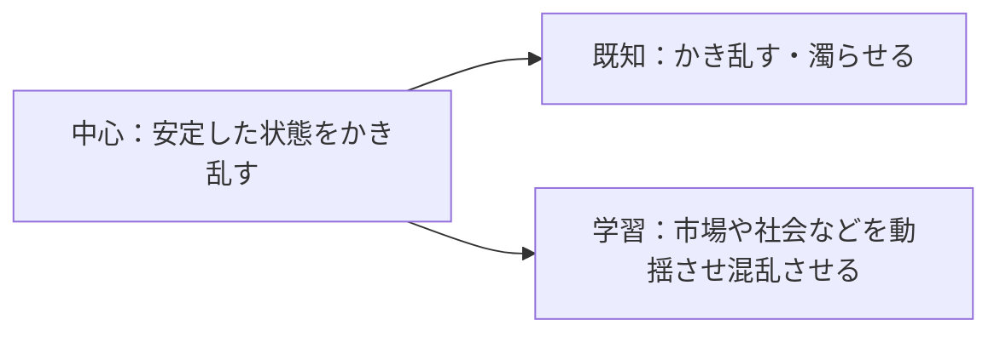

**重要語法：** `roil the markets`

<small>index: 10734 / candidate_id: `ev-10734-verb-01` / global_order: 4721</small>

---
## 02. runaway

**品詞：** 形容詞　 **発音：** /ˈrʌnəweɪ/

<small>よく知られている意味：逃走中の・家出した</small>

### 見落としやすい意味

**（物価・費用などが）制御できないほど急増する**

**例文：** The city is struggling with runaway housing costs.

**和訳：** その都市は歯止めの利かない住宅費の高騰に苦しんでいる。

**コアイメージ：** 逃げ出したものを止められない感覚が中心。費用や物価の上昇が制御を失う様子にも広がる。

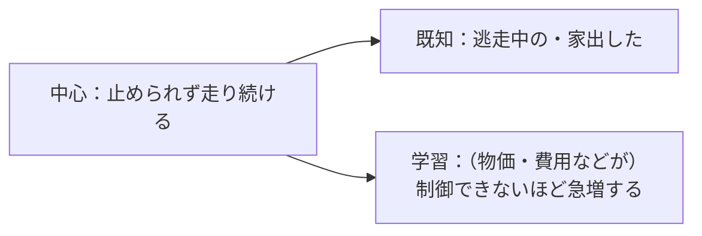

**重要語法：** `runaway inflation / runaway costs`

<small>index: 10739 / candidate_id: `ev-10739-adjective-01` / global_order: 4722</small>

---
## 03. runaway

**品詞：** 形容詞　 **発音：** /ˈrʌnəweɪ/

<small>よく知られている意味：逃走中の・家出した</small>

### 見落としやすい意味

**大成功した、圧倒的な人気のある**

**例文：** The small film became a runaway success.

**和訳：** その小規模な映画は予想外の大ヒットとなった。

**コアイメージ：** 止めようのない勢いという共通点がある。よい方向に働くと、人気や成功が爆発的に広がるという意味になる。

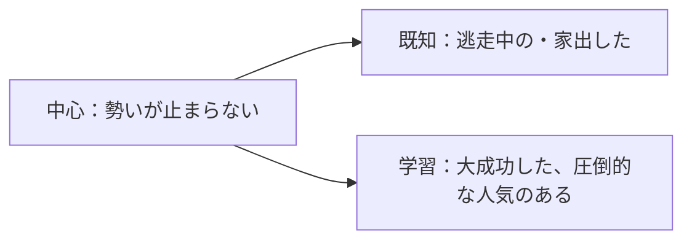

**重要語法：** `a runaway success / a runaway hit`

<small>index: 10739 / candidate_id: `ev-10739-adjective-02` / global_order: 4723</small>

---
## 04. sanity

**品詞：** 名詞　 **発音：** /ˈsænəti/

<small>よく知られている意味：正気・精神の健全さ</small>

### 見落としやすい意味

**理にかなった判断、良識**

**例文：** We need a little sanity in this debate.

**和訳：** この議論にはもう少し良識が必要だ。

**コアイメージ：** 精神が正常に働く状態から、判断が現実的で節度を保っていることへ広がる。単なる健康状態ではなく、議論や政策の健全さも表せる。

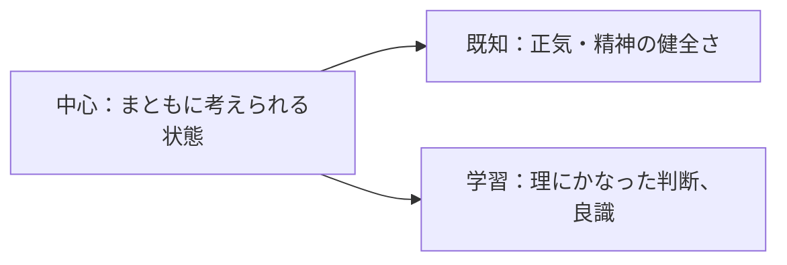

**重要語法：** `restore some sanity`

<small>index: 10740 / candidate_id: `ev-10740-noun-01` / global_order: 4724</small>

---
## 05. setup

**品詞：** 名詞　 **発音：** /ˈsetʌp/

<small>よく知られている意味：設置・準備・仕組み</small>

### 見落としやすい意味

**罠、仕組まれた策略**

**例文：** The message was fake; the whole thing was a setup.

**和訳：** そのメッセージは偽物で、すべてが仕組まれた罠だった。

**コアイメージ：** 物事を事前に配置・設定するのが基本。人を陥れるために周到に準備された計画にも使う。

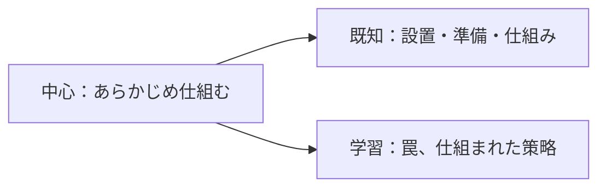

**重要語法：** `It was a setup.`

<small>index: 10745 / candidate_id: `ev-10745-noun-01` / global_order: 4725</small>

---
## 06. shelve

**品詞：** 動詞　 **発音：** /ʃelv/

<small>よく知られている意味：棚に置く</small>

### 見落としやすい意味

**計画を棚上げして後回しにする**

**例文：** The board decided to shelve the proposal for now.

**和訳：** 理事会はその提案を当面棚上げすることにした。

**コアイメージ：** 物を棚にしまう動作が元になる。計画や議題をいったん片づけて実行・検討を先延ばしにする比喩になる。

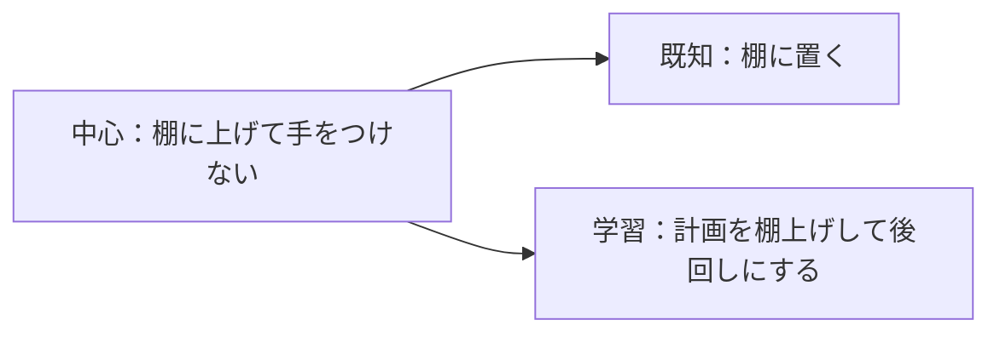

**重要語法：** `shelve a plan / proposal`

<small>index: 10747 / candidate_id: `ev-10747-verb-01` / global_order: 4726</small>

---
## 07. shrill

**品詞：** 形容詞　 **発音：** /ʃrɪl/

<small>よく知られている意味：甲高い・耳障りな</small>

### 見落としやすい意味

**批判や論争の態度が過度に強硬・攻撃的な**

**例文：** The public debate grew increasingly shrill.

**和訳：** 公の議論は次第に攻撃的な調子を強めた。

**コアイメージ：** 音が鋭く不快に響く感覚が中心。声の調子だけでなく、批判や論調が過剰に激しくなることも示す。

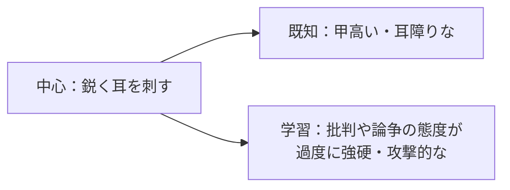

**重要語法：** `shrill criticism`

<small>index: 10749 / candidate_id: `ev-10749-adjective-01` / global_order: 4727</small>

---
## 08. snort

**品詞：** 動詞　 **発音：** /snɔːrt/

<small>よく知られている意味：鼻を鳴らす</small>

### 見落としやすい意味

**鼻であしらうように、不満や反対を強く表明する**

**例文：** She snorted at the idea that the rule was fair.

**和訳：** 彼女はその規則が公平だという考えを鼻であしらった。

**コアイメージ：** 鼻を鳴らす反応が軽蔑や不服を伝えることがある。言葉で長く反論しなくても、態度で強い否定を示せる。

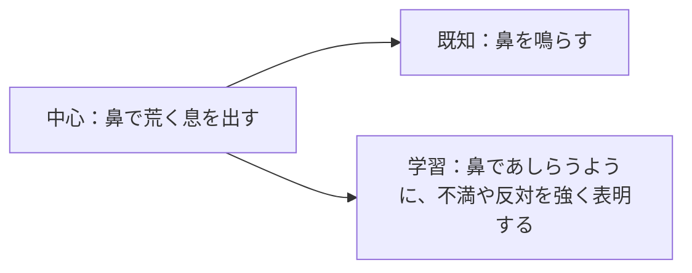

**重要語法：** `snort at a suggestion`

<small>index: 10756 / candidate_id: `ev-10756-verb-01` / global_order: 4728</small>

---
## 09. solace

**品詞：** 動詞　 **発音：** /ˈsɑːləs/

<small>よく知られている意味：慰め・安らぎ（名詞）</small>

### 見落としやすい意味

**（悲しみや不安にある人を）慰める**

**例文：** She tried to solace her worried friend with kind words.

**和訳：** 彼女は優しい言葉で不安な友人を慰めようとした。

**コアイメージ：** 名詞では悲しみの中の慰めを表す。同じ中心から動詞では人を慰め、苦痛を和らげる行為を表す。

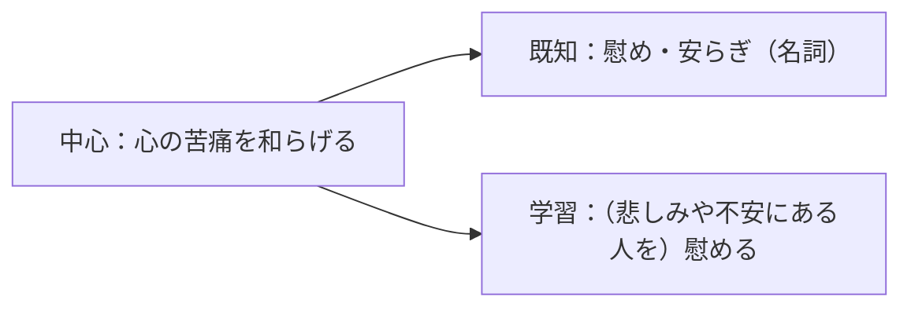

**重要語法：** `solace someone（文語的）`

<small>index: 10757 / candidate_id: `ev-10757-verb-01` / global_order: 4729</small>

---
## 10. sore

**品詞：** 形容詞　 **発音：** /sɔːr/

<small>よく知られている意味：痛い・ひりひりする</small>

### 見落としやすい意味

**不当に扱われたと思って腹を立てている**

**例文：** He was still sore about being excluded.

**和訳：** 彼は仲間外れにされたことをまだ根に持っていた。

**コアイメージ：** 体の痛みに似て、感情的な傷も刺激されると痛む。そこから不公平な扱いへの怒りや不満を表す。

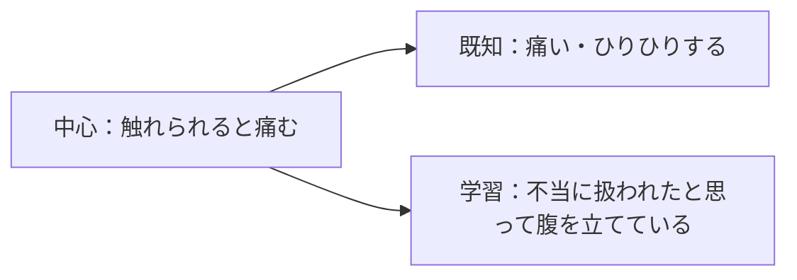

**重要語法：** `be sore about something`

<small>index: 10758 / candidate_id: `ev-10758-adjective-01` / global_order: 4730</small>

---
## 11. sorely

**品詞：** 副詞　 **発音：** /ˈsɔːrli/

<small>よく知られている意味：痛ましく・ひどく</small>

### 見落としやすい意味

**非常に、ひどく、強く**

**例文：** The region sorely needs more nurses.

**和訳：** その地域では看護師が非常に不足している。

**コアイメージ：** 痛みが強いという感覚が比喩的な強調になる。必要性や欠乏が切実であることを表す副詞として使う。

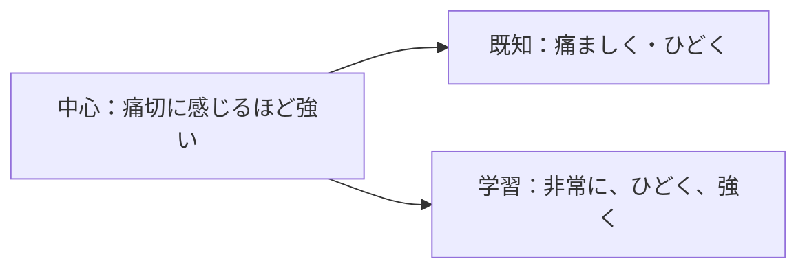

**重要語法：** `sorely need / sorely missed`

<small>index: 10759 / candidate_id: `ev-10759-adverb-01` / global_order: 4731</small>

---
## 12. sought

**品詞：** 形容詞　 **発音：** /sɔːt/

<small>よく知られている意味：seekの過去形・過去分詞</small>

### 見落としやすい意味

**引く手あまたの、需要の高い**

**例文：** Skilled engineers are highly sought after.

**和訳：** 熟練した技術者は非常に引く手あまただ。

**コアイメージ：** seek が「求める」という意味なので、求められる側に焦点を当てると需要の高さを示す。形容詞的には sought-after の形が特に自然。

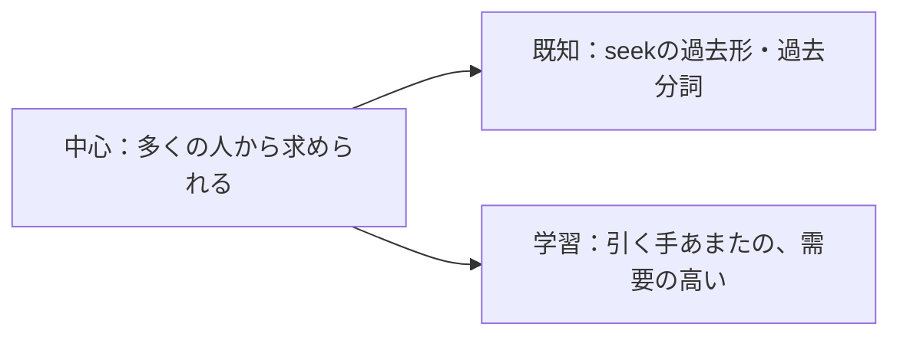

**重要語法：** `highly sought-after`

<small>index: 10760 / candidate_id: `ev-10760-adjective-01` / global_order: 4732</small>

---
## 13. spew

**品詞：** 動詞　 **発音：** /spjuː/

<small>よく知られている意味：勢いよく噴き出す</small>

### 見落としやすい意味

**（暴言・憎悪などを）次々と吐き出す**

**例文：** The account kept spewing hateful comments.

**和訳：** そのアカウントは憎悪に満ちたコメントを次々に吐き出していた。

**コアイメージ：** 液体や煙が激しく噴き出す様子が基本。怒りや悪意の言葉が大量に出ることにも比喩的に使われる。

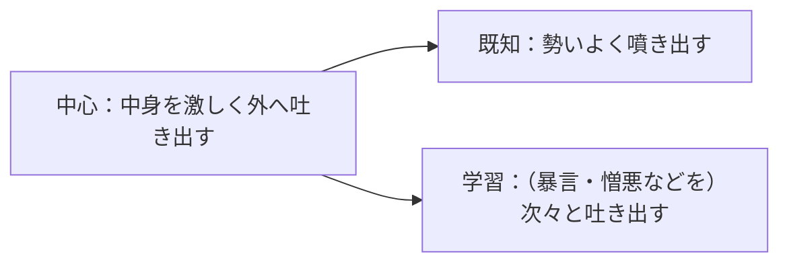

**重要語法：** `spew hatred / abuse`

<small>index: 10762 / candidate_id: `ev-10762-verb-01` / global_order: 4733</small>

---
## 14. stew

**品詞：** 動詞　 **発音：** /stuː/

<small>よく知られている意味：煮込む・シチュー</small>

### 見落としやすい意味

**不安や怒りを抱えたまま考え続ける**

**例文：** Don't stew over the mistake all night.

**和訳：** その失敗を一晩中くよくよ考え続けないで。

**コアイメージ：** 鍋の中で長く煮る動きから、感情を内側でくすぶらせるイメージになる。怒りや不安を抱え、同じことを考え続ける。

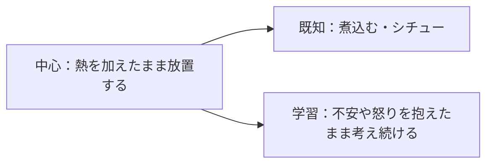

**重要語法：** `stew over something`

<small>index: 10767 / candidate_id: `ev-10767-verb-01` / global_order: 4734</small>

---
## 15. stocking

**品詞：** 動詞　 **発音：** /ˈstɑːkɪŋ/

<small>よく知られている意味：長靴下（名詞 stocking）</small>

### 見落としやすい意味

**（店の棚などに）商品を補充する**

**例文：** Staff were stocking the shelves before opening.

**和訳：** 店員たちは開店前に棚に商品を補充していた。

**コアイメージ：** ここでの stocking は名詞の長靴下ではなく動詞 stock の -ing 形。品物を棚や店に供給して、在庫を満たすことを示す。

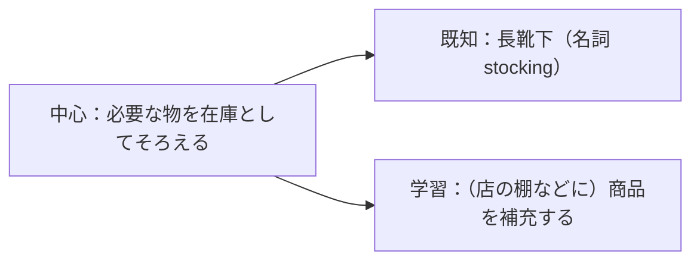

**重要語法：** `stock the shelves`

<small>index: 10770 / candidate_id: `ev-10770-verb-01` / global_order: 4735</small>

---
## 16. stroller

**品詞：** 名詞　 **発音：** /ˈstroʊlər/

<small>よく知られている意味：ベビーカー（主に米語）</small>

### 見落としやすい意味

**散歩する人、のんびり歩く人**

**例文：** The park was full of joggers and leisurely strollers.

**和訳：** 公園にはジョギングをする人やのんびり散歩する人が大勢いた。

**コアイメージ：** stroll はぶらぶら歩くこと。その動作をする人が stroller だが、米語ではベビーカーも意味するため文脈で判断する。

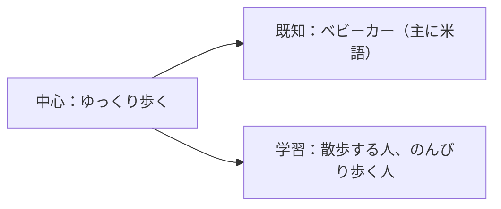

**重要語法：** `a leisurely stroller`

<small>index: 10771 / candidate_id: `ev-10771-noun-01` / global_order: 4736</small>

---
## 17. strut

**品詞：** 名詞　 **発音：** /strʌt/

<small>よく知られている意味：得意げに歩く（動詞）</small>

### 見落としやすい意味

**構造物を支える支柱・突っ張り棒**

**例文：** Steel struts support the roof.

**和訳：** 鉄製の支柱が屋根を支えている。

**コアイメージ：** 名詞の strut には、構造物を固定する突っ張り材という意味がある。歩き方を表す動詞の意味とは分けて、建築の文脈で見分ける。

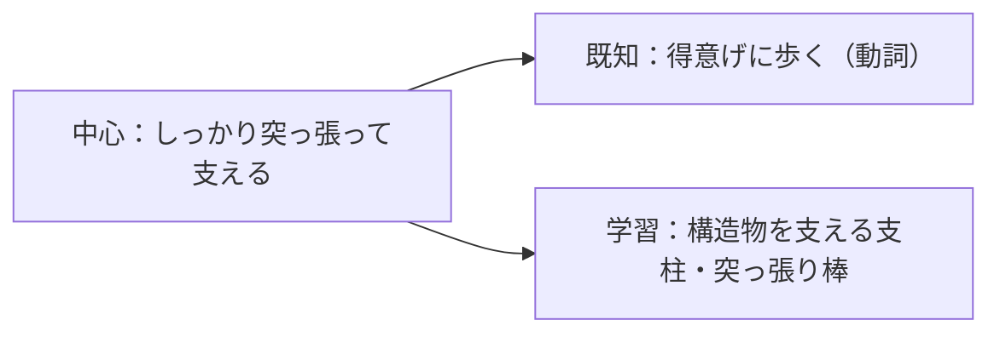

**重要語法：** `supporting struts`

<small>index: 10772 / candidate_id: `ev-10772-noun-01` / global_order: 4737</small>

---
## 18. subvert

**品詞：** 動詞　 **発音：** /səbˈvɜːrt/

<small>よく知られている意味：覆す・転覆させる</small>

### 見落としやすい意味

**（期待・常識・慣習などを）意図的に覆す**

**例文：** The novel subverts the usual hero story.

**和訳：** その小説はよくある英雄物語の型を意図的に覆している。

**コアイメージ：** 既存の仕組みを根元から揺るがすのが中心。政治制度だけでなく、物語の定番や社会の期待も覆せる。

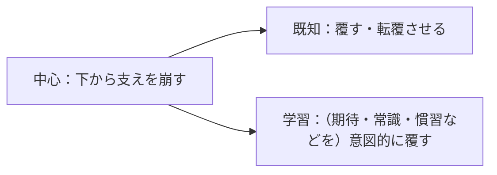

**重要語法：** `subvert expectations`

<small>index: 10776 / candidate_id: `ev-10776-verb-01` / global_order: 4738</small>

---
## 19. tad

**品詞：** 名詞　 **発音：** /tæd/

<small>よく知られている意味：少し（口語表現）</small>

### 見落としやすい意味

**ほんの少し**

**例文：** The sauce is a tad too sweet.

**和訳：** そのソースはほんの少し甘すぎる。

**コアイメージ：** a tad は程度を少しだけ弱めて伝える口語表現。数量というより、評価の微妙な加減に使う。

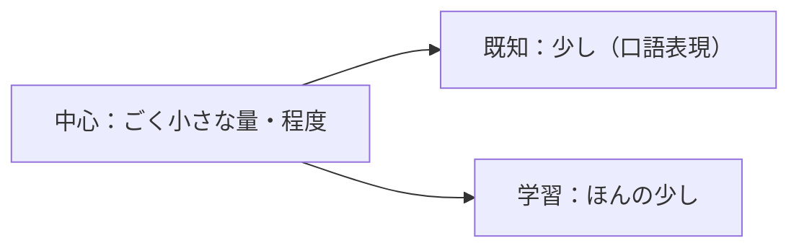

**重要語法：** `a tad too + 形容詞`

<small>index: 10784 / candidate_id: `ev-10784-noun-01` / global_order: 4739</small>

---
## 20. tan

**品詞：** 動詞　 **発音：** /tæn/

<small>よく知られている意味：日焼けする・日焼けした色</small>

### 見落としやすい意味

**動物の皮を薬品などでなめして革にする**

**例文：** This factory tans hides to make leather.

**和訳：** この工場では皮をなめして革を作っている。

**コアイメージ：** 日焼けの意味とは別に、動物の皮を加工する専門的な用法がある。なめすことで腐敗しにくい革に変える工程を指す。

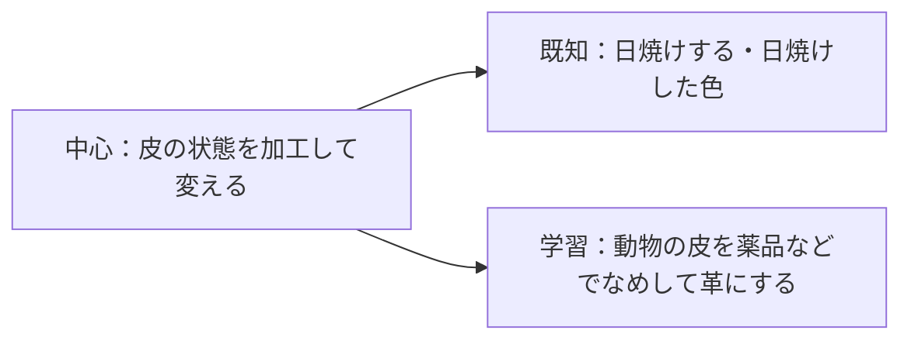

**重要語法：** `tan hides / leather`

<small>index: 10785 / candidate_id: `ev-10785-verb-01` / global_order: 4740</small>

---
## 21. tantamount

**品詞：** 形容詞　 **発音：** /ˈtæntəmaʊnt/

<small>よく知られている意味：同等の・〜に等しい</small>

### 見落としやすい意味

**実質的に同じことになる**

**例文：** Silence would be tantamount to approval.

**和訳：** 沈黙は実質的に承認と同じことになるだろう。

**コアイメージ：** 表面上は別の行為でも、その意味や結果が変わらない場合に使う。特に tantamount to の形で「〜も同然だ」を表す。

```mermaid
flowchart LR
    A["中心：結果・意味が同等になる"]
    B["既知：同等の・〜に等しい"]
    C["学習：実質的に同じことになる"]
    A --> B
    A --> C
```

**重要語法：** `be tantamount to + 名詞 / -ing`

<small>index: 10787 / candidate_id: `ev-10787-adjective-01` / global_order: 4741</small>

---
## 22. tarnish

**品詞：** 動詞　 **発音：** /ˈtɑːrnɪʃ/

<small>よく知られている意味：（金属などが）曇る</small>

### 見落としやすい意味

**評判・名声を傷つける**

**例文：** The scandal tarnished the school's reputation.

**和訳：** その不祥事は学校の評判を傷つけた。

**コアイメージ：** 金属の光沢が失われることが出発点。人や組織の名声が傷つき、以前ほど輝かなくなるという比喩になる。

```mermaid
flowchart LR
    A["中心：輝きがくすむ"]
    B["既知：（金属などが）曇る"]
    C["学習：評判・名声を傷つける"]
    A --> B
    A --> C
```

**重要語法：** `tarnish a reputation`

<small>index: 10789 / candidate_id: `ev-10789-verb-01` / global_order: 4742</small>

---
## 23. tasting

**品詞：** 名詞　 **発音：** /ˈteɪstɪŋ/

<small>よく知られている意味：味見・試食すること</small>

### 見落としやすい意味

**試食会、試飲会**

**例文：** The bakery hosted a tasting of its new breads.

**和訳：** そのパン屋は新作パンの試食会を開いた。

**コアイメージ：** tasting は味を確かめる行為を指す。複数の品を実際に試す催し全体も指すようになる。

```mermaid
flowchart LR
    A["中心：味を試して評価する"]
    B["既知：味見・試食すること"]
    C["学習：試食会、試飲会"]
    A --> B
    A --> C
```

**重要語法：** `a tasting event / food tasting`

<small>index: 10790 / candidate_id: `ev-10790-noun-01` / global_order: 4743</small>

---
## 24. tentatively

**品詞：** 副詞　 **発音：** /ˈtentətɪvli/

<small>よく知られている意味：試しに・ためらいがちに</small>

### 見落としやすい意味

**あとで変更される可能性を残して、暫定的に**

**例文：** The meeting is tentatively scheduled for Friday.

**和訳：** 会議はひとまず金曜日に予定されている。

**コアイメージ：** 確信や決定を完全には固めない態度が中心。日程や計画なら、後で変更できる暫定的な決定を表す。

```mermaid
flowchart LR
    A["中心：確定させずに置く"]
    B["既知：試しに・ためらいがちに"]
    C["学習：あとで変更される可能性を残して、暫定的に"]
    A --> B
    A --> C
```

**重要語法：** `tentatively scheduled`

<small>index: 10793 / candidate_id: `ev-10793-adverb-01` / global_order: 4744</small>

---
## 25. throes

**品詞：** 名詞　 **発音：** /θroʊz/

<small>よく知られている意味：苦痛の発作（複数形）</small>

### 見落としやすい意味

**（困難や苦境などの）真っただ中**

**例文：** The industry is in the throes of major change.

**和訳：** その業界は大きな変化の真っただ中にある。

**コアイメージ：** throes はもともと激しい苦痛やもがきを指す。変化や危機の渦中にいる状態を in the throes of で表す。

```mermaid
flowchart LR
    A["中心：激しい苦しみのさなか"]
    B["既知：苦痛の発作（複数形）"]
    C["学習：（困難や苦境などの）真っただ中"]
    A --> B
    A --> C
```

**重要語法：** `in the throes of`

<small>index: 10797 / candidate_id: `ev-10797-noun-01` / global_order: 4745</small>

---
## 26. tote

**品詞：** 動詞　 **発音：** /toʊt/

<small>よく知られている意味：（物を）運ぶ</small>

### 見落としやすい意味

**（特に重い物やかさばる物を）持ち運ぶ**

**例文：** He toted a heavy suitcase up three flights of stairs.

**和訳：** 彼は重いスーツケースを階段で3階分運んだ。

**コアイメージ：** tote は物を手にして運ぶ動きを表す動詞。特に重い物やかさばる物を持ち運ぶニュアンスで使える。

```mermaid
flowchart LR
    A["中心：荷物を持って移動する"]
    B["既知：（物を）運ぶ"]
    C["学習：（特に重い物やかさばる物を）持ち運ぶ"]
    A --> B
    A --> C
```

**重要語法：** `tote a bag / suitcase`

<small>index: 10801 / candidate_id: `ev-10801-verb-01` / global_order: 4746</small>

---
## 27. underpinning

**品詞：** 名詞　 **発音：** /ˈʌndərpɪnɪŋ/

<small>よく知られている意味：建物の土台・下支え</small>

### 見落としやすい意味

**物事の考え方・制度などを支える根本的な根拠**

**例文：** Mutual trust is an underpinning of their partnership.

**和訳：** 相互の信頼は彼らの協力関係を支える基盤だ。

**コアイメージ：** 物理的な土台が上の構造を支える姿が中心。制度や考えを成り立たせる理論的・社会的な基盤にも使う。

```mermaid
flowchart LR
    A["中心：下から支える基礎"]
    B["既知：建物の土台・下支え"]
    C["学習：物事の考え方・制度などを支える根本的な根拠"]
    A --> B
    A --> C
```

**重要語法：** `the underpinning of a theory`

<small>index: 10813 / candidate_id: `ev-10813-noun-01` / global_order: 4747</small>

---
## 28. understated

**品詞：** 形容詞　 **発音：** /ˌʌndərˈsteɪtɪd/

<small>よく知られている意味：控えめに述べた</small>

### 見落としやすい意味

**控えめで目立たない、さりげない**

**例文：** Her understated style made the room feel elegant.

**和訳：** 彼女の控えめなデザインによって、その部屋は上品な雰囲気になった。

**コアイメージ：** understate は実際より控えめに表すこと。デザインや態度では、目立たせすぎない洗練を意味する。

```mermaid
flowchart LR
    A["中心：あえて強く打ち出さない"]
    B["既知：控えめに述べた"]
    C["学習：控えめで目立たない、さりげない"]
    A --> B
    A --> C
```

**重要語法：** `understated elegance`

<small>index: 10814 / candidate_id: `ev-10814-adjective-01` / global_order: 4748</small>

---
## 29. unsavory

**品詞：** 形容詞　 **発音：** /ʌnˈseɪvəri/

<small>よく知られている意味：味のよくない（古風）</small>

### 見落としやすい意味

**不快で不道徳な、評判のよくない**

**例文：** The investigation revealed unsavory business practices.

**和訳：** 調査でその企業の不道徳な商慣行が明らかになった。

**コアイメージ：** おいしくないという感覚が、人物や行為への不快感・不信感に広がる。評判が悪い、倫理的に問題があるという文脈で使う。

```mermaid
flowchart LR
    A["中心：後味が悪い・好ましくない"]
    B["既知：味のよくない（古風）"]
    C["学習：不快で不道徳な、評判のよくない"]
    A --> B
    A --> C
```

**重要語法：** `unsavory dealings`

<small>index: 10820 / candidate_id: `ev-10820-adjective-01` / global_order: 4749</small>

---
## 30. upstart

**品詞：** 名詞　 **発音：** /ˈʌpstɑːrt/

<small>よく知られている意味：成り上がり者</small>

### 見落としやすい意味

**新興の競争相手・新規参入企業**

**例文：** An upstart company challenged the market leader.

**和訳：** 新興企業が業界最大手に挑んだ。

**コアイメージ：** 地位の低いところから急に上がってきた人を表す語。ビジネスでは新規参入して既存の強者に挑む企業も指す。

```mermaid
flowchart LR
    A["中心：急に台頭してきた存在"]
    B["既知：成り上がり者"]
    C["学習：新興の競争相手・新規参入企業"]
    A --> B
    A --> C
```

**重要語法：** `an upstart competitor`

<small>index: 10822 / candidate_id: `ev-10822-noun-01` / global_order: 4750</small>

---
## 31. vaulted

**品詞：** 形容詞　 **発音：** /ˈvɔːltɪd/

<small>よく知られている意味：（高く）跳び越えた</small>

### 見落としやすい意味

**天井・屋根などがアーチ状の構造になった**

**例文：** The old hall has a beautifully vaulted ceiling.

**和訳：** その古いホールには美しいアーチ型の天井がある。

**コアイメージ：** vault はアーチ状の構造を指すことがある。vaulted は天井や屋根が弓なりに組まれている様子を表す。

```mermaid
flowchart LR
    A["中心：上方に弧を描く"]
    B["既知：（高く）跳び越えた"]
    C["学習：天井・屋根などがアーチ状の構造になった"]
    A --> B
    A --> C
```

**重要語法：** `a vaulted ceiling`

<small>index: 10824 / candidate_id: `ev-10824-adjective-01` / global_order: 4751</small>

---
## 32. veneer

**品詞：** 名詞　 **発音：** /vəˈnɪr/

<small>よく知られている意味：薄い化粧板・突き板</small>

### 見落としやすい意味

**本質を隠す表面的な見せかけ**

**例文：** His friendliness was only a veneer over deep resentment.

**和訳：** 彼の親しげな態度は深い恨みを隠す表面上の見せかけにすぎなかった。

**コアイメージ：** 家具の表面に貼る薄い板がもとになっている。外側だけ立派に見せて内面の実態を隠すことを表す。

```mermaid
flowchart LR
    A["中心：表面を薄く覆う"]
    B["既知：薄い化粧板・突き板"]
    C["学習：本質を隠す表面的な見せかけ"]
    A --> B
    A --> C
```

**重要語法：** `a veneer of respectability`

<small>index: 10825 / candidate_id: `ev-10825-noun-01` / global_order: 4752</small>

---
## 33. voluminous

**品詞：** 形容詞　 **発音：** /vəˈluːmɪnəs/

<small>よく知られている意味：大量の・膨大な</small>

### 見落としやすい意味

**（衣服などが）たっぷりした、ゆったりした**

**例文：** She wore a voluminous dress that flowed as she walked.

**和訳：** 彼女は歩くたびに裾が揺れる、たっぷりしたドレスを着ていた。

**コアイメージ：** 体積や分量が大きいことが中心。文章の量だけでなく、布地を多く使ったゆったりした衣服にも使う。

```mermaid
flowchart LR
    A["中心：大きく広がり量感がある"]
    B["既知：大量の・膨大な"]
    C["学習：（衣服などが）たっぷりした、ゆったりした"]
    A --> B
    A --> C
```

**重要語法：** `voluminous sleeves`

<small>index: 10828 / candidate_id: `ev-10828-adjective-01` / global_order: 4753</small>

---
## 34. wasteland

**品詞：** 名詞　 **発音：** /ˈweɪstlænd/

<small>よく知られている意味：荒れ地・不毛の地</small>

### 見落としやすい意味

**精神的・文化的な価値や活動が乏しい場所・時代**

**例文：** He described the town as a cultural wasteland.

**和訳：** 彼はその町を文化的に不毛な場所だと評した。

**コアイメージ：** 草木が育たない土地という意味が出発点。文化や発想が乏しく、魅力的な活動が生まれない状態の比喩になる。

```mermaid
flowchart LR
    A["中心：何も育たない場所"]
    B["既知：荒れ地・不毛の地"]
    C["学習：精神的・文化的な価値や活動が乏しい場所・時代"]
    A --> B
    A --> C
```

**重要語法：** `a cultural wasteland`

<small>index: 10832 / candidate_id: `ev-10832-noun-01` / global_order: 4754</small>

---
## 35. woolly

**品詞：** 形容詞　 **発音：** /ˈwʊli/

<small>よく知られている意味：羊毛のような・毛深い</small>

### 見落としやすい意味

**（考えや説明が）曖昧で筋道がはっきりしていない**

**例文：** His explanation was too woolly to be useful.

**和訳：** 彼の説明は曖昧すぎて役に立たなかった。

**コアイメージ：** もこもこの羊毛は細部や輪郭がはっきり見えない。その感覚から、考えや説明が曖昧で整理されていないことに使う。

```mermaid
flowchart LR
    A["中心：輪郭がぼやける"]
    B["既知：羊毛のような・毛深い"]
    C["学習：（考えや説明が）曖昧で筋道がはっきりしていない"]
    A --> B
    A --> C
```

**重要語法：** `woolly thinking`

<small>index: 10836 / candidate_id: `ev-10836-adjective-01` / global_order: 4755</small>

---
## 36. sub

**品詞：** 名詞　 **発音：** /sʌb/

<small>よく知られている意味：潜水艦・略語のsub</small>

### 見落としやすい意味

**代理の教師**

**例文：** A sub taught our science class today.

**和訳：** 今日は代わりの先生が理科の授業を担当した。

**コアイメージ：** sub はさまざまな語の短縮形。学校の文脈では substitute teacher（代用教員）を短く呼ぶ。

```mermaid
flowchart LR
    A["中心：substitute の省略"]
    B["既知：潜水艦・略語のsub"]
    C["学習：代理の教師"]
    A --> B
    A --> C
```

**重要語法：** `a substitute teacher / a sub`

<small>index: 10845 / candidate_id: `ev-10845-noun-01` / global_order: 4756</small>

---
## 37. sub

**品詞：** 名詞　 **発音：** /sʌb/

<small>よく知られている意味：代理・代わりの人</small>

### 見落としやすい意味

**会費・定期購読料**

**例文：** The club's annual subs are due next month.

**和訳：** そのクラブの年会費は来月が支払期限だ。

**コアイメージ：** 会費や定期購読料を表す sub は subscription の短縮形。教師の代役を指す sub とは語源となる省略元が異なる。

```mermaid
flowchart LR
    A["中心：subscription の省略"]
    B["既知：代理・代わりの人"]
    C["学習：会費・定期購読料"]
    A --> B
    A --> C
```

**重要語法：** `annual subs（主に英国英語）`

<small>index: 10845 / candidate_id: `ev-10845-noun-02` / global_order: 4757</small>

---
## 38. sub

**品詞：** 名詞　 **発音：** /sʌb/

<small>よく知られている意味：代理・代わりの人</small>

### 見落としやすい意味

**細長いパンで具を挟んだサンドイッチ**

**例文：** I ordered a chicken sub for lunch.

**和訳：** 昼食にチキン入りの細長いサンドイッチを注文した。

**コアイメージ：** 細長いパンの形が潜水艦に似ていることから submarine sandwich と呼ぶ。sub はその短縮形として使われる。

```mermaid
flowchart LR
    A["中心：submarine sandwich の省略"]
    B["既知：代理・代わりの人"]
    C["学習：細長いパンで具を挟んだサンドイッチ"]
    A --> B
    A --> C
```

**重要語法：** `a turkey sub / a chicken sub`

<small>index: 10845 / candidate_id: `ev-10845-noun-03` / global_order: 4758</small>

---
## 39. licence

**品詞：** 名詞　 **発音：** /ˈlaɪsəns/

<small>よく知られている意味：ライセンス（米語 license）</small>

### 見落としやすい意味

**許可、免許（英国英語での名詞の綴り）**

**例文：** She renewed her driving licence yesterday.

**和訳：** 彼女は昨日、運転免許証を更新した。

**コアイメージ：** 英国英語では名詞 licence と動詞 license を書き分けることがある。米国英語では通常どちらも license と綴る。

```mermaid
flowchart LR
    A["中心：許可を表す名詞の英国式綴り"]
    B["既知：ライセンス（米語 license）"]
    C["学習：許可、免許（英国英語での名詞の綴り）"]
    A --> B
    A --> C
```

**重要語法：** `a driving licence（英）`

<small>index: 10850 / candidate_id: `ev-10850-noun-01` / global_order: 4759</small>

---
## 40. cereal

**品詞：** 名詞　 **発音：** /ˈsɪriəl/

<small>よく知られている意味：朝食用シリアル</small>

### 見落としやすい意味

**穀物を採るために栽培するイネ科などの作物**

**例文：** Rice is an important cereal in many countries.

**和訳：** 米は多くの国で重要な穀物作物だ。

**コアイメージ：** 朝食のシリアルは穀物から作られる食品。もとの cereal は小麦・米などの穀物やその作物を広く指す。

```mermaid
flowchart LR
    A["中心：食用の穀物そのもの"]
    B["既知：朝食用シリアル"]
    C["学習：穀物を採るために栽培するイネ科などの作物"]
    A --> B
    A --> C
```

**重要語法：** `cereal crops`

<small>index: 10851 / candidate_id: `ev-10851-noun-01` / global_order: 4760</small>

---
## 41. mustard

**品詞：** 慣用句　 **発音：** /ˈmʌstərd/

<small>よく知られている意味：マスタード・からし</small>

### 見落としやすい意味

**要求される水準に達する、十分に役立つ**

**例文：** The new design doesn't quite cut the mustard.

**和訳：** その新しいデザインは要求水準に少し届いていない。

**コアイメージ：** cut the mustard は一まとまりで「期待される水準に達する」という慣用句。からしの性質から直訳して推測せず、句全体で覚える。

```mermaid
flowchart LR
    A["中心：慣用句で基準を満たす"]
    B["既知：マスタード・からし"]
    C["学習：要求される水準に達する、十分に役立つ"]
    A --> B
    A --> C
```

**重要語法：** `cut the mustard`

<small>index: 10857 / candidate_id: `ev-10857-idiom-01` / global_order: 4761</small>

---
## 42. sickness

**品詞：** 名詞　 **発音：** /ˈsɪknəs/

<small>よく知られている意味：病気・体調不良</small>

### 見落としやすい意味

**吐き気、むかつき**

**例文：** The strong smell caused a sudden feeling of sickness.

**和訳：** 強いにおいで急に吐き気がした。

**コアイメージ：** sickness は病気一般を表すこともある。特に胃のむかつきや吐き気を指す場合は、周囲の身体症状の文脈から判断する。

```mermaid
flowchart LR
    A["中心：体調が悪くなる感覚"]
    B["既知：病気・体調不良"]
    C["学習：吐き気、むかつき"]
    A --> B
    A --> C
```

**重要語法：** `a feeling of sickness / motion sickness`

<small>index: 10858 / candidate_id: `ev-10858-noun-01` / global_order: 4762</small>

---
## 43. capsule

**品詞：** 名詞　 **発音：** /ˈkæpsəl/

<small>よく知られている意味：薬のカプセル</small>

### 見落としやすい意味

**要点だけにまとめた短い概説**

**例文：** The book offers a capsule history of the city.

**和訳：** その本はその都市の歴史を簡潔にまとめている。

**コアイメージ：** 小さな殻に中身を収める発想が中心。情報を必要な分だけ短くまとめた紹介にも用いる。

```mermaid
flowchart LR
    A["中心：小さな容器に要点を詰める"]
    B["既知：薬のカプセル"]
    C["学習：要点だけにまとめた短い概説"]
    A --> B
    A --> C
```

**重要語法：** `a capsule summary / history`

<small>index: 10859 / candidate_id: `ev-10859-noun-01` / global_order: 4763</small>

---
## 44. capsule

**品詞：** 名詞　 **発音：** /ˈkæpsəl/

<small>よく知られている意味：薬のカプセル</small>

### 見落としやすい意味

**宇宙船の乗員を収容するカプセル**

**例文：** The crew returned to Earth in a space capsule.

**和訳：** 乗組員は宇宙カプセルで地球に帰還した。

**コアイメージ：** 中に大切なものを収容する密閉容器の形が中心。宇宙飛行士を収める機体部分も capsule と呼ぶ。

```mermaid
flowchart LR
    A["中心：小さく密閉された区画"]
    B["既知：薬のカプセル"]
    C["学習：宇宙船の乗員を収容するカプセル"]
    A --> B
    A --> C
```

**重要語法：** `a space capsule`

<small>index: 10859 / candidate_id: `ev-10859-noun-02` / global_order: 4764</small>

---
## 45. pedal

**品詞：** 動詞　 **発音：** /ˈpedəl/

<small>よく知られている意味：ペダル（名詞）</small>

### 見落としやすい意味

**（自転車などの）ペダルをこぐ**

**例文：** We pedaled slowly along the river.

**和訳：** 私たちは川沿いをゆっくり自転車で走った。

**コアイメージ：** 名詞の pedal は足で操作する部品。動詞になると、その部品をこいで乗り物を進める動作を表す。

```mermaid
flowchart LR
    A["中心：ペダルを足で踏み動かす"]
    B["既知：ペダル（名詞）"]
    C["学習：（自転車などの）ペダルをこぐ"]
    A --> B
    A --> C
```

**重要語法：** `pedal uphill / pedal along`

<small>index: 10862 / candidate_id: `ev-10862-verb-01` / global_order: 4765</small>

---
## 46. immortal

**品詞：** 形容詞　 **発音：** /ɪˈmɔːrtəl/

<small>よく知られている意味：不死の・死なない</small>

### 見落としやすい意味

**非常に名高く、長く後世に記憶される**

**例文：** Her immortal poems are still read today.

**和訳：** 彼女の不朽の詩は今も読まれている。

**コアイメージ：** 死なないという基本イメージが、作品や名声が消えないことに広がる。実際の不死ではなく、後世に記憶される偉大さを表す。

```mermaid
flowchart LR
    A["中心：時を超えて残り続ける"]
    B["既知：不死の・死なない"]
    C["学習：非常に名高く、長く後世に記憶される"]
    A --> B
    A --> C
```

**重要語法：** `immortal works`

<small>index: 10864 / candidate_id: `ev-10864-adjective-01` / global_order: 4766</small>

---
## 47. immortal

**品詞：** 名詞　 **発音：** /ɪˈmɔːrtəl/

<small>よく知られている意味：不死の・死なない（形容詞）</small>

### 見落としやすい意味

**死後も名声が残るほど偉大な人物**

**例文：** The exhibition honored the immortals of classical music.

**和訳：** その展覧会はクラシック音楽界の不朽の偉人たちをたたえた。

**コアイメージ：** 形容詞の不滅という考えが人を指す名詞にもなる。作品や功績によって長く語り継がれる人物を表す。

```mermaid
flowchart LR
    A["中心：名声が時を超えて生き続ける人"]
    B["既知：不死の・死なない（形容詞）"]
    C["学習：死後も名声が残るほど偉大な人物"]
    A --> B
    A --> C
```

**重要語法：** `the immortals of literature`

<small>index: 10864 / candidate_id: `ev-10864-noun-01` / global_order: 4767</small>

---
## 48. standby

**品詞：** 名詞　 **発音：** /ˈstændbaɪ/

<small>よく知られている意味：待機・予備の状態</small>

### 見落としやすい意味

**予備の人・物、交代要員**

**例文：** A small generator served as our standby during the outage.

**和訳：** 停電時には小型発電機が予備の電源として役立った。

**コアイメージ：** stand by はそばで待機すること。必要なときに代わりに使える人や物を名詞で standby と呼ぶ。

```mermaid
flowchart LR
    A["中心：いざという時に備える"]
    B["既知：待機・予備の状態"]
    C["学習：予備の人・物、交代要員"]
    A --> B
    A --> C
```

**重要語法：** `a reliable standby`

<small>index: 10865 / candidate_id: `ev-10865-noun-01` / global_order: 4768</small>

---
## 49. salty

**品詞：** 形容詞　 **発音：** /ˈsɔːlti/

<small>よく知られている意味：塩辛い</small>

### 見落としやすい意味

**（口語で）理不尽なほどいら立っている**

**例文：** He was still salty about the loss.

**和訳：** 彼は敗北したことにまだ腹を立てていた。

**コアイメージ：** 口語では salty が不満や苛立ちを表すことがある。味の塩辛さから感情を直接推測するのではなく、くだけた表現として認識する。

```mermaid
flowchart LR
    A["中心：感情がとげとげする"]
    B["既知：塩辛い"]
    C["学習：（口語で）理不尽なほどいら立っている"]
    A --> B
    A --> C
```

**重要語法：** `be salty about something（口語）`

<small>index: 10867 / candidate_id: `ev-10867-adjective-01` / global_order: 4769</small>

---
## 50. salty

**品詞：** 形容詞　 **発音：** /ˈsɔːlti/

<small>よく知られている意味：塩辛い</small>

### 見落としやすい意味

**皮肉が利いた、辛辣な／（言葉が）下品な**

**例文：** The host was known for his salty jokes.

**和訳：** その司会者は辛辣で少し下品な冗談で知られていた。

**コアイメージ：** salty は言葉遣いがきつい、皮肉っぽい、ときに下品だという意味でも使う。食べ物の味でないときは、発言の調子に注目する。

```mermaid
flowchart LR
    A["中心：刺激の強い言葉"]
    B["既知：塩辛い"]
    C["学習：皮肉が利いた、辛辣な／（言葉が）下品な"]
    A --> B
    A --> C
```

**重要語法：** `salty language / jokes`

<small>index: 10867 / candidate_id: `ev-10867-adjective-02` / global_order: 4770</small>

---
## 51. stool

**品詞：** 名詞　 **発音：** /stuːl/

<small>よく知られている意味：腰掛け・スツール</small>

### 見落としやすい意味

**医学的な文脈でいう便・排せつ物**

**例文：** The lab requested a stool sample.

**和訳：** 検査室は便の検体を求めた。

**コアイメージ：** stool は椅子の意味とは別に、医学的には便を指す。sample などの語とともに出るときは医療文脈の意味を選ぶ。

```mermaid
flowchart LR
    A["中心：医学用語としての排せつ物"]
    B["既知：腰掛け・スツール"]
    C["学習：医学的な文脈でいう便・排せつ物"]
    A --> B
    A --> C
```

**重要語法：** `stool sample`

<small>index: 10868 / candidate_id: `ev-10868-noun-01` / global_order: 4771</small>

---
## 52. frost

**品詞：** 動詞　 **発音：** /frɔːst/

<small>よく知られている意味：霜・霜が降りる</small>

### 見落としやすい意味

**（米語で）ケーキにアイシングを塗る**

**例文：** They frosted the cake with vanilla icing.

**和訳：** 彼らはケーキにバニラ味のアイシングを塗った。

**コアイメージ：** 霜が表面を白く覆うように、ケーキの表面にも糖衣をかける。米語で frost a cake と言う。

```mermaid
flowchart LR
    A["中心：表面を白く薄く覆う"]
    B["既知：霜・霜が降りる"]
    C["学習：（米語で）ケーキにアイシングを塗る"]
    A --> B
    A --> C
```

**重要語法：** `frost a cake（米）`

<small>index: 10869 / candidate_id: `ev-10869-verb-01` / global_order: 4772</small>

---
## 53. calf

**品詞：** 名詞　 **発音：** /kæf/

<small>よく知られている意味：子牛</small>

### 見落としやすい意味

**人の脚の膝下後部、ふくらはぎ**

**例文：** My right calf hurt after the long walk.

**和訳：** 長く歩いた後、右のふくらはぎが痛んだ。

**コアイメージ：** 同じつづりの calf には子牛と脚の部位という別の意味がある。筋肉や痛みの話ではふくらはぎを指す。

```mermaid
flowchart LR
    A["中心：脚の膝下のふくらんだ部分"]
    B["既知：子牛"]
    C["学習：人の脚の膝下後部、ふくらはぎ"]
    A --> B
    A --> C
```

**重要語法：** `calf muscles`

<small>index: 10870 / candidate_id: `ev-10870-noun-01` / global_order: 4773</small>

---
## 54. criteria

**品詞：** 名詞　 **発音：** /kraɪˈtɪriə/

<small>よく知られている意味：criterion の複数形</small>

### 見落としやすい意味

**判断・評価の基準（criterionの複数形）**

**例文：** The committee explained its selection criteria.

**和訳：** 委員会は選考基準を説明した。

**コアイメージ：** criterion は一つの基準、criteria は複数の基準。評価の観点が並ぶときに複数形を使う。

```mermaid
flowchart LR
    A["中心：判断の物差しを複数示す"]
    B["既知：criterion の複数形"]
    C["学習：判断・評価の基準（criterionの複数形）"]
    A --> B
    A --> C
```

**重要語法：** `one criterion / several criteria`

<small>index: 10871 / candidate_id: `ev-10871-noun-01` / global_order: 4774</small>

---
## 55. goose

**品詞：** 動詞　 **発音：** /ɡuːs/

<small>よく知られている意味：ガチョウ</small>

### 見落としやすい意味

**人や活動を活性化・促進する**

**例文：** The grant helped goose investment in the region.

**和訳：** その補助金は地域への投資を促進する助けになった。

**コアイメージ：** 動詞 goose は活動や数値に勢いを与える口語的な表現。鳥の意味から直訳せず、経済や売上の文脈で促進と読む。

```mermaid
flowchart LR
    A["中心：勢いをつける"]
    B["既知：ガチョウ"]
    C["学習：人や活動を活性化・促進する"]
    A --> B
    A --> C
```

**重要語法：** `goose sales / growth`

<small>index: 10872 / candidate_id: `ev-10872-verb-01` / global_order: 4775</small>

---
## 56. intuitive

**品詞：** 形容詞　 **発音：** /ɪnˈtuːɪtɪv/

<small>よく知られている意味：直感的な・勘に基づく</small>

### 見落としやすい意味

**特別な説明や知識がなくても自然に使える**

**例文：** The software is intuitive even for beginners.

**和訳：** そのソフトウェアは初心者にも直感的に操作できる。

**コアイメージ：** 考え込まず感覚的に理解できることが中心。操作画面では、説明書がなくても使い方をつかめる性質を表す。

```mermaid
flowchart LR
    A["中心：説明なしに自然に分かる"]
    B["既知：直感的な・勘に基づく"]
    C["学習：特別な説明や知識がなくても自然に使える"]
    A --> B
    A --> C
```

**重要語法：** `an intuitive interface`

<small>index: 10879 / candidate_id: `ev-10879-adjective-01` / global_order: 4776</small>

---
## 57. complimentary

**品詞：** 形容詞　 **発音：** /ˌkɑːmpləˈmentəri/

<small>よく知られている意味：称賛の・好意的な</small>

### 見落としやすい意味

**無料で提供される**

**例文：** The hotel offers complimentary breakfast.

**和訳：** そのホテルでは朝食が無料で提供される。

**コアイメージ：** complimentary は賛辞を表す用法のほか、サービスが無料で付く意味でも使う。料金表示や宿泊案内では無料提供を選ぶ。

```mermaid
flowchart LR
    A["中心：料金を請求せず添える"]
    B["既知：称賛の・好意的な"]
    C["学習：無料で提供される"]
    A --> B
    A --> C
```

**重要語法：** `complimentary breakfast / tickets`

<small>index: 10882 / candidate_id: `ev-10882-adjective-01` / global_order: 4777</small>

---
## 58. pendulum

**品詞：** 名詞　 **発音：** /ˈpendʒələm/

<small>よく知られている意味：振り子</small>

### 見落としやすい意味

**社会の考えや流れが一方の極から反対の極へ変わること**

**例文：** The pendulum has swung toward stricter rules.

**和訳：** 世論の流れはより厳しい規則を支持する方向へ振れた。

**コアイメージ：** 振り子が一方からもう一方へ揺れる動きが中心。社会の価値観や政策が反対方向に変化することを比喩的に表す。

```mermaid
flowchart LR
    A["中心：左右の極を行き来する"]
    B["既知：振り子"]
    C["学習：社会の考えや流れが一方の極から反対の極へ変わること"]
    A --> B
    A --> C
```

**重要語法：** `the pendulum swings`

<small>index: 10883 / candidate_id: `ev-10883-noun-01` / global_order: 4778</small>

---
## 59. domestically

**品詞：** 副詞　 **発音：** /dəˈmestɪkli/

<small>よく知られている意味：国内で（国外との対比）</small>

### 見落としやすい意味

**家庭内で、家庭に関して**

**例文：** Things were going well domestically, despite his work problems.

**和訳：** 仕事では問題があったが、彼の家庭生活は順調だった。

**コアイメージ：** domestic は国の内側だけでなく家庭も表す。文脈が生活や家族についてなら domestically は家庭生活の面で、という意味になる。

```mermaid
flowchart LR
    A["中心：家の内側に関すること"]
    B["既知：国内で（国外との対比）"]
    C["学習：家庭内で、家庭に関して"]
    A --> B
    A --> C
```

**重要語法：** `domestic life`

<small>index: 10885 / candidate_id: `ev-10885-adverb-01` / global_order: 4779</small>

---
## 60. watershed

**品詞：** 名詞　 **発音：** /ˈwɔːtərʃed/

<small>よく知られている意味：流域・分水界</small>

### 見落としやすい意味

**歴史や状況の決定的な転換点**

**例文：** The discovery marked a watershed in medicine.

**和訳：** その発見は医学における画期的な転換点となった。

**コアイメージ：** watershed は水の流れを分ける境界に関係する語。歴史の流れが大きく変わる分岐点にも使う。

```mermaid
flowchart LR
    A["中心：流れが分かれる境界"]
    B["既知：流域・分水界"]
    C["学習：歴史や状況の決定的な転換点"]
    A --> B
    A --> C
```

**重要語法：** `a watershed moment`

<small>index: 10889 / candidate_id: `ev-10889-noun-01` / global_order: 4780</small>

---
## 61. determinant

**品詞：** 名詞　 **発音：** /dɪˈtɜːrmɪnənt/

<small>よく知られている意味：決定要因・規定因子</small>

### 見落としやすい意味

**行列式**

**例文：** Calculate the determinant of this matrix.

**和訳：** この行列の行列式を計算しなさい。

**コアイメージ：** 一般には結果を左右する要因を表す。数学では行列から計算する特定の値を determinant（行列式）と呼ぶ。

```mermaid
flowchart LR
    A["中心：値や結果を決めるもの"]
    B["既知：決定要因・規定因子"]
    C["学習：行列式"]
    A --> B
    A --> C
```

**重要語法：** `the determinant of a matrix`

<small>index: 10890 / candidate_id: `ev-10890-noun-01` / global_order: 4781</small>

---
## 62. expiration

**品詞：** 名詞　 **発音：** /ˌekspəˈreɪʃən/

<small>よく知られている意味：期限切れ・満了</small>

### 見落としやすい意味

**息を吐くこと、呼気**

**例文：** The therapist asked for a slow expiration.

**和訳：** 療法士はゆっくり息を吐くよう求めた。

**コアイメージ：** expiration は期間が終わることをよく指す。一方、生理学では息が肺から外へ出ること、つまり呼気を表す。

```mermaid
flowchart LR
    A["中心：外に出ていくこと"]
    B["既知：期限切れ・満了"]
    C["学習：息を吐くこと、呼気"]
    A --> B
    A --> C
```

**重要語法：** `expiration and inspiration`

<small>index: 10891 / candidate_id: `ev-10891-noun-01` / global_order: 4782</small>

---
## 63. accomplished

**品詞：** 形容詞　 **発音：** /əˈkɑːmplɪʃt/

<small>よく知られている意味：達成した・完成した</small>

### 見落としやすい意味

**熟練した、腕の優れた**

**例文：** She is an accomplished pianist.

**和訳：** 彼女は腕の優れたピアニストだ。

**コアイメージ：** accomplish は物事をやり遂げること。その経験や練習を積んで高い技能を得た人を accomplished と形容する。

```mermaid
flowchart LR
    A["中心：技術を十分に身につけた"]
    B["既知：達成した・完成した"]
    C["学習：熟練した、腕の優れた"]
    A --> B
    A --> C
```

**重要語法：** `an accomplished musician`

<small>index: 10896 / candidate_id: `ev-10896-adjective-01` / global_order: 4783</small>

---
## 64. acknowledgement

**品詞：** 名詞　 **発音：** /əkˈnɑːlɪdʒmənt/

<small>よく知られている意味：承認・受け入れの表明</small>

### 見落としやすい意味

**書物の巻頭・巻末にある謝辞・協力者への感謝**

**例文：** The author thanked her teachers in the acknowledgements.

**和訳：** 著者は謝辞の中で恩師たちに感謝を述べた。

**コアイメージ：** 他者の助けを認めることが中心。書籍では協力者への感謝を記す部分を acknowledgements と呼ぶ。

```mermaid
flowchart LR
    A["中心：貢献を認めて感謝を示す"]
    B["既知：承認・受け入れの表明"]
    C["学習：書物の巻頭・巻末にある謝辞・協力者への感謝"]
    A --> B
    A --> C
```

**重要語法：** `in the acknowledgements`

<small>index: 10897 / candidate_id: `ev-10897-noun-01` / global_order: 4784</small>

---
## 65. acknowledgement

**品詞：** 名詞　 **発音：** /əkˈnɑːlɪdʒmənt/

<small>よく知られている意味：承認・受け入れの表明</small>

### 見落としやすい意味

**書面・電子メールなどの受領通知**

**例文：** An acknowledgement of my application arrived by email.

**和訳：** 応募書類の受領通知がメールで届いた。

**コアイメージ：** acknowledge は受け取った事実を確認することにも使う。書面やメールの acknowledgement は受領の知らせを指す。

```mermaid
flowchart LR
    A["中心：受け取ったことを認める"]
    B["既知：承認・受け入れの表明"]
    C["学習：書面・電子メールなどの受領通知"]
    A --> B
    A --> C
```

**重要語法：** `an acknowledgement of receipt`

<small>index: 10897 / candidate_id: `ev-10897-noun-02` / global_order: 4785</small>

---
## 66. admonish

**品詞：** 動詞　 **発音：** /ədˈmɑːnɪʃ/

<small>よく知られている意味：叱責する・注意する</small>

### 見落としやすい意味

**（悪いことをしないよう）警告する、戒める**

**例文：** The guide admonished us not to approach the fragile exhibits.

**和訳：** ガイドは壊れやすい展示品に近づかないよう私たちに警告した。

**コアイメージ：** 単なる批判でなく、望ましくない行為をやめさせる意図がある。これからの危険に対して戒めるときにも用いる。

```mermaid
flowchart LR
    A["中心：誤りを正そうと強く注意する"]
    B["既知：叱責する・注意する"]
    C["学習：（悪いことをしないよう）警告する、戒める"]
    A --> B
    A --> C
```

**重要語法：** `admonish someone not to do`

<small>index: 10898 / candidate_id: `ev-10898-verb-01` / global_order: 4786</small>

---
## 67. affix

**品詞：** 名詞　 **発音：** /ˈæfɪks/

<small>よく知られている意味：貼り付ける（動詞）</small>

### 見落としやすい意味

**単語に付く接頭辞・接尾辞などの接辞**

**例文：** The suffix -less is an affix added to many nouns.

**和訳：** 接尾辞の -less は多くの名詞につけられる接辞だ。

**コアイメージ：** 貼り付けるという動作の語から、単語に付加される部品を指す名詞になる。接頭辞や接尾辞をまとめて affix と呼ぶ。

```mermaid
flowchart LR
    A["中心：語の前後に付ける要素"]
    B["既知：貼り付ける（動詞）"]
    C["学習：単語に付く接頭辞・接尾辞などの接辞"]
    A --> B
    A --> C
```

**重要語法：** `prefix / suffix / affix`

<small>index: 10900 / candidate_id: `ev-10900-noun-01` / global_order: 4787</small>

---
## 68. aftershock

**品詞：** 名詞　 **発音：** /ˈæftərʃɑːk/

<small>よく知られている意味：余震</small>

### 見落としやすい意味

**大きな出来事のあとに生じる二次的な影響**

**例文：** The layoffs were an aftershock of the earlier financial crisis.

**和訳：** その人員削減は先の財政危機による二次的な影響だった。

**コアイメージ：** 地震の本震の後に起きる余震が基本。大きな事件の後になって現れる影響や混乱にも使われる。

```mermaid
flowchart LR
    A["中心：大きな衝撃の後に続く揺れ"]
    B["既知：余震"]
    C["学習：大きな出来事のあとに生じる二次的な影響"]
    A --> B
    A --> C
```

**重要語法：** `economic aftershocks`

<small>index: 10902 / candidate_id: `ev-10902-noun-01` / global_order: 4788</small>

---
## 69. amber

**品詞：** 名詞　 **発音：** /ˈæmbər/

<small>よく知られている意味：琥珀・琥珀色</small>

### 見落としやすい意味

**信号機の赤に変わる直前の黄色い信号**

**例文：** The traffic light turned amber as we approached.

**和訳：** 近づいたとき、信号は黄色に変わった。

**コアイメージ：** 琥珀の色が信号の色の名前にもなる。特に英国英語では黄色信号を amber light と呼ぶ。

```mermaid
flowchart LR
    A["中心：琥珀のような黄橙色"]
    B["既知：琥珀・琥珀色"]
    C["学習：信号機の赤に変わる直前の黄色い信号"]
    A --> B
    A --> C
```

**重要語法：** `amber light（主に英国英語）`

<small>index: 10907 / candidate_id: `ev-10907-noun-01` / global_order: 4789</small>

---
## 70. antecedent

**品詞：** 形容詞　 **発音：** /ˌæntɪˈsiːdənt/

<small>よく知られている意味：前にあったもの</small>

### 見落としやすい意味

**それ以前の、先行する**

**例文：** The report examined events antecedent to the crisis.

**和訳：** 報告書は危機に先立つ出来事を調べた。

**コアイメージ：** antecedent は何かに先行するものを指す。形容詞では出来事や条件が後の事態より前にあることを示す。

```mermaid
flowchart LR
    A["中心：時間や順序で前にある"]
    B["既知：前にあったもの"]
    C["学習：それ以前の、先行する"]
    A --> B
    A --> C
```

**重要語法：** `antecedent to something`

<small>index: 10914 / candidate_id: `ev-10914-adjective-01` / global_order: 4790</small>

---
## 71. antecedent

**品詞：** 名詞　 **発音：** /ˌæntɪˈsiːdənt/

<small>よく知られている意味：先立つ出来事・前のもの</small>

### 見落としやすい意味

**代名詞が指し示している先行する語句**

**例文：** In this sentence, 'Mika' is the antecedent of 'she'.

**和訳：** この文では、「Mika」が「she」の先行詞である。

**コアイメージ：** 代名詞は既出の人や物を指し直すことがある。その指示先になっている名詞・語句を antecedent（先行詞）と呼ぶ。

```mermaid
flowchart LR
    A["中心：指示される前の語句"]
    B["既知：先立つ出来事・前のもの"]
    C["学習：代名詞が指し示している先行する語句"]
    A --> B
    A --> C
```

**重要語法：** `the antecedent of a pronoun`

<small>index: 10914 / candidate_id: `ev-10914-noun-01` / global_order: 4791</small>

---
## 72. apologist

**品詞：** 名詞　 **発音：** /əˈpɑːlədʒɪst/

<small>よく知られている意味：擁護者・弁護者</small>

### 見落としやすい意味

**ある立場・思想を擁護して弁護する人**

**例文：** He became an apologist for the controversial policy.

**和訳：** 彼はその議論のある政策を擁護する人物となった。

**コアイメージ：** apologist は必ずしも謝罪する人ではない。ある主張や制度を批判から守ろうと論じる人を指す。

```mermaid
flowchart LR
    A["中心：立場を論じて弁護する"]
    B["既知：擁護者・弁護者"]
    C["学習：ある立場・思想を擁護して弁護する人"]
    A --> B
    A --> C
```

**重要語法：** `an apologist for something`

<small>index: 10918 / candidate_id: `ev-10918-noun-01` / global_order: 4792</small>

---
## 73. assumed

**品詞：** 句　 **発音：** /əˈsuːmd/

<small>よく知られている意味：仮定された・想定上の</small>

### 見落としやすい意味

**本名でない別名や仮名を名乗っている**

**例文：** The writer published the article under an assumed name.

**和訳：** その筆者は仮名で記事を発表した。

**コアイメージ：** assume には役割や名前を自分のものとして用いる意味がある。assumed name は本名ではなく名乗っている別名を示す。

```mermaid
flowchart LR
    A["中心：別のものとして引き受ける"]
    B["既知：仮定された・想定上の"]
    C["学習：本名でない別名や仮名を名乗っている"]
    A --> B
    A --> C
```

**重要語法：** `under an assumed name`

<small>index: 10922 / candidate_id: `ev-10922-phrase-01` / global_order: 4793</small>

---
## 74. atrium

**品詞：** 名詞　 **発音：** /ˈeɪtriəm/

<small>よく知られている意味：建物の吹き抜け・中庭</small>

### 見落としやすい意味

**心臓の心房**

**例文：** The left atrium receives blood from the lungs.

**和訳：** 左心房は肺から血液を受け取る。

**コアイメージ：** atrium は建物内部の広い空間を指すほか、解剖学では心臓の上側の部屋を指す。どちらも空間を表すが、文脈で区別する。

```mermaid
flowchart LR
    A["中心：内部の空間・部屋"]
    B["既知：建物の吹き抜け・中庭"]
    C["学習：心臓の心房"]
    A --> B
    A --> C
```

**重要語法：** `left atrium / right atrium`

<small>index: 10923 / candidate_id: `ev-10923-noun-01` / global_order: 4794</small>

---
## 75. avenge

**品詞：** 動詞　 **発音：** /əˈvendʒ/

<small>よく知られている意味：復讐する</small>

### 見落としやすい意味

**（死・不正などに対して）仇を討つ、報復する**

**例文：** She hoped to avenge the injustice done to her family.

**和訳：** 彼女は家族が受けた不正への報復を望んでいた。

**コアイメージ：** avenge は個人的な怒りだけでなく、他者が受けた不正や被害に報いることを表す。通常は被害や不正を目的語に取る。

```mermaid
flowchart LR
    A["中心：受けた害に報いようとする"]
    B["既知：復讐する"]
    C["学習：（死・不正などに対して）仇を討つ、報復する"]
    A --> B
    A --> C
```

**重要語法：** `avenge a wrong`

<small>index: 10926 / candidate_id: `ev-10926-verb-01` / global_order: 4795</small>

---
## 76. backpack

**品詞：** 動詞　 **発音：** /ˈbækpæk/

<small>よく知られている意味：リュックサック（名詞）</small>

### 見落としやすい意味

**リュックを背負って旅行・長距離歩行をする**

**例文：** They backpacked across the country during the summer.

**和訳：** 彼らは夏にリュックを背負ってその国を旅した。

**コアイメージ：** 背負うかばんの名詞から、荷物を背負って旅する行為を表す動詞になる。徒歩移動や低予算旅行の文脈でも使う。

```mermaid
flowchart LR
    A["中心：荷物を背負って移動する"]
    B["既知：リュックサック（名詞）"]
    C["学習：リュックを背負って旅行・長距離歩行をする"]
    A --> B
    A --> C
```

**重要語法：** `go backpacking`

<small>index: 10928 / candidate_id: `ev-10928-verb-01` / global_order: 4796</small>

---
## 77. balk

**品詞：** 動詞　 **発音：** /bɔːk/

<small>よく知られている意味：立ち止まる・ためらう</small>

### 見落としやすい意味

**〜するのをためらう、嫌がる**

**例文：** Several members balked at the higher fee.

**和訳：** 数人の会員は値上げされた会費を払うのを嫌がった。

**コアイメージ：** 障害に直面して動きが止まる感覚が中心。提案や負担を受け入れるのを渋ることにも使われる。

```mermaid
flowchart LR
    A["中心：前に進むのを拒む"]
    B["既知：立ち止まる・ためらう"]
    C["学習：〜するのをためらう、嫌がる"]
    A --> B
    A --> C
```

**重要語法：** `balk at + 名詞 / -ing`

<small>index: 10930 / candidate_id: `ev-10930-verb-01` / global_order: 4797</small>

---
## 78. ballistic

**品詞：** 慣用句　 **発音：** /bəˈlɪstɪk/

<small>よく知られている意味：弾道の・弾道学の</small>

### 見落としやすい意味

**激怒する、怒りを爆発させる**

**例文：** Dad went ballistic when he saw the huge bill.

**和訳：** 父は高額な請求書を見て激怒した。

**コアイメージ：** go ballistic は「激怒する」を表す口語の定型句。弾道という形容詞の通常の意味から逐語訳せず、句として覚える。

```mermaid
flowchart LR
    A["中心：感情が急激に爆発する"]
    B["既知：弾道の・弾道学の"]
    C["学習：激怒する、怒りを爆発させる"]
    A --> B
    A --> C
```

**重要語法：** `go ballistic（口語）`

<small>index: 10931 / candidate_id: `ev-10931-idiom-01` / global_order: 4798</small>

---
## 79. befit

**品詞：** 動詞　 **発音：** /bɪˈfɪt/

<small>よく知られている意味：適する・似合う</small>

### 見落としやすい意味

**〜にふさわしい、似つかわしい**

**例文：** The quiet ceremony befitted the solemn occasion.

**和訳：** その静かな式典は厳粛な場にふさわしかった。

**コアイメージ：** be- と fit を含む語で、行動や身なりが立場・場面に合っていることを表す。やや改まった文体で使われる。

```mermaid
flowchart LR
    A["中心：状況にぴったり合う"]
    B["既知：適する・似合う"]
    C["学習：〜にふさわしい、似つかわしい"]
    A --> B
    A --> C
```

**重要語法：** `befit the occasion`

<small>index: 10934 / candidate_id: `ev-10934-verb-01` / global_order: 4799</small>

---
## 80. belie

**品詞：** 動詞　 **発音：** /bɪˈlaɪ/

<small>よく知られている意味：（証拠などが）矛盾する</small>

### 見落としやすい意味

**外見や言動が実際の状況・感情を覆い隠す**

**例文：** Her steady voice belied her nervousness.

**和訳：** 彼女の落ち着いた声は内心の緊張を隠していた。

**コアイメージ：** 見た目と内実が食い違うという関係が中心。落ち着いて見える態度などが、実際の不安や弱さを覆い隠す場合にも使う。

```mermaid
flowchart LR
    A["中心：表面の印象が実態を語らない"]
    B["既知：（証拠などが）矛盾する"]
    C["学習：外見や言動が実際の状況・感情を覆い隠す"]
    A --> B
    A --> C
```

**重要語法：** `belie one's feelings`

<small>index: 10936 / candidate_id: `ev-10936-verb-01` / global_order: 4800</small>

---
