# EasyVoca 完成教材｜Batch 061

採用済み語義から作成した学習用カード（**80件**）。対象：global_order **4801〜4880**。語義の追加・再選定は行っていません。

見落としやすい意味を中心に、先に例文・和訳、その後にコアイメージと模式図を示します。

## 1. binge

- **品詞**：verb
- **発音**：/bɪndʒ/

<small>よく知られている意味：大量に飲食する</small>

### 見落としやすい意味

**（番組や動画などを）続けざまに大量視聴する**

**例文**：We binged the entire series over the weekend.

**和訳**：私たちは週末にそのシリーズを全話一気見した。

**コアイメージ**：bingeの中心には、ある行動を短時間に集中して繰り返す感覚がある。飲食を大量にするだけでなく、映像を次々と視聴する行為にも使う。

**図**

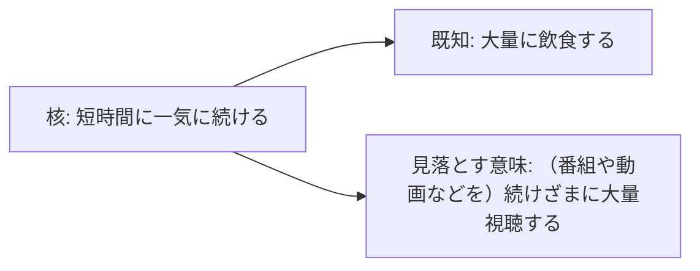

**重要語法**：`binge-watch a series`

---

## 2. blitz

- **品詞**：noun
- **発音**：/blɪts/

<small>よく知られている意味：電撃戦</small>

### 見落としやすい意味

**短期間に集中的に行う宣伝・取り組み**

**例文**：The company launched a media blitz before the product release.

**和訳**：その会社は発売前に集中的なメディア宣伝を展開した。

**コアイメージ**：もとは短期間に一斉に攻めるような勢いを表す。宣伝や活動を一気に集中的に行う場合にも使われる。

**図**

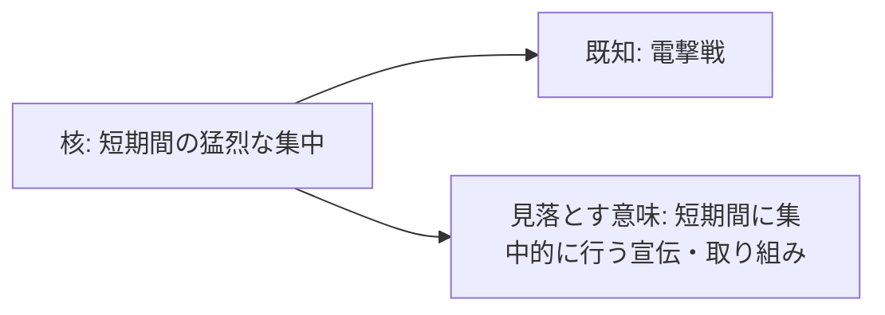

**重要語法**：`a publicity blitz`

---

## 3. blizzard

- **品詞**：noun
- **発音**：/ˈblɪzərd/

<small>よく知られている意味：猛吹雪</small>

### 見落としやすい意味

**大量の物事が一度に押し寄せること**

**例文**：After the announcement, the office received a blizzard of emails.

**和訳**：発表の後、事務所には大量のメールが殺到した。

**コアイメージ**：猛吹雪では雪が次々と押し寄せる。その圧倒的な量をたとえ、メールや質問などが一度に殺到する様子を表す。

**図**

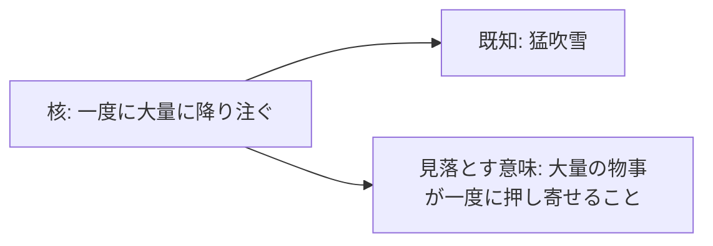

**重要語法**：`a blizzard of questions`

---

## 4. brighten

- **品詞**：verb
- **発音**：/ˈbraɪtən/

<small>よく知られている意味：明るくする</small>

### 見落としやすい意味

**（顔色・気分が）明るくなる、元気になる**

**例文**：Her face brightened when she heard the good news.

**和訳**：よい知らせを聞くと、彼女の表情がぱっと明るくなった。

**コアイメージ**：光が増して周囲が明るくなるのが基本の感覚。その変化が表情や気分にも広がり、元気を取り戻す様子を示す。

**図**

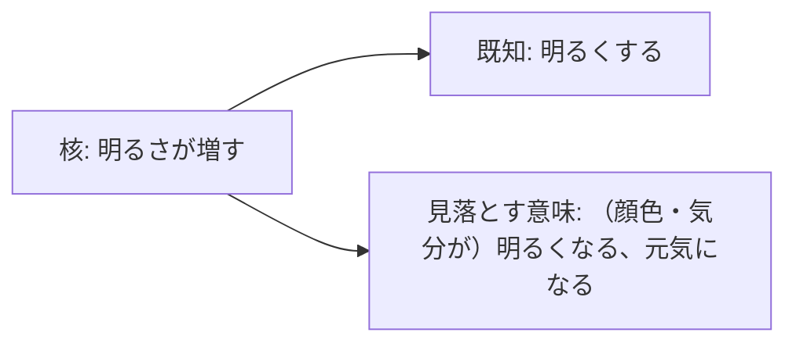

**重要語法**：`brighten up`

---

## 5. brook

- **品詞**：verb
- **発音**：/brʊk/

<small>よく知られている意味：小川</small>

### 見落としやすい意味

**（反論や批判などを）容認する**

**例文**：The manager would brook no further delays.

**和訳**：部長はこれ以上の遅れを一切容認しなかった。

**コアイメージ**：動詞のbrookは、好ましくないことを我慢して受け入れる意味を持つ。特に否定形で、異議や遅延を許さない強い態度を表す。

**図**

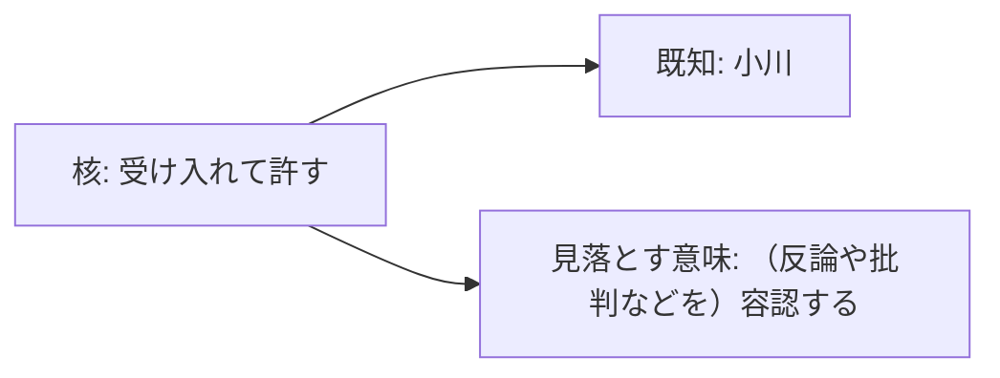

**重要語法**：`brook no opposition / brook no delay`

---

## 6. bumpy

- **品詞**：adjective
- **発音**：/ˈbʌmpi/

<small>よく知られている意味：でこぼこの</small>

### 見落としやすい意味

**（経過・関係などが）波乱の多い、順調でない**

**例文**：The project got off to a bumpy start.

**和訳**：その計画は波乱含みのスタートを切った。

**コアイメージ**：でこぼこ道では進み方がぎくしゃくする。そこから計画や関係が障害に遭い、順調には進まない様子に広がる。

**図**

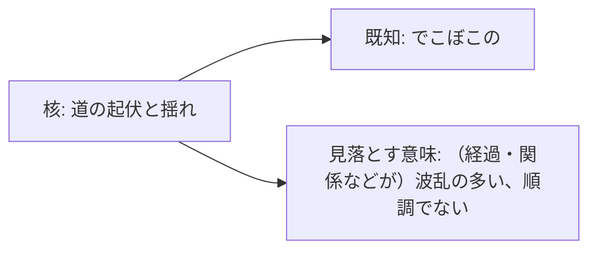

**重要語法**：`a bumpy start`

---

## 7. burner

- **品詞**：idiom
- **発音**：/ˈbɝːnɚ/

<small>よく知られている意味：燃焼器具・コンロの火口</small>

### 見落としやすい意味

**優先度を下げて、当面は取り組まない**

**例文**：We have put the redesign on the back burner for now.

**和訳**：私たちは当面、その再設計の優先順位を下げている。

**コアイメージ**：コンロの奥の火口には、すぐに仕上げない鍋を置くことがある。そのイメージで、案件を捨てずに優先度だけ下げることを表す。

**図**

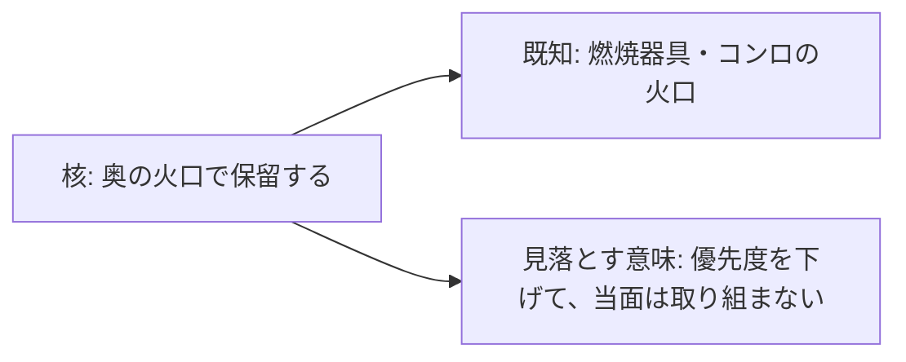

**重要語法**：`put something on the back burner`

---

## 8. burrow

- **品詞**：verb
- **発音**：/ˈbɝːoʊ/

<small>よく知られている意味：穴を掘る</small>

### 見落としやすい意味

**身体などを奥へ潜り込ませる**

**例文**：The child burrowed deeper into the warm blankets.

**和訳**：その子は暖かい毛布の奥へさらに潜り込んだ。

**コアイメージ**：動物が穴の奥へ潜る動きが核にある。人や身体の一部が布などの中へぐっと入り込む動作にも使える。

**図**

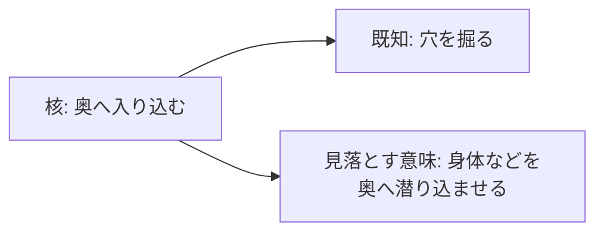

**重要語法**：`burrow into / under something`

---

## 9. burrow

- **品詞**：verb
- **発音**：/ˈbɝːoʊ/

<small>よく知られている意味：地面に穴を掘る</small>

### 見落としやすい意味

**何かを探して物の間をかき分ける**

**例文**：She burrowed through her bag to find the keys.

**和訳**：彼女は鍵を探してかばんの中をごそごそかき分けた。

**コアイメージ**：狭いところへ入り進む感覚がもとにある。物をかき分けながら内部を探す動作にもそのイメージが応用される。

**図**

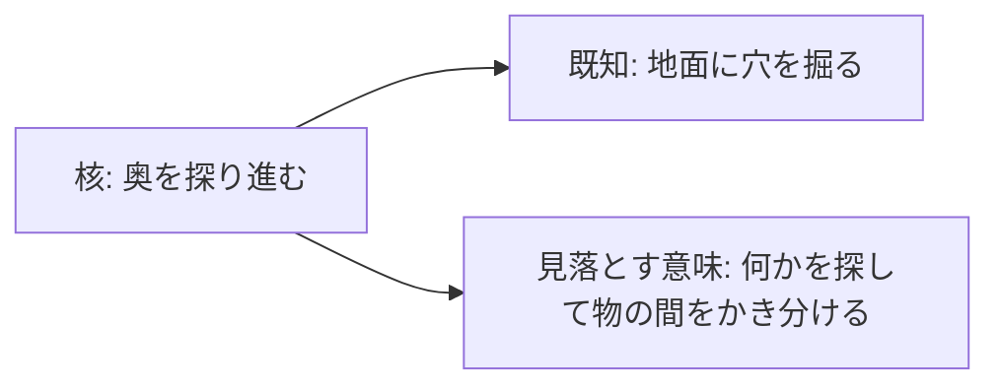

**重要語法**：`burrow through a bag`

---

## 10. cadence

- **品詞**：noun
- **発音**：/ˈkeɪdəns/

<small>よく知られている意味：音楽の拍子・抑揚</small>

### 見落としやすい意味

**定例業務・会議などの実施頻度や周期**

**例文**：Our team now follows a weekly reporting cadence.

**和訳**：私たちのチームは現在、週1回の報告サイクルで動いている。

**コアイメージ**：音楽や話し方の規則的な流れが基本。仕事の会議や報告にも、繰り返す頻度や周期という意味で用いる。

**図**

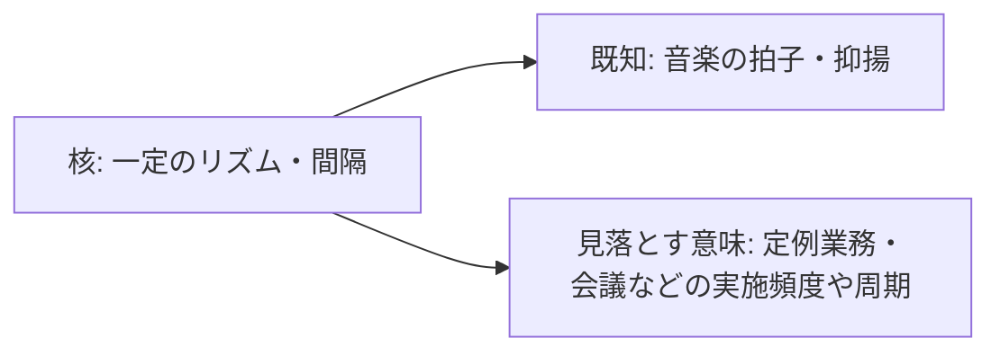

**重要語法**：`a weekly meeting cadence`

---

## 11. capitalization

- **品詞**：noun
- **発音**：/ˌkæpɪtələˈzeɪʃən/

<small>よく知られている意味：大文字使用</small>

### 見落としやすい意味

**企業の株式の時価総額**

**例文**：The firm's market capitalization exceeded $10 billion.

**和訳**：その企業の株式時価総額は100億ドルを超えた。

**コアイメージ**：金融ではcapitalは企業の資本や価値に関わる語になる。market capitalizationは、株価と発行済み株式数から算出する株式時価総額を指す。

**図**

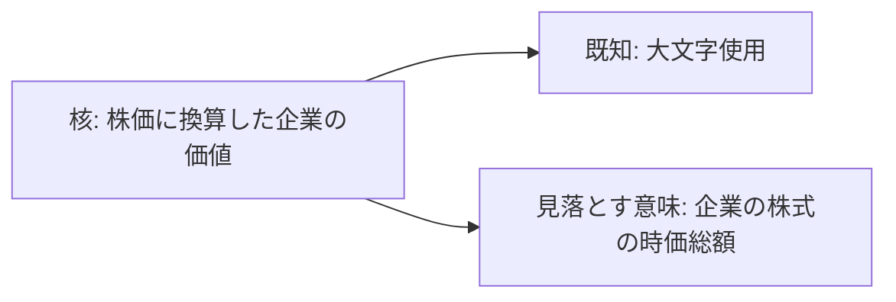

**重要語法**：`market capitalization (market cap)`

---

## 12. casting

- **品詞**：noun
- **発音**：/ˈkæstɪŋ/

<small>よく知られている意味：配役・キャスティング</small>

### 見落としやすい意味

**金属などを型に流し込んで作る鋳造品**

**例文**：The museum displayed a bronze casting of the statue.

**和訳**：博物館には、その像の青銅製の鋳造品が展示されていた。

**コアイメージ**：castingには材料を型へ流し込む工程の意味もある。そこから、その方法で作られた鋳造品そのものを指せる。

**図**

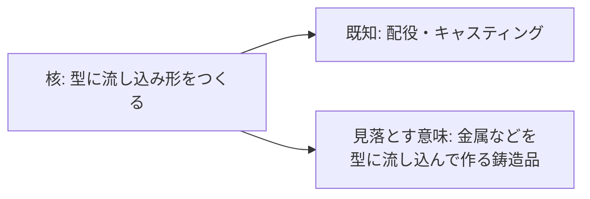

**重要語法**：`a bronze casting`

---

## 13. casting

- **品詞**：noun
- **発音**：/ˈkæstɪŋ/

<small>よく知られている意味：配役を決めること</small>

### 見落としやすい意味

**スマートフォン等の画像・音声を別の画面に転送表示すること**

**例文**：Screen casting lets me show my phone on the classroom display.

**和訳**：画面のキャスト機能を使えば、スマホの画面を教室のディスプレイに映せる。

**コアイメージ**：castには何かを送り出す感覚がある。画面や音声のデータを別の機器へ転送する意味でも使われる。

**図**

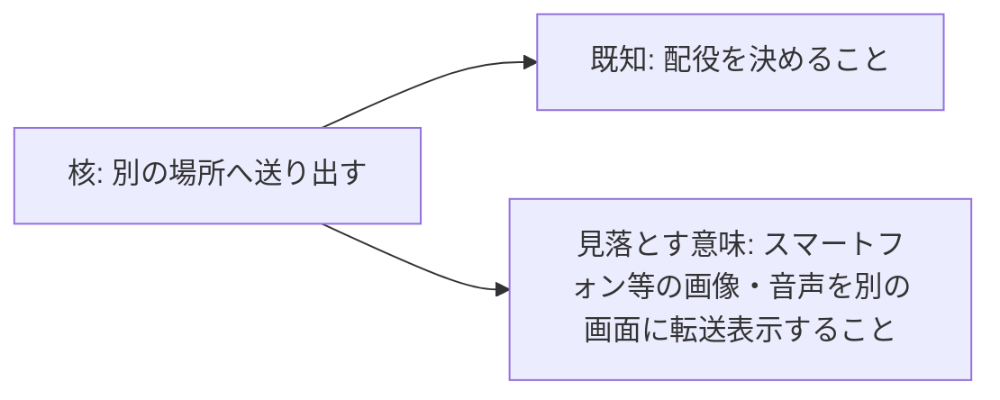

**重要語法**：`screen casting / cast to a TV`

---

## 14. casting

- **品詞**：noun
- **発音**：/ˈkæstɪŋ/

<small>よく知られている意味：配役の選定</small>

### 見落としやすい意味

**投票行為**

**例文**：The casting of ballots began early in the morning.

**和訳**：投票は朝早くから始まった。

**コアイメージ**：cast a voteは票を投じる定型表現。castingはその投票行為を名詞化したもので、配役とは異なる文脈で現れる。

**図**

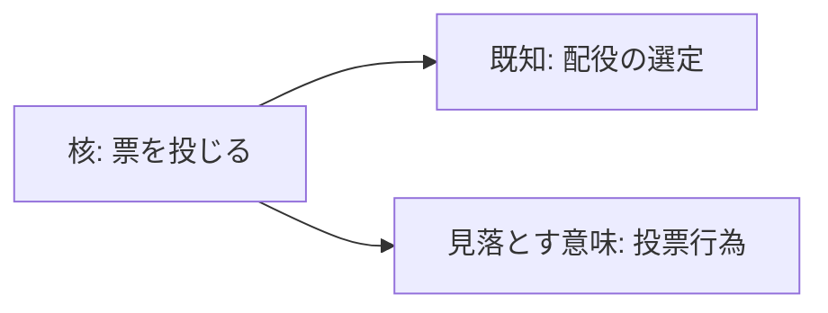

**重要語法**：`the casting of votes / cast a ballot`

---

## 15. cipher

- **品詞**：noun
- **発音**：/ˈsaɪfɚ/

<small>よく知られている意味：暗号・暗号化方式</small>

### 見落としやすい意味

**実権がないまま他人に利用される人物**

**例文**：Critics called the chairman a mere cipher with no real authority.

**和訳**：批評家たちは、その議長を実権のない名ばかりの人物だと評した。

**コアイメージ**：cipherには記号やゼロのように、実体が目立たない感覚がある。人物に使うと、独自の権限や存在感がなく他人に動かされる人を表せる。

**図**

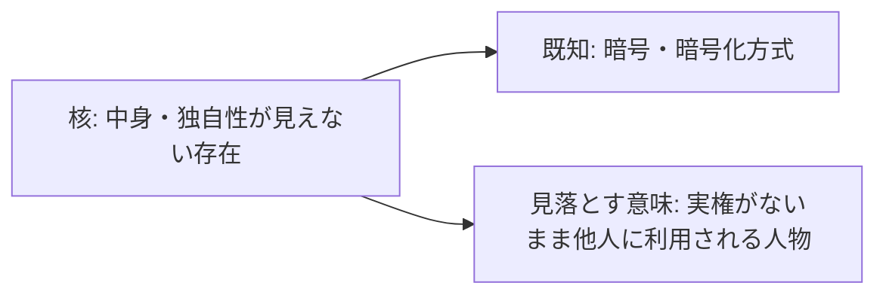

**重要語法**：`a mere cipher`

---

## 16. coax

- **品詞**：verb
- **発音**：/koʊks/

<small>よく知られている意味：なだめて説得する</small>

### 見落としやすい意味

**（機械や火などを）うまく働くように少しずつ仕向ける**

**例文**：It took an hour to coax the old engine into starting.

**和訳**：古いエンジンを何とか始動させるのに1時間かかった。

**コアイメージ**：coaxは相手を強く押すより、辛抱強く働きかけて動かす感じが核。人だけでなく、機械をだましだまし動かす場合にも使う。

**図**

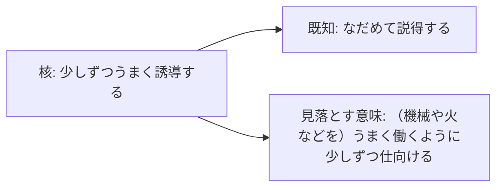

**重要語法**：`coax something into working`

---

## 17. coding

- **品詞**：noun
- **発音**：/ˈkoʊdɪŋ/

<small>よく知られている意味：プログラムを書くこと</small>

### 見落としやすい意味

**DNAに記された遺伝情報の配列・符号化**

**例文**：The researchers identified a change in a protein-coding region of DNA.

**和訳**：研究者たちはDNAのタンパク質をコードする領域に変化を見つけた。

**コアイメージ**：codingは情報を一定の符号に置き換えること。コンピューターだけでなく、DNA上でタンパク質に関する情報が指定される仕組みにも使う。

**図**

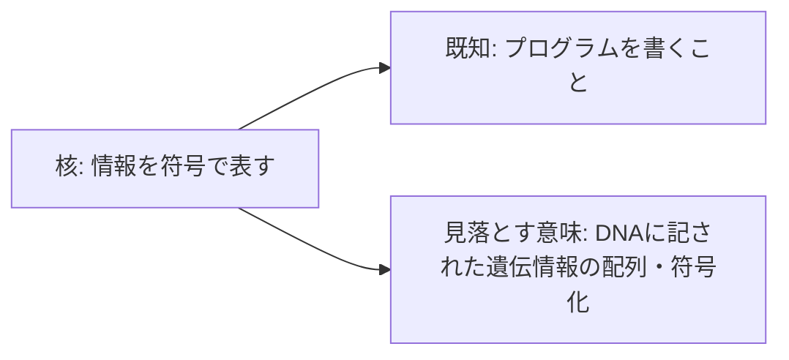

**重要語法**：`protein-coding DNA / coding region`

---

## 18. consequent

- **品詞**：adjective
- **発音**：/ˈkɑːnsəkwənt/

<small>よく知られている意味：結果として起こること（名詞）</small>

### 見落としやすい意味

**〜から生じた、〜の結果である**

**例文**：The consequent loss of trust damaged the organization.

**和訳**：その結果生じた信頼の喪失が、組織に打撃を与えた。

**コアイメージ**：consequentは、先にある出来事の後について生じる関係を示す。単に時間的に後というより、原因と結果のつながりを表す形容詞。

**図**

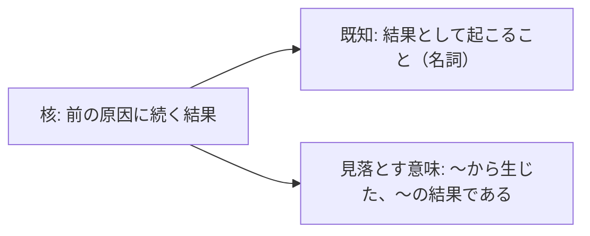

**重要語法**：`consequent on/upon something`

---

## 19. consonant

- **品詞**：adjective
- **発音**：/ˈkɑːnsənənt/

<small>よく知られている意味：子音（名詞）</small>

### 見落としやすい意味

**意見や考え方が一致している、調和している**

**例文**：His proposal was consonant with the committee's goals.

**和訳**：彼の提案は委員会の目標と一致していた。

**コアイメージ**：音が調和して響く感覚から、意見や行動の方向が合っている状態を表す。形容詞ではwithとともに用いることが多い。

**図**

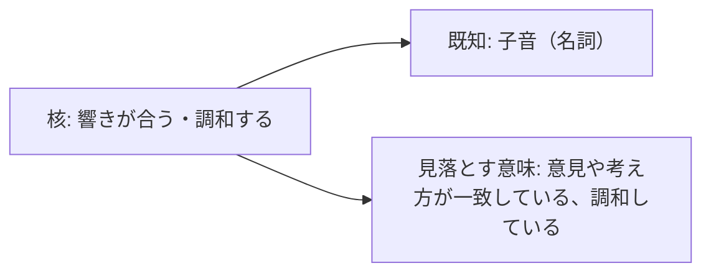

**重要語法**：`be consonant with something`

---

## 20. contrarian

- **品詞**：adjective
- **発音**：/kənˈtreriən/

<small>よく知られている意味：逆張りをする人（名詞）</small>

### 見落としやすい意味

**多数派の意見に逆らう、逆張りの**

**例文**：She took a contrarian view of the market's prospects.

**和訳**：彼女は市場の見通しについて多数派とは逆の見方を示した。

**コアイメージ**：contrarianは一般的な見方にあえて逆らう立場を表す。形容詞なら、そうした見方や投資判断を直接修飾できる。

**図**

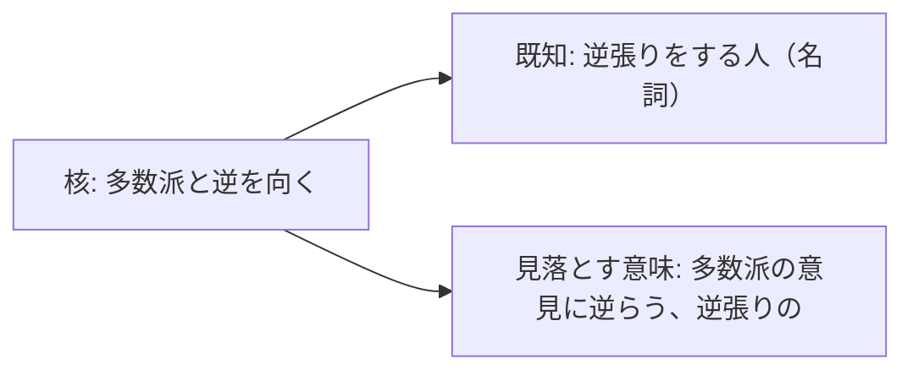

**重要語法**：`a contrarian view / contrarian strategy`

---

## 21. coolly

- **品詞**：adverb
- **発音**：/ˈkuːli/

<small>よく知られている意味：冷静に</small>

### 見落としやすい意味

**冷淡に、素っ気なく**

**例文**：He coolly dismissed their concerns as unimportant.

**和訳**：彼は彼らの懸念を重要でないとして冷たく退けた。

**コアイメージ**：coolには感情が高ぶらない状態を表す用法がある。文脈によっては落ち着きではなく、相手への思いやりがない冷淡さを表す。

**図**

```mermaid
flowchart LR
    A["核: 温度の低さから感情の冷たさへ"]
    B["既知: 冷静に"]
    C["見落とす意味: 冷淡に、素っ気なく"]
    A --> B
    A --> C
```

**重要語法**：`coolly dismiss / coolly ignore`

---

## 22. deadbeat

- **品詞**：adjective
- **発音**：/ˈdɛdbiːt/

<small>よく知られている意味：怠け者・ろくでなし（名詞）</small>

### 見落としやすい意味

**借金や義務を果たそうとしない**

**例文**：The agency pursued deadbeat parents who refused to pay child support.

**和訳**：その機関は養育費を支払おうとしない親たちへの対応を進めた。

**コアイメージ**：deadbeatは本来、責任を果たさない人への非難を含む口語表現。形容詞でも、支払いなどの義務を怠る人を修飾する。

**図**

```mermaid
flowchart LR
    A["核: 負うべき責任を放置する"]
    B["既知: 怠け者・ろくでなし（名詞）"]
    C["見落とす意味: 借金や義務を果たそうとしない"]
    A --> B
    A --> C
```

**重要語法**：`deadbeat parent / deadbeat debtor`

---

## 23. delinquent

- **品詞**：adjective
- **発音**：/dɪˈlɪŋkwənt/

<small>よく知られている意味：非行のある・不良の</small>

### 見落としやすい意味

**支払いが延滞している**

**例文**：The account is now ninety days delinquent.

**和訳**：その口座の支払いは現在90日間延滞している。

**コアイメージ**：delinquentには義務や規則を守らない感覚がある。金融・請求の文脈では、期限までに支払われていない状態を示す。

**図**

```mermaid
flowchart LR
    A["核: 本来の義務から遅れる"]
    B["既知: 非行のある・不良の"]
    C["見落とす意味: 支払いが延滞している"]
    A --> B
    A --> C
```

**重要語法**：`delinquent payment / delinquent account`

---

## 24. denomination

- **品詞**：noun
- **発音**：/dɪˌnɑməˈneɪʃən/

<small>よく知られている意味：宗派・教派</small>

### 見落としやすい意味

**貨幣・紙幣の額面金額の単位**

**例文**：The ATM dispenses notes in several denominations.

**和訳**：そのATMは複数の額面の紙幣を払い出す。

**コアイメージ**：denominationは、あるものを名前や種類ごとに区別すること。貨幣では、紙幣や硬貨を額面ごとに分けた区分を指す。

**図**

```mermaid
flowchart LR
    A["核: 種類を名付けて区分する"]
    B["既知: 宗派・教派"]
    C["見落とす意味: 貨幣・紙幣の額面金額の単位"]
    A --> B
    A --> C
```

**重要語法**：`a $20 denomination / denominations of banknotes`

---

## 25. domino

- **品詞**：idiom
- **発音**：/ˈdɑmɪnoʊ/

<small>よく知られている意味：ドミノ牌</small>

### 見落としやすい意味

**domino effect：一つの出来事が次々に連鎖反応を起こすこと**

**例文**：One small delay caused a domino effect across the schedule.

**和訳**：たった一つの小さな遅れが、予定全体に連鎖的な影響を及ぼした。

**コアイメージ**：ドミノ牌を並べると、一つの倒れ方が次へ伝わる。この連鎖を、出来事が次々に別の出来事を引き起こす状態にたとえる。

**図**

```mermaid
flowchart LR
    A["核: 一つ倒れると次も倒れる"]
    B["既知: ドミノ牌"]
    C["見落とす意味: domino effect：一つの出来事が次々に連鎖反応を起こすこと"]
    A --> B
    A --> C
```

**重要語法**：`the domino effect`

---

## 26. doubly

- **品詞**：adverbial expression
- **発音**：/ˈdʌbli/

<small>よく知られている意味：二倍に・二重に</small>

### 見落としやすい意味

**doubly so：なおさらそうである**

**例文**：The rule is confusing for beginners, and doubly so for children.

**和訳**：その規則は初心者には分かりにくく、子どもにはなおさらだ。

**コアイメージ**：doublyは程度をさらに大きくすることを示す。doubly soは直前に述べた性質が、別の対象には一層よく当てはまると示す省略表現。

**図**

```mermaid
flowchart LR
    A["核: 程度がさらに強まる"]
    B["既知: 二倍に・二重に"]
    C["見落とす意味: doubly so：なおさらそうである"]
    A --> B
    A --> C
```

**重要語法**：`doubly so for ...`

---

## 27. dredge

- **品詞**：verb (phrasal)
- **発音**：/drɛdʒ/

<small>よく知られている意味：水底をさらう</small>

### 見落としやすい意味

**dredge up：過去の不快な出来事を蒸し返す**

**例文**：The interview dredged up memories she wanted to forget.

**和訳**：そのインタビューは、彼女が忘れたかった記憶を蒸し返した。

**コアイメージ**：dredgeは底に沈んだものをさらい出す動作。dredge upで、過去に埋もれていた話題や記憶を再び表に出す意味になる。

**図**

```mermaid
flowchart LR
    A["核: 底から掘り起こす"]
    B["既知: 水底をさらう"]
    C["見落とす意味: dredge up：過去の不快な出来事を蒸し返す"]
    A --> B
    A --> C
```

**重要語法**：`dredge up the past`

---

## 28. dressing

- **品詞**：noun
- **発音**：/ˈdrɛsɪŋ/

<small>よく知られている意味：衣服を着ること・サラダドレッシング</small>

### 見落としやすい意味

**傷を覆って保護する包帯・ガーゼなど**

**例文**：The nurse changed the dressing on his injured hand.

**和訳**：看護師は、彼のけがをした手の保護用ガーゼを取り替えた。

**コアイメージ**：dressには身体を覆う意味もある。dressingは衣服や調味料以外に、傷を覆って保護する包帯・ガーゼなどを指す。

**図**

```mermaid
flowchart LR
    A["核: 覆って保護するもの"]
    B["既知: 衣服を着ること・サラダドレッシング"]
    C["見落とす意味: 傷を覆って保護する包帯・ガーゼなど"]
    A --> B
    A --> C
```

**重要語法**：`change a dressing / wound dressing`

---

## 29. endearment

- **品詞**：noun phrase
- **発音**：/ɪnˈdɪrmənt/

<small>よく知られている意味：愛情表現</small>

### 見落としやすい意味

**term of endearment：親愛を込めた呼び名**

**例文**：Grandma called me 'sunshine' as a term of endearment.

**和訳**：祖母は親しみを込めて私を「サンシャイン」と呼んだ。

**コアイメージ**：endearは相手に愛情や親しみを感じさせること。term of endearmentは、その気持ちを込めて相手を呼ぶ言葉を指す。

**図**

```mermaid
flowchart LR
    A["核: 親しさを言葉に表す"]
    B["既知: 愛情表現"]
    C["見落とす意味: term of endearment：親愛を込めた呼び名"]
    A --> B
    A --> C
```

**重要語法**：`a term of endearment`

---

## 30. equestrian

- **品詞**：noun
- **発音**：/ɪˈkwɛstriən/

<small>よく知られている意味：乗馬の・馬術の（形容詞）</small>

### 見落としやすい意味

**乗馬をする人、馬術選手**

**例文**：The young equestrian won her first national competition.

**和訳**：その若い馬術選手は初めて全国大会で優勝した。

**コアイメージ**：equestrianは馬に乗る活動に関わる語。形容詞だけでなく、乗馬をする人や馬術競技の選手を表す名詞にもなる。

**図**

```mermaid
flowchart LR
    A["核: 馬に乗る人・活動"]
    B["既知: 乗馬の・馬術の（形容詞）"]
    C["見落とす意味: 乗馬をする人、馬術選手"]
    A --> B
    A --> C
```

**重要語法**：`an experienced equestrian`

---

## 31. evergreen

- **品詞**：adjective
- **発音**：/ˈɛvɚɡriːn/

<small>よく知られている意味：常緑の</small>

### 見落としやすい意味

**長年人気が衰えない、時代が変わっても新鮮な**

**例文**：The bookstore still sells this evergreen classic.

**和訳**：その書店では、この長く愛される名作を今も販売している。

**コアイメージ**：常緑樹が一年中緑を保つことが出発点。作品や知識が時代を経ても魅力を失わない様子を表せる。

**図**

```mermaid
flowchart LR
    A["核: 季節が変わっても色あせない"]
    B["既知: 常緑の"]
    C["見落とす意味: 長年人気が衰えない、時代が変わっても新鮮な"]
    A --> B
    A --> C
```

**重要語法**：`evergreen content / evergreen classic`

---

## 32. facto

- **品詞**：fixed expression
- **発音**：/deɪ ˈfæktoʊ/

<small>よく知られている意味：facto単独は通常使わない</small>

### 見落としやすい意味

**de facto：形式上ではなく事実上の**

**例文**：She became the de facto leader after the director resigned.

**和訳**：部長が辞任した後、彼女が事実上のリーダーになった。

**コアイメージ**：de factoは正式な地位や規則より、実際に何が起きているかを重視する表現。形式上の肩書きがなくても実質的にそうであることを示す。

**図**

```mermaid
flowchart LR
    A["核: 公式でなく実態として成立"]
    B["既知: facto単独は通常使わない"]
    C["見落とす意味: de facto：形式上ではなく事実上の"]
    A --> B
    A --> C
```

**重要語法**：`de facto leader / de facto standard`

---

## 33. flagship

- **品詞**：noun / attributive noun
- **発音**：/ˈflæɡʃɪp/

<small>よく知られている意味：旗艦・司令官の乗る船</small>

### 見落としやすい意味

**組織の代表的・最重要の製品や店舗など**

**例文**：The brand opened its flagship store in Tokyo.

**和訳**：そのブランドは東京に代表的な大型店舗を開いた。

**コアイメージ**：艦隊を率いる旗艦から、組織を代表する最重要な商品・店舗へ意味が広がる。ほかのものを象徴する中心的存在を指す。

**図**

```mermaid
flowchart LR
    A["核: 集団を代表する先頭の船"]
    B["既知: 旗艦・司令官の乗る船"]
    C["見落とす意味: 組織の代表的・最重要の製品や店舗など"]
    A --> B
    A --> C
```

**重要語法**：`flagship store / flagship product`

---

## 34. foregone

- **品詞**：fixed expression
- **発音**：/fɔrˈɡɔn/

<small>よく知られている意味：過ぎ去った（foregoの過去分詞との混同に注意）</small>

### 見落としやすい意味

**foregone conclusion：初めから結果が分かっていること**

**例文**：Everyone expected a victory, but it was not a foregone conclusion.

**和訳**：誰もが勝利を予想していたが、初めから決まった結果ではなかった。

**コアイメージ**：foregoneには、すでに先に行ってしまったような感覚がある。foregone conclusionで、議論や勝負の前から結果が決まっている状態を表す。

**図**

```mermaid
flowchart LR
    A["核: 結果がすでに先取りされている"]
    B["既知: 過ぎ去った（foregoの過去分詞との混同に注意）"]
    C["見落とす意味: foregone conclusion：初めから結果が分かっていること"]
    A --> B
    A --> C
```

**重要語法**：`a foregone conclusion`

---

## 35. freight

- **品詞**：verb [T]
- **発音**：/freɪt/

<small>よく知られている意味：貨物・運賃（名詞）</small>

### 見落としやすい意味

**（貨物を船・鉄道などで）輸送する**

**例文**：Fresh produce is freighted by rail to the capital.

**和訳**：生鮮食品は鉄道貨物で首都へ輸送される。

**コアイメージ**：freightはもともと輸送する貨物や輸送料に関わる語。動詞としては、品物を船・鉄道などで運ぶ行為を表す。

**図**

```mermaid
flowchart LR
    A["核: 貨物として運ぶ"]
    B["既知: 貨物・運賃（名詞）"]
    C["見落とす意味: （貨物を船・鉄道などで）輸送する"]
    A --> B
    A --> C
```

**重要語法**：`freight goods by rail`

---

## 36. gory

- **品詞**：adjective
- **発音**：/ˈɡɔːri/

<small>よく知られている意味：血なまぐさい</small>

### 見落としやすい意味

**gory details：不快なほど生々しい詳細**

**例文**：I won't bore you with the gory details of the paperwork.

**和訳**：事務手続きの細々としたうんざりする話は省きます。

**コアイメージ**：goryは不快になるほど生々しいことを表す。gory detailsは、流血の話に限らず、聞き手がうんざりする細かな事情にも使える。

**図**

```mermaid
flowchart LR
    A["核: 聞きたくないほど生々しい"]
    B["既知: 血なまぐさい"]
    C["見落とす意味: gory details：不快なほど生々しい詳細"]
    A --> B
    A --> C
```

**重要語法**：`spare someone the gory details`

---

## 37. gridlock

- **品詞**：noun
- **発音**：/ˈɡrɪdlɑːk/

<small>よく知られている意味：道路の交通渋滞</small>

### 見落としやすい意味

**政治や立法過程などが膠着して動かなくなること**

**例文**：The reform stalled because of gridlock in parliament.

**和訳**：その改革は議会での対立による膠着状態のため停滞した。

**コアイメージ**：車両が交差点で互いの進路をふさぎ動けなくなる状態が基本。政治や組織でも意見が対立し、何も決められない状況を指す。

**図**

```mermaid
flowchart LR
    A["核: 互いにふさいで進めない"]
    B["既知: 道路の交通渋滞"]
    C["見落とす意味: 政治や立法過程などが膠着して動かなくなること"]
    A --> B
    A --> C
```

**重要語法**：`political gridlock / legislative gridlock`

---

## 38. grunt

- **品詞**：noun (US informal)
- **発音**：/ɡrʌnt/

<small>よく知られている意味：うなり声・不平の声</small>

### 見落としやすい意味

**地味な作業を担う下働きの人**

**例文**：Junior staff were left to do the grunt work.

**和訳**：地味で大変な実務作業は若手職員に任された。

**コアイメージ**：gruntは力を入れるときの低いうなり声を表す語。口語では、現場で地味で大変な作業を担当する人・仕事を指す。

**図**

```mermaid
flowchart LR
    A["核: 力仕事や地味な役割"]
    B["既知: うなり声・不平の声"]
    C["見落とす意味: 地味な作業を担う下働きの人"]
    A --> B
    A --> C
```

**重要語法**：`grunt work / a grunt`

---

## 39. guns

- **品詞**：idiom
- **発音**：/ɡʌnz/

<small>よく知られている意味：銃（gunの複数形）</small>

### 見落としやすい意味

**big guns：有力者、切り札となる強力な人材**

**例文**：The company brought in its big guns to negotiate the deal.

**和訳**：会社はその取引の交渉に有力な人材を投入した。

**コアイメージ**：大きな砲が強い力を持つことから、big gunsは重要な局面で頼れる有力者を指す。人材や切り札として使われる比喩表現。

**図**

```mermaid
flowchart LR
    A["核: 強力な戦力を持ち出す"]
    B["既知: 銃（gunの複数形）"]
    C["見落とす意味: big guns：有力者、切り札となる強力な人材"]
    A --> B
    A --> C
```

**重要語法**：`bring in the big guns`

---

## 40. handsomely

- **品詞**：adverb
- **発音**：/ˈhænsəmli/

<small>よく知られている意味：容姿がよく・立派に</small>

### 見落としやすい意味

**十分な金額で、気前よく**

**例文**：The investor rewarded the team handsomely for its success.

**和訳**：投資家は成功したチームに十分な報酬を与えた。

**コアイメージ**：handsomeには見た目のよさのほかに、額や規模が立派という意味がある。handsomelyも、惜しみなく大きな報酬を与える様子を表せる。

**図**

```mermaid
flowchart LR
    A["核: 見栄え・規模が立派"]
    B["既知: 容姿がよく・立派に"]
    C["見落とす意味: 十分な金額で、気前よく"]
    A --> B
    A --> C
```

**重要語法**：`pay / reward handsomely`

---

## 41. heartland

- **品詞**：noun
- **発音**：/ˈhɑːrtlænd/

<small>よく知られている意味：心臓部・中心地域</small>

### 見落としやすい意味

**特定の政治勢力・産業などの主要な支持基盤・中心地域**

**例文**：The region is the party's traditional political heartland.

**和訳**：その地域は、その政党の伝統的な支持基盤だ。

**コアイメージ**：heartlandは文字どおり中心となる地域を表す。政治勢力や産業の力が特に強く根付く場所にも使える。

**図**

```mermaid
flowchart LR
    A["核: 中心となって支える土地"]
    B["既知: 心臓部・中心地域"]
    C["見落とす意味: 特定の政治勢力・産業などの主要な支持基盤・中心地域"]
    A --> B
    A --> C
```

**重要語法**：`the industrial heartland / a party's heartland`

---

## 42. heave

- **品詞**：verb (intransitive)
- **発音**：/hiːv/

<small>よく知られている意味：重い物を持ち上げる</small>

### 見落としやすい意味

**吐き気を催す、えずく**

**例文**：The strong smell made him heave.

**和訳**：強いにおいで彼は吐き気を催した。

**コアイメージ**：heaveの核は身体やものが強く上下に動くこと。胃や胸が不随意に動く様子から、えずく・吐き気を催す意味になる。

**図**

```mermaid
flowchart LR
    A["核: 身体が大きく動く"]
    B["既知: 重い物を持ち上げる"]
    C["見落とす意味: 吐き気を催す、えずく"]
    A --> B
    A --> C
```

**重要語法**：`heave with nausea`

---

## 43. helm

- **品詞**：noun (idiom)
- **発音**：/hɛlm/

<small>よく知られている意味：船の舵</small>

### 見落としやすい意味

**at the helm：組織などの指揮を執って**

**例文**：With a new director at the helm, the project moved faster.

**和訳**：新しい責任者の指揮の下で、その計画はより速く進んだ。

**コアイメージ**：helmは船の舵を表す。組織という船の進む方向を定める人をたとえ、at the helmで指揮・運営の立場を表す。

**図**

```mermaid
flowchart LR
    A["核: 舵を握って方向を決める"]
    B["既知: 船の舵"]
    C["見落とす意味: at the helm：組織などの指揮を執って"]
    A --> B
    A --> C
```

**重要語法**：`at the helm of a company`

---

## 44. helm

- **品詞**：verb (transitive)
- **発音**：/hɛlm/

<small>よく知られている意味：船の舵を取る</small>

### 見落としやすい意味

**映画・事業などの指揮を執る**

**例文**：A first-time director helmed the award-winning film.

**和訳**：その受賞映画は新人監督が指揮を執って制作した。

**コアイメージ**：船を操る舵から、集団や制作全体を導くという意味へ広がる。映画をhelmedといえば監督を務めたことを表す。

**図**

```mermaid
flowchart LR
    A["核: 舵取り役として全体を動かす"]
    B["既知: 船の舵を取る"]
    C["見落とす意味: 映画・事業などの指揮を執る"]
    A --> B
    A --> C
```

**重要語法**：`helm a film / helm a project`

---

## 45. herring

- **品詞**：noun (idiom)
- **発音**：/ˈhɛrɪŋ/

<small>よく知られている意味：ニシン（魚）</small>

### 見落としやすい意味

**red herring：本筋から注意をそらす情報や論点**

**例文**：The spokesperson's answer was a red herring that distracted us from the real issue.

**和訳**：広報担当者の答えは、本当の問題から注意をそらす論点のすり替えだった。

**コアイメージ**：red herringは本題から注意をそらす手がかりや論点を表す慣用句。魚そのものではなく、議論の方向を外へ向けることが重要。

**図**

```mermaid
flowchart LR
    A["核: 注意を別方向へそらす"]
    B["既知: ニシン（魚）"]
    C["見落とす意味: red herring：本筋から注意をそらす情報や論点"]
    A --> B
    A --> C
```

**重要語法**：`a red herring / a distracting red herring`

---

## 46. hew

- **品詞**：verb (intransitive phrase)
- **発音**：/hjuː/

<small>よく知られている意味：（木や石を）切り出す</small>

### 見落としやすい意味

**hew to：規則や方針などに忠実に従う**

**例文**：The editor tried to hew to the original author's style.

**和訳**：編集者は元の著者の文体を忠実に守ろうとした。

**コアイメージ**：hewには材料を削り形に合わせる動きがある。hew toで、決められた方針・原則から離れずに従うことを表す。

**図**

```mermaid
flowchart LR
    A["核: 決めた線に沿って進む"]
    B["既知: （木や石を）切り出す"]
    C["見落とす意味: hew to：規則や方針などに忠実に従う"]
    A --> B
    A --> C
```

**重要語法**：`hew to the rules / hew closely to`

---

## 47. hoax

- **品詞**：verb [T]
- **発音**：/hoʊks/

<small>よく知られている意味：作り話・いたずら（名詞）</small>

### 見落としやすい意味

**いたずらや虚偽の情報で人をだます**

**例文**：The fake message was designed to hoax unsuspecting readers.

**和訳**：その偽メッセージは、疑わない読者をだますために作られた。

**コアイメージ**：hoaxはでっち上げの情報や悪ふざけによる欺きを指す。動詞では、偽情報を使って人をだます行為そのものを表す。

**図**

```mermaid
flowchart LR
    A["核: 偽りを本物と思わせる"]
    B["既知: 作り話・いたずら（名詞）"]
    C["見落とす意味: いたずらや虚偽の情報で人をだます"]
    A --> B
    A --> C
```

**重要語法**：`hoax the public / hoax someone into believing`

---

## 48. huddle

- **品詞**：noun (idiom)
- **発音**：/ˈhʌdəl/

<small>よく知られている意味：身を寄せ合うこと</small>

### 見落としやすい意味

**go/get into a huddle：集まって内密に相談する**

**例文**：The two advisers went into a huddle before answering.

**和訳**：2人の助言者は答える前に集まって小声で相談した。

**コアイメージ**：huddleは人々が互いに近づき集まること。go into a huddleでは、周囲から離れて内密に相談する様子を表す。

**図**

```mermaid
flowchart LR
    A["核: 近くに集まって話す"]
    B["既知: 身を寄せ合うこと"]
    C["見落とす意味: go/get into a huddle：集まって内密に相談する"]
    A --> B
    A --> C
```

**重要語法**：`go into a huddle / get into a huddle`

---

## 49. hum

- **品詞**：verb [I], informal
- **発音**：/hʌm/

<small>よく知られている意味：鼻歌を歌う・ブーンと音がする</small>

### 見落としやすい意味

**（場所・組織が）活気に満ちて活動する**

**例文**：The café was humming with activity by noon.

**和訳**：正午までには、そのカフェは活気に満ちていた。

**コアイメージ**：humは連続した低い音を表す。場所や組織に使うと、人や作業の動きが絶えず続く活発さをたとえる。

**図**

```mermaid
flowchart LR
    A["核: 絶えず小さな動きが響く"]
    B["既知: 鼻歌を歌う・ブーンと音がする"]
    C["見落とす意味: （場所・組織が）活気に満ちて活動する"]
    A --> B
    A --> C
```

**重要語法**：`hum with activity`

---

## 50. impregnable

- **品詞**：adjective
- **発音**：/ɪmˈprɛɡnəbəl/

<small>よく知られている意味：攻撃しても破れない</small>

### 見落としやすい意味

**（優勢・リードなどが）揺るがず覆せない**

**例文**：The team built an almost impregnable lead in the first half.

**和訳**：そのチームは前半にほとんど覆せないほどのリードを築いた。

**コアイメージ**：impregnableは守りが非常に堅く突破できない様子を表す。勝負での優位やリードが容易に崩れないことにも使う。

**図**

```mermaid
flowchart LR
    A["核: 外から崩せない堅さ"]
    B["既知: 攻撃しても破れない"]
    C["見落とす意味: （優勢・リードなどが）揺るがず覆せない"]
    A --> B
    A --> C
```

**重要語法**：`an impregnable lead / position`

---

## 51. impressionist

- **品詞**：noun
- **発音**：/ɪmˈprɛʃənɪst/

<small>よく知られている意味：印象派の画家</small>

### 見落としやすい意味

**有名人などの声やしぐさをまねる芸人**

**例文**：The impressionist copied the actor's voice perfectly.

**和訳**：その物まね芸人は俳優の声を完璧に再現した。

**コアイメージ**：impressionistは絵画の印象派の人を指すほか、人物の声やしぐさをまねる芸人も指す。対象の特徴をとらえて表現する点でつながる。

**図**

```mermaid
flowchart LR
    A["核: 印象的な特徴を再現する"]
    B["既知: 印象派の画家"]
    C["見落とす意味: 有名人などの声やしぐさをまねる芸人"]
    A --> B
    A --> C
```

**重要語法**：`a celebrity impressionist`

---

## 52. impunity

- **品詞**：noun (fixed phrase)
- **発音**：/ɪmˈpjuːnəti/

<small>よく知られている意味：処罰されない状態（名詞）</small>

### 見落としやすい意味

**with impunity：罰や不利益を受けずに**

**例文**：Officials should not be able to break the rules with impunity.

**和訳**：役人が罰を受けずに規則を破れるようであってはならない。

**コアイメージ**：impunityは悪い行為をしても罰を受けずに済むこと。with impunityはそのような状態で自由に行うことを表す。

**図**

```mermaid
flowchart LR
    A["核: 罰や不利益を免れる"]
    B["既知: 処罰されない状態（名詞）"]
    C["見落とす意味: with impunity：罰や不利益を受けずに"]
    A --> B
    A --> C
```

**重要語法**：`act with impunity`

---

## 53. incomparable

- **品詞**：adjective
- **発音**：/ɪnˈkɑːmpərəbəl/

<small>よく知られている意味：比較できない</small>

### 見落としやすい意味

**比べる対象がないほど傑出した**

**例文**：Her skill as a pianist is incomparable.

**和訳**：ピアニストとしての彼女の腕前は比べるものがないほど優れている。

**コアイメージ**：incomparableは文字どおり比較できないこと。相手がいないほど優れているという強い称賛としても使われる。

**図**

```mermaid
flowchart LR
    A["核: 比較の尺度を超える"]
    B["既知: 比較できない"]
    C["見落とす意味: 比べる対象がないほど傑出した"]
    A --> B
    A --> C
```

**重要語法**：`incomparable talent`

---

## 54. institutionalized

- **品詞**：adjective
- **発音**：/ˌɪnstɪˈtuːʃənəlaɪzd/

<small>よく知られている意味：施設に収容された</small>

### 見落としやすい意味

**制度や慣行として定着した**

**例文**：The practice became institutionalized over decades.

**和訳**：その慣行は数十年かけて制度として定着した。

**コアイメージ**：institutionは制度や組織。institutionalizedは、当初は個々の行為だったものが正式な制度や固定した慣行になったことを表す。

**図**

```mermaid
flowchart LR
    A["核: 個人の行為から制度へ組み込む"]
    B["既知: 施設に収容された"]
    C["見落とす意味: 制度や慣行として定着した"]
    A --> B
    A --> C
```

**重要語法**：`institutionalized discrimination / practice`

---

## 55. juggle

- **品詞**：verb [T]
- **発音**：/ˈdʒʌɡəl/

<small>よく知られている意味：物を空中で次々投げる</small>

### 見落としやすい意味

**仕事・家庭など複数の活動をやりくりし両立させる**

**例文**：He struggles to juggle a part-time job and his studies.

**和訳**：彼はアルバイトと学業を両立させるのに苦労している。

**コアイメージ**：ジャグリングでは複数の物を同時に扱い続ける。そこから仕事や家庭など複数の役割を調整して回すことを表す。

**図**

```mermaid
flowchart LR
    A["核: 複数のものを落とさず回す"]
    B["既知: 物を空中で次々投げる"]
    C["見落とす意味: 仕事・家庭など複数の活動をやりくりし両立させる"]
    A --> B
    A --> C
```

**重要語法**：`juggle work and study`

---

## 56. kicking

- **品詞**：idiom
- **発音**：/ˈkɪkɪŋ/

<small>よく知られている意味：蹴っている</small>

### 見落としやすい意味

**alive and kicking：元気に活動している、まだ健在である**

**例文**：The old theater is still alive and kicking.

**和訳**：その古い劇場は今も元気に営業している。

**コアイメージ**：kickingは活発に身体が動く様子を示す。alive and kickingは、衰えると思われていた人や組織が今も健在であることを表す。

**図**

```mermaid
flowchart LR
    A["核: 動き続けるほど元気"]
    B["既知: 蹴っている"]
    C["見落とす意味: alive and kicking：元気に活動している、まだ健在である"]
    A --> B
    A --> C
```

**重要語法**：`alive and kicking`

---

## 57. knowing

- **品詞**：adjective
- **発音**：/ˈnoʊɪŋ/

<small>よく知られている意味：知っている・知識のある</small>

### 見落としやすい意味

**（笑み・視線などが）事情を知っていることを示す、意味ありげな**

**例文**：She gave me a knowing smile when I mentioned the surprise.

**和訳**：そのサプライズの話をすると、彼女は事情を知っているような意味ありげな笑みを浮かべた。

**コアイメージ**：knowingは単に知識があることだけではない。表情や視線に使うと、言葉にしなくても事情を察していることが伝わる様子を表す。

**図**

```mermaid
flowchart LR
    A["核: 事情を分かったうえで示す"]
    B["既知: 知っている・知識のある"]
    C["見落とす意味: （笑み・視線などが）事情を知っていることを示す、意味ありげな"]
    A --> B
    A --> C
```

**重要語法**：`a knowing smile / look`

---

## 58. languish

- **品詞**：verb (intransitive)
- **発音**：/ˈlæŋɡwɪʃ/

<small>よく知られている意味：衰える・弱る</small>

### 見落としやすい意味

**不遇の状態・無名のままで長く過ごす**

**例文**：The manuscript languished in a drawer for years.

**和訳**：その原稿は何年もの間、引き出しにしまわれたまま日の目を見なかった。

**コアイメージ**：languishは生気がなくなったまま長くとどまる感覚。人だけでなく、作品や計画が不遇の状態で放置される場合にも使われる。

**図**

```mermaid
flowchart LR
    A["核: 元気や機会を失って停滞する"]
    B["既知: 衰える・弱る"]
    C["見落とす意味: 不遇の状態・無名のままで長く過ごす"]
    A --> B
    A --> C
```

**重要語法**：`languish in obscurity`

---

## 59. lightweight

- **品詞**：adjective
- **発音**：/ˈlaɪtweɪt/

<small>よく知られている意味：軽量の</small>

### 見落としやすい意味

**内容が浅い、重要性や実力に欠ける**

**例文**：The committee rejected the report as too lightweight.

**和訳**：委員会はその報告書を内容が浅すぎるとして退けた。

**コアイメージ**：物理的な軽さから、内容や実力に重厚さがないという評価へ広がる。議論や報告書が表面的だと述べる場合にも使う。

**図**

```mermaid
flowchart LR
    A["核: 重みがない"]
    B["既知: 軽量の"]
    C["見落とす意味: 内容が浅い、重要性や実力に欠ける"]
    A --> B
    A --> C
```

**重要語法**：`a lightweight argument / report`

---

## 60. lining

- **品詞**：noun (idiom)
- **発音**：/ˈlaɪnɪŋ/

<small>よく知られている意味：内張り・裏地</small>

### 見落としやすい意味

**silver lining：困難な状況の中にある救い・よい面**

**例文**：The delay was frustrating, but the silver lining was extra time to prepare.

**和訳**：遅れはもどかしかったが、救いは準備時間が増えたことだった。

**コアイメージ**：silver liningは、暗い雲の端が光って見える様子から来た表現。困難の中にも見つけられる希望やよい面を指す。

**図**

```mermaid
flowchart LR
    A["核: 暗雲の縁に見える光"]
    B["既知: 内張り・裏地"]
    C["見落とす意味: silver lining：困難な状況の中にある救い・よい面"]
    A --> B
    A --> C
```

**重要語法**：`Every cloud has a silver lining.`

---

## 61. loaf

- **品詞**：verb (intransitive)
- **発音**：/loʊf/

<small>よく知られている意味：一斤のパン（名詞）</small>

### 見落としやすい意味

**loaf around：ぶらぶらして何もせず過ごす**

**例文**：We loafed around the house all afternoon.

**和訳**：私たちは午後ずっと家でぶらぶらして過ごした。

**コアイメージ**：動詞のloafは、特に用事もなく時間を過ごすこと。loaf aroundで、目的もなくのんびりする、怠けて過ごす意味になる。

**図**

```mermaid
flowchart LR
    A["核: 積極的に働かず過ごす"]
    B["既知: 一斤のパン（名詞）"]
    C["見落とす意味: loaf around：ぶらぶらして何もせず過ごす"]
    A --> B
    A --> C
```

**重要語法**：`loaf around`

---

## 62. luminary

- **品詞**：noun
- **発音**：/ˈluːməneri/

<small>よく知られている意味：発光体・星</small>

### 見落としやすい意味

**ある分野で際立つ著名人、権威**

**例文**：Several scientific luminaries attended the conference.

**和訳**：数人の科学界の著名人がその会議に出席した。

**コアイメージ**：luminaryは光を放つものを指す語。比喩では、その分野で光を放つような著名人や権威を表す。

**図**

```mermaid
flowchart LR
    A["核: 周囲を照らす存在"]
    B["既知: 発光体・星"]
    C["見落とす意味: ある分野で際立つ著名人、権威"]
    A --> B
    A --> C
```

**重要語法**：`a literary luminary / luminaries of science`

---

## 63. maneuvering

- **品詞**：noun
- **発音**：/məˈnuːvərɪŋ/

<small>よく知られている意味：巧みな操作・操縦</small>

### 見落としやすい意味

**政治・組織内の駆け引き、策動**

**例文**：Weeks of political maneuvering delayed the vote.

**和訳**：数週間にわたる政治的な駆け引きで投票が遅れた。

**コアイメージ**：maneuverは状況を見て巧みに位置を変える動きが核。政治や組織では、主導権や利益を得るための駆け引きを表す。

**図**

```mermaid
flowchart LR
    A["核: 有利な位置を探して動く"]
    B["既知: 巧みな操作・操縦"]
    C["見落とす意味: 政治・組織内の駆け引き、策動"]
    A --> B
    A --> C
```

**重要語法**：`political maneuvering`

---

## 64. markdown

- **品詞**：noun
- **発音**：/ˈmɑːrkdaʊn/

<small>よく知られている意味：Markdown記法</small>

### 見落としやすい意味

**商品の値下げ、値引き額**

**例文**：The store offered a steep markdown on winter coats.

**和訳**：その店は冬物コートを大幅に値下げした。

**コアイメージ**：価格を下方向に書き換えるイメージから、商品を値下げすることを表す。小売の文脈では値引きの行為や値引き額を指す。

**図**

```mermaid
flowchart LR
    A["核: 表示価格を下げる"]
    B["既知: Markdown記法"]
    C["見落とす意味: 商品の値下げ、値引き額"]
    A --> B
    A --> C
```

**重要語法**：`a 30% markdown / take a markdown`

---

## 65. mastermind

- **品詞**：verb (transitive)
- **発音**：/ˈmæstɚmaɪnd/

<small>よく知られている意味：黒幕・首謀者（名詞）</small>

### 見落としやすい意味

**複雑な計画を立案し全体を取り仕切る**

**例文**：She masterminded the museum's major renovation.

**和訳**：彼女は博物館の大規模な改修を企画し、全体を取り仕切った。

**コアイメージ**：mastermindは計画全体を考え動かす中心人物。動詞では、複雑な取り組みを企画し、各部分を統括することを表す。

**図**

```mermaid
flowchart LR
    A["核: 全体を頭脳として設計する"]
    B["既知: 黒幕・首謀者（名詞）"]
    C["見落とす意味: 複雑な計画を立案し全体を取り仕切る"]
    A --> B
    A --> C
```

**重要語法**：`mastermind a project / operation`

---

## 66. mecca

- **品詞**：noun (figurative)
- **発音**：/ˈmɛkə/

<small>よく知られている意味：イスラム教の聖地メッカ</small>

### 見落としやすい意味

**特定分野の人が集まる中心地・憧れの場所**

**例文**：The city became a mecca for young designers.

**和訳**：その都市は若いデザイナーたちが集まる憧れの地となった。

**コアイメージ**：Meccaは特定の人々にとって特別な目的地を示す地名。小文字の比喩用法では、ある分野の人が多く集まる憧れの場所を指す。

**図**

```mermaid
flowchart LR
    A["核: 人を引き付ける中心地"]
    B["既知: イスラム教の聖地メッカ"]
    C["見落とす意味: 特定分野の人が集まる中心地・憧れの場所"]
    A --> B
    A --> C
```

**重要語法**：`a mecca for artists`

---

## 67. mend

- **品詞**：idiom
- **発音**：/mɛnd/

<small>よく知られている意味：修理する・繕う</small>

### 見落としやすい意味

**on the mend：病気や不調から回復しつつある**

**例文**：After a week of rest, she's finally on the mend.

**和訳**：一週間休んで、彼女はようやく回復に向かっている。

**コアイメージ**：mendは壊れたものを直すこと。on the mendでは、身体の不調や状況が徐々によい状態に戻りつつあることを表す。

**図**

```mermaid
flowchart LR
    A["核: 壊れた状態からよくなる"]
    B["既知: 修理する・繕う"]
    C["見落とす意味: on the mend：病気や不調から回復しつつある"]
    A --> B
    A --> C
```

**重要語法**：`be on the mend`

---

## 68. momentarily

- **品詞**：adverb (US)
- **発音**：/ˌmoʊmənˈtɛrəli/

<small>よく知られている意味：一瞬の間</small>

### 見落としやすい意味

**まもなく、すぐに**

**例文**：The train will depart momentarily.

**和訳**：列車はまもなく発車します。

**コアイメージ**：momentは非常に短い時間を指す。アメリカ英語ではmomentarilyが、その短い時間の後、つまり『まもなく』の意味でも用いられる。

**図**

```mermaid
flowchart LR
    A["核: ごく短い時間を表す"]
    B["既知: 一瞬の間"]
    C["見落とす意味: まもなく、すぐに"]
    A --> B
    A --> C
```

**重要語法**：`US: will arrive momentarily / 他の用法: briefly`

---

## 69. moonlight

- **品詞**：verb [I]
- **発音**：/ˈmuːnlaɪt/

<small>よく知られている意味：月明かり（名詞）</small>

### 見落としやすい意味

**本業のほかに副業をする（特に雇用主に知らせずに）**

**例文**：He moonlights as a translator on weekends.

**和訳**：彼は週末に副業として翻訳の仕事をしている。

**コアイメージ**：moonlightには夜の月明かりという意味がある。そこから、通常の仕事以外の時間に別の仕事をする意味で使われる。

**図**

```mermaid
flowchart LR
    A["核: 本業の外の時間で働く"]
    B["既知: 月明かり（名詞）"]
    C["見落とす意味: 本業のほかに副業をする（特に雇用主に知らせずに）"]
    A --> B
    A --> C
```

**重要語法**：`moonlight as a translator`

---

## 70. morbidity

- **品詞**：noun
- **発音**：/mɔːrˈbɪdəti/

<small>よく知られている意味：病的な状態・病気であること</small>

### 見落としやすい意味

**罹患率、集団における病気の発生・存在の程度**

**例文**：The study compared morbidity rates in two regions.

**和訳**：その研究は2地域の罹患率を比較した。

**コアイメージ**：morbidityは病気にかかっている状態や、集団内での病気の生じ方を表す。死亡を表すmortalityとは区別する。

**図**

```mermaid
flowchart LR
    A["核: 病気が起きている度合い"]
    B["既知: 病的な状態・病気であること"]
    C["見落とす意味: 罹患率、集団における病気の発生・存在の程度"]
    A --> B
    A --> C
```

**重要語法**：`morbidity rate / morbidity and mortality`

---

## 71. mule

- **品詞**：noun
- **発音**：/mjuːl/

<small>よく知られている意味：ラバ（動物）</small>

### 見落としやすい意味

**密輸品などを他人のために運ぶ役の人**

**例文**：Customs officers questioned a mule carrying smuggled goods.

**和訳**：税関職員は密輸品の運び役となっていた人物を事情聴取した。

**コアイメージ**：muleは荷物を運ぶラバを指す。比喩では、他人のために密輸品などを運ぶ人物を表すことがある。

**図**

```mermaid
flowchart LR
    A["核: 荷を運ぶ役割"]
    B["既知: ラバ（動物）"]
    C["見落とす意味: 密輸品などを他人のために運ぶ役の人"]
    A --> B
    A --> C
```

**重要語法**：`a drug mule (犯罪報道など)`

---

## 72. negate

- **品詞**：verb (transitive)
- **発音**：/nɪˈɡeɪt/

<small>よく知られている意味：否定する</small>

### 見落としやすい意味

**（効果や利益などを）打ち消し無効にする**

**例文**：The extra costs could negate the benefits of the new system.

**和訳**：追加費用が新制度の利点を帳消しにする可能性がある。

**コアイメージ**：negateは肯定・有効な状態を否定すること。効果や利益が反対の要因によって相殺される場合にも使う。

**図**

```mermaid
flowchart LR
    A["核: 作用を打ち消してゼロにする"]
    B["既知: 否定する"]
    C["見落とす意味: （効果や利益などを）打ち消し無効にする"]
    A --> B
    A --> C
```

**重要語法**：`negate the benefits / negate an effect`

---

## 73. obsolescence

- **品詞**：noun phrase
- **発音**：/ˌɑːbsəˈlɛsəns/

<small>よく知られている意味：時代遅れになること</small>

### 見落としやすい意味

**planned obsolescence：製品を意図的に短い寿命にする設計・販売戦略**

**例文**：Some critics argue that planned obsolescence creates unnecessary waste.

**和訳**：計画的陳腐化は不要な廃棄物を生むと主張する批評家もいる。

**コアイメージ**：obsolescenceはものが古くなり使われなくなること。planned obsolescenceは、その時期が早く来るよう製品寿命や買い替えを設計する考え方を表す。

**図**

```mermaid
flowchart LR
    A["核: 古く使えなくなるようにする"]
    B["既知: 時代遅れになること"]
    C["見落とす意味: planned obsolescence：製品を意図的に短い寿命にする設計・販売戦略"]
    A --> B
    A --> C
```

**重要語法**：`planned obsolescence`

---

## 74. owes

- **品詞**：verb construction
- **発音**：/oʊz/

<small>よく知られている意味：借りがある・返済義務がある</small>

### 見落としやすい意味

**owe A to B：AはBのおかげで生じた、Aの原因はBにある**

**例文**：She owes her success to years of careful practice.

**和訳**：彼女の成功は、何年にもわたる入念な練習のおかげだ。

**コアイメージ**：oweは借りがあることを表す語。owe A to BではAがBに由来する・Bのおかげだと、成果を原因に結び付ける。

**図**

```mermaid
flowchart LR
    A["核: 原因や恩恵の源へ結び付ける"]
    B["既知: 借りがある・返済義務がある"]
    C["見落とす意味: owe A to B：AはBのおかげで生じた、Aの原因はBにある"]
    A --> B
    A --> C
```

**重要語法**：`owe A to B / owe it to ...`

---

## 75. palatable

- **品詞**：adjective
- **発音**：/ˈpælətəbəl/

<small>よく知られている意味：口に合う・おいしい</small>

### 見落としやすい意味

**（提案・変更などが）受け入れられる、納得できる**

**例文**：The revised plan was more palatable to the staff.

**和訳**：修正された計画は職員にとって、より受け入れやすいものだった。

**コアイメージ**：palatableは食べ物が口に合うことが基本。提案や政策にも用い、心理的に受け入れやすいことを表せる。

**図**

```mermaid
flowchart LR
    A["核: 受け入れて飲み込める"]
    B["既知: 口に合う・おいしい"]
    C["見落とす意味: （提案・変更などが）受け入れられる、納得できる"]
    A --> B
    A --> C
```

**重要語法**：`palatable to voters / staff`

---

## 76. panacea

- **品詞**：noun
- **発音**：/ˌpænəˈsiːə/

<small>よく知られている意味：万能薬</small>

### 見落としやすい意味

**あらゆる問題を解決する万能の対策**

**例文**：Technology is not a panacea for every social problem.

**和訳**：技術があらゆる社会問題を解決する万能策というわけではない。

**コアイメージ**：panaceaは何にでも効くと考えられる万能薬。比喩では、複雑な問題を一挙に解決する対策という意味で、しばしば否定文に現れる。

**図**

```mermaid
flowchart LR
    A["核: どんな問題にも効くと期待されるもの"]
    B["既知: 万能薬"]
    C["見落とす意味: あらゆる問題を解決する万能の対策"]
    A --> B
    A --> C
```

**重要語法**：`not a panacea for ...`

---

## 77. partake

- **品詞**：verb (intransitive phrase)
- **発音**：/pɑːrˈteɪk/

<small>よく知られている意味：参加する</small>

### 見落としやすい意味

**partake of：飲食物を口にする**

**例文**：After the ceremony, everyone partook of a simple meal.

**和訳**：式の後、全員が簡単な食事を取った。

**コアイメージ**：partakeは何かに参加したり分け前を得たりする意味が核。partake of foodなどでは、飲食物を口にする少し改まった言い方になる。

**図**

```mermaid
flowchart LR
    A["核: 分けられたものを自分も受け取る"]
    B["既知: 参加する"]
    C["見落とす意味: partake of：飲食物を口にする"]
    A --> B
    A --> C
```

**重要語法**：`partake of food / drink`

---

## 78. piecemeal

- **品詞**：adverb
- **発音**：/ˈpiːsmiːl/

<small>よく知られている意味：断片的な（形容詞）</small>

### 見落としやすい意味

**部分ごとに、少しずつばらばらに**

**例文**：The repairs were carried out piecemeal over several months.

**和訳**：修理は数か月かけて部分ごとにばらばらに進められた。

**コアイメージ**：pieceは一つの部分。piecemealは全体を一度に扱わず、部分ごとに順次進める様子を表す副詞にもなる。

**図**

```mermaid
flowchart LR
    A["核: 一片ずつ別々に扱う"]
    B["既知: 断片的な（形容詞）"]
    C["見落とす意味: 部分ごとに、少しずつばらばらに"]
    A --> B
    A --> C
```

**重要語法**：`do something piecemeal`

---

## 79. portentous

- **品詞**：adjective
- **発音**：/pɔːrˈtɛntəs/

<small>よく知られている意味：重大な前兆を示す</small>

### 見落としやすい意味

**大げさで思わせぶりな、尊大な**

**例文**：He delivered a portentous speech about the team's routine meeting.

**和訳**：彼はチームの普段の会議について大げさで意味ありげな演説をした。

**コアイメージ**：portentousは重要な出来事の前兆のような重々しさを示す。その雰囲気が過剰な場合、大げさで尊大な態度を皮肉る表現になる。

**図**

```mermaid
flowchart LR
    A["核: 重大な意味を感じさせる"]
    B["既知: 重大な前兆を示す"]
    C["見落とす意味: 大げさで思わせぶりな、尊大な"]
    A --> B
    A --> C
```

**重要語法**：`a portentous tone / speech`

---

## 80. predate

- **品詞**：verb
- **発音**：/priːˈdeɪt/

<small>よく知られている意味：日付を実際より前に記す</small>

### 見落としやすい意味

**別の出来事より前に存在する、先行する**

**例文**：This bridge predates the railway by nearly a century.

**和訳**：この橋は鉄道よりほぼ1世紀前から存在している。

**コアイメージ**：pre-は『前に』を示す。predateは日付を前にすることから、あるものが別のものより以前から存在する意味にもなる。

**図**

```mermaid
flowchart LR
    A["核: 時間的に前に位置する"]
    B["既知: 日付を実際より前に記す"]
    C["見落とす意味: 別の出来事より前に存在する、先行する"]
    A --> B
    A --> C
```

**重要語法**：`predate something by 100 years`

---
