# EasyVoca 完成教材｜Batch 062

**担当範囲：global_order 4881〜4960（80件）**

main の採用済み候補（decision = accepted）を index 昇順、同一 index 内は candidate_id 昇順で配列した結果に基づく。例文・説明・模式図は本教材用に新規作成。発音は主にイギリス英語を目安とした簡略IPA表記で、文脈や地域による違いがあり得る。

## 01｜profusely

**品詞：** adverb  
**発音：** /prəˈfjuːsli/

<small>よく知られている意味：大量に・豊富に</small>

**見落としやすい意味：（謝罪や感謝を）しきりに、何度も強く**

**例文：** She apologized profusely for the delay.

**和訳：** 彼女は遅れたことをしきりに謝った。

**コアイメージ：** 量があふれるほど多い、という感覚が中心にある。言葉や気持ちに向けると、謝罪や感謝を強く繰り返す様子になる。

**図：**

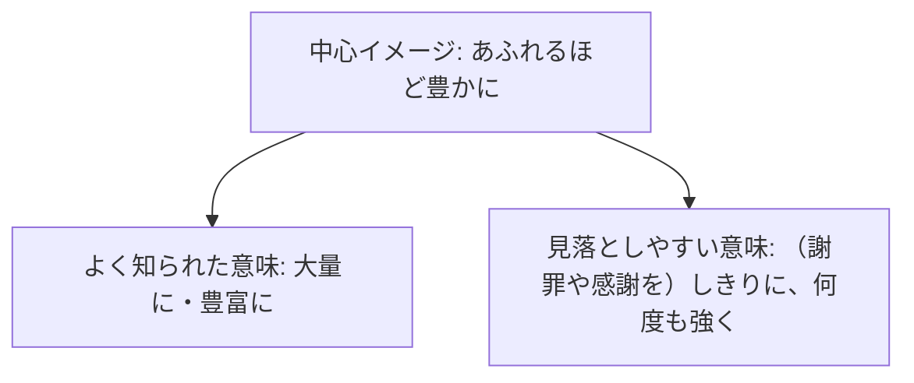

**重要語法：** `apologize profusely`、`thank someone profusely`

<small>global_order: 4881 ／ index: 11204 ／ candidate_id: ev-11204-adverb-01</small>

---

## 02｜prospectus

**品詞：** noun  
**発音：** /prəˈspektəs/

<small>よく知られている意味：学校・講座の案内書</small>

**見落としやすい意味：投資商品や企業の募集内容を記した目論見書**

**例文：** Read the fund's prospectus before investing.

**和訳：** 投資する前に、そのファンドの目論見書を読んでください。

**コアイメージ：** 今後提供されるものの概要を前もって知らせる文書を指す。教育機関では案内書、金融商品では条件やリスクを説明する目論見書になる。

**図：**

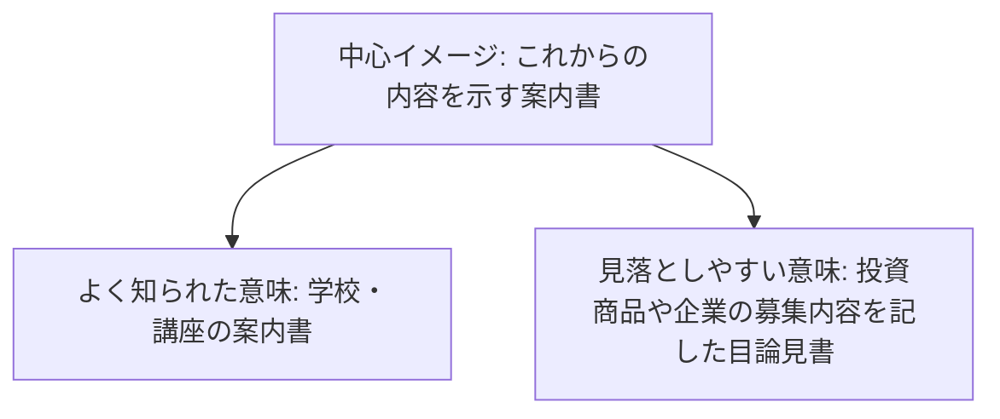

**重要語法：** `a fund prospectus`

<small>global_order: 4882 ／ index: 11206 ／ candidate_id: ev-11206-noun-01</small>

---

## 03｜purveyor

**品詞：** noun  
**発音：** /pəˈveɪə/

<small>よく知られている意味：商品を供給する業者</small>

**見落としやすい意味：情報や考えを広める人、供給者**

**例文：** The site became a purveyor of misleading health claims.

**和訳：** そのサイトは誤解を招く健康情報の発信元になった。

**コアイメージ：** 物を人々に提供する者が基本イメージである。提供する対象が情報や考え方にも広がり、うわさなどを広める人にも使える。

**図：**

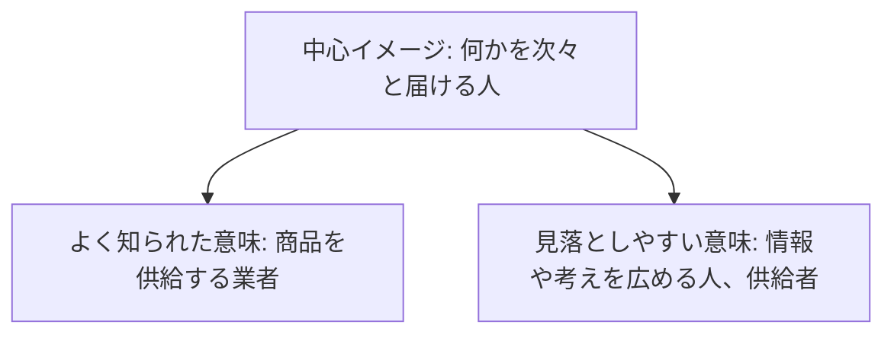

**重要語法：** `a purveyor of rumors`

<small>global_order: 4883 ／ index: 11210 ／ candidate_id: ev-11210-noun-01</small>

---

## 04｜quirk

**品詞：** idiom  
**発音：** /kwɜːk/

<small>よく知られている意味：奇癖・風変わりな特徴</small>

**見落としやすい意味：a quirk of fate：運命のいたずら、思いがけない偶然**

**例文：** By a quirk of fate, they met again in the same town.

**和訳：** 運命のいたずらで、二人は同じ町で再会した。

**コアイメージ：** 人の行動に現れる独特のずれが「癖」である。出来事の流れに現れた予想外のずれは、偶然の巡り合わせと表される。

**図：**

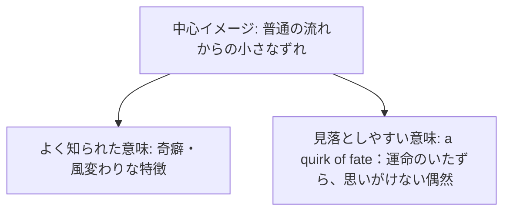

**重要語法：** `a quirk of fate`

<small>global_order: 4884 ／ index: 11214 ／ candidate_id: ev-11214-idiom-01</small>

---

## 05｜registered

**品詞：** fixed expression  
**発音：** /ˈredʒɪstəd/

<small>よく知られている意味：登録済みの</small>

**見落としやすい意味：registered mail：書留郵便**

**例文：** I sent the original document by registered mail.

**和訳：** 私は原本を書留郵便で送った。

**コアイメージ：** 記録簿に登録されるという意味が中心にある。郵便では、差出しや配達の記録を残す扱いを示す。

**図：**

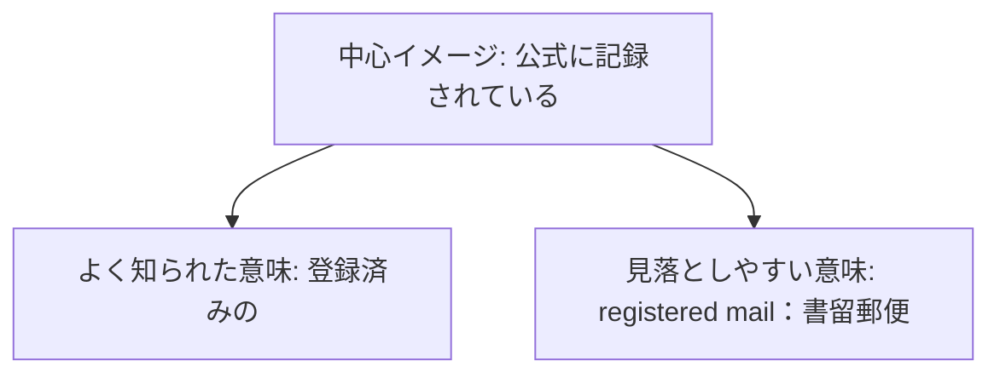

**重要語法：** `registered mail`

<small>global_order: 4885 ／ index: 11225 ／ candidate_id: ev-11225-fixed-expression-01</small>

---

## 06｜rendezvous

**品詞：** verb [I]  
**発音：** /ˈrɒndeɪvuː/

<small>よく知られている意味：待ち合わせ・集合場所（名詞）</small>

**見落としやすい意味：特定の場所・時刻に落ち合う**

**例文：** The rescue teams rendezvoused outside the station.

**和訳：** 救助隊は駅の外で落ち合った。

**コアイメージ：** 人々が約束した一点に集まる場面が中心である。その予定や場所を名詞で表すだけでなく、実際に落ち合う動作を動詞でも言える。

**図：**

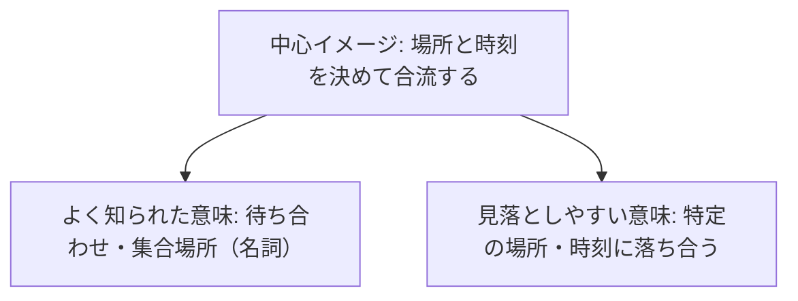

**重要語法：** `rendezvous with someone`

<small>global_order: 4886 ／ index: 11227 ／ candidate_id: ev-11227-rendezvous-01</small>

---

## 07｜rivet

**品詞：** verb (transitive)  
**発音：** /ˈrɪvɪt/

<small>よく知られている意味：リベットで固定する</small>

**見落としやすい意味：（人の注意を）釘付けにする**

**例文：** The documentary riveted the audience from start to finish.

**和訳：** そのドキュメンタリーは最初から最後まで観客の注意を釘付けにした。

**コアイメージ：** 金属を留め具でしっかり固定する動作が元にある。注意や視線が動かなくなる様子にも比喩的に使われる。

**図：**

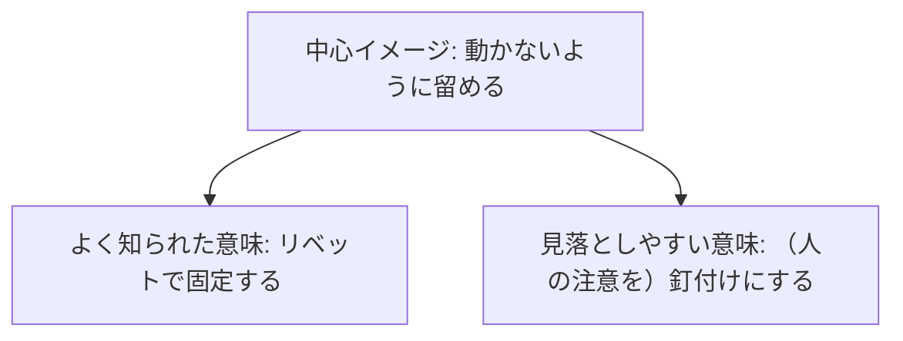

**重要語法：** `be riveted by`、`rivet someone's attention`

<small>global_order: 4887 ／ index: 11233 ／ candidate_id: ev-11233-verb-transitive-01</small>

---

## 08｜rounded

**品詞：** adjective (well-rounded)  
**発音：** /ˈraʊndɪd/

<small>よく知られている意味：丸みを帯びた</small>

**見落としやすい意味：多方面の知識・経験・能力を備えた**

**例文：** The program aims to give students a well-rounded education.

**和訳：** そのプログラムは生徒に幅広い教育を提供することを目指している。

**コアイメージ：** 形に角が少なく丸い状態を表す。能力や教育では、一部分だけでなく多方面がバランスよく育っていることを表す。

**図：**

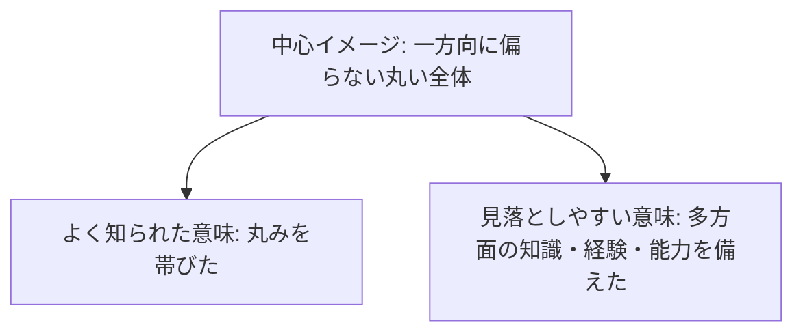

**重要語法：** `well-rounded education`、`well-rounded person`

<small>global_order: 4888 ／ index: 11234 ／ candidate_id: ev-11234-adjective-well-rounded-01</small>

---

## 09｜sacrificial

**品詞：** idiom  
**発音：** /ˌsækrɪˈfɪʃəl/

<small>よく知られている意味：犠牲の・いけにえの</small>

**見落としやすい意味：sacrificial lamb：他者の目的のため犠牲にされる人**

**例文：** The junior manager became a sacrificial lamb after the failure.

**和訳：** 失敗のあと、その若手管理職が責任を負わされる犠牲役になった。

**コアイメージ：** 本来は儀式で差し出される犠牲を表す。比喩では、大きな組織や他者の利益のために責任を押し付けられる人を指す。

**図：**

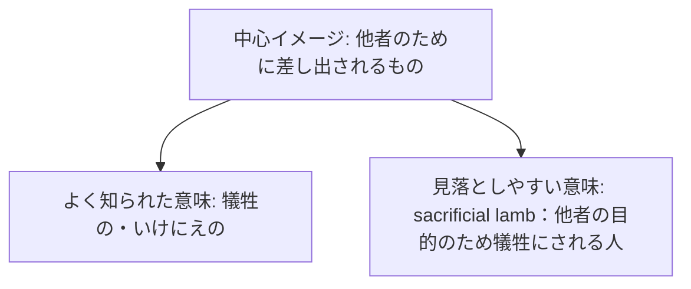

**重要語法：** `a sacrificial lamb`

<small>global_order: 4889 ／ index: 11236 ／ candidate_id: ev-11236-idiom-01</small>

---

## 10｜sedate

**品詞：** adjective  
**発音：** /sɪˈdeɪt/

<small>よく知られている意味：鎮静させる（動詞）</small>

**見落としやすい意味：落ち着いた、活動が控えめで穏やかな**

**例文：** The town has a sedate atmosphere even on weekends.

**和訳：** その町は週末でも落ち着いた雰囲気だ。

**コアイメージ：** 興奮や活動の程度が低い状態が共通している。動詞は鎮静させること、形容詞は控えめで穏やかな性質を表す。

**図：**

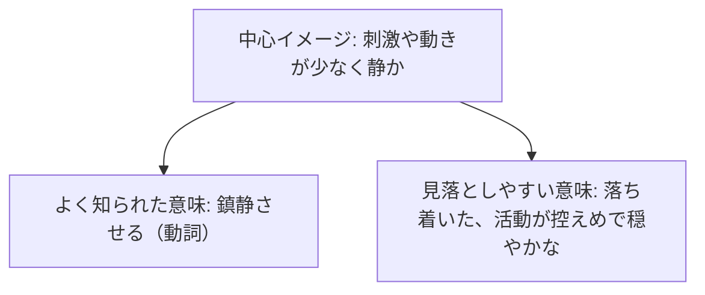

**重要語法：** `a sedate pace`、`sedate surroundings`

<small>global_order: 4890 ／ index: 11244 ／ candidate_id: ev-11244-adjective-01</small>

---

## 11｜seedy

**品詞：** adjective  
**発音：** /ˈsiːdi/

<small>よく知られている意味：種の多い（字義的）</small>

**見落としやすい意味：薄汚れていていかがわしい、うさんくさい**

**例文：** They stayed in a seedy hotel near the station.

**和訳：** 彼らは駅の近くの薄汚れてうさんくさいホテルに泊まった。

**コアイメージ：** 種が多いという字面だけでは、現在の比喩的な意味には届かない。人や場所の様子がみすぼらしく、信用しにくい感じを指す形容詞として覚える。

**図：**

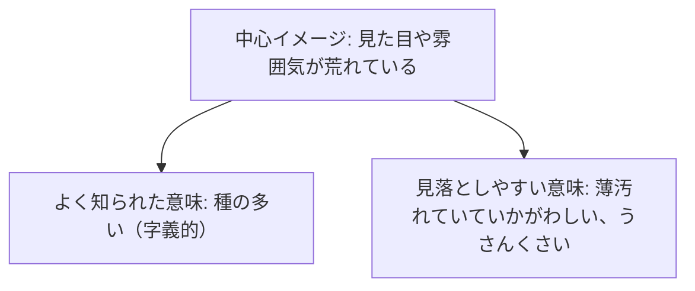

**重要語法：** `a seedy hotel`、`a seedy district`

<small>global_order: 4891 ／ index: 11245 ／ candidate_id: ev-11245-adjective-01</small>

---

## 12｜shifting

**品詞：** idiom  
**発音：** /ˈʃɪftɪŋ/

<small>よく知られている意味：移動する・変化する</small>

**見落としやすい意味：shifting sands：絶えず変化し不安定な状況**

**例文：** The company had to adapt to the shifting sands of online retail.

**和訳：** その会社は変化の激しいネット小売の状況に対応しなければならなかった。

**コアイメージ：** 砂地は踏み固めても形が変わりやすい。そこから状況や条件が安定せず、先が読みにくいという比喩になる。

**図：**

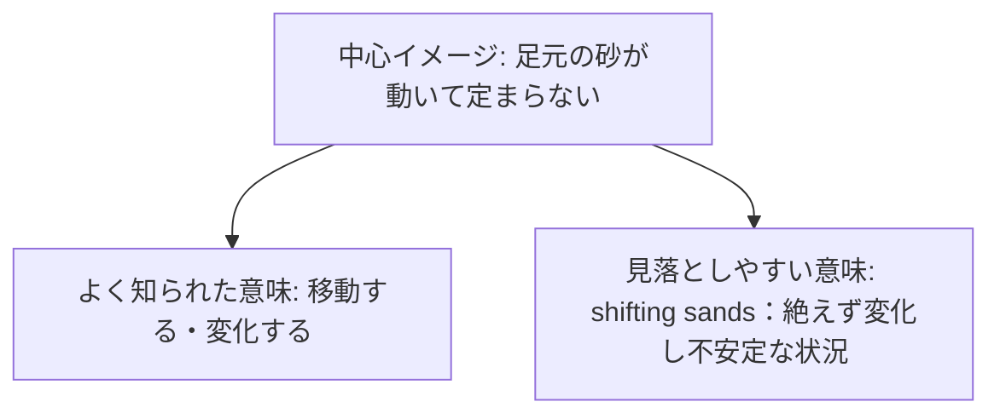

**重要語法：** `the shifting sands of`

<small>global_order: 4892 ／ index: 11249 ／ candidate_id: ev-11249-idiom-01</small>

---

## 13｜shorthand

**品詞：** noun (idiom)  
**発音：** /ˈʃɔːthænd/

<small>よく知られている意味：速記法</small>

**見落としやすい意味：shorthand for：～を簡潔に指す言い方・略称**

**例文：** In this report, 'green' is shorthand for low-carbon technology.

**和訳：** この報告書では「グリーン」は低炭素技術を簡潔に指す言い方だ。

**コアイメージ：** 速記は多くの言葉を少ない記号で記録する。そこから、複雑な考えを手短に指す名称や表現にも使う。

**図：**

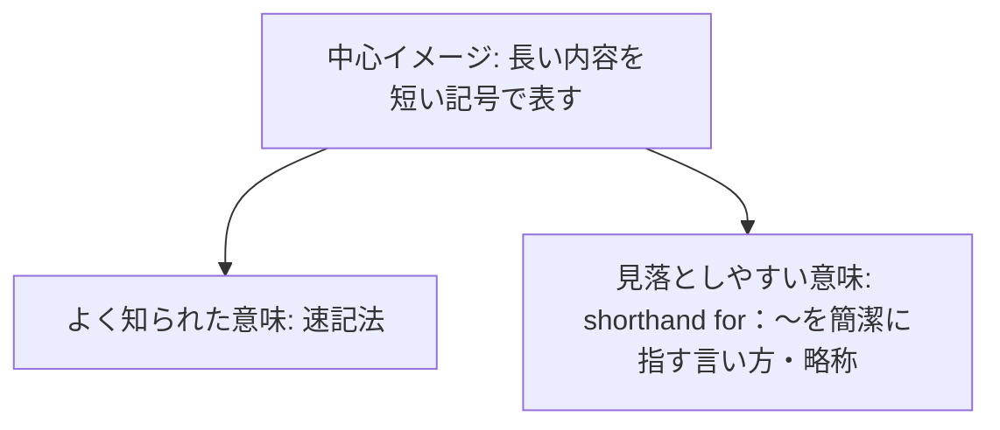

**重要語法：** `shorthand for`

<small>global_order: 4893 ／ index: 11251 ／ candidate_id: ev-11251-noun-idiom-01</small>

---

## 14｜shove

**品詞：** idiom  
**発音：** /ʃʌv/

<small>よく知られている意味：強く押す</small>

**見落としやすい意味：when push comes to shove：いざというときには、切羽詰まれば**

**例文：** When push comes to shove, safety must come first.

**和訳：** いざというときには、安全を最優先しなければならない。

**コアイメージ：** 軽く押す段階から、強く押し合う切迫した段階へ進むイメージである。慣用句では、最後に決断や対応を迫られる局面を表す。

**図：**

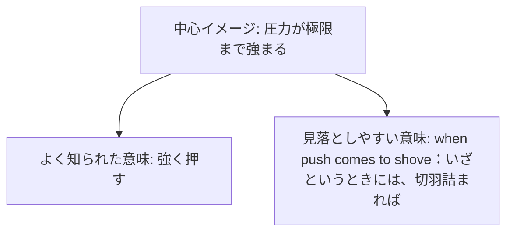

**重要語法：** `when push comes to shove`

<small>global_order: 4894 ／ index: 11252 ／ candidate_id: ev-11252-idiom-01</small>

---

## 15｜sic

**品詞：** adverb (editorial marker)  
**発音：** /sɪk/

<small>よく知られている意味：通常の基本語義はない編集注記</small>

**見落としやすい意味：[sic]：引用元の誤記も原文どおりであることを示す**

**例文：** The article reproduced 'recieve [sic]' exactly as printed.

**和訳：** その記事は印刷されたとおりに「recieve［原文ママ］」と記した。

**コアイメージ：** 引用文に見える誤記が転載時の間違いではない、と読者に知らせる記号である。訳語を当てるより「原文ママ」の注記として読む。

**図：**

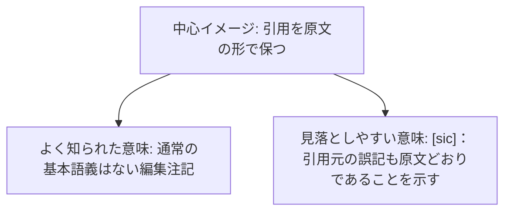

**重要語法：** `[sic]（引用文中の注記）`

<small>global_order: 4895 ／ index: 11253 ／ candidate_id: ev-11253-adverb-editorial-marker-01</small>

---

## 16｜sideline

**品詞：** verb (transitive)  
**発音：** /ˈsaɪdlaɪn/

<small>よく知られている意味：競技場の側線・控え</small>

**見落としやすい意味：人を主要な活動・意思決定から外す**

**例文：** The new policy sidelined local residents from the debate.

**和訳：** 新しい方針によって、地元住民は議論から締め出された。

**コアイメージ：** 競技場の外側は主なプレーから離れた場所である。人を意思決定の中心から遠ざけ、関与できなくする動詞に転じる。

**図：**

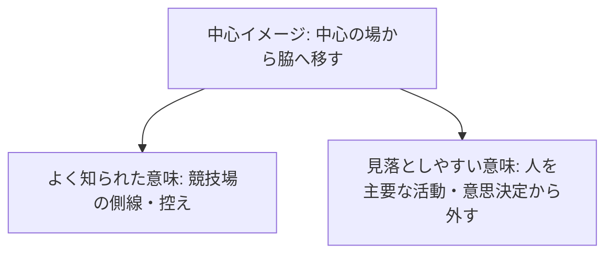

**重要語法：** `be sidelined from`

<small>global_order: 4896 ／ index: 11254 ／ candidate_id: ev-11254-verb-transitive-01</small>

---

## 17｜silo

**品詞：** noun  
**発音：** /ˈsaɪləʊ/

<small>よく知られている意味：穀物貯蔵庫</small>

**見落としやすい意味：組織内で情報や業務が分断された縦割り状態**

**例文：** The teams work in silos and rarely share data.

**和訳：** 各チームは縦割りで働き、データをほとんど共有しない。

**コアイメージ：** サイロは物を区切って保管する設備である。組織では部門が閉じこもり、知識や業務が分断される状態を表す。

**図：**

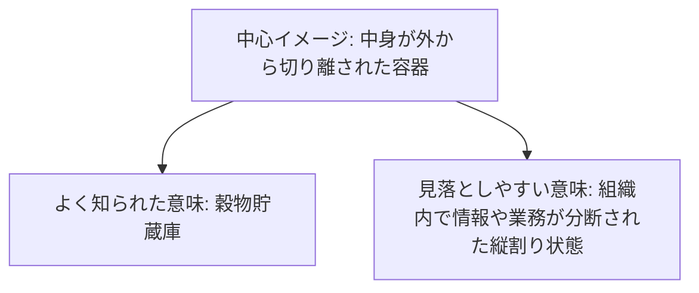

**重要語法：** `work in silos`

<small>global_order: 4897 ／ index: 11255 ／ candidate_id: ev-11255-noun-01</small>

---

## 18｜siphon

**品詞：** verb (phrasal)  
**発音：** /ˈsaɪfən/

<small>よく知られている意味：管で液体を移す</small>

**見落としやすい意味：siphon off：資金などを本来と別の用途へひそかに流用する**

**例文：** The accountant siphoned off money from the charity.

**和訳：** その会計担当者は慈善団体の資金をひそかに流用した。

**コアイメージ：** サイホンで液体を別の場所へ移す動きが元にある。資金などを正規の用途から抜いて別へ流すことにも使う。

**図：**

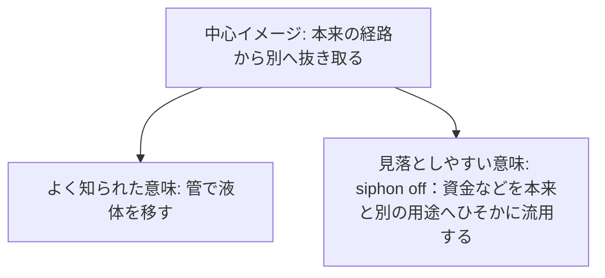

**重要語法：** `siphon off funds`

<small>global_order: 4898 ／ index: 11256 ／ candidate_id: ev-11256-verb-phrasal-01</small>

---

## 19｜sly

**品詞：** idiom  
**発音：** /slaɪ/

<small>よく知られている意味：ずる賢い</small>

**見落としやすい意味：on the sly：人に知られないように、こっそり**

**例文：** They arranged the surprise party on the sly.

**和訳：** 彼らは人に知られないようにサプライズパーティーを準備した。

**コアイメージ：** sly には人に気づかれないよう動く含みがある。on the sly では行動のしかたを表す副詞句になる。

**図：**

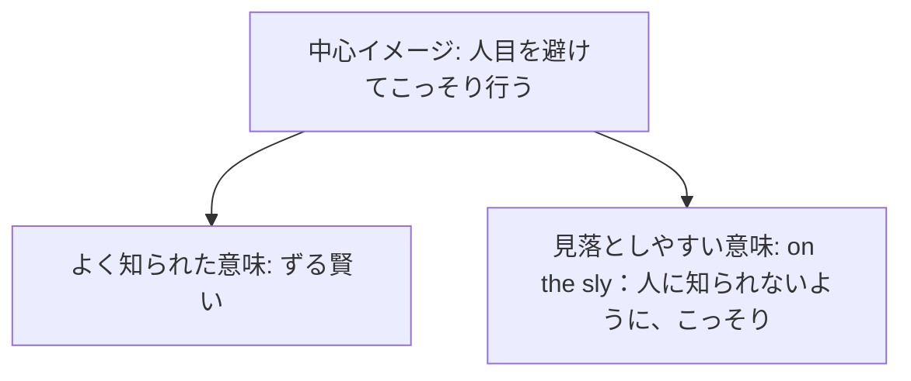

**重要語法：** `on the sly`

<small>global_order: 4899 ／ index: 11260 ／ candidate_id: ev-11260-idiom-01</small>

---

## 20｜softball

**品詞：** noun modifier  
**発音：** /ˈsɒftbɔːl/

<small>よく知られている意味：ソフトボール（競技）</small>

**見落としやすい意味：softball question：相手に答えやすい甘い質問**

**例文：** The reporter opened with a softball question.

**和訳：** 記者は答えやすい甘い質問から始めた。

**コアイメージ：** 競技名をもとに、相手が容易に受け取れる球を比喩的に思い浮かべる。質問について使えば、相手を追い込まない簡単な質問を指す。

**図：**

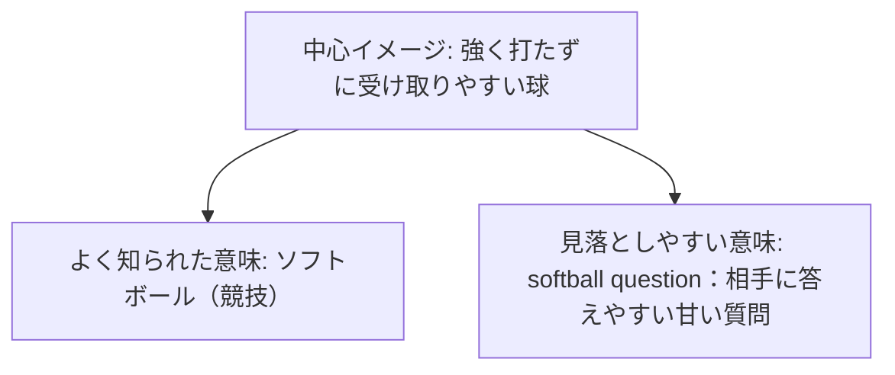

**重要語法：** `a softball question`

<small>global_order: 4900 ／ index: 11262 ／ candidate_id: ev-11262-noun-modifier-01</small>

---

## 21｜spinoff

**品詞：** noun  
**発音：** /ˈspɪnɒf/

<small>よく知られている意味：派生作品・スピンオフ</small>

**見落としやすい意味：既存企業から事業を切り離して成立した会社**

**例文：** The energy division became an independent company through a spinoff.

**和訳：** エネルギー部門は事業分離によって独立した会社になった。

**コアイメージ：** 元の作品から別作品が生まれるのと同じく、事業の一部が母体から分かれる。企業の文脈では独立会社や事業分離を指す。

**図：**

```mermaid
flowchart TD
    A["中心イメージ: 大きなものから一部が分かれる"]
    B["よく知られた意味: 派生作品・スピンオフ"]
    C["見落としやすい意味: 既存企業から事業を切り離して成立した会社"]
    A --> B
    A --> C
```

**重要語法：** `corporate spinoff`

<small>global_order: 4901 ／ index: 11264 ／ candidate_id: ev-11264-noun-01</small>

---

## 22｜spoof

**品詞：** verb  
**発音：** /spuːf/

<small>よく知られている意味：風刺的にまねる・パロディ化する</small>

**見落としやすい意味：メールの差出人や発信元の情報を偽装する**

**例文：** The message spoofed the bank's email address.

**和訳：** そのメッセージは銀行のメールアドレスを偽装していた。

**コアイメージ：** 外見や表現をまねる点はパロディと共通する。情報技術では、差出人や発信元を本物に見せかけて偽る意味になる。

**図：**

```mermaid
flowchart TD
    A["中心イメージ: 見かけだけ本物に似せる"]
    B["よく知られた意味: 風刺的にまねる・パロディ化する"]
    C["見落としやすい意味: メールの差出人や発信元の情報を偽装する"]
    A --> B
    A --> C
```

**重要語法：** `spoof an email address`

<small>global_order: 4902 ／ index: 11265 ／ candidate_id: ev-11265-verb-01</small>

---

## 23｜sporting

**品詞：** adjective (collocation)  
**発音：** /ˈspɔːtɪŋ/

<small>よく知られている意味：スポーツの・スポーツマンらしい</small>

**見落としやすい意味：sporting chance：ある程度見込みのある可能性**

**例文：** With enough practice, our team has a sporting chance of winning.

**和訳：** 十分に練習すれば、私たちのチームにも勝つ見込みはある。

**コアイメージ：** sporting は競技に関わる意味を持つ。sporting chance では、勝負になる程度の現実的な見込みを表す定型表現になる。

**図：**

```mermaid
flowchart TD
    A["中心イメージ: 勝負に参加できるだけの機会"]
    B["よく知られた意味: スポーツの・スポーツマンらしい"]
    C["見落としやすい意味: sporting chance：ある程度見込みのある可能性"]
    A --> B
    A --> C
```

**重要語法：** `a sporting chance of doing`

<small>global_order: 4903 ／ index: 11266 ／ candidate_id: ev-11266-adjective-collocation-01</small>

---

## 24｜stale

**品詞：** adjective  
**発音：** /steɪl/

<small>よく知られている意味：古くなって新鮮でない（食品など）</small>

**見落としやすい意味：（仕事に飽きたり疲れたりして）意欲や活力を失った**

**例文：** After months of the same routine, she felt stale.

**和訳：** 同じ日課を何か月も続けて、彼女は活力を失っていた。

**コアイメージ：** 食べ物の鮮度が落ちることから、刺激や張りが失われる感覚へ広がる。人については疲れやマンネリで意欲が鈍った状態を表す。

**図：**

```mermaid
flowchart TD
    A["中心イメージ: 新鮮さが抜け落ちる"]
    B["よく知られた意味: 古くなって新鮮でない（食品など）"]
    C["見落としやすい意味: （仕事に飽きたり疲れたりして）意欲や活力を失った"]
    A --> B
    A --> C
```

**重要語法：** `feel stale`

<small>global_order: 4904 ／ index: 11268 ／ candidate_id: ev-11268-adjective-01</small>

---

## 25｜staunch

**品詞：** verb  
**発音：** /stɔːntʃ/

<small>よく知られている意味：断固とした・忠実な（形容詞）</small>

**見落としやすい意味：流出や進行を食い止める**

**例文：** The new measures helped staunch the flow of false information.

**和訳：** 新たな対策は偽情報の拡散を食い止めるのに役立った。

**コアイメージ：** 形容詞 staunch の「揺るがない」とは別に、動詞には流出を止める働きがある。血や資金、情報などが外へ流れるのを抑える場面で使う。

**図：**

```mermaid
flowchart TD
    A["中心イメージ: 流れをしっかり止める"]
    B["よく知られた意味: 断固とした・忠実な（形容詞）"]
    C["見落としやすい意味: 流出や進行を食い止める"]
    A --> B
    A --> C
```

**重要語法：** `staunch the flow of`

<small>global_order: 4905 ／ index: 11271 ／ candidate_id: ev-11271-verb-01</small>

---

## 26｜swipe

**品詞：** noun (idiom)  
**発音：** /swaɪp/

<small>よく知られている意味：横に振る一撃・ひと振り</small>

**見落としやすい意味：take a swipe at：相手を痛烈に批判する**

**例文：** The columnist took a swipe at the minister's proposal.

**和訳：** そのコラムニストは大臣の提案を痛烈に批判した。

**コアイメージ：** 手を振って打つ動作が元になる。言葉を相手にぶつける比喩から、批判や当てこすりを表す。

**図：**

```mermaid
flowchart TD
    A["中心イメージ: 素早く横から打ちつける"]
    B["よく知られた意味: 横に振る一撃・ひと振り"]
    C["見落としやすい意味: take a swipe at：相手を痛烈に批判する"]
    A --> B
    A --> C
```

**重要語法：** `take a swipe at`

<small>global_order: 4906 ／ index: 11281 ／ candidate_id: ev-11281-noun-idiom-02</small>

---

## 27｜swipe

**品詞：** verb (transitive, informal)  
**発音：** /swaɪp/

<small>よく知られている意味：画面上で指を滑らせる</small>

**見落としやすい意味：こっそり盗む**

**例文：** Someone swiped my umbrella from the hallway.

**和訳：** 誰かが廊下から私の傘をこっそり盗んだ。

**コアイメージ：** すばやい手の動きを表す語である。口語では、他人の物をさっと持ち去ること、つまり盗むことを指す。

**図：**

```mermaid
flowchart TD
    A["中心イメージ: 素早く手を伸ばして取る"]
    B["よく知られた意味: 画面上で指を滑らせる"]
    C["見落としやすい意味: こっそり盗む"]
    A --> B
    A --> C
```

**重要語法：** `swipe something`

<small>global_order: 4907 ／ index: 11281 ／ candidate_id: ev-11281-verb-transitive-informal-01</small>

---

## 28｜tamper

**品詞：** verb (intransitive phrase)  
**発音：** /ˈtæmpə/

<small>よく知られている意味：機械などを勝手にいじる</small>

**見落としやすい意味：tamper with witnesses：証人などに不当に働きかける**

**例文：** The court investigated claims that someone had tampered with witnesses.

**和訳：** 裁判所は何者かが証人に不当に働きかけたという申し立てを調べた。

**コアイメージ：** 機械や証拠に無断で手を加える動作が元にある。対象が証人になると、証言に影響を与えようと不当に働きかける意味になる。

**図：**

```mermaid
flowchart TD
    A["中心イメージ: 正当でない形で介入する"]
    B["よく知られた意味: 機械などを勝手にいじる"]
    C["見落としやすい意味: tamper with witnesses：証人などに不当に働きかける"]
    A --> B
    A --> C
```

**重要語法：** `tamper with witnesses`

<small>global_order: 4908 ／ index: 11284 ／ candidate_id: ev-11284-verb-intransitive-phrase-01</small>

---

## 29｜telescope

**品詞：** verb  
**発音：** /ˈtelɪskəʊp/

<small>よく知られている意味：望遠鏡（名詞）</small>

**見落としやすい意味：長い過程や期間を短く圧縮する**

**例文：** The director telescoped three meetings into one afternoon.

**和訳：** 責任者は三つの会議を一日の午後に詰め込んだ。

**コアイメージ：** 伸縮する望遠鏡の筒を縮める形が比喩の元にある。時間や作業の長い流れを圧縮する動詞にもなる。

**図：**

```mermaid
flowchart TD
    A["中心イメージ: 長いものを短く縮める"]
    B["よく知られた意味: 望遠鏡（名詞）"]
    C["見落としやすい意味: 長い過程や期間を短く圧縮する"]
    A --> B
    A --> C
```

**重要語法：** `telescope several stages into one`

<small>global_order: 4909 ／ index: 11285 ／ candidate_id: ev-11285-verb-01</small>

---

## 30｜threatened

**品詞：** adjective  
**発音：** /ˈθretənd/

<small>よく知られている意味：脅かされた</small>

**見落としやすい意味：（生物種が）絶滅の恐れのある**

**例文：** The park protects several threatened species.

**和訳：** その公園は絶滅のおそれがある複数の生物種を保護している。

**コアイメージ：** threaten は危険が迫ることを表す。保全の文脈では、種の存続が危うい状態を指す専門的な形容詞として使われる。

**図：**

```mermaid
flowchart TD
    A["中心イメージ: 存続に危険が迫っている"]
    B["よく知られた意味: 脅かされた"]
    C["見落としやすい意味: （生物種が）絶滅の恐れのある"]
    A --> B
    A --> C
```

**重要語法：** `threatened species`

<small>global_order: 4910 ／ index: 11289 ／ candidate_id: ev-11289-adjective-01</small>

---

## 31｜topical

**品詞：** adjective (medical)  
**発音：** /ˈtɒpɪkəl/

<small>よく知られている意味：時事問題に関する</small>

**見落としやすい意味：（薬剤などを）皮膚等の体表に直接用いる**

**例文：** Apply the topical cream only to the affected area.

**和訳：** その外用クリームは患部にだけ塗ってください。

**コアイメージ：** topic に関わるという一般的な意味とは別に、医学では薬を体の表面に直接使うことを表す。話題か体表かは修飾する名詞で判断する。

**図：**

```mermaid
flowchart TD
    A["中心イメージ: 特定の場所や話題に直接向ける"]
    B["よく知られた意味: 時事問題に関する"]
    C["見落としやすい意味: （薬剤などを）皮膚等の体表に直接用いる"]
    A --> B
    A --> C
```

**重要語法：** `topical cream`

<small>global_order: 4911 ／ index: 11290 ／ candidate_id: ev-11290-adjective-medical-01</small>

---

## 32｜travesty

**品詞：** noun (formal)  
**発音：** /ˈtrævəsti/

<small>よく知られている意味：下手な物まね・滑稽なまがい物</small>

**見落としやすい意味：本来の趣旨を損なったひどいまがい物・歪曲**

**例文：** The unfair trial was a travesty of justice.

**和訳：** その不公正な裁判は正義を踏みにじるものだった。

**コアイメージ：** まねたものが本物の価値や趣旨を損なう感覚が中心にある。justice など重要な理念を続けると、その理念を裏切るひどい状況を強く非難する。

**図：**

```mermaid
flowchart TD
    A["中心イメージ: 本来の姿がゆがめられる"]
    B["よく知られた意味: 下手な物まね・滑稽なまがい物"]
    C["見落としやすい意味: 本来の趣旨を損なったひどいまがい物・歪曲"]
    A --> B
    A --> C
```

**重要語法：** `a travesty of justice`

<small>global_order: 4912 ／ index: 11294 ／ candidate_id: ev-11294-noun-formal-01</small>

---

## 33｜twofold

**品詞：** adjective  
**発音：** /ˈtuːfəʊld/

<small>よく知られている意味：二倍の</small>

**見落としやすい意味：（問題・目的・理由などが）二つの側面からなる**

**例文：** The plan has a twofold purpose: save time and reduce errors.

**和訳：** その計画には、時間の節約とミスの削減という二つの目的がある。

**コアイメージ：** two と fold の組み合わせは、二倍という量にも二つの部分にも使われる。purpose や problem に付けば、二つの側面があると読むのが自然である。

**図：**

```mermaid
flowchart TD
    A["中心イメージ: 二つに分かれた構造"]
    B["よく知られた意味: 二倍の"]
    C["見落としやすい意味: （問題・目的・理由などが）二つの側面からなる"]
    A --> B
    A --> C
```

**重要語法：** `a twofold purpose`

<small>global_order: 4913 ／ index: 11297 ／ candidate_id: ev-11297-adjective-01</small>

---

## 34｜unused

**品詞：** adjective (fixed construction)  
**発音：** /ˌʌnˈjuːzd/

<small>よく知られている意味：使われていない</small>

**見落としやすい意味：be unused to：～に慣れていない**

**例文：** I was unused to speaking in front of a large audience.

**和訳：** 私は大勢の前で話すことに慣れていなかった。

**コアイメージ：** unused は使われていない物を表す一方、人の経験についても使う。be unused to の後では慣れていない活動や状況を示す。

**図：**

```mermaid
flowchart TD
    A["中心イメージ: 十分な経験がない状態"]
    B["よく知られた意味: 使われていない"]
    C["見落としやすい意味: be unused to：～に慣れていない"]
    A --> B
    A --> C
```

**重要語法：** `be unused to + 名詞・動名詞`

<small>global_order: 4914 ／ index: 11308 ／ candidate_id: ev-11308-adjective-fixed-construc-01</small>

---

## 35｜visitation

**品詞：** noun phrase  
**発音：** /ˌvɪzɪˈteɪʃən/

<small>よく知られている意味：訪問・訪れること</small>

**見落としやすい意味：visitation rights：親などが子どもと面会・交流する権利**

**例文：** The agreement protects both parents' visitation rights.

**和訳：** その合意は両親それぞれの子どもとの面会交流の権利を守っている。

**コアイメージ：** 訪れる行為を指す語が基礎にある。家庭法の表現では、親が子どもと会い交流する機会を保障する権利を指す。

**図：**

```mermaid
flowchart TD
    A["中心イメージ: 会いに行く機会を認める"]
    B["よく知られた意味: 訪問・訪れること"]
    C["見落としやすい意味: visitation rights：親などが子どもと面会・交流する権利"]
    A --> B
    A --> C
```

**重要語法：** `visitation rights`

<small>global_order: 4915 ／ index: 11315 ／ candidate_id: ev-11315-noun-phrase-01</small>

---

## 36｜wallow

**品詞：** verb (wallow in)  
**発音：** /ˈwɒləʊ/

<small>よく知られている意味：泥や水の中を転げ回る</small>

**見落としやすい意味：悲しみや自己憐憫などの感情に浸り、抜け出そうとしない**

**例文：** He spent the weekend wallowing in self-pity.

**和訳：** 彼は週末を自己憐憫に浸って過ごした。

**コアイメージ：** 泥の中でいつまでも転げ回る動作が元にある。感情については、つらい気持ちに浸り続けてそこから離れようとしない様子を表す。

**図：**

```mermaid
flowchart TD
    A["中心イメージ: 何かの中に長く身を置く"]
    B["よく知られた意味: 泥や水の中を転げ回る"]
    C["見落としやすい意味: 悲しみや自己憐憫などの感情に浸り、抜け出そうとしない"]
    A --> B
    A --> C
```

**重要語法：** `wallow in self-pity`

<small>global_order: 4916 ／ index: 11319 ／ candidate_id: ev-11319-verb-wallow-in-01</small>

---

## 37｜watchdog

**品詞：** noun  
**発音：** /ˈwɒtʃdɒɡ/

<small>よく知られている意味：番犬</small>

**見落としやすい意味：行政や企業を監視する団体・監視役**

**例文：** An independent watchdog monitors public spending.

**和訳：** 独立した監視団体が公的支出を監視している。

**コアイメージ：** 番犬は外からの危険を見張る役割を担う。そこから権力や企業の行動を監視する人・団体へ意味が広がる。

**図：**

```mermaid
flowchart TD
    A["中心イメージ: 不正や危険を見張る"]
    B["よく知られた意味: 番犬"]
    C["見落としやすい意味: 行政や企業を監視する団体・監視役"]
    A --> B
    A --> C
```

**重要語法：** `an independent watchdog`

<small>global_order: 4917 ／ index: 11322 ／ candidate_id: ev-11322-noun-01</small>

---

## 38｜wedlock

**品詞：** idiom  
**発音：** /ˈwedlɒk/

<small>よく知られている意味：婚姻・結婚生活</small>

**見落としやすい意味：out of wedlock：法的な婚姻関係にない状態で**

**例文：** The law gives equal protection to children born out of wedlock.

**和訳：** その法律は、婚姻関係にない親のもとで生まれた子どもにも平等な保護を与える。

**コアイメージ：** wedlock は結婚している状態を指す。out of を付けると、その法的な婚姻関係の外であることを表す。

**図：**

```mermaid
flowchart TD
    A["中心イメージ: 婚姻という法的な結びつき"]
    B["よく知られた意味: 婚姻・結婚生活"]
    C["見落としやすい意味: out of wedlock：法的な婚姻関係にない状態で"]
    A --> B
    A --> C
```

**重要語法：** `out of wedlock`

<small>global_order: 4918 ／ index: 11324 ／ candidate_id: ev-11324-idiom-01</small>

---

## 39｜weighted

**品詞：** adjective (passive construction)  
**発音：** /ˈweɪtɪd/

<small>よく知られている意味：重みづけされた</small>

**見落としやすい意味：be weighted in favour of/against：特定の側に有利・不利に偏っている**

**例文：** The selection process was weighted in favour of experienced applicants.

**和訳：** 選考方法は経験豊富な応募者に有利になるよう偏っていた。

**コアイメージ：** weight を加えると片側が重くなり、均衡が変わる。評価や制度に使うと特定の側に有利または不利な偏りがあることを表す。

**図：**

```mermaid
flowchart TD
    A["中心イメージ: 一方に重りが多く載る"]
    B["よく知られた意味: 重みづけされた"]
    C["見落としやすい意味: be weighted in favour of/against：特定の側に有利・不利に偏っている"]
    A --> B
    A --> C
```

**重要語法：** `be weighted in favour of`、`be weighted against`

<small>global_order: 4919 ／ index: 11325 ／ candidate_id: ev-11325-adjective-passive-constr-01</small>

---

## 40｜whiff

**品詞：** noun (figurative)  
**発音：** /wɪf/

<small>よく知られている意味：かすかなにおい</small>

**見落としやすい意味：a whiff of：問題・疑惑などのわずかな気配**

**例文：** The report raised a whiff of scandal around the project.

**和訳：** その報告書によって、その事業にわずかな不祥事の疑いが生じた。

**コアイメージ：** すぐ消えそうな微かなにおいが基本イメージである。疑惑や問題にも用い、その兆しがわずかに感じられることを表す。

**図：**

```mermaid
flowchart TD
    A["中心イメージ: ほのかに漂う気配"]
    B["よく知られた意味: かすかなにおい"]
    C["見落としやすい意味: a whiff of：問題・疑惑などのわずかな気配"]
    A --> B
    A --> C
```

**重要語法：** `a whiff of scandal`

<small>global_order: 4920 ／ index: 11326 ／ candidate_id: ev-11326-noun-figurative-01</small>

---

## 41｜wiggle

**品詞：** idiom  
**発音：** /ˈwɪɡəl/

<small>よく知られている意味：体を小さくくねらせる</small>

**見落としやすい意味：wiggle room：交渉や判断での融通の余地**

**例文：** There is little wiggle room in this budget.

**和訳：** この予算にはほとんど融通の余地がない。

**コアイメージ：** wiggle は体を小さく動かすことを表す。room と結びつくと、制約の中でも判断や交渉を動かせる幅を指す。

**図：**

```mermaid
flowchart TD
    A["中心イメージ: 狭い場所でも動ける小さな余地"]
    B["よく知られた意味: 体を小さくくねらせる"]
    C["見落としやすい意味: wiggle room：交渉や判断での融通の余地"]
    A --> B
    A --> C
```

**重要語法：** `wiggle room`

<small>global_order: 4921 ／ index: 11330 ／ candidate_id: ev-11330-idiom-01</small>

---

## 42｜woefully

**品詞：** adverb  
**発音：** /ˈwəʊfəli/

<small>よく知られている意味：悲しげに・嘆かわしく</small>

**見落としやすい意味：ひどく、残念なほど（不十分・不足している）**

**例文：** The school was woefully unprepared for the storm.

**和訳：** その学校は嵐への備えがひどく不十分だった。

**コアイメージ：** 悲しみを伴う悪い状態の感覚が元にある。不足・不備を表す語を強く修飾し、単なる「悲しそうに」とは訳さない。

**図：**

```mermaid
flowchart TD
    A["中心イメージ: 残念なほど程度がひどい"]
    B["よく知られた意味: 悲しげに・嘆かわしく"]
    C["見落としやすい意味: ひどく、残念なほど（不十分・不足している）"]
    A --> B
    A --> C
```

**重要語法：** `woefully inadequate`、`woefully unprepared`

<small>global_order: 4922 ／ index: 11335 ／ candidate_id: ev-11335-adverb-01</small>

---

## 43｜works

**品詞：** plural noun (idiom)  
**発音：** /wɜːks/

<small>よく知られている意味：仕事・作品（workの複数）</small>

**見落としやすい意味：the works：期待されるもの一式、全部**

**例文：** We ordered a pizza with the works.

**和訳：** 私たちは具材を全部載せたピザを注文した。

**コアイメージ：** works はさまざまなものの集まりとして使われることがある。the works では、通常期待される付属品や内容を全部含めた一式を表す。

**図：**

```mermaid
flowchart TD
    A["中心イメージ: 必要なものを一式そろえる"]
    B["よく知られた意味: 仕事・作品（workの複数）"]
    C["見落としやすい意味: the works：期待されるもの一式、全部"]
    A --> B
    A --> C
```

**重要語法：** `with the works`

<small>global_order: 4923 ／ index: 11336 ／ candidate_id: ev-11336-plural-noun-idiom-01</small>

---

## 44｜wry

**品詞：** adjective  
**発音：** /raɪ/

<small>よく知られている意味：ゆがんだ・ねじれた</small>

**見落としやすい意味：皮肉を含みながら苦境を少しおかしがる**

**例文：** She gave a wry smile when the train was delayed again.

**和訳：** 電車がまた遅れたとき、彼女は皮肉っぽく苦笑した。

**コアイメージ：** 表情がまっすぐでなく少しゆがむ感覚から、皮肉や苦さを含む反応へつながる。困った状況を少しおかしく受け止める笑いに使われる。

**図：**

```mermaid
flowchart TD
    A["中心イメージ: 素直に喜べない、ひねりのある反応"]
    B["よく知られた意味: ゆがんだ・ねじれた"]
    C["見落としやすい意味: 皮肉を含みながら苦境を少しおかしがる"]
    A --> B
    A --> C
```

**重要語法：** `a wry smile`

<small>global_order: 4924 ／ index: 11337 ／ candidate_id: ev-11337-adjective-01</small>

---

## 45｜yoke

**品詞：** verb (transitive, often passive)  
**発音：** /jəʊk/

<small>よく知られている意味：くびき・家畜をつなぐ道具</small>

**見落としやすい意味：異なる要素を結びつけ、一緒にする**

**例文：** The merger yoked two very different companies together.

**和訳：** その合併は性格の大きく異なる二つの会社を結びつけた。

**コアイメージ：** くびきは二頭の動物を並べてつなぐ道具である。そこから、異なる人や組織を一緒に結びつける動詞になる。

**図：**

```mermaid
flowchart TD
    A["中心イメージ: 別々のものを一つの枠でつなぐ"]
    B["よく知られた意味: くびき・家畜をつなぐ道具"]
    C["見落としやすい意味: 異なる要素を結びつけ、一緒にする"]
    A --> B
    A --> C
```

**重要語法：** `yoke A and B together`

<small>global_order: 4925 ／ index: 11338 ／ candidate_id: ev-11338-verb-transitive-often-pa-01</small>

---

## 46｜fried

**品詞：** adjective  
**発音：** /fraɪd/

<small>よく知られている意味：揚げた・炒めた</small>

**見落としやすい意味：疲れ切って頭が働かない、くたくたの**

**例文：** After studying all night, my brain felt fried.

**和訳：** 一晩中勉強して、頭が疲れ切っていた。

**コアイメージ：** 調理で強い熱を受けた状態から、口語では体や頭の働きが消耗しきった状態を表す。能力を批判するより疲れの程度を伝える表現である。

**図：**

```mermaid
flowchart TD
    A["中心イメージ: 熱を受けてすっかり消耗する"]
    B["よく知られた意味: 揚げた・炒めた"]
    C["見落としやすい意味: 疲れ切って頭が働かない、くたくたの"]
    A --> B
    A --> C
```

**重要語法：** `feel fried`

<small>global_order: 4926 ／ index: 11345 ／ candidate_id: ev-11345-adjective-01</small>

---

## 47｜favour

**品詞：** verb  
**発音：** /ˈfeɪvə/

<small>よく知られている意味：好む・支持する・優遇する</small>

**見落としやすい意味：けがや痛みのある部位をかばう**

**例文：** He was favouring his injured knee as he walked.

**和訳：** 彼は歩きながら痛めた膝をかばっていた。

**コアイメージ：** 特定の対象を優先して扱うのが共通する感覚である。痛めた体の部位については、負担をかけないようにかばう動作を表す。

**図：**

```mermaid
flowchart TD
    A["中心イメージ: 一方に特別な配慮を向ける"]
    B["よく知られた意味: 好む・支持する・優遇する"]
    C["見落としやすい意味: けがや痛みのある部位をかばう"]
    A --> B
    A --> C
```

**重要語法：** `favour an injured leg`

<small>global_order: 4927 ／ index: 11346 ／ candidate_id: ev-11346-verb-01</small>

---

## 48｜aged

**品詞：** adjective  
**発音：** /ˈeɪdʒɪd/（年老いた）・/eɪdʒd/（年齢を示す）

<small>よく知られている意味：～歳の（/eɪdʒd/）</small>

**見落としやすい意味：aged：年齢を表す場合と「年老いた」の場合で発音が異なる**

**例文：** The aged residents, many aged over ninety, received extra care.

**和訳：** 多くが90歳を超える高齢の住民たちは、追加の介護を受けた。

**コアイメージ：** 同じ綴りでも「年老いた」と性質を表す aged は二音節で発音する。一方、「何歳の」と年齢を示す aged は通常一音節になる。

**図：**

```mermaid
flowchart TD
    A["中心イメージ: 年齢を経た状態を二通りで表す"]
    B["よく知られた意味: ～歳の（/eɪdʒd/）"]
    C["見落としやすい意味: aged：年齢を表す場合と「年老いた」の場合で発音が異なる"]
    A --> B
    A --> C
```

**重要語法：** `an aged person /ˈeɪdʒɪd/`、`aged 90 /eɪdʒd/`

<small>global_order: 4928 ／ index: 11347 ／ candidate_id: ev-11347-adjective-01</small>

---

## 49｜honour

**品詞：** verb (transitive, UK)  
**発音：** /ˈɒnə/

<small>よく知られている意味：敬う・名誉を与える</small>

**見落としやすい意味：（小切手・契約などを）履行・承認し有効に扱う**

**例文：** The company promised to honour the original contract.

**和訳：** その会社は元の契約を履行すると約束した。

**コアイメージ：** 人を尊重することが基本にある。契約や支払条件については、取り決めを正当なものとして扱い、実行する意味になる。

**図：**

```mermaid
flowchart TD
    A["中心イメージ: 約束や価値を正当に認める"]
    B["よく知られた意味: 敬う・名誉を与える"]
    C["見落としやすい意味: （小切手・契約などを）履行・承認し有効に扱う"]
    A --> B
    A --> C
```

**重要語法：** `honour a contract`、`honour a cheque`

<small>global_order: 4929 ／ index: 11348 ／ candidate_id: ev-11348-verb-transitive-uk-01</small>

---

## 50｜judgement

**品詞：** noun phrase  
**発音：** /ˈdʒʌdʒmənt/

<small>よく知られている意味：判断・判決</small>

**見落としやすい意味：judgement call：判断者の裁量に委ねられる難しい決断**

**例文：** Whether to cancel the trip is a judgement call.

**和訳：** 旅行を中止するかどうかは、状況を見て判断するしかない難しい決断だ。

**コアイメージ：** judgement は事実や状況を評価して結論を出すことを表す。judgement call では、機械的な基準だけでは決まらない裁量判断を指す。

**図：**

```mermaid
flowchart TD
    A["中心イメージ: 明確な正解がなく判断に委ねる"]
    B["よく知られた意味: 判断・判決"]
    C["見落としやすい意味: judgement call：判断者の裁量に委ねられる難しい決断"]
    A --> B
    A --> C
```

**重要語法：** `a judgement call`

<small>global_order: 4930 ／ index: 11350 ／ candidate_id: ev-11350-noun-phrase-01</small>

---

## 51｜economics

**品詞：** noun  
**発音：** /ˌiːkəˈnɒmɪks/

<small>よく知られている意味：経済学</small>

**見落としやすい意味：事業や計画の採算性、経済的な成り立ち**

**例文：** The economics of running the service no longer make sense.

**和訳：** そのサービスを運営する採算がもう合わなくなっている。

**コアイメージ：** 経済を研究する学問名から、個別の事業にかかるお金の構造にも使われる。運営費や収益を含めて成り立つかどうかを表す。

**図：**

```mermaid
flowchart TD
    A["中心イメージ: 費用と利益の釣り合い"]
    B["よく知られた意味: 経済学"]
    C["見落としやすい意味: 事業や計画の採算性、経済的な成り立ち"]
    A --> B
    A --> C
```

**重要語法：** `the economics of a project`

<small>global_order: 4931 ／ index: 11352 ／ candidate_id: ev-11352-noun-01</small>

---

## 52｜erase

**品詞：** verb [T]  
**発音：** /ɪˈreɪz/

<small>よく知られている意味：文字・印を消す</small>

**見落としやすい意味：（疑念や記憶などを）払拭する、心に残らないようにする**

**例文：** One honest answer cannot erase all their doubts.

**和訳：** 一度率直に答えただけでは、彼らの疑念をすべて払拭できない。

**コアイメージ：** 書かれた文字を取り除くのが基本イメージである。記憶や不安などの心に残る痕跡をなくす意味へ広がる。

**図：**

```mermaid
flowchart TD
    A["中心イメージ: 痕跡を見えなくする"]
    B["よく知られた意味: 文字・印を消す"]
    C["見落としやすい意味: （疑念や記憶などを）払拭する、心に残らないようにする"]
    A --> B
    A --> C
```

**重要語法：** `erase doubts`、`erase a memory`

<small>global_order: 4932 ／ index: 11357 ／ candidate_id: ev-11357-erase-01</small>

---

## 53｜rumble

**品詞：** phrasal verb (rumble on)  
**発音：** /ˈrʌmbəl/

<small>よく知られている意味：低く重い音を立てる</small>

**見落としやすい意味：意見の対立などが解決されないまま長引く**

**例文：** The dispute over the new rules rumbled on for months.

**和訳：** 新しい規則をめぐる対立は何か月も解決しないまま続いた。

**コアイメージ：** rumble には重い音が長く響く感じがある。対立や議論に使うと、収まらずにくすぶり続ける様子を表す。

**図：**

```mermaid
flowchart TD
    A["中心イメージ: 低い音が遠くまで続く"]
    B["よく知られた意味: 低く重い音を立てる"]
    C["見落としやすい意味: 意見の対立などが解決されないまま長引く"]
    A --> B
    A --> C
```

**重要語法：** `rumble on`

<small>global_order: 4933 ／ index: 11360 ／ candidate_id: ev-11360-rumble-on-01</small>

---

## 54｜differentiation

**品詞：** noun  
**発音：** /ˌdɪfərenʃiˈeɪʃən/

<small>よく知られている意味：微分（数学）</small>

**見落としやすい意味：製品やサービスを競合と区別する差別化**

**例文：** Good customer support can be a source of product differentiation.

**和訳：** 丁寧な顧客対応は製品の差別化につながりうる。

**コアイメージ：** differentiate は二つのものの違いを作り分けることを表す。数学では変化を扱うが、ビジネスでは競合との違いを際立たせる意味になる。

**図：**

```mermaid
flowchart TD
    A["中心イメージ: 違いをはっきりさせる"]
    B["よく知られた意味: 微分（数学）"]
    C["見落としやすい意味: 製品やサービスを競合と区別する差別化"]
    A --> B
    A --> C
```

**重要語法：** `product differentiation`

<small>global_order: 4934 ／ index: 11362 ／ candidate_id: ev-11362-noun-01</small>

---

## 55｜numb

**品詞：** adjective  
**発音：** /nʌm/

<small>よく知られている意味：しびれて感覚がない</small>

**見落としやすい意味：衝撃などで感情が麻痺し、ものを考えられない**

**例文：** She felt numb after hearing the unexpected news.

**和訳：** 彼女は予想外の知らせを聞いて、感情が麻痺したようになった。

**コアイメージ：** 体の感覚が鈍る状態が出発点である。強い衝撃を受けて感情や思考が働かない状態にも使う。

**図：**

```mermaid
flowchart TD
    A["中心イメージ: 刺激を感じられなくなる"]
    B["よく知られた意味: しびれて感覚がない"]
    C["見落としやすい意味: 衝撃などで感情が麻痺し、ものを考えられない"]
    A --> B
    A --> C
```

**重要語法：** `feel numb`

<small>global_order: 4935 ／ index: 11365 ／ candidate_id: ev-11365-numb-01</small>

---

## 56｜optimum

**品詞：** noun  
**発音：** /ˈɒptɪməm/

<small>よく知られている意味：最適な（形容詞）</small>

**見落としやすい意味：最もよい条件・値、最適値**

**例文：** The researchers searched for an optimum between speed and accuracy.

**和訳：** 研究者たちは速さと正確さの最適なバランスを探した。

**コアイメージ：** 複数の条件を比べて最も望ましい水準を指す。形容詞として条件を修飾するほか、その水準そのものを名詞として表せる。

**図：**

```mermaid
flowchart TD
    A["中心イメージ: 最もよい一点"]
    B["よく知られた意味: 最適な（形容詞）"]
    C["見落としやすい意味: 最もよい条件・値、最適値"]
    A --> B
    A --> C
```

**重要語法：** `reach an optimum`

<small>global_order: 4936 ／ index: 11367 ／ candidate_id: ev-11367-noun-01</small>

---

## 57｜repel

**品詞：** verb  
**発音：** /rɪˈpel/

<small>よく知られている意味：追い払う・撃退する</small>

**見落としやすい意味：人に不快感や嫌悪感を抱かせる**

**例文：** The harsh tone of the advertisement repelled many viewers.

**和訳：** その広告のきつい口調は、多くの視聴者に嫌悪感を抱かせた。

**コアイメージ：** 物理的に何かを押し返す力が元にある。人の感情については、不快にさせて心理的に遠ざける意味になる。

**図：**

```mermaid
flowchart TD
    A["中心イメージ: 相手を近寄らせない力"]
    B["よく知られた意味: 追い払う・撃退する"]
    C["見落としやすい意味: 人に不快感や嫌悪感を抱かせる"]
    A --> B
    A --> C
```

**重要語法：** `repel customers`

<small>global_order: 4937 ／ index: 11371 ／ candidate_id: ev-11371-verb-01</small>

---

## 58｜postgraduate

**品詞：** noun  
**発音：** /ˌpəʊstˈɡrædʒuət/

<small>よく知られている意味：大学院の・卒業後の課程の（形容詞）</small>

**見落としやすい意味：大学院生、卒業後の課程で学ぶ人**

**例文：** A postgraduate presented the findings at the seminar.

**和訳：** 大学院生がゼミで研究成果を発表した。

**コアイメージ：** post は「後」を表し、graduate は大学卒業者を指す。課程を修飾する形容詞だけでなく、その課程で学ぶ人を名詞でも表せる。

**図：**

```mermaid
flowchart TD
    A["中心イメージ: 大学を卒業した後の学習段階"]
    B["よく知られた意味: 大学院の・卒業後の課程の（形容詞）"]
    C["見落としやすい意味: 大学院生、卒業後の課程で学ぶ人"]
    A --> B
    A --> C
```

**重要語法：** `a postgraduate`

<small>global_order: 4938 ／ index: 11373 ／ candidate_id: ev-11373-noun-01</small>

---

## 59｜acidic

**品詞：** adjective  
**発音：** /əˈsɪdɪk/

<small>よく知られている意味：酸性の</small>

**見落としやすい意味：（発言などが）辛辣でとげがある**

**例文：** His acidic remark made the discussion uncomfortable.

**和訳：** 彼の辛辣な一言で、議論の場は気まずくなった。

**コアイメージ：** 酸には刺激的で鋭い印象がある。発言に使うと、聞く人を刺すような辛辣さを表す比喩になる。

**図：**

```mermaid
flowchart TD
    A["中心イメージ: 刺激の強い酸の感覚"]
    B["よく知られた意味: 酸性の"]
    C["見落としやすい意味: （発言などが）辛辣でとげがある"]
    A --> B
    A --> C
```

**重要語法：** `an acidic comment`

<small>global_order: 4939 ／ index: 11378 ／ candidate_id: ev-11378-adjective-01</small>

---

## 60｜abreast

**品詞：** adverb (idiom)  
**発音：** /əˈbrest/

<small>よく知られている意味：横に並んで</small>

**見落としやすい意味：keep abreast of：最新の状況や情報を把握し続ける**

**例文：** Doctors must keep abreast of new research.

**和訳：** 医師は新しい研究の動向を把握し続けなければならない。

**コアイメージ：** 横並びで遅れず進むという空間的イメージが中心である。情報や進歩についていく場合は、最新の状況を知り続ける意味になる。

**図：**

```mermaid
flowchart TD
    A["中心イメージ: 変化と同じ位置に並んで進む"]
    B["よく知られた意味: 横に並んで"]
    C["見落としやすい意味: keep abreast of：最新の状況や情報を把握し続ける"]
    A --> B
    A --> C
```

**重要語法：** `keep abreast of`

<small>global_order: 4940 ／ index: 11382 ／ candidate_id: ev-11382-adverb-idiom-01</small>

---

## 61｜abridge

**品詞：** verb (transitive)  
**発音：** /əˈbrɪdʒ/

<small>よく知られている意味：文章を短縮する</small>

**見落としやすい意味：（権利・自由などを）制限・縮小する**

**例文：** The court ruled that the rule would abridge free speech.

**和訳：** 裁判所は、その規則が言論の自由を制限すると判断した。

**コアイメージ：** 文章を短くする動作が元になる。権利や自由に向けると、認められた範囲を狭めることを表す。

**図：**

```mermaid
flowchart TD
    A["中心イメージ: 本来の長さや範囲を削る"]
    B["よく知られた意味: 文章を短縮する"]
    C["見落としやすい意味: （権利・自由などを）制限・縮小する"]
    A --> B
    A --> C
```

**重要語法：** `abridge rights`

<small>global_order: 4941 ／ index: 11383 ／ candidate_id: ev-11383-verb-transitive-01</small>

---

## 62｜adamant

**品詞：** adjective (construction)  
**発音：** /ˈædəmənt/

<small>よく知られている意味：断固とした</small>

**見落としやすい意味：adamant that：～という考えを頑として譲らない**

**例文：** She was adamant that the records should remain public.

**和訳：** 彼女は記録を公開したままにすべきだと頑として譲らなかった。

**コアイメージ：** 考えを変えない強い意志が中心にある。that 節を続けると、譲らない主張の具体的な内容を表せる。

**図：**

```mermaid
flowchart TD
    A["中心イメージ: 立場を固く保って動かない"]
    B["よく知られた意味: 断固とした"]
    C["見落としやすい意味: adamant that：～という考えを頑として譲らない"]
    A --> B
    A --> C
```

**重要語法：** `be adamant that ...`

<small>global_order: 4942 ／ index: 11385 ／ candidate_id: ev-11385-adjective-construction-01</small>

---

## 63｜allergic

**品詞：** adjective construction  
**発音：** /əˈlɜːdʒɪk/

<small>よく知られている意味：アレルギーがある</small>

**見落としやすい意味：be allergic to：～を極端に嫌がる、強い拒否感を示す**

**例文：** The director seems allergic to unnecessary meetings.

**和訳：** その責任者は不必要な会議をひどく嫌がるようだ。

**コアイメージ：** 体が特定の物質に過敏に反応することが基本義である。比喩では、ある考えや行動に強い拒否感を示す。

**図：**

```mermaid
flowchart TD
    A["中心イメージ: あるものを強く拒む"]
    B["よく知られた意味: アレルギーがある"]
    C["見落としやすい意味: be allergic to：～を極端に嫌がる、強い拒否感を示す"]
    A --> B
    A --> C
```

**重要語法：** `be allergic to + 名詞`

<small>global_order: 4943 ／ index: 11390 ／ candidate_id: ev-11390-adjective-construction-01</small>

---

## 64｜alma

**品詞：** fixed expression  
**発音：** /ˌælmə ˈmeɪtə/（alma mater）

<small>よく知られている意味：単独では一般的な英単語として使わない</small>

**見落としやすい意味：alma mater：母校、かつて学んだ学校**

**例文：** She returned to her alma mater to give a lecture.

**和訳：** 彼女は講演するために母校へ戻った。

**コアイメージ：** alma mater はラテン語由来の決まった二語の表現である。alma だけを切り出して訳すのではなく、全体で母校と理解する。

**図：**

```mermaid
flowchart TD
    A["中心イメージ: 学び育った場所を指す定型句"]
    B["よく知られた意味: 単独では一般的な英単語として使わない"]
    C["見落としやすい意味: alma mater：母校、かつて学んだ学校"]
    A --> B
    A --> C
```

**重要語法：** `alma mater`

<small>global_order: 4944 ／ index: 11391 ／ candidate_id: ev-11391-fixed-expression-01</small>

---

## 65｜antenna

**品詞：** noun figurative  
**発音：** /ænˈtenə/

<small>よく知られている意味：アンテナ・受信装置</small>

**見落としやすい意味：変化を察知する感受性、情報をつかむ能力**

**例文：** Good editors have an antenna for changing public opinion.

**和訳：** 優れた編集者は世論の変化を察知する感覚を持っている。

**コアイメージ：** 装置のアンテナは外部の信号を受け取る。人に使えば、変化や兆候を敏感につかむ感受性を表す。

**図：**

```mermaid
flowchart TD
    A["中心イメージ: 周囲の微かな信号を拾う"]
    B["よく知られた意味: アンテナ・受信装置"]
    C["見落としやすい意味: 変化を察知する感受性、情報をつかむ能力"]
    A --> B
    A --> C
```

**重要語法：** `an antenna for change`

<small>global_order: 4945 ／ index: 11397 ／ candidate_id: ev-11397-noun-figurative-01</small>

---

## 66｜attrition

**品詞：** noun [U], US business  
**発音：** /əˈtrɪʃən/

<small>よく知られている意味：摩耗・消耗・人員減少</small>

**見落としやすい意味：退職した従業員を補充しないことによる人員の自然減**

**例文：** The firm plans to reduce its workforce through attrition.

**和訳：** その会社は退職者を補充しない自然減によって従業員数を減らす予定だ。

**コアイメージ：** 一度に切り捨てるのではなく徐々に減る様子が中心にある。人事分野では退職者の空席を埋めずに人数を減らす方法を表す。

**図：**

```mermaid
flowchart TD
    A["中心イメージ: 少しずつ減っていく"]
    B["よく知られた意味: 摩耗・消耗・人員減少"]
    C["見落としやすい意味: 退職した従業員を補充しないことによる人員の自然減"]
    A --> B
    A --> C
```

**重要語法：** `reduce staff through attrition`

<small>global_order: 4946 ／ index: 11405 ／ candidate_id: ev-11405-noun-u-us-business-01</small>

---

## 67｜backfire

**品詞：** verb (intransitive)  
**発音：** /ˌbækˈfaɪə/

<small>よく知られている意味：逆火を起こす</small>

**見落としやすい意味：計画や行動が裏目に出て逆効果になる**

**例文：** The attempt to hide the mistake backfired badly.

**和訳：** ミスを隠そうとした試みはひどく裏目に出た。

**コアイメージ：** 燃焼の力が意図と違う方向へ出るという字義が元にある。計画や行動にも使い、期待と反対の悪い結果を生むことを表す。

**図：**

```mermaid
flowchart TD
    A["中心イメージ: 狙いと逆方向に跳ね返る"]
    B["よく知られた意味: 逆火を起こす"]
    C["見落としやすい意味: 計画や行動が裏目に出て逆効果になる"]
    A --> B
    A --> C
```

**重要語法：** `a plan backfires`

<small>global_order: 4947 ／ index: 11408 ／ candidate_id: ev-11408-verb-intransitive-01</small>

---

## 68｜bask

**品詞：** verb  
**発音：** /bɑːsk/

<small>よく知られている意味：日光浴をする</small>

**見落としやすい意味：称賛や成功を浴びて満足感に浸る**

**例文：** The players basked in the praise after their victory.

**和訳：** 選手たちは勝利後の称賛を浴びて満足感に浸った。

**コアイメージ：** 太陽の暖かさを浴びて楽しむのが基本イメージである。称賛や成功の喜びを十分に味わうことにも使われる。

**図：**

```mermaid
flowchart TD
    A["中心イメージ: 心地よいものを全身で受ける"]
    B["よく知られた意味: 日光浴をする"]
    C["見落としやすい意味: 称賛や成功を浴びて満足感に浸る"]
    A --> B
    A --> C
```

**重要語法：** `bask in praise`

<small>global_order: 4948 ／ index: 11410 ／ candidate_id: ev-11410-verb-01</small>

---

## 69｜becomes

**品詞：** verb (inflected; become of)  
**発音：** /bɪˈkʌmz/

<small>よく知られている意味：～になる（become）</small>

**見落としやすい意味：what becomes of ～：～がどうなるか、どんな結果になるか**

**例文：** Nobody knows what becomes of the old equipment after replacement.

**和訳：** 交換後、古い設備がどうなるのか誰も知らない。

**コアイメージ：** become は状態が変化することを表す。what becomes of ... では、対象のその後の運命・結果を問う定型構文になる。

**図：**

```mermaid
flowchart TD
    A["中心イメージ: その後の行方や結末"]
    B["よく知られた意味: ～になる（become）"]
    C["見落としやすい意味: what becomes of ～：～がどうなるか、どんな結果になるか"]
    A --> B
    A --> C
```

**重要語法：** `what becomes of ...?`

<small>global_order: 4949 ／ index: 11411 ／ candidate_id: ev-11411-verb-inflected-become-of-01</small>

---

## 70｜beget

**品詞：** verb (transitive, formal)  
**発音：** /bɪˈɡet/

<small>よく知られている意味：子をもうける（古風）</small>

**見落としやすい意味：ある出来事・状態を引き起こす、もたらす**

**例文：** Fear can beget further distrust.

**和訳：** 恐怖はさらに不信感を生むことがある。

**コアイメージ：** 親から子が生まれる意味が元にある。現代の抽象的な文脈では、ある感情や出来事が別のものを引き起こすことを表す。

**図：**

```mermaid
flowchart TD
    A["中心イメージ: あるものから次のものが生まれる"]
    B["よく知られた意味: 子をもうける（古風）"]
    C["見落としやすい意味: ある出来事・状態を引き起こす、もたらす"]
    A --> B
    A --> C
```

**重要語法：** `fear begets fear`

<small>global_order: 4950 ／ index: 11412 ／ candidate_id: ev-11412-verb-transitive-formal-01</small>

---

## 71｜bingo

**品詞：** interjection  
**発音：** /ˈbɪŋɡəʊ/

<small>よく知られている意味：ビンゴ（ゲーム名）</small>

**見落としやすい意味：bingo!：正解・成功を言い当てたときの感嘆**

**例文：** Bingo! You've found the missing clue.

**和訳：** そのとおり！ 欠けていた手がかりを見つけたね。

**コアイメージ：** ゲームで必要な印がそろう達成感が元にある。会話では正解を言い当てたときや、うまくいったときの感嘆詞になる。

**図：**

```mermaid
flowchart TD
    A["中心イメージ: 狙った答えが当たる瞬間"]
    B["よく知られた意味: ビンゴ（ゲーム名）"]
    C["見落としやすい意味: bingo!：正解・成功を言い当てたときの感嘆"]
    A --> B
    A --> C
```

**重要語法：** `Bingo!`

<small>global_order: 4951 ／ index: 11415 ／ candidate_id: ev-11415-interjection-01</small>

---

## 72｜blot

**品詞：** verb (phrasal)  
**発音：** /blɒt/

<small>よく知られている意味：しみ・汚点</small>

**見落としやすい意味：blot out：不快な記憶を意識から消す**

**例文：** He tried to blot out the embarrassing memory.

**和訳：** 彼はその恥ずかしい記憶を忘れ去ろうとした。

**コアイメージ：** しみが文字などを見えなくする感覚が元にある。blot out は、つらい記憶などを意識から消そうとすることにも使う。

**図：**

```mermaid
flowchart TD
    A["中心イメージ: 覆い隠して見えなくする"]
    B["よく知られた意味: しみ・汚点"]
    C["見落としやすい意味: blot out：不快な記憶を意識から消す"]
    A --> B
    A --> C
```

**重要語法：** `blot out a memory`

<small>global_order: 4952 ／ index: 11418 ／ candidate_id: ev-11418-verb-phrasal-01</small>

---

## 73｜bona

**品詞：** fixed expression  
**発音：** /ˌbəʊnə ˈfaɪdi/（bona fide）

<small>よく知られている意味：単独の bona は通常この意味で用いない</small>

**見落としやすい意味：bona fide：本物の、正真正銘の**

**例文：** The certificate proves that she is a bona fide expert.

**和訳：** その証明書は彼女が正真正銘の専門家であることを示している。

**コアイメージ：** bona fide はラテン語由来で一まとまりとして使われる。見かけだけでなく、偽物ではない本物だと強調する。

**図：**

```mermaid
flowchart TD
    A["中心イメージ: 本物であることを保証する定型句"]
    B["よく知られた意味: 単独の bona は通常この意味で用いない"]
    C["見落としやすい意味: bona fide：本物の、正真正銘の"]
    A --> B
    A --> C
```

**重要語法：** `bona fide`

<small>global_order: 4953 ／ index: 11419 ／ candidate_id: ev-11419-fixed-expression-01</small>

---

## 74｜brandish

**品詞：** verb  
**発音：** /ˈbrændɪʃ/

<small>よく知られている意味：武器などを振りかざす</small>

**見落としやすい意味：数字・証拠・主張などを得意げに掲げる**

**例文：** The speaker brandished figures to support his argument.

**和訳：** その講演者は自説を裏付ける数字を得意げに掲げた。

**コアイメージ：** 武器を人に見せつける動作が元にある。証拠や数字を強調して提示することにも比喩的に使う。

**図：**

```mermaid
flowchart TD
    A["中心イメージ: 目立つように振りかざす"]
    B["よく知られた意味: 武器などを振りかざす"]
    C["見落としやすい意味: 数字・証拠・主張などを得意げに掲げる"]
    A --> B
    A --> C
```

**重要語法：** `brandish statistics`

<small>global_order: 4954 ／ index: 11422 ／ candidate_id: ev-11422-verb-01</small>

---

## 75｜brethren

**品詞：** noun  
**発音：** /ˈbreðrən/

<small>よく知られている意味：兄弟たち（古風）</small>

**見落としやすい意味：同じ職業・信条・組織に属する仲間たち**

**例文：** She shared the news with her professional brethren.

**和訳：** 彼女は同じ職業の仲間たちとその知らせを共有した。

**コアイメージ：** 兄弟のように結びついた集団の感覚が中心にある。血縁でなくても、同じ職業・信条を持つ仲間をやや格式ばって指す。

**図：**

```mermaid
flowchart TD
    A["中心イメージ: 同じ集団につながる仲間"]
    B["よく知られた意味: 兄弟たち（古風）"]
    C["見落としやすい意味: 同じ職業・信条・組織に属する仲間たち"]
    A --> B
    A --> C
```

**重要語法：** `professional brethren`

<small>global_order: 4955 ／ index: 11424 ／ candidate_id: ev-11424-noun-01</small>

---

## 76｜categorical

**品詞：** adjective  
**発音：** /ˌkætəˈɡɒrɪkəl/

<small>よく知られている意味：カテゴリー上の・分類の</small>

**見落としやすい意味：（否定・断言が）断固とした、明白で例外を認めない**

**例文：** The company issued a categorical denial of the accusation.

**和訳：** その会社はその疑惑を断固として否定した。

**コアイメージ：** 分類するという考えには境界を明確にする感覚がある。主張や否定に使うと、曖昧さや例外を認めない断言を表す。

**図：**

```mermaid
flowchart TD
    A["中心イメージ: 例外を残さずはっきり区切る"]
    B["よく知られた意味: カテゴリー上の・分類の"]
    C["見落としやすい意味: （否定・断言が）断固とした、明白で例外を認めない"]
    A --> B
    A --> C
```

**重要語法：** `a categorical denial`

<small>global_order: 4956 ／ index: 11431 ／ candidate_id: ev-11431-adjective-01</small>

---

## 77｜cauldron

**品詞：** noun figurative  
**発音：** /ˈkɔːldrən/

<small>よく知られている意味：大鍋</small>

**見落としやすい意味：混乱・緊張・対立が渦巻く状況や場所**

**例文：** The city became a cauldron of political tension.

**和訳：** その都市は政治的緊張が渦巻く場所となった。

**コアイメージ：** 大鍋の中で多くのものが激しく動くイメージがある。社会的な対立や混乱が集中する場所・状態を表す比喩になる。

**図：**

```mermaid
flowchart TD
    A["中心イメージ: さまざまなものが煮え立つ鍋"]
    B["よく知られた意味: 大鍋"]
    C["見落としやすい意味: 混乱・緊張・対立が渦巻く状況や場所"]
    A --> B
    A --> C
```

**重要語法：** `a cauldron of unrest`

<small>global_order: 4957 ／ index: 11432 ／ candidate_id: ev-11432-noun-figurative-01</small>

---

## 78｜cavalry

**品詞：** idiom  
**発音：** /ˈkævəlri/

<small>よく知られている意味：騎兵隊</small>

**見落としやすい意味：the cavalry：危機に駆けつける救援・助っ人**

**例文：** When the system failed, the volunteer engineers were the cavalry.

**和訳：** システムが故障したとき、ボランティアの技術者たちが救援役となった。

**コアイメージ：** 騎兵が危機の現場に駆けつける歴史的イメージが元にある。現代では、困った場面で助けに来る人々を比喩的に表す。

**図：**

```mermaid
flowchart TD
    A["中心イメージ: 窮地へ駆けつける救援部隊"]
    B["よく知られた意味: 騎兵隊"]
    C["見落としやすい意味: the cavalry：危機に駆けつける救援・助っ人"]
    A --> B
    A --> C
```

**重要語法：** `the cavalry arrives`

<small>global_order: 4958 ／ index: 11433 ／ candidate_id: ev-11433-idiom-01</small>

---

## 79｜chancellor

**品詞：** noun phrase  
**発音：** /ˈtʃɑːnsələ/

<small>よく知られている意味：大学などの総長・大臣職</small>

**見落としやすい意味：Chancellor of the Exchequer：英国の財務大臣**

**例文：** The Chancellor of the Exchequer announced a new tax policy.

**和訳：** 英国の財務大臣は新しい税制方針を発表した。

**コアイメージ：** chancellor は重要な役職の名であり、国や組織によって職務が異なる。英国の Chancellor of the Exchequer は財政・税制を担当する大臣を指す。

**図：**

```mermaid
flowchart TD
    A["中心イメージ: 国や制度によって役割が違う高官"]
    B["よく知られた意味: 大学などの総長・大臣職"]
    C["見落としやすい意味: Chancellor of the Exchequer：英国の財務大臣"]
    A --> B
    A --> C
```

**重要語法：** `Chancellor of the Exchequer`

<small>global_order: 4959 ／ index: 11438 ／ candidate_id: ev-11438-noun-phrase-01</small>

---

## 80｜cheerleader

**品詞：** noun  
**発音：** /ˈtʃɪəliːdə/

<small>よく知られている意味：応援団員・チアリーダー</small>

**見落としやすい意味：大義や企画を積極的に後押しする熱心な支持者**

**例文：** The mayor became a cheerleader for the new arts project.

**和訳：** 市長は新しい芸術事業の熱心な推進役になった。

**コアイメージ：** 応援で人々を元気づける人が元の意味である。計画や運動を熱心に支持して広める人にも使う。

**図：**

```mermaid
flowchart TD
    A["中心イメージ: 周りを励まして勢いをつける人"]
    B["よく知られた意味: 応援団員・チアリーダー"]
    C["見落としやすい意味: 大義や企画を積極的に後押しする熱心な支持者"]
    A --> B
    A --> C
```

**重要語法：** `a cheerleader for`

<small>global_order: 4960 ／ index: 11440 ／ candidate_id: ev-11440-noun-01</small>

---
