# EasyVoca 完成教材｜Batch 063

- 対象：採用済み語義 global_order **4961〜5040**（80件）
- 原データ：main の `data/candidates/` にある `decision == "accepted"` の候補のみ
- 順序：`index` 昇順、同じ `index` では `candidate_id` 昇順
- 発音：主に米語のIPA目安（語や方言による差があり得ます）

---

### 4961. colon

**品詞**：noun  
**発音**：/ˈkoʊlən/

<small>よく知られている意味：句読点の「:」</small>

**見落としやすい意味**：**大腸、結腸**

**例文**：A healthy colon absorbs water from digested food.  
**和訳**：健康な結腸は消化された食べ物から水分を吸収する。

**コアイメージ**：colon は句読点の「コロン」と同じつづりだが、医学では消化管の一部を指す。同じ単語でも身体の話なら「結腸・大腸」と読む。

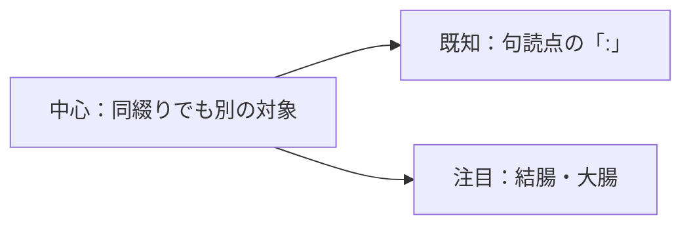

**重要語法**：colon cancer：大腸がん

<!-- candidate_id: ev-11448-noun-01; index: 11448 -->

---

### 4962. colorblind

**品詞**：adjective figurative  
**発音**：/ˈkʌlərblaɪnd/

<small>よく知られている意味：色の見分けが難しい</small>

**見落としやすい意味**：**人種や肌の色を区別せずに扱おうとする**

**例文**：The committee described its hiring policy as colorblind.  
**和訳**：委員会は採用方針を、人種や肌の色で区別しないものだと説明した。

**コアイメージ**：色を区別しないという表現が、肌の色を判断基準にしない社会的姿勢にも使われる。視覚特性の話か、人々を扱う方針の話かを文脈で見極める。

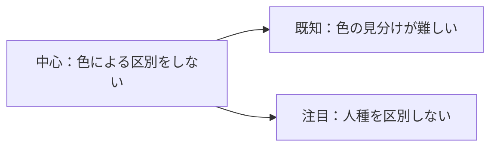

**重要語法**：colorblind policy：人種・肌の色で区別しない方針

<!-- candidate_id: ev-11449-adjective-figurative-01; index: 11449 -->

---

### 4963. congenital

**品詞**：adjective  
**発音**：/kənˈdʒɛnɪtəl/

<small>よく知られている意味：先天性の（病気など）</small>

**見落としやすい意味**：**生来の、根っからの（性格・習慣など）**

**例文**：He is a congenital optimist, even in difficult times.  
**和訳**：彼は困難なときでも生来の楽天家だ。

**コアイメージ**：congenital の中心には「生まれつき備わっている」という意味がある。病気だけでなく、根強い性格や習慣にも比喩的に使う。

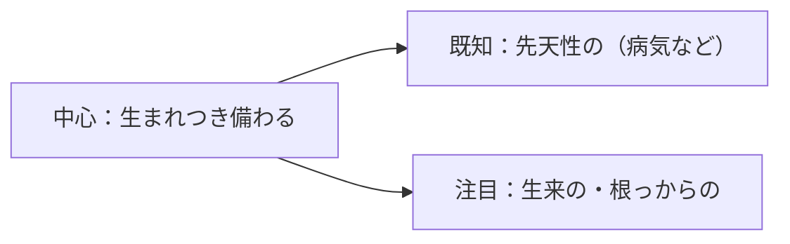

**重要語法**：a congenital optimist：根っからの楽天家

<!-- candidate_id: ev-11460-adjective-01; index: 11460 -->

---

### 4964. cordial

**品詞**：adjective (collocation)  
**発音**：/ˈkɔːrdʒəl/

<small>よく知られている意味：友好的な・心からの</small>

**見落としやすい意味**：**cordial dislike：強い嫌悪**

**例文**：Despite their polite greetings, the rivals had a cordial dislike for each other.  
**和訳**：礼儀正しく挨拶はするものの、そのライバル同士は互いに強い嫌悪感を抱いていた。

**コアイメージ**：cordial には「心からの」という強さがある。dislike と結ぶと、好意ではなく嫌悪が心底からのものであるという皮肉な表現になる。

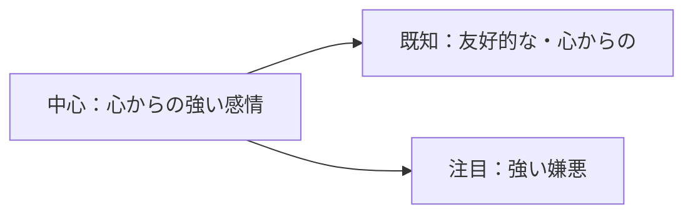

**重要語法**：cordial dislike：心底からの嫌悪（皮肉を含む）

<!-- candidate_id: ev-11463-adjective-collocation-01; index: 11463 -->

---

### 4965. cornucopia

**品詞**：noun (figurative)  
**発音**：/ˌkɔːrnəˈkoʊpiə/

<small>よく知られている意味：豊穣の角（伝統的な象徴）</small>

**見落としやすい意味**：**豊富に湧き出るもの、宝庫**

**例文**：The museum offers a cornucopia of fascinating exhibits.  
**和訳**：その博物館には魅力的な展示品が豊富にそろっている。

**コアイメージ**：cornucopia は豊かな実りがあふれる角のイメージを持つ。そこから、さまざまなものが豊富にある状態やその宝庫を表す。

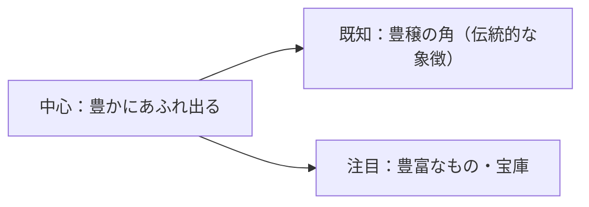

**重要語法**：a cornucopia of ～：豊富な～

<!-- candidate_id: ev-11464-noun-figurative-01; index: 11464 -->

---

### 4966. courtship

**品詞**：noun  
**発音**：/ˈkɔːrtʃɪp/

<small>よく知られている意味：求愛・交際を申し込むこと</small>

**見落としやすい意味**：**支持・顧客・提携を得るための働きかけ**

**例文**：The company's courtship of foreign investors lasted several months.  
**和訳**：その会社が海外投資家の関心を得ようとする働きかけは、数か月に及んだ。

**コアイメージ**：courtship は相手の好意や承諾を得ようと働きかける過程を表す。恋愛から転じて、企業や政治家が支持・資金・協力を得るための接近にも使う。

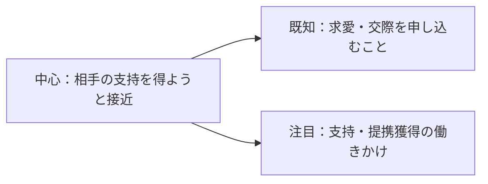

**重要語法**：the courtship of investors：投資家への働きかけ

<!-- candidate_id: ev-11467-noun-01; index: 11467 -->

---

### 4967. covenant

**品詞**：verb [I/T], formal or old-fashioned  
**発音**：/ˈkʌvənənt/

<small>よく知られている意味：契約・誓約（名詞）</small>

**見落としやすい意味**：**（正式な）契約・誓約を交わす**

**例文**：The partners covenanted to share all costs equally.  
**和訳**：当事者たちはすべての費用を平等に分担することを正式に約束した。

**コアイメージ**：covenant は厳粛な約束や正式な取り決めを表す。同じ語が動詞になると、その約束を「交わす」という行為を示す。

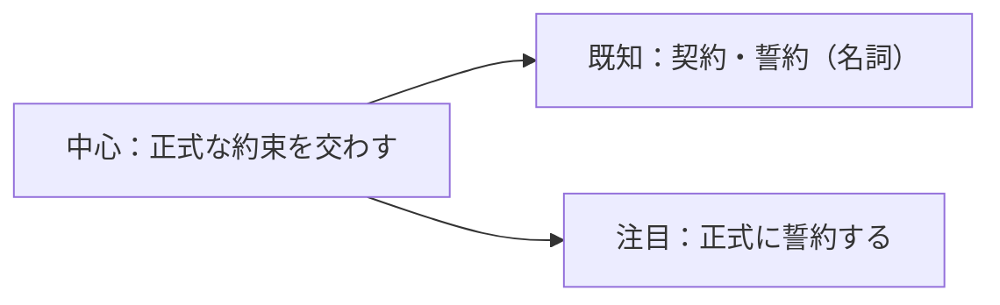

**重要語法**：covenant to do：～することを誓約する（格式ばった表現）

<!-- candidate_id: ev-11468-verb-01; index: 11468 -->

---

### 4968. crunch

**品詞**：noun (crunch time)  
**発音**：/krʌntʃ/

<small>よく知られている意味：かみ砕くこと・バリバリという音</small>

**見落としやすい意味**：**重大な判断・困難な行動が必要となる正念場**

**例文**：With the deadline tomorrow, it's crunch time for the team.  
**和訳**：締め切りが明日に迫り、チームはいよいよ正念場を迎えている。

**コアイメージ**：crunch は何かが強く押しつぶされるイメージを持つ。crunch time は、圧力が最も強まり、決断や踏ん張りが必要な時期をいう。

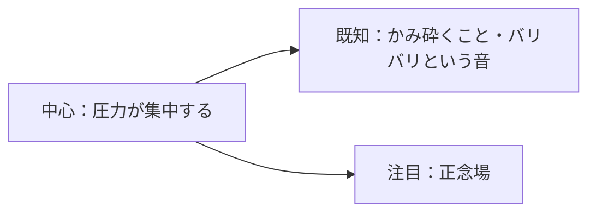

**重要語法**：crunch time：正念場・追い込みの時期

<!-- candidate_id: ev-11472-noun-crunch-time-02; index: 11472 -->

---

### 4969. crunch

**品詞**：verb (idiom)  
**発音**：/krʌntʃ/

<small>よく知られている意味：かみ砕く</small>

**見落としやすい意味**：**crunch the numbers：大量の数値を計算・分析する**

**例文**：We crunched the numbers before approving the budget.  
**和訳**：私たちは予算を承認する前に数値を詳しく分析した。

**コアイメージ**：crunch は硬いものを押しつぶして処理する動作を表す。数字について使うと、多量の数値を計算して分析するという意味になる。

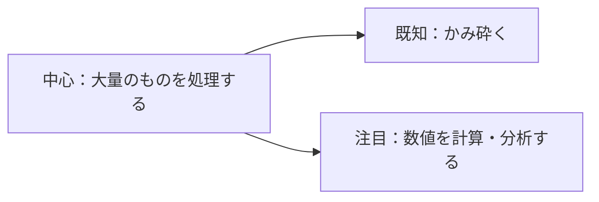

**重要語法**：crunch the numbers：数値を詳しく計算・分析する

<!-- candidate_id: ev-11472-verb-idiom-01; index: 11472 -->

---

### 4970. crystallize

**品詞**：verb (transitive)  
**発音**：/ˈkrɪstəlaɪz/

<small>よく知られている意味：結晶化する</small>

**見落としやすい意味**：**考えや意見を明確で確かな形にする**

**例文**：The discussion helped crystallize our priorities.  
**和訳**：その議論によって、私たちの優先事項がはっきりした。

**コアイメージ**：結晶が形を持って現れるように、漠然とした考えも明確な形を取ることがある。crystallize は意見や方針をはっきりさせることにも使う。

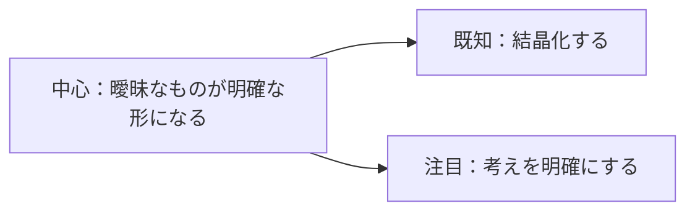

**重要語法**：crystallize an idea：考えを明確にする

<!-- candidate_id: ev-11474-verb-transitive-01; index: 11474 -->

---

### 4971. dearly

**品詞**：adverb (idiom)  
**発音**：/ˈdɪrli/

<small>よく知られている意味：愛情をこめて・非常に</small>

**見落としやすい意味**：**pay dearly for：～のために大きな代償を払う**

**例文**：The company paid dearly for ignoring safety warnings.  
**和訳**：その会社は安全上の警告を無視したために大きな代償を払った。

**コアイメージ**：dearly は感情や価値の強さを表す語でもある。pay dearly for では「支払う代価が大きい」ことを指し、必ずしもお金だけの話ではない。

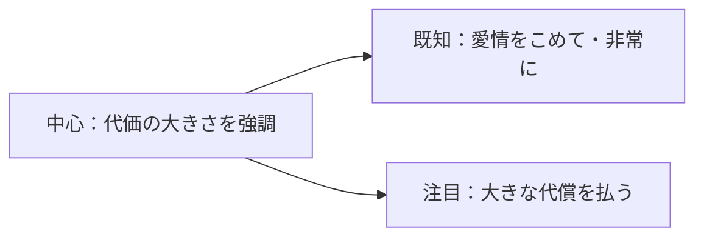

**重要語法**：pay dearly for ～：～のために大きな代償を払う

<!-- candidate_id: ev-11477-adverb-idiom-01; index: 11477 -->

---

### 4972. defining

**品詞**：adjective  
**発音**：/dɪˈfaɪnɪŋ/

<small>よく知られている意味：定義すること</small>

**見落としやすい意味**：**時代・人生・人物の特徴を決定づける**

**例文**：Moving abroad was a defining moment in her career.  
**和訳**：海外への移住は、彼女の経歴を決定づける転機だった。

**コアイメージ**：define は境界を定め、特徴をはっきりさせることを表す。defining はその人や時代の特徴・進路を大きく決めた出来事を形容する。

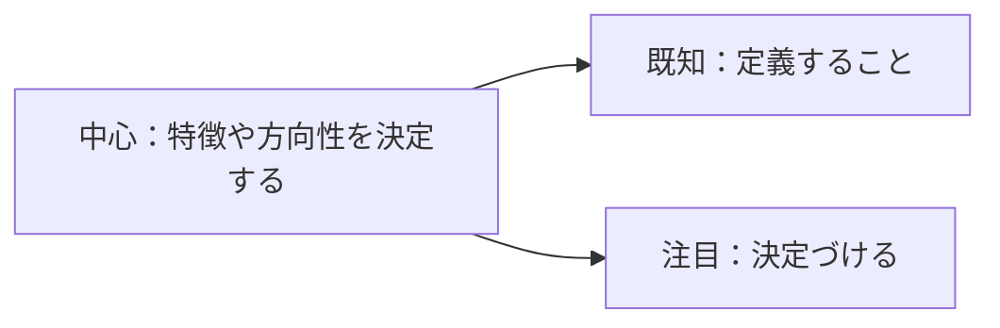

**重要語法**：a defining moment：決定的な転機

<!-- candidate_id: ev-11483-adjective-01; index: 11483 -->

---

### 4973. devalue

**品詞**：verb  
**発音**：/diːˈvæljuː/

<small>よく知られている意味：通貨の価値を切り下げる</small>

**見落としやすい意味**：**人の努力や貢献などを不当に低く評価する**

**例文**：Calling their efforts useless devalues the volunteers' work.  
**和訳**：彼らの努力を無意味だと言うことは、ボランティアの働きを不当に低く評価することになる。

**コアイメージ**：devalue は価値を低くするという意味が中心にある。通貨だけでなく、人の努力や成果の価値を認めない態度にも使われる。

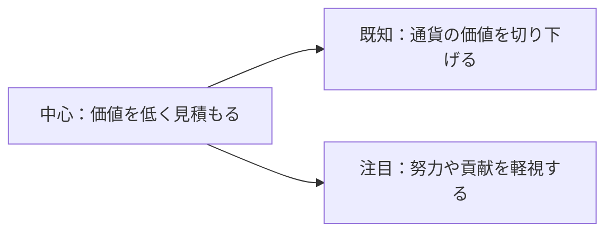

**重要語法**：devalue someone's contribution：人の貢献を軽視する

<!-- candidate_id: ev-11488-verb-01; index: 11488 -->

---

### 4974. diligence

**品詞**：noun phrase  
**発音**：/ˈdɪlɪdʒəns/

<small>よく知られている意味：勤勉さ</small>

**見落としやすい意味**：**due diligence：取引や投資の前に行う適切な調査・精査**

**例文**：The firm conducted due diligence before buying the startup.  
**和訳**：その企業は新興企業を買収する前に適切な事前調査を行った。

**コアイメージ**：diligence は注意深く着実に取り組む姿勢を表す。due diligence では、契約や投資の判断前に必要事項を十分調べることをいう。

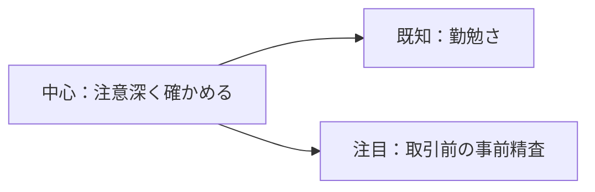

**重要語法**：conduct due diligence：事前調査・精査を実施する

<!-- candidate_id: ev-11490-noun-phrase-01; index: 11490 -->

---

### 4975. dime

**品詞**：noun (idiom)  
**発音**：/daɪm/

<small>よく知られている意味：10セント硬貨</small>

**見落としやすい意味**：**a dime a dozen：ありふれていて、特に価値がない**

**例文**：Ideas like that are a dime a dozen.  
**和訳**：そのようなアイデアはありふれていて、特に珍しくない。

**コアイメージ**：a dime は小額の硬貨で、a dozen は12個を表す。a dime a dozen は非常に安く大量に手に入るほどありふれている、という比喩である。

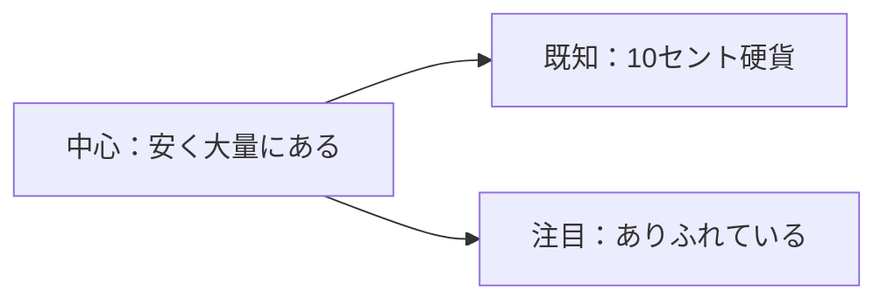

**重要語法**：a dime a dozen：ありふれた（通常、価値が高くないという含み）

<!-- candidate_id: ev-11493-noun-idiom-01; index: 11493 -->

---

### 4976. disclaimer

**品詞**：noun  
**発音**：/dɪsˈkleɪmər/

<small>よく知られている意味：免責事項</small>

**見落としやすい意味**：**立場や責任の範囲を明確にする断り書き**

**例文**：She began with a disclaimer that she was not speaking for her employer.  
**和訳**：彼女はまず、勤務先の代表として話しているわけではないと断った。

**コアイメージ**：disclaimer は自分の主張や責任の及ぶ範囲を限定する説明を指す。法的な免責文だけでなく、話の前に添える立場の断りにもなる。

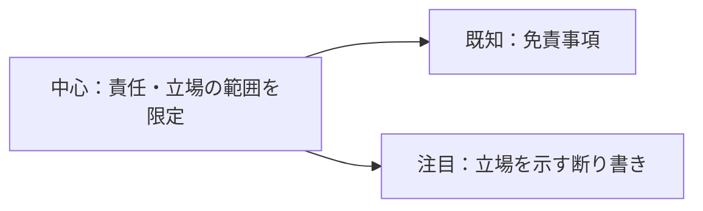

**重要語法**：a disclaimer that ...：…という断り

<!-- candidate_id: ev-11496-noun-01; index: 11496 -->

---

### 4977. displaced

**品詞**：adjective, US  
**発音**：/dɪsˈpleɪst/

<small>よく知られている意味：元の場所から移された</small>

**見落としやすい意味**：**（人が）職を失った、失職を余儀なくされた**

**例文**：The factory offered training to displaced workers.  
**和訳**：その工場は職を失った労働者に研修を提供した。

**コアイメージ**：displace は元の位置や役割から押しのけるという意味を持つ。労働の話では、技術革新や経済事情などで従来の仕事を失った人を指す。

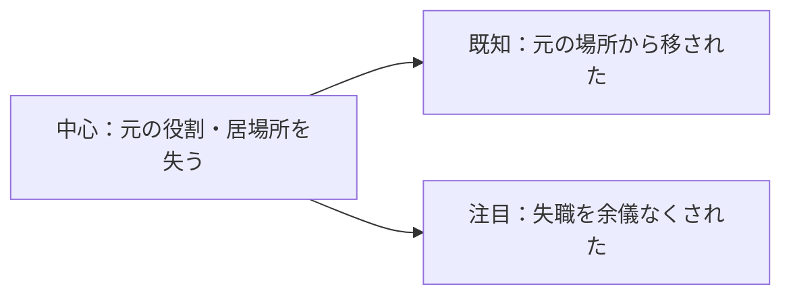

**重要語法**：displaced workers：失職を余儀なくされた労働者

<!-- candidate_id: ev-11500-adjective-us-01; index: 11500 -->

---

### 4978. dissolution

**品詞**：noun  
**発音**：/ˌdɪsəˈluːʃən/

<small>よく知られている意味：物質の溶解</small>

**見落としやすい意味**：**議会・法人・婚姻などの解散・解消**

**例文**：The dissolution of parliament triggered a new election.  
**和訳**：議会の解散が新たな選挙につながった。

**コアイメージ**：dissolution は、まとまっていたものが解けて成り立たなくなることを表す。物質の溶解だけでなく、議会・法人・婚姻などの制度や結びつきの解消を指す。

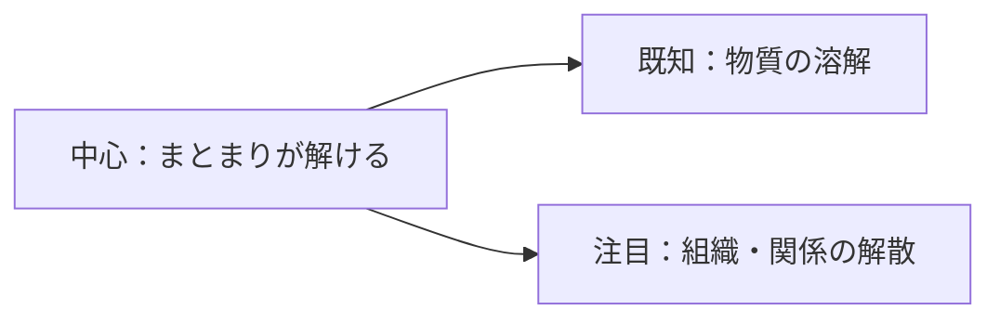

**重要語法**：the dissolution of parliament：議会の解散

<!-- candidate_id: ev-11503-01; index: 11503 -->

---

### 4979. dissuade

**品詞**：verb pattern  
**発音**：/dɪˈsweɪd/

<small>よく知られている意味：説得してやめさせる</small>

**見落としやすい意味**：**dissuade A from doing：Aに〜するのを思いとどまらせる**

**例文**：The warning dissuaded us from hiking in the storm.  
**和訳**：その警告によって、私たちは嵐の中での登山を思いとどまった。

**コアイメージ**：dissuade は人の行動意欲を弱め、やめる方向に説得することを表す。後ろの from doing が「やめさせたい行動」を示す点が重要である。

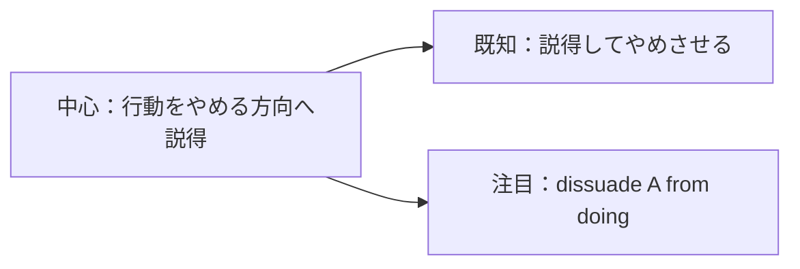

**重要語法**：dissuade A from doing：Aに～するのを思いとどまらせる

<!-- candidate_id: ev-11504-01; index: 11504 -->

---

### 4980. dormant

**品詞**：adjective  
**発音**：/ˈdɔːrmənt/

<small>よく知られている意味：眠っている・活動していない</small>

**見落としやすい意味**：**口座・事業などが長く使われず休止状態の**

**例文**：The dormant account was closed after years of inactivity.  
**和訳**：その休眠口座は何年も利用されなかったため閉鎖された。

**コアイメージ**：dormant は活動が表に出ていない状態を表す。人が眠るイメージから、口座・事業・火山などが今は動いていない状態にも広がる。

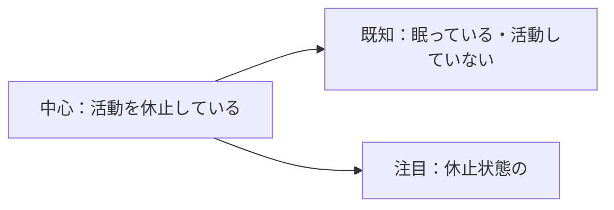

**重要語法**：a dormant account：休眠口座

<!-- candidate_id: ev-11506-01; index: 11506 -->

---

### 4981. dribble

**品詞**：verb  
**発音**：/ˈdrɪbəl/

<small>よく知られている意味：ボールをドリブルする</small>

**見落としやすい意味**：**液体などが少しずつ垂れる・流れる**

**例文**：Water dribbled from the cracked pipe.  
**和訳**：ひびの入った管から水が少しずつ垂れた。

**コアイメージ**：dribble は小さな動きが続く様子を表す。ボールを細かく動かす意味のほか、液体が少量ずつ流れ出る場合にも使う。

```mermaid
flowchart LR
    A["中心：少しずつ動き続ける"]
    B["既知：ボールをドリブルする"]
    C["注目：少しずつ垂れる"]
    A --> B
    A --> C
```

**重要語法**：water dribbles from ～：～から水が少しずつ漏れる

<!-- candidate_id: ev-11510-01; index: 11510 -->

---

### 4982. dummy

**品詞**：adjective  
**発音**：/ˈdʌmi/

<small>よく知られている意味：人形・模型（名詞）</small>

**見落としやすい意味**：**本物ではない、模造の・仮の**

**例文**：Please enter a dummy address for the software test.  
**和訳**：ソフトウェアのテストには仮の住所を入力してください。

**コアイメージ**：dummy は実物の代わりになる模型や代用品を指す。形容詞では、試験や練習のために用意した仮のもの・本物でないものを表す。

```mermaid
flowchart LR
    A["中心：本物の代用品"]
    B["既知：人形・模型（名詞）"]
    C["注目：仮の・模造の"]
    A --> B
    A --> C
```

**重要語法**：dummy data：テスト用の仮データ

<!-- candidate_id: ev-11512-01; index: 11512 -->

---

### 4983. dwelt

**品詞**：phrasal verb  
**発音**：/dwɛlt/

<small>よく知られている意味：dwell＝住む</small>

**見落としやすい意味**：**dwell on：〜について長々と思い巡らす・こだわる**

**例文**：She dwelt on the mistake long after the meeting.  
**和訳**：会議が終わっても、彼女はその失敗を長く気にし続けた。

**コアイメージ**：dwell はある所にとどまるという意味を持つ。dwell on では、場所ではなく一つの考えに心がとどまり、何度も思い返すことをいう。

```mermaid
flowchart LR
    A["中心：一か所に長くとどまる"]
    B["既知：dwell＝住む"]
    C["注目：～にこだわり続ける"]
    A --> B
    A --> C
```

**重要語法**：dwell on ～：～をくよくよ考える・長々と論じる

<!-- candidate_id: ev-11513-01; index: 11513 -->

---

### 4984. enamored

**品詞**：adjective pattern  
**発音**：/ɪˈnæmərd/

<small>よく知られている意味：魅了された</small>

**見落としやすい意味**：**be enamored of / with：〜に夢中になっている**

**例文**：The students were enamored with the new approach.  
**和訳**：学生たちはその新しい方法にすっかり夢中になっていた。

**コアイメージ**：enamored は人や物への強い好意・魅了を表す。of または with を使って、何に夢中なのかを続ける形を押さえる。

```mermaid
flowchart LR
    A["中心：強く心を奪われる"]
    B["既知：魅了された"]
    C["注目：～に夢中になる"]
    A --> B
    A --> C
```

**重要語法**：be enamored of / with ～：～に夢中である

<!-- candidate_id: ev-11525-01; index: 11525 -->

---

### 4985. err

**品詞**：idiom  
**発音**：/ɛr/

<small>よく知られている意味：誤る・間違える</small>

**見落としやすい意味**：**err on the side of caution：念のため慎重になりすぎるほうを選ぶ**

**例文**：When information is incomplete, we should err on the side of caution.  
**和訳**：情報が不十分なときは、念のため慎重すぎるくらいにしておくべきだ。

**コアイメージ**：err on the side of ～ は、どちらかに偏るならその側を選ぶ、という言い方である。caution が続けば「安全側に寄る」の意味で、単なる失敗の報告ではない。

```mermaid
flowchart LR
    A["中心：偏るなら安全な側を選ぶ"]
    B["既知：誤る・間違える"]
    C["注目：念のため慎重にする"]
    A --> B
    A --> C
```

**重要語法**：err on the side of caution：慎重さを優先する

<!-- candidate_id: ev-11531-01; index: 11531 -->

---

### 4986. exhort

**品詞**：verb pattern  
**発音**：/ɪɡˈzɔːrt/

<small>よく知られている意味：強く勧める</small>

**見落としやすい意味**：**exhort A to do：Aに〜するよう強く促す**

**例文**：The coach exhorted the players to remain calm.  
**和訳**：監督は選手たちに冷静さを保つよう強く促した。

**コアイメージ**：exhort は相手に強い言葉で行動を呼びかけることを表す。「人＋to do」の形で、求めている行動を示す。

```mermaid
flowchart LR
    A["中心：強く呼びかけて行動を促す"]
    B["既知：強く勧める"]
    C["注目：Aに～するよう強く促す"]
    A --> B
    A --> C
```

**重要語法**：exhort A to do：Aに～するよう熱心に勧める

<!-- candidate_id: ev-11537-01; index: 11537 -->

---

### 4987. fathom

**品詞**：verb  
**発音**：/ˈfæðəm/

<small>よく知られている意味：水深を表す単位</small>

**見落としやすい意味**：**物事の意味や理由を理解する・解明する**

**例文**：I cannot fathom why the plan failed.  
**和訳**：なぜその計画が失敗したのか、私にはどうしても理解できない。

**コアイメージ**：fathom はもともと深さを測ることに関わる語である。動詞では、複雑な事情の奥まで理解する・見抜くことをいう。

```mermaid
flowchart LR
    A["中心：深いところまで探る"]
    B["既知：水深を表す単位"]
    C["注目：意味や理由を理解する"]
    A --> B
    A --> C
```

**重要語法**：cannot fathom why ...：なぜ…なのか理解できない

<!-- candidate_id: ev-11543-01; index: 11543 -->

---

### 4988. fling

**品詞**：idiom  
**発音**：/flɪŋ/

<small>よく知られている意味：勢いよく投げる</small>

**見落としやすい意味**：**fling oneself into：〜に熱心に打ち込む**

**例文**：After graduation, she flung herself into volunteer work.  
**和訳**：卒業後、彼女はボランティア活動に精力的に打ち込んだ。

**コアイメージ**：fling は勢いよく投げ込む動きを表す。oneself into の形になると、自分のエネルギーをある活動に一気に注ぐことになる。

```mermaid
flowchart LR
    A["中心：勢いよく投げ込む"]
    B["既知：勢いよく投げる"]
    C["注目：熱心に打ち込む"]
    A --> B
    A --> C
```

**重要語法**：fling oneself into ～：～に全力で打ち込む

<!-- candidate_id: ev-11547-01; index: 11547 -->

---

### 4989. flirtation

**品詞**：noun phrase  
**発音**：/flɜːrˈteɪʃən/

<small>よく知られている意味：恋愛の駆け引き</small>

**見落としやすい意味**：**a flirtation with：〜への一時的な興味・試み**

**例文**：The council's flirtation with the proposal ended within a week.  
**和訳**：その評議会がその提案を試しに検討したのは、わずか1週間で終わった。

**コアイメージ**：flirtation は軽く関心を寄せることを表す。恋愛以外では、ある考えや政策に一時的に興味を示すが、本格的には取り組まない含みがある。

```mermaid
flowchart LR
    A["中心：軽く接近して関心を示す"]
    B["既知：恋愛の駆け引き"]
    C["注目：一時的な興味・試み"]
    A --> B
    A --> C
```

**重要語法**：a flirtation with ～：～への一時的な関心

<!-- candidate_id: ev-11548-01; index: 11548 -->

---

### 4990. forgiving

**品詞**：adjective  
**発音**：/fərˈɡɪvɪŋ/

<small>よく知られている意味：人を許す・寛大な</small>

**見落としやすい意味**：**（素材・環境などが）多少の失敗や弱点を許容する**

**例文**：This camera is forgiving of small mistakes.  
**和訳**：このカメラなら多少の操作ミスがあっても問題になりにくい。

**コアイメージ**：forgiving は欠点や失敗を厳しくとがめないという意味を持つ。人だけでなく、道具や環境が多少の誤差を許容することにも使う。

```mermaid
flowchart LR
    A["中心：小さな失敗を許容する"]
    B["既知：人を許す・寛大な"]
    C["注目：失敗を許容する"]
    A --> B
    A --> C
```

**重要語法**：be forgiving of ～：～に寛容である

<!-- candidate_id: ev-11552-01; index: 11552 -->

---

### 4991. gel

**品詞**：verb  
**発音**：/dʒɛl/

<small>よく知られている意味：ゼリー状の物質</small>

**見落としやすい意味**：**（計画・考えが）明確にまとまる・形をなす**

**例文**：After several meetings, the plan finally began to gel.  
**和訳**：何度か会議を重ねた末、ようやく計画の形がまとまり始めた。

**コアイメージ**：gel は柔らかなものがまとまって一定の形を取るイメージを持つ。計画や考えについて使うと、ばらばらだった要素が具体化することを表す。

```mermaid
flowchart LR
    A["中心：ばらばらの要素がまとまる"]
    B["既知：ゼリー状の物質"]
    C["注目：考えがまとまる"]
    A --> B
    A --> C
```

**重要語法**：the plan begins to gel：計画が形になり始める

<!-- candidate_id: ev-11558-01; index: 11558 -->

---

### 4992. gel

**品詞**：verb  
**発音**：/dʒɛl/

<small>よく知られている意味：ゼリー状の物質</small>

**見落としやすい意味**：**（人やチームが）うまくかみ合う・打ち解ける**

**例文**：The new players needed time to gel as a team.  
**和訳**：新しい選手たちがチームとしてうまくかみ合うには時間が必要だった。

**コアイメージ**：gel は別々だったものが一つのまとまりになるイメージを持つ。人々については、互いに協力しやすくなりチームとして機能することをいう。

```mermaid
flowchart LR
    A["中心：別々のものが一体になる"]
    B["既知：ゼリー状の物質"]
    C["注目：チームがかみ合う"]
    A --> B
    A --> C
```

**重要語法**：gel as a team：チームとしてまとまる

<!-- candidate_id: ev-11558-02; index: 11558 -->

---

### 4993. giveaway

**品詞**：noun  
**発音**：/ˈɡɪvəweɪ/

<small>よく知られている意味：無料配布・景品</small>

**見落としやすい意味**：**秘密・正体などを露呈させる手がかり**

**例文**：Her nervous smile was a giveaway that she knew the secret.  
**和訳**：彼女のぎこちない笑顔は、秘密を知っていることを示す決定的な手がかりだった。

**コアイメージ**：giveaway は何かが外に出てしまうことに結びつく。比喩では、隠そうとしていた事実が表に出るきっかけや兆候をいう。

```mermaid
flowchart LR
    A["中心：隠れた事実が外に出る"]
    B["既知：無料配布・景品"]
    C["注目：正体を示す手がかり"]
    A --> B
    A --> C
```

**重要語法**：a dead giveaway：明白な手がかり

<!-- candidate_id: ev-11560-01; index: 11560 -->

---

### 4994. grate

**品詞**：verb  
**発音**：/ɡreɪt/

<small>よく知られている意味：食材をおろし金でおろす</small>

**見落としやすい意味**：**（音や言動が）人の神経に障る・いら立たせる**

**例文**：His constant tapping began to grate on my nerves.  
**和訳**：彼が絶えず指でたたく音が、だんだん私の神経に障り始めた。

**コアイメージ**：grate はこすれてざらざらした感触や音を生じることを表す。そこから、言動や音が心理的に耳障りでいら立つという意味になる。

```mermaid
flowchart LR
    A["中心：こすれて不快な刺激になる"]
    B["既知：食材をおろし金でおろす"]
    C["注目：神経に障る"]
    A --> B
    A --> C
```

**重要語法**：grate on someone's nerves：人の神経に障る

<!-- candidate_id: ev-11562-01; index: 11562 -->

---

### 4995. grumble

**品詞**：verb  
**発音**：/ˈɡrʌmbəl/

<small>よく知られている意味：ぶつぶつ不平を言う</small>

**見落としやすい意味**：**胃・おなかがごろごろ鳴る**

**例文**：My stomach grumbled during the long lecture.  
**和訳**：長い講義の間、私のおなかがぐうぐう鳴った。

**コアイメージ**：grumble は低くごろごろ響く音を表す。人が不平を言う声だけでなく、おなかが鳴る音にも使える。

```mermaid
flowchart LR
    A["中心：低くごろごろ鳴る"]
    B["既知：ぶつぶつ不平を言う"]
    C["注目：おなかが鳴る"]
    A --> B
    A --> C
```

**重要語法**：one's stomach grumbles：おなかが鳴る

<!-- candidate_id: ev-11564-01; index: 11564 -->

---

### 4996. hawkish

**品詞**：adjective  
**発音**：/ˈhɔːkɪʃ/

<small>よく知られている意味：タカに似た</small>

**見落としやすい意味**：**外交・金融政策などで強硬姿勢の、タカ派的な**

**例文**：The central bank adopted a more hawkish stance on inflation.  
**和訳**：中央銀行はインフレに対して、より金融引き締めに積極的な姿勢を取った。

**コアイメージ**：hawk（タカ）は強気で攻撃的な姿勢の比喩に使われる。hawkish は外交なら強硬、金融政策なら一般にインフレ抑制のための引き締めを重視する姿勢をいう。

```mermaid
flowchart LR
    A["中心：タカのように強硬"]
    B["既知：タカに似た"]
    C["注目：政策で強硬・タカ派的な"]
    A --> B
    A --> C
```

**重要語法**：a hawkish stance：強硬・引き締め寄りの姿勢

<!-- candidate_id: ev-11570-01; index: 11570 -->

---

### 4997. heck

**品詞**：interjection / idiom  
**発音**：/hɛk/

<small>よく知られている意味：軽い驚きを表す婉曲語</small>

**見落としやすい意味**：**what the heck：一体全体どうして・何だって**

**例文**：What the heck is going on here?  
**和訳**：いったいここで何が起きているんだ？

**コアイメージ**：heck は強い罵り語を和らげた口語表現として使われる。what the heck では疑問・驚き・いら立ちを強調し、「一体全体」のように訳せる。

```mermaid
flowchart LR
    A["中心：驚きや疑問を強める"]
    B["既知：軽い驚きを表す婉曲語"]
    C["注目：いったい全体"]
    A --> B
    A --> C
```

**重要語法**：what the heck ...?：いったい…？（くだけた表現）

<!-- candidate_id: ev-11572-01; index: 11572 -->

---

### 4998. hitch

**品詞**：noun  
**発音**：/hɪtʃ/

<small>よく知られている意味：引っかける・つなぐ</small>

**見落としやすい意味**：**思わぬ障害・支障・引っ掛かり**

**例文**：The trip went smoothly without a hitch.  
**和訳**：旅行は思わぬ支障もなく順調に進んだ。

**コアイメージ**：hitch は何かが引っかかって動きを妨げるイメージを持つ。名詞では、計画の進行を止める小さな問題や予期しない障害を表す。

```mermaid
flowchart LR
    A["中心：進行を引っかけて止める"]
    B["既知：引っかける・つなぐ"]
    C["注目：思わぬ支障"]
    A --> B
    A --> C
```

**重要語法**：without a hitch：問題なく・滞りなく

<!-- candidate_id: ev-11579-01; index: 11579 -->

---

### 4999. hitch

**品詞**：verb phrase  
**発音**：/hɪtʃ/

<small>よく知られている意味：引っかける・つなぐ</small>

**見落としやすい意味**：**hitch a ride：他人の車などに便乗する**

**例文**：We hitched a ride with a neighbor.  
**和訳**：私たちは近所の人の車に乗せてもらった。

**コアイメージ**：hitch はものをつないだり引っかけたりする動作を表す。hitch a ride では、他人の移動手段に便乗する意味になる。

```mermaid
flowchart LR
    A["中心：他人の移動につながる"]
    B["既知：引っかける・つなぐ"]
    C["注目：車などに便乗する"]
    A --> B
    A --> C
```

**重要語法**：hitch a ride with ～：～の車などに便乗する

<!-- candidate_id: ev-11579-02; index: 11579 -->

---

### 5000. hoary

**品詞**：adjective  
**発音**：/ˈhɔːri/

<small>よく知られている意味：白髪の・灰白色の</small>

**見落としやすい意味**：**（冗談・議論などが）使い古されて新鮮味がない**

**例文**：He repeated the same hoary joke at every meeting.  
**和訳**：彼は会議のたびに同じ使い古された冗談を繰り返した。

**コアイメージ**：hoary は古くなって白髪を帯びたような様子を表す。冗談や議論については、長年使われて新鮮さがないという否定的な評価になる。

```mermaid
flowchart LR
    A["中心：古さが目立つ"]
    B["既知：白髪の・灰白色の"]
    C["注目：使い古された"]
    A --> B
    A --> C
```

**重要語法**：a hoary old joke：使い古された冗談

<!-- candidate_id: ev-11581-01; index: 11581 -->

---

### 5001. incidental

**品詞**：adjective pattern  
**発音**：/ˌɪnsɪˈdɛntəl/

<small>よく知られている意味：偶然の・付随的な</small>

**見落としやすい意味**：**incidental to：〜に付随する・伴って起こる**

**例文**：Travel expenses are incidental to the research project.  
**和訳**：出張費はその研究計画に付随して生じる費用だ。

**コアイメージ**：incidental は中心となる事柄の周辺で起こることを表す。incidental to ～ なら、主要な目的ではないが、それに伴って生じるという関係になる。

```mermaid
flowchart LR
    A["中心：主なものの周辺で生じる"]
    B["既知：偶然の・付随的な"]
    C["注目：～に付随する"]
    A --> B
    A --> C
```

**重要語法**：be incidental to ～：～に付随する

<!-- candidate_id: ev-11600-01; index: 11600 -->

---

### 5002. inroads

**品詞**：plural noun / idiom  
**発音**：/ˈɪnroʊdz/

<small>よく知られている意味：侵入・食い込み</small>

**見落としやすい意味**：**make inroads into：分野に進出する・問題の解決に進展を見せる**

**例文**：The company made inroads into the Asian market.  
**和訳**：その会社はアジア市場への進出を進めた。

**コアイメージ**：inroads は内側へ入り込んで足場を広げるイメージを持つ。make inroads into は新しい市場や課題に入り込み、進出や進展を実現することをいう。

```mermaid
flowchart LR
    A["中心：内側へ入り込む"]
    B["既知：侵入・食い込み"]
    C["注目：進出する・進展する"]
    A --> B
    A --> C
```

**重要語法**：make inroads into ～：～に進出する・～で進展する

<!-- candidate_id: ev-11609-01; index: 11609 -->

---

### 5003. intimately

**品詞**：adverb  
**発音**：/ˈɪntəmətli/

<small>よく知られている意味：親密に</small>

**見落としやすい意味**：**事実・仕組みなどを詳細に、深く熟知して**

**例文**：The engineer is intimately familiar with the system.  
**和訳**：その技術者はそのシステムを隅々まで熟知している。

**コアイメージ**：intimately は対象との距離が非常に近い状態を表す。人間関係だけでなく、知識についても細部まで深く知っているという意味になる。

```mermaid
flowchart LR
    A["中心：距離が近く細部まで知る"]
    B["既知：親密に"]
    C["注目：詳細に熟知して"]
    A --> B
    A --> C
```

**重要語法**：be intimately familiar with ～：～を熟知している

<!-- candidate_id: ev-11618-01; index: 11618 -->

---

### 5004. invasive

**品詞**：adjective  
**発音**：/ɪnˈveɪsɪv/

<small>よく知られている意味：侵入的な・外来の</small>

**見落としやすい意味**：**質問・調査などが私生活に立ち入りすぎる・詮索的な**

**例文**：The interviewer asked several invasive questions.  
**和訳**：面接官は私生活に踏み込みすぎる質問をいくつかした。

**コアイメージ**：invasive は境界を越えて入り込むという意味がある。医療や生態の話から離れて、質問や調査が私的な領域に過度に踏み込むことも表す。

```mermaid
flowchart LR
    A["中心：境界を越えて入り込む"]
    B["既知：侵入的な・外来の"]
    C["注目：詮索的な"]
    A --> B
    A --> C
```

**重要語法**：invasive questions：詮索的な質問

<!-- candidate_id: ev-11621-01; index: 11621 -->

---

### 5005. kernel

**品詞**：noun  
**発音**：/ˈkɜːrnəl/

<small>よく知られている意味：穀粒・種の中身</small>

**見落としやすい意味**：**（物事の）核心、わずかな真実の部分**

**例文**：There is a kernel of truth in her criticism.  
**和訳**：彼女の批判には、わずかながら真実が含まれている。

**コアイメージ**：kernel は実の中心にある小さな核を指す。比喩では、周辺の余計な部分を取り除いた後に残る真実や核心を表す。

```mermaid
flowchart LR
    A["中心：中心にある小さな核"]
    B["既知：穀粒・種の中身"]
    C["注目：真実の核心"]
    A --> B
    A --> C
```

**重要語法**：a kernel of truth：一片の真実

<!-- candidate_id: ev-11627-01; index: 11627 -->

---

### 5006. lens

**品詞**：idiom  
**発音**：/lɛnz/

<small>よく知られている意味：光学レンズ</small>

**見落としやすい意味**：**through the lens of：〜という視点・枠組みから見て**

**例文**：The novel examines poverty through the lens of childhood.  
**和訳**：その小説は子どもの視点から貧困を描いている。

**コアイメージ**：lens はものの見え方を左右する道具である。through the lens of は、ある考え方や経験を通して物事を解釈するという比喩になる。

```mermaid
flowchart LR
    A["中心：見え方を決める視点"]
    B["既知：光学レンズ"]
    C["注目：～という視点から"]
    A --> B
    A --> C
```

**重要語法**：through the lens of ～：～という視点から

<!-- candidate_id: ev-11632-01; index: 11632 -->

---

### 5007. lick

**品詞**：verb  
**発音**：/lɪk/

<small>よく知られている意味：舌でなめる</small>

**見落としやすい意味**：**（競争相手を）打ち負かす、難題を克服する（口語）**

**例文**：The small team finally licked the technical problem.  
**和訳**：小さなチームはついにその技術的な難題を克服した。

**コアイメージ**：lick は口語では相手に勝つ、問題をやっつけるという意味でも使う。対象が敵や難題なら、「なめる」でなく「打ち負かす・克服する」と読む。

```mermaid
flowchart LR
    A["中心：相手・問題をやっつける"]
    B["既知：舌でなめる"]
    C["注目：打ち負かす・克服する"]
    A --> B
    A --> C
```

**重要語法**：lick a problem：問題を克服する（口語）

<!-- candidate_id: ev-11634-01; index: 11634 -->

---

### 5008. lick

**品詞**：noun  
**発音**：/lɪk/

<small>よく知られている意味：舌でなめる</small>

**見落としやすい意味**：**ほんの少し（not a lick of など・口語）**

**例文**：He doesn't know a lick of French.  
**和訳**：彼はフランス語を少しも知らない。

**コアイメージ**：lick は口語の否定表現で、ほんの少しの量を指すことがある。not a lick of ～ なら、「～がまったくない」という強い否定になる。

```mermaid
flowchart LR
    A["中心：ごくわずかな量"]
    B["既知：舌でなめる"]
    C["注目：ほんの少し"]
    A --> B
    A --> C
```

**重要語法**：not a lick of ～：～が少しもない（口語）

<!-- candidate_id: ev-11634-02; index: 11634 -->

---

### 5009. lighten

**品詞**：phrasal verb  
**発音**：/ˈlaɪtən/

<small>よく知られている意味：明るくする・軽くする</small>

**見落としやすい意味**：**lighten up：気楽になる、堅苦しく考えない**

**例文**：You should lighten up; it was only a joke.  
**和訳**：もっと気楽に考えなよ。単なる冗談だったんだから。

**コアイメージ**：lighten は重さや暗さを和らげる意味を持つ。lighten up では、気持ちの重さや緊張を解いて気楽になることを表す。

```mermaid
flowchart LR
    A["中心：重さ・緊張を軽くする"]
    B["既知：明るくする・軽くする"]
    C["注目：気楽になる"]
    A --> B
    A --> C
```

**重要語法**：lighten up：気楽に構える・肩の力を抜く

<!-- candidate_id: ev-11635-01; index: 11635 -->

---

### 5010. lo

**品詞**：idiom  
**発音**：/loʊ/

<small>よく知られている意味：見よ（古風な語）</small>

**見落としやすい意味**：**lo and behold：すると驚いたことに、何と**

**例文**：We opened the box, and lo and behold, the missing letter was inside.  
**和訳**：箱を開けると、なんと、その中に行方不明だった手紙が入っていた。

**コアイメージ**：lo は注意を向けさせる古風な呼びかけである。lo and behold は予想外の発見や驚きを、少し芝居がかった調子で伝える成句として残っている。

```mermaid
flowchart LR
    A["中心：見よという驚きの呼びかけ"]
    B["既知：見よ（古風な語）"]
    C["注目：すると驚いたことに"]
    A --> B
    A --> C
```

**重要語法**：lo and behold：すると驚いたことに

<!-- candidate_id: ev-11636-01; index: 11636 -->

---

### 5011. lucid

**品詞**：adjective  
**発音**：/ˈluːsɪd/

<small>よく知られている意味：明晰で分かりやすい</small>

**見落としやすい意味**：**人の意識が明瞭な、正気がはっきりしている**

**例文**：Despite being tired, she remained lucid throughout the interview.  
**和訳**：疲れていたにもかかわらず、彼女は面接の間ずっと意識がはっきりしていた。

**コアイメージ**：lucid は頭の中が明るくはっきりしている状態を表す。説明が分かりやすい場合だけでなく、人の意識や思考が明瞭な状態にも使う。

```mermaid
flowchart LR
    A["中心：頭がはっきりしている"]
    B["既知：明晰で分かりやすい"]
    C["注目：意識が明瞭な"]
    A --> B
    A --> C
```

**重要語法**：remain lucid：意識が明瞭なままでいる

<!-- candidate_id: ev-11639-01; index: 11639 -->

---

### 5012. lurch

**品詞**：idiom  
**発音**：/lɜːrtʃ/

<small>よく知られている意味：急によろめく</small>

**見落としやすい意味**：**leave someone in the lurch：困った状況に人を置き去りにする**

**例文**：The contractor left us in the lurch just before the deadline.  
**和訳**：請負業者は締め切り直前に私たちを困った状況に置き去りにした。

**コアイメージ**：lurch は不安定に揺れ、体勢を崩すことに結びつく。leave someone in the lurch は、人が困っているのに助けず見捨てるという決まった言い方である。

```mermaid
flowchart LR
    A["中心：不安定な苦境に置く"]
    B["既知：急によろめく"]
    C["注目：苦境に置き去りにする"]
    A --> B
    A --> C
```

**重要語法**：leave A in the lurch：Aを困ったまま置き去りにする

<!-- candidate_id: ev-11640-01; index: 11640 -->

---

### 5013. mimic

**品詞**：verb  
**発音**：/ˈmɪmɪk/

<small>よく知られている意味：人の声や動作をまねる</small>

**見落としやすい意味**：**病気や現象が別のものとよく似た症状・特徴を示す**

**例文**：The infection can mimic the symptoms of a common cold.  
**和訳**：その感染症は普通の風邪によく似た症状を示すことがある。

**コアイメージ**：mimic は外見や特徴が別のものと似ることを表す。人のものまね以外にも、病気や現象が別のものと見分けにくい状態を表せる。

```mermaid
flowchart LR
    A["中心：別のものに似た特徴を示す"]
    B["既知：人の声や動作をまねる"]
    C["注目：症状などがよく似る"]
    A --> B
    A --> C
```

**重要語法**：mimic symptoms：似た症状を示す

<!-- candidate_id: ev-11655-01; index: 11655 -->

---

### 5014. nap

**品詞**：idiom  
**発音**：/næp/

<small>よく知られている意味：昼寝</small>

**見落としやすい意味**：**catch someone napping：人の油断を突く、不意を打つ**

**例文**：The surprise inspection caught the staff napping.  
**和訳**：抜き打ち検査は職員たちの油断を突いた。

**コアイメージ**：napping は眠って注意が緩んでいる状態を示す。catch someone napping は実際の睡眠でなく、相手が警戒していないところを突くという成句である。

```mermaid
flowchart LR
    A["中心：注意が緩んだ隙"]
    B["既知：昼寝"]
    C["注目：油断を突く"]
    A --> B
    A --> C
```

**重要語法**：catch A napping：Aの油断を突く

<!-- candidate_id: ev-11678-01; index: 11678 -->

---

### 5015. nickel

**品詞**：idiom  
**発音**：/ˈnɪkəl/

<small>よく知られている意味：5セント硬貨</small>

**見落としやすい意味**：**nickel-and-dime：少額を細かく請求する・小金を出し惜しむ**

**例文**：The airline nickel-and-dimed passengers for every extra service.  
**和訳**：その航空会社は追加サービスのたびに乗客から細かく料金を取った。

**コアイメージ**：nickel と dime は少額の硬貨である。nickel-and-dime は少額の金額を細かく要求して相手をうんざりさせることなどを表す。

```mermaid
flowchart LR
    A["中心：小銭を細かく積み重ねる"]
    B["既知：5セント硬貨"]
    C["注目：少額を細かく請求する"]
    A --> B
    A --> C
```

**重要語法**：nickel-and-dime A：Aから細かく料金を取る

<!-- candidate_id: ev-11682-01; index: 11682 -->

---

### 5016. observant

**品詞**：adjective  
**発音**：/əbˈzɜːrvənt/

<small>よく知られている意味：観察力が鋭い</small>

**見落としやすい意味**：**（宗教的な）戒律や慣習を忠実に守る**

**例文**：He grew up in an observant household that followed strict religious practices.  
**和訳**：彼は宗教上の戒律を厳格に守る家庭で育った。

**コアイメージ**：observant は細かな点に注意を払うことを表す。宗教の文脈では、定められた戒律や慣習を注意深く守るという意味になる。

```mermaid
flowchart LR
    A["中心：決まりを注意深く守る"]
    B["既知：観察力が鋭い"]
    C["注目：宗教的戒律を守る"]
    A --> B
    A --> C
```

**重要語法**：an observant family：戒律を守る家庭

<!-- candidate_id: ev-11687-01; index: 11687 -->

---

### 5017. offbeat

**品詞**：adjective  
**発音**：/ˈɔːfbiːt/

<small>よく知られている意味：拍から外れた（音楽）</small>

**見落としやすい意味**：**型にはまらない、風変わりで独特な**

**例文**：The film's offbeat humor appealed to a small audience.  
**和訳**：その映画の風変わりなユーモアは一部の観客に受けた。

**コアイメージ**：offbeat は通常の拍から外れることに由来する表現である。人や作品に使うと、一般的な型から少し外れた独自の面白さを指す。

```mermaid
flowchart LR
    A["中心：通常のリズムから外れる"]
    B["既知：拍から外れた（音楽）"]
    C["注目：風変わりな"]
    A --> B
    A --> C
```

**重要語法**：offbeat humor：風変わりなユーモア

<!-- candidate_id: ev-11689-01; index: 11689 -->

---

### 5018. ooze

**品詞**：verb  
**発音**：/uːz/

<small>よく知られている意味：液体がにじみ出る</small>

**見落としやすい意味**：**（自信・魅力などを）全身から漂わせる**

**例文**：The speaker oozed confidence during the debate.  
**和訳**：その話し手は討論中、自信を全身から漂わせていた。

**コアイメージ**：ooze は液体がじわじわ外ににじむことを表す。感情や雰囲気に使えば、内面にあるものが自然と外へ現れるという比喩になる。

```mermaid
flowchart LR
    A["中心：内側からじわじわ表に出る"]
    B["既知：液体がにじみ出る"]
    C["注目：自信などを漂わせる"]
    A --> B
    A --> C
```

**重要語法**：ooze confidence：自信がにじみ出る

<!-- candidate_id: ev-11690-01; index: 11690 -->

---

### 5019. outlier

**品詞**：noun  
**発音**：/ˈaʊtlaɪər/

<small>よく知られている意味：統計の外れ値</small>

**見落としやすい意味**：**主流から外れた人・例外的な存在**

**例文**：Among the cautious voters, she was an outlier.  
**和訳**：慎重な有権者たちの中で、彼女は例外的な存在だった。

**コアイメージ**：outlier は集団の一般的な範囲から外れた点を表す。統計上の数値だけでなく、主流とは違う人や事例にも使われる。

```mermaid
flowchart LR
    A["中心：集団の外側に位置する"]
    B["既知：統計の外れ値"]
    C["注目：主流から外れた存在"]
    A --> B
    A --> C
```

**重要語法**：an outlier in a group：集団内の例外的な存在

<!-- candidate_id: ev-11695-01; index: 11695 -->

---

### 5020. percolating

**品詞**：verb (present participle)  
**発音**：/ˈpɜːrkəleɪtɪŋ/

<small>よく知られている意味：液体がしみ出す・ろ過される</small>

**見落としやすい意味**：**（情報・考えが）徐々に伝わり広がっている**

**例文**：News of the decision was slowly percolating through the office.  
**和訳**：その決定の知らせは職場全体に少しずつ広まっていた。

**コアイメージ**：percolate は液体が細かな隙間を通って浸透することを表す。情報や考えにも使い、少しずつ人から人へ広がる様子を表す。

```mermaid
flowchart LR
    A["中心：じわじわと浸透する"]
    B["既知：液体がしみ出す・ろ過される"]
    C["注目：徐々に伝わる"]
    A --> B
    A --> C
```

**重要語法**：news percolates through ～：知らせが～に徐々に広がる

<!-- candidate_id: ev-11708-01; index: 11708 -->

---

### 5021. perversely

**品詞**：adverb  
**発音**：/pərˈvɜːrsli/

<small>よく知られている意味：ひねくれて・意地悪く</small>

**見落としやすい意味**：**逆説的にも、常識に反する形で**

**例文**：Perversely, the new rule made the process slower.  
**和訳**：逆説的にも、新しい規則によってその手続きはかえって遅くなった。

**コアイメージ**：perversely は予想や本来の意図に反する方向を強調する。人の性格の悪さだけでなく、「皮肉にも・逆説的にも」という論理的なつながりを示せる。

```mermaid
flowchart LR
    A["中心：予想や意図に逆らう"]
    B["既知：ひねくれて・意地悪く"]
    C["注目：逆説的にも"]
    A --> B
    A --> C
```

**重要語法**：Perversely, ...：逆説的にも…

<!-- candidate_id: ev-11710-01; index: 11710 -->

---

### 5022. planter

**品詞**：noun  
**発音**：/ˈplæntər/

<small>よく知られている意味：植木鉢・植物を植える人</small>

**見落としやすい意味**：**特に歴史上の大規模農園の所有者・経営者**

**例文**：The historian examined letters written by wealthy planters in the nineteenth century.  
**和訳**：その歴史家は19世紀の裕福な大農園主たちが書いた手紙を調べた。

**コアイメージ**：planter は植物を植える人を広く指すが、歴史の文脈では大規模農園を所有・経営する人を意味する。農園制度や労働史の話なら単なる園芸家と訳さない。

```mermaid
flowchart LR
    A["中心：植える人から農園の経営者へ"]
    B["既知：植木鉢・植物を植える人"]
    C["注目：大農園の所有・経営者"]
    A --> B
    A --> C
```

**重要語法**：plantation owner / planter：大農園主

<!-- candidate_id: ev-11714-01; index: 11714 -->

---

### 5023. pointedly

**品詞**：adverb  
**発音**：/ˈpɔɪntɪdli/

<small>よく知られている意味：鋭く・的確に</small>

**見落としやすい意味**：**わざと意味ありげに・当てつけるように**

**例文**：She pointedly ignored his question.  
**和訳**：彼女は彼の質問をわざと無視して、態度で意思を示した。

**コアイメージ**：pointedly は相手に伝わるように何かをはっきり示すことを表す。言動に使うと、わざと意味ありげに振る舞うという含みになる。

```mermaid
flowchart LR
    A["中心：意図をはっきり示す"]
    B["既知：鋭く・的確に"]
    C["注目：わざと意味ありげに"]
    A --> B
    A --> C
```

**重要語法**：pointedly ignore ～：～をわざと無視する

<!-- candidate_id: ev-11718-01; index: 11718 -->

---

### 5024. predicate

**品詞**：verb  
**発音**：/ˈprɛdɪkeɪt/

<small>よく知られている意味：述語（名詞）</small>

**見落としやすい意味**：**be predicated on：〜を前提・根拠として成り立つ**

**例文**：The proposal is predicated on the assumption that costs will fall.  
**和訳**：その提案は、費用が下がるという前提に基づいている。

**コアイメージ**：predicate はある判断を前提や根拠の上に置くという動詞でもある。be predicated on は、主張や計画が何を土台として成立しているかを示す。

```mermaid
flowchart LR
    A["中心：前提を土台に置く"]
    B["既知：述語（名詞）"]
    C["注目：～を前提として成り立つ"]
    A --> B
    A --> C
```

**重要語法**：be predicated on ～：～を前提として成り立つ

<!-- candidate_id: ev-11721-01; index: 11721 -->

---

### 5025. predicate

**品詞**：verb  
**発音**：/ˈprɛdɪkeɪt/

<small>よく知られている意味：述語（名詞）</small>

**見落としやすい意味**：**（あることを）真実だと断定する（形式的な表現）**

**例文**：We cannot predicate honesty of a stranger without evidence.  
**和訳**：証拠もなく見知らぬ人が正直だと断定することはできない。

**コアイメージ**：predicate は論理的な文章で、ある性質を特定の対象について言い表す動詞にもなる。predicate A of B は「BにAという性質があると述べる」という形式的な構文である。

```mermaid
flowchart LR
    A["中心：対象に性質を言い当てる"]
    B["既知：述語（名詞）"]
    C["注目：真実だと断定する"]
    A --> B
    A --> C
```

**重要語法**：predicate A of B：BにAという性質があると断定する（格式ばった表現）

<!-- candidate_id: ev-11721-02; index: 11721 -->

---

### 5026. prosaic

**品詞**：adjective  
**発音**：/proʊˈzeɪɪk/

<small>よく知られている意味：散文の</small>

**見落としやすい意味**：**ありきたりで平凡な、味気ない**

**例文**：The explanation turned out to be surprisingly prosaic.  
**和訳**：その説明は意外なほどありきたりで、味気ないものだった。

**コアイメージ**：prosaic は詩的ではなく普通の散文であることに由来する。そこから、面白みや想像力に欠けるほど日常的・平凡だという評価になる。

```mermaid
flowchart LR
    A["中心：詩的でなく平凡"]
    B["既知：散文の"]
    C["注目：平凡で味気ない"]
    A --> B
    A --> C
```

**重要語法**：a prosaic explanation：ありきたりな説明

<!-- candidate_id: ev-11726-01; index: 11726 -->

---

### 5027. puncture

**品詞**：verb  
**発音**：/ˈpʌŋktʃər/

<small>よく知られている意味：穴を開ける</small>

**見落としやすい意味**：**希望・自信・主張などを打ち砕く、くじく**

**例文**：The report punctured their hopes of a quick recovery.  
**和訳**：その報告書は、早期回復への彼らの期待を打ち砕いた。

**コアイメージ**：puncture はふくらんだものに穴を開けて勢いを失わせるイメージを持つ。希望や自信などを目的語にすると、それをしぼませる・くじくという意味になる。

```mermaid
flowchart LR
    A["中心：膨らんだものをしぼませる"]
    B["既知：穴を開ける"]
    C["注目：希望・主張を打ち砕く"]
    A --> B
    A --> C
```

**重要語法**：puncture someone's hopes：人の希望を打ち砕く

<!-- candidate_id: ev-11729-01; index: 11729 -->

---

### 5028. quadrangle

**品詞**：noun  
**発音**：/ˈkwɑːdræŋɡəl/

<small>よく知られている意味：四角形</small>

**見落としやすい意味**：**大学などで四方を建物に囲まれた中庭**

**例文**：Students gathered in the quadrangle between the library and the dormitories.  
**和訳**：学生たちは図書館と寮の間にある、建物に囲まれた中庭に集まった。

**コアイメージ**：quadrangle は四辺を持つ形を表す。大学などでは、周囲を建物で囲まれた四角い中庭や広場を指すことがある。

```mermaid
flowchart LR
    A["中心：四辺で囲まれた空間"]
    B["既知：四角形"]
    C["注目：建物に囲まれた中庭"]
    A --> B
    A --> C
```

**重要語法**：the college quadrangle：大学の中庭

<!-- candidate_id: ev-11733-01; index: 11733 -->

---

### 5029. ration

**品詞**：verb  
**発音**：/ˈræʃən/

<small>よく知られている意味：配給量（名詞）</small>

**見落としやすい意味**：**（不足する物資や利用時間などを）割り当て・制限する**

**例文**：During the drought, the town rationed water.  
**和訳**：干ばつの間、その町は水の使用量を割り当てて制限した。

**コアイメージ**：ration は不足するものを決められた量に分けるという考え方に基づく。動詞では、水・食料・利用時間などを制限しながら配分することを表す。

```mermaid
flowchart LR
    A["中心：限られた量を配分する"]
    B["既知：配給量（名詞）"]
    C["注目：割り当てて制限する"]
    A --> B
    A --> C
```

**重要語法**：ration water：水の使用量を制限・配給する

<!-- candidate_id: ev-11735-01; index: 11735 -->

---

### 5030. regiment

**品詞**：verb  
**発音**：/ˈrɛdʒɪmənt/

<small>よく知られている意味：軍の連隊</small>

**見落としやすい意味**：**（人の行動などを）厳格に規制・画一的に管理する**

**例文**：The school tried to regiment every minute of students' free time.  
**和訳**：その学校は生徒の自由時間を一分単位で厳格に管理しようとした。

**コアイメージ**：regiment は軍隊の組織を表す名詞として知られる。動詞になると、軍隊式に人々の行動を細かく規則で統制する意味になる。

```mermaid
flowchart LR
    A["中心：軍隊式に秩序を強制する"]
    B["既知：軍の連隊"]
    C["注目：厳格に画一管理する"]
    A --> B
    A --> C
```

**重要語法**：highly regimented：厳格に管理された

<!-- candidate_id: ev-11740-01; index: 11740 -->

---

### 5031. repellent

**品詞**：adjective  
**発音**：/rɪˈpɛlənt/

<small>よく知られている意味：虫よけ剤（名詞）</small>

**見落としやすい意味**：**不快感や強い嫌悪感を抱かせる**

**例文**：His repellent behavior drove customers away.  
**和訳**：彼の不快な振る舞いのために客が離れていった。

**コアイメージ**：repellent は近寄ろうとするものを遠ざける性質を表す。人の言動に使うと、他人が近づきたくなくなるほど不快だという意味になる。

```mermaid
flowchart LR
    A["中心：近づくものを遠ざける"]
    B["既知：虫よけ剤（名詞）"]
    C["注目：嫌悪感を抱かせる"]
    A --> B
    A --> C
```

**重要語法**：repellent behavior：不快感を与える振る舞い

<!-- candidate_id: ev-11744-01; index: 11744 -->

---

### 5032. reputedly

**品詞**：adverb  
**発音**：/rɪˈpjuːtɪdli/

<small>よく知られている意味：評判がある（reputed の形容）</small>

**見落としやすい意味**：**伝えられるところでは、評判によれば**

**例文**：The building is reputedly more than two hundred years old.  
**和訳**：その建物は、伝えられるところでは築200年以上だという。

**コアイメージ**：reputedly は世間でそう言われていることを示す。話し手が直接確認した事実ではなく、伝聞や評判に基づく情報として読む。

```mermaid
flowchart LR
    A["中心：人づてにそう言われる"]
    B["既知：評判がある（reputed の形容）"]
    C["注目：伝えられるところでは"]
    A --> B
    A --> C
```

**重要語法**：be reputedly ～：伝えられるところでは～だ

<!-- candidate_id: ev-11746-01; index: 11746 -->

---

### 5033. rift

**品詞**：noun  
**発音**：/rɪft/

<small>よく知られている意味：地面・岩の裂け目</small>

**見落としやすい意味**：**人間関係・組織・国家間の深い対立・不和**

**例文**：A serious rift developed between the two leaders.  
**和訳**：その二人の指導者の間に深刻な対立が生じた。

**コアイメージ**：rift は一つだったものに亀裂が入るイメージを表す。人間関係や組織では、信頼や協力が割れて深い不和ができることをいう。

```mermaid
flowchart LR
    A["中心：一体だったものが裂ける"]
    B["既知：地面・岩の裂け目"]
    C["注目：深い対立・不和"]
    A --> B
    A --> C
```

**重要語法**：a rift between A and B：AとBの間の不和

<!-- candidate_id: ev-11755-01; index: 11755 -->

---

### 5034. roundly

**品詞**：adverb  
**発音**：/ˈraʊndli/

<small>よく知られている意味：広く・全面的に</small>

**見落としやすい意味**：**厳しく・徹底的に（非難する、打ち負かすなど）**

**例文**：The proposal was roundly criticized by experts.  
**和訳**：その提案は専門家たちから厳しく批判された。

**コアイメージ**：roundly は対象に対して徹底的に行うことを強調する副詞である。特に criticize や condemn などと結びつき、手厳しく・容赦なくという意味になる。

```mermaid
flowchart LR
    A["中心：徹底して強く行う"]
    B["既知：広く・全面的に"]
    C["注目：厳しく・徹底的に"]
    A --> B
    A --> C
```

**重要語法**：roundly criticize ～：～を厳しく批判する

<!-- candidate_id: ev-11760-01; index: 11760 -->

---

### 5035. rundown

**品詞**：noun  
**発音**：/ˈrʌndaʊn/

<small>よく知られている意味：荒廃した（run-down）</small>

**見落としやすい意味**：**（事情・要点の）説明、概要・報告**

**例文**：Could you give me a quick rundown of the results?  
**和訳**：結果の概要を手短に説明してもらえますか。

**コアイメージ**：rundown は物事を順に追って説明することから、要点をまとめた報告を意味する。形容詞 run-down の「荒れ果てた」とは区別する。

```mermaid
flowchart LR
    A["中心：順に追って要点を述べる"]
    B["既知：荒廃した（run-down）"]
    C["注目：概要・報告"]
    A --> B
    A --> C
```

**重要語法**：give A a rundown of ～：Aに～の概要を説明する

<!-- candidate_id: ev-11761-01; index: 11761 -->

---

### 5036. runoff

**品詞**：noun  
**発音**：/ˈrʌnɔːf/

<small>よく知られている意味：雨水の流出</small>

**見落としやすい意味**：**（選挙の）決選投票**

**例文**：Neither candidate won a majority, so a runoff was scheduled.  
**和訳**：どちらの候補者も過半数を得られなかったため、決選投票が予定された。

**コアイメージ**：runoff は選挙では勝者を絞り込むための追加投票を指す。水が流れ出る意味とは別の制度上の用語なので、選挙の文脈を確認する。

```mermaid
flowchart LR
    A["中心：勝者を決める追加段階"]
    B["既知：雨水の流出"]
    C["注目：決選投票"]
    A --> B
    A --> C
```

**重要語法**：a runoff election：決選投票

<!-- candidate_id: ev-11762-01; index: 11762 -->

---

### 5037. sag

**品詞**：verb  
**発音**：/sæɡ/

<small>よく知られている意味：垂れ下がる・たるむ</small>

**見落としやすい意味**：**景気・売上・支持率などが落ち込む**

**例文**：Sales sagged during the winter.  
**和訳**：冬の間、売上は落ち込んだ。

**コアイメージ**：sag は重さで下にたわむ動きが中心にある。売上や景気、支持率などの数値が下がって勢いを失うときにも使う。

```mermaid
flowchart LR
    A["中心：勢いを失って下がる"]
    B["既知：垂れ下がる・たるむ"]
    C["注目：売上などが落ち込む"]
    A --> B
    A --> C
```

**重要語法**：sales sag：売上が落ち込む

<!-- candidate_id: ev-11764-01; index: 11764 -->

---

### 5038. sardine

**品詞**：idiom  
**発音**：/sɑːrˈdiːn/

<small>よく知られている意味：イワシ</small>

**見落としやすい意味**：**packed like sardines：すし詰めになった**

**例文**：The passengers were packed like sardines on the train.  
**和訳**：乗客は電車の中ですし詰めになっていた。

**コアイメージ**：sardines は缶詰でぎっしり並ぶ小魚のイメージで用いられる。packed like sardines は人が狭い場所に非常に密集している様子を表す。

```mermaid
flowchart LR
    A["中心：缶詰の魚のように密集"]
    B["既知：イワシ"]
    C["注目：すし詰めになった"]
    A --> B
    A --> C
```

**重要語法**：packed like sardines：すし詰めになって

<!-- candidate_id: ev-11767-01; index: 11767 -->

---

### 5039. sealed

**品詞**：idiom  
**発音**：/siːld/

<small>よく知られている意味：封をした</small>

**見落としやすい意味**：**one's fate was sealed：運命・結末が決定づけられた**

**例文**：When the evidence appeared, his fate was sealed.  
**和訳**：その証拠が現れたとき、彼の運命は決定づけられた。

**コアイメージ**：seal は封をして閉じ、あとから変えられない状態にすることを表す。fate was sealed では、結末がほぼ確定して覆しにくいことを意味する。

```mermaid
flowchart LR
    A["中心：封じて変更できなくする"]
    B["既知：封をした"]
    C["注目：運命・結末が決まった"]
    A --> B
    A --> C
```

**重要語法**：one's fate is sealed：結末が決まっている

<!-- candidate_id: ev-11776-01; index: 11776 -->

---

### 5040. seminal

**品詞**：adjective  
**発音**：/ˈsɛmɪnəl/

<small>よく知られている意味：種子・生殖に関する</small>

**見落としやすい意味**：**後世に大きな影響を与える、先駆的な**

**例文**：Her seminal study changed how researchers understood memory.  
**和訳**：彼女の先駆的な研究は、研究者たちの記憶に対する理解を変えた。

**コアイメージ**：seminal はもともと種や新たなものを生み出すことに関わる語である。研究や著作には、後の発展を生み出すほど重要で影響力の大きいという意味で使う。

```mermaid
flowchart LR
    A["中心：後の発展の種になる"]
    B["既知：種子・生殖に関する"]
    C["注目：先駆的で大きな影響"]
    A --> B
    A --> C
```

**重要語法**：a seminal study / work：先駆的で影響力の大きい研究・著作

<!-- candidate_id: ev-11779-01; index: 11779 -->
