# EasyVoca 完成教材｜Batch 064

担当 global_order 5041〜5111（採用済み71件）。例文・解説・図はこの教材用に制作したオリジナルです。

## 5041. senseless

**単語**：senseless  
**品詞**：adjective  
**発音**：/ˈsensləs/

<small>よく知られている意味：意味のない・無分別な</small>

### 見落としやすい意味

**衝撃などで意識を失った**

**例文**：The boxer was senseless for a moment after the blow.

**和訳**：ボクサーは打撃を受け、一時的に意識を失った。

**コアイメージの説明**：sense は感覚や意識を表す。そこから「意味がない」だけでなく、意識が働かない状態も表す。

**図**

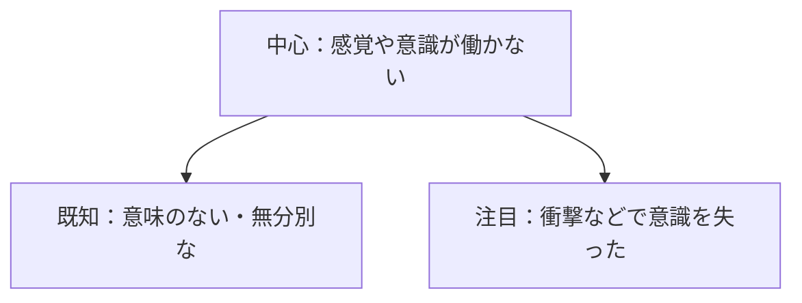

**重要語法**：knock someone senseless：人を意識不明にさせる

---

## 5042. siren

**単語**：siren  
**品詞**：idiom  
**発音**：/ˈsaɪrən/

<small>よく知られている意味：警報サイレン</small>

### 見落としやすい意味

**siren song：魅力的だが危険な誘い・甘い誘惑**

**例文**：The offer sounded like a siren song, but it carried serious risks.

**和訳**：その申し出は魅力的に聞こえたが、重大な危険を伴っていた。

**コアイメージの説明**：神話のセイレーンは美しい歌で船乗りを危険へ誘った。その伝説から、魅力的でも従うと危険な誘いを siren song と呼ぶ。

**図**

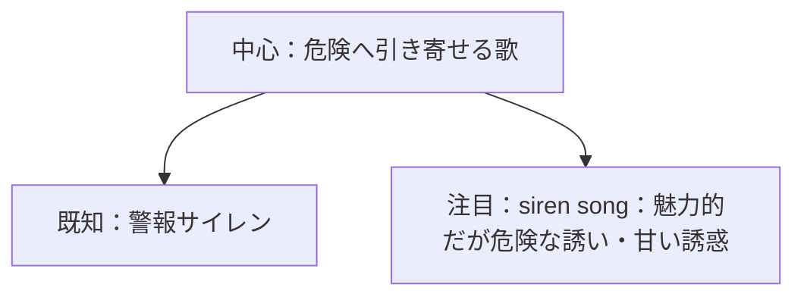

**重要語法**：siren song：危険な甘い誘惑

---

## 5043. sleeping

**単語**：sleeping  
**品詞**：idiom  
**発音**：/ˈsliːpɪŋ/

<small>よく知られている意味：眠っている</small>

### 見落としやすい意味

**sleeping giant：潜在的に大きな力を持つ人・国・企業**

**例文**：The small company may be a sleeping giant in the energy industry.

**和訳**：その小企業はエネルギー業界で巨大な潜在力を持つかもしれない。

**コアイメージの説明**：巨人は眠っている間、力をまだ発揮していない。そこから、今は目立たなくても大きな影響力を発揮しうる存在を指す。

**図**

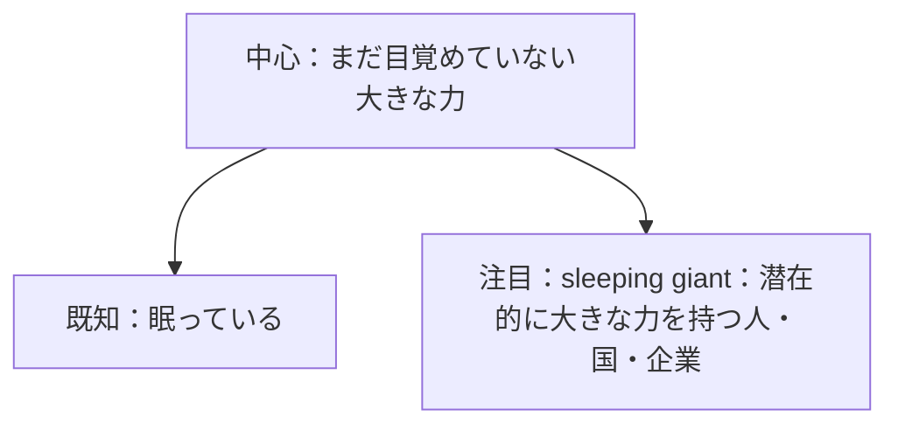

**重要語法**：sleeping giant：潜在力の大きな存在

---

## 5044. snail

**単語**：snail  
**品詞**：idiom  
**発音**：/sneɪl/

<small>よく知られている意味：カタツムリ</small>

### 見落としやすい意味

**snail mail：電子メールに対する従来の郵便**

**例文**：I sent the original document by snail mail rather than email.

**和訳**：私は書類の原本をメールではなく普通郵便で送った。

**コアイメージの説明**：カタツムリの遅い動きが比喩の出発点になる。電子メールより時間がかかる従来の郵便を、くだけて snail mail と呼ぶ。

**図**

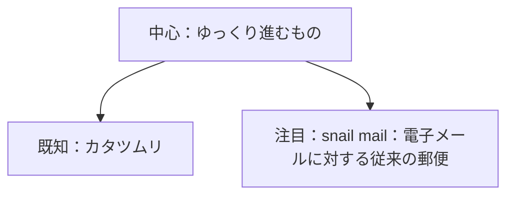

**重要語法**：snail mail：普通郵便

---

## 5045. sow

**単語**：sow  
**品詞**：verb  
**発音**：/soʊ/

<small>よく知られている意味：種をまく</small>

### 見落としやすい意味

**（疑惑・不安などを）生じさせ、広める**

**例文**：The false report sowed doubt among the residents.

**和訳**：その虚偽の報道は住民の間に疑念を広めた。

**コアイメージの説明**：畑にまいた種は後から芽を出して広がる。不安や疑念など目に見えないものを生じさせる場合にも同じ動詞を使う。

**図**

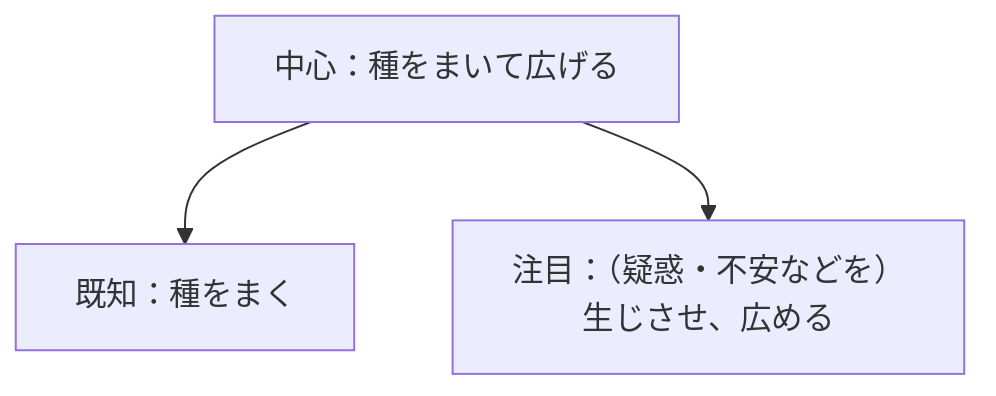

**重要語法**：sow doubt / fear：疑念・恐怖を広める

---

## 5046. sow

**単語**：sow  
**品詞**：noun  
**発音**：/saʊ/

<small>よく知られている意味：種をまく（動詞）</small>

### 見落としやすい意味

**成長した雌ブタ（動詞sowとは発音が異なる）**

**例文**：The farmer kept two sows for breeding.

**和訳**：農場主は繁殖用に成長した雌ブタを2頭飼っていた。

**コアイメージの説明**：動詞 sow「種をまく」と名詞 sow「雌ブタ」は同綴りの別語である。意味を無理につなげず、名詞が /saʊ/ と発音されることも覚える。

**図**

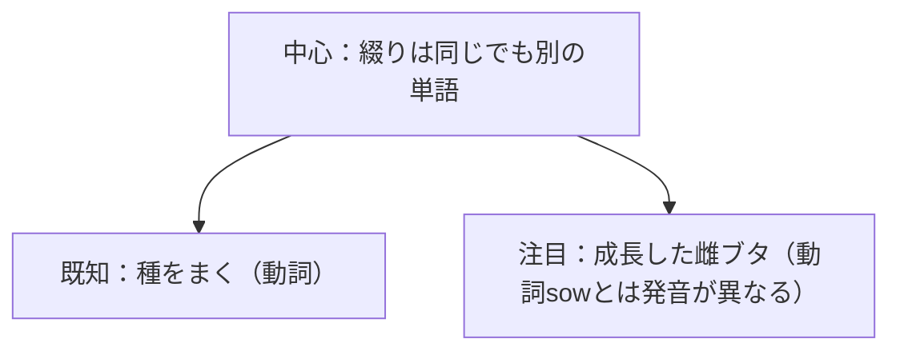

**重要語法**：a sow and her piglets：雌ブタと子ブタ

---

## 5047. sterling

**単語**：sterling  
**品詞**：adjective  
**発音**：/ˈstɜːrlɪŋ/

<small>よく知られている意味：英ポンド・純銀の</small>

### 見落としやすい意味

**（仕事・性格などが）非常に優秀な、立派な**

**例文**：She has done sterling work for the local community.

**和訳**：彼女は地域のために実に立派な仕事をしてきた。

**コアイメージの説明**：sterling は銀の純度など確かな品質を表す。その評価が仕事や人格にも広がり、「非常に優れた」という褒め言葉になる。

**図**

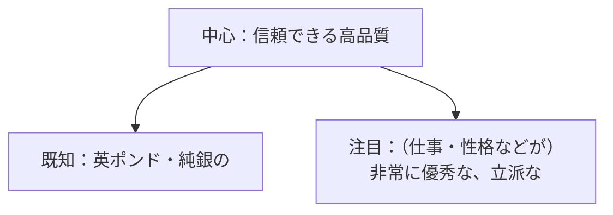

**重要語法**：sterling work：非常に優れた仕事

---

## 5048. steward

**単語**：steward  
**品詞**：noun  
**発音**：/ˈstuːərd/

<small>よく知られている意味：客室乗務員・給仕</small>

### 見落としやすい意味

**資源・組織などの管理責任を負う人・世話役**

**例文**：We must act as responsible stewards of the forest.

**和訳**：私たちは森林の責任ある管理者として行動しなければならない。

**コアイメージの説明**：steward は人や組織から任されたものの面倒を見る役割が中心。乗客の世話だけでなく、自然や資源の保全責任にも使う。

**図**

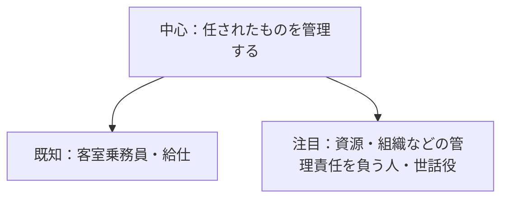

**重要語法**：steward of the environment：環境の管理責任者

---

## 5049. stony

**単語**：stony  
**品詞**：idiom  
**発音**：/ˈstoʊni/

<small>よく知られている意味：石のような・石だらけの</small>

### 見落としやすい意味

**stony silence：冷淡で全く反応のない沈黙**

**例文**：His question was met with stony silence.

**和訳**：彼の質問には冷ややかな沈黙が返ってきた。

**コアイメージの説明**：石は硬く、反応したり表情を変えたりしない。その性質から、返事も共感も示さない冷たい沈黙を表す。

**図**

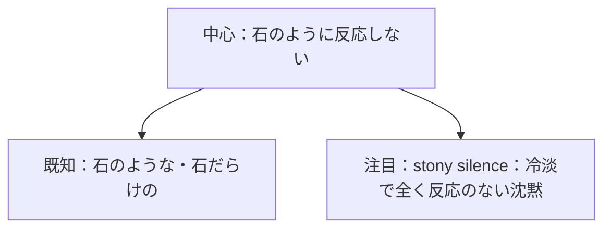

**重要語法**：stony silence：冷淡な沈黙

---

## 5050. stoop

**単語**：stoop  
**品詞**：phrasal verb  
**発音**：/stuːp/

<small>よく知られている意味：腰をかがめる</small>

### 見落としやすい意味

**stoop to：卑劣な行為をするところまで堕ちる**

**例文**：She would never stoop to cheating to win a contest.

**和訳**：彼女は大会で勝つために不正をするほど身を落としたりしない。

**コアイメージの説明**：体をかがめて低くする動作が出発点。その比喩で、品位を下げるほど卑劣なことをする意味になる。

**図**

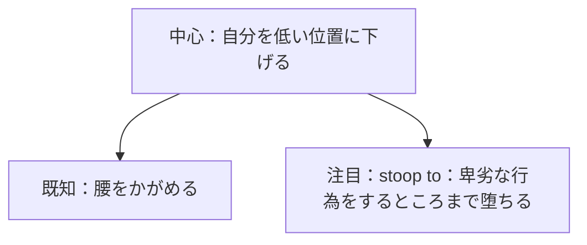

**重要語法**：stoop to doing：〜するほど身を落とす

---

## 5051. digest

**単語**：digest  
**品詞**：verb  
**発音**：/daɪˈdʒest/

<small>よく知られている意味：食べ物を消化する</small>

### 見落としやすい意味

**（複雑な情報や内容を）時間をかけて理解・吸収する**

**例文**：I needed time to digest the unexpected news.

**和訳**：その思いがけない知らせを理解し受け止めるのに時間が必要だった。

**コアイメージの説明**：食物を消化して体に吸収することが基本。情報や出来事にも使い、時間をかけて理解し自分の中に取り込むことを表す。

**図**

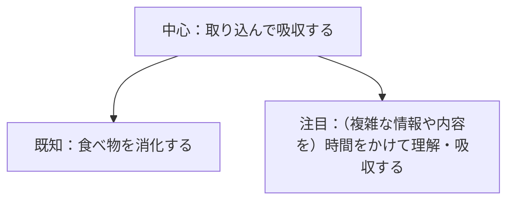

**重要語法**：digest information：情報を理解する

---

## 5052. digest

**単語**：digest  
**品詞**：noun  
**発音**：/ˈdaɪdʒest/

<small>よく知られている意味：消化する（動詞）</small>

### 見落としやすい意味

**要約、記事・資料の要点集（動詞と強勢位置が異なる）**

**例文**：The newsletter offers a weekly digest of science news.

**和訳**：そのニュースレターには科学ニュースの週刊要約が載っている。

**コアイメージの説明**：複雑な情報を読みやすく処理したものが digest という要約である。名詞では第一音節に強勢があることが多く、動詞と区別する。

**図**

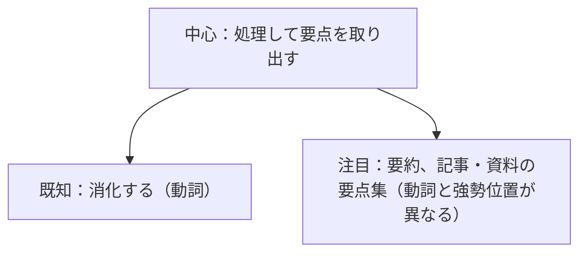

**重要語法**：a news digest：ニュースの要約

---

## 5053. rib

**単語**：rib  
**品詞**：verb  
**発音**：/rɪb/

<small>よく知られている意味：あばら骨</small>

### 見落としやすい意味

**相手を親しみを込めてからかう**

**例文**：My classmates ribbed me about my new haircut.

**和訳**：クラスメートは新しい髪型について親しみを込めて私をからかった。

**コアイメージの説明**：身体を軽くつついて反応を引き出すような、小さな刺激が比喩の出発点。動詞 rib は親しい間柄で冗談交じりにからかう場合に使う。

**図**

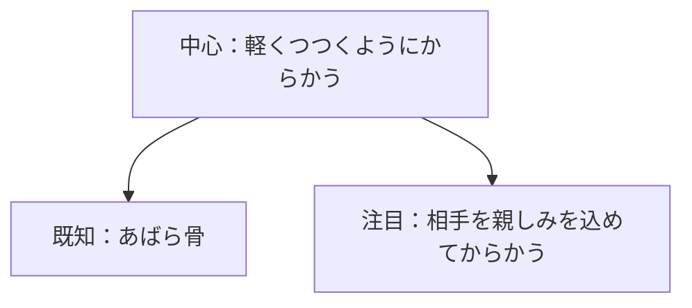

**重要語法**：rib someone about something：〜のことでからかう

---

## 5054. ranger

**単語**：ranger  
**品詞**：noun  
**発音**：/ˈreɪndʒər/

<small>よく知られている意味：軍のレンジャー隊員</small>

### 見落としやすい意味

**国立公園・自然保護区などの管理官・監視員**

**例文**：A park ranger showed us where the trail began.

**和訳**：公園の管理官が登山道の始まる場所を教えてくれた。

**コアイメージの説明**：ranger は広い地域を巡回して見守る人を表す。軍人だけでなく、国立公園などで自然や利用者を守る職員にも使う。

**図**

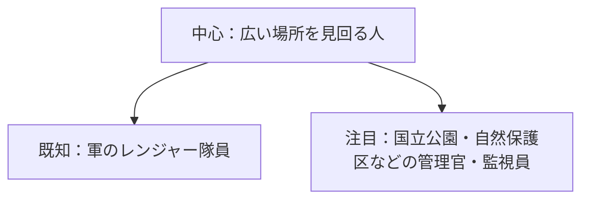

**重要語法**：park ranger：公園管理官

---

## 5055. audition

**単語**：audition  
**品詞**：verb  
**発音**：/ɔːˈdɪʃən/

<small>よく知られている意味：オーディション（名詞）</small>

### 見落としやすい意味

**役などを得るためオーディションを受ける**

**例文**：He auditioned for the lead role in the school play.

**和訳**：彼は学校の劇の主役を得るためオーディションを受けた。

**コアイメージの説明**：audition は出演者を選ぶための審査を意味する。その選考に参加し実力を示す行為を動詞 audition だけで表せる。

**図**

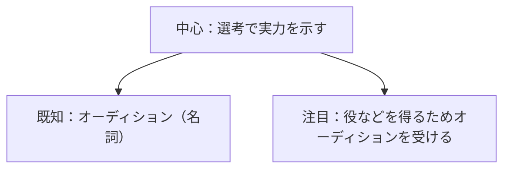

**重要語法**：audition for a role：役のオーディションを受ける

---

## 5056. conditional

**単語**：conditional  
**品詞**：adjective pattern  
**発音**：/kənˈdɪʃənəl/

<small>よく知られている意味：条件付きの</small>

### 見落としやすい意味

**conditional on / upon：〜を条件とする、〜次第で決まる**

**例文**：The grant is conditional on the project meeting safety standards.

**和訳**：助成金の支給は事業が安全基準を満たすことを条件としている。

**コアイメージの説明**：conditional は無条件では成立しないことを表す。on / upon の後に成立の前提を置き、「その条件次第」と読む。

**図**

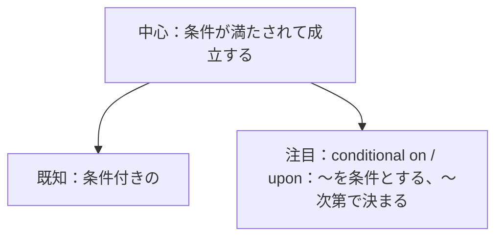

**重要語法**：be conditional on / upon：〜を条件とする

---

## 5057. unison

**単語**：unison  
**品詞**：idiom  
**発音**：/ˈjuːnɪsən/

<small>よく知られている意味：同じ音・斉唱</small>

### 見落としやすい意味

**in unison：声や動作をそろえて、一斉に**

**例文**：The students answered the question in unison.

**和訳**：生徒たちはその質問に声をそろえて答えた。

**コアイメージの説明**：複数の声が同じ音として重なることが基本。音楽以外でも声や動作が一斉にそろう様子を in unison で表す。

**図**

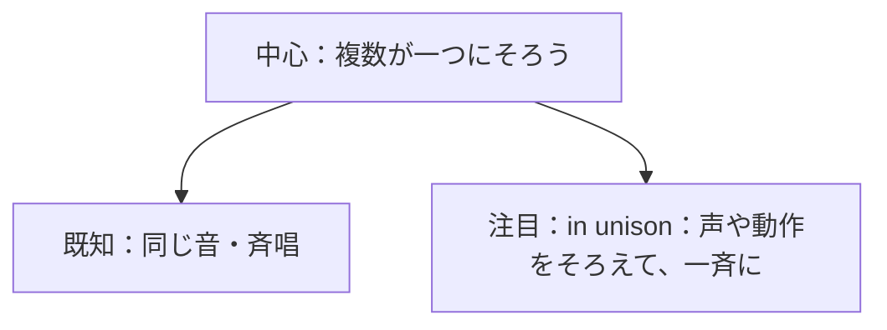

**重要語法**：in unison：一斉に

---

## 5058. flux

**単語**：flux  
**品詞**：idiom  
**発音**：/flʌks/

<small>よく知られている意味：流れ・流束</small>

### 見落としやすい意味

**in flux：流動的で変化し続けている**

**例文**：The rules are still in flux, so check for updates.

**和訳**：規則はまだ流動的なので、更新情報を確認してほしい。

**コアイメージの説明**：flux は物事が流れたり移り変わったりすること。固定された状態ではなく、状況が変化の途中にあることを in flux と言う。

**図**

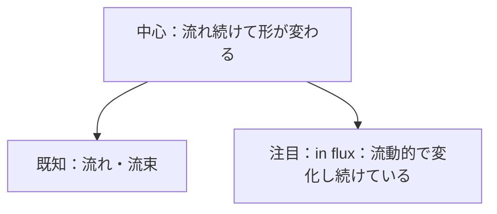

**重要語法**：in flux：流動的で

---

## 5059. cavity

**単語**：cavity  
**品詞**：noun  
**発音**：/ˈkævɪti/

<small>よく知られている意味：空洞・穴</small>

### 見落としやすい意味

**虫歯、歯にできた穴**

**例文**：The dentist found a small cavity in my back tooth.

**和訳**：歯科医は私の奥歯に小さな虫歯を見つけた。

**コアイメージの説明**：cavity の基本は中身が抜けてできた穴や空間。歯にできた穴も同じイメージで、日常英語では虫歯を指す。

**図**

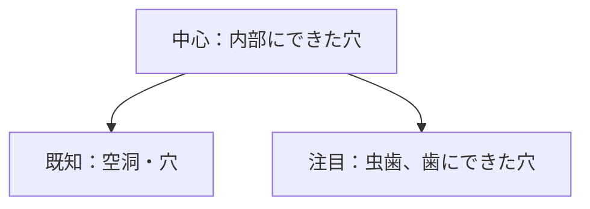

**重要語法**：have a cavity：虫歯がある

---

## 5060. wavelength

**単語**：wavelength  
**品詞**：idiom  
**発音**：/ˈweɪvleŋθ/

<small>よく知られている意味：波長</small>

### 見落としやすい意味

**be on the same wavelength：考え方が似ていて互いに理解し合える**

**例文**：We work well together because we are on the same wavelength.

**和訳**：私たちは考え方が通じ合うので一緒にうまく仕事ができる。

**コアイメージの説明**：同じ波長の波は調子が合う。そのイメージを人間関係へ広げ、考え方が似て意思が通じることを表す。

**図**

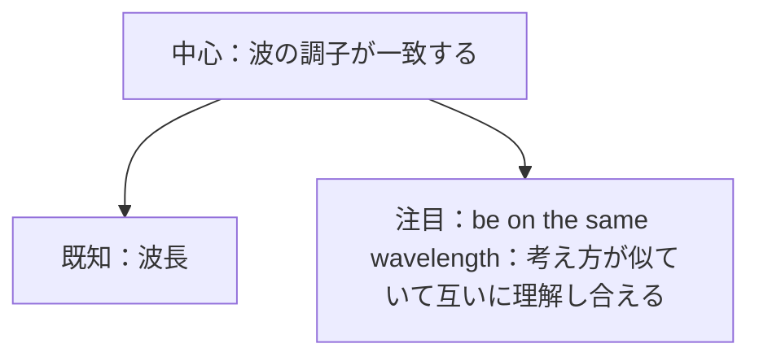

**重要語法**：be on the same wavelength：気が合う

---

## 5061. roundup

**単語**：roundup  
**品詞**：noun  
**発音**：/ˈraʊndʌp/

<small>よく知られている意味：家畜を集めること</small>

### 見落としやすい意味

**ニュース・出来事・成果などの要約、まとめ**

**例文**：Here is a quick roundup of today's main headlines.

**和訳**：こちらが今日の主な見出しの簡単なまとめです。

**コアイメージの説明**：家畜を一か所に集めるのがもとのイメージ。各所に散らばるニュースや成果を集めた「まとめ」にもなる。

**図**

```mermaid
flowchart TD
    A["中心：散らばったものを集める"]
    B["既知：家畜を集めること"]
    C["注目：ニュース・出来事・成果などの要約、まとめ"]
    A --> B
    A --> C
```

**重要語法**：a news roundup：ニュースのまとめ

---

## 5062. liquidity

**単語**：liquidity  
**品詞**：noun  
**発音**：/lɪˈkwɪdəti/

<small>よく知られている意味：液状であること</small>

### 見落としやすい意味

**資産・市場の流動性、現金化のしやすさ**

**例文**：The firm sold its assets to improve liquidity.

**和訳**：その企業は資産を売って資金の流動性を高めた。

**コアイメージの説明**：液体は形を変えて流れやすい。金融では資産を必要なときに現金へ変え、支払いに使いやすい度合いを表す。

**図**

```mermaid
flowchart TD
    A["中心：必要なときに動かせる"]
    B["既知：液状であること"]
    C["注目：資産・市場の流動性、現金化のしやすさ"]
    A --> B
    A --> C
```

**重要語法**：improve liquidity：流動性を高める

---

## 5063. impersonate

**単語**：impersonate  
**品詞**：verb  
**発音**：/ɪmˈpɜːrsəneɪt/

<small>よく知られている意味：物まねをする</small>

### 見落としやすい意味

**他人になりすます、他人のふりをする**

**例文**：The caller tried to impersonate a bank employee.

**和訳**：電話の相手は銀行員になりすまそうとした。

**コアイメージの説明**：impersonate は別人の特徴をまねてその人のように振る舞うこと。芸としての物まねのほか、相手を欺くためのなりすましも指す。

**図**

```mermaid
flowchart TD
    A["中心：別人として振る舞う"]
    B["既知：物まねをする"]
    C["注目：他人になりすます、他人のふりをする"]
    A --> B
    A --> C
```

**重要語法**：impersonate someone：人になりすます

---

## 5064. bee

**単語**：bee  
**品詞**：noun phrase  
**発音**：/biː/

<small>よく知られている意味：ハチ</small>

### 見落としやすい意味

**spelling bee：英単語のつづりを競う大会**

**例文**：My sister won the regional spelling bee last year.

**和訳**：姉は昨年、地域の英単語つづり大会で優勝した。

**コアイメージの説明**：bee には昆虫のほか、特定の活動のために人が集まる会という用法がある。spelling bee は単語のつづりを答えて競う大会を指す。

**図**

```mermaid
flowchart TD
    A["中心：人が集まって活動する"]
    B["既知：ハチ"]
    C["注目：spelling bee：英単語のつづりを競う大会"]
    A --> B
    A --> C
```

**重要語法**：spelling bee：スペリング大会

---

## 5065. curry

**単語**：curry  
**品詞**：idiom / verb  
**発音**：/ˈkʌri/

<small>よく知られている意味：カレー（料理）</small>

### 見落としやすい意味

**curry favor with：利益を得るために人に取り入る・おべっかを使う**

**例文**：He tried to curry favor with the manager by praising every decision.

**和訳**：彼は上司の決定を何でも褒め、その機嫌を取ろうとした。

**コアイメージの説明**：curry favor は相手に気に入られるよう振る舞う定型表現。料理のカレーとは無関係で、下心のあるおべっかとして覚える。

**図**

```mermaid
flowchart TD
    A["中心：利益のために取り入る"]
    B["既知：カレー（料理）"]
    C["注目：curry favor with：利益を得るために人に取り入る・おべっかを使う"]
    A --> B
    A --> C
```

**重要語法**：curry favor with someone：人に取り入る

---

## 5066. coupled

**単語**：coupled  
**品詞**：participle pattern  
**発音**：/ˈkʌpəld/

<small>よく知られている意味：一組になった</small>

### 見落としやすい意味

**coupled with：〜と相まって・〜と組み合わさって**

**例文**：Heavy rain, coupled with strong winds, delayed the flight.

**和訳**：激しい雨に強風も重なり、その便は遅れた。

**コアイメージの説明**：couple は二つのものを結び付けること。coupled with は別の要因が加わって結果を生むことを示す。

**図**

```mermaid
flowchart TD
    A["中心：要因が結び付く"]
    B["既知：一組になった"]
    C["注目：coupled with：〜と相まって・〜と組み合わさって"]
    A --> B
    A --> C
```

**重要語法**：coupled with：〜と相まって

---

## 5067. reactive

**単語**：reactive  
**品詞**：adjective  
**発音**：/riˈæktɪv/

<small>よく知られている意味：反応性の高い</small>

### 見落としやすい意味

**問題後に受動的に対応する、事後対応型の**

**例文**：Our team needs a proactive plan rather than a reactive response.

**和訳**：チームには事後対応ではなく先手を打つ計画が必要だ。

**コアイメージの説明**：reactive は何かが起きてから反応する性質を表す。仕事では問題を予防せず、発生後に対応する姿勢を指す。

**図**

```mermaid
flowchart TD
    A["中心：起きたことに反応する"]
    B["既知：反応性の高い"]
    C["注目：問題後に受動的に対応する、事後対応型の"]
    A --> B
    A --> C
```

**重要語法**：reactive approach：事後対応型の方法

---

## 5068. astray

**単語**：astray  
**品詞**：adverb  
**発音**：/əˈstreɪ/

<small>よく知られている意味：道を外れて</small>

### 見落としやすい意味

**go astray：道を誤る、手紙などが行方不明になる**

**例文**：The parcel went astray during delivery.

**和訳**：その小包は配送中に行方不明になった。

**コアイメージの説明**：astray は予定された進路から外れた状態。判断を誤る人だけでなく、荷物が届かず行方不明になる場合にも使える。

**図**

```mermaid
flowchart TD
    A["中心：本来の進路から外れる"]
    B["既知：道を外れて"]
    C["注目：go astray：道を誤る、手紙などが行方不明になる"]
    A --> B
    A --> C
```

**重要語法**：go astray：道を誤る・行方不明になる

---

## 5069. detriment

**単語**：detriment  
**品詞**：idiom  
**発音**：/ˈdɛtrɪmənt/

<small>よく知られている意味：損害・不利益</small>

### 見落としやすい意味

**to the detriment of：〜を犠牲にして・損なって**

**例文**：He focused on speed to the detriment of accuracy.

**和訳**：彼は正確さを犠牲にして速さを優先した。

**コアイメージの説明**：detriment は不利益や損害を表す。to the detriment of は何かを優先した結果、別の大切なものが損なわれることを示す。

**図**

```mermaid
flowchart TD
    A["中心：一方を得て他方を損なう"]
    B["既知：損害・不利益"]
    C["注目：to the detriment of：〜を犠牲にして・損なって"]
    A --> B
    A --> C
```

**重要語法**：to the detriment of：〜を損なって

---

## 5070. bacon

**単語**：bacon  
**品詞**：idiom  
**発音**：/ˈbeɪkən/

<small>よく知られている意味：ベーコン</small>

### 見落としやすい意味

**bring home the bacon：生活費を稼ぐ、成功を収める**

**例文**：Both parents work hard to bring home the bacon.

**和訳**：両親は生活費を稼ぐため一生懸命働いている。

**コアイメージの説明**：食べ物を持ち帰る姿が家族を支える収入を象徴する。bring home the bacon は肉そのものではなく、稼ぐことや成功することを表す。

**図**

```mermaid
flowchart TD
    A["中心：食卓に稼ぎを持ち帰る"]
    B["既知：ベーコン"]
    C["注目：bring home the bacon：生活費を稼ぐ、成功を収める"]
    A --> B
    A --> C
```

**重要語法**：bring home the bacon：生活費を稼ぐ

---

## 5071. ginger

**単語**：ginger  
**品詞**：phrasal verb  
**発音**：/ˈdʒɪndʒər/

<small>よく知られている意味：ショウガ</small>

### 見落としやすい意味

**ginger up：活気づける、面白くする（主に英）**

**例文**：The host added a game to ginger up the meeting.

**和訳**：司会者は会議を活気づけるためゲームを加えた。

**コアイメージの説明**：ショウガのぴりっとした刺激を、雰囲気に勢いを与えることへ重ねる。ginger up は人や行事を元気にしたり面白くしたりする。

**図**

```mermaid
flowchart TD
    A["中心：刺激を加えて活発にする"]
    B["既知：ショウガ"]
    C["注目：ginger up：活気づける、面白くする（主に英）"]
    A --> B
    A --> C
```

**重要語法**：ginger up：活気づける（主に英）

---

## 5072. humour

**単語**：humour  
**品詞**：verb  
**発音**：/ˈhjuːmər/

<small>よく知られている意味：ユーモア（名詞）</small>

### 見落としやすい意味

**人の機嫌をとって話や要求に合わせる**

**例文**：I humoured him and listened to his long story.

**和訳**：私は彼の機嫌を損ねないよう長い話に付き合った。

**コアイメージの説明**：humour には人の気分という意味の流れがある。動詞では自分の意見を押し通さず、相手の望みに合わせることを表す。

**図**

```mermaid
flowchart TD
    A["中心：相手の気分に合わせる"]
    B["既知：ユーモア（名詞）"]
    C["注目：人の機嫌をとって話や要求に合わせる"]
    A --> B
    A --> C
```

**重要語法**：humour someone：機嫌を取る（米綴り humor）

---

## 5073. ram

**単語**：ram  
**品詞**：verb  
**発音**：/ræm/

<small>よく知られている意味：雄羊・RAM</small>

### 見落としやすい意味

**強い勢いでぶつける・押し込む**

**例文**：The driver accidentally rammed the gate with his truck.

**和訳**：運転手は誤ってトラックで門に激しく衝突した。

**コアイメージの説明**：雄羊が頭を使って突くような強い衝突がイメージの中心。車をぶつけるほか、物を無理に押し込む場合にも使う。

**図**

```mermaid
flowchart TD
    A["中心：勢いよく突き当たる"]
    B["既知：雄羊・RAM"]
    C["注目：強い勢いでぶつける・押し込む"]
    A --> B
    A --> C
```

**重要語法**：ram something into something：押し込む

---

## 5074. longitudinal

**単語**：longitudinal  
**品詞**：adjective  
**発音**：/ˌlɑːndʒɪˈtuːdənəl/

<small>よく知られている意味：縦方向の</small>

### 見落としやすい意味

**研究・調査が同じ対象を長期間追跡する**

**例文**：The researchers conducted a longitudinal study over ten years.

**和訳**：研究者たちは10年間にわたる追跡調査を行った。

**コアイメージの説明**：longitudinal は長い方向の軸に沿う性質を表す。研究では同じ対象を長い時間にわたって観察することを指す。

**図**

```mermaid
flowchart TD
    A["中心：時間の長い軸を追う"]
    B["既知：縦方向の"]
    C["注目：研究・調査が同じ対象を長期間追跡する"]
    A --> B
    A --> C
```

**重要語法**：longitudinal study：縦断研究

---

## 5075. remedial

**単語**：remedial  
**品詞**：adjective  
**発音**：/rɪˈmiːdiəl/

<small>よく知られている意味：治療・改善のための</small>

### 見落としやすい意味

**授業・教育が遅れや不足を補うための、補習の**

**例文**：She enrolled in a remedial math class before the new term.

**和訳**：彼女は新学期前に数学の補習授業を受けた。

**コアイメージの説明**：remedy は問題を改善する手段。教育では学習の遅れや不足を補う授業を remedial と呼ぶ。

**図**

```mermaid
flowchart TD
    A["中心：不足を補い改善する"]
    B["既知：治療・改善のための"]
    C["注目：授業・教育が遅れや不足を補うための、補習の"]
    A --> B
    A --> C
```

**重要語法**：remedial classes：補習授業

---

## 5076. locus

**単語**：locus  
**品詞**：noun  
**発音**：/ˈloʊkəs/

<small>よく知られている意味：数学の軌跡</small>

### 見落としやすい意味

**問題や活動の中心・所在・起点**

**例文**：The city became the locus of the protest movement.

**和訳**：その都市は抗議運動の中心地となった。

**コアイメージの説明**：locus の根本は場所で、数学では点の軌跡をいう。抽象的には問題や活動が生じる中心・所在を表す。

**図**

```mermaid
flowchart TD
    A["中心：物事が位置する場所"]
    B["既知：数学の軌跡"]
    C["注目：問題や活動の中心・所在・起点"]
    A --> B
    A --> C
```

**重要語法**：the locus of activity：活動の中心

---

## 5077. provided

**単語**：provided  
**品詞**：conjunction  
**発音**：/prəˈvaɪdɪd/

<small>よく知られている意味：提供した・与えた</small>

### 見落としやすい意味

**（provided / provided that）〜という条件で、〜ならば**

**例文**：You may leave early, provided that you finish your work.

**和訳**：仕事を終えれば早く帰ってもよい。

**コアイメージの説明**：provided that は前に述べたことが成立する条件を示す接続詞句。「提供された」ではなく「〜ならば」と読む。

**図**

```mermaid
flowchart TD
    A["中心：成立に必要な条件を置く"]
    B["既知：提供した・与えた"]
    C["注目：（provided / provided that）〜という条件で、〜ならば"]
    A --> B
    A --> C
```

**重要語法**：provided (that)：〜という条件で

---

## 5078. phoenix

**単語**：phoenix  
**品詞**：idiom  
**発音**：/ˈfiːnɪks/

<small>よく知られている意味：不死鳥</small>

### 見落としやすい意味

**rise like a phoenix from the ashes：逆境や崩壊から復活する**

**例文**：After the fire, the theater rose like a phoenix from the ashes.

**和訳**：火災の後、その劇場は見事に再建された。

**コアイメージの説明**：伝説の不死鳥は燃え尽きた後に再生するとされる。その物語から、崩壊や失敗からの力強い復活を表す。

**図**

```mermaid
flowchart TD
    A["中心：灰の中から再び生まれる"]
    B["既知：不死鳥"]
    C["注目：rise like a phoenix from the ashes：逆境や崩壊から復活する"]
    A --> B
    A --> C
```

**重要語法**：rise like a phoenix from the ashes：復活する

---

## 5079. compliant

**単語**：compliant  
**品詞**：adjective  
**発音**：/kəmˈplaɪənt/

<small>よく知られている意味：従順な</small>

### 見落としやすい意味

**製品・組織が法令・規格などに適合している**

**例文**：All devices must be compliant with the new safety rules.

**和訳**：すべての機器は新しい安全規則に適合していなければならない。

**コアイメージの説明**：compliant は要求や規則に従う状態を示す。人だけでなく、製品や組織が定められた基準を満たす場合にも使う。

**図**

```mermaid
flowchart TD
    A["中心：基準に従っている"]
    B["既知：従順な"]
    C["注目：製品・組織が法令・規格などに適合している"]
    A --> B
    A --> C
```

**重要語法**：be compliant with：〜に適合する

---

## 5080. liquidation

**単語**：liquidation  
**品詞**：noun  
**発音**：/ˌlɪkwɪˈdeɪʃən/

<small>よく知られている意味：液状化</small>

### 見落としやすい意味

**会社・事業の清算、廃業に伴う資産処分**

**例文**：The company began liquidation after it closed its stores.

**和訳**：その企業は店舗を閉じた後、清算手続きを始めた。

**コアイメージの説明**：liquid は資産が現金化しやすい性質にも使う。liquidation は会社の資産を処分し、債務などを整理して事業を終える手続きに結び付く。

**図**

```mermaid
flowchart TD
    A["中心：資産を現金化して整理する"]
    B["既知：液状化"]
    C["注目：会社・事業の清算、廃業に伴う資産処分"]
    A --> B
    A --> C
```

**重要語法**：go into liquidation：清算手続きに入る

---

## 5081. incorporation

**単語**：incorporation  
**品詞**：noun  
**発音**：/ɪnˌkɔːrpəˈreɪʃən/

<small>よく知られている意味：組み込み・統合</small>

### 見落としやすい意味

**法人設立、登記・法人化**

**例文**：The startup completed its incorporation in April.

**和訳**：その新興企業は4月に法人設立の手続きを終えた。

**コアイメージの説明**：incorporate は要素を一つのまとまりにすること。法律上は事業を独立した法人として成立させることを incorporation と呼ぶ。

**図**

```mermaid
flowchart TD
    A["中心：一つの組織体にする"]
    B["既知：組み込み・統合"]
    C["注目：法人設立、登記・法人化"]
    A --> B
    A --> C
```

**重要語法**：certificate of incorporation：会社設立証明書

---

## 5082. contested

**単語**：contested  
**品詞**：adjective  
**発音**：/kənˈtɛstɪd/

<small>よく知られている意味：競われた・争われた</small>

### 見落としやすい意味

**意見が分かれている、異論・論争のある**

**例文**：The policy remains highly contested among experts.

**和訳**：その政策について専門家の間で今も意見が大きく分かれる。

**コアイメージの説明**：contest は競技だけでなく主張に異議を唱えることも意味する。contested は同意が得られず議論の的になっている状態を表す。

**図**

```mermaid
flowchart TD
    A["中心：一つの主張に異議が出る"]
    B["既知：競われた・争われた"]
    C["注目：意見が分かれている、異論・論争のある"]
    A --> B
    A --> C
```

**重要語法**：a contested issue：論争のある問題

---

## 5083. symptomatic

**単語**：symptomatic  
**品詞**：adjective  
**発音**：/ˌsɪmptəˈmætɪk/

<small>よく知られている意味：症状のある</small>

### 見落としやすい意味

**より大きな問題・傾向の兆候を示す、象徴する**

**例文**：The mistake is symptomatic of deeper problems in the system.

**和訳**：そのミスは制度の根深い問題を示している。

**コアイメージの説明**：病気の症状は見えにくい原因を知らせる手がかり。同じように、出来事が背後の大きな問題の兆候となる場合にも使う。

**図**

```mermaid
flowchart TD
    A["中心：表に現れた兆候"]
    B["既知：症状のある"]
    C["注目：より大きな問題・傾向の兆候を示す、象徴する"]
    A --> B
    A --> C
```

**重要語法**：be symptomatic of：〜の兆候である

---

## 5084. denominator

**単語**：denominator  
**品詞**：idiom  
**発音**：/dɪˈnɑːməneɪtər/

<small>よく知られている意味：分母</small>

### 見落としやすい意味

**common denominator：共通点・共通項**

**例文**：Curiosity is the common denominator among these students.

**和訳**：好奇心はこれらの生徒に共通する特徴だ。

**コアイメージの説明**：数学では異なる分数を共通の分母で扱える。その発想から、別々の人や事柄を結ぶ共通点を common denominator と呼ぶ。

**図**

```mermaid
flowchart TD
    A["中心：異なるものに共通する部分"]
    B["既知：分母"]
    C["注目：common denominator：共通点・共通項"]
    A --> B
    A --> C
```

**重要語法**：common denominator：共通項

---

## 5085. engaged

**単語**：engaged  
**品詞**：adjective  
**発音**：/ɪnˈɡeɪdʒd/

<small>よく知られている意味：婚約している</small>

### 見落としやすい意味

**be engaged in：〜に従事している・取り組んでいる**

**例文**：She is engaged in research on renewable energy.

**和訳**：彼女は再生可能エネルギーの研究に従事している。

**コアイメージの説明**：engage は何かに関わり取り組むこと。婚約以外に be engaged in で仕事や研究に参加している状態を表す。

**図**

```mermaid
flowchart TD
    A["中心：活動に深く関わる"]
    B["既知：婚約している"]
    C["注目：be engaged in：〜に従事している・取り組んでいる"]
    A --> B
    A --> C
```

**重要語法**：be engaged in：〜に従事する

---

## 5086. engaged

**単語**：engaged  
**品詞**：adjective  
**発音**：/ɪnˈɡeɪdʒd/

<small>よく知られている意味：婚約している</small>

### 見落としやすい意味

**（電話・部屋・時間などが）使用中、ふさがっている**

**例文**：The line was engaged, so I called again later.

**和訳**：電話が話し中だったので、私は後でもう一度かけた。

**コアイメージの説明**：engaged は何かに占められ別の用途に使えない状態にもなる。電話回線・席・時間なら「使用中・ふさがっている」と読む。

**図**

```mermaid
flowchart TD
    A["中心：すでに使われている"]
    B["既知：婚約している"]
    C["注目：（電話・部屋・時間などが）使用中、ふさがっている"]
    A --> B
    A --> C
```

**重要語法**：an engaged line：話し中の電話回線（主に英）

---

## 5087. concerning

**単語**：concerning  
**品詞**：preposition  
**発音**：/kənˈsɜːrnɪŋ/

<small>よく知られている意味：心配させる（現在分詞）</small>

### 見落としやすい意味

**〜について、〜に関して**

**例文**：We received several questions concerning the schedule.

**和訳**：日程に関していくつかの質問が寄せられた。

**コアイメージの説明**：concern には「関係する」という意味がある。concerning が前置詞として名詞の前に来ると「〜について」を表す。

**図**

```mermaid
flowchart TD
    A["中心：話題の対象に関係する"]
    B["既知：心配させる（現在分詞）"]
    C["注目：〜について、〜に関して"]
    A --> B
    A --> C
```

**重要語法**：concerning the schedule：日程について

---

## 5088. adopted

**単語**：adopted  
**品詞**：adjective  
**発音**：/əˈdɑːptɪd/

<small>よく知られている意味：養子になった・採用された</small>

### 見落としやすい意味

**故郷以外で自ら選んで住むようになった、第二の**

**例文**：Japan became her adopted home after she moved there.

**和訳**：彼女が移住した後、日本は第二の故郷になった。

**コアイメージの説明**：adopt は他のものを自分の側に迎え入れること。出生地でなくても自ら選び住み着いた土地を adopted home と表せる。

**図**

```mermaid
flowchart TD
    A["中心：自分のものとして受け入れる"]
    B["既知：養子になった・採用された"]
    C["注目：故郷以外で自ら選んで住むようになった、第二の"]
    A --> B
    A --> C
```

**重要語法**：adopted country / home：第二の故郷

---

## 5089. vector

**単語**：vector  
**品詞**：noun  
**発音**：/ˈvɛktər/

<small>よく知られている意味：ベクトル（数学）</small>

### 見落としやすい意味

**病原体を媒介する生物・媒介者**

**例文**：Mosquitoes can act as vectors for certain diseases.

**和訳**：蚊は特定の病気を媒介することがある。

**コアイメージの説明**：vector には方向を持って運ぶというイメージがある。生物学では病原体を宿主から別の宿主へ運ぶ生物を指す。

**図**

```mermaid
flowchart TD
    A["中心：何かを運ぶもの"]
    B["既知：ベクトル（数学）"]
    C["注目：病原体を媒介する生物・媒介者"]
    A --> B
    A --> C
```

**重要語法**：a disease vector：病気の媒介生物

---

## 5090. stretching

**単語**：stretching  
**品詞**：idiom  
**発音**：/ˈstrɛtʃɪŋ/

<small>よく知られている意味：体を伸ばすこと</small>

### 見落としやすい意味

**stretching the truth：事実を誇張して言う**

**例文**：He was stretching the truth to make the story more exciting.

**和訳**：彼は話を面白くするため事実を誇張していた。

**コアイメージの説明**：stretch はものを元の長さ以上に伸ばすこと。truth を引き伸ばすと、事実からはみ出すほど大げさに話す意味になる。

**図**

```mermaid
flowchart TD
    A["中心：本来の範囲を伸ばす"]
    B["既知：体を伸ばすこと"]
    C["注目：stretching the truth：事実を誇張して言う"]
    A --> B
    A --> C
```

**重要語法**：stretch the truth：事実を誇張する

---

## 5091. inversion

**単語**：inversion  
**品詞**：noun  
**発音**：/ɪnˈvɜːrʒən/

<small>よく知られている意味：逆さにすること</small>

### 見落としやすい意味

**文法上の倒置、語順の反転**

**例文**：The sentence begins with an inversion after the negative phrase.

**和訳**：その文では否定表現の後に倒置が起きている。

**コアイメージの説明**：inversion は通常の並びを逆にすること。英文法では否定語句などが前に来た際、主語と助動詞の順序が入れ替わることを指す。

**図**

```mermaid
flowchart TD
    A["中心：通常の順序を逆にする"]
    B["既知：逆さにすること"]
    C["注目：文法上の倒置、語順の反転"]
    A --> B
    A --> C
```

**重要語法**：subject–auxiliary inversion：主語と助動詞の倒置

---

## 5092. gusto

**単語**：gusto  
**品詞**：idiom  
**発音**：/ˈɡʌstoʊ/

<small>よく知られている意味：熱意・勢い</small>

### 見落としやすい意味

**with gusto：勢いよく、熱意を込めて**

**例文**：The children sang with gusto at the festival.

**和訳**：子どもたちは祭りで元気いっぱいに歌った。

**コアイメージの説明**：gusto は楽しさや意気込みを伴う力強さ。with gusto とすれば活気や熱意を込めて行動する様子が伝わる。

**図**

```mermaid
flowchart TD
    A["中心：勢いを込めて楽しむ"]
    B["既知：熱意・勢い"]
    C["注目：with gusto：勢いよく、熱意を込めて"]
    A --> B
    A --> C
```

**重要語法**：with gusto：勢いよく

---

## 5093. mum

**単語**：mum  
**品詞**：adjective  
**発音**：/mʌm/

<small>よく知られている意味：お母さん（主に英）</small>

### 見落としやすい意味

**（事情について）黙ったままの（keep mum）**

**例文**：The staff kept mum about the surprise announcement.

**和訳**：職員たちはその突然の発表について黙ったままだった。

**コアイメージの説明**：mum には黙っている状態を表す形容詞の用法がある。母親を指す名詞と区別し、keep mum を一まとまりで覚える。

**図**

```mermaid
flowchart TD
    A["中心：口を閉じて黙る"]
    B["既知：お母さん（主に英）"]
    C["注目：（事情について）黙ったままの（keep mum）"]
    A --> B
    A --> C
```

**重要語法**：keep mum about：〜について黙る

---

## 5094. made

**単語**：made  
**品詞**：idiom  
**発音**：/meɪd/

<small>よく知られている意味：作られた（make の過去分詞）</small>

### 見落としやすい意味

**have it made：成功・安定した生活がほぼ確実である**

**例文**：With that job offer, she has it made.

**和訳**：その仕事の内定があるなら彼女の将来は安泰だ。

**コアイメージの説明**：have it made は望む状態が実現したか、成功がほぼ確実なことを表す。「それを作った」とは訳せない定型句である。

**図**

```mermaid
flowchart TD
    A["中心：成功の条件が整っている"]
    B["既知：作られた（make の過去分詞）"]
    C["注目：have it made：成功・安定した生活がほぼ確実である"]
    A --> B
    A --> C
```

**重要語法**：have it made：成功が約束された状態

---

## 5095. pacific

**単語**：pacific  
**品詞**：adjective  
**発音**：/pəˈsɪfɪk/

<small>よく知られている意味：太平洋の（Pacific）</small>

### 見落としやすい意味

**平和を好む・平和をもたらす（小文字での用法）**

**例文**：The two countries sought a pacific solution to the dispute.

**和訳**：その二国は紛争の平和的な解決を目指した。

**コアイメージの説明**：pacific は平和を好む、平和をもたらす性質を表す。地名 Pacific と綴りが共通しても、小文字の形容詞では「平和的な」と読める。

**図**

```mermaid
flowchart TD
    A["中心：争いを避けて平和にする"]
    B["既知：太平洋の（Pacific）"]
    C["注目：平和を好む・平和をもたらす（小文字での用法）"]
    A --> B
    A --> C
```

**重要語法**：a pacific solution：平和的な解決

---

## 5096. fallen

**単語**：fallen  
**品詞**：phrasal verb  
**発音**：/ˈfɔːlən/

<small>よく知られている意味：落ちた（fall の過去分詞）</small>

### 見落としやすい意味

**have fallen for：だまされて信じてしまった**

**例文**：I can't believe I have fallen for that fake message.

**和訳**：あの偽のメッセージにだまされたなんて信じられない。

**コアイメージの説明**：fall for は話や誘いを信じ込んでしまう表現。完了形 have fallen for でも、落下ではなく「だまされた」と読む。

**図**

```mermaid
flowchart TD
    A["中心：罠に引っかかる"]
    B["既知：落ちた（fall の過去分詞）"]
    C["注目：have fallen for：だまされて信じてしまった"]
    A --> B
    A --> C
```

**重要語法**：fall for a trick：策略に引っかかる

---

## 5097. canned

**単語**：canned  
**品詞**：adjective  
**発音**：/kænd/

<small>よく知られている意味：缶詰の</small>

### 見落としやすい意味

**返事・説明などが型通りの、事前に準備された**

**例文**：The website sent me a canned reply instead of answering my question.

**和訳**：そのサイトは質問に答えず定型的な返事を送ってきた。

**コアイメージの説明**：缶詰は中身を前もって詰めて保存するもの。その比喩で、その場で考えたのではない型通りの回答を canned と言う。

**図**

```mermaid
flowchart TD
    A["中心：前もって詰めて用意する"]
    B["既知：缶詰の"]
    C["注目：返事・説明などが型通りの、事前に準備された"]
    A --> B
    A --> C
```

**重要語法**：a canned response：定型の返答

---

## 5098. sparkling

**単語**：sparkling  
**品詞**：adjective  
**発音**：/ˈspɑːrklɪŋ/

<small>よく知られている意味：きらきら輝く</small>

### 見落としやすい意味

**水・飲み物が炭酸入りの、発泡性の**

**例文**：Would you prefer still water or sparkling water?

**和訳**：普通の水と炭酸水のどちらがよいですか。

**コアイメージの説明**：sparkle は細かな光や泡のきらめきを表す。飲み物では細かな泡が次々と出ることから「炭酸入り」を表す。

**図**

```mermaid
flowchart TD
    A["中心：小さな泡がはじける"]
    B["既知：きらきら輝く"]
    C["注目：水・飲み物が炭酸入りの、発泡性の"]
    A --> B
    A --> C
```

**重要語法**：sparkling water：炭酸水

---

## 5099. induction

**単語**：induction  
**品詞**：noun  
**発音**：/ɪnˈdʌkʃən/

<small>よく知られている意味：誘導・帰納</small>

### 見落としやすい意味

**（新入者の）正式な加入・就任式、入職時の研修**

**例文**：All new employees attend an induction session on their first day.

**和訳**：新入社員は全員、初日に導入研修に参加する。

**コアイメージの説明**：induction には人を組織や役割に正式に迎え入れる意味がある。入職時の説明会や研修、就任式も表せる。

**図**

```mermaid
flowchart TD
    A["中心：新しい立場へ導き入れる"]
    B["既知：誘導・帰納"]
    C["注目：（新入者の）正式な加入・就任式、入職時の研修"]
    A --> B
    A --> C
```

**重要語法**：induction training：導入研修

---

## 5100. jersey

**単語**：jersey  
**品詞**：noun  
**発音**：/ˈdʒɜːrzi/

<small>よく知られている意味：ジャージー生地</small>

### 見落としやすい意味

**スポーツチームのユニフォームの上衣**

**例文**：The players wore blue jerseys for the final match.

**和訳**：選手たちは決勝戦で青いユニフォームの上衣を着ていた。

**コアイメージの説明**：jersey はもともと編み地やその素材の衣服を指す。スポーツでは選手の上衣を表し、日本語の上下セットの「ジャージ」とは限らない。

**図**

```mermaid
flowchart TD
    A["中心：選手が身につける上衣"]
    B["既知：ジャージー生地"]
    C["注目：スポーツチームのユニフォームの上衣"]
    A --> B
    A --> C
```

**重要語法**：team jersey：ユニフォームの上衣

---

## 5101. compromised

**単語**：compromised  
**品詞**：adjective  
**発音**：/ˈkɑːmprəmaɪzd/

<small>よく知られている意味：妥協した</small>

### 見落としやすい意味

**安全性・免疫機能・アカウントなどが損なわれた、侵害された**

**例文**：The company reset passwords after several accounts were compromised.

**和訳**：複数のアカウントが不正アクセスを受け、会社はパスワードを再設定した。

**コアイメージの説明**：compromise は妥協のほか、安全性や秘密を危険にさらすことも表す。compromised account は安全性が侵害されたアカウントである。

**図**

```mermaid
flowchart TD
    A["中心：安全な状態が損なわれる"]
    B["既知：妥協した"]
    C["注目：安全性・免疫機能・アカウントなどが損なわれた、侵害された"]
    A --> B
    A --> C
```

**重要語法**：a compromised account：侵害されたアカウント

---

## 5102. bubbly

**単語**：bubbly  
**品詞**：adjective  
**発音**：/ˈbʌbli/

<small>よく知られている意味：泡立つ</small>

### 見落としやすい意味

**性格が明るく活発で社交的な**

**例文**：Her bubbly personality puts everyone at ease.

**和訳**：彼女の明るく活発な性格は周囲の人を安心させる。

**コアイメージの説明**：泡が次々と浮かぶ様子は明るさと活気を連想させる。性格に使うと陽気で社交的なことを表す。

**図**

```mermaid
flowchart TD
    A["中心：泡のように弾む元気"]
    B["既知：泡立つ"]
    C["注目：性格が明るく活発で社交的な"]
    A --> B
    A --> C
```

**重要語法**：a bubbly personality：明るく活発な性格

---

## 5103. demo

**単語**：demo  
**品詞**：noun  
**発音**：/ˈdɛmoʊ/

<small>よく知られている意味：デモ行進</small>

### 見落としやすい意味

**製品の実演・試用版・デモンストレーション**

**例文**：The developer showed us a demo of the new app.

**和訳**：開発者は新しいアプリの実演を見せてくれた。

**コアイメージの説明**：demo は demonstration の短縮形で、実際に何かを示すことが中心。抗議デモだけでなく、製品の実演や試用版も指す。

**図**

```mermaid
flowchart TD
    A["中心：実際に示す"]
    B["既知：デモ行進"]
    C["注目：製品の実演・試用版・デモンストレーション"]
    A --> B
    A --> C
```

**重要語法**：a product demo：製品の実演

---

## 5104. magnetism

**単語**：magnetism  
**品詞**：noun  
**発音**：/ˈmæɡnətɪzəm/

<small>よく知られている意味：磁力・磁性</small>

### 見落としやすい意味

**人を強く引き付ける魅力・カリスマ性**

**例文**：The speaker's personal magnetism held the audience's attention.

**和訳**：その講演者の魅力が聴衆の注意を引きつけた。

**コアイメージの説明**：磁石は触れずに物を引き寄せる。そのイメージを人に移して、周囲の好意や関心を集める魅力を表す。

**図**

```mermaid
flowchart TD
    A["中心：磁石のように引きつける"]
    B["既知：磁力・磁性"]
    C["注目：人を強く引き付ける魅力・カリスマ性"]
    A --> B
    A --> C
```

**重要語法**：personal magnetism：人を引きつける魅力

---

## 5105. chisel

**単語**：chisel  
**品詞**：verb  
**発音**：/ˈtʃɪzəl/

<small>よく知られている意味：のみ（工具）</small>

### 見落としやすい意味

**（人から金銭などを）だまし取る（主に北米の口語）**

**例文**：The fraudster chiseled money out of several customers.

**和訳**：詐欺師は複数の客から金をだまし取った。

**コアイメージの説明**：のみで材料を削り取る動作から、不正に利益や金銭を取り去る動詞用法につながる。主に北米の口語表現である。

**図**

```mermaid
flowchart TD
    A["中心：少しずつ削り取る"]
    B["既知：のみ（工具）"]
    C["注目：（人から金銭などを）だまし取る（主に北米の口語）"]
    A --> B
    A --> C
```

**重要語法**：chisel money out of someone：金をだまし取る（北米口語）

---

## 5106. succulent

**単語**：succulent  
**品詞**：noun  
**発音**：/ˈsʌkjələnt/

<small>よく知られている意味：水分が多くみずみずしい</small>

### 見落としやすい意味

**多肉植物**

**例文**：A small succulent sits on my desk by the window.

**和訳**：窓際の私の机に小さな多肉植物が置いてある。

**コアイメージの説明**：succulent は水分を多く含むこと。葉や茎に水を蓄える植物を名詞で a succulent と呼ぶ。

**図**

```mermaid
flowchart TD
    A["中心：水分を蓄えた状態"]
    B["既知：水分が多くみずみずしい"]
    C["注目：多肉植物"]
    A --> B
    A --> C
```

**重要語法**：succulent plants：多肉植物

---

## 5107. impersonation

**単語**：impersonation  
**品詞**：noun  
**発音**：/ɪmˌpɜːrsəˈneɪʃən/

<small>よく知られている意味：物まね</small>

### 見落としやすい意味

**他人へのなりすまし**

**例文**：The email was part of an impersonation scam targeting students.

**和訳**：そのメールは学生を狙ったなりすまし詐欺の一部だった。

**コアイメージの説明**：impersonation は別の人として振る舞うこと。芸の物まねだけでなく、本人と信じ込ませるなりすまし行為にも使う。

**図**

```mermaid
flowchart TD
    A["中心：他人の身分を装う"]
    B["既知：物まね"]
    C["注目：他人へのなりすまし"]
    A --> B
    A --> C
```

**重要語法**：impersonation scam：なりすまし詐欺

---

## 5108. conservatory

**単語**：conservatory  
**品詞**：noun  
**発音**：/kənˈsɜːrvətɔːri/

<small>よく知られている意味：温室・サンルーム</small>

### 見落としやすい意味

**音楽・演劇・美術などを専門に教える学校**

**例文**：She plans to study violin at a music conservatory.

**和訳**：彼女は音楽専門学校でバイオリンを学ぶ予定だ。

**コアイメージの説明**：conservatory は大切なものを保存し育てる場所という発想がある。植物の温室に加え、音楽などの技能を磨く専門学校も指す。

**図**

```mermaid
flowchart TD
    A["中心：技能や芸術を守り育てる場所"]
    B["既知：温室・サンルーム"]
    C["注目：音楽・演劇・美術などを専門に教える学校"]
    A --> B
    A --> C
```

**重要語法**：music conservatory：音楽専門学校

---

## 5109. salve

**単語**：salve  
**品詞**：verb / idiom  
**発音**：/sɑːv/

<small>よく知られている意味：軟膏</small>

### 見落としやすい意味

**salve one's conscience：罪悪感を和らげるために何かをする**

**例文**：He donated a small amount to salve his conscience.

**和訳**：彼は罪悪感を和らげるため少額の寄付をした。

**コアイメージの説明**：傷に塗る軟膏が痛みを和らげるように、心の痛みもなだめると考える。salve one's conscience は罪悪感を軽くする行為を表す。

**図**

```mermaid
flowchart TD
    A["中心：心の痛みを和らげる"]
    B["既知：軟膏"]
    C["注目：salve one's conscience：罪悪感を和らげるために何かをする"]
    A --> B
    A --> C
```

**重要語法**：salve one's conscience：良心の痛みを和らげる

---

## 5110. wayside

**単語**：wayside  
**品詞**：idiom  
**発音**：/ˈweɪsaɪd/

<small>よく知られている意味：道端</small>

### 見落としやすい意味

**fall by the wayside：途中で脱落する、計画などが立ち消えになる**

**例文**：Several promising ideas fell by the wayside during the project.

**和訳**：その計画の途中で有望な案がいくつか立ち消えになった。

**コアイメージの説明**：旅を続けられず道端に残される様子が出発点。人の脱落や、計画が途中で放棄されることを表す。

**図**

```mermaid
flowchart TD
    A["中心：道の途中に取り残される"]
    B["既知：道端"]
    C["注目：fall by the wayside：途中で脱落する、計画などが立ち消えになる"]
    A --> B
    A --> C
```

**重要語法**：fall by the wayside：途中で脱落する

---

## 5111. paternalistic

**単語**：paternalistic  
**品詞**：adjective  
**発音**：/pəˌtɜːrnəˈlɪstɪk/

<small>よく知られている意味：父親らしい</small>

### 見落としやすい意味

**本人のためと称して相手の自主性を制限する温情主義的な**

**例文**：The policy was criticized as paternalistic because it limited adults' choices.

**和訳**：その政策は大人の選択を制限するため、温情主義的だと批判された。

**コアイメージの説明**：父親が子を保護し判断を代行する関係を社会や政治へ移した語。本人の利益を理由に自主性を制限するという批判的な含みを持つことが多い。

**図**

```mermaid
flowchart TD
    A["中心：保護を理由に代わりに決める"]
    B["既知：父親らしい"]
    C["注目：本人のためと称して相手の自主性を制限する温情主義的な"]
    A --> B
    A --> C
```

**重要語法**：paternalistic policy：温情主義的な政策

---

